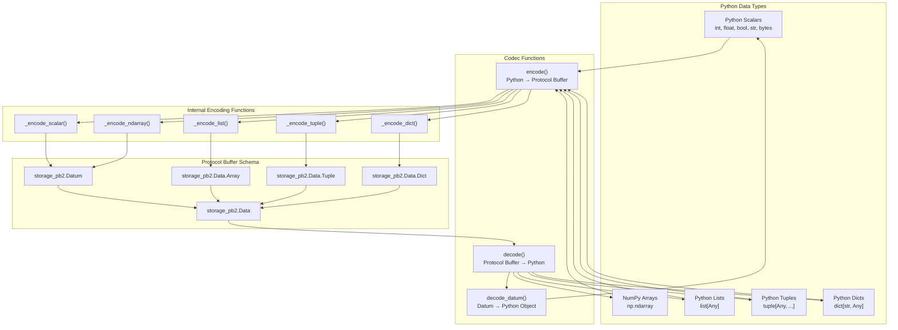
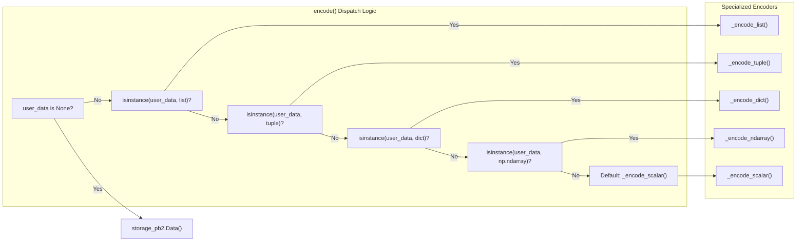
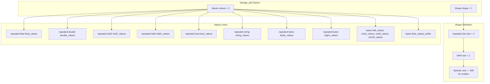
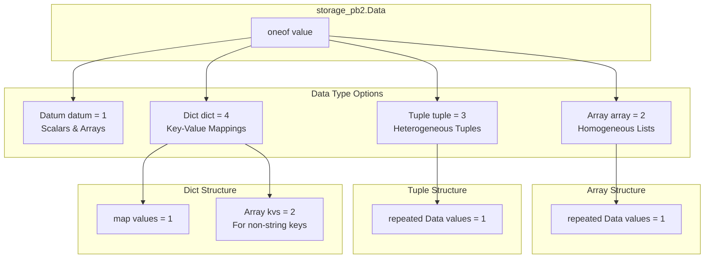
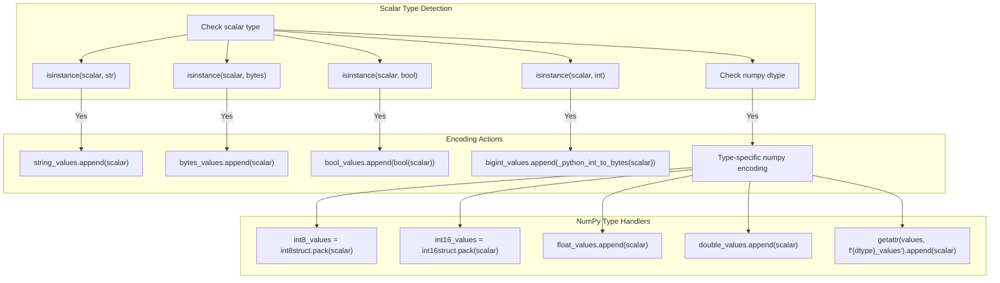
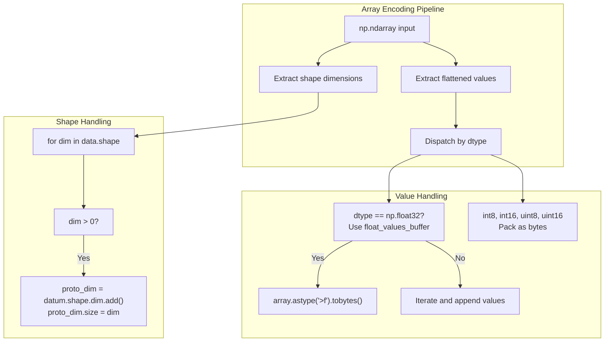
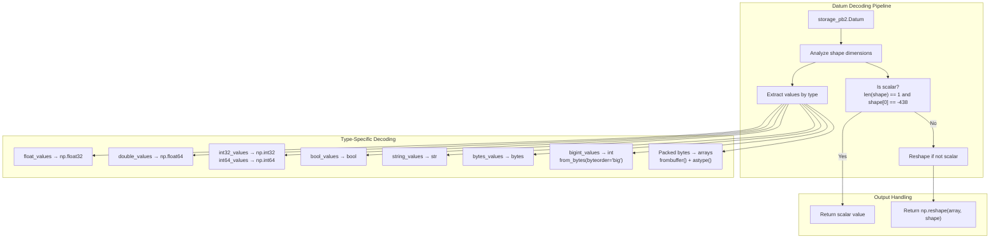
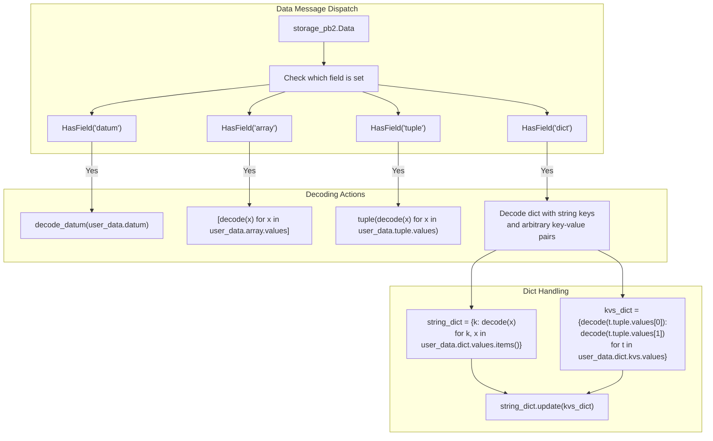

<!-- source: DeepWiki mcp.deepwiki.com · repo google-deepmind/envlogger · page 4.1 Python Codec System · fetched 2026-10-26 -->

# Python Codec System

<details>
<summary>Relevant source files</summary>

The following files were used as context for generating this wiki page:

- [envlogger/converters/codec.py](envlogger/converters/codec.py)
- [envlogger/converters/codec_test.py](envlogger/converters/codec_test.py)
- [envlogger/proto/storage.proto](envlogger/proto/storage.proto)

</details>


## Purpose and Scope

The Python Codec System provides serialization and deserialization capabilities for converting Python objects to and from protocol buffer format within the EnvLogger framework. This system enables efficient storage and transmission of environment trajectory data by transforming complex Python data structures (numpy arrays, lists, tuples, dictionaries) into the standardized `storage_pb2.Data` protocol buffer format.

For information about the C++ codec system for numerical arrays, see [C++ XTensor Codec](#4.2). For details about the RLDS data format conversion utilities, see [RLDS Data Format Utilities](#4.3).

## System Architecture

The codec system operates as a bidirectional converter between Python objects and protocol buffers, with specialized handling for different data types:



Sources: [envlogger/converters/codec.py:287-333](), [envlogger/converters/codec.py:407-465](), [envlogger/proto/storage.proto:104-145]()

## Core Functions

### Primary API Functions

| Function | Purpose | Input Type | Output Type |
|----------|---------|------------|-------------|
| `encode()` | Convert Python objects to protocol buffer | Python objects | `storage_pb2.Data` |
| `decode()` | Convert protocol buffer to Python objects | `storage_pb2.Data` | Python objects |
| `decode_datum()` | Decode single Datum protobuf | `storage_pb2.Datum` | Python scalar/array |

### Internal Encoding Functions

The `encode()` function dispatches to specialized internal functions based on input type:



Sources: [envlogger/converters/codec.py:320-332]()

## Data Type Support

### Supported Scalar Types

The codec system supports the following scalar types with their corresponding protocol buffer representations:

| Python Type | NumPy Type | Protocol Buffer Field | Notes |
|-------------|------------|----------------------|-------|
| `int` | N/A | `bigint_values` | Arbitrary precision |
| `float` | `np.float64` | `double_values` | 64-bit precision |
| `bool` | `np.bool_` | `bool_values` | Boolean values |
| `str` | `np.str_` | `string_values` | UTF-8 strings |
| `bytes` | `np.bytes_` | `bytes_values` | Raw bytes |
| N/A | `np.float32` | `float_values` | 32-bit precision |
| N/A | `np.int8` | `int8_values` | 8-bit signed |
| N/A | `np.int16` | `int16_values` | 16-bit signed |
| N/A | `np.int32` | `int32_values` | 32-bit signed |
| N/A | `np.int64` | `int64_values` | 64-bit signed |
| N/A | `np.uint8` | `uint8_values` | 8-bit unsigned |
| N/A | `np.uint16` | `uint16_values` | 16-bit unsigned |
| N/A | `np.uint32` | `uint32_values` | 32-bit unsigned |
| N/A | `np.uint64` | `uint64_values` | 64-bit unsigned |

Sources: [envlogger/converters/codec.py:25-38](), [envlogger/converters/codec.py:130-174]()

### Collection Types

The codec handles nested data structures:

- **Lists**: Homogeneous collections stored as `storage_pb2.Data.Array`
- **Tuples**: Heterogeneous collections stored as `storage_pb2.Data.Tuple`  
- **Dictionaries**: Key-value mappings stored as `storage_pb2.Data.Dict`
- **NumPy Arrays**: Multidimensional arrays stored as `storage_pb2.Datum`

Sources: [envlogger/converters/codec.py:218-258]()

## Protocol Buffer Schema Details

### Datum Structure

The `Datum` message represents multidimensional arrays with shape information preserved:



Sources: [envlogger/proto/storage.proto:19-102]()

### Data Container Structure

The `Data` message serves as a union type for different data structures:



Sources: [envlogger/proto/storage.proto:104-145]()

## Encoding Process

### Scalar Encoding

The `_set_datum_values_from_scalar()` function handles scalar value encoding with type-specific logic:



Sources: [envlogger/converters/codec.py:130-174]()

### Array Encoding

NumPy arrays are encoded with shape preservation and optimized value packing:



Sources: [envlogger/converters/codec.py:176-215](), [envlogger/converters/codec.py:261-275]()

## Decoding Process

### Datum Decoding

The `decode_datum()` function reverses the encoding process:



Sources: [envlogger/converters/codec.py:335-404]()

### Collection Decoding

The main `decode()` function handles different `Data` message types:



Sources: [envlogger/converters/codec.py:449-464]()

## Performance Considerations

### Efficient Array Storage

The codec system includes optimizations for numerical data:

1. **Packed Float32 Arrays**: Float32 values can be stored as packed bytes using `float_values_buffer` for better space efficiency
2. **Small Integer Types**: int8, int16, uint8, uint16 values are packed as bytes rather than using individual repeated fields
3. **Homogeneous Lists**: Lists are validated to contain elements of the same type to prevent runtime errors

### Memory Layout Preservation

The system preserves NumPy array memory layout and shape information:

- Shape dimensions are stored in order (outermost to innermost)
- Scalar values are distinguished from zero-dimensional arrays using a special dimension size (-438)
- Array values are flattened and can be efficiently reshaped on decode

Sources: [envlogger/converters/codec.py:63-68](), [envlogger/converters/codec.py:186-188](), [envlogger/converters/codec.py:205-213]()

## Error Handling

### Type Safety

The codec system enforces type safety through several mechanisms:

1. **Homogeneous Lists**: Lists must contain elements of the same type
2. **Unsupported Type Detection**: Raises `TypeError` for unsupported types like functions, classes, or sets
3. **Heterogeneous List Rejection**: Provides detailed error messages for mixed-type lists

### Validation Examples

Common error cases handled by the system:

```python
# These will raise TypeError:
codec.encode([np.int64(1), np.int32(2)])  # Mixed types in list
codec.encode(lambda x: x)  # Unsupported function type
codec.encode(set([1, 2, 3]))  # Unsupported set type
```

Sources: [envlogger/converters/codec.py:218-237](), [envlogger/converters/codec_test.py:1563-1574]()

---

