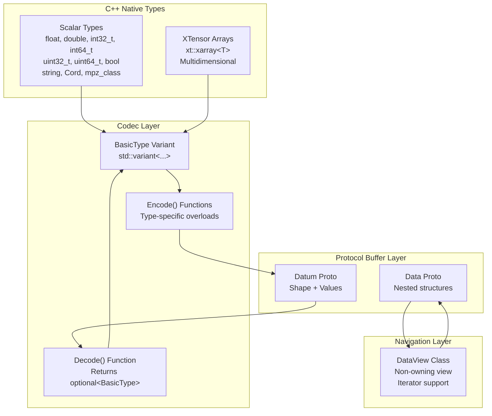
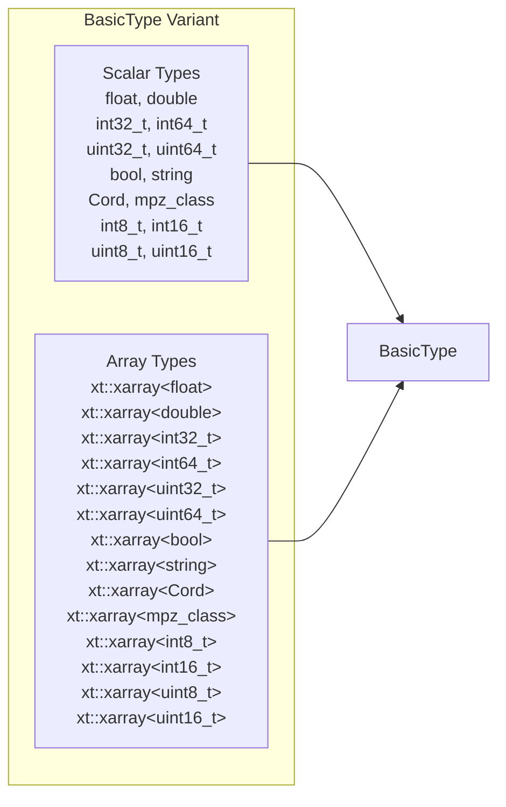
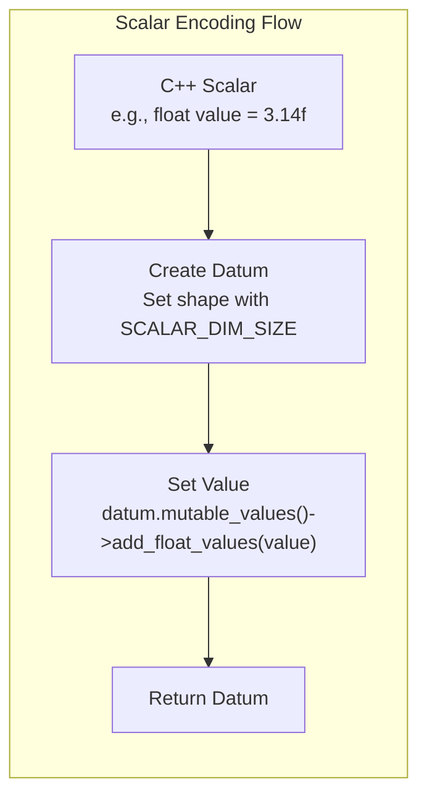
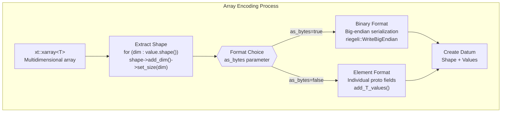
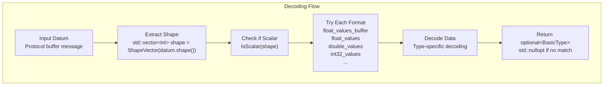
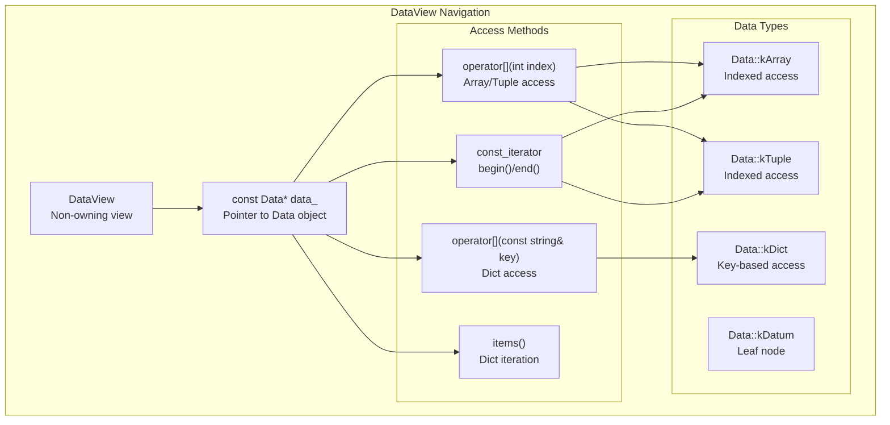
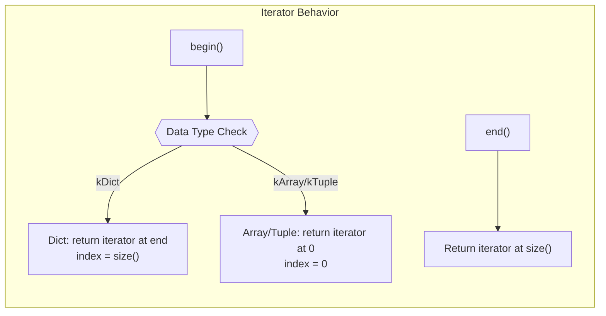
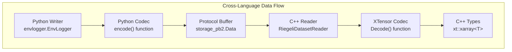
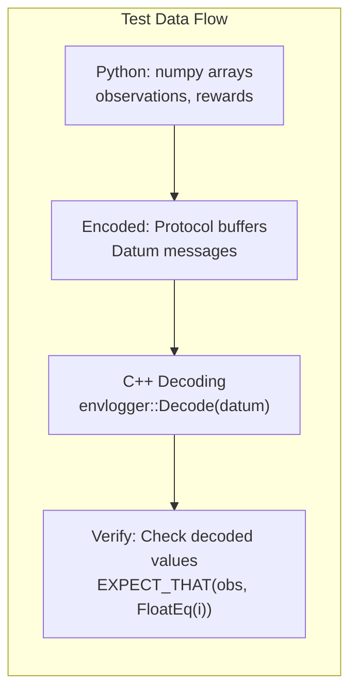

<!-- source: DeepWiki mcp.deepwiki.com · repo google-deepmind/envlogger · page 4.2 C++ XTensor Codec · fetched 2026-10-26 -->

# C++ XTensor Codec

Relevant source files

The following files were used as context for generating this wiki page:

- [envlogger/backends/cross_language_test/cc_reader.cc](envlogger/backends/cross_language_test/cc_reader.cc)
- [envlogger/backends/python/episode_info.cc](envlogger/backends/python/episode_info.cc)
- [envlogger/converters/xtensor_codec.cc](envlogger/converters/xtensor_codec.cc)
- [envlogger/converters/xtensor_codec.h](envlogger/converters/xtensor_codec.h)
- [envlogger/converters/xtensor_codec_test.cc](envlogger/converters/xtensor_codec_test.cc)

The C++ XTensor Codec provides efficient serialization and deserialization between C++ data types and protocol buffer `Datum` objects for the EnvLogger system. This codec enables high-performance numerical data handling using the XTensor library while maintaining compatibility with the broader EnvLogger ecosystem.

The codec specializes in handling both scalar values and multidimensional arrays (`xt::xarray`) with optimized serialization for numerical data. For general Python data serialization, see [Python Codec System](#4.1). For reinforcement learning dataset format conversion, see [RLDS Data Format Utilities](#4.3).

## Architecture Overview

The XTensor Codec operates as a bidirectional conversion system between C++ native types and the EnvLogger protocol buffer format. It provides type-safe encoding and decoding with support for arbitrary precision integers, efficient binary serialization, and cross-language compatibility.

Sources: [envlogger/converters/xtensor_codec.h:44-57](), [envlogger/converters/xtensor_codec.cc:232-618]()

## Type System

The codec uses the `BasicType` variant to represent all supported C++ types in a type-safe manner. This enables compile-time type checking while supporting runtime type dispatch.

### Supported Types

| Category | Types | Storage Format |
|----------|-------|----------------|
| Floating Point | `float`, `double` | Native protobuf fields or big-endian binary |
| Signed Integers | `int8_t`, `int16_t`, `int32_t`, `int64_t` | Big-endian binary or native fields |
| Unsigned Integers | `uint8_t`, `uint16_t`, `uint32_t`, `uint64_t` | Big-endian binary or native fields |
| Boolean | `bool` | Native protobuf field |
| Text | `std::string` | UTF-8 string |
| Binary | `absl::Cord` | Byte array |
| Arbitrary Precision | `mpz_class` | Custom binary format |
| Multidimensional Arrays | `xt::xarray<T>` | Shape metadata + flattened data |

### BasicType Variant Definition

Sources: [envlogger/converters/xtensor_codec.h:48-56]()

## Encoding System

The encoding system provides type-specific `Encode()` function overloads that convert C++ objects to `Datum` protocol buffer messages. Each type has optimized serialization strategies.

### Scalar Encoding

Scalars are encoded with a special dimension size marker (`SCALAR_DIM_SIZE = -438`) to distinguish them from single-element arrays.

Sources: [envlogger/converters/xtensor_codec.cc:237-312](), [envlogger/converters/xtensor_codec.cc:36-37]()

### Array Encoding

Arrays are encoded with shape metadata and data serialization. Float arrays support efficient binary serialization via the `as_bytes` parameter.

Sources: [envlogger/converters/xtensor_codec.cc:352-530](), [envlogger/converters/xtensor_codec.cc:482-502]()

## Decoding System

The decoding system converts `Datum` protocol buffer messages back to C++ types using the `Decode()` function, which returns an `optional<BasicType>`.

### Decoding Process

### Type-Specific Decoding

| Data Type | Decoding Function | Special Handling |
|-----------|-------------------|------------------|
| Binary Integers | `DecodeValuesBigEndian<T>()` | Big-endian byte order conversion |
| Arbitrary Precision | `ToMpzClass()` | Custom GMP conversion |
| Float Arrays | `FillXarrayValuesBigEndian<float>()` | Binary buffer or element-wise |
| String Arrays | `FillXarrayValues()` | UTF-8 string handling |
| Cord Arrays | `FillXarrayValuesCord()` | Binary data as Cord objects |

Sources: [envlogger/converters/xtensor_codec.cc:536-618](), [envlogger/converters/xtensor_codec.cc:148-228]()

## DataView Navigation System

The `DataView` class provides a non-owning view interface for navigating nested `Data` structures with iterator support and type-safe access patterns.

### DataView Architecture

### Iterator Implementation

The `DataView::const_iterator` provides STL-compatible iteration over arrays and tuples while excluding dictionaries from direct iteration.

Sources: [envlogger/converters/xtensor_codec.cc:624-698](), [envlogger/converters/xtensor_codec.h:104-172]()

## Cross-Language Integration

The XTensor Codec enables seamless data exchange between C++ and Python components through protocol buffer serialization and pybind11 bindings.

### Integration Flow

### Usage Example

The cross-language test demonstrates end-to-end compatibility:

Sources: [envlogger/backends/cross_language_test/cc_reader.cc:76-132](), [envlogger/backends/python/episode_info.cc:25-37]()

---

