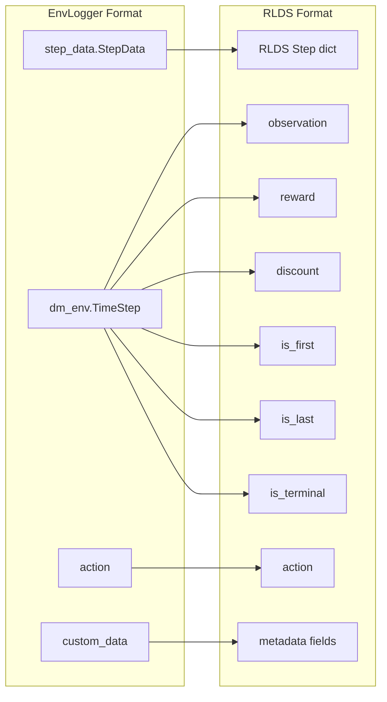
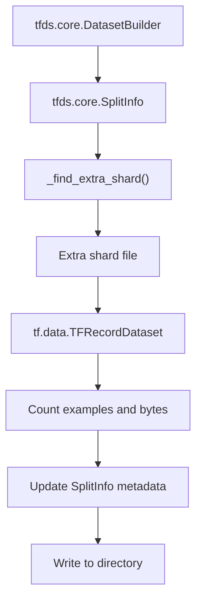
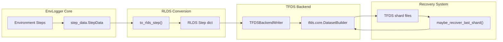

<!-- source: DeepWiki mcp.deepwiki.com · repo google-deepmind/envlogger · page 4.3 RLDS Data Format Utilities · fetched 2026-10-26 -->

# RLDS Data Format Utilities

<details>
<summary>Relevant source files</summary>

The following files were used as context for generating this wiki page:

- [envlogger/backends/rlds_utils.py](envlogger/backends/rlds_utils.py)
- [envlogger/backends/rlds_utils_test.py](envlogger/backends/rlds_utils_test.py)
- [envlogger/examples/tfds_random_agent_catch.py](envlogger/examples/tfds_random_agent_catch.py)
- [envlogger/requirements.txt](envlogger/requirements.txt)

</details>


## Purpose and Scope

The RLDS Data Format Utilities provide conversion and recovery functionality for transforming EnvLogger trajectory data into the RLDS (Reinforcement Learning Dataset) format. This system handles two primary concerns: converting EnvLogger's internal `StepData` format to RLDS-compliant step dictionaries, and recovering incomplete TFDS dataset shards that may result from interrupted logging sessions.

For information about the underlying storage systems that use these utilities, see [TFDS Backend](#3.1). For details about the EnvLogger step data format being converted, see [Core EnvLogger System](#2).

## RLDS Step Conversion System

The core conversion functionality transforms EnvLogger's `step_data.StepData` objects into RLDS-compliant step dictionaries through the `to_rlds_step()` function. This conversion bridges the gap between EnvLogger's internal representation and the standardized RLDS format used by machine learning pipelines.

### Step Data Transformation



Sources: [envlogger/backends/rlds_utils.py:29-66]()

The `to_rlds_step()` function accepts two `StepData` objects - the previous step and current step - and constructs an RLDS step dictionary containing:

| Field | Source | Description |
|-------|--------|-------------|
| `observation` | `prev_step.timestep.observation` | Environment observation from previous step |
| `action` | `step.action` | Action taken at current step |
| `reward` | `step.timestep.reward` | Reward received at current step |
| `discount` | `step.timestep.discount` | Discount factor for current step |
| `is_first` | `prev_step.timestep.first()` | Boolean indicating episode start |
| `is_last` | `prev_step.timestep.last()` | Boolean indicating episode end |
| `is_terminal` | `prev_step.timestep.last() && discount == 0.0` | Boolean indicating terminal state |

### Handling Terminal Steps

When processing the final step of an episode (`step` parameter is `None`), the function creates zero-valued placeholders for undefined fields using `tf.nest.map_structure(np.zeros_like, ...)`. This ensures consistent data shapes while marking the step as terminal.

Sources: [envlogger/backends/rlds_utils.py:49-64]()

### Custom Metadata Integration

The conversion system extracts custom metadata from `StepData.custom_data` when it's a dictionary, flattening these fields into the RLDS step dictionary alongside standard fields.

Sources: [envlogger/backends/rlds_utils.py:44-46](), [envlogger/backends/rlds_utils_test.py:134-162]()

## Shard Recovery System

The shard recovery system addresses incomplete TFDS datasets that may result from interrupted logging sessions. The `maybe_recover_last_shard()` function reconstructs missing metadata for untracked shards.

### Recovery Process Flow



Sources: [envlogger/backends/rlds_utils.py:82-123]()

### Shard Detection Algorithm

The `_find_extra_shard()` function identifies untracked shards by:

1. Checking if the dataset has a valid `filename_template`
2. Constructing the expected filepath for the next shard index
3. Verifying file existence using `tf.io.gfile.exists()`

Sources: [envlogger/backends/rlds_utils.py:69-79]()

### Metadata Reconstruction

When an extra shard is found, the recovery process:

1. Reads the entire shard using `tf.data.TFRecordDataset`
2. Counts examples and calculates total bytes
3. Updates the `SplitInfo` with new shard lengths and byte counts
4. Writes the corrected metadata back to the dataset directory

The system assumes only the last shard can be incomplete, based on EnvLogger's sequential shard generation pattern.

Sources: [envlogger/backends/rlds_utils.py:107-123]()

## Integration with TFDS Backend

The RLDS utilities integrate tightly with the TFDS backend system, providing the data format conversion layer that enables EnvLogger trajectories to be stored as TFDS datasets.

### Data Flow Architecture



Sources: [envlogger/backends/rlds_utils.py:1-124](), [envlogger/examples/tfds_random_agent_catch.py:49-67]()

## Usage Patterns

### Basic Step Conversion

```python
# Convert EnvLogger steps to RLDS format
rlds_step = rlds_utils.to_rlds_step(prev_step, current_step)

# Handle terminal step (no current step)
terminal_step = rlds_utils.to_rlds_step(last_step, None)
```

### Dataset Recovery

```python
# Recover incomplete TFDS dataset
builder = tfds.builder_from_directory(data_dir)
recovered_builder = rlds_utils.maybe_recover_last_shard(builder)
```

Sources: [envlogger/backends/rlds_utils_test.py:29-55](), [envlogger/backends/rlds_utils_test.py:184-186]()

The RLDS utilities serve as a critical bridge between EnvLogger's internal data representation and the standardized RLDS format, enabling seamless integration with TensorFlow Datasets and downstream machine learning workflows.

---

