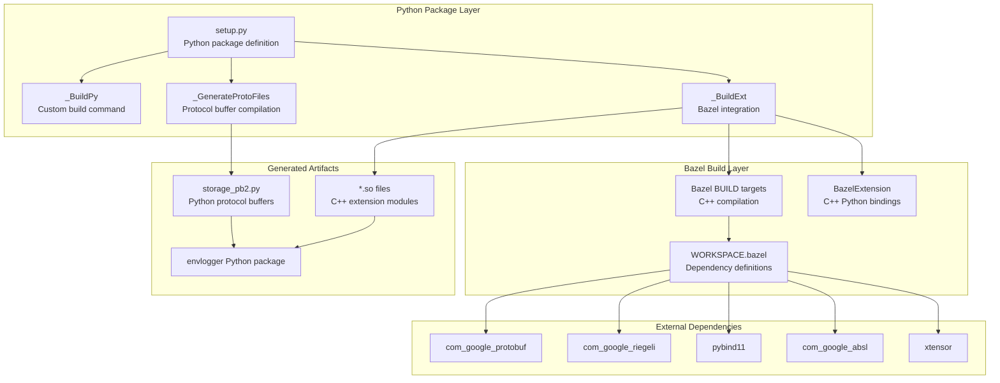
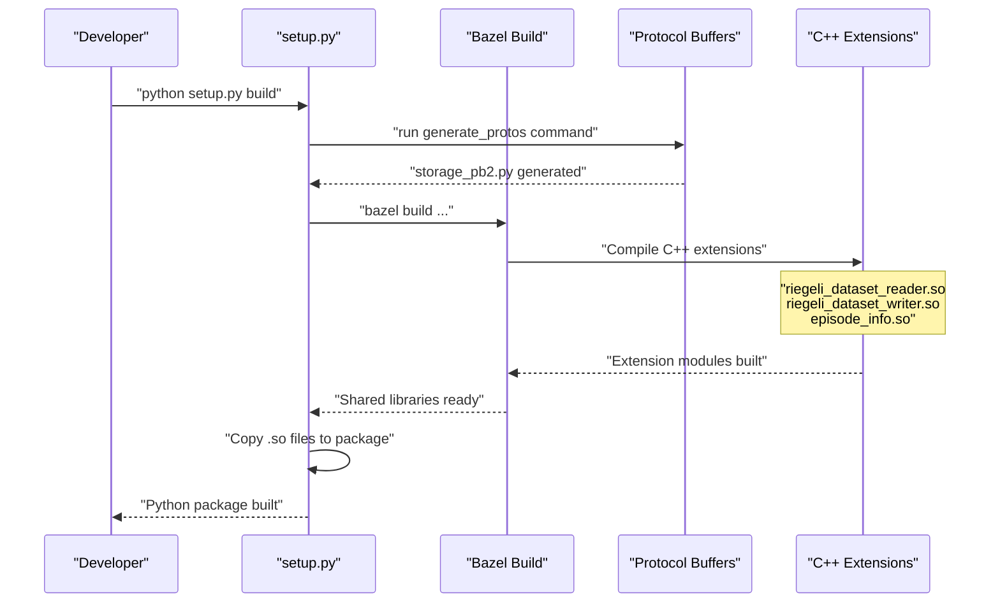
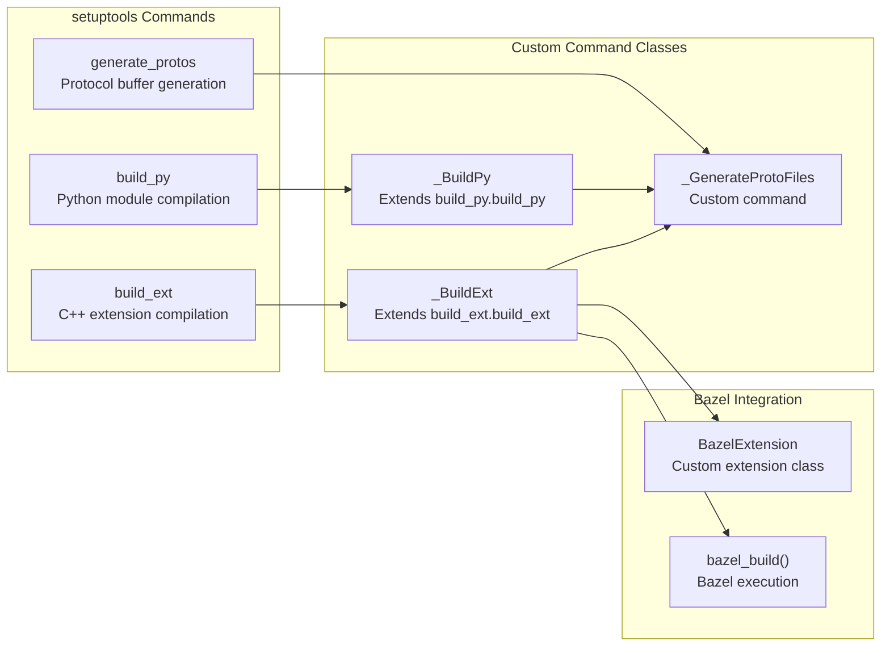
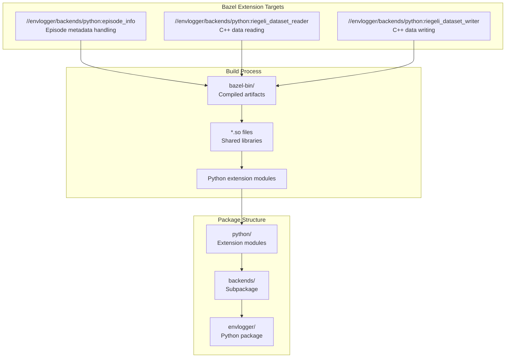
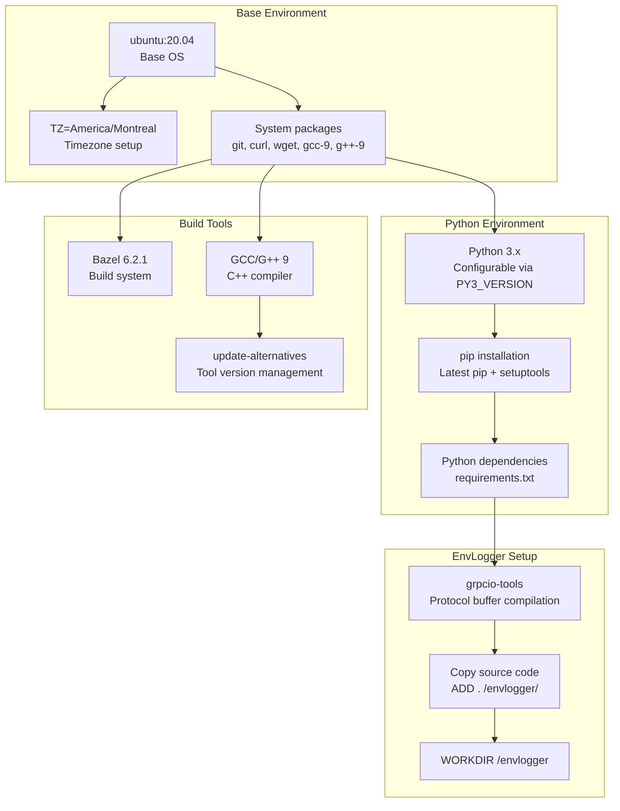

<!-- source: DeepWiki mcp.deepwiki.com · repo google-deepmind/envlogger · page 5 Build System and Development Setup · fetched 2026-10-26 -->

# Build System and Development Setup

<details>
<summary>Relevant source files</summary>

The following files were used as context for generating this wiki page:

- [WORKSPACE.bazel](WORKSPACE.bazel)
- [docker/Dockerfile](docker/Dockerfile)
- [envlogger/setup.py](envlogger/setup.py)

</details>


This document covers the build system architecture and development setup for EnvLogger, including both Python and C++ components. EnvLogger uses a hybrid build system combining Bazel for C++ compilation and native Python packaging with setuptools for distribution.

For detailed information about the Python package build process specifically, see [Python Package Build](#5.1). For Bazel workspace configuration details, see [Bazel Build Configuration](#5.2).

## Build System Architecture

EnvLogger employs a multi-layered build system that coordinates between Bazel (for C++ components) and Python setuptools (for package distribution). The system must handle cross-language compilation, protocol buffer generation, and complex dependency management.

### Build System Components



Sources: [envlogger/setup.py:1-175](), [WORKSPACE.bazel:1-215]()

### Build Process Flow

The build process follows a specific sequence that ensures proper dependency resolution and artifact generation:



Sources: [envlogger/setup.py:94-137]()

## Bazel Workspace Configuration

The `WORKSPACE.bazel` file defines the complete dependency graph for the project, including external libraries and build rules.

### Key External Dependencies

| Dependency | Purpose | Version/Commit |
|------------|---------|----------------|
| `com_google_protobuf` | Protocol buffer support | 3.21.9 |
| `com_google_riegeli` | High-performance data storage | b2210b97... |
| `com_google_absl` | Abseil C++ libraries | 20220623.1 |
| `pybind11` | Python-C++ bindings | 2.10.4 |
| `xtensor` | C++ tensor library | 54dbb822... |
| `com_google_googletest` | C++ testing framework | 1.12.1 |

Sources: [WORKSPACE.bazel:18-214]()

### Dependency Resolution Strategy

```mermaid
graph TD
    subgraph "Core Dependencies"
        protobuf["com_google_protobuf<br/>Protocol buffer compiler"]
        absl["com_google_absl<br/>Abseil C++ libraries"]
        gtest["com_google_googletest<br/>Testing framework"]
    end
    
    subgraph "Data Processing Dependencies"
        riegeli["com_google_riegeli<br/>Storage engine"]
        xtensor["xtensor<br/>Tensor operations"]
        xtl["xtl<br/>Tensor library support"]
    end
    
    subgraph "Compression Dependencies"
        zstd["net_zstd<br/>Zstandard compression"]
        brotli["org_brotli<br/>Brotli compression"]
        snappy["snappy<br/>Snappy compression"]
        zlib["zlib<br/>Zlib compression"]
    end
    
    subgraph "Python Integration"
        pybind11_rules["pybind11_bazel<br/>Build rules"]
        pybind11_lib["pybind11<br/>Binding library"]
        pybind11_proto["pybind11_protobuf<br/>Protocol buffer bindings"]
    end
    
    riegeli --> zstd
    riegeli --> brotli
    riegeli --> snappy
    riegeli --> zlib
    
    xtensor --> xtl
    
    pybind11_rules --> pybind11_lib
    pybind11_proto --> pybind11_lib
    pybind11_proto --> protobuf
    
    riegeli --> absl
    riegeli --> protobuf
```



Sources: [WORKSPACE.bazel:83-207]()

## Python Package Build System

The `setup.py` script implements a custom build system that integrates Bazel compilation with Python packaging.

### Custom Build Commands

The setup system defines several custom commands that extend the standard setuptools build process:



Sources: [envlogger/setup.py:38-137]()

### Bazel Extension Compilation

The system compiles three main C++ extensions as Bazel targets:



Sources: [envlogger/setup.py:145-149](), [envlogger/setup.py:115-136]()

## Docker Development Environment

The project provides a containerized development environment for consistent builds across different platforms.

### Docker Build Configuration



Sources: [docker/Dockerfile:1-54]()

### Development Workflow

The Docker environment supports the complete development workflow:

1. **Environment Setup**: Creates a consistent Ubuntu 20.04 environment with all required dependencies
2. **Python Configuration**: Supports multiple Python versions (3.x) with configurable `PY3_VERSION`
3. **Build Tool Installation**: Installs Bazel 6.2.1 and configures GCC/G++ 9 as the default compilers
4. **Dependency Management**: Installs Python requirements and gRPC tools for protocol buffer compilation

## Development Setup Instructions

### Prerequisites

- **Operating System**: Ubuntu 20.04+ (or use Docker)
- **Python**: 3.8+ (3.10+ recommended)
- **Bazel**: 6.2.1+
- **Compiler**: GCC/G++ 9+
- **Dependencies**: `libgmp-dev` for mathematical operations

### Local Development Setup

1. **Install System Dependencies**:
   ```bash
   sudo apt install -y gcc-9 g++-9 libgmp-dev python3.10-dev
   ```

2. **Install Bazel**:
   ```bash
   wget https://github.com/bazelbuild/bazel/releases/download/6.2.1/bazel-6.2.1-linux-x86_64
   chmod +x bazel-6.2.1-linux-x86_64
   sudo mv bazel-6.2.1-linux-x86_64 /usr/bin/bazel
   ```

3. **Build the Package**:
   ```bash
   cd envlogger
   python setup.py build
   ```

### Docker Development Setup

1. **Build Docker Image**:
   ```bash
   docker build -t envlogger-dev -f docker/Dockerfile .
   ```

2. **Run Development Container**:
   ```bash
   docker run -it -v $(pwd):/envlogger envlogger-dev
   ```

Sources: [docker/Dockerfile:19-53](), [envlogger/setup.py:104-113]()

---

