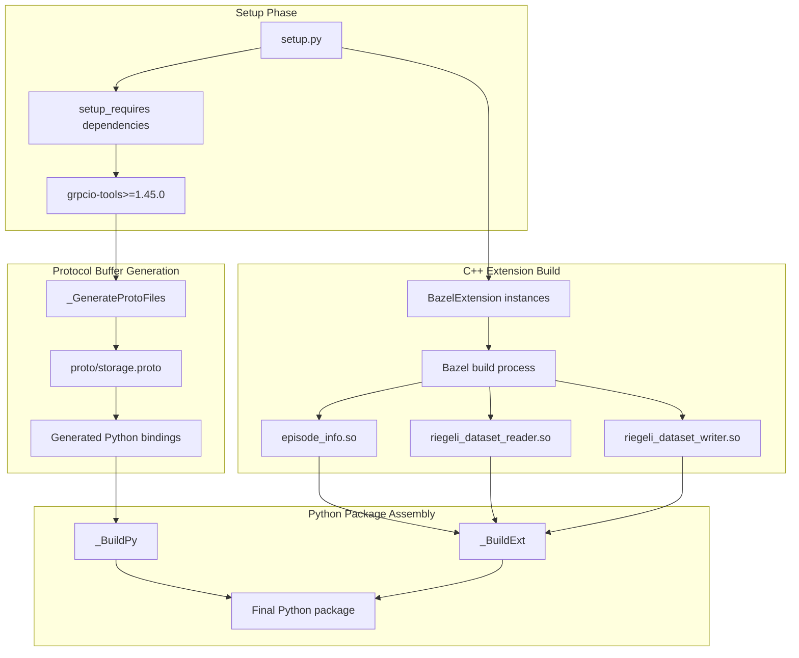
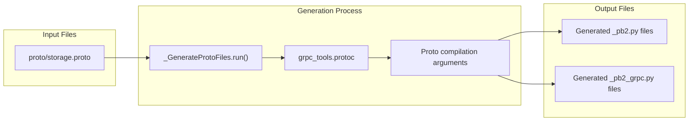
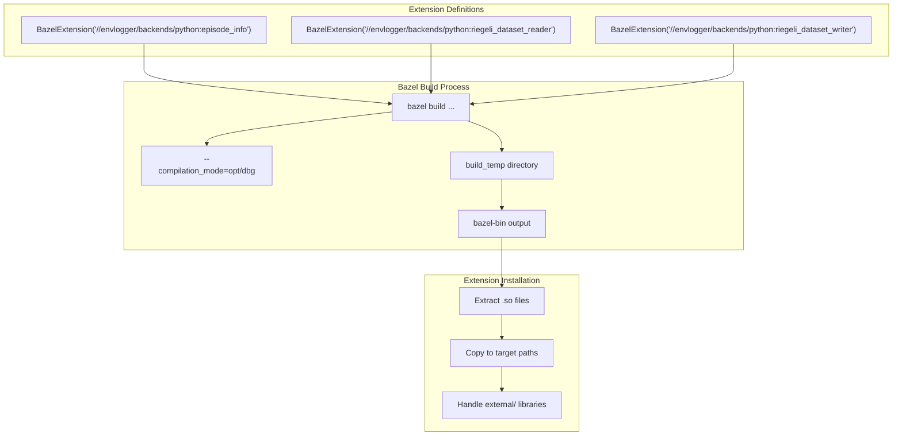
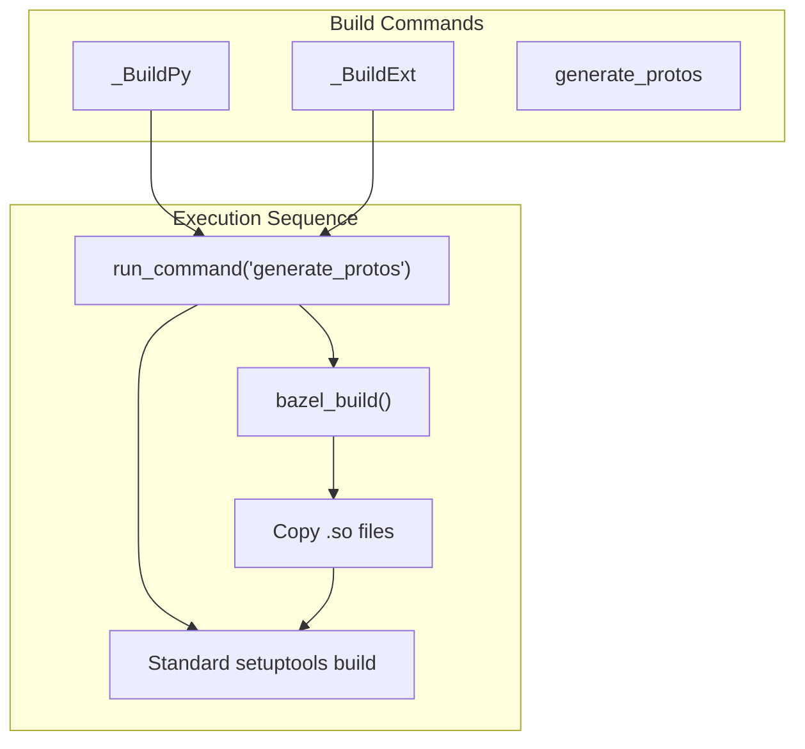
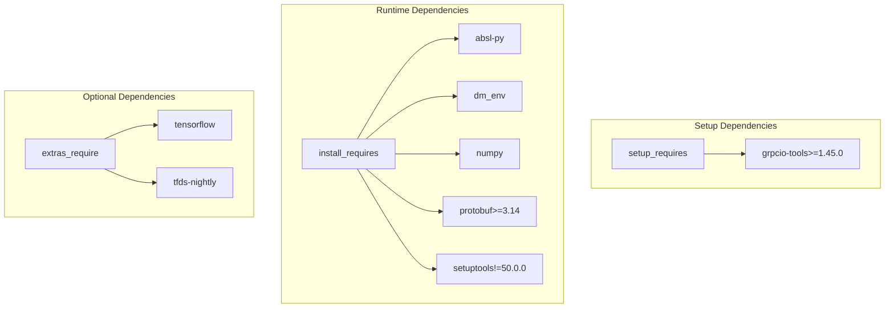
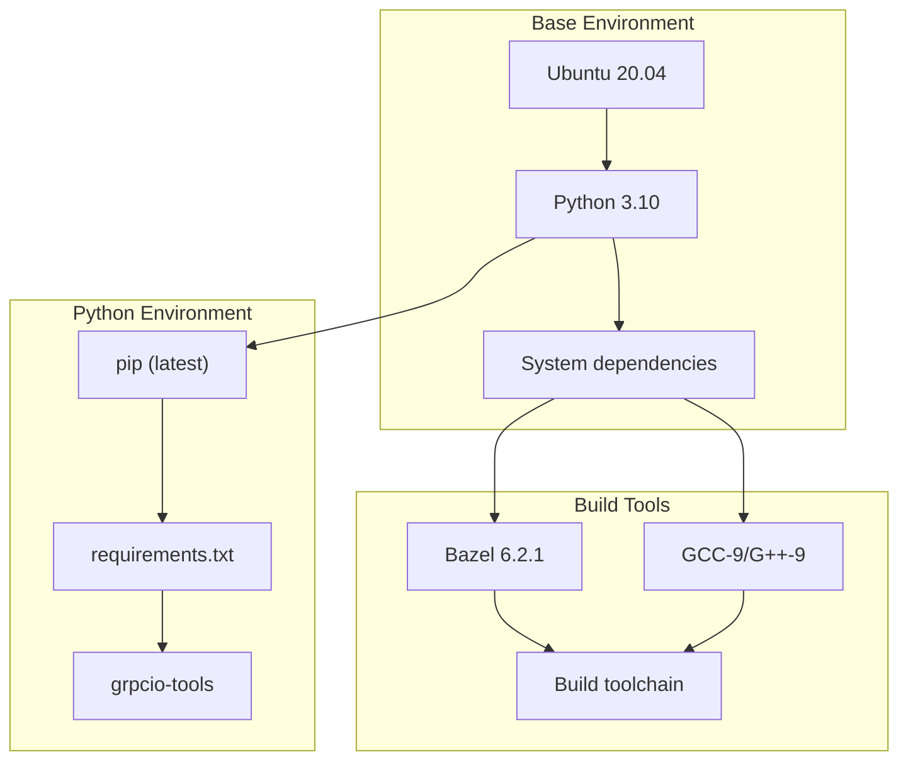

<!-- source: DeepWiki mcp.deepwiki.com · repo google-deepmind/envlogger · page 5.1 Python Package Build · fetched 2026-10-26 -->

# Python Package Build

<details>
<summary>Relevant source files</summary>

The following files were used as context for generating this wiki page:

- [docker/Dockerfile](docker/Dockerfile)
- [envlogger/setup.py](envlogger/setup.py)

</details>


## Purpose and Scope

This document explains the Python package build process for EnvLogger, focusing on the setuptools configuration and C++ extension compilation pipeline. The build system integrates protocol buffer generation, Bazel-based C++ compilation, and Python packaging into a unified process.

For information about the Bazel workspace configuration and external dependencies, see [Bazel Build Configuration](#5.2).

## Build Process Overview

The EnvLogger Python package build follows a multi-stage process that combines protocol buffer generation, C++ extension compilation via Bazel, and standard Python packaging.

### Build Pipeline Architecture



Sources: [envlogger/setup.py:1-174]()

## Protocol Buffer Generation

The build process begins with generating Python bindings for protocol buffer definitions. This is handled by the `_GenerateProtoFiles` command class.

### Protocol Buffer Build Process



The protocol buffer generation process is configured in the `_GenerateProtoFiles` class:

| Component | Description | File Reference |
|-----------|-------------|----------------|
| `_ENVLOGGER_PROTOS` | List of proto files to compile | [envlogger/setup.py:33-35]() |
| `grpc_tools.protoc` | Protocol buffer compiler | [envlogger/setup.py:53-68]() |
| Proto arguments | Compilation flags and paths | [envlogger/setup.py:59-66]() |

Sources: [envlogger/setup.py:38-69]()

## C++ Extension Compilation

The build system compiles three C++ extensions using Bazel through the custom `BazelExtension` class and `_BuildExt` command.

### Bazel Extension Architecture



### C++ Extension Configuration

The extensions are defined using `BazelExtension` instances that map to specific Bazel targets:

| Extension | Bazel Target | Purpose |
|-----------|-------------|---------|
| `episode_info` | `//envlogger/backends/python:episode_info` | Episode metadata handling |
| `riegeli_dataset_reader` | `//envlogger/backends/python:riegeli_dataset_reader` | Riegeli dataset reading |
| `riegeli_dataset_writer` | `//envlogger/backends/python:riegeli_dataset_writer` | Riegeli dataset writing |

The `BazelExtension` class parses Bazel target paths and creates appropriate extension names for setuptools:

```python
# Target parsing logic
self.relpath, self.target_name = (
    posixpath.relpath(bazel_target, '//').split(':'))
ext_name = os.path.join(
    self.relpath.replace(posixpath.sep, os.path.sep), self.target_name)
```

Sources: [envlogger/setup.py:79-89](), [envlogger/setup.py:145-149]()

## Build Commands and Execution

The build process uses custom setuptools commands that coordinate protocol buffer generation and C++ extension compilation.

### Build Command Flow



### Build Configuration Parameters

The `_BuildExt` class configures the Bazel build process with specific parameters:

| Parameter | Description | Implementation |
|-----------|-------------|----------------|
| `--symlink_prefix` | Bazel output directory | [envlogger/setup.py:108]() |
| `--compilation_mode` | Debug or optimized build | [envlogger/setup.py:109]() |
| `--verbose_failures` | Detailed error reporting | [envlogger/setup.py:110]() |

The build process handles special cases for external dependencies by copying libraries from the `external/` directory to appropriate locations in the package structure.

Sources: [envlogger/setup.py:91-137]()

## Dependencies and Installation

The package defines multiple dependency categories to support different use cases and build requirements.

### Dependency Configuration



### Package Configuration

The main package configuration includes:

| Setting | Value | Purpose |
|---------|-------|---------|
| `name` | `envlogger` | Package name |
| `version` | `1.2` | Package version |
| `description` | `EnvLogger: A tool for recording trajectories.` | Package description |
| `license` | `Apache 2.0` | License type |

Sources: [envlogger/setup.py:139-174]()

## Docker Build Environment

The project includes a Docker configuration that sets up the complete build environment with all necessary dependencies.

### Docker Build Components



The Docker configuration includes specific version constraints and environment setup:

- **Python Version**: Configurable via `PY3_VERSION` build arg (default: 3.10)
- **Bazel Version**: Fixed at 6.2.1
- **Compiler**: GCC-9/G++-9 for C++ compilation
- **Dependencies**: Installed from `requirements.txt` plus `grpcio-tools`

Sources: [docker/Dockerfile:1-54]()

---

