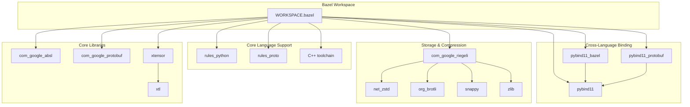
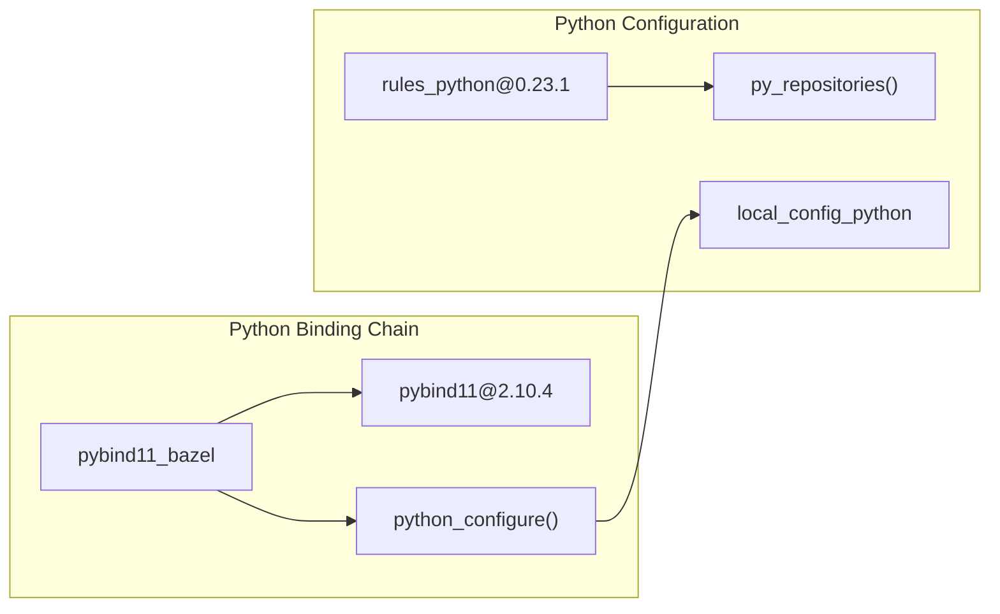
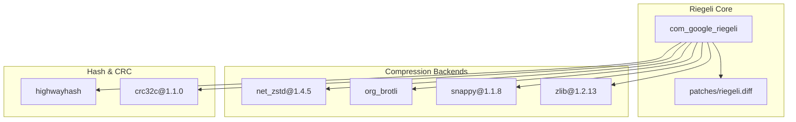
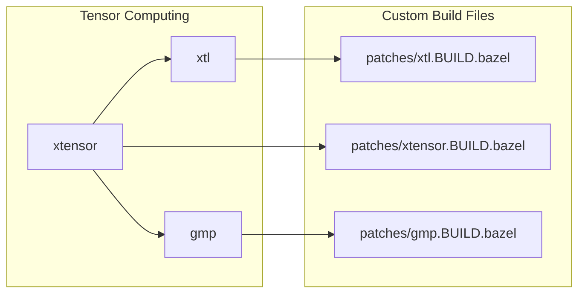
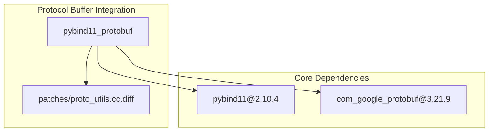
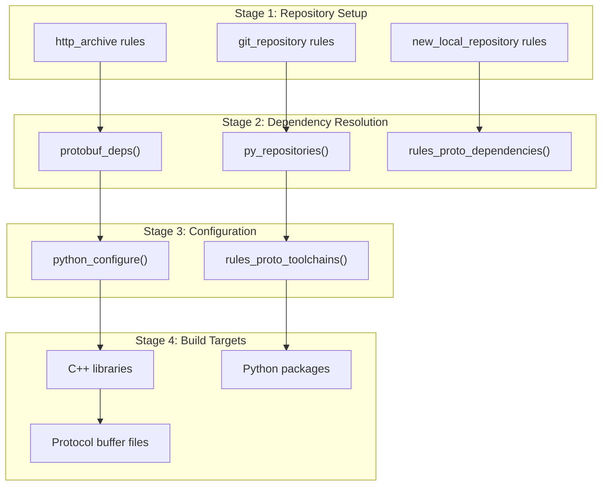

<!-- source: DeepWiki mcp.deepwiki.com · repo google-deepmind/envlogger · page 5.2 Bazel Build Configuration · fetched 2026-10-26 -->

# Bazel Build Configuration

Relevant source files

The following files were used as context for generating this wiki page:

- [WORKSPACE.bazel](WORKSPACE.bazel)

This document describes the Bazel workspace configuration for the EnvLogger repository, including external dependencies, build rules, and cross-language integration setup. The configuration enables building both Python and C++ components with proper dependency management and cross-compilation support.

For information about the Python package build process, see [Python Package Build](#5.1). For details about testing and integration, see [Testing and Cross-Language Integration](#6).

## Overview

The EnvLogger project uses Bazel as its primary build system to manage complex dependencies across multiple languages (Python, C++, and Protocol Buffers). The workspace configuration is defined in `WORKSPACE.bazel` and orchestrates the integration of numerous external libraries required for high-performance data logging and storage.

**Sources:** [WORKSPACE.bazel:1-215]()

## Core Build Rules and Language Support

The workspace establishes foundational build rules for multi-language development:

### Python Integration

The `rules_python` configuration enables Python package building and cross-language bindings:

**Sources:** [WORKSPACE.bazel:44-54](), [WORKSPACE.bazel:184-199]()

### Protocol Buffer Support

Protocol Buffers provide the serialization backbone for cross-language data exchange:

| Component | Version | Purpose |
|-----------|---------|---------|
| `com_google_protobuf` | 3.21.9 | Core protocol buffer library |
| `rules_proto` | 97d8af4dc474... | Bazel build rules for protobuf |
| `six_archive` | 1.10.0 | Python 2/3 compatibility for protobuf |

**Sources:** [WORKSPACE.bazel:26-42](), [WORKSPACE.bazel:56-71]()

## High-Performance Storage Dependencies

The EnvLogger system depends on several compression and storage libraries, primarily centered around the Riegeli storage format:

### Riegeli Storage System

The Riegeli configuration includes custom patches to integrate with the EnvLogger build system. Each compression library is configured with specific versions to ensure compatibility:

- **Zstd**: High-performance compression for large datasets
- **Brotli**: Web-optimized compression algorithm
- **Snappy**: Fast compression/decompression for real-time operations
- **Zlib**: Standard compression library

**Sources:** [WORKSPACE.bazel:83-143]()

## Scientific Computing Dependencies

The C++ components rely on high-performance numerical computing libraries:

### XTensor Ecosystem

The XTensor configuration enables efficient C++ array operations with custom build files to integrate with the Bazel ecosystem.

**Sources:** [WORKSPACE.bazel:144-166]()

## Development and Testing Infrastructure

### Testing Framework

The workspace includes comprehensive testing support:

| Component | Version | Purpose |
|-----------|---------|---------|
| `com_google_googletest` | 1.12.1 | Unit testing framework |
| `com_google_benchmark` | 1.5.5 | Performance benchmarking |
| `com_github_gflags_gflags` | 2.2.2 | Command-line flag parsing |
| `com_github_google_glog` | 0.5.0 | Logging infrastructure |

**Sources:** [WORKSPACE.bazel:73-81](), [WORKSPACE.bazel:169-181](), [WORKSPACE.bazel:209-214]()

### Cross-Language Protocol Buffer Integration

The `pybind11_protobuf` integration enables seamless protocol buffer handling between Python and C++:

**Sources:** [WORKSPACE.bazel:201-207]()

## Build Process Flow

The Bazel configuration establishes a multi-stage build process:

**Sources:** [WORKSPACE.bazel:15-16](), [WORKSPACE.bazel:33-35](), [WORKSPACE.bazel:52-54](), [WORKSPACE.bazel:67-71](), [WORKSPACE.bazel:197-199]()

## Patches and Customizations

The build system includes several patches to adapt external dependencies:

| Patch File | Target | Purpose |
|------------|--------|---------|
| `patches/riegeli.diff` | Riegeli | Integration customizations |
| `patches/proto_utils.cc.diff` | pybind11_protobuf | Protocol buffer binding fixes |
| `patches/highwayhash.BUILD.bazel` | HighwayHash | Custom build rules |
| `patches/net_zstd.BUILD.bazel` | Zstd | Custom build configuration |
| `patches/snappy.BUILD.bazel` | Snappy | Custom build rules |
| `patches/crc32.BUILD.bazel` | CRC32C | Custom build configuration |
| `patches/zlib.BUILD.bazel` | Zlib | Custom build rules |
| `patches/xtl.BUILD.bazel` | XTL | Custom build configuration |
| `patches/xtensor.BUILD.bazel` | XTensor | Custom build rules |
| `patches/gmp.BUILD.bazel` | GMP | Custom build configuration |

These patches ensure proper integration with the EnvLogger build environment and resolve compatibility issues between different dependency versions.

**Sources:** [WORKSPACE.bazel:87](), [WORKSPACE.bazel:96](), [WORKSPACE.bazel:104](), [WORKSPACE.bazel:119](), [WORKSPACE.bazel:127](), [WORKSPACE.bazel:138](), [WORKSPACE.bazel:147](), [WORKSPACE.bazel:155](), [WORKSPACE.bazel:164](), [WORKSPACE.bazel:204-205]()

---

