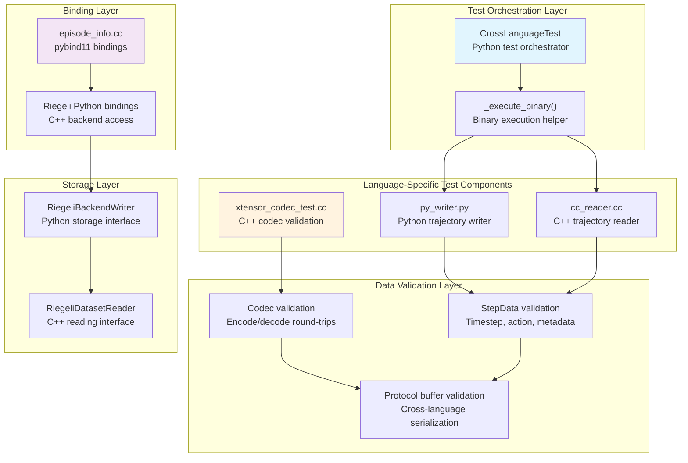
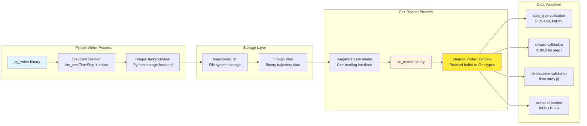
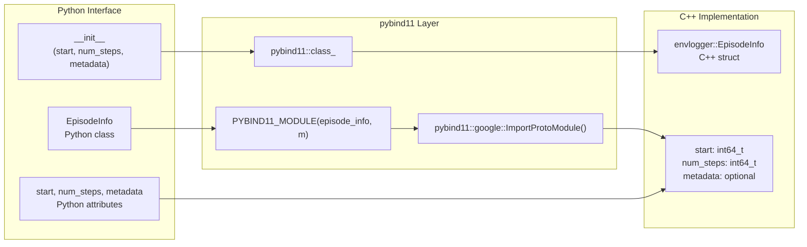
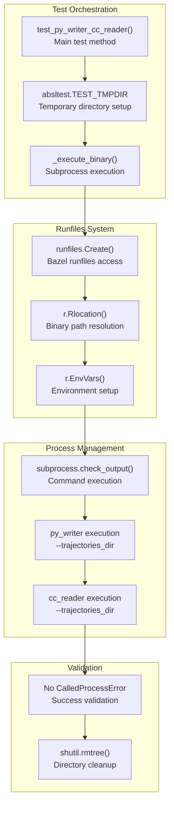

<!-- source: DeepWiki mcp.deepwiki.com · repo google-deepmind/envlogger · page 6 Testing and Cross-Language Integration · fetched 2026-10-26 -->

# Testing and Cross-Language Integration

<details>
<summary>Relevant source files</summary>

The following files were used as context for generating this wiki page:

- [envlogger/backends/cross_language_test/cc_reader.cc](envlogger/backends/cross_language_test/cc_reader.cc)
- [envlogger/backends/cross_language_test/cross_language_test.py](envlogger/backends/cross_language_test/cross_language_test.py)
- [envlogger/backends/cross_language_test/py_writer.py](envlogger/backends/cross_language_test/py_writer.py)
- [envlogger/backends/python/episode_info.cc](envlogger/backends/python/episode_info.cc)
- [envlogger/converters/xtensor_codec_test.cc](envlogger/converters/xtensor_codec_test.cc)

</details>


This document covers the testing infrastructure and cross-language integration systems that ensure data compatibility between Python and C++ components in EnvLogger. The testing framework validates that data written by Python components can be correctly read by C++ components, and vice versa, ensuring seamless interoperability across language boundaries.

For information about the build system that enables cross-language compilation, see [Build System and Development Setup](#5). For details about the data conversion mechanisms being tested, see [Data Conversion and Serialization](#4).

## Testing Architecture Overview

The testing infrastructure consists of multiple layers that validate different aspects of cross-language integration:



**Sources:** [envlogger/backends/cross_language_test/cross_language_test.py:1-66](), [envlogger/backends/cross_language_test/cc_reader.cc:1-137](), [envlogger/backends/cross_language_test/py_writer.py:1-64]()

## Cross-Language Integration Testing

The cross-language testing system validates data compatibility by writing trajectories in one language and reading them in another. The primary test case validates Python-to-C++ data flow:



The test validates specific data patterns to ensure serialization fidelity:

| Data Field | Python Type | C++ Type | Validation Logic |
|------------|-------------|----------|------------------|
| `step_type` | `dm_env.StepType` | `mpz_class` | FIRST=0, MID=1 |
| `reward` | `float` | `double` | `i/100.0` for step `i` |
| `observation` | `np.array[float32]` | `xt::xarray<float>` | Single element `[i]` |
| `action` | `np.int32` | `int` | `100-i` for step `i` |
| `discount` | `float` | `double` | Fixed value `0.99` |

**Sources:** [envlogger/backends/cross_language_test/py_writer.py:38-59](), [envlogger/backends/cross_language_test/cc_reader.cc:75-131]()

## XTensor Codec Testing

The `xtensor_codec_test.cc` provides comprehensive validation of the C++ codec system that handles serialization between C++ types and protocol buffers:

### Scalar Type Testing

The codec testing validates round-trip serialization for all supported scalar types:

```mermaid
graph TD
    subgraph "Scalar Type Tests"
        Float32Test["Float32Identity<br/>3.14f → Encode → Decode"]
        DoubleTest["DoubleIdentity<br/>3.14159265358979 → round-trip"]
        Int32Test["Int32Identity<br/>321 → protocol buffer"]
        Int64Test["Int64Identity<br/>123456789012 → validation"]
        UInt32Test["Uint32Identity<br/>4294967295 → max value"]
        UInt64Test["Uint64Identity<br/>9223372036854775807 → max value"]
        BoolTest["BoolIdentity<br/>true → bool_values field"]
        StringTest["StringIdentity<br/>\"pi\" → string_values field"]
        BytesTest["BytesIdentity<br/>absl::Cord → bytes_values field"]
        BigIntTest["BigIntIdentity<br/>mpz_class → bigint_values field"]
        Int8Test["Int8Identity<br/>-123 → int8_values field"]
        Int16Test["Int16Identity<br/>-1234 → int16_values field"]
        UInt8Test["Uint8Identity<br/>255 → uint8_values field"]
        UInt16Test["Uint16Identity<br/>12345 → uint16_values field"]
    end
    
    subgraph "Protocol Buffer Fields"
        FloatValues["float_values"]
        DoubleValues["double_values"]
        IntValues["int32_values, int64_values"]
        UIntValues["uint32_values, uint64_values"]
        BoolValues["bool_values"]
        StringValues["string_values"]
        BytesValues["bytes_values"]
        BigIntValues["bigint_values"]
        SmallIntValues["int8_values, int16_values<br/>uint8_values, uint16_values"]
    end
    
    Float32Test --> FloatValues
    DoubleTest --> DoubleValues
    Int32Test --> IntValues
    Int64Test --> IntValues
    UInt32Test --> UIntValues
    UInt64Test --> UIntValues
    BoolTest --> BoolValues
    StringTest --> StringValues
    BytesTest --> BytesValues
    BigIntTest --> BigIntValues
    Int8Test --> SmallIntValues
    Int16Test --> SmallIntValues
    UInt8Test --> SmallIntValues
    UInt16Test --> SmallIntValues
```

**Sources:** [envlogger/converters/xtensor_codec_test.cc:71-519]()

### Array Type Testing

The codec also validates `xt::xarray` serialization for multi-dimensional data:

| Array Type | Test Pattern | Protocol Buffer Field |
|------------|--------------|----------------------|
| `xt::xarray<float>` | `{1.23f}` | `float_values` |
| `xt::xarray<double>` | `{3.14159265358979}` | `double_values` |
| `xt::xarray<int32_t>` | `{123}` | `int32_values` |
| `xt::xarray<int64_t>` | `{123456789123}` | `int64_values` |
| `xt::xarray<bool>` | `{true}` | `bool_values` |
| `xt::xarray<std::string>` | `{"awesome value"}` | `string_values` |
| `xt::xarray<absl::Cord>` | `{absl::Cord("a1b2c3d4e5f6")}` | `bytes_values` |
| `xt::xarray<mpz_class>` | `{mpz_class("12345678901234567890")}` | `bigint_values` |

**Sources:** [envlogger/converters/xtensor_codec_test.cc:527-905]()

### DataView Testing

The `DataView` class provides a unified interface for accessing protocol buffer data structures:

```mermaid
graph TD
    subgraph "DataView Access Patterns"
        DatumAccess["Datum access<br/>*view → Data"]
        ArrayAccess["Array access<br/>view[i] → Data"]
        TupleAccess["Tuple access<br/>view[i] → Data"]
        DictAccess["Dict access<br/>view[\"key\"] → Data"]
    end
    
    subgraph "Protocol Buffer Types"
        DataDatum["Data.datum<br/>Single value"]
        DataArray["Data.array<br/>Repeated values"]
        DataTuple["Data.tuple<br/>Ordered values"]
        DataDict["Data.dict<br/>Key-value pairs"]
    end
    
    subgraph "Error Handling"
        NullptrDeath["Nullptr → DEATH"]
        OutOfBoundDeath["Index out of bounds → DEATH"]
        NonExistingKeyDeath["Missing key → DEATH"]
        UnsubscriptableDeath["Invalid subscript → DEATH"]
    end
    
    DatumAccess --> DataDatum
    ArrayAccess --> DataArray
    TupleAccess --> DataTuple
    DictAccess --> DataDict
    
    DataDatum --> NullptrDeath
    DataArray --> OutOfBoundDeath
    DataDict --> NonExistingKeyDeath
    DataDatum --> UnsubscriptableDeath
```

**Sources:** [envlogger/converters/xtensor_codec_test.cc:911-1137]()

## Python Bindings Testing

The Python bindings enable cross-language data structures through `pybind11`:

### EpisodeInfo Bindings

The `episode_info.cc` provides Python access to C++ episode metadata:



The binding configuration enables bidirectional data flow:

| Python Parameter | C++ Type | pybind11 Annotation |
|------------------|----------|---------------------|
| `start` | `int64_t` | `pybind11::arg("start") = 0` |
| `num_steps` | `int64_t` | `pybind11::arg("num_steps") = 0` |
| `metadata` | `std::optional<envlogger::Data>` | `pybind11::arg("metadata") = std::nullopt` |

**Sources:** [envlogger/backends/python/episode_info.cc:25-37]()

## Test Execution Framework

The test execution framework orchestrates cross-language validation through subprocess execution:

### Binary Execution System



The execution flow ensures proper isolation and cleanup:

1. **Setup Phase**: Creates temporary directory for trajectory storage
2. **Write Phase**: Executes Python writer with trajectory directory parameter
3. **Read Phase**: Executes C++ reader with same trajectory directory
4. **Validation Phase**: Verifies no process errors occurred
5. **Cleanup Phase**: Removes temporary directory

**Sources:** [envlogger/backends/cross_language_test/cross_language_test.py:30-62]()

### Cross-Language Data Patterns

The test validates specific data generation and consumption patterns:

| Step Index | Python Writer Output | C++ Reader Expectation |
|------------|---------------------|------------------------|
| 0 | `step_type=FIRST, reward=0.0, obs=[0.0], action=100` | `step_type=0, reward=0.0, obs=[0.0], action=100` |
| 1 | `step_type=MID, reward=0.01, obs=[1.0], action=99` | `step_type=1, reward=0.01, obs=[1.0], action=99` |
| i | `step_type=MID, reward=i/100.0, obs=[i], action=100-i` | `step_type=1, reward=i/100.0, obs=[i], action=100-i` |

This systematic approach ensures that all data types and structures maintain fidelity across language boundaries.

**Sources:** [envlogger/backends/cross_language_test/py_writer.py:49-58](), [envlogger/backends/cross_language_test/cc_reader.cc:84-127]()

---

