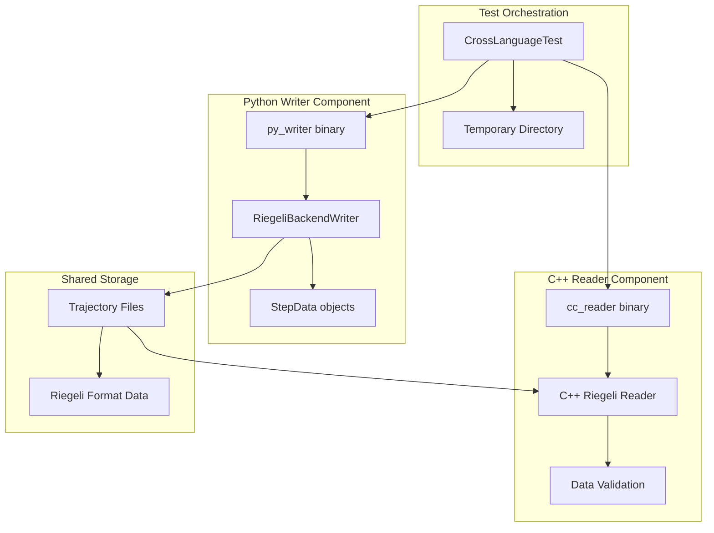
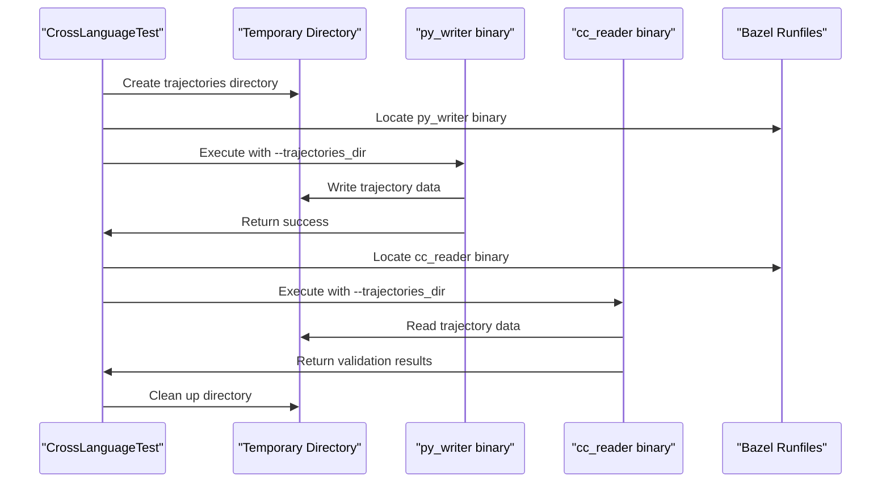
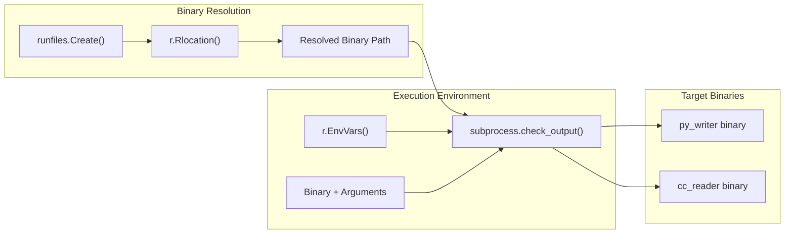
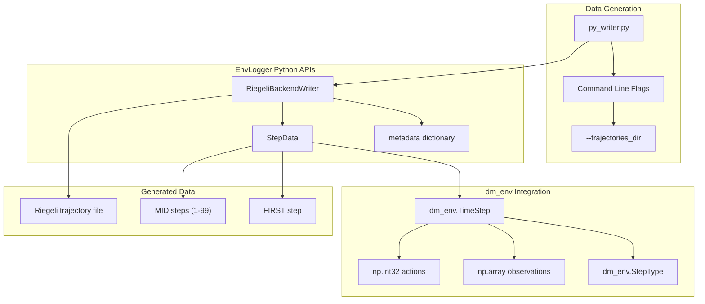
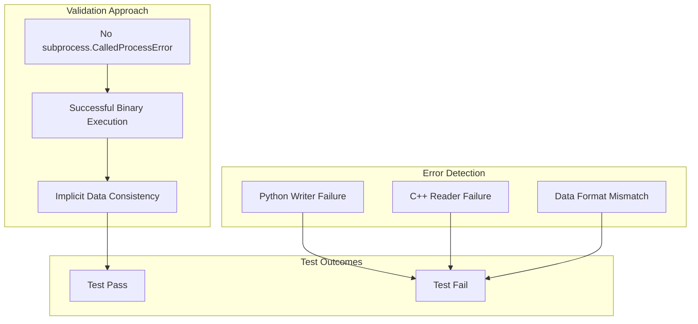
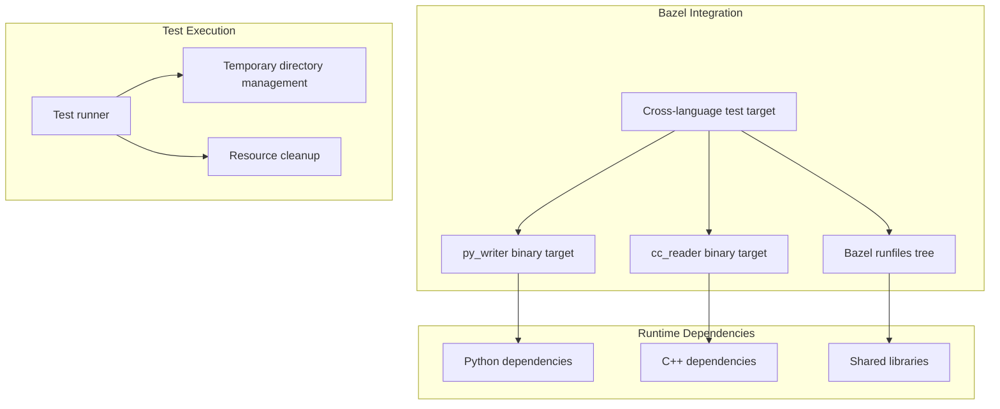

<!-- source: DeepWiki mcp.deepwiki.com · repo google-deepmind/envlogger · page 6.1 Cross-Language Testing · fetched 2026-10-26 -->

# Cross-Language Testing

Relevant source files

The following files were used as context for generating this wiki page:

- [envlogger/backends/cross_language_test/cross_language_test.py](envlogger/backends/cross_language_test/cross_language_test.py)
- [envlogger/backends/cross_language_test/py_writer.py](envlogger/backends/cross_language_test/py_writer.py)

## Purpose and Scope

The cross-language testing system validates data compatibility between Python writers and C++ readers in EnvLogger. This ensures that reinforcement learning trajectories written using Python components can be correctly consumed by C++ components, providing confidence in the interoperability of the dual-language architecture.

This documentation covers the testing framework that validates cross-language data exchange. For information about the broader testing infrastructure, see [Testing and Cross-Language Integration](#6). For details about the underlying storage backends being tested, see [Riegeli Backend](#3.2).

## Testing Architecture Overview

The cross-language testing system uses a three-component architecture to validate data compatibility:

**Sources:** [envlogger/backends/cross_language_test/cross_language_test.py:37-62]()

## Test Execution Workflow

The `CrossLanguageTest` class orchestrates the cross-language validation process through a systematic workflow:

The test workflow implementation:

| Phase | Component | Function |
|-------|-----------|----------|
| Setup | `CrossLanguageTest.test_py_writer_cc_reader` | Creates temporary directory for trajectory storage |
| Write | `_execute_binary` | Executes Python writer with trajectory directory path |
| Read | `_execute_binary` | Executes C++ reader with same trajectory directory path |
| Validate | Exception handling | Ensures no `subprocess.CalledProcessError` occurs |
| Cleanup | `shutil.rmtree` | Removes temporary trajectory directory |

**Sources:** [envlogger/backends/cross_language_test/cross_language_test.py:39-61]()

## Binary Execution System

The testing framework uses Bazel runfiles to locate and execute cross-language binaries:

The `_execute_binary` function provides a standardized interface for binary execution:

- **Path Resolution**: Uses `runfiles.Create()` and `r.Rlocation()` to locate binaries within the Bazel workspace
- **Environment Setup**: Applies proper environment variables via `r.EnvVars()`
- **Execution**: Uses `subprocess.check_output()` to execute binaries and capture output
- **Error Handling**: Propagates `subprocess.CalledProcessError` for test validation

**Sources:** [envlogger/backends/cross_language_test/cross_language_test.py:30-34]()

## Python Writer Component

The Python writer component (`py_writer`) generates test trajectory data using EnvLogger's Python APIs:

The writer generates a 100-step trajectory with specific characteristics:

| Step Range | Step Type | Observation Pattern | Action Pattern | Reward Pattern |
|------------|-----------|-------------------|----------------|----------------|
| 0 | `FIRST` | `[0.0]` | `100` | `0.0` |
| 1-99 | `MID` | `[float(i)]` | `100 - i` | `i / 100.0` |

**Configuration Details:**
- **Backend**: `RiegeliBackendWriter` with custom metadata `{'my_data': [1, 2, 3]}`
- **Observations**: Single-element float32 numpy arrays
- **Actions**: int32 values with decreasing pattern
- **Rewards**: Increasing float values from 0.0 to 0.99
- **Discount**: Fixed at 0.99 for all steps

**Sources:** [envlogger/backends/cross_language_test/py_writer.py:38-59]()

## Test Validation Strategy

The cross-language testing employs implicit validation through successful execution:

The validation strategy relies on:

- **Process Exit Codes**: Both writer and reader must exit successfully (exit code 0)
- **Exception Propagation**: Any `subprocess.CalledProcessError` indicates test failure
- **Data Format Compatibility**: C++ reader must successfully parse Python-written data
- **Implicit Validation**: No explicit data comparison; success implies compatibility

**Sources:** [envlogger/backends/cross_language_test/cross_language_test.py:57-58]()

## Integration with Build System

The cross-language testing integrates with Bazel's build and test infrastructure:

**Key Integration Points:**
- **Runfiles Access**: Uses `rules_python.python.runfiles` for binary location
- **Temporary Storage**: Leverages `absltest.TEST_TMPDIR` for test isolation
- **Resource Management**: Automatic cleanup of test artifacts
- **Build Dependencies**: Ensures both Python and C++ components are built before testing

**Sources:** [envlogger/backends/cross_language_test/cross_language_test.py:27-28](), [envlogger/backends/cross_language_test/cross_language_test.py:41-43](), [envlogger/backends/cross_language_test/cross_language_test.py:60-61]()

---

