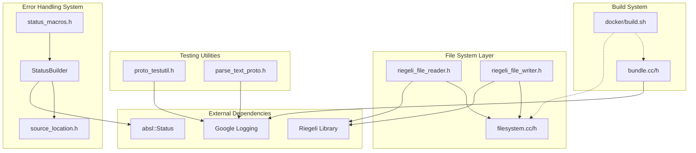
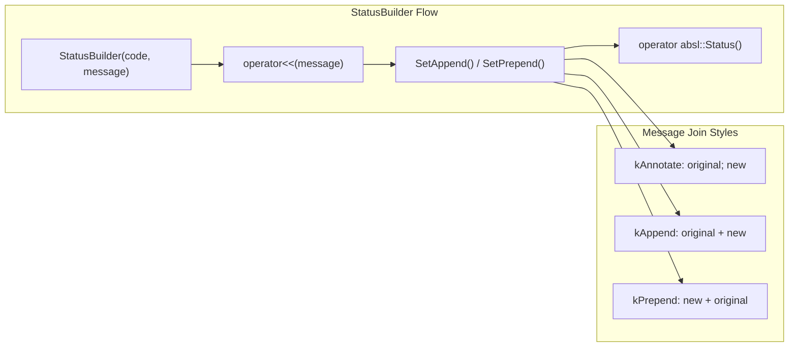
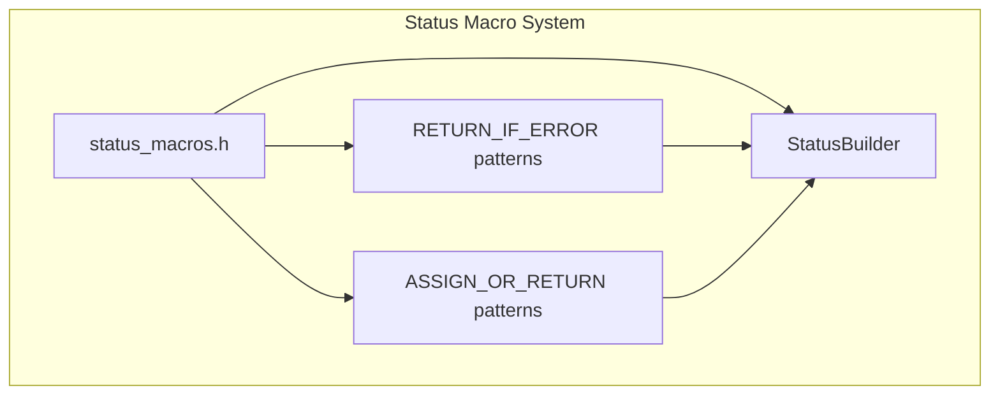
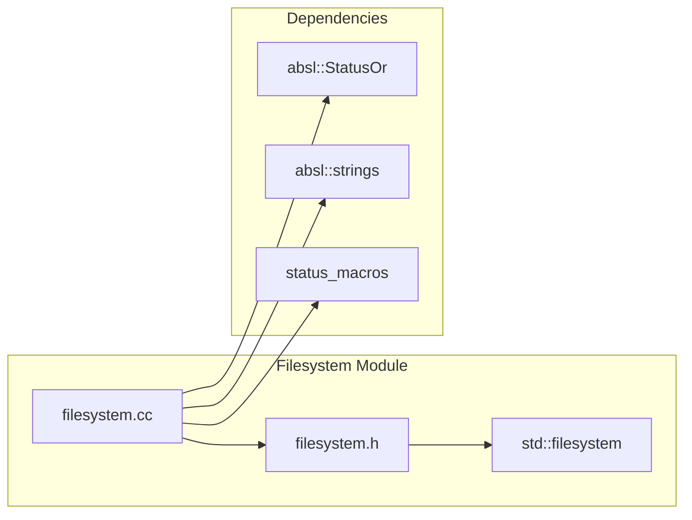
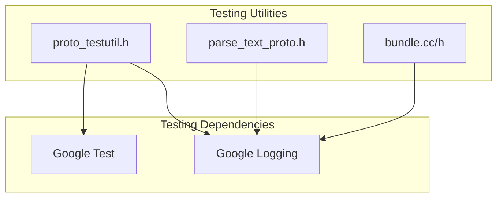
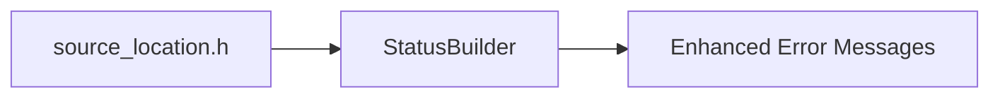
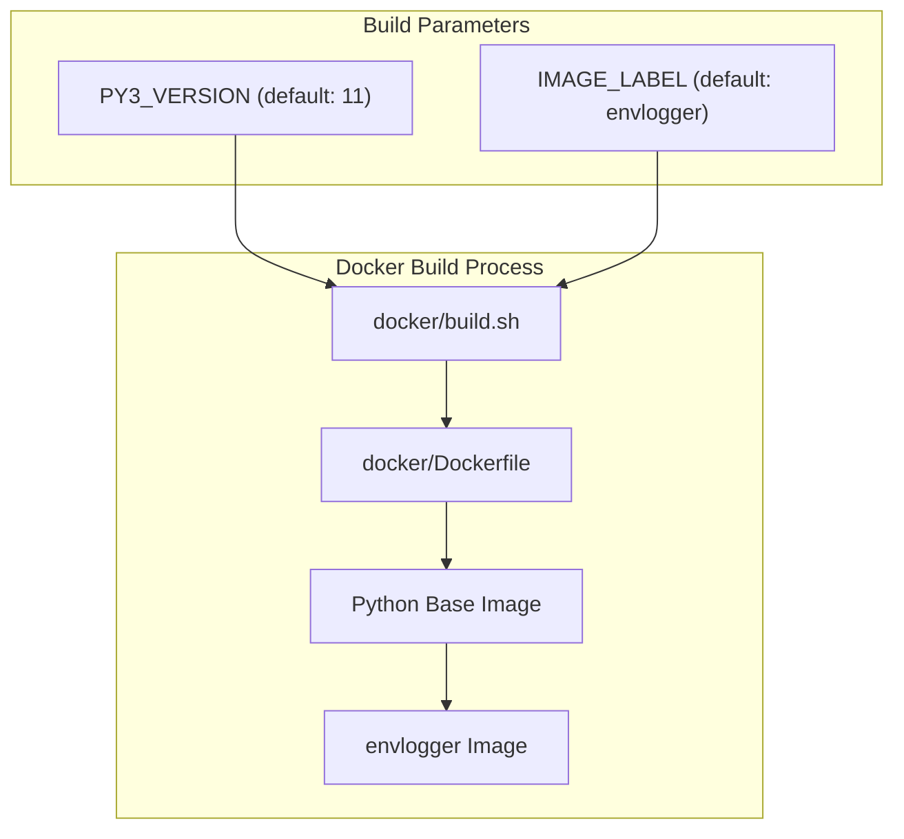
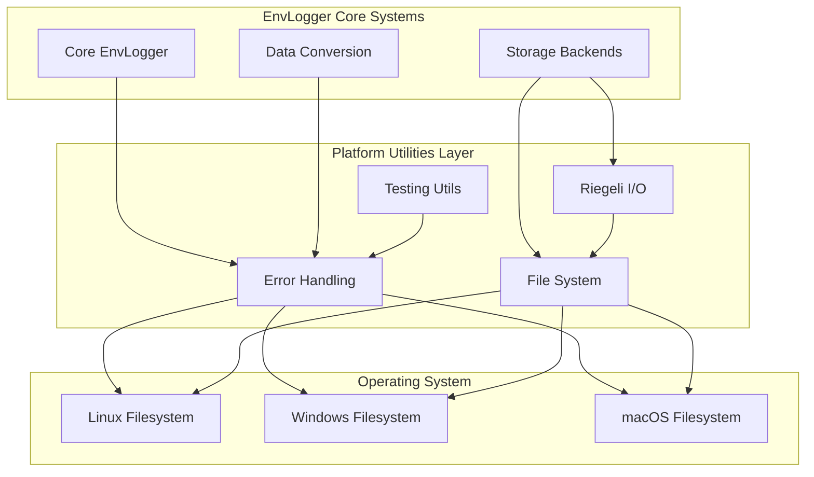

<!-- source: DeepWiki mcp.deepwiki.com · repo google-deepmind/envlogger · page 7 Platform Utilities · fetched 2026-10-26 -->

# Platform Utilities

<details>
<summary>Relevant source files</summary>

The following files were used as context for generating this wiki page:

- [docker/build.sh](docker/build.sh)
- [envlogger/platform/default/BUILD.bazel](envlogger/platform/default/BUILD.bazel)
- [envlogger/platform/default/status_builder.cc](envlogger/platform/default/status_builder.cc)

</details>


This document covers the platform-specific utilities and helper components that provide foundational infrastructure for the EnvLogger system. These utilities handle cross-platform compatibility, error handling, file I/O operations, and development tools.

For information about the main EnvLogger system, see [Core EnvLogger System](#2). For storage backend implementations that use these utilities, see [Storage Backends](#3).

## Overview

The platform utilities in EnvLogger provide a standardized interface for platform-specific operations and common development tasks. These utilities are organized into several categories:

- **Error Handling**: Status management and error reporting utilities
- **File System Operations**: Cross-platform file and directory utilities  
- **Riegeli Integration**: File I/O wrappers for Riegeli storage
- **Testing Infrastructure**: Utilities for unit testing and protocol buffer validation
- **Build and Deployment**: Docker containerization and build automation

## Platform Utilities Architecture



**Sources:** [envlogger/platform/default/BUILD.bazel:1-99](), [envlogger/platform/default/status_builder.cc:1-90](), [docker/build.sh:1-29]()

## Error Handling System

The error handling system provides structured error reporting and status management throughout the EnvLogger codebase.

### StatusBuilder Implementation

The `StatusBuilder` class provides a fluent interface for constructing `absl::Status` objects with detailed error messages:



Key features of the `StatusBuilder`:

| Feature | Implementation | Purpose |
|---------|---------------|---------|
| Copy Constructor | [envlogger/platform/default/status_builder.cc:24-31]() | Deep copy of status and stream state |
| Stream Interface | Private `std::ostringstream` | Fluent message building |
| Join Styles | `MessageJoinStyle` enum | Control message concatenation |
| No Logging Mode | `SetNoLogging()` method | Disable logging for sensitive operations |

### Status Macros

The status macros provide convenient error handling patterns:



**Sources:** [envlogger/platform/default/status_builder.cc:74-86](), [envlogger/platform/default/BUILD.bazel:79-98]()

## File System Utilities

The file system utilities provide cross-platform file and directory operations with proper error handling.

### Filesystem Operations

The `filesystem.cc/h` components provide standardized file system operations:



The filesystem module includes platform-specific linking requirements (`-lstdc++fs`) for C++17 filesystem support.

### Riegeli File I/O Wrappers

The Riegeli file I/O utilities provide high-level interfaces for Riegeli-based file operations:

| Component | Purpose | Dependencies |
|-----------|---------|-------------|
| `riegeli_file_reader.h` | Reading from Riegeli files | `filesystem`, `riegeli::FdReader` |
| `riegeli_file_writer.h` | Writing to Riegeli files | `filesystem`, `riegeli::FdWriter` |

**Sources:** [envlogger/platform/default/BUILD.bazel:26-72]()

## Testing and Development Utilities

The testing utilities provide infrastructure for unit testing and protocol buffer validation.

### Testing Infrastructure



| Utility | Purpose | Usage Context |
|---------|---------|---------------|
| `proto_testutil.h` | Protocol buffer testing helpers | Unit tests only (`testonly = 1`) |
| `parse_text_proto.h` | Text protocol buffer parsing | Development and debugging |
| `bundle.cc/h` | Resource bundling utilities | Build-time asset management |

### Source Location Utilities

The `source_location.h` header provides source code location tracking for debugging and error reporting:



**Sources:** [envlogger/platform/default/BUILD.bazel:39-77]()

## Build and Deployment Infrastructure

The build and deployment utilities support containerized development and cross-platform builds.

### Docker Build System

The Docker build system provides standardized containerization:



The build script supports configurable Python versions and image labels:

| Parameter | Default | Purpose |
|-----------|---------|---------|
| `PY3_VERSION` | `11` | Python 3.x version (e.g., 11 for Python 3.11) |
| `IMAGE_LABEL` | `envlogger` | Output Docker image name |

Usage example:
```bash
# Build with Python 3.11 (default)
docker/build.sh

# Build with Python 3.9
docker/build.sh 9

# Build with custom image label
docker/build.sh 11 my-envlogger-image
```

**Sources:** [docker/build.sh:15-29]()

## Platform Abstraction Layer

The platform utilities collectively form an abstraction layer that enables EnvLogger to operate consistently across different platforms and environments:



**Sources:** [envlogger/platform/default/BUILD.bazel:1-99](), [envlogger/platform/default/status_builder.cc:1-90](), [docker/build.sh:1-29]()