# Page: EnvLogger Overview

# EnvLogger Overview

<details>
<summary>Relevant source files</summary>

The following files were used as context for generating this wiki page:

- [README.md](README.md)
- [docker/Dockerfile](docker/Dockerfile)
- [docs/images/timings.png](docs/images/timings.png)
- [envlogger/backends/in_memory_backend.py](envlogger/backends/in_memory_backend.py)
- [envlogger/backends/riegeli_backend_writer.py](envlogger/backends/riegeli_backend_writer.py)
- [envlogger/examples/random_agent_catch.py](envlogger/examples/random_agent_catch.py)
- [envlogger/setup.py](envlogger/setup.py)

</details>


## Purpose and Scope

EnvLogger is a trajectory logging system for reinforcement learning environments that provides a standard wrapper around `dm_env.Environment` interfaces. It records interactions between agents and environments, storing them persistently for later analysis, training, or evaluation. The system supports multiple storage backends, cross-language integration between Python and C++, and seamless integration with TensorFlow Datasets (TFDS) and Reinforcement Learning Dataset (RLDS) formats.

This document covers the overall system architecture, core components, and data flow patterns. For detailed information about specific storage backends, see [Storage Backends](#3). For build system configuration, see [Build System and Development Setup](#5).

## System Architecture

### Overall Architecture

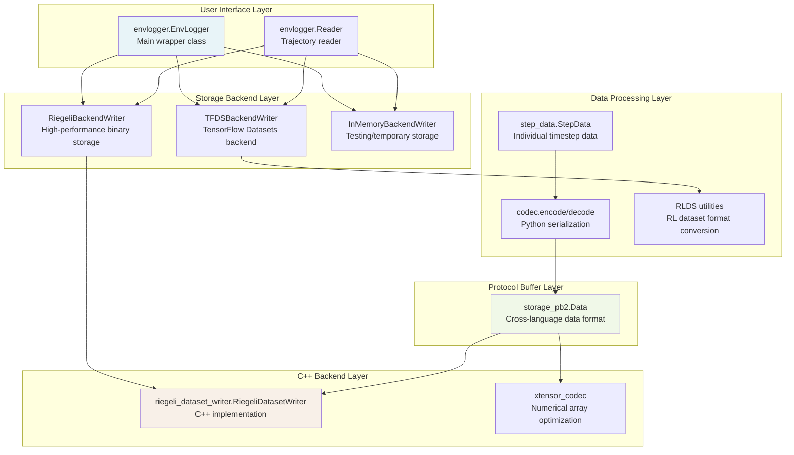

Sources: [README.md:1-235](), [envlogger/setup.py:27-174](), [envlogger/backends/riegeli_backend_writer.py:1-100](), [envlogger/backends/in_memory_backend.py:1-92]()

## Core Components

### Environment Wrapper Integration

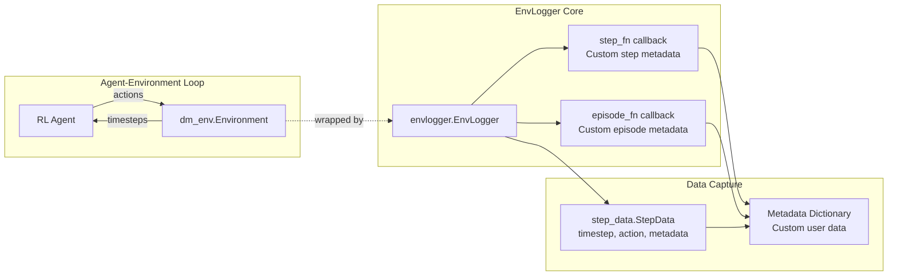

Sources: [README.md:16-98](), [envlogger/examples/random_agent_catch.py:36-67]()

### Backend Architecture

```mermaid
graph TB
    subgraph "Abstract Interface"
        BackendWriter["backend_writer.BackendWriter<br/>Abstract base class"]
        BackendReader["backend_reader.BackendReader<br/>Abstract base class"]
    end
    
    subgraph "Concrete Implementations"
        TFDSWriter["TFDSBackendWriter<br/>TFDS format writer"]
        RiegeliWriter["RiegeliBackendWriter<br/>Binary format writer"]
        InMemoryWriter["InMemoryBackendWriter<br/>RAM-based writer"]
        
        TFDSReader["TFDSBackendReader<br/>TFDS format reader"]
        RiegeliReader["RiegeliBackendReader<br/>Binary format reader"]
        InMemoryReader["InMemoryBackendReader<br/>RAM-based reader"]
    end
    
    subgraph "Support Components"
        Scheduler["schedulers.BernoulliStepScheduler<br/>Flush timing control"]
        EpisodeInfo["episode_info.EpisodeInfo<br/>Episode metadata"]
    end
    
    BackendWriter <|-- TFDSWriter
    BackendWriter <|-- RiegeliWriter
    BackendWriter <|-- InMemoryWriter
    
    BackendReader <|-- TFDSReader
    BackendReader <|-- RiegeliReader
    BackendReader <|-- InMemoryReader
    
    RiegeliWriter --> Scheduler
    InMemoryWriter --> EpisodeInfo
    InMemoryReader --> EpisodeInfo
```

Sources: [envlogger/backends/riegeli_backend_writer.py:29-100](), [envlogger/backends/in_memory_backend.py:29-92]()

## Data Flow Architecture

### Recording Data Flow

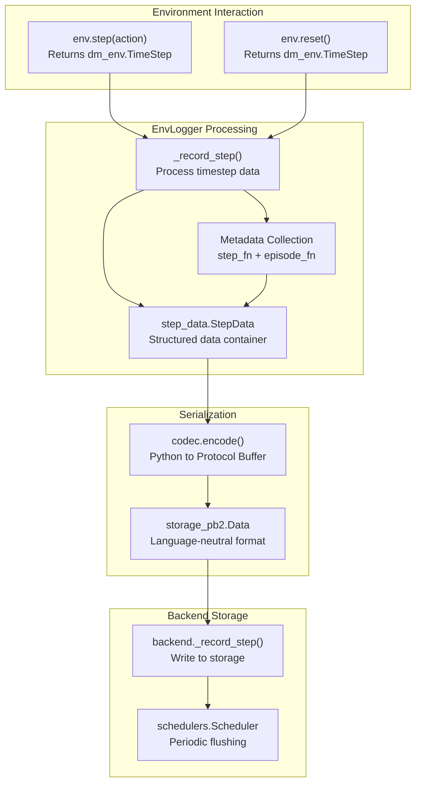

Sources: [envlogger/backends/riegeli_backend_writer.py:80-89](), [README.md:40-70]()

### Reading Data Flow

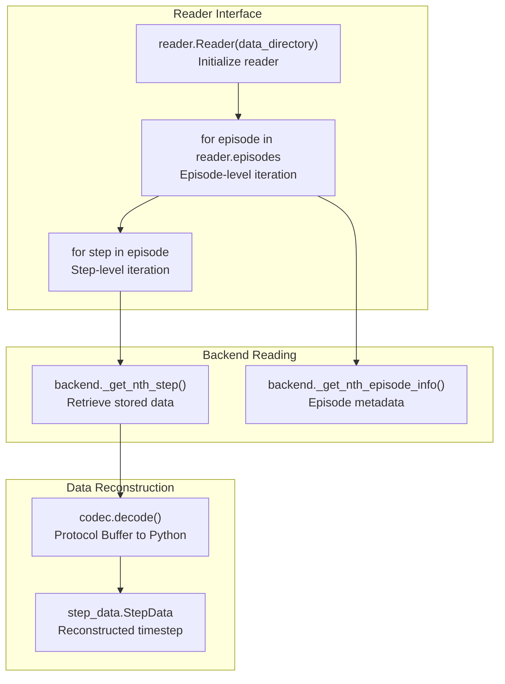

Sources: [README.md:149-174](), [envlogger/backends/in_memory_backend.py:66-91]()

## Cross-Language Integration

### Python-C++ Bridge

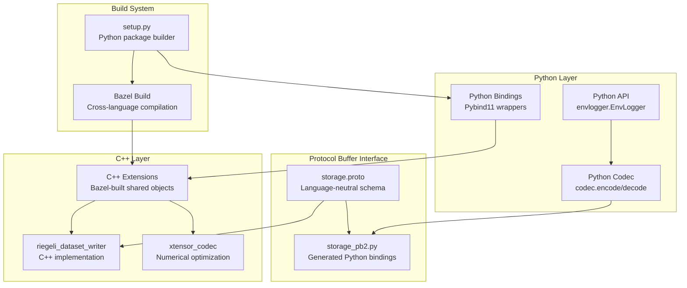

Sources: [envlogger/setup.py:79-137](), [envlogger/setup.py:33-68]()

## Integration Points

### TFDS and RLDS Integration

| Component | Purpose | Key Classes |
|-----------|---------|-------------|
| TFDS Backend | TensorFlow Datasets compatibility | `TFDSBackendWriter`, `tfds_backend_writer` |
| RLDS Format | Reinforcement Learning Dataset format | `rlds_utils`, `DatasetConfig` |
| Dataset Configuration | Environment specification | `tfds.features.Tensor`, `tfds.rlds.rlds_base.DatasetConfig` |
| Shard Management | File organization and recovery | `maybe_recover_last_shard`, `max_episodes_per_file` |

Sources: [README.md:100-148]()

### Performance Characteristics

| Backend | Use Case | Performance Notes |
|---------|----------|-------------------|
| InMemory | Testing, small datasets | Fastest access, limited by RAM |
| Riegeli | Production, large datasets | ~2ms overhead per step, compressed storage |
| TFDS | ML pipeline integration | TFDS-compatible format, batch processing |

The system adds approximately 2 milliseconds overhead per environment step based on benchmark data with a random agent on a 100 steps per second Catch environment.

Sources: [README.md:218-228](), [envlogger/backends/in_memory_backend.py:1-92](), [envlogger/backends/riegeli_backend_writer.py:1-100]()

---

# Page: System Architecture

# System Architecture

<details>
<summary>Relevant source files</summary>

The following files were used as context for generating this wiki page:

- [README.md](README.md)
- [docs/images/timings.png](docs/images/timings.png)
- [envlogger/backends/BUILD.bazel](envlogger/backends/BUILD.bazel)
- [envlogger/backends/in_memory_backend.py](envlogger/backends/in_memory_backend.py)
- [envlogger/backends/riegeli_backend_writer.py](envlogger/backends/riegeli_backend_writer.py)
- [envlogger/examples/random_agent_catch.py](envlogger/examples/random_agent_catch.py)

</details>


This document provides a comprehensive overview of the EnvLogger system architecture, detailing how components interact to provide trajectory logging capabilities for reinforcement learning environments. EnvLogger acts as a wrapper around `dm_env.Environment` instances to record agent-environment interactions and store them in various backend formats.

For information about specific backend implementations, see [Storage Backends](#3). For build system details, see [Build System and Development Setup](#5). For data format specifications, see [Data Conversion and Serialization](#4).

## Overview

EnvLogger implements a layered architecture that separates concerns between environment interaction, data transformation, and persistent storage. The system is designed to be backend-agnostic, allowing users to choose between different storage formats while maintaining a consistent API.

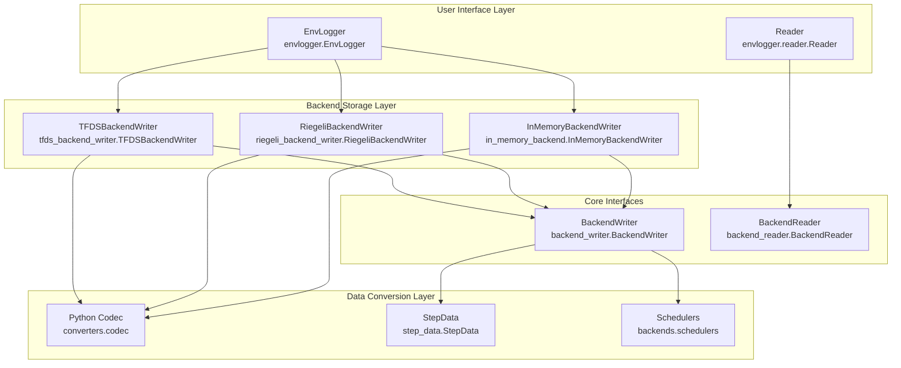

**Sources:** [README.md:1-235](), [envlogger/backends/BUILD.bazel:15-176]()

## Core Components

### EnvLogger Wrapper

The `EnvLogger` class serves as the primary entry point for users. It wraps a `dm_env.Environment` instance and intercepts all interactions to record trajectory data.

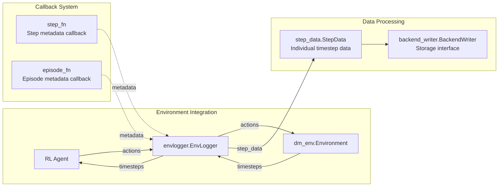

**Sources:** [README.md:16-24](), [envlogger/examples/random_agent_catch.py:36-66]()

### Backend Storage Architecture

The system implements a pluggable backend architecture where different storage mechanisms can be used interchangeably through the `BackendWriter` interface.

```mermaid
graph TD
    subgraph "Abstract Interface"
        BackendWriter["backend_writer.BackendWriter<br/>Abstract base class"]
        BackendReader["backend_reader.BackendReader<br/>Abstract base class"]
    end
    
    subgraph "Concrete Implementations"
        TFDSWriter["tfds_backend_writer.TFDSBackendWriter<br/>TensorFlow Datasets format"]
        RiegeliWriter["riegeli_backend_writer.RiegeliBackendWriter<br/>High-performance binary format"]
        InMemoryWriter["in_memory_backend.InMemoryBackendWriter<br/>RAM-based storage"]
    end
    
    subgraph "Supporting Components"
        Scheduler["schedulers.Scheduler<br/>Flush scheduling"]
        RLDSUtils["rlds_utils<br/>RLDS format conversion"]
        Codec["codec<br/>Serialization utilities"]
    end
    
    BackendWriter <|-- TFDSWriter
    BackendWriter <|-- RiegeliWriter
    BackendWriter <|-- InMemoryWriter
    
    TFDSWriter --> RLDSUtils
    RiegeliWriter --> Scheduler
    
    TFDSWriter --> Codec
    RiegeliWriter --> Codec
    InMemoryWriter --> Codec
```

**Sources:** [envlogger/backends/BUILD.bazel:52-58](), [envlogger/backends/riegeli_backend_writer.py:29-100](), [envlogger/backends/in_memory_backend.py:29-92]()

## Data Flow Patterns

### Step Recording Flow

The following diagram illustrates how individual environment steps are processed and stored:

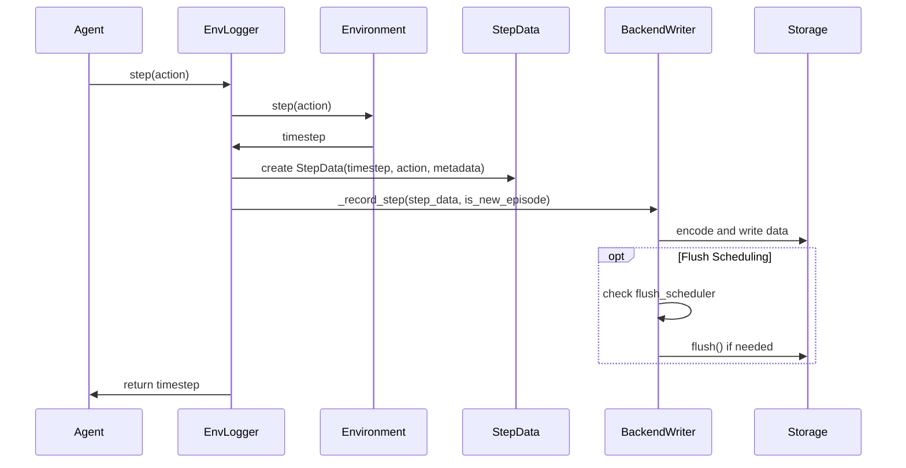

**Sources:** [envlogger/backends/riegeli_backend_writer.py:80-89](), [envlogger/backends/in_memory_backend.py:38-42]()

### Backend Selection and Configuration

EnvLogger supports multiple storage backends that can be configured at initialization:

| Backend Type | Class | Use Case | Key Features |
|--------------|-------|----------|--------------|
| **TFDS** | `tfds_backend_writer.TFDSBackendWriter` | ML pipeline integration | TensorFlow Datasets compatibility, RLDS format |
| **Riegeli** | `riegeli_backend_writer.RiegeliBackendWriter` | High-performance storage | C++ implementation, compression, sharding |
| **InMemory** | `in_memory_backend.InMemoryBackendWriter` | Testing and prototyping | RAM-based, no persistence |

**Sources:** [envlogger/backends/BUILD.bazel:134-141](), [envlogger/backends/BUILD.bazel:99-110](), [envlogger/backends/BUILD.bazel:61-69]()

## Cross-Language Integration

EnvLogger implements a hybrid Python/C++ architecture where performance-critical components are implemented in C++ and exposed through Python bindings:

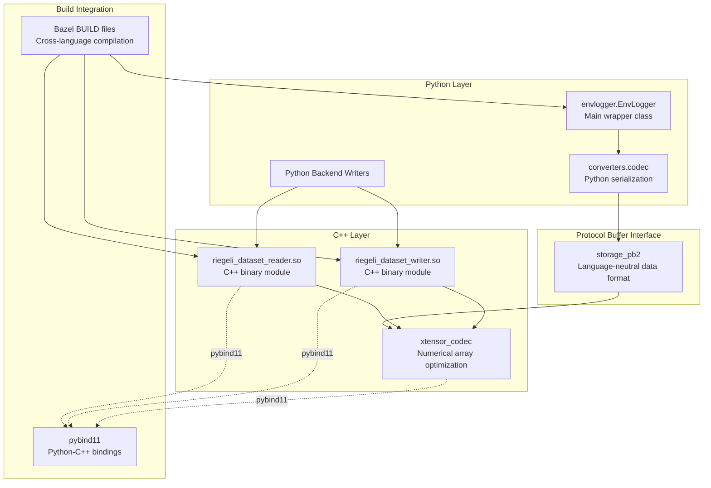

**Sources:** [envlogger/backends/BUILD.bazel:84-95](), [envlogger/backends/BUILD.bazel:99-103]()

## Scheduling and Persistence

The system implements configurable flush scheduling to balance performance and data safety:

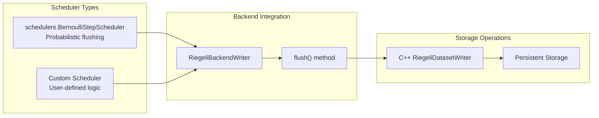

**Sources:** [envlogger/backends/riegeli_backend_writer.py:62-65](), [envlogger/backends/riegeli_backend_writer.py:87-89](), [envlogger/backends/BUILD.bazel:26-31]()

## Data Serialization Pipeline

The system uses a layered approach to data serialization that supports multiple data formats and optimizations:

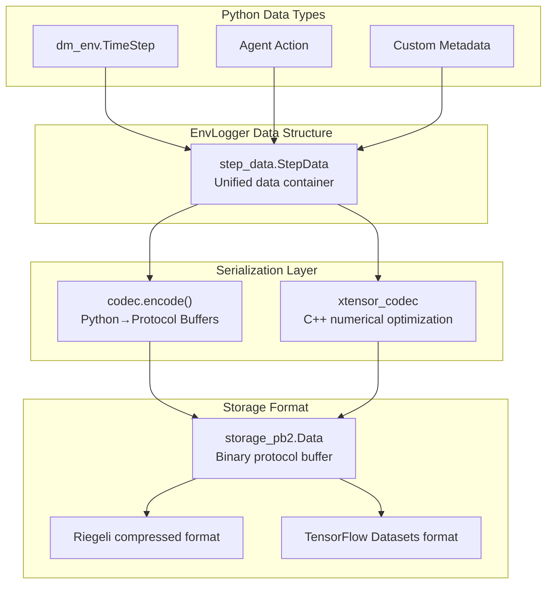

**Sources:** [envlogger/backends/riegeli_backend_writer.py:82-83](), [envlogger/backends/BUILD.bazel:47-50](), [envlogger/backends/BUILD.bazel:127-131]()

---

# Page: Core EnvLogger System

# Core EnvLogger System

<details>
<summary>Relevant source files</summary>

The following files were used as context for generating this wiki page:

- [README.md](README.md)
- [docs/images/timings.png](docs/images/timings.png)
- [envlogger/backends/in_memory_backend.py](envlogger/backends/in_memory_backend.py)
- [envlogger/backends/riegeli_backend_writer.py](envlogger/backends/riegeli_backend_writer.py)
- [envlogger/backends/schedulers.py](envlogger/backends/schedulers.py)
- [envlogger/backends/schedulers_test.py](envlogger/backends/schedulers_test.py)
- [envlogger/environment_wrapper.py](envlogger/environment_wrapper.py)
- [envlogger/examples/random_agent_catch.py](envlogger/examples/random_agent_catch.py)

</details>


This document covers the central EnvLogger wrapper class and its integration with dm_env environments. It explains how the system captures environment interactions, processes step data, and coordinates with storage backends. For information about specific storage backends, see [Storage Backends](#3). For details on data serialization and conversion, see [Data Conversion and Serialization](#4).

## EnvLogger Wrapper Architecture

The `EnvLogger` class serves as the primary user-facing interface for trajectory logging. It extends the `EnvironmentWrapper` base class to seamlessly integrate with the dm_env ecosystem while adding logging capabilities.

### Core Class Hierarchy

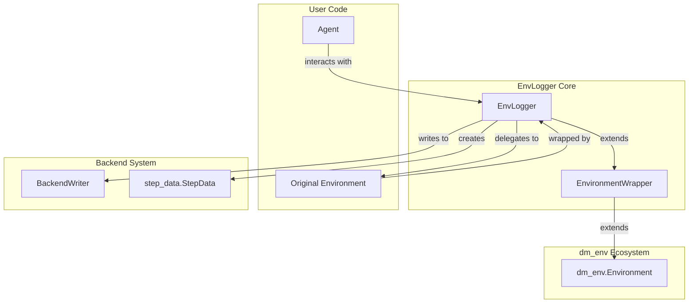

The `EnvironmentWrapper` class provides the foundational wrapper pattern implementation, handling delegation and attribute forwarding to the wrapped environment. The `EnvLogger` class extends this to add trajectory logging functionality.

**Sources:** [envlogger/environment_wrapper.py:23-66](), [README.md:3-6]()

### Environment Integration Pattern

EnvLogger implements the decorator pattern to transparently add logging to any dm_env.Environment:

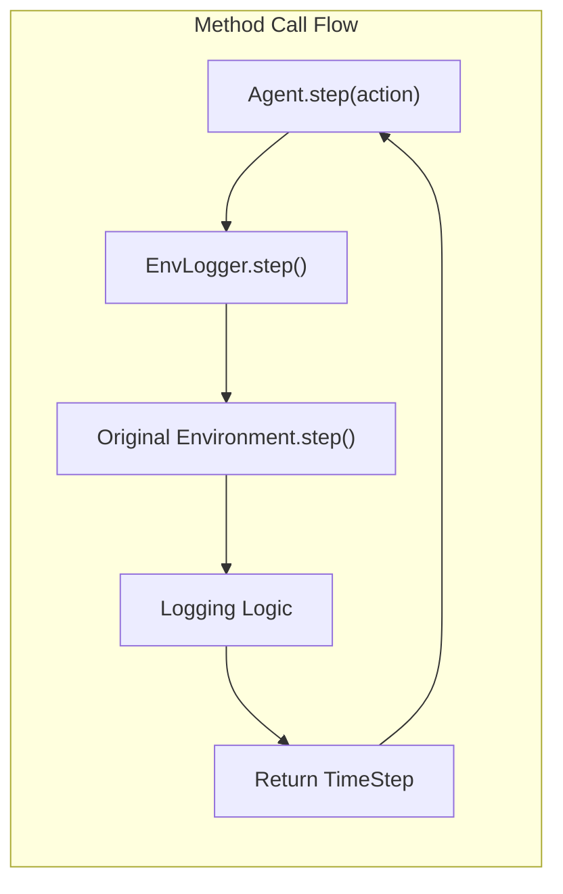

This pattern ensures that:
- All dm_env.Environment methods are preserved
- Logging is added transparently without changing the environment interface
- The wrapped environment's behavior remains unchanged
- Agent code requires no modifications

**Sources:** [envlogger/environment_wrapper.py:34-66](), [README.md:29-44]()

## Step Processing Pipeline

The EnvLogger processes each environment interaction through a structured pipeline that captures step data, applies metadata, and coordinates with storage backends.

### Step Data Flow

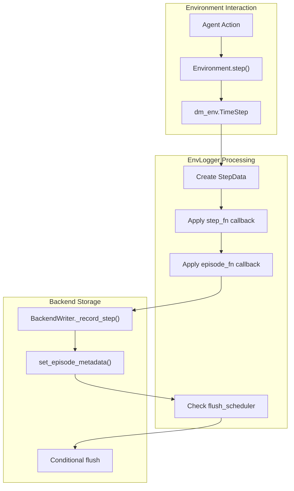

The pipeline ensures that:
- Each timestep is wrapped in a `step_data.StepData` structure
- Custom metadata can be attached via callback functions
- Episode boundaries are properly tracked
- Data is efficiently flushed based on scheduling policies

**Sources:** [envlogger/step_data.py](), [envlogger/backends/riegeli_backend_writer.py:80-89]()

### Step Data Structure

The `step_data.StepData` class encapsulates all information about a single environment interaction:

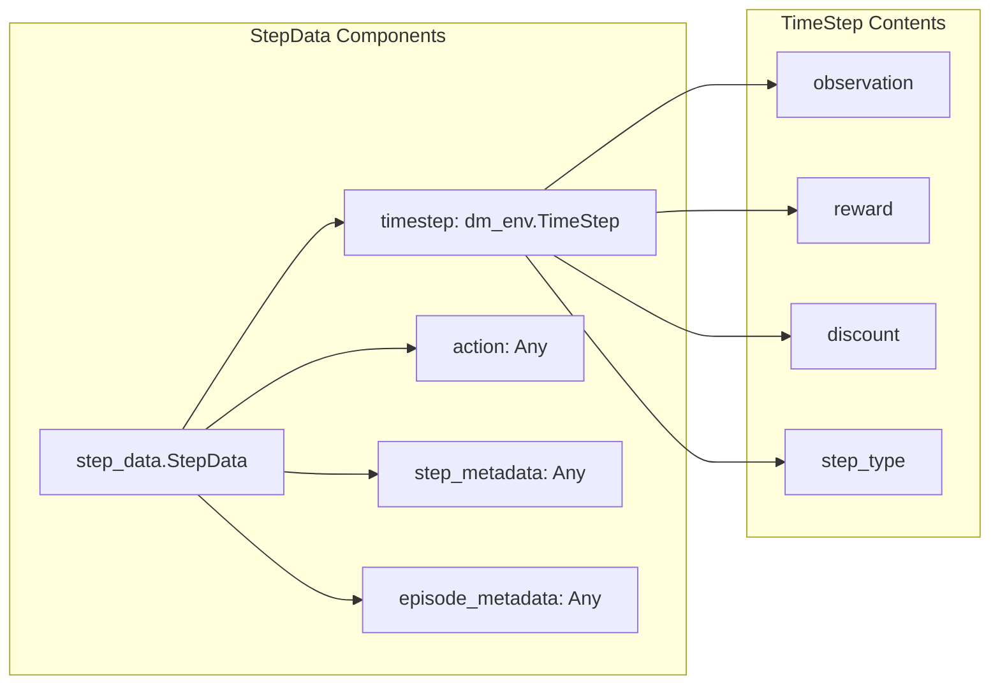

This structure provides a complete record of each environment interaction, including the agent's action, the environment's response, and any custom metadata.

**Sources:** [envlogger/step_data.py](), [README.md:160-161]()

## Metadata and Callback System

EnvLogger supports flexible metadata collection through user-defined callback functions that can attach custom information to steps and episodes.

### Callback Function Types

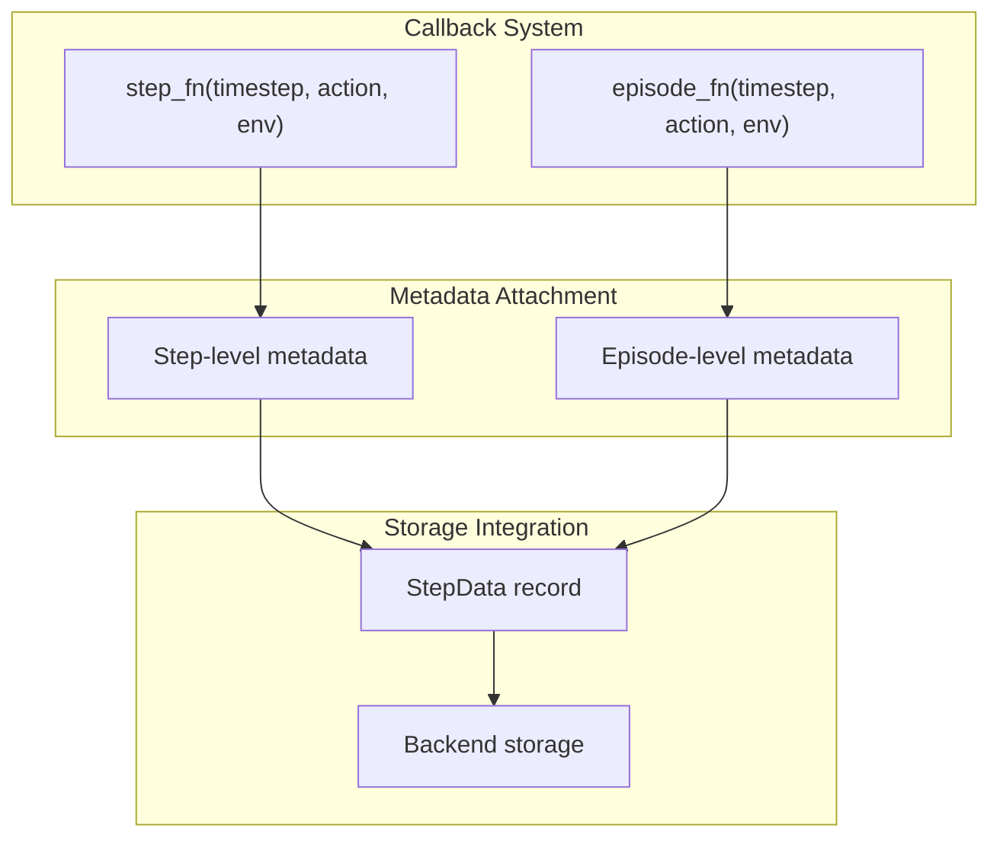

The callback system allows users to:
- Attach arbitrary metadata to individual steps
- Collect episode-level information that persists across steps
- Access the current timestep, action, and environment for context
- Return `None` to skip metadata collection for specific steps

**Sources:** [README.md:50-98](), [envlogger/examples/random_agent_catch.py:41-42]()

### Metadata Example Usage

Common metadata patterns include:

| Metadata Type | Example Use Case | Implementation |
|---------------|------------------|----------------|
| Timing | Step execution time | `{'timestamp': time.time()}` |
| Performance | Agent confidence | `{'confidence': model.confidence()}` |
| Environment | State information | `{'level': env.current_level}` |
| Episode | Episode characteristics | `{'difficulty': 'hard'}` |

The metadata is serialized using the codec system and stored alongside the step data for later retrieval and analysis.

**Sources:** [README.md:58-60](), [envlogger/examples/random_agent_catch.py:41-54]()

## Scheduling and Backend Integration

EnvLogger uses a scheduling system to control when data is flushed to permanent storage, balancing performance with data safety.

### Scheduler Architecture

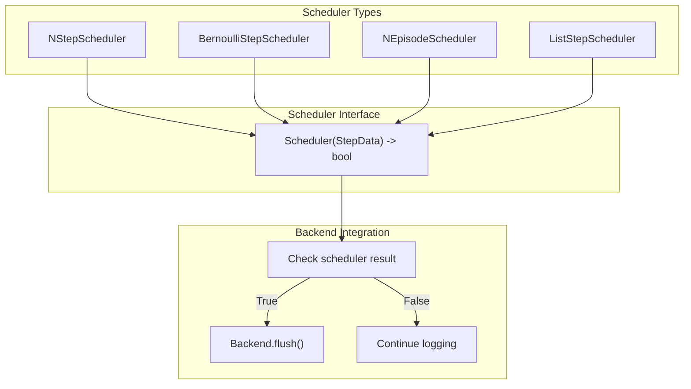

The scheduler system provides:
- **Step-based scheduling**: Flush every N steps or with probability P
- **Episode-based scheduling**: Flush every N episodes or with probability P
- **List-based scheduling**: Flush at specific step or episode numbers
- **Custom scheduling**: User-defined flush policies

**Sources:** [envlogger/backends/schedulers.py:25-159](), [envlogger/backends/riegeli_backend_writer.py:62-89]()

### Default Scheduling Behavior

Different backends use different default scheduling strategies:

| Backend | Default Scheduler | Rationale |
|---------|-------------------|-----------|
| RiegeliBackendWriter | `BernoulliStepScheduler(1.0/5000)` | Balance performance with data safety |
| TFDSBackendWriter | Episode-based | Align with dataset structure |
| InMemoryBackendWriter | No scheduling | Data already in memory |

The scheduling system ensures that data is periodically persisted while maintaining good performance characteristics.

**Sources:** [envlogger/backends/riegeli_backend_writer.py:62-65](), [envlogger/backends/schedulers.py:48-103]()

---

# Page: Storage Backends

# Storage Backends

<details>
<summary>Relevant source files</summary>

The following files were used as context for generating this wiki page:

- [README.md](README.md)
- [docs/images/timings.png](docs/images/timings.png)
- [envlogger/backends/BUILD.bazel](envlogger/backends/BUILD.bazel)
- [envlogger/backends/in_memory_backend.py](envlogger/backends/in_memory_backend.py)
- [envlogger/backends/riegeli_backend_writer.py](envlogger/backends/riegeli_backend_writer.py)
- [envlogger/examples/random_agent_catch.py](envlogger/examples/random_agent_catch.py)

</details>


This document provides an overview of the storage backend system in EnvLogger, which handles the persistence of trajectory data from reinforcement learning environments. The storage backends provide different options for how and where trajectory data is stored, each optimized for different use cases.

For detailed implementation information about specific backends, see [TFDS Backend](#3.1), [Riegeli Backend](#3.2), and [Backend Interfaces and Utilities](#3.3). For information about the data conversion layer that works with these backends, see [Data Conversion and Serialization](#4).

## Backend Architecture Overview

The storage backend system follows a common interface pattern where all backends implement the `BackendWriter` abstract base class. This allows the core EnvLogger system to work with different storage mechanisms transparently.

### Backend Class Hierarchy

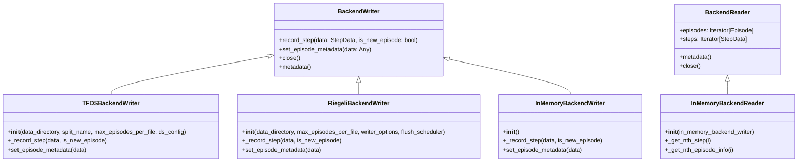

Sources: [envlogger/backends/backend_writer.py:1-100](), [envlogger/backends/backend_reader.py:1-100](), [envlogger/backends/tfds_backend_writer.py:1-50](), [envlogger/backends/riegeli_backend_writer.py:1-50](), [envlogger/backends/in_memory_backend.py:1-50]()

### Data Flow Architecture

```mermaid
flowchart TD
    EnvLogger["EnvLogger Wrapper"] --> StepData["step_data.StepData"]
    StepData --> BackendWriter["BackendWriter Interface"]
    
    BackendWriter --> TFDSWriter["TFDSBackendWriter"]
    BackendWriter --> RiegeliWriter["RiegeliBackendWriter"]
    BackendWriter --> InMemoryWriter["InMemoryBackendWriter"]
    
    TFDSWriter --> Codec["codec.encode()"]
    RiegeliWriter --> Codec
    InMemoryWriter --> DirectStorage["Direct Python Storage"]
    
    Codec --> ProtoBuf["storage_pb2.Data"]
    
    TFDSWriter --> TFDSFiles["TFDS Sharded Files"]
    RiegeliWriter --> RiegeliFiles["Riegeli Binary Files"]
    InMemoryWriter --> RAM["In-Memory Lists"]
    
    TFDSFiles --> TFDSReader["TFDS Dataset API"]
    RiegeliFiles --> RiegeliReader["RiegeliBackendReader"]
    RAM --> InMemoryReader["InMemoryBackendReader"]
    
    TFDSReader --> MLPipeline["ML Training Pipeline"]
    RiegeliReader --> Reader["envlogger.Reader"]
    InMemoryReader --> Testing["Testing/Development"]
```

Sources: [envlogger/backends/backend_writer.py:54-58](), [envlogger/backends/tfds_backend_writer.py:134-141](), [envlogger/backends/riegeli_backend_writer.py:99-110](), [envlogger/converters/codec.py:1-50]()

## Available Storage Backends

EnvLogger provides three main storage backends, each optimized for different use cases:

| Backend | Format | Use Case | Performance | Compatibility |
|---------|---------|----------|-------------|---------------|
| **TFDS** | TensorFlow Datasets | ML training pipelines | Good | TensorFlow, JAX, PyTorch |
| **Riegeli** | Compressed binary | High-performance storage | Excellent | EnvLogger Reader |
| **In-Memory** | Python objects | Testing, short experiments | Fast (RAM-limited) | EnvLogger Reader |

### TFDS Backend

The `TFDSBackendWriter` stores trajectory data in TensorFlow Datasets format, making it directly compatible with TensorFlow, JAX, and PyTorch training pipelines.

**Key Features:**
- Direct TFDS/RLDS compatibility
- Automatic sharding based on episode count
- Built-in data validation through TFDS features
- Seamless integration with existing ML workflows

**Usage Example:**
```python
dataset_config = tfds.rlds.rlds_base.DatasetConfig(
    name='my_experiment',
    observation_info=tfds.features.Tensor(shape=(64, 64, 3), dtype=tf.uint8),
    action_info=tf.int32,
    reward_info=tf.float32
)

backend = tfds_backend_writer.TFDSBackendWriter(
    data_directory='/tmp/trajectories',
    split_name='train',
    max_episodes_per_file=500,
    ds_config=dataset_config
)
```

Sources: [README.md:100-131](), [envlogger/backends/tfds_backend_writer.py:134-141]()

### Riegeli Backend

The `RiegeliBackendWriter` provides high-performance storage using Google's Riegeli format, optimized for fast sequential access and compression.

**Key Features:**
- Excellent compression ratios
- Fast sequential reading
- Configurable flush scheduling
- C++ implementation for performance

**Usage Example:**
```python
backend = RiegeliBackendWriter(
    data_directory='/tmp/trajectories',
    max_episodes_per_file=10000,
    writer_options='transpose,brotli:6,chunk_size:1M',
    flush_scheduler=schedulers.BernoulliStepScheduler(1.0 / 5000)
)
```

Sources: [envlogger/backends/riegeli_backend_writer.py:32-66]()

### In-Memory Backend

The `InMemoryBackendWriter` stores all trajectory data in Python data structures in RAM, making it ideal for testing and development.

**Key Features:**
- No disk I/O overhead
- Immediate data availability
- Simple debugging interface
- Memory-limited capacity

**Usage Example:**
```python
backend = InMemoryBackendWriter()
# Data is stored in backend.steps and backend.episode_metadata
```

Sources: [envlogger/backends/in_memory_backend.py:29-51]()

## Backend Selection Guide

### When to Use Each Backend

**Use TFDS Backend when:**
- Training ML models with TensorFlow/JAX/PyTorch
- Need compatibility with existing TFDS-based pipelines
- Want automatic data validation
- Sharing datasets with other researchers

**Use Riegeli Backend when:**
- Need maximum storage efficiency
- Handling large-scale data collection
- Want fast sequential access patterns
- Using EnvLogger's native reader interface

**Use In-Memory Backend when:**
- Testing and development
- Short experiments with limited data
- Need immediate data access
- Debugging trajectory collection

### Performance Characteristics

According to the benchmark data, EnvLogger adds approximately 2ms overhead per environment step. The choice of backend affects this overhead:

- **In-Memory**: Lowest overhead, RAM-limited
- **Riegeli**: Balanced performance with compression
- **TFDS**: Higher overhead due to validation and formatting

Sources: [README.md:217-226]()

## Integration with Schedulers

All backends support configurable flush scheduling through the `schedulers` module, which controls when data is written to permanent storage.

```mermaid
flowchart LR
    StepData["step_data.StepData"] --> Scheduler["Scheduler.should_flush()"]
    Scheduler --> BernoulliScheduler["BernoulliStepScheduler"]
    Scheduler --> CustomScheduler["Custom Scheduler"]
    
    BernoulliScheduler --> FlushDecision["Flush Decision"]
    CustomScheduler --> FlushDecision
    
    FlushDecision --> BackendFlush["backend.flush()"]
    BackendFlush --> Storage["Permanent Storage"]
```

The default flush scheduler is a `BernoulliStepScheduler` with a 1/5000 probability of flushing per step, balancing performance with data safety.

Sources: [envlogger/backends/schedulers.py:1-50](), [envlogger/backends/riegeli_backend_writer.py:62-66]()

## Common Interface and Utilities

All backends implement the `BackendWriter` interface, which provides these key methods:

- `record_step(data, is_new_episode)`: Records a single environment step
- `set_episode_metadata(data)`: Sets metadata for the current episode
- `close()`: Finalizes storage and cleans up resources
- `metadata()`: Returns dataset-level metadata

The backends also share common utilities like data encoding through the `codec` module and episode information tracking through the `episode_info` module.

Sources: [envlogger/backends/backend_writer.py:54-58](), [envlogger/backends/BUILD.bazel:42-58]()

---

# Page: TFDS Backend

# TFDS Backend

<details>
<summary>Relevant source files</summary>

The following files were used as context for generating this wiki page:

- [envlogger/backends/rlds_utils.py](envlogger/backends/rlds_utils.py)
- [envlogger/backends/rlds_utils_test.py](envlogger/backends/rlds_utils_test.py)
- [envlogger/backends/tfds_backend_testlib.py](envlogger/backends/tfds_backend_testlib.py)
- [envlogger/backends/tfds_backend_writer.py](envlogger/backends/tfds_backend_writer.py)
- [envlogger/backends/tfds_backend_writer_test.py](envlogger/backends/tfds_backend_writer_test.py)
- [envlogger/examples/tfds_random_agent_catch.py](envlogger/examples/tfds_random_agent_catch.py)
- [envlogger/requirements.txt](envlogger/requirements.txt)

</details>


## Purpose and Scope

The TFDS Backend is a storage backend implementation for EnvLogger that writes trajectory data in TensorFlow Datasets (TFDS) format using the Reinforcement Learning Datasets (RLDS) structure. This backend enables integration with the TensorFlow ecosystem and provides standardized dataset formats for machine learning pipelines.

For information about other storage backends, see [Storage Backends](#3). For details about the RLDS data format conversion utilities, see [RLDS Data Format Utilities](#4.3).

## System Architecture

The TFDS Backend consists of several key components that work together to convert EnvLogger step data into TFDS-compatible format:

### TFDS Backend Architecture

```mermaid
graph TB
    subgraph "EnvLogger Integration"
        StepData["step_data.StepData"]
        BackendWriter["backend_writer.BackendWriter"]
    end
    
    subgraph "TFDS Backend Core"
        TFDSWriter["TFDSBackendWriter"]
        EpisodeBuilder["Episode"]
        RLDSConverter["rlds_utils.to_rlds_step"]
    end
    
    subgraph "TFDS Components"
        DatasetConfig["tfds.rlds.rlds_base.DatasetConfig"]
        SequentialWriter["tfds.core.SequentialWriter"]
        DatasetInfo["tfds.core.DatasetInfo"]
    end
    
    subgraph "Output Format"
        TFRecords["TFRecord Shards"]
        Metadata["Dataset Metadata"]
    end
    
    StepData --> TFDSWriter
    BackendWriter <|-- TFDSWriter
    TFDSWriter --> EpisodeBuilder
    EpisodeBuilder --> RLDSConverter
    
    TFDSWriter --> DatasetConfig
    TFDSWriter --> SequentialWriter
    TFDSWriter --> DatasetInfo
    
    SequentialWriter --> TFRecords
    DatasetInfo --> Metadata
    
    RLDSConverter --> SequentialWriter
```

Sources: [envlogger/backends/tfds_backend_writer.py:54-130](), [envlogger/backends/rlds_utils.py:29-66]()

## Core Components

### TFDSBackendWriter Class

The `TFDSBackendWriter` class is the main implementation that extends `BackendWriter` and handles the conversion from EnvLogger data to TFDS format:

| Component | Purpose | Key Methods |
|-----------|---------|-------------|
| `TFDSBackendWriter` | Main backend writer class | `_record_step()`, `set_episode_metadata()`, `close()` |
| `Episode` | Episode construction helper | `add_step()`, `get_rlds_episode()` |
| `tfds.core.SequentialWriter` | TFDS file writing | `add_examples()`, `close_all()` |

The writer maintains a current episode being constructed and writes completed episodes to TFDS shards.

Sources: [envlogger/backends/tfds_backend_writer.py:54-130]()

### Episode Construction Process

```mermaid
graph LR
    subgraph "Episode Lifecycle"
        NewEpisode["New Episode\n(is_new_episode=True)"]
        EpisodeObj["Episode Object\nCreated"]
        StepAccumulation["Step Accumulation\n(add_step)"]
        RLDSConversion["RLDS Conversion\n(to_rlds_step)"]
        EpisodeCompletion["Episode Completion\n(get_rlds_episode)"]
        TFDSWrite["TFDS Write\n(SequentialWriter)"]
    end
    
    NewEpisode --> EpisodeObj
    EpisodeObj --> StepAccumulation
    StepAccumulation --> RLDSConversion
    RLDSConversion --> StepAccumulation
    StepAccumulation --> EpisodeCompletion
    EpisodeCompletion --> TFDSWrite
    TFDSWrite --> NewEpisode
```

Sources: [envlogger/backends/tfds_backend_writer.py:30-52](), [envlogger/backends/tfds_backend_writer.py:109-120]()

### RLDS Data Conversion

The backend uses `rlds_utils.to_rlds_step()` to convert EnvLogger `StepData` objects to RLDS format:

```mermaid
graph TB
    subgraph "StepData Input"
        PrevStep["prev_step: StepData\n(timestep, action, custom_data)"]
        CurrentStep["step: StepData\n(timestep, action, custom_data)"]
    end
    
    subgraph "RLDS Conversion"
        Converter["to_rlds_step()"]
        RLDSStep["RLDS Step Dict"]
    end
    
    subgraph "RLDS Step Fields"
        Observation["observation: prev_step.timestep.observation"]
        Action["action: step.action"]
        Reward["reward: step.timestep.reward"]
        Discount["discount: step.timestep.discount"]
        IsFirst["is_first: prev_step.timestep.first()"]
        IsLast["is_last: prev_step.timestep.last()"]
        IsTerminal["is_terminal: discount == 0.0"]
        Metadata["metadata: custom_data"]
    end
    
    PrevStep --> Converter
    CurrentStep --> Converter
    Converter --> RLDSStep
    
    RLDSStep --> Observation
    RLDSStep --> Action
    RLDSStep --> Reward
    RLDSStep --> Discount
    RLDSStep --> IsFirst
    RLDSStep --> IsLast
    RLDSStep --> IsTerminal
    RLDSStep --> Metadata
```

Sources: [envlogger/backends/rlds_utils.py:29-66]()

## Configuration and Usage

### Dataset Configuration

The TFDS Backend requires a `DatasetConfig` object that specifies the schema for observations, actions, rewards, and metadata:

```python
DatasetConfig = tfds.rlds.rlds_base.DatasetConfig
```

Key configuration parameters include:
- `name`: Dataset name
- `observation_info`: TensorFlow feature specification for observations
- `action_info`: TensorFlow feature specification for actions
- `reward_info`: TensorFlow feature specification for rewards
- `discount_info`: TensorFlow feature specification for discounts
- `step_metadata_info`: Additional step-level metadata schema
- `episode_metadata_info`: Additional episode-level metadata schema

Sources: [envlogger/backends/tfds_backend_writer.py:27](), [envlogger/backends/tfds_backend_testlib.py:71-84]()

### Initialization Parameters

| Parameter | Type | Default | Description |
|-----------|------|---------|-------------|
| `data_directory` | `str` | Required | Directory to store TFDS data |
| `ds_config` | `DatasetConfig` | Required | Dataset schema configuration |
| `max_episodes_per_file` | `int` | `1000` | Episodes per shard file |
| `split_name` | `str` | `'train'` | TFDS split name |
| `version` | `str` | `'0.0.1'` | Dataset version |
| `store_ds_metadata` | `bool` | `False` | Whether to store dataset metadata |

Sources: [envlogger/backends/tfds_backend_writer.py:58-77]()

## Shard Management and Recovery

### Shard Recovery System

The TFDS Backend includes utilities for recovering incomplete shards that may result from interrupted writes:

```mermaid
graph TB
    subgraph "Shard Recovery Process"
        Builder["tfds.core.DatasetBuilder"]
        Recovery["maybe_recover_last_shard()"]
        ExtraShard["_find_extra_shard()"]
        ReadShard["Read TFRecord Data"]
        UpdateMetadata["Update Split Metadata"]
    end
    
    subgraph "Shard Detection"
        SplitInfo["SplitInfo"]
        Template["filename_template"]
        FileCheck["tf.io.gfile.exists()"]
    end
    
    subgraph "Metadata Update"
        ShardLengths["shard_lengths"]
        NumBytes["num_bytes"]
        SplitDict["SplitDict"]
    end
    
    Builder --> Recovery
    Recovery --> ExtraShard
    ExtraShard --> SplitInfo
    SplitInfo --> Template
    Template --> FileCheck
    FileCheck --> ReadShard
    ReadShard --> UpdateMetadata
    UpdateMetadata --> ShardLengths
    UpdateMetadata --> NumBytes
    UpdateMetadata --> SplitDict
```

Sources: [envlogger/backends/rlds_utils.py:69-123]()

### Shard Recovery Algorithm

The recovery process works by:
1. Detecting extra shard files that aren't accounted for in metadata
2. Reading the unaccounted shard to count examples and bytes
3. Updating the split metadata to include the recovered shard
4. Writing the updated metadata back to the dataset directory

Sources: [envlogger/backends/rlds_utils.py:82-123]()

## Data Flow

### Complete Data Flow Pipeline

```mermaid
graph TB
    subgraph "EnvLogger Input"
        StepDataIn["step_data.StepData"]
        NewEpisodeFlag["is_new_episode: bool"]
        EpisodeMetadata["episode_metadata: dict"]
    end
    
    subgraph "Episode Management"
        RecordStep["_record_step()"]
        CurrentEpisode["_current_episode: Episode"]
        AddStep["add_step()"]
        WriteEpisode["_write_and_reset_episode()"]
    end
    
    subgraph "RLDS Conversion"
        ToRLDSStep["to_rlds_step()"]
        RLDSEpisode["get_rlds_episode()"]
    end
    
    subgraph "TFDS Output"
        SequentialWriter["tfds.core.SequentialWriter"]
        TFRecordShard["TFRecord Shard Files"]
        DatasetMetadata["dataset_info.json"]
    end
    
    StepDataIn --> RecordStep
    NewEpisodeFlag --> RecordStep
    RecordStep --> CurrentEpisode
    CurrentEpisode --> AddStep
    AddStep --> ToRLDSStep
    ToRLDSStep --> CurrentEpisode
    
    NewEpisodeFlag --> WriteEpisode
    WriteEpisode --> RLDSEpisode
    RLDSEpisode --> SequentialWriter
    SequentialWriter --> TFRecordShard
    
    EpisodeMetadata --> CurrentEpisode
    SequentialWriter --> DatasetMetadata
```

Sources: [envlogger/backends/tfds_backend_writer.py:103-129]()

## Testing Infrastructure

### Test Components

The TFDS Backend includes comprehensive testing infrastructure:

| Component | Purpose | Key Features |
|-----------|---------|--------------|
| `tfds_backend_writer_test.py` | Unit tests for writer | Episode construction, RLDS conversion, metadata handling |
| `tfds_backend_testlib.py` | Test utilities | Environment simulation, dataset generation |
| `rlds_utils_test.py` | RLDS conversion tests | Step conversion, shard recovery |

### Test Environment Integration

The testing infrastructure uses a `Catch` environment to generate realistic trajectory data:

```python
def generate_episode_data(
    backend: backend_writer.BackendWriter,
    num_episodes: int = 2,
) -> list[list[step_data.StepData]]
```

Sources: [envlogger/backends/tfds_backend_testlib.py:30-68]()

## Example Usage

A complete example of using the TFDS Backend can be found in the random agent example:

```python
dataset_config = tfds.rlds.rlds_base.DatasetConfig(
    name='catch_example',
    observation_info=tfds.features.Tensor(
        shape=(10, 5), dtype=tf.float32,
        encoding=tfds.features.Encoding.ZLIB),
    action_info=tf.int64,
    reward_info=tf.float64,
    discount_info=tf.float64,
    step_metadata_info={'timestamp': tf.float32})

backend = tfds_backend_writer.TFDSBackendWriter(
    data_directory=FLAGS.trajectories_dir,
    split_name='train',
    max_episodes_per_file=500,
    ds_config=dataset_config)
```

Sources: [envlogger/examples/tfds_random_agent_catch.py:49-67]()

---

# Page: Riegeli Backend

# Riegeli Backend

<details>
<summary>Relevant source files</summary>

The following files were used as context for generating this wiki page:

- [envlogger/backends/backend_reader.py](envlogger/backends/backend_reader.py)
- [envlogger/backends/python/riegeli_dataset_reader.cc](envlogger/backends/python/riegeli_dataset_reader.cc)
- [envlogger/backends/python/riegeli_dataset_test.py](envlogger/backends/python/riegeli_dataset_test.py)
- [envlogger/backends/python/riegeli_dataset_writer.cc](envlogger/backends/python/riegeli_dataset_writer.cc)
- [envlogger/backends/riegeli_backend_reader.py](envlogger/backends/riegeli_backend_reader.py)
- [envlogger/reader.py](envlogger/reader.py)

</details>


## Purpose and Scope

The Riegeli Backend provides a high-performance storage system for EnvLogger trajectory data using the Riegeli compression format. It serves as one of the primary storage backends alongside the TFDS Backend, offering efficient compression and fast I/O operations for large-scale reinforcement learning datasets.

For information about other storage backends, see [Storage Backends](#3) and [TFDS Backend](#3.1). For details about the C++ implementation specifics, see [Riegeli C++ Implementation](#3.2.1).

## Architecture Overview

The Riegeli Backend implements a two-layer architecture with C++ core components exposed to Python through pybind11 bindings:

```mermaid
graph TD
    subgraph "Python Layer"
        RiegeliBackendReader["RiegeliBackendReader"]
        Reader["Reader"]
        BackendReader["BackendReader"]
    end
    
    subgraph "C++ Binding Layer"
        RiegeliDatasetReaderBinding["riegeli_dataset_reader.cc<br/>pybind11 module"]
        RiegeliDatasetWriterBinding["riegeli_dataset_writer.cc<br/>pybind11 module"]
    end
    
    subgraph "C++ Core Layer"
        RiegeliDatasetReader["RiegeliDatasetReader<br/>C++ Implementation"]
        RiegeliDatasetWriter["RiegeliDatasetWriter<br/>C++ Implementation"]
    end
    
    subgraph "Storage Layer"
        RiegeliFiles["Riegeli Compressed Files"]
        Metadata["Dataset Metadata"]
    end
    
    Reader --> RiegeliBackendReader
    RiegeliBackendReader --> BackendReader
    RiegeliBackendReader --> RiegeliDatasetReaderBinding
    RiegeliDatasetReaderBinding --> RiegeliDatasetReader
    RiegeliDatasetWriterBinding --> RiegeliDatasetWriter
    RiegeliDatasetReader --> RiegeliFiles
    RiegeliDatasetWriter --> RiegeliFiles
    RiegeliDatasetReader --> Metadata
    RiegeliDatasetWriter --> Metadata
```

Sources: [envlogger/backends/riegeli_backend_reader.py:1-110](), [envlogger/backends/python/riegeli_dataset_reader.cc:1-178](), [envlogger/backends/python/riegeli_dataset_writer.cc:1-146]()

## Core Components

### RiegeliDatasetWriter

The `RiegeliDatasetWriter` class provides the primary interface for writing trajectory data to Riegeli format:

```mermaid
graph LR
    subgraph "Writer Interface"
        Init["init(data_dir, metadata, max_episodes_per_shard, writer_options)"]
        AddStep["add_step(data, is_new_episode)"]
        SetMetadata["set_episode_metadata(data)"]
        Flush["flush()"]
        Close["close()"]
    end
    
    subgraph "Configuration"
        DataDir["data_dir"]
        WriterOptions["writer_options<br/>\"transpose,brotli:6,chunk_size:1M\""]
        MaxEpisodes["max_episodes_per_shard"]
        EpisodeCounter["episode_counter"]
    end
    
    subgraph "Storage Operations"
        ShardManagement["Shard Management"]
        Compression["Brotli Compression"]
        Serialization["Protocol Buffer Serialization"]
    end
    
    Init --> DataDir
    Init --> WriterOptions
    Init --> MaxEpisodes
    AddStep --> ShardManagement
    AddStep --> Compression
    AddStep --> Serialization
    SetMetadata --> Serialization
    Flush --> ShardManagement
```

Key configuration parameters:
- `data_dir`: Target directory for storing Riegeli files
- `writer_options`: Compression settings (default: "transpose,brotli:6,chunk_size:1M")
- `max_episodes_per_shard`: Episodes per shard file (0 = no limit)

Sources: [envlogger/backends/python/riegeli_dataset_writer.cc:79-145]()

### RiegeliDatasetReader

The `RiegeliDatasetReader` class handles reading trajectory data from Riegeli files:

```mermaid
graph LR
    subgraph "Reader Interface"
        Init["init(data_dir)"]
        Step["step(step_index)"]
        SerializedStep["serialized_step(step_index)"]
        Episode["episode(episode_index, include_metadata)"]
        Clone["clone()"]
        Close["close()"]
    end
    
    subgraph "Data Access"
        NumSteps["num_steps"]
        NumEpisodes["num_episodes"]
        Metadata["metadata()"]
        DataDir["data_dir()"]
    end
    
    subgraph "Optimizations"
        FloatOptimization["OptimizeDataProto()<br/>Float buffer conversion"]
        BigEndianFloats["WriteBigEndianFloats()"]
        MemoryView["pybind11::memoryview"]
    end
    
    Init --> DataDir
    Step --> FloatOptimization
    SerializedStep --> FloatOptimization
    FloatOptimization --> BigEndianFloats
    BigEndianFloats --> MemoryView
    Episode --> NumSteps
    Episode --> NumEpisodes
```

Sources: [envlogger/backends/python/riegeli_dataset_reader.cc:77-177]()

### RiegeliBackendReader

The `RiegeliBackendReader` class provides the Python-level interface that integrates with the broader EnvLogger system:

| Method | Purpose | Return Type |
|--------|---------|-------------|
| `_get_num_steps()` | Returns total number of steps | `int` |
| `_get_num_episodes()` | Returns total number of episodes | `int` |
| `_get_nth_step(i)` | Retrieves step at index i | `step_data.StepData` |
| `_get_nth_episode_info(i)` | Retrieves episode information | `episode_info.EpisodeInfo` |
| `metadata()` | Returns dataset metadata | `dict` |
| `close()` | Closes the reader | `None` |

Sources: [envlogger/backends/riegeli_backend_reader.py:34-110]()

## Data Flow and Serialization

The Riegeli Backend handles data transformation through multiple stages:

```mermaid
graph TB
    subgraph "Input Data"
        StepData["step_data.StepData"]
        PythonObjects["Python Objects"]
    end
    
    subgraph "Serialization Pipeline"
        Codec["codec.encode()"]
        ProtoBuf["storage_pb2.Data"]
        Optimization["OptimizeDataProto()"]
        FloatBuffer["float_values_buffer"]
    end
    
    subgraph "Storage Pipeline"
        RiegeliWriter["RiegeliDatasetWriter.AddStep()"]
        Compression["Brotli Compression"]
        ShardFiles["Riegeli Shard Files"]
    end
    
    subgraph "Retrieval Pipeline"
        RiegeliReader["RiegeliDatasetReader.Step()"]
        Decompression["Brotli Decompression"]
        Decoding["codec.decode()"]
        OutputData["step_data.StepData"]
    end
    
    PythonObjects --> Codec
    StepData --> Codec
    Codec --> ProtoBuf
    ProtoBuf --> Optimization
    Optimization --> FloatBuffer
    FloatBuffer --> RiegeliWriter
    RiegeliWriter --> Compression
    Compression --> ShardFiles
    
    ShardFiles --> RiegeliReader
    RiegeliReader --> Decompression
    Decompression --> ProtoBuf
    ProtoBuf --> Decoding
    Decoding --> OutputData
```

Sources: [envlogger/backends/riegeli_backend_reader.py:95-99](), [envlogger/backends/python/riegeli_dataset_reader.cc:41-74](), [envlogger/backends/python/riegeli_dataset_writer.cc:37-70]()

## Performance Optimizations

### Float Buffer Optimization

The Riegeli Backend implements a critical performance optimization for numerical data through the `OptimizeDataProto` function:

```mermaid
graph LR
    subgraph "Original Format"
        FloatValues["float_values<br/>repeated field"]
    end
    
    subgraph "Optimization Process"
        StringWriter["riegeli::StringWriter"]
        BigEndianConversion["WriteBigEndianFloats()"]
        ClearOriginal["clear_float_values()"]
    end
    
    subgraph "Optimized Format"
        FloatBuffer["float_values_buffer<br/>byte array"]
        NumpyCompatible["np.frombuffer() compatible"]
    end
    
    FloatValues --> StringWriter
    StringWriter --> BigEndianConversion
    BigEndianConversion --> FloatBuffer
    BigEndianConversion --> ClearOriginal
    FloatBuffer --> NumpyCompatible
```

This optimization provides a 2.3x performance improvement for numerical array operations by converting repeated float fields to big-endian byte arrays that can be efficiently processed by NumPy's `frombuffer()` function.

Sources: [envlogger/backends/python/riegeli_dataset_reader.cc:34-75](), [envlogger/backends/python/riegeli_dataset_writer.cc:30-71]()

### Memory Management Features

| Feature | Implementation | Benefit |
|---------|---------------|---------|
| Clone Support | `reader.clone()` | Independent reader instances |
| Pickling Support | `__getstate__` / `__setstate__` | Serialization compatibility |
| Error Recovery | Empty step offset handling | Graceful degradation |
| Memory Views | `pybind11::memoryview` | Zero-copy data access |

Sources: [envlogger/backends/python/riegeli_dataset_reader.cc:85-95](), [envlogger/backends/python/riegeli_dataset_reader.cc:160-176](), [envlogger/backends/riegeli_backend_reader.py:47-65]()

## Integration with Backend System

The Riegeli Backend integrates into the broader EnvLogger architecture through the `BackendReader` interface:

```mermaid
graph TD
    subgraph "User Interface"
        Reader["Reader"]
        BackendType["BackendType.RIEGELI"]
    end
    
    subgraph "Backend Interface"
        BackendReader["BackendReader<br/>Abstract Base"]
        SequenceAdapter["_SequenceAdapter<br/>List-like interface"]
    end
    
    subgraph "Riegeli Implementation"
        RiegeliBackendReader["RiegeliBackendReader"]
        RiegeliDatasetReader["RiegeliDatasetReader<br/>C++ binding"]
    end
    
    subgraph "Data Access Patterns"
        Steps["steps property"]
        Episodes["episodes property"]
        Metadata["metadata property"]
    end
    
    Reader --> BackendType
    BackendType --> RiegeliBackendReader
    RiegeliBackendReader --> BackendReader
    BackendReader --> SequenceAdapter
    RiegeliBackendReader --> RiegeliDatasetReader
    SequenceAdapter --> Steps
    SequenceAdapter --> Episodes
    RiegeliBackendReader --> Metadata
```

The integration supports both episode-wise and step-wise data access patterns through the `_SequenceAdapter` class, which provides list-like interfaces for trajectory data.

Sources: [envlogger/reader.py:34-55](), [envlogger/backends/backend_reader.py:31-85](), [envlogger/backends/riegeli_backend_reader.py:34-110]()

---

# Page: Riegeli C++ Implementation

# Riegeli C++ Implementation

<details>
<summary>Relevant source files</summary>

The following files were used as context for generating this wiki page:

- [envlogger/backends/cc/BUILD.bazel](envlogger/backends/cc/BUILD.bazel)
- [envlogger/backends/cc/riegeli_dataset_reader.cc](envlogger/backends/cc/riegeli_dataset_reader.cc)
- [envlogger/backends/cc/riegeli_dataset_writer.cc](envlogger/backends/cc/riegeli_dataset_writer.cc)
- [envlogger/backends/cc/riegeli_dataset_writer.h](envlogger/backends/cc/riegeli_dataset_writer.h)
- [envlogger/backends/cc/riegeli_shard_io_test.cc](envlogger/backends/cc/riegeli_shard_io_test.cc)

</details>


## Purpose and Scope

This document covers the C++ implementation of the Riegeli dataset storage system, specifically the high-level dataset reader and writer classes that manage multiple shards and coordinate I/O operations. The implementation provides efficient, parallel access to trajectory data stored in Riegeli format.

For information about the underlying shard-level I/O operations, see [Riegeli Shard System](#3.2.2). For the Python-facing dataset APIs, see [Riegeli Dataset APIs](#3.2.3). For C++ data serialization, see [C++ XTensor Codec](#4.2).

## Architecture Overview

The Riegeli C++ implementation consists of two primary classes that manage collections of shards, each containing trajectory data organized by episodes and steps.

### Dataset Management Architecture

```mermaid
graph TB
    subgraph "RiegeliDatasetReader"
        RDR_Init["Init(data_dir)"]
        RDR_Clone["Clone()"]
        RDR_Episode["Episode(episode_index)"]
        RDR_GetShard["GetShard(episode_index)"]
        RDR_FindShard["FindShard(global_index)"]
    end
    
    subgraph "RiegeliDatasetWriter"
        RDW_Init["Init(data_dir, metadata)"]
        RDW_AddStep["AddStep(data, is_new_episode)"]
        RDW_SetEpisodeMetadata["SetEpisodeMetadata(data)"]
        RDW_Flush["Flush()"]
    end
    
    subgraph "Shard Management"
        Shard_Struct["Shard struct"]
        RiegeliShardReader_Instance["RiegeliShardReader index"]
        RiegeliShardWriter_Instance["RiegeliShardWriter writer_"]
    end
    
    subgraph "File System"
        DataDir["data_dir/"]
        MetadataFile["metadata.riegeli"]
        TimestampDirs["YYYYMMDDTHHMMSS*/"]
        ShardFiles["steps.riegeli<br/>step_offsets.riegeli<br/>episode_metadata.riegeli<br/>episode_index.riegeli"]
    end
    
    RDR_Init --> DataDir
    RDR_Init --> MetadataFile
    RDR_Init --> TimestampDirs
    RDR_Clone --> Shard_Struct
    RDR_Episode --> RDR_FindShard
    RDR_GetShard --> RiegeliShardReader_Instance
    
    RDW_Init --> DataDir
    RDW_Init --> MetadataFile
    RDW_AddStep --> RiegeliShardWriter_Instance
    RDW_SetEpisodeMetadata --> RiegeliShardWriter_Instance
    
    Shard_Struct --> RiegeliShardReader_Instance
    TimestampDirs --> ShardFiles
    
    RiegeliShardReader_Instance -.-> ShardFiles
    RiegeliShardWriter_Instance -.-> ShardFiles
```

**Sources:** [envlogger/backends/cc/riegeli_dataset_reader.cc:94-167](), [envlogger/backends/cc/riegeli_dataset_writer.cc:86-110](), [envlogger/backends/cc/riegeli_dataset_writer.h:35-84]()

## Core Components

### RiegeliDatasetReader

The `RiegeliDatasetReader` class provides read access to multi-shard Riegeli datasets with support for parallel initialization and efficient episode/step lookups.

#### Key Data Structures

| Component | Purpose | Location |
|-----------|---------|----------|
| `Shard` struct | Manages individual shard metadata and reader | [riegeli_dataset_reader.cc:75-86]() |
| `shards_` vector | Collection of all dataset shards | [riegeli_dataset_reader.cc:105]() |
| `total_num_steps_` | Cumulative step count across shards | [riegeli_dataset_reader.cc:153]() |
| `total_num_episodes_` | Cumulative episode count across shards | [riegeli_dataset_reader.cc:154]() |

#### Parallel Initialization

The reader uses `thread::Bundle` to parallelize shard initialization:

```mermaid
graph LR
    subgraph "Init Process"
        GetSubdirectories["file::GetSubdirectories()"]
        ThreadBundle["thread::Bundle"]
        InitializeShard["initialize_shard lambda"]
        ReadMetadata["ReadFirstRiegeliRecord()"]
    end
    
    subgraph "Per-Shard Tasks"
        ShardInit["shard->index.Init()"]
        StepsFile["steps.riegeli"]
        StepOffsetsFile["step_offsets.riegeli"]
        EpisodeMetadataFile["episode_metadata.riegeli"]
        EpisodeIndexFile["episode_index.riegeli"]
    end
    
    GetSubdirectories --> ThreadBundle
    ThreadBundle --> InitializeShard
    ThreadBundle --> ReadMetadata
    
    InitializeShard --> ShardInit
    ShardInit --> StepsFile
    ShardInit --> StepOffsetsFile
    ShardInit --> EpisodeMetadataFile
    ShardInit --> EpisodeIndexFile
```

**Sources:** [envlogger/backends/cc/riegeli_dataset_reader.cc:126-151](), [envlogger/backends/cc/riegeli_dataset_reader.cc:111-124]()

### RiegeliDatasetWriter

The `RiegeliDatasetWriter` class manages writing trajectory data across multiple shards with automatic shard creation based on episode limits.

#### Shard Management Strategy

The writer creates new shards when episode limits are reached:

| Parameter | Purpose | Default Value |
|-----------|---------|---------------|
| `max_episodes_per_shard_` | Maximum episodes per shard | 0 (unlimited) |
| `episode_counter_` | Current episode counter | 0 |
| `writer_options_` | Riegeli writer options | "transpose,brotli:6,chunk_size:1M" |

**Sources:** [envlogger/backends/cc/riegeli_dataset_writer.h:41-53](), [envlogger/backends/cc/riegeli_dataset_writer.cc:112-122]()

## File Organization and Constants

### Directory Structure

The implementation uses a specific directory structure defined in `riegeli_dataset_io_constants.h`:

```mermaid
graph TB
    subgraph "Dataset Directory Structure"
        DataDir["data_dir/"]
        MetadataFile["metadata.riegeli"]
        TimestampDir1["20231201T143052123456/"]
        TimestampDir2["20231201T143152789012/"]
        TimestampDirN["..."]
        
        subgraph "Shard Files"
            StepsFile["steps.riegeli"]
            StepOffsetsFile["step_offsets.riegeli"]
            EpisodeMetadataFile["episode_metadata.riegeli"]
            EpisodeIndexFile["episode_index.riegeli"]
        end
    end
    
    DataDir --> MetadataFile
    DataDir --> TimestampDir1
    DataDir --> TimestampDir2
    DataDir --> TimestampDirN
    
    TimestampDir1 --> StepsFile
    TimestampDir1 --> StepOffsetsFile
    TimestampDir1 --> EpisodeMetadataFile
    TimestampDir1 --> EpisodeIndexFile
```

### File Constants

The system uses predefined filename constants:

- `kStepsFilename`: Main trajectory data
- `kStepOffsetsFilename`: Step position indices
- `kEpisodeMetadataFilename`: Episode-level metadata
- `kEpisodeIndexFilename`: Episode boundary indices
- `kMetadataFilename`: Dataset-level metadata

**Sources:** [envlogger/backends/cc/riegeli_dataset_reader.cc:98](), [envlogger/backends/cc/riegeli_dataset_reader.cc:114-121](), [envlogger/backends/cc/riegeli_dataset_writer.cc:95-96]()

## Threading and Parallelization

### Parallel Shard Initialization

The reader implements parallel initialization using `thread::Bundle`:

```mermaid
sequenceDiagram
    participant Main as "Main Thread"
    participant Bundle as "thread::Bundle"
    participant Worker1 as "Worker Thread 1"
    participant Worker2 as "Worker Thread 2"
    participant WorkerN as "Worker Thread N"
    
    Main->>Bundle: Add shard initialization tasks
    Main->>Bundle: Add metadata reading task
    Bundle->>Worker1: Initialize shard 1
    Bundle->>Worker2: Initialize shard 2
    Bundle->>WorkerN: Read metadata
    
    Worker1->>Worker1: RiegeliShardReader.Init()
    Worker2->>Worker2: RiegeliShardReader.Init()
    WorkerN->>WorkerN: ReadFirstRiegeliRecord()
    
    Bundle->>Main: JoinAll()
    Main->>Main: Process initialization results
```

**Sources:** [envlogger/backends/cc/riegeli_dataset_reader.cc:126-151]()

### Cumulative Index Building

After parallel initialization, the reader builds cumulative indices for efficient lookups:

- `global_step_index`: Global step offset for each shard
- `cumulative_steps`: Running total of steps up to each shard
- `cumulative_episodes`: Running total of episodes up to each shard

**Sources:** [envlogger/backends/cc/riegeli_dataset_reader.cc:152-161]()

## Integration with Lower-Level Components

### Shard Reader Integration

The dataset reader manages multiple `RiegeliShardReader` instances and provides global indexing:

```mermaid
graph TB
    subgraph "Global Access Pattern"
        GlobalEpisodeIndex["episode_index (global)"]
        GlobalStepIndex["step_index (global)"]
    end
    
    subgraph "Shard Resolution"
        FindShard["FindShard(global_index, extractor)"]
        BinarySearch["std::lower_bound()"]
        LocalIndex["local_index calculation"]
    end
    
    subgraph "Shard Access"
        ShardReader["RiegeliShardReader"]
        LocalEpisode["Episode(local_episode_index)"]
        LocalStep["Step(local_step_index)"]
    end
    
    GlobalEpisodeIndex --> FindShard
    GlobalStepIndex --> FindShard
    FindShard --> BinarySearch
    BinarySearch --> LocalIndex
    LocalIndex --> ShardReader
    ShardReader --> LocalEpisode
    ShardReader --> LocalStep
```

**Sources:** [envlogger/backends/cc/riegeli_dataset_reader.cc:212-223](), [envlogger/backends/cc/riegeli_dataset_reader.cc:177-193]()

### Writer Integration

The dataset writer coordinates with `RiegeliShardWriter` for automatic shard management:

- Creates new shards based on episode limits
- Manages timestamp-based directory naming
- Handles metadata persistence
- Coordinates flushing and closing operations

**Sources:** [envlogger/backends/cc/riegeli_dataset_writer.cc:64-82](), [envlogger/backends/cc/riegeli_dataset_writer.cc:112-122]()

---

# Page: Riegeli Shard System

# Riegeli Shard System

<details>
<summary>Relevant source files</summary>

The following files were used as context for generating this wiki page:

- [envlogger/backends/cc/riegeli_shard_reader.cc](envlogger/backends/cc/riegeli_shard_reader.cc)
- [envlogger/backends/cc/riegeli_shard_reader_test.cc](envlogger/backends/cc/riegeli_shard_reader_test.cc)
- [envlogger/backends/cc/riegeli_shard_writer.cc](envlogger/backends/cc/riegeli_shard_writer.cc)
- [envlogger/backends/cc/riegeli_shard_writer.h](envlogger/backends/cc/riegeli_shard_writer.h)
- [envlogger/backends/cc/riegeli_shard_writer_test.cc](envlogger/backends/cc/riegeli_shard_writer_test.cc)

</details>


## Purpose and Scope

The Riegeli Shard System provides a high-performance sharding architecture for storing and retrieving trajectory data using the Riegeli record format. This system implements external indexing to enable O(1) random access to individual steps and episodes within large trajectory datasets.

For the high-level Riegeli backend integration, see [Riegeli Backend](#3.2). For the C++ dataset APIs that use this sharding system, see [Riegeli Dataset APIs](#3.2.3).

## Architecture Overview

The Riegeli Shard System consists of two main components: `RiegeliShardWriter` for data ingestion and `RiegeliShardReader` for data retrieval. The system employs a multi-file architecture where each shard is split into four distinct files to optimize storage and enable efficient random access.

### Core Components

```mermaid
graph TB
    subgraph "Writer System"
        ShardWriter["RiegeliShardWriter"]
        StepsWriter["steps_writer_"]
        StepOffsetsWriter["step_offsets_writer_"]
        EpisodeMetadataWriter["episode_metadata_writer_"]
        EpisodeIndexWriter["episode_index_writer_"]
    end
    
    subgraph "Reader System"
        ShardReader["RiegeliShardReader"]
        StepsReader["steps_reader_"]
        EpisodeMetadataReader["episode_metadata_reader_"]
        ShardData["ShardData"]
    end
    
    subgraph "File System"
        StepsFile["steps.riegeli"]
        StepOffsetsFile["step_offsets.riegeli"]
        EpisodeMetadataFile["episode_metadata.riegeli"]
        EpisodeIndexFile["episode_index.riegeli"]
    end
    
    ShardWriter --> StepsWriter
    ShardWriter --> StepOffsetsWriter
    ShardWriter --> EpisodeMetadataWriter
    ShardWriter --> EpisodeIndexWriter
    
    StepsWriter --> StepsFile
    StepOffsetsWriter --> StepOffsetsFile
    EpisodeMetadataWriter --> EpisodeMetadataFile
    EpisodeIndexWriter --> EpisodeIndexFile
    
    ShardReader --> StepsReader
    ShardReader --> EpisodeMetadataReader
    ShardReader --> ShardData
    
    StepsFile --> StepsReader
    EpisodeMetadataFile --> EpisodeMetadataReader
    StepOffsetsFile --> ShardData
    EpisodeIndexFile --> ShardData
```

**Sources:** [envlogger/backends/cc/riegeli_shard_writer.h:35-116](), [envlogger/backends/cc/riegeli_shard_reader.cc:59-195]()

## File Structure

The sharding system divides trajectory data across four specialized files, each optimized for specific access patterns:

| File Type | Purpose | Content | Access Pattern |
|-----------|---------|---------|----------------|
| **steps** | Trajectory data | `Data` objects containing timesteps, actions, metadata | Sequential/Random via index |
| **step_offsets** | Step index | `Datum` objects with `xt::xarray<int64_t>` offsets | Random access |
| **episode_metadata** | Episode metadata | `Data` objects with episode-level information | Random via episode index |
| **episode_index** | Episode index | `Datum` objects with `(start_step, metadata_offset)` pairs | Random access |

### Index Structure

```mermaid
graph LR
    subgraph "Step Access"
        StepIndex["step_offsets[i]"] --> StepData["steps[offset]"]
    end
    
    subgraph "Episode Access"
        EpisodeIndex["episode_index[j]"] --> EpisodeStart["episode_starts[j]"]
        EpisodeIndex --> MetadataOffset["metadata_offsets[j]"]
        MetadataOffset --> EpisodeMetadata["episode_metadata[offset]"]
    end
    
    subgraph "Data Structures"
        StepOffsets["step_offsets_<br/>vector<int64_t>"]
        EpisodeStarts["episode_starts_<br/>vector<int64_t>"]
        EpisodeOffsets["episode_metadata_offsets<br/>vector<int64_t>"]
    end
    
    StepIndex --> StepOffsets
    EpisodeStart --> EpisodeStarts
    MetadataOffset --> EpisodeOffsets
```

**Sources:** [envlogger/backends/cc/riegeli_shard_writer.h:44-67](), [envlogger/backends/cc/riegeli_shard_reader.cc:72-89]()

## Writer System

The `RiegeliShardWriter` manages the creation and writing of sharded trajectory data through a coordinated multi-file write process.

### Writer Lifecycle

```mermaid
sequenceDiagram
    participant Client
    participant Writer as "RiegeliShardWriter"
    participant StepsWriter as "steps_writer_"
    participant Indexers as "Index Writers"
    
    Client->>Writer: Init(filepaths, options)
    Writer->>StepsWriter: Reset with options
    Writer->>Indexers: Reset with options
    
    loop For each step
        Client->>Writer: AddStep(data, is_new_episode)
        alt is_new_episode
            Writer->>Indexers: Write previous episode metadata
            Writer->>Writer: Update episode_starts_
        end
        Writer->>StepsWriter: WriteRecord(data)
        Writer->>Writer: Record step_offsets_
    end
    
    Client->>Writer: Flush()
    Writer->>StepsWriter: Flush()
    Writer->>Indexers: Write indices and flush
    
    Client->>Writer: Close()
    Writer->>Writer: WriteLastEpisodeIndex()
    Writer->>StepsWriter: Close()
    Writer->>Indexers: Close()
```

**Sources:** [envlogger/backends/cc/riegeli_shard_writer.cc:72-95](), [envlogger/backends/cc/riegeli_shard_writer.cc:179-215]()

### Key Writer Methods

The writer provides several key methods for data ingestion:

- **`Init()`** - Initializes all four file writers with specified options
- **`AddStep()`** - Writes step data and manages episode boundaries
- **`SetEpisodeMetadata()`** - Sets metadata for the current episode
- **`Flush()`** - Writes accumulated indices to disk
- **`Close()`** - Finalizes all files and releases resources

**Sources:** [envlogger/backends/cc/riegeli_shard_writer.h:68-91](), [envlogger/backends/cc/riegeli_shard_writer.cc:99-177]()

## Reader System

The `RiegeliShardReader` provides efficient random access to trajectory data by loading index information at initialization and using it for O(1) lookups.

### Reader Initialization

```mermaid
graph TD
    Init["Init(filepaths)"] --> CreateShardData["Create ShardData"]
    CreateShardData --> ReadStepOffsets["Read step_offsets file"]
    ReadStepOffsets --> ReadEpisodeIndex["Read episode_index file"]
    ReadEpisodeIndex --> CreateReaders["Create steps_reader_ and episode_metadata_reader_"]
    CreateReaders --> Ready["Reader Ready"]
    
    subgraph "ShardData Structure"
        StepOffsets["step_offsets: vector<int64_t>"]
        EpisodeStarts["episode_starts: vector<int64_t>"]
        MetadataOffsets["episode_metadata_offsets: vector<int64_t>"]
        FilePaths["File paths for readers"]
    end
    
    ReadStepOffsets --> StepOffsets
    ReadEpisodeIndex --> EpisodeStarts
    ReadEpisodeIndex --> MetadataOffsets
    CreateReaders --> FilePaths
```

**Sources:** [envlogger/backends/cc/riegeli_shard_reader.cc:61-126](), [envlogger/backends/cc/riegeli_shard_reader.cc:66-67]()

### Reader Operations

The reader supports both step-level and episode-level access:

| Method | Purpose | Time Complexity |
|--------|---------|-----------------|
| `NumSteps()` | Returns total step count | O(1) |
| `NumEpisodes()` | Returns total episode count | O(1) |
| `Step(index)` | Retrieves specific step | O(1) |
| `Episode(index, include_metadata)` | Retrieves episode info | O(1) |
| `Clone()` | Creates independent reader copy | O(1) |

**Sources:** [envlogger/backends/cc/riegeli_shard_reader.cc:140-184]()

## Data Flow Architecture

The system processes trajectory data through a coordinated write-then-read pipeline:

```mermaid
flowchart TD
    subgraph "Write Phase"
        StepData["Step Data<br/>(Data protobuf)"] --> AddStep["AddStep()"]
        EpisodeMetadata["Episode Metadata<br/>(Data protobuf)"] --> SetMetadata["SetEpisodeMetadata()"]
        
        AddStep --> WriteStep["Write to steps_writer_"]
        WriteStep --> RecordOffset["Record step offset"]
        RecordOffset --> CheckEpisode{"New Episode?"}
        CheckEpisode -->|Yes| WriteEpisodeMeta["Write episode metadata"]
        CheckEpisode -->|No| Continue["Continue"]
        WriteEpisodeMeta --> UpdateEpisodeStarts["Update episode_starts_"]
        
        Flush["Flush()"] --> WriteIndices["Write step_offsets and episode_index"]
        WriteIndices --> FlushFiles["Flush all files"]
    end
    
    subgraph "Read Phase"
        LoadIndices["Load indices at Init()"] --> ReadyForAccess["Ready for O(1) access"]
        ReadyForAccess --> StepAccess["Step(i) → steps_reader_.Seek(step_offsets_[i])"]
        ReadyForAccess --> EpisodeAccess["Episode(j) → Calculate from episode_starts_[j]"]
        EpisodeAccess --> MetadataAccess["Load metadata via episode_metadata_offsets[j]"]
    end
    
    FlushFiles --> LoadIndices
```

**Sources:** [envlogger/backends/cc/riegeli_shard_writer.cc:179-215](), [envlogger/backends/cc/riegeli_shard_reader.cc:148-184]()

The shard system's design enables efficient storage and retrieval of large trajectory datasets by separating data from indexing information, allowing for both sequential processing during writes and random access during reads.

---

# Page: Riegeli Dataset APIs

# Riegeli Dataset APIs

<details>
<summary>Relevant source files</summary>

The following files were used as context for generating this wiki page:

- [envlogger/backends/cc/riegeli_dataset_reader.h](envlogger/backends/cc/riegeli_dataset_reader.h)
- [envlogger/backends/cc/riegeli_dataset_writer.cc](envlogger/backends/cc/riegeli_dataset_writer.cc)
- [envlogger/backends/cc/riegeli_dataset_writer.h](envlogger/backends/cc/riegeli_dataset_writer.h)

</details>


This document covers the high-level dataset reader and writer APIs for the Riegeli backend storage system. These APIs provide convenient interfaces for reading and writing trajectory data stored in the Riegeli format, abstracting away the complexities of the underlying shard system.

For information about the low-level shard I/O implementation, see [Riegeli Shard System](#3.2.2). For details about the C++ implementation internals, see [Riegeli C++ Implementation](#3.2.1).

## API Overview

The Riegeli dataset APIs consist of two primary classes that work together to provide a complete data storage and retrieval system:

```mermaid
graph TB
    subgraph "High-Level Dataset APIs"
        RiegeliDatasetWriter["RiegeliDatasetWriter<br/>Trajectory writing interface"]
        RiegeliDatasetReader["RiegeliDatasetReader<br/>Trajectory reading interface"]
    end
    
    subgraph "Low-Level Shard System"
        RiegeliShardWriter["RiegeliShardWriter<br/>Individual shard writing"]
        RiegeliShardReader["RiegeliShardReader<br/>Individual shard reading"]
    end
    
    subgraph "Storage Layer"
        TimestampDirs["Timestamp Directories<br/>Chronologically ordered shards"]
        RiegeliFiles["Riegeli Files<br/>Compressed binary storage"]
    end
    
    RiegeliDatasetWriter --> RiegeliShardWriter
    RiegeliDatasetReader --> RiegeliShardReader
    RiegeliShardWriter --> TimestampDirs
    RiegeliShardReader --> TimestampDirs
    TimestampDirs --> RiegeliFiles
```

**Dataset-Level API Architecture**

Sources: [envlogger/backends/cc/riegeli_dataset_reader.h:15-149](), [envlogger/backends/cc/riegeli_dataset_writer.h:15-88]()

## RiegeliDatasetReader API

The `RiegeliDatasetReader` class provides read access to trajectory data stored across multiple shards. It represents a one-dimensional trajectory composed of steps that can be grouped into episodes.

### Core Reader Methods

| Method | Purpose | Return Type |
|--------|---------|-------------|
| `Init(data_dir)` | Initialize reader with data directory | `absl::Status` |
| `NumSteps()` | Get total number of steps across all shards | `int64_t` |
| `NumEpisodes()` | Get total number of episodes across all shards | `int64_t` |
| `Step<T>(step_index)` | Retrieve step data at global index | `std::optional<T>` |
| `Episode(episode_index)` | Get episode information and metadata | `std::optional<EpisodeInfo>` |
| `Clone()` | Create thread-safe copy of reader | `absl::StatusOr<RiegeliDatasetReader>` |

### Reader Architecture

```mermaid
graph TB
    subgraph "RiegeliDatasetReader Internal Structure"
        Reader["RiegeliDatasetReader"]
        Metadata["metadata_<br/>std::optional&lt;Data&gt;"]
        TotalSteps["total_num_steps_<br/>int64_t"]
        TotalEpisodes["total_num_episodes_<br/>int64_t"]
        Shards["shards_<br/>std::vector&lt;Shard&gt;"]
    end
    
    subgraph "Shard Structure"
        ShardStruct["Shard"]
        TimestampDir["timestamp_dir<br/>std::string"]
        ShardIndex["index<br/>RiegeliShardReader"]
        GlobalStepIndex["global_step_index<br/>int64_t"]
        CumulativeSteps["cumulative_steps<br/>int64_t"]
        CumulativeEpisodes["cumulative_episodes<br/>int64_t"]
    end
    
    Reader --> Metadata
    Reader --> TotalSteps
    Reader --> TotalEpisodes
    Reader --> Shards
    Shards --> ShardStruct
    ShardStruct --> TimestampDir
    ShardStruct --> ShardIndex
    ShardStruct --> GlobalStepIndex
    ShardStruct --> CumulativeSteps
    ShardStruct --> CumulativeEpisodes
```

**RiegeliDatasetReader Internal Architecture**

Sources: [envlogger/backends/cc/riegeli_dataset_reader.h:89-128]()

### Step Access Pattern

The reader uses a two-level indexing system to locate steps efficiently:

1. **Global Index Resolution**: Find the appropriate shard using the `FindShard` method
2. **Local Index Access**: Access the step within the shard using the shard's internal index

```mermaid
sequenceDiagram
    participant Client
    participant Reader as "RiegeliDatasetReader"
    participant FindShard as "FindShard()"
    participant ShardReader as "RiegeliShardReader"
    
    Client->>Reader: "Step(global_index)"
    Reader->>FindShard: "Find shard for global_index"
    FindShard-->>Reader: "shard, local_index"
    Reader->>ShardReader: "Step(local_index)"
    ShardReader-->>Reader: "step_data"
    Reader-->>Client: "step_data"
```

**Step Access Flow**

Sources: [envlogger/backends/cc/riegeli_dataset_reader.h:134-145]()

## RiegeliDatasetWriter API

The `RiegeliDatasetWriter` class manages the creation of trajectory data, automatically handling shard creation and episode boundaries.

### Core Writer Methods

| Method | Purpose | Parameters |
|--------|---------|------------|
| `Init()` | Initialize writer with configuration | `data_dir`, `metadata`, `max_episodes_per_shard`, `writer_options` |
| `AddStep()` | Add step data to trajectory | `data`, `is_new_episode` |
| `SetEpisodeMetadata()` | Set metadata for current episode | `data` |
| `Flush()` | Flush pending writes to disk | None |
| `Close()` | Finalize all writes and release resources | None |

### Writer Configuration

The writer accepts several configuration parameters during initialization:

```mermaid
graph LR
    subgraph "Writer Configuration"
        DataDir["data_dir<br/>Storage directory path"]
        Metadata["metadata<br/>Client-specific payload"]
        MaxEpisodes["max_episodes_per_shard<br/>Episodes per shard limit"]
        WriterOptions["writer_options<br/>Compression settings"]
        EpisodeCounter["episode_counter<br/>Starting episode number"]
    end
    
    subgraph "Default Values"
        DefaultOptions["transpose,brotli:6,chunk_size:1M"]
        DefaultMaxEpisodes["0 (unlimited)"]
        DefaultCounter["0"]
    end
    
    MaxEpisodes -.-> DefaultMaxEpisodes
    WriterOptions -.-> DefaultOptions
    EpisodeCounter -.-> DefaultCounter
```

**Writer Configuration Parameters**

Sources: [envlogger/backends/cc/riegeli_dataset_writer.h:49-53]()

### Shard Management

The writer automatically creates new shards based on the `max_episodes_per_shard` parameter:

```mermaid
graph TD
    AddStep["AddStep(data, is_new_episode)"]
    CheckNewEpisode{"is_new_episode?"}
    CheckShardLimit{"episode_counter % max_episodes_per_shard == 0?"}
    CreateNewShard["CreateRiegeliShardWriter()"]
    WriteToShard["writer_.AddStep(data, is_new_episode)"]
    
    AddStep --> CheckNewEpisode
    CheckNewEpisode -->|Yes| CheckShardLimit
    CheckNewEpisode -->|No| WriteToShard
    CheckShardLimit -->|Yes| CreateNewShard
    CheckShardLimit -->|No| WriteToShard
    CreateNewShard --> WriteToShard
```

**Shard Creation Logic**

Sources: [envlogger/backends/cc/riegeli_dataset_writer.cc:112-122]()

## Data Flow Architecture

The complete data flow from writing to reading involves several layers:

```mermaid
graph TB
    subgraph "Writing Process"
        Client1["Client Code"]
        DatasetWriter["RiegeliDatasetWriter"]
        ShardWriter["RiegeliShardWriter"]
        TimestampDir1["Timestamp Directory"]
    end
    
    subgraph "Storage Layer"
        MetadataFile["metadata.riegeli<br/>Dataset metadata"]
        StepsFile["steps.riegeli<br/>Step data"]
        StepOffsetsFile["step_offsets.riegeli<br/>Step indices"]
        EpisodeMetadataFile["episode_metadata.riegeli<br/>Episode metadata"]
        EpisodeIndexFile["episode_index.riegeli<br/>Episode indices"]
    end
    
    subgraph "Reading Process"
        Client2["Client Code"]
        DatasetReader["RiegeliDatasetReader"]
        ShardReader["RiegeliShardReader"]
        TimestampDir2["Timestamp Directory"]
    end
    
    Client1 --> DatasetWriter
    DatasetWriter --> ShardWriter
    ShardWriter --> TimestampDir1
    TimestampDir1 --> MetadataFile
    TimestampDir1 --> StepsFile
    TimestampDir1 --> StepOffsetsFile
    TimestampDir1 --> EpisodeMetadataFile
    TimestampDir1 --> EpisodeIndexFile
    
    MetadataFile --> TimestampDir2
    StepsFile --> TimestampDir2
    StepOffsetsFile --> TimestampDir2
    EpisodeMetadataFile --> TimestampDir2
    EpisodeIndexFile --> TimestampDir2
    TimestampDir2 --> ShardReader
    ShardReader --> DatasetReader
    DatasetReader --> Client2
```

**Complete Data Flow Architecture**

Sources: [envlogger/backends/cc/riegeli_dataset_writer.cc:64-82](), [envlogger/backends/cc/riegeli_dataset_reader.h:37-48]()

## Usage Patterns

### Thread Safety

The `RiegeliDatasetReader` supports multi-threaded access through the `Clone()` method:

- Original reader can be used in one thread
- `Clone()` creates an independent reader instance for additional threads
- Each cloned reader maintains its own file handles and state

Sources: [envlogger/backends/cc/riegeli_dataset_reader.h:54-56]()

### Episode Boundary Management

Writers must explicitly mark episode boundaries when adding steps:

- `AddStep(data, true)` marks the beginning of a new episode
- `SetEpisodeMetadata()` can be called multiple times for the current episode
- Metadata is written when a new episode begins or when the writer is closed

Sources: [envlogger/backends/cc/riegeli_dataset_writer.h:55-65]()

### Resource Management

Both reader and writer classes provide explicit resource management:

- `Close()` methods release file handles and flush pending writes
- Destructors automatically clean up resources
- `Flush()` ensures data is written to disk without closing files

Sources: [envlogger/backends/cc/riegeli_dataset_reader.h:59](), [envlogger/backends/cc/riegeli_dataset_writer.h:67-70]()

---

# Page: Backend Interfaces and Utilities

# Backend Interfaces and Utilities

<details>
<summary>Relevant source files</summary>

The following files were used as context for generating this wiki page:

- [envlogger/backends/BUILD.bazel](envlogger/backends/BUILD.bazel)
- [envlogger/backends/schedulers.py](envlogger/backends/schedulers.py)
- [envlogger/backends/schedulers_test.py](envlogger/backends/schedulers_test.py)
- [envlogger/environment_wrapper.py](envlogger/environment_wrapper.py)

</details>


This document covers the abstract backend interfaces, scheduling utilities, and common components that support the various storage backends in EnvLogger. These components provide the foundation for implementing different storage strategies while maintaining a consistent interface.

For information about specific backend implementations, see [TFDS Backend](#3.1), [Riegeli Backend](#3.2), and [Riegeli C++ Implementation](#3.2.1). For the core EnvLogger wrapper that uses these backends, see [Core EnvLogger System](#2).

## Backend Interface Hierarchy

The backend system is built around abstract interfaces that define common operations for reading and writing trajectory data. The core interfaces establish contracts that all backend implementations must follow.

### Abstract Backend Interfaces

```mermaid
classDiagram
    class BackendWriter {
        <<abstract>>
        +write(step_data: StepData) void
        +close() void
    }
    
    class BackendReader {
        <<abstract>>
        +read() Iterator[StepData]
        +episode_info() EpisodeInfo
    }
    
    class InMemoryBackendWriter {
        +write(step_data: StepData) void
        +close() void
        +_data: List[StepData]
    }
    
    class RiegeliBackendWriter {
        +write(step_data: StepData) void
        +close() void
        +_writer: RiegeliDatasetWriter
    }
    
    class TFDSBackendWriter {
        +write(step_data: StepData) void
        +close() void
        +_builder: DatasetBuilder
    }
    
    class InMemoryBackendReader {
        +read() Iterator[StepData]
        +episode_info() EpisodeInfo
    }
    
    class RiegeliBackendReader {
        +read() Iterator[StepData]
        +episode_info() EpisodeInfo
        +_reader: RiegeliDatasetReader
    }
    
    BackendWriter <|-- InMemoryBackendWriter
    BackendWriter <|-- RiegeliBackendWriter
    BackendWriter <|-- TFDSBackendWriter
    BackendReader <|-- InMemoryBackendReader
    BackendReader <|-- RiegeliBackendReader
```

The `BackendWriter` interface defines the contract for writing trajectory data, while `BackendReader` provides data retrieval capabilities. All concrete backend implementations inherit from these base classes.

**Sources:** [envlogger/backends/BUILD.bazel:42-58](), [envlogger/backends/BUILD.bazel:83-96]()

### Environment Wrapper Integration

```mermaid
graph TB
    subgraph "Environment Layer"
        EnvironmentWrapper["EnvironmentWrapper"]
        Environment["dm_env.Environment"]
    end
    
    subgraph "Backend Interface Layer"
        BackendWriter["BackendWriter"]
        BackendReader["BackendReader"]
        StepData["step_data.StepData"]
    end
    
    subgraph "Concrete Backends"
        InMemoryWriter["InMemoryBackendWriter"]
        RiegeliWriter["RiegeliBackendWriter"]
        TFDSWriter["TFDSBackendWriter"]
    end
    
    EnvironmentWrapper --> StepData
    StepData --> BackendWriter
    BackendWriter <|-- InMemoryWriter
    BackendWriter <|-- RiegeliWriter
    BackendWriter <|-- TFDSWriter
    
    Environment --> EnvironmentWrapper
```

The `EnvironmentWrapper` class serves as the base for environment decorators that can intercept and modify environment interactions. It provides the foundation for the EnvLogger wrapper to capture trajectory data.

**Sources:** [envlogger/environment_wrapper.py:23-66]()

## Scheduling System

The scheduling system provides flexible control over when trajectory data should be logged. Schedulers implement a common interface and can be used across different backend implementations.

### Scheduler Interface and Types

```mermaid
graph TB
    subgraph "Scheduler Type Definition"
        SchedulerType["Scheduler = Callable[[StepData], bool]"]
        StepData["step_data.StepData"]
    end
    
    subgraph "Step-Based Schedulers"
        NStepScheduler["NStepScheduler"]
        BernoulliStepScheduler["BernoulliStepScheduler"]
        ListStepScheduler["ListStepScheduler"]
    end
    
    subgraph "Episode-Based Schedulers"
        NEpisodeScheduler["NEpisodeScheduler"]
        BernoulliEpisodeScheduler["BernoulliEpisodeScheduler"]
        ListEpisodeScheduler["ListEpisodeScheduler"]
    end
    
    SchedulerType --> StepData
    SchedulerType <|-- NStepScheduler
    SchedulerType <|-- BernoulliStepScheduler
    SchedulerType <|-- ListStepScheduler
    SchedulerType <|-- NEpisodeScheduler
    SchedulerType <|-- BernoulliEpisodeScheduler
    SchedulerType <|-- ListEpisodeScheduler
```

All schedulers implement the `Scheduler` type alias, which is defined as a callable that takes `StepData` and returns a boolean indicating whether the data should be logged.

**Sources:** [envlogger/backends/schedulers.py:25-27]()

### Scheduler Implementation Details

| Scheduler Class | Purpose | Key Parameters | Behavior |
|-----------------|---------|----------------|----------|
| `NStepScheduler` | Log every N steps | `step_interval: int` | Returns `True` every N calls |
| `BernoulliStepScheduler` | Probabilistic step logging | `keep_probability: float`, `seed: Optional[int]` | Returns `True` with given probability |
| `NEpisodeScheduler` | Log every N episodes | `episode_interval: int` | Returns `True` every N episodes |
| `BernoulliEpisodeScheduler` | Probabilistic episode logging | `keep_probability: float`, `seed: Optional[int]` | Returns `True` with given probability per episode |
| `ListStepScheduler` | Log specific steps | `desired_steps: Union[list[int], np.ndarray]` | Returns `True` for steps in the list |
| `ListEpisodeScheduler` | Log specific episodes | `desired_episodes: Union[list[int], np.ndarray]` | Returns `True` for episodes in the list |

### Scheduler Usage Patterns

```mermaid
sequenceDiagram
    participant Backend as "BackendWriter"
    participant Scheduler as "Scheduler"
    participant StepData as "step_data.StepData"
    
    Backend->>Scheduler: __call__(step_data)
    Scheduler->>StepData: timestep.last()
    StepData-->>Scheduler: boolean
    Scheduler-->>Backend: should_log: bool
    
    alt should_log == True
        Backend->>Backend: write(step_data)
    else should_log == False
        Backend->>Backend: skip logging
    end
```

The schedulers are called with `StepData` objects and return boolean values indicating whether the data should be logged. Episode-based schedulers check `timestep.last()` to detect episode boundaries.

**Sources:** [envlogger/backends/schedulers.py:30-159]()

## Common Utilities and Dependencies

### Build Configuration

The backend system's build configuration shows the dependency relationships between components:

```mermaid
graph TB
    subgraph "Core Dependencies"
        step_data["//envlogger:step_data"]
        codec["//envlogger/converters:codec"]
        storage_proto["//envlogger/proto:storage_py_pb2"]
    end
    
    subgraph "Backend Components"
        schedulers["schedulers"]
        backend_writer["backend_writer"]
        backend_reader["backend_reader"]
    end
    
    subgraph "Concrete Implementations"
        in_memory["in_memory_backend"]
        riegeli_writer["riegeli_backend_writer"]
        riegeli_reader["riegeli_backend_reader"]
        tfds_writer["tfds_backend_writer"]
    end
    
    subgraph "Native Extensions"
        episode_info_so["episode_info.so"]
        riegeli_reader_so["riegeli_dataset_reader.so"]
        riegeli_writer_so["riegeli_dataset_writer.so"]
    end
    
    step_data --> schedulers
    step_data --> backend_writer
    step_data --> backend_reader
    
    backend_writer --> in_memory
    backend_reader --> in_memory
    backend_writer --> riegeli_writer
    backend_reader --> riegeli_reader
    backend_writer --> tfds_writer
    
    schedulers --> riegeli_writer
    codec --> backend_reader
    codec --> riegeli_reader
    codec --> riegeli_writer
    storage_proto --> riegeli_reader
    
    episode_info_so --> backend_reader
    episode_info_so --> in_memory
    riegeli_reader_so --> riegeli_reader
    riegeli_writer_so --> riegeli_writer
```

The build configuration reveals that all backends depend on the core `step_data` module, while some backends require additional native extensions built from C++ code.

**Sources:** [envlogger/backends/BUILD.bazel:20-175]()

### Backend Type Classification

The system includes a `backend_type` module that likely defines enumeration or classification of different backend types, though the specific implementation is not shown in the provided files.

**Sources:** [envlogger/backends/BUILD.bazel:20-23]()

## Integration with Backend Writers

### Scheduler Integration Pattern

```mermaid
graph LR
    subgraph "Data Flow"
        StepData["step_data.StepData"]
        Scheduler["Scheduler"]
        BackendWriter["BackendWriter"]
    end
    
    subgraph "Decision Logic"
        ShouldLog{"should_log?"}
        WriteData["write(step_data)"]
        SkipData["skip"]
    end
    
    StepData --> Scheduler
    Scheduler --> ShouldLog
    ShouldLog -->|true| WriteData
    ShouldLog -->|false| SkipData
    WriteData --> BackendWriter
```

Backend writers integrate with schedulers to control data logging frequency. The `RiegeliBackendWriter` explicitly depends on the schedulers module, indicating this integration pattern.

**Sources:** [envlogger/backends/BUILD.bazel:99-110]()

### Cross-Language Integration

The backend system supports both Python and C++ implementations through shared interfaces:

```mermaid
graph TB
    subgraph "Python Layer"
        py_schedulers["schedulers.py"]
        py_backend_writer["backend_writer.py"]
        py_backend_reader["backend_reader.py"]
    end
    
    subgraph "C++ Extensions"
        cpp_episode_info["episode_info.so"]
        cpp_riegeli_reader["riegeli_dataset_reader.so"]
        cpp_riegeli_writer["riegeli_dataset_writer.so"]
    end
    
    subgraph "Protocol Buffers"
        storage_proto["storage_py_pb2"]
    end
    
    py_schedulers --> py_backend_writer
    py_backend_reader --> cpp_episode_info
    py_backend_reader --> storage_proto
    py_backend_writer --> cpp_riegeli_writer
    py_backend_reader --> cpp_riegeli_reader
```

The C++ extensions provide high-performance implementations for critical operations like dataset reading and writing, while Python schedulers provide flexible control logic.

**Sources:** [envlogger/backends/BUILD.bazel:42-96]()

---

# Page: Data Conversion and Serialization

# Data Conversion and Serialization

<details>
<summary>Relevant source files</summary>

The following files were used as context for generating this wiki page:

- [envlogger/converters/BUILD.bazel](envlogger/converters/BUILD.bazel)
- [envlogger/converters/codec.py](envlogger/converters/codec.py)
- [envlogger/converters/codec_test.py](envlogger/converters/codec_test.py)
- [envlogger/proto/storage.proto](envlogger/proto/storage.proto)

</details>


This document covers the data conversion and serialization systems in EnvLogger that handle the transformation of Python objects, C++ data structures, and protocol buffers for storage and retrieval. The system provides efficient bidirectional conversion between language-specific data types and a common serialization format.

For information about the storage backends that consume these serialized formats, see [Storage Backends](#3). For details about the RLDS dataset format utilities, see [RLDS Data Format Utilities](#4.3).

## System Overview

The data conversion layer serves as the bridge between high-level programming language objects and the persistent storage format. It handles type preservation, efficient serialization, and cross-language compatibility through a protocol buffer-based intermediate representation.

## Core Architecture

```mermaid
graph TB
    subgraph "Python Layer"
        PyObjects["Python Objects<br/>lists, dicts, np.ndarray"]
        PyCodec["codec.encode()<br/>codec.decode()"]
        PyFunctions["_encode_list()<br/>_encode_dict()<br/>_encode_ndarray()"]
    end
    
    subgraph "Protocol Buffer Layer"
        StorageProto["storage_pb2.Data<br/>storage_pb2.Datum"]
        ProtoSchema["storage.proto<br/>schema definition"]
    end
    
    subgraph "C++ Layer"
        XTensorCodec["xtensor_codec.cc<br/>xtensor_codec.h"]
        CppTypes["xtensor arrays<br/>C++ native types"]
    end
    
    subgraph "Backend Integration"
        TFDSBackend["TFDSBackendWriter"]
        RiegeliBackend["RiegeliBackendWriter"]
        RLDSUtils["rlds_utils<br/>conversion"]
    end
    
    PyObjects -->|"encode()"| PyCodec
    PyCodec -->|"decode()"| PyObjects
    PyCodec --> PyFunctions
    PyFunctions --> StorageProto
    
    StorageProto --> ProtoSchema
    StorageProto --> XTensorCodec
    XTensorCodec --> CppTypes
    
    StorageProto --> TFDSBackend
    StorageProto --> RiegeliBackend
    StorageProto --> RLDSUtils
    
    style PyCodec fill:#e3f2fd
    style StorageProto fill:#fff3e0
    style XTensorCodec fill:#f3e5f5
```

Sources: [envlogger/converters/codec.py:1-466](), [envlogger/converters/BUILD.bazel:51-68](), [envlogger/proto/storage.proto:1-146]()

## Data Type Mapping

The conversion system maintains precise type mappings between different language representations:

| Python Type | Protocol Buffer Field | C++ Type | Notes |
|-------------|----------------------|----------|-------|
| `np.float32` | `float_values` | `float` | 32-bit floating point |
| `np.float64` | `double_values` | `double` | 64-bit floating point |
| `np.int32` | `int32_values` | `int32_t` | 32-bit signed integer |
| `np.int64` | `int64_values` | `int64_t` | 64-bit signed integer |
| `np.uint32` | `uint32_values` | `uint32_t` | 32-bit unsigned integer |
| `np.uint64` | `uint64_values` | `uint64_t` | 64-bit unsigned integer |
| `np.int8` | `int8_values` | `int8_t` | Packed as bytes |
| `np.int16` | `int16_values` | `int16_t` | Packed as bytes |
| `np.uint8` | `uint8_values` | `uint8_t` | Packed as bytes |
| `np.uint16` | `uint16_values` | `uint16_t` | Packed as bytes |
| `bool` | `bool_values` | `bool` | Boolean values |
| `str` | `string_values` | `string` | UTF-8 strings |
| `bytes` | `bytes_values` | `bytes` | Raw byte data |
| `int` | `bigint_values` | `mpz_t` | Arbitrary precision integers |

Sources: [envlogger/converters/codec.py:25-81](), [envlogger/proto/storage.proto:56-100]()

## Serialization Flow

```mermaid
graph LR
    subgraph "Encoding Process"
        Input["User Data<br/>Python Objects"]
        TypeCheck["Type Detection<br/>isinstance() checks"]
        Dispatch["Encode Dispatch<br/>_encode_list()<br/>_encode_dict()<br/>_encode_ndarray()<br/>_encode_scalar()"]
        ProtoGen["Protocol Buffer<br/>Generation"]
    end
    
    subgraph "Decoding Process"
        ProtoInput["storage_pb2.Data<br/>Protocol Buffer"]
        FieldCheck["Field Detection<br/>HasField() checks"]
        TypeRecon["Type Reconstruction<br/>decode_datum()<br/>list/dict/tuple"]
        Output["Python Objects<br/>Reconstructed"]
    end
    
    Input --> TypeCheck
    TypeCheck --> Dispatch
    Dispatch --> ProtoGen
    
    ProtoInput --> FieldCheck
    FieldCheck --> TypeRecon
    TypeRecon --> Output
    
    ProtoGen -.->|"Storage/Network"| ProtoInput
    
    style TypeCheck fill:#e8f5e8
    style FieldCheck fill:#e8f5e8
    style ProtoGen fill:#fff3e0
    style ProtoInput fill:#fff3e0
```

Sources: [envlogger/converters/codec.py:287-333](), [envlogger/converters/codec.py:407-465]()

## Protocol Buffer Schema

The `storage.proto` file defines the serialization format with support for complex nested structures:

### Core Data Structure
- **`Data`**: Root message containing one of: `Datum`, `Array`, `Tuple`, or `Dict`
- **`Datum`**: Represents multidimensional tensors/matrices with shape and typed values
- **`Array`**: Homogeneous sequences (Python lists, C++ vectors)
- **`Tuple`**: Heterogeneous sequences (Python tuples, C++ tuples)
- **`Dict`**: Key-value mappings with support for string keys and arbitrary key types

### Special Features
- **Scalar Encoding**: Uses dimension size `-438` to differentiate scalars from 0-dimensional arrays
- **Efficient Packing**: Small integer types (int8, int16, uint8, uint16) are packed as bytes
- **Arbitrary Precision**: Python `int` objects stored as variable-length byte strings
- **Float32 Optimization**: Dedicated `float_values_buffer` for efficient float32 array storage

Sources: [envlogger/proto/storage.proto:19-145]()

## Performance Optimizations

### Python Codec Optimizations
The Python codec includes several performance optimizations:

1. **Batch Processing**: Arrays are processed as single units rather than element-by-element
2. **Type Homogeneity**: Lists require uniform element types to prevent costly type checking
3. **Packed Encoding**: Small integer types use efficient byte packing
4. **Buffer Optimization**: Float32 arrays use direct buffer serialization

```python
# Example of efficient array encoding
array = np.array([1.0, 2.0, 3.0], dtype=np.float32)
# Encoded as single float_values_buffer rather than repeated float_values
```

### C++ XTensor Integration
The C++ codec leverages the XTensor library for high-performance numerical computations:

- **Zero-Copy Operations**: Direct memory mapping where possible
- **SIMD Optimization**: Vectorized operations for numerical arrays
- **Memory Layout**: Row-major layout compatible with numpy and xtensor
- **Type Safety**: Template-based type checking at compile time

Sources: [envlogger/converters/codec.py:186-216](), [envlogger/converters/BUILD.bazel:52-67]()

## Cross-Language Compatibility

```mermaid
graph TB
    subgraph "Python Environment"
        PyWriter["Python Writer<br/>codec.encode()"]
        PyReader["Python Reader<br/>codec.decode()"]
    end
    
    subgraph "Protocol Buffer Layer"
        StorageFormat["storage_pb2.Data<br/>Wire Format"]
    end
    
    subgraph "C++ Environment"
        CppWriter["C++ Writer<br/>xtensor_codec"]
        CppReader["C++ Reader<br/>xtensor_codec"]
    end
    
    subgraph "Cross-Language Testing"
        PyWriteCppRead["py_writer → cc_reader"]
        CppWritePyRead["cc_writer → py_reader"]
        IntegrationTest["Cross-language validation"]
    end
    
    PyWriter --> StorageFormat
    StorageFormat --> PyReader
    CppWriter --> StorageFormat
    StorageFormat --> CppReader
    
    PyWriter -.-> PyWriteCppRead
    CppReader -.-> PyWriteCppRead
    CppWriter -.-> CppWritePyRead
    PyReader -.-> CppWritePyRead
    
    PyWriteCppRead --> IntegrationTest
    CppWritePyRead --> IntegrationTest
    
    style StorageFormat fill:#fff3e0
    style IntegrationTest fill:#e8f5e8
```

The system ensures data written in one language can be read by another through:

1. **Standardized Protocol Buffer Schema**: Common wire format across languages
2. **Consistent Type Mappings**: Identical semantic meaning for each protocol buffer field
3. **Endianness Handling**: Big-endian encoding for cross-platform compatibility
4. **Automated Testing**: Cross-language integration tests validate compatibility

Sources: [envlogger/converters/BUILD.bazel:51-83](), [envlogger/proto/storage.proto:1-146]()

## Error Handling and Validation

The conversion system includes comprehensive error handling:

### Type Validation
- **Unsupported Types**: Raises `TypeError` for non-serializable objects (functions, classes, sets)
- **Homogeneity Checks**: Enforces uniform types within arrays
- **Shape Validation**: Ensures consistent array dimensionality

### Data Integrity
- **Round-trip Testing**: Validates `encode(decode(x)) == x` for all supported types
- **Precision Preservation**: Maintains exact numeric precision for supported types
- **Overflow Detection**: Handles large integers gracefully using arbitrary precision encoding

### Example Error Cases
```python
# These operations raise TypeError
codec.encode(lambda x: x)  # Functions not supported
codec.encode([1, "mixed"])  # Heterogeneous lists not supported
codec.encode(set([1, 2]))   # Sets not supported
```

Sources: [envlogger/converters/codec.py:1563-1573](), [envlogger/converters/codec_test.py:771-774]()

## Usage Patterns

### Basic Serialization
```python
# Encode various Python objects
data = codec.encode(np.array([1, 2, 3]))
data = codec.encode({"key": np.array([1.0, 2.0])})
data = codec.encode([np.int32(1), np.int32(2)])

# Decode back to Python objects
original = codec.decode(data)
```

### Complex Nested Structures
```python
# Nested dictionaries and arrays
complex_data = {
    "observations": np.array([[1, 2], [3, 4]], dtype=np.float32),
    "actions": [np.int32(0), np.int32(1)],
    "metadata": {
        "episode_id": 123,
        "step_count": np.int64(1000)
    }
}
encoded = codec.encode(complex_data)
```

### Performance Considerations
- **Use NumPy Arrays**: More efficient than Python lists for numerical data
- **Consistent Types**: Avoid mixed-type containers
- **Batch Operations**: Process large datasets in chunks rather than individual elements

Sources: [envlogger/converters/codec.py:287-333](), [envlogger/converters/codec_test.py:421-461]()

# Data Conversion and Serialization

This document covers the data conversion and serialization systems in EnvLogger that handle the transformation of Python objects, C++ data structures, and protocol buffers for storage and retrieval. The system provides efficient bidirectional conversion between language-specific data types and a common serialization format.

For information about the storage backends that consume these serialized formats, see [Storage Backends](#3). For details about the RLDS dataset format utilities, see [RLDS Data Format Utilities](#4.3).

## System Overview

The data conversion layer serves as the bridge between high-level programming language objects and the persistent storage format. It handles type preservation, efficient serialization, and cross-language compatibility through a protocol buffer-based intermediate representation.

## Core Architecture

```mermaid
graph TB
    subgraph "Python Layer"
        PyObjects["Python Objects<br/>lists, dicts, np.ndarray"]
        PyCodec["codec.encode()<br/>codec.decode()"]
        PyFunctions["_encode_list()<br/>_encode_dict()<br/>_encode_ndarray()"]
    end
    
    subgraph "Protocol Buffer Layer"
        StorageProto["storage_pb2.Data<br/>storage_pb2.Datum"]
        ProtoSchema["storage.proto<br/>schema definition"]
    end
    
    subgraph "C++ Layer"
        XTensorCodec["xtensor_codec.cc<br/>xtensor_codec.h"]
        CppTypes["xtensor arrays<br/>C++ native types"]
    end
    
    subgraph "Backend Integration"
        TFDSBackend["TFDSBackendWriter"]
        RiegeliBackend["RiegeliBackendWriter"]
        RLDSUtils["rlds_utils<br/>conversion"]
    end
    
    PyObjects -->|"encode()"| PyCodec
    PyCodec -->|"decode()"| PyObjects
    PyCodec --> PyFunctions
    PyFunctions --> StorageProto
    
    StorageProto --> ProtoSchema
    StorageProto --> XTensorCodec
    XTensorCodec --> CppTypes
    
    StorageProto --> TFDSBackend
    StorageProto --> RiegeliBackend
    StorageProto --> RLDSUtils
    
    style PyCodec fill:#e3f2fd
    style StorageProto fill:#fff3e0
    style XTensorCodec fill:#f3e5f5
```

Sources: [envlogger/converters/codec.py:1-466](), [envlogger/converters/BUILD.bazel:51-68](), [envlogger/proto/storage.proto:1-146]()

## Data Type Mapping

The conversion system maintains precise type mappings between different language representations:

| Python Type | Protocol Buffer Field | C++ Type | Notes |
|-------------|----------------------|----------|-------|
| `np.float32` | `float_values` | `float` | 32-bit floating point |
| `np.float64` | `double_values` | `double` | 64-bit floating point |
| `np.int32` | `int32_values` | `int32_t` | 32-bit signed integer |
| `np.int64` | `int64_values` | `int64_t` | 64-bit signed integer |
| `np.uint32` | `uint32_values` | `uint32_t` | 32-bit unsigned integer |
| `np.uint64` | `uint64_values` | `uint64_t` | 64-bit unsigned integer |
| `np.int8` | `int8_values` | `int8_t` | Packed as bytes |
| `np.int16` | `int16_values` | `int16_t` | Packed as bytes |
| `np.uint8` | `uint8_values` | `uint8_t` | Packed as bytes |
| `np.uint16` | `uint16_values` | `uint16_t` | Packed as bytes |
| `bool` | `bool_values` | `bool` | Boolean values |
| `str` | `string_values` | `string` | UTF-8 strings |
| `bytes` | `bytes_values` | `bytes` | Raw byte data |
| `int` | `bigint_values` | `mpz_t` | Arbitrary precision integers |

Sources: [envlogger/converters/codec.py:25-81](), [envlogger/proto/storage.proto:56-100]()

## Serialization Flow

```mermaid
graph LR
    subgraph "Encoding Process"
        Input["User Data<br/>Python Objects"]
        TypeCheck["Type Detection<br/>isinstance() checks"]
        Dispatch["Encode Dispatch<br/>_encode_list()<br/>_encode_dict()<br/>_encode_ndarray()<br/>_encode_scalar()"]
        ProtoGen["Protocol Buffer<br/>Generation"]
    end
    
    subgraph "Decoding Process"
        ProtoInput["storage_pb2.Data<br/>Protocol Buffer"]
        FieldCheck["Field Detection<br/>HasField() checks"]
        TypeRecon["Type Reconstruction<br/>decode_datum()<br/>list/dict/tuple"]
        Output["Python Objects<br/>Reconstructed"]
    end
    
    Input --> TypeCheck
    TypeCheck --> Dispatch
    Dispatch --> ProtoGen
    
    ProtoInput --> FieldCheck
    FieldCheck --> TypeRecon
    TypeRecon --> Output
    
    ProtoGen -.->|"Storage/Network"| ProtoInput
    
    style TypeCheck fill:#e8f5e8
    style FieldCheck fill:#e8f5e8
    style ProtoGen fill:#fff3e0
    style ProtoInput fill:#fff3e0
```

Sources: [envlogger/converters/codec.py:287-333](), [envlogger/converters/codec.py:407-465]()

## Protocol Buffer Schema

The `storage.proto` file defines the serialization format with support for complex nested structures:

### Core Data Structure
- **`Data`**: Root message containing one of: `Datum`, `Array`, `Tuple`, or `Dict`
- **`Datum`**: Represents multidimensional tensors/matrices with shape and typed values
- **`Array`**: Homogeneous sequences (Python lists, C++ vectors)
- **`Tuple`**: Heterogeneous sequences (Python tuples, C++ tuples)
- **`Dict`**: Key-value mappings with support for string keys and arbitrary key types

### Special Features
- **Scalar Encoding**: Uses dimension size `-438` to differentiate scalars from 0-dimensional arrays
- **Efficient Packing**: Small integer types (int8, int16, uint8, uint16) are packed as bytes
- **Arbitrary Precision**: Python `int` objects stored as variable-length byte strings
- **Float32 Optimization**: Dedicated `float_values_buffer` for efficient float32 array storage

Sources: [envlogger/proto/storage.proto:19-145]()

## Performance Optimizations

### Python Codec Optimizations
The Python codec includes several performance optimizations:

1. **Batch Processing**: Arrays are processed as single units rather than element-by-element
2. **Type Homogeneity**: Lists require uniform element types to prevent costly type checking
3. **Packed Encoding**: Small integer types use efficient byte packing
4. **Buffer Optimization**: Float32 arrays use direct buffer serialization

### C++ XTensor Integration
The C++ codec leverages the XTensor library for high-performance numerical computations:

- **Zero-Copy Operations**: Direct memory mapping where possible
- **SIMD Optimization**: Vectorized operations for numerical arrays
- **Memory Layout**: Row-major layout compatible with numpy and xtensor
- **Type Safety**: Template-based type checking at compile time

Sources: [envlogger/converters/codec.py:186-216](), [envlogger/converters/BUILD.bazel:52-67]()

## Cross-Language Compatibility

```mermaid
graph TB
    subgraph "Python Environment"
        PyWriter["Python Writer<br/>codec.encode()"]
        PyReader["Python Reader<br/>codec.decode()"]
    end
    
    subgraph "Protocol Buffer Layer"
        StorageFormat["storage_pb2.Data<br/>Wire Format"]
    end
    
    subgraph "C++ Environment"
        CppWriter["C++ Writer<br/>xtensor_codec"]
        CppReader["C++ Reader<br/>xtensor_codec"]
    end
    
    subgraph "Cross-Language Testing"
        PyWriteCppRead["py_writer → cc_reader"]
        CppWritePyRead["cc_writer → py_reader"]
        IntegrationTest["Cross-language validation"]
    end
    
    PyWriter --> StorageFormat
    StorageFormat --> PyReader
    CppWriter --> StorageFormat
    StorageFormat --> CppReader
    
    PyWriter -.-> PyWriteCppRead
    CppReader -.-> PyWriteCppRead
    CppWriter -.-> CppWritePyRead
    PyReader -.-> CppWritePyRead
    
    PyWriteCppRead --> IntegrationTest
    CppWritePyRead --> IntegrationTest
    
    style StorageFormat fill:#fff3e0
    style IntegrationTest fill:#e8f5e8
```

The system ensures data written in one language can be read by another through:

1. **Standardized Protocol Buffer Schema**: Common wire format across languages
2. **Consistent Type Mappings**: Identical semantic meaning for each protocol buffer field
3. **Endianness Handling**: Big-endian encoding for cross-platform compatibility
4. **Automated Testing**: Cross-language integration tests validate compatibility

Sources: [envlogger/converters/BUILD.bazel:51-83](), [envlogger/proto/storage.proto:1-146]()

## Error Handling and Validation

The conversion system includes comprehensive error handling:

### Type Validation
- **Unsupported Types**: Raises `TypeError` for non-serializable objects (functions, classes, sets)
- **Homogeneity Checks**: Enforces uniform types within arrays
- **Shape Validation**: Ensures consistent array dimensionality

### Data Integrity
- **Round-trip Testing**: Validates `encode(decode(x)) == x` for all supported types
- **Precision Preservation**: Maintains exact numeric precision for supported types
- **Overflow Detection**: Handles large integers gracefully using arbitrary precision encoding

Sources: [envlogger/converters/codec.py:1563-1573](), [envlogger/converters/codec_test.py:771-774]()

## Usage Patterns

### Basic Serialization
The `encode()` function accepts various Python objects and converts them to protocol buffer format:

```python
# Encode various Python objects
data = codec.encode(np.array([1, 2, 3]))
data = codec.encode({"key": np.array([1.0, 2.0])})
data = codec.encode([np.int32(1), np.int32(2)])

# Decode back to Python objects
original = codec.decode(data)
```

### Complex Nested Structures
The system supports deeply nested data structures combining arrays, dictionaries, and scalar values:

```python
# Nested dictionaries and arrays
complex_data = {
    "observations": np.array([[1, 2], [3, 4]], dtype=np.float32),
    "actions": [np.int32(0), np.int32(1)],
    "metadata": {
        "episode_id": 123,
        "step_count": np.int64(1000)
    }
}
encoded = codec.encode(complex_data)
```

### Performance Considerations
- **Use NumPy Arrays**: More efficient than Python lists for numerical data
- **Consistent Types**: Avoid mixed-type containers
- **Batch Operations**: Process large datasets in chunks rather than individual elements

Sources: [envlogger/converters/codec.py:287-333](), [envlogger/converters/codec_test.py:421-461]()

---

# Page: Python Codec System

# Python Codec System

<details>
<summary>Relevant source files</summary>

The following files were used as context for generating this wiki page:

- [envlogger/converters/codec.py](envlogger/converters/codec.py)
- [envlogger/converters/codec_test.py](envlogger/converters/codec_test.py)
- [envlogger/proto/storage.proto](envlogger/proto/storage.proto)

</details>


## Purpose and Scope

The Python Codec System provides serialization and deserialization capabilities for converting Python objects to and from protocol buffer format within the EnvLogger framework. This system enables efficient storage and transmission of environment trajectory data by transforming complex Python data structures (numpy arrays, lists, tuples, dictionaries) into the standardized `storage_pb2.Data` protocol buffer format.

For information about the C++ codec system for numerical arrays, see [C++ XTensor Codec](#4.2). For details about the RLDS data format conversion utilities, see [RLDS Data Format Utilities](#4.3).

## System Architecture

The codec system operates as a bidirectional converter between Python objects and protocol buffers, with specialized handling for different data types:

```mermaid
graph TB
    subgraph "Python Data Types"
        PyScalar["Python Scalars<br/>int, float, bool, str, bytes"]
        PyArray["NumPy Arrays<br/>np.ndarray"]
        PyList["Python Lists<br/>list[Any]"]
        PyTuple["Python Tuples<br/>tuple[Any, ...]"]
        PyDict["Python Dicts<br/>dict[str, Any]"]
    end
    
    subgraph "Codec Functions"
        Encode["encode()<br/>Python → Protocol Buffer"]
        Decode["decode()<br/>Protocol Buffer → Python"]
        DecodeDatum["decode_datum()<br/>Datum → Python Object"]
    end
    
    subgraph "Protocol Buffer Schema"
        DataProto["storage_pb2.Data"]
        DatumProto["storage_pb2.Datum"]
        ArrayProto["storage_pb2.Data.Array"]
        TupleProto["storage_pb2.Data.Tuple"]
        DictProto["storage_pb2.Data.Dict"]
    end
    
    subgraph "Internal Encoding Functions"
        EncodeScalar["_encode_scalar()"]
        EncodeArray["_encode_ndarray()"]
        EncodeList["_encode_list()"]
        EncodeTuple["_encode_tuple()"]
        EncodeDict["_encode_dict()"]
    end
    
    PyScalar --> Encode
    PyArray --> Encode
    PyList --> Encode
    PyTuple --> Encode
    PyDict --> Encode
    
    Encode --> EncodeScalar
    Encode --> EncodeArray
    Encode --> EncodeList
    Encode --> EncodeTuple
    Encode --> EncodeDict
    
    EncodeScalar --> DatumProto
    EncodeArray --> DatumProto
    EncodeList --> ArrayProto
    EncodeTuple --> TupleProto
    EncodeDict --> DictProto
    
    DatumProto --> DataProto
    ArrayProto --> DataProto
    TupleProto --> DataProto
    DictProto --> DataProto
    
    DataProto --> Decode
    Decode --> DecodeDatum
    
    DecodeDatum --> PyScalar
    Decode --> PyArray
    Decode --> PyList
    Decode --> PyTuple
    Decode --> PyDict
```

Sources: [envlogger/converters/codec.py:287-333](), [envlogger/converters/codec.py:407-465](), [envlogger/proto/storage.proto:104-145]()

## Core Functions

### Primary API Functions

| Function | Purpose | Input Type | Output Type |
|----------|---------|------------|-------------|
| `encode()` | Convert Python objects to protocol buffer | Python objects | `storage_pb2.Data` |
| `decode()` | Convert protocol buffer to Python objects | `storage_pb2.Data` | Python objects |
| `decode_datum()` | Decode single Datum protobuf | `storage_pb2.Datum` | Python scalar/array |

### Internal Encoding Functions

The `encode()` function dispatches to specialized internal functions based on input type:

```mermaid
graph LR
    subgraph "encode() Dispatch Logic"
        CheckNone["user_data is None?"]
        CheckList["isinstance(user_data, list)?"]
        CheckTuple["isinstance(user_data, tuple)?"]
        CheckDict["isinstance(user_data, dict)?"]
        CheckNdarray["isinstance(user_data, np.ndarray)?"]
        DefaultScalar["Default: _encode_scalar()"]
    end
    
    subgraph "Specialized Encoders"
        EncodeList["_encode_list()"]
        EncodeTuple["_encode_tuple()"]
        EncodeDict["_encode_dict()"]
        EncodeNdarray["_encode_ndarray()"]
        EncodeScalar["_encode_scalar()"]
    end
    
    CheckNone -->|"Yes"| EmptyData["storage_pb2.Data()"]
    CheckNone -->|"No"| CheckList
    CheckList -->|"Yes"| EncodeList
    CheckList -->|"No"| CheckTuple
    CheckTuple -->|"Yes"| EncodeTuple
    CheckTuple -->|"No"| CheckDict
    CheckDict -->|"Yes"| EncodeDict
    CheckDict -->|"No"| CheckNdarray
    CheckNdarray -->|"Yes"| EncodeNdarray
    CheckNdarray -->|"No"| DefaultScalar
    DefaultScalar --> EncodeScalar
```

Sources: [envlogger/converters/codec.py:320-332]()

## Data Type Support

### Supported Scalar Types

The codec system supports the following scalar types with their corresponding protocol buffer representations:

| Python Type | NumPy Type | Protocol Buffer Field | Notes |
|-------------|------------|----------------------|-------|
| `int` | N/A | `bigint_values` | Arbitrary precision |
| `float` | `np.float64` | `double_values` | 64-bit precision |
| `bool` | `np.bool_` | `bool_values` | Boolean values |
| `str` | `np.str_` | `string_values` | UTF-8 strings |
| `bytes` | `np.bytes_` | `bytes_values` | Raw bytes |
| N/A | `np.float32` | `float_values` | 32-bit precision |
| N/A | `np.int8` | `int8_values` | 8-bit signed |
| N/A | `np.int16` | `int16_values` | 16-bit signed |
| N/A | `np.int32` | `int32_values` | 32-bit signed |
| N/A | `np.int64` | `int64_values` | 64-bit signed |
| N/A | `np.uint8` | `uint8_values` | 8-bit unsigned |
| N/A | `np.uint16` | `uint16_values` | 16-bit unsigned |
| N/A | `np.uint32` | `uint32_values` | 32-bit unsigned |
| N/A | `np.uint64` | `uint64_values` | 64-bit unsigned |

Sources: [envlogger/converters/codec.py:25-38](), [envlogger/converters/codec.py:130-174]()

### Collection Types

The codec handles nested data structures:

- **Lists**: Homogeneous collections stored as `storage_pb2.Data.Array`
- **Tuples**: Heterogeneous collections stored as `storage_pb2.Data.Tuple`  
- **Dictionaries**: Key-value mappings stored as `storage_pb2.Data.Dict`
- **NumPy Arrays**: Multidimensional arrays stored as `storage_pb2.Datum`

Sources: [envlogger/converters/codec.py:218-258]()

## Protocol Buffer Schema Details

### Datum Structure

The `Datum` message represents multidimensional arrays with shape information preserved:

```mermaid
graph TB
    subgraph "storage_pb2.Datum"
        DatumShape["Shape shape = 1"]
        DatumValues["Values values = 2"]
    end
    
    subgraph "Shape Definition"
        ShapeDims["repeated Dim dim = 2"]
        DimSize["int64 size = 1"]
        ScalarDim["Special: size = -438<br/>for scalars"]
    end
    
    subgraph "Values Union"
        FloatVals["repeated float float_values"]
        DoubleVals["repeated double double_values"]
        Int32Vals["repeated int32 int32_values"]
        Int64Vals["repeated int64 int64_values"]
        BoolVals["repeated bool bool_values"]
        StringVals["repeated string string_values"]
        BytesVals["repeated bytes bytes_values"]
        BigintVals["repeated bytes bigint_values"]
        SmallIntVals["bytes int8_values, int16_values, uint8_values, uint16_values"]
        FloatBuffer["bytes float_values_buffer"]
    end
    
    DatumShape --> ShapeDims
    ShapeDims --> DimSize
    DimSize --> ScalarDim
    
    DatumValues --> FloatVals
    DatumValues --> DoubleVals
    DatumValues --> Int32Vals
    DatumValues --> Int64Vals
    DatumValues --> BoolVals
    DatumValues --> StringVals
    DatumValues --> BytesVals
    DatumValues --> BigintVals
    DatumValues --> SmallIntVals
    DatumValues --> FloatBuffer
```

Sources: [envlogger/proto/storage.proto:19-102]()

### Data Container Structure

The `Data` message serves as a union type for different data structures:

```mermaid
graph TB
    subgraph "storage_pb2.Data"
        DataOneof["oneof value"]
    end
    
    subgraph "Data Type Options"
        DataDatum["Datum datum = 1<br/>Scalars & Arrays"]
        DataArray["Array array = 2<br/>Homogeneous Lists"]
        DataTuple["Tuple tuple = 3<br/>Heterogeneous Tuples"]
        DataDict["Dict dict = 4<br/>Key-Value Mappings"]
    end
    
    subgraph "Array Structure"
        ArrayValues["repeated Data values = 1"]
    end
    
    subgraph "Tuple Structure"
        TupleValues["repeated Data values = 1"]
    end
    
    subgraph "Dict Structure"
        DictStringKeys["map<string, Data> values = 1"]
        DictArbitraryKeys["Array kvs = 2<br/>For non-string keys"]
    end
    
    DataOneof --> DataDatum
    DataOneof --> DataArray
    DataOneof --> DataTuple
    DataOneof --> DataDict
    
    DataArray --> ArrayValues
    DataTuple --> TupleValues
    DataDict --> DictStringKeys
    DataDict --> DictArbitraryKeys
```

Sources: [envlogger/proto/storage.proto:104-145]()

## Encoding Process

### Scalar Encoding

The `_set_datum_values_from_scalar()` function handles scalar value encoding with type-specific logic:

```mermaid
graph TB
    subgraph "Scalar Type Detection"
        CheckType["Check scalar type"]
        StringType["isinstance(scalar, str)"]
        BytesType["isinstance(scalar, bytes)"]
        BoolType["isinstance(scalar, bool)"]
        IntType["isinstance(scalar, int)"]
        NumpyType["Check numpy dtype"]
    end
    
    subgraph "Encoding Actions"
        StringAction["string_values.append(scalar)"]
        BytesAction["bytes_values.append(scalar)"]
        BoolAction["bool_values.append(bool(scalar))"]
        IntAction["bigint_values.append(_python_int_to_bytes(scalar))"]
        NumpyAction["Type-specific numpy encoding"]
    end
    
    subgraph "NumPy Type Handlers"
        Int8Handler["int8_values = int8struct.pack(scalar)"]
        Int16Handler["int16_values = int16struct.pack(scalar)"]
        Float32Handler["float_values.append(scalar)"]
        Float64Handler["double_values.append(scalar)"]
        OtherHandler["getattr(values, f'{dtype}_values').append(scalar)"]
    end
    
    CheckType --> StringType
    CheckType --> BytesType
    CheckType --> BoolType
    CheckType --> IntType
    CheckType --> NumpyType
    
    StringType -->|"Yes"| StringAction
    BytesType -->|"Yes"| BytesAction
    BoolType -->|"Yes"| BoolAction
    IntType -->|"Yes"| IntAction
    NumpyType -->|"Yes"| NumpyAction
    
    NumpyAction --> Int8Handler
    NumpyAction --> Int16Handler
    NumpyAction --> Float32Handler
    NumpyAction --> Float64Handler
    NumpyAction --> OtherHandler
```

Sources: [envlogger/converters/codec.py:130-174]()

### Array Encoding

NumPy arrays are encoded with shape preservation and optimized value packing:

```mermaid
graph TB
    subgraph "Array Encoding Pipeline"
        InputArray["np.ndarray input"]
        ShapeExtraction["Extract shape dimensions"]
        ValueExtraction["Extract flattened values"]
        TypeDispatch["Dispatch by dtype"]
    end
    
    subgraph "Shape Handling"
        ShapeLoop["for dim in data.shape"]
        ValidDim["dim > 0?"]
        AddDim["proto_dim = datum.shape.dim.add()<br/>proto_dim.size = dim"]
    end
    
    subgraph "Value Handling"
        Float32Special["dtype == np.float32?<br/>Use float_values_buffer"]
        PackedBytes["array.astype('>f').tobytes()"]
        RegularValues["Iterate and append values"]
        BytePackedTypes["int8, int16, uint8, uint16<br/>Pack as bytes"]
    end
    
    InputArray --> ShapeExtraction
    InputArray --> ValueExtraction
    
    ShapeExtraction --> ShapeLoop
    ShapeLoop --> ValidDim
    ValidDim -->|"Yes"| AddDim
    
    ValueExtraction --> TypeDispatch
    TypeDispatch --> Float32Special
    Float32Special -->|"Yes"| PackedBytes
    Float32Special -->|"No"| RegularValues
    TypeDispatch --> BytePackedTypes
```

Sources: [envlogger/converters/codec.py:176-215](), [envlogger/converters/codec.py:261-275]()

## Decoding Process

### Datum Decoding

The `decode_datum()` function reverses the encoding process:

```mermaid
graph TB
    subgraph "Datum Decoding Pipeline"
        InputDatum["storage_pb2.Datum"]
        ShapeAnalysis["Analyze shape dimensions"]
        ScalarCheck["Is scalar?<br/>len(shape) == 1 and shape[0] == -438"]
        ValueExtraction["Extract values by type"]
        ArrayReshape["Reshape if not scalar"]
    end
    
    subgraph "Type-Specific Decoding"
        FloatValues["float_values → np.float32"]
        DoubleValues["double_values → np.float64"]
        IntValues["int32_values → np.int32<br/>int64_values → np.int64"]
        BoolValues["bool_values → bool"]
        StringValues["string_values → str"]
        BytesValues["bytes_values → bytes"]
        BigintValues["bigint_values → int<br/>from_bytes(byteorder='big')"]
        PackedValues["Packed bytes → arrays<br/>frombuffer() + astype()"]
    end
    
    subgraph "Output Handling"
        ScalarReturn["Return scalar value"]
        ArrayReturn["Return np.reshape(array, shape)"]
    end
    
    InputDatum --> ShapeAnalysis
    ShapeAnalysis --> ScalarCheck
    ShapeAnalysis --> ValueExtraction
    
    ValueExtraction --> FloatValues
    ValueExtraction --> DoubleValues
    ValueExtraction --> IntValues
    ValueExtraction --> BoolValues
    ValueExtraction --> StringValues
    ValueExtraction --> BytesValues
    ValueExtraction --> BigintValues
    ValueExtraction --> PackedValues
    
    ScalarCheck -->|"Yes"| ScalarReturn
    ScalarCheck -->|"No"| ArrayReshape
    ArrayReshape --> ArrayReturn
```

Sources: [envlogger/converters/codec.py:335-404]()

### Collection Decoding

The main `decode()` function handles different `Data` message types:

```mermaid
graph TB
    subgraph "Data Message Dispatch"
        InputData["storage_pb2.Data"]
        HasField["Check which field is set"]
        DatumField["HasField('datum')"]
        ArrayField["HasField('array')"]
        TupleField["HasField('tuple')"]
        DictField["HasField('dict')"]
    end
    
    subgraph "Decoding Actions"
        DecodeDatum["decode_datum(user_data.datum)"]
        DecodeArray["[decode(x) for x in user_data.array.values]"]
        DecodeTuple["tuple(decode(x) for x in user_data.tuple.values)"]
        DecodeDict["Decode dict with string keys<br/>and arbitrary key-value pairs"]
    end
    
    subgraph "Dict Handling"
        StringKeys["string_dict = {k: decode(x)<br/>for k, x in user_data.dict.values.items()}"]
        KVPairs["kvs_dict = {decode(t.tuple.values[0]):<br/>decode(t.tuple.values[1])<br/>for t in user_data.dict.kvs.values}"]
        MergeDict["string_dict.update(kvs_dict)"]
    end
    
    InputData --> HasField
    HasField --> DatumField
    HasField --> ArrayField
    HasField --> TupleField
    HasField --> DictField
    
    DatumField -->|"Yes"| DecodeDatum
    ArrayField -->|"Yes"| DecodeArray
    TupleField -->|"Yes"| DecodeTuple
    DictField -->|"Yes"| DecodeDict
    
    DecodeDict --> StringKeys
    DecodeDict --> KVPairs
    StringKeys --> MergeDict
    KVPairs --> MergeDict
```

Sources: [envlogger/converters/codec.py:449-464]()

## Performance Considerations

### Efficient Array Storage

The codec system includes optimizations for numerical data:

1. **Packed Float32 Arrays**: Float32 values can be stored as packed bytes using `float_values_buffer` for better space efficiency
2. **Small Integer Types**: int8, int16, uint8, uint16 values are packed as bytes rather than using individual repeated fields
3. **Homogeneous Lists**: Lists are validated to contain elements of the same type to prevent runtime errors

### Memory Layout Preservation

The system preserves NumPy array memory layout and shape information:

- Shape dimensions are stored in order (outermost to innermost)
- Scalar values are distinguished from zero-dimensional arrays using a special dimension size (-438)
- Array values are flattened and can be efficiently reshaped on decode

Sources: [envlogger/converters/codec.py:63-68](), [envlogger/converters/codec.py:186-188](), [envlogger/converters/codec.py:205-213]()

## Error Handling

### Type Safety

The codec system enforces type safety through several mechanisms:

1. **Homogeneous Lists**: Lists must contain elements of the same type
2. **Unsupported Type Detection**: Raises `TypeError` for unsupported types like functions, classes, or sets
3. **Heterogeneous List Rejection**: Provides detailed error messages for mixed-type lists

### Validation Examples

Common error cases handled by the system:

```python
# These will raise TypeError:
codec.encode([np.int64(1), np.int32(2)])  # Mixed types in list
codec.encode(lambda x: x)  # Unsupported function type
codec.encode(set([1, 2, 3]))  # Unsupported set type
```

Sources: [envlogger/converters/codec.py:218-237](), [envlogger/converters/codec_test.py:1563-1574]()

---

# Page: C++ XTensor Codec

# C++ XTensor Codec

<details>
<summary>Relevant source files</summary>

The following files were used as context for generating this wiki page:

- [envlogger/backends/cross_language_test/cc_reader.cc](envlogger/backends/cross_language_test/cc_reader.cc)
- [envlogger/backends/python/episode_info.cc](envlogger/backends/python/episode_info.cc)
- [envlogger/converters/xtensor_codec.cc](envlogger/converters/xtensor_codec.cc)
- [envlogger/converters/xtensor_codec.h](envlogger/converters/xtensor_codec.h)
- [envlogger/converters/xtensor_codec_test.cc](envlogger/converters/xtensor_codec_test.cc)

</details>


The C++ XTensor Codec provides efficient serialization and deserialization between C++ data types and protocol buffer `Datum` objects for the EnvLogger system. This codec enables high-performance numerical data handling using the XTensor library while maintaining compatibility with the broader EnvLogger ecosystem.

The codec specializes in handling both scalar values and multidimensional arrays (`xt::xarray`) with optimized serialization for numerical data. For general Python data serialization, see [Python Codec System](#4.1). For reinforcement learning dataset format conversion, see [RLDS Data Format Utilities](#4.3).

## Architecture Overview

The XTensor Codec operates as a bidirectional conversion system between C++ native types and the EnvLogger protocol buffer format. It provides type-safe encoding and decoding with support for arbitrary precision integers, efficient binary serialization, and cross-language compatibility.

```mermaid
graph TB
    subgraph "C++ Native Types"
        Scalars["Scalar Types<br/>float, double, int32_t, int64_t<br/>uint32_t, uint64_t, bool<br/>string, Cord, mpz_class"]
        Arrays["XTensor Arrays<br/>xt::xarray&lt;T&gt;<br/>Multidimensional"]
    end
    
    subgraph "Codec Layer"
        BasicType["BasicType Variant<br/>std::variant&lt;...&gt;"]
        Encode["Encode() Functions<br/>Type-specific overloads"]
        Decode["Decode() Function<br/>Returns optional&lt;BasicType&gt;"]
    end
    
    subgraph "Protocol Buffer Layer"
        Datum["Datum Proto<br/>Shape + Values"]
        Data["Data Proto<br/>Nested structures"]
    end
    
    subgraph "Navigation Layer"
        DataView["DataView Class<br/>Non-owning view<br/>Iterator support"]
    end
    
    Scalars --> BasicType
    Arrays --> BasicType
    
    BasicType --> Encode
    Encode --> Datum
    
    Datum --> Decode
    Decode --> BasicType
    
    Data --> DataView
    DataView --> Data
```

Sources: [envlogger/converters/xtensor_codec.h:44-57](), [envlogger/converters/xtensor_codec.cc:232-618]()

## Type System

The codec uses the `BasicType` variant to represent all supported C++ types in a type-safe manner. This enables compile-time type checking while supporting runtime type dispatch.

### Supported Types

| Category | Types | Storage Format |
|----------|-------|----------------|
| Floating Point | `float`, `double` | Native protobuf fields or big-endian binary |
| Signed Integers | `int8_t`, `int16_t`, `int32_t`, `int64_t` | Big-endian binary or native fields |
| Unsigned Integers | `uint8_t`, `uint16_t`, `uint32_t`, `uint64_t` | Big-endian binary or native fields |
| Boolean | `bool` | Native protobuf field |
| Text | `std::string` | UTF-8 string |
| Binary | `absl::Cord` | Byte array |
| Arbitrary Precision | `mpz_class` | Custom binary format |
| Multidimensional Arrays | `xt::xarray<T>` | Shape metadata + flattened data |

### BasicType Variant Definition

```mermaid
graph LR
    subgraph "BasicType Variant"
        ScalarTypes["Scalar Types<br/>float, double<br/>int32_t, int64_t<br/>uint32_t, uint64_t<br/>bool, string<br/>Cord, mpz_class<br/>int8_t, int16_t<br/>uint8_t, uint16_t"]
        ArrayTypes["Array Types<br/>xt::xarray&lt;float&gt;<br/>xt::xarray&lt;double&gt;<br/>xt::xarray&lt;int32_t&gt;<br/>xt::xarray&lt;int64_t&gt;<br/>xt::xarray&lt;uint32_t&gt;<br/>xt::xarray&lt;uint64_t&gt;<br/>xt::xarray&lt;bool&gt;<br/>xt::xarray&lt;string&gt;<br/>xt::xarray&lt;Cord&gt;<br/>xt::xarray&lt;mpz_class&gt;<br/>xt::xarray&lt;int8_t&gt;<br/>xt::xarray&lt;int16_t&gt;<br/>xt::xarray&lt;uint8_t&gt;<br/>xt::xarray&lt;uint16_t&gt;"]
    end
    
    ScalarTypes --> BasicType
    ArrayTypes --> BasicType
```

Sources: [envlogger/converters/xtensor_codec.h:48-56]()

## Encoding System

The encoding system provides type-specific `Encode()` function overloads that convert C++ objects to `Datum` protocol buffer messages. Each type has optimized serialization strategies.

### Scalar Encoding

Scalars are encoded with a special dimension size marker (`SCALAR_DIM_SIZE = -438`) to distinguish them from single-element arrays.

```mermaid
graph LR
    subgraph "Scalar Encoding Flow"
        CppScalar["C++ Scalar<br/>e.g., float value = 3.14f"]
        CreateDatum["Create Datum<br/>Set shape with SCALAR_DIM_SIZE"]
        SetValue["Set Value<br/>datum.mutable_values()->add_float_values(value)"]
        ReturnDatum["Return Datum"]
    end
    
    CppScalar --> CreateDatum
    CreateDatum --> SetValue
    SetValue --> ReturnDatum
```

Sources: [envlogger/converters/xtensor_codec.cc:237-312](), [envlogger/converters/xtensor_codec.cc:36-37]()

### Array Encoding

Arrays are encoded with shape metadata and data serialization. Float arrays support efficient binary serialization via the `as_bytes` parameter.

```mermaid
graph TB
    subgraph "Array Encoding Process"
        XTensorArray["xt::xarray&lt;T&gt;<br/>Multidimensional array"]
        ExtractShape["Extract Shape<br/>for (dim : value.shape())<br/>shape->add_dim()->set_size(dim)"]
        ChooseFormat{{"Format Choice<br/>as_bytes parameter"}}
        BinaryFormat["Binary Format<br/>Big-endian serialization<br/>riegeli::WriteBigEndian"]
        ElementFormat["Element Format<br/>Individual proto fields<br/>add_T_values()"]
        CreateDatum["Create Datum<br/>Shape + Values"]
    end
    
    XTensorArray --> ExtractShape
    ExtractShape --> ChooseFormat
    ChooseFormat -->|"as_bytes=true"| BinaryFormat
    ChooseFormat -->|"as_bytes=false"| ElementFormat
    BinaryFormat --> CreateDatum
    ElementFormat --> CreateDatum
```

Sources: [envlogger/converters/xtensor_codec.cc:352-530](), [envlogger/converters/xtensor_codec.cc:482-502]()

## Decoding System

The decoding system converts `Datum` protocol buffer messages back to C++ types using the `Decode()` function, which returns an `optional<BasicType>`.

### Decoding Process

```mermaid
graph TB
    subgraph "Decoding Flow"
        InputDatum["Input Datum<br/>Protocol buffer message"]
        ExtractShape["Extract Shape<br/>std::vector&lt;int&gt; shape = ShapeVector(datum.shape())"]
        CheckScalar["Check if Scalar<br/>IsScalar(shape)"]
        TryFormats["Try Each Format<br/>float_values_buffer<br/>float_values<br/>double_values<br/>int32_values<br/>..."]
        DecodeData["Decode Data<br/>Type-specific decoding"]
        ReturnOptional["Return optional&lt;BasicType&gt;<br/>std::nullopt if no match"]
    end
    
    InputDatum --> ExtractShape
    ExtractShape --> CheckScalar
    CheckScalar --> TryFormats
    TryFormats --> DecodeData
    DecodeData --> ReturnOptional
```

### Type-Specific Decoding

| Data Type | Decoding Function | Special Handling |
|-----------|-------------------|------------------|
| Binary Integers | `DecodeValuesBigEndian<T>()` | Big-endian byte order conversion |
| Arbitrary Precision | `ToMpzClass()` | Custom GMP conversion |
| Float Arrays | `FillXarrayValuesBigEndian<float>()` | Binary buffer or element-wise |
| String Arrays | `FillXarrayValues()` | UTF-8 string handling |
| Cord Arrays | `FillXarrayValuesCord()` | Binary data as Cord objects |

Sources: [envlogger/converters/xtensor_codec.cc:536-618](), [envlogger/converters/xtensor_codec.cc:148-228]()

## DataView Navigation System

The `DataView` class provides a non-owning view interface for navigating nested `Data` structures with iterator support and type-safe access patterns.

### DataView Architecture

```mermaid
graph TB
    subgraph "DataView Navigation"
        DataView["DataView<br/>Non-owning view"]
        DataPtr["const Data* data_<br/>Pointer to Data object"]
        
        subgraph "Access Methods"
            IndexAccess["operator[](int index)<br/>Array/Tuple access"]
            KeyAccess["operator[](const string& key)<br/>Dict access"]
            Iterators["const_iterator<br/>begin()/end()"]
            Items["items()<br/>Dict iteration"]
        end
        
        subgraph "Data Types"
            ArrayData["Data::kArray<br/>Indexed access"]
            TupleData["Data::kTuple<br/>Indexed access"]
            DictData["Data::kDict<br/>Key-based access"]
            DatumData["Data::kDatum<br/>Leaf node"]
        end
    end
    
    DataView --> DataPtr
    DataPtr --> IndexAccess
    DataPtr --> KeyAccess
    DataPtr --> Iterators
    DataPtr --> Items
    
    IndexAccess --> ArrayData
    IndexAccess --> TupleData
    KeyAccess --> DictData
    Iterators --> ArrayData
    Iterators --> TupleData
```

### Iterator Implementation

The `DataView::const_iterator` provides STL-compatible iteration over arrays and tuples while excluding dictionaries from direct iteration.

```mermaid
graph LR
    subgraph "Iterator Behavior"
        BeginCall["begin()"]
        CheckType{{"Data Type Check"}}
        DictBegin["Dict: return iterator at end<br/>index = size()"]
        ArrayBegin["Array/Tuple: return iterator at 0<br/>index = 0"]
        EndCall["end()"]
        EndIterator["Return iterator at size()"]
    end
    
    BeginCall --> CheckType
    CheckType -->|"kDict"| DictBegin
    CheckType -->|"kArray/kTuple"| ArrayBegin
    EndCall --> EndIterator
```

Sources: [envlogger/converters/xtensor_codec.cc:624-698](), [envlogger/converters/xtensor_codec.h:104-172]()

## Cross-Language Integration

The XTensor Codec enables seamless data exchange between C++ and Python components through protocol buffer serialization and pybind11 bindings.

### Integration Flow

```mermaid
graph TB
    subgraph "Cross-Language Data Flow"
        PythonWriter["Python Writer<br/>envlogger.EnvLogger"]
        PythonCodec["Python Codec<br/>encode() function"]
        ProtocolBuffer["Protocol Buffer<br/>storage_pb2.Data"]
        CppReader["C++ Reader<br/>RiegeliDatasetReader"]
        XTensorCodec["XTensor Codec<br/>Decode() function"]
        CppTypes["C++ Types<br/>xt::xarray&lt;T&gt;"]
    end
    
    PythonWriter --> PythonCodec
    PythonCodec --> ProtocolBuffer
    ProtocolBuffer --> CppReader
    CppReader --> XTensorCodec
    XTensorCodec --> CppTypes
```

### Usage Example

The cross-language test demonstrates end-to-end compatibility:

```mermaid
graph LR
    subgraph "Test Data Flow"
        PythonData["Python: numpy arrays<br/>observations, rewards"]
        EncodedData["Encoded: Protocol buffers<br/>Datum messages"]
        CppDecoding["C++ Decoding<br/>envlogger::Decode(datum)"]
        VerifyData["Verify: Check decoded values<br/>EXPECT_THAT(obs, FloatEq(i))"]
    end
    
    PythonData --> EncodedData
    EncodedData --> CppDecoding
    CppDecoding --> VerifyData
```

Sources: [envlogger/backends/cross_language_test/cc_reader.cc:76-132](), [envlogger/backends/python/episode_info.cc:25-37]()

---

# Page: RLDS Data Format Utilities

# RLDS Data Format Utilities

<details>
<summary>Relevant source files</summary>

The following files were used as context for generating this wiki page:

- [envlogger/backends/rlds_utils.py](envlogger/backends/rlds_utils.py)
- [envlogger/backends/rlds_utils_test.py](envlogger/backends/rlds_utils_test.py)
- [envlogger/examples/tfds_random_agent_catch.py](envlogger/examples/tfds_random_agent_catch.py)
- [envlogger/requirements.txt](envlogger/requirements.txt)

</details>


## Purpose and Scope

The RLDS Data Format Utilities provide conversion and recovery functionality for transforming EnvLogger trajectory data into the RLDS (Reinforcement Learning Dataset) format. This system handles two primary concerns: converting EnvLogger's internal `StepData` format to RLDS-compliant step dictionaries, and recovering incomplete TFDS dataset shards that may result from interrupted logging sessions.

For information about the underlying storage systems that use these utilities, see [TFDS Backend](#3.1). For details about the EnvLogger step data format being converted, see [Core EnvLogger System](#2).

## RLDS Step Conversion System

The core conversion functionality transforms EnvLogger's `step_data.StepData` objects into RLDS-compliant step dictionaries through the `to_rlds_step()` function. This conversion bridges the gap between EnvLogger's internal representation and the standardized RLDS format used by machine learning pipelines.

### Step Data Transformation

```mermaid
graph LR
    subgraph "EnvLogger Format"
        StepData["step_data.StepData"]
        TimeStep["dm_env.TimeStep"]
        Action["action"]
        CustomData["custom_data"]
    end
    
    subgraph "RLDS Format"
        RLDSStep["RLDS Step dict"]
        Observation["observation"]
        ActionOut["action"]
        Reward["reward"]
        Discount["discount"]
        IsFirst["is_first"]
        IsLast["is_last"]
        IsTerminal["is_terminal"]
        Metadata["metadata fields"]
    end
    
    StepData --> RLDSStep
    TimeStep --> Observation
    TimeStep --> Reward
    TimeStep --> Discount
    TimeStep --> IsFirst
    TimeStep --> IsLast
    TimeStep --> IsTerminal
    Action --> ActionOut
    CustomData --> Metadata
```

Sources: [envlogger/backends/rlds_utils.py:29-66]()

The `to_rlds_step()` function accepts two `StepData` objects - the previous step and current step - and constructs an RLDS step dictionary containing:

| Field | Source | Description |
|-------|--------|-------------|
| `observation` | `prev_step.timestep.observation` | Environment observation from previous step |
| `action` | `step.action` | Action taken at current step |
| `reward` | `step.timestep.reward` | Reward received at current step |
| `discount` | `step.timestep.discount` | Discount factor for current step |
| `is_first` | `prev_step.timestep.first()` | Boolean indicating episode start |
| `is_last` | `prev_step.timestep.last()` | Boolean indicating episode end |
| `is_terminal` | `prev_step.timestep.last() && discount == 0.0` | Boolean indicating terminal state |

### Handling Terminal Steps

When processing the final step of an episode (`step` parameter is `None`), the function creates zero-valued placeholders for undefined fields using `tf.nest.map_structure(np.zeros_like, ...)`. This ensures consistent data shapes while marking the step as terminal.

Sources: [envlogger/backends/rlds_utils.py:49-64]()

### Custom Metadata Integration

The conversion system extracts custom metadata from `StepData.custom_data` when it's a dictionary, flattening these fields into the RLDS step dictionary alongside standard fields.

Sources: [envlogger/backends/rlds_utils.py:44-46](), [envlogger/backends/rlds_utils_test.py:134-162]()

## Shard Recovery System

The shard recovery system addresses incomplete TFDS datasets that may result from interrupted logging sessions. The `maybe_recover_last_shard()` function reconstructs missing metadata for untracked shards.

### Recovery Process Flow

```mermaid
graph TD
    Builder["tfds.core.DatasetBuilder"]
    SplitInfo["tfds.core.SplitInfo"]
    FindExtra["_find_extra_shard()"]
    ExtraShard["Extra shard file"]
    ReadShard["tf.data.TFRecordDataset"]
    CountExamples["Count examples and bytes"]
    UpdateMetadata["Update SplitInfo metadata"]
    WriteMetadata["Write to directory"]
    
    Builder --> SplitInfo
    SplitInfo --> FindExtra
    FindExtra --> ExtraShard
    ExtraShard --> ReadShard
    ReadShard --> CountExamples
    CountExamples --> UpdateMetadata
    UpdateMetadata --> WriteMetadata
```

Sources: [envlogger/backends/rlds_utils.py:82-123]()

### Shard Detection Algorithm

The `_find_extra_shard()` function identifies untracked shards by:

1. Checking if the dataset has a valid `filename_template`
2. Constructing the expected filepath for the next shard index
3. Verifying file existence using `tf.io.gfile.exists()`

Sources: [envlogger/backends/rlds_utils.py:69-79]()

### Metadata Reconstruction

When an extra shard is found, the recovery process:

1. Reads the entire shard using `tf.data.TFRecordDataset`
2. Counts examples and calculates total bytes
3. Updates the `SplitInfo` with new shard lengths and byte counts
4. Writes the corrected metadata back to the dataset directory

The system assumes only the last shard can be incomplete, based on EnvLogger's sequential shard generation pattern.

Sources: [envlogger/backends/rlds_utils.py:107-123]()

## Integration with TFDS Backend

The RLDS utilities integrate tightly with the TFDS backend system, providing the data format conversion layer that enables EnvLogger trajectories to be stored as TFDS datasets.

### Data Flow Architecture

```mermaid
graph LR
    subgraph "EnvLogger Core"
        EnvStep["Environment Steps"]
        StepDataObj["step_data.StepData"]
    end
    
    subgraph "RLDS Conversion"
        ToRLDSStep["to_rlds_step()"]
        RLDSDict["RLDS Step dict"]
    end
    
    subgraph "TFDS Backend"
        TFDSWriter["TFDSBackendWriter"]
        TFDSBuilder["tfds.core.DatasetBuilder"]
    end
    
    subgraph "Recovery System"
        RecoveryFn["maybe_recover_last_shard()"]
        ShardFiles["TFDS shard files"]
    end
    
    EnvStep --> StepDataObj
    StepDataObj --> ToRLDSStep
    ToRLDSStep --> RLDSDict
    RLDSDict --> TFDSWriter
    TFDSWriter --> TFDSBuilder
    TFDSBuilder --> ShardFiles
    ShardFiles --> RecoveryFn
    RecoveryFn --> TFDSBuilder
```

Sources: [envlogger/backends/rlds_utils.py:1-124](), [envlogger/examples/tfds_random_agent_catch.py:49-67]()

## Usage Patterns

### Basic Step Conversion

```python
# Convert EnvLogger steps to RLDS format
rlds_step = rlds_utils.to_rlds_step(prev_step, current_step)

# Handle terminal step (no current step)
terminal_step = rlds_utils.to_rlds_step(last_step, None)
```

### Dataset Recovery

```python
# Recover incomplete TFDS dataset
builder = tfds.builder_from_directory(data_dir)
recovered_builder = rlds_utils.maybe_recover_last_shard(builder)
```

Sources: [envlogger/backends/rlds_utils_test.py:29-55](), [envlogger/backends/rlds_utils_test.py:184-186]()

The RLDS utilities serve as a critical bridge between EnvLogger's internal data representation and the standardized RLDS format, enabling seamless integration with TensorFlow Datasets and downstream machine learning workflows.

---

# Page: Build System and Development Setup

# Build System and Development Setup

<details>
<summary>Relevant source files</summary>

The following files were used as context for generating this wiki page:

- [WORKSPACE.bazel](WORKSPACE.bazel)
- [docker/Dockerfile](docker/Dockerfile)
- [envlogger/setup.py](envlogger/setup.py)

</details>


This document covers the build system architecture and development setup for EnvLogger, including both Python and C++ components. EnvLogger uses a hybrid build system combining Bazel for C++ compilation and native Python packaging with setuptools for distribution.

For detailed information about the Python package build process specifically, see [Python Package Build](#5.1). For Bazel workspace configuration details, see [Bazel Build Configuration](#5.2).

## Build System Architecture

EnvLogger employs a multi-layered build system that coordinates between Bazel (for C++ components) and Python setuptools (for package distribution). The system must handle cross-language compilation, protocol buffer generation, and complex dependency management.

### Build System Components

```mermaid
graph TB
    subgraph "Python Package Layer"
        setup_py["setup.py<br/>Python package definition"]
        build_py["_BuildPy<br/>Custom build command"]
        build_ext["_BuildExt<br/>Bazel integration"]
        generate_protos["_GenerateProtoFiles<br/>Protocol buffer compilation"]
    end
    
    subgraph "Bazel Build Layer"
        workspace["WORKSPACE.bazel<br/>Dependency definitions"]
        bazel_targets["Bazel BUILD targets<br/>C++ compilation"]
        bazel_extensions["BazelExtension<br/>C++ Python bindings"]
    end
    
    subgraph "External Dependencies"
        protobuf["com_google_protobuf"]
        riegeli["com_google_riegeli"]
        pybind11["pybind11"]
        abseil["com_google_absl"]
        xtensor["xtensor"]
    end
    
    subgraph "Generated Artifacts"
        proto_bindings["storage_pb2.py<br/>Python protocol buffers"]
        so_files["*.so files<br/>C++ extension modules"]
        python_package["envlogger Python package"]
    end
    
    setup_py --> build_py
    setup_py --> build_ext
    setup_py --> generate_protos
    
    build_ext --> bazel_targets
    build_ext --> bazel_extensions
    
    bazel_targets --> workspace
    workspace --> protobuf
    workspace --> riegeli
    workspace --> pybind11
    workspace --> abseil
    workspace --> xtensor
    
    generate_protos --> proto_bindings
    build_ext --> so_files
    
    proto_bindings --> python_package
    so_files --> python_package
```

Sources: [envlogger/setup.py:1-175](), [WORKSPACE.bazel:1-215]()

### Build Process Flow

The build process follows a specific sequence that ensures proper dependency resolution and artifact generation:

```mermaid
sequenceDiagram
    participant Dev as "Developer"
    participant Setup as "setup.py"
    participant Bazel as "Bazel Build"
    participant Proto as "Protocol Buffers"
    participant Ext as "C++ Extensions"
    
    Dev->>Setup: "python setup.py build"
    Setup->>Proto: "run generate_protos command"
    Proto-->>Setup: "storage_pb2.py generated"
    
    Setup->>Bazel: "bazel build ..."
    Bazel->>Ext: "Compile C++ extensions"
    Note over Ext: "riegeli_dataset_reader.so<br/>riegeli_dataset_writer.so<br/>episode_info.so"
    Ext-->>Bazel: "Extension modules built"
    Bazel-->>Setup: "Shared libraries ready"
    
    Setup->>Setup: "Copy .so files to package"
    Setup-->>Dev: "Python package built"
```

Sources: [envlogger/setup.py:94-137]()

## Bazel Workspace Configuration

The `WORKSPACE.bazel` file defines the complete dependency graph for the project, including external libraries and build rules.

### Key External Dependencies

| Dependency | Purpose | Version/Commit |
|------------|---------|----------------|
| `com_google_protobuf` | Protocol buffer support | 3.21.9 |
| `com_google_riegeli` | High-performance data storage | b2210b97... |
| `com_google_absl` | Abseil C++ libraries | 20220623.1 |
| `pybind11` | Python-C++ bindings | 2.10.4 |
| `xtensor` | C++ tensor library | 54dbb822... |
| `com_google_googletest` | C++ testing framework | 1.12.1 |

Sources: [WORKSPACE.bazel:18-214]()

### Dependency Resolution Strategy

```mermaid
graph TD
    subgraph "Core Dependencies"
        protobuf["com_google_protobuf<br/>Protocol buffer compiler"]
        absl["com_google_absl<br/>Abseil C++ libraries"]
        gtest["com_google_googletest<br/>Testing framework"]
    end
    
    subgraph "Data Processing Dependencies"
        riegeli["com_google_riegeli<br/>Storage engine"]
        xtensor["xtensor<br/>Tensor operations"]
        xtl["xtl<br/>Tensor library support"]
    end
    
    subgraph "Compression Dependencies"
        zstd["net_zstd<br/>Zstandard compression"]
        brotli["org_brotli<br/>Brotli compression"]
        snappy["snappy<br/>Snappy compression"]
        zlib["zlib<br/>Zlib compression"]
    end
    
    subgraph "Python Integration"
        pybind11_rules["pybind11_bazel<br/>Build rules"]
        pybind11_lib["pybind11<br/>Binding library"]
        pybind11_proto["pybind11_protobuf<br/>Protocol buffer bindings"]
    end
    
    riegeli --> zstd
    riegeli --> brotli
    riegeli --> snappy
    riegeli --> zlib
    
    xtensor --> xtl
    
    pybind11_rules --> pybind11_lib
    pybind11_proto --> pybind11_lib
    pybind11_proto --> protobuf
    
    riegeli --> absl
    riegeli --> protobuf
```

Sources: [WORKSPACE.bazel:83-207]()

## Python Package Build System

The `setup.py` script implements a custom build system that integrates Bazel compilation with Python packaging.

### Custom Build Commands

The setup system defines several custom commands that extend the standard setuptools build process:

```mermaid
graph LR
    subgraph "setuptools Commands"
        build_py_cmd["build_py<br/>Python module compilation"]
        build_ext_cmd["build_ext<br/>C++ extension compilation"]
        generate_protos_cmd["generate_protos<br/>Protocol buffer generation"]
    end
    
    subgraph "Custom Command Classes"
        BuildPy["_BuildPy<br/>Extends build_py.build_py"]
        BuildExt["_BuildExt<br/>Extends build_ext.build_ext"]
        GenerateProtoFiles["_GenerateProtoFiles<br/>Custom command"]
    end
    
    subgraph "Bazel Integration"
        BazelExtension["BazelExtension<br/>Custom extension class"]
        bazel_build["bazel_build()<br/>Bazel execution"]
    end
    
    build_py_cmd --> BuildPy
    build_ext_cmd --> BuildExt
    generate_protos_cmd --> GenerateProtoFiles
    
    BuildPy --> GenerateProtoFiles
    BuildExt --> GenerateProtoFiles
    BuildExt --> BazelExtension
    BuildExt --> bazel_build
```

Sources: [envlogger/setup.py:38-137]()

### Bazel Extension Compilation

The system compiles three main C++ extensions as Bazel targets:

```mermaid
graph TB
    subgraph "Bazel Extension Targets"
        episode_info["//envlogger/backends/python:episode_info<br/>Episode metadata handling"]
        riegeli_reader["//envlogger/backends/python:riegeli_dataset_reader<br/>C++ data reading"]
        riegeli_writer["//envlogger/backends/python:riegeli_dataset_writer<br/>C++ data writing"]
    end
    
    subgraph "Build Process"
        bazel_bin["bazel-bin/<br/>Compiled artifacts"]
        so_files["*.so files<br/>Shared libraries"]
        python_modules["Python extension modules"]
    end
    
    subgraph "Package Structure"
        envlogger_pkg["envlogger/<br/>Python package"]
        backends_pkg["backends/<br/>Subpackage"]
        python_pkg["python/<br/>Extension modules"]
    end
    
    episode_info --> bazel_bin
    riegeli_reader --> bazel_bin
    riegeli_writer --> bazel_bin
    
    bazel_bin --> so_files
    so_files --> python_modules
    
    python_modules --> python_pkg
    python_pkg --> backends_pkg
    backends_pkg --> envlogger_pkg
```

Sources: [envlogger/setup.py:145-149](), [envlogger/setup.py:115-136]()

## Docker Development Environment

The project provides a containerized development environment for consistent builds across different platforms.

### Docker Build Configuration

```mermaid
graph TD
    subgraph "Base Environment"
        ubuntu["ubuntu:20.04<br/>Base OS"]
        timezone["TZ=America/Montreal<br/>Timezone setup"]
        packages["System packages<br/>git, curl, wget, gcc-9, g++-9"]
    end
    
    subgraph "Python Environment"
        python_version["Python 3.x<br/>Configurable via PY3_VERSION"]
        pip_install["pip installation<br/>Latest pip + setuptools"]
        python_packages["Python dependencies<br/>requirements.txt"]
    end
    
    subgraph "Build Tools"
        bazel_install["Bazel 6.2.1<br/>Build system"]
        compiler_setup["GCC/G++ 9<br/>C++ compiler"]
        alternatives["update-alternatives<br/>Tool version management"]
    end
    
    subgraph "EnvLogger Setup"
        source_copy["Copy source code<br/>ADD . /envlogger/"]
        workdir["WORKDIR /envlogger"]
        grpc_tools["grpcio-tools<br/>Protocol buffer compilation"]
    end
    
    ubuntu --> timezone
    ubuntu --> packages
    packages --> python_version
    python_version --> pip_install
    pip_install --> python_packages
    
    packages --> bazel_install
    packages --> compiler_setup
    compiler_setup --> alternatives
    
    python_packages --> grpc_tools
    grpc_tools --> source_copy
    source_copy --> workdir
```

Sources: [docker/Dockerfile:1-54]()

### Development Workflow

The Docker environment supports the complete development workflow:

1. **Environment Setup**: Creates a consistent Ubuntu 20.04 environment with all required dependencies
2. **Python Configuration**: Supports multiple Python versions (3.x) with configurable `PY3_VERSION`
3. **Build Tool Installation**: Installs Bazel 6.2.1 and configures GCC/G++ 9 as the default compilers
4. **Dependency Management**: Installs Python requirements and gRPC tools for protocol buffer compilation

## Development Setup Instructions

### Prerequisites

- **Operating System**: Ubuntu 20.04+ (or use Docker)
- **Python**: 3.8+ (3.10+ recommended)
- **Bazel**: 6.2.1+
- **Compiler**: GCC/G++ 9+
- **Dependencies**: `libgmp-dev` for mathematical operations

### Local Development Setup

1. **Install System Dependencies**:
   ```bash
   sudo apt install -y gcc-9 g++-9 libgmp-dev python3.10-dev
   ```

2. **Install Bazel**:
   ```bash
   wget https://github.com/bazelbuild/bazel/releases/download/6.2.1/bazel-6.2.1-linux-x86_64
   chmod +x bazel-6.2.1-linux-x86_64
   sudo mv bazel-6.2.1-linux-x86_64 /usr/bin/bazel
   ```

3. **Build the Package**:
   ```bash
   cd envlogger
   python setup.py build
   ```

### Docker Development Setup

1. **Build Docker Image**:
   ```bash
   docker build -t envlogger-dev -f docker/Dockerfile .
   ```

2. **Run Development Container**:
   ```bash
   docker run -it -v $(pwd):/envlogger envlogger-dev
   ```

Sources: [docker/Dockerfile:19-53](), [envlogger/setup.py:104-113]()

---

# Page: Python Package Build

# Python Package Build

<details>
<summary>Relevant source files</summary>

The following files were used as context for generating this wiki page:

- [docker/Dockerfile](docker/Dockerfile)
- [envlogger/setup.py](envlogger/setup.py)

</details>


## Purpose and Scope

This document explains the Python package build process for EnvLogger, focusing on the setuptools configuration and C++ extension compilation pipeline. The build system integrates protocol buffer generation, Bazel-based C++ compilation, and Python packaging into a unified process.

For information about the Bazel workspace configuration and external dependencies, see [Bazel Build Configuration](#5.2).

## Build Process Overview

The EnvLogger Python package build follows a multi-stage process that combines protocol buffer generation, C++ extension compilation via Bazel, and standard Python packaging.

### Build Pipeline Architecture

```mermaid
graph TD
    subgraph "Setup Phase"
        SetupPy["setup.py"]
        SetupRequires["setup_requires dependencies"]
        GrpcTools["grpcio-tools>=1.45.0"]
    end
    
    subgraph "Protocol Buffer Generation"
        GenerateProtos["_GenerateProtoFiles"]
        StorageProto["proto/storage.proto"]
        ProtobufBindings["Generated Python bindings"]
    end
    
    subgraph "C++ Extension Build"
        BazelExtensions["BazelExtension instances"]
        BazelBuild["Bazel build process"]
        EpisodeInfo["episode_info.so"]
        RiegeliReader["riegeli_dataset_reader.so"]
        RiegeliWriter["riegeli_dataset_writer.so"]
    end
    
    subgraph "Python Package Assembly"
        BuildPy["_BuildPy"]
        BuildExt["_BuildExt"]
        PackageAssembly["Final Python package"]
    end
    
    SetupPy --> SetupRequires
    SetupRequires --> GrpcTools
    GrpcTools --> GenerateProtos
    GenerateProtos --> StorageProto
    StorageProto --> ProtobufBindings
    
    SetupPy --> BazelExtensions
    BazelExtensions --> BazelBuild
    BazelBuild --> EpisodeInfo
    BazelBuild --> RiegeliReader
    BazelBuild --> RiegeliWriter
    
    ProtobufBindings --> BuildPy
    BuildPy --> PackageAssembly
    EpisodeInfo --> BuildExt
    RiegeliReader --> BuildExt
    RiegeliWriter --> BuildExt
    BuildExt --> PackageAssembly
```

Sources: [envlogger/setup.py:1-174]()

## Protocol Buffer Generation

The build process begins with generating Python bindings for protocol buffer definitions. This is handled by the `_GenerateProtoFiles` command class.

### Protocol Buffer Build Process

```mermaid
graph LR
    subgraph "Input Files"
        StorageProto["proto/storage.proto"]
    end
    
    subgraph "Generation Process"
        GenerateProtos["_GenerateProtoFiles.run()"]
        GrpcProtoc["grpc_tools.protoc"]
        ProtoArgs["Proto compilation arguments"]
    end
    
    subgraph "Output Files"
        PythonBindings["Generated _pb2.py files"]
        GrpcBindings["Generated _pb2_grpc.py files"]
    end
    
    StorageProto --> GenerateProtos
    GenerateProtos --> GrpcProtoc
    GrpcProtoc --> ProtoArgs
    ProtoArgs --> PythonBindings
    ProtoArgs --> GrpcBindings
```

The protocol buffer generation process is configured in the `_GenerateProtoFiles` class:

| Component | Description | File Reference |
|-----------|-------------|----------------|
| `_ENVLOGGER_PROTOS` | List of proto files to compile | [envlogger/setup.py:33-35]() |
| `grpc_tools.protoc` | Protocol buffer compiler | [envlogger/setup.py:53-68]() |
| Proto arguments | Compilation flags and paths | [envlogger/setup.py:59-66]() |

Sources: [envlogger/setup.py:38-69]()

## C++ Extension Compilation

The build system compiles three C++ extensions using Bazel through the custom `BazelExtension` class and `_BuildExt` command.

### Bazel Extension Architecture

```mermaid
graph TD
    subgraph "Extension Definitions"
        EpisodeInfoExt["BazelExtension('//envlogger/backends/python:episode_info')"]
        RiegeliReaderExt["BazelExtension('//envlogger/backends/python:riegeli_dataset_reader')"]
        RiegeliWriterExt["BazelExtension('//envlogger/backends/python:riegeli_dataset_writer')"]
    end
    
    subgraph "Bazel Build Process"
        BazelBuild["bazel build ..."]
        CompilationMode["--compilation_mode=opt/dbg"]
        BuildTemp["build_temp directory"]
        BazelBin["bazel-bin output"]
    end
    
    subgraph "Extension Installation"
        ExtractSo["Extract .so files"]
        CopyToTarget["Copy to target paths"]
        ExternalLibs["Handle external/ libraries"]
    end
    
    EpisodeInfoExt --> BazelBuild
    RiegeliReaderExt --> BazelBuild
    RiegeliWriterExt --> BazelBuild
    
    BazelBuild --> CompilationMode
    BazelBuild --> BuildTemp
    BuildTemp --> BazelBin
    BazelBin --> ExtractSo
    ExtractSo --> CopyToTarget
    CopyToTarget --> ExternalLibs
```

### C++ Extension Configuration

The extensions are defined using `BazelExtension` instances that map to specific Bazel targets:

| Extension | Bazel Target | Purpose |
|-----------|-------------|---------|
| `episode_info` | `//envlogger/backends/python:episode_info` | Episode metadata handling |
| `riegeli_dataset_reader` | `//envlogger/backends/python:riegeli_dataset_reader` | Riegeli dataset reading |
| `riegeli_dataset_writer` | `//envlogger/backends/python:riegeli_dataset_writer` | Riegeli dataset writing |

The `BazelExtension` class parses Bazel target paths and creates appropriate extension names for setuptools:

```python
# Target parsing logic
self.relpath, self.target_name = (
    posixpath.relpath(bazel_target, '//').split(':'))
ext_name = os.path.join(
    self.relpath.replace(posixpath.sep, os.path.sep), self.target_name)
```

Sources: [envlogger/setup.py:79-89](), [envlogger/setup.py:145-149]()

## Build Commands and Execution

The build process uses custom setuptools commands that coordinate protocol buffer generation and C++ extension compilation.

### Build Command Flow

```mermaid
graph TD
    subgraph "Build Commands"
        BuildPy["_BuildPy"]
        BuildExt["_BuildExt"]
        GenerateProtos["generate_protos"]
    end
    
    subgraph "Execution Sequence"
        RunGenerateProtos["run_command('generate_protos')"]
        BazelBuild["bazel_build()"]
        CopyExtensions["Copy .so files"]
        StandardBuild["Standard setuptools build"]
    end
    
    BuildPy --> RunGenerateProtos
    RunGenerateProtos --> StandardBuild
    
    BuildExt --> RunGenerateProtos
    RunGenerateProtos --> BazelBuild
    BazelBuild --> CopyExtensions
    CopyExtensions --> StandardBuild
```

### Build Configuration Parameters

The `_BuildExt` class configures the Bazel build process with specific parameters:

| Parameter | Description | Implementation |
|-----------|-------------|----------------|
| `--symlink_prefix` | Bazel output directory | [envlogger/setup.py:108]() |
| `--compilation_mode` | Debug or optimized build | [envlogger/setup.py:109]() |
| `--verbose_failures` | Detailed error reporting | [envlogger/setup.py:110]() |

The build process handles special cases for external dependencies by copying libraries from the `external/` directory to appropriate locations in the package structure.

Sources: [envlogger/setup.py:91-137]()

## Dependencies and Installation

The package defines multiple dependency categories to support different use cases and build requirements.

### Dependency Configuration

```mermaid
graph TD
    subgraph "Setup Dependencies"
        SetupReq["setup_requires"]
        GrpcTools["grpcio-tools>=1.45.0"]
    end
    
    subgraph "Runtime Dependencies"
        InstallReq["install_requires"]
        AbslPy["absl-py"]
        DmEnv["dm_env"]
        Numpy["numpy"]
        Protobuf["protobuf>=3.14"]
        Setuptools["setuptools!=50.0.0"]
    end
    
    subgraph "Optional Dependencies"
        ExtrasReq["extras_require"]
        TensorFlow["tensorflow"]
        TfdsNightly["tfds-nightly"]
    end
    
    SetupReq --> GrpcTools
    InstallReq --> AbslPy
    InstallReq --> DmEnv
    InstallReq --> Numpy
    InstallReq --> Protobuf
    InstallReq --> Setuptools
    ExtrasReq --> TensorFlow
    ExtrasReq --> TfdsNightly
```

### Package Configuration

The main package configuration includes:

| Setting | Value | Purpose |
|---------|-------|---------|
| `name` | `envlogger` | Package name |
| `version` | `1.2` | Package version |
| `description` | `EnvLogger: A tool for recording trajectories.` | Package description |
| `license` | `Apache 2.0` | License type |

Sources: [envlogger/setup.py:139-174]()

## Docker Build Environment

The project includes a Docker configuration that sets up the complete build environment with all necessary dependencies.

### Docker Build Components

```mermaid
graph TD
    subgraph "Base Environment"
        Ubuntu["Ubuntu 20.04"]
        Python["Python 3.10"]
        SystemDeps["System dependencies"]
    end
    
    subgraph "Build Tools"
        Bazel["Bazel 6.2.1"]
        GCC["GCC-9/G++-9"]
        BuildTools["Build toolchain"]
    end
    
    subgraph "Python Environment"
        Pip["pip (latest)"]
        Requirements["requirements.txt"]
        GrpcToolsDocker["grpcio-tools"]
    end
    
    Ubuntu --> Python
    Python --> SystemDeps
    SystemDeps --> Bazel
    SystemDeps --> GCC
    Bazel --> BuildTools
    GCC --> BuildTools
    Python --> Pip
    Pip --> Requirements
    Requirements --> GrpcToolsDocker
```

The Docker configuration includes specific version constraints and environment setup:

- **Python Version**: Configurable via `PY3_VERSION` build arg (default: 3.10)
- **Bazel Version**: Fixed at 6.2.1
- **Compiler**: GCC-9/G++-9 for C++ compilation
- **Dependencies**: Installed from `requirements.txt` plus `grpcio-tools`

Sources: [docker/Dockerfile:1-54]()

---

# Page: Bazel Build Configuration

# Bazel Build Configuration

<details>
<summary>Relevant source files</summary>

The following files were used as context for generating this wiki page:

- [WORKSPACE.bazel](WORKSPACE.bazel)

</details>


This document describes the Bazel workspace configuration for the EnvLogger repository, including external dependencies, build rules, and cross-language integration setup. The configuration enables building both Python and C++ components with proper dependency management and cross-compilation support.

For information about the Python package build process, see [Python Package Build](#5.1). For details about testing and integration, see [Testing and Cross-Language Integration](#6).

## Overview

The EnvLogger project uses Bazel as its primary build system to manage complex dependencies across multiple languages (Python, C++, and Protocol Buffers). The workspace configuration is defined in `WORKSPACE.bazel` and orchestrates the integration of numerous external libraries required for high-performance data logging and storage.

```mermaid
graph TB
    subgraph "Bazel Workspace"
        WorkspaceFile["WORKSPACE.bazel"]
    end
    
    subgraph "Core Language Support"
        Python["rules_python"]
        Proto["rules_proto"]
        Cpp["C++ toolchain"]
    end
    
    subgraph "Cross-Language Binding"
        Pybind11["pybind11"]
        Pybind11Bazel["pybind11_bazel"]
        Pybind11Proto["pybind11_protobuf"]
    end
    
    subgraph "Storage & Compression"
        Riegeli["com_google_riegeli"]
        Zstd["net_zstd"]
        Brotli["org_brotli"]
        Snappy["snappy"]
        Zlib["zlib"]
    end
    
    subgraph "Core Libraries"
        Absl["com_google_absl"]
        Protobuf["com_google_protobuf"]
        Xtensor["xtensor"]
        Xtl["xtl"]
    end
    
    WorkspaceFile --> Python
    WorkspaceFile --> Proto
    WorkspaceFile --> Cpp
    WorkspaceFile --> Pybind11
    WorkspaceFile --> Pybind11Bazel
    WorkspaceFile --> Pybind11Proto
    WorkspaceFile --> Riegeli
    WorkspaceFile --> Absl
    WorkspaceFile --> Protobuf
    WorkspaceFile --> Xtensor
    
    Pybind11Bazel --> Pybind11
    Pybind11Proto --> Pybind11
    Riegeli --> Zstd
    Riegeli --> Brotli
    Riegeli --> Snappy
    Riegeli --> Zlib
    Xtensor --> Xtl
```

**Sources:** [WORKSPACE.bazel:1-215]()

## Core Build Rules and Language Support

The workspace establishes foundational build rules for multi-language development:

### Python Integration

The `rules_python` configuration enables Python package building and cross-language bindings:

```mermaid
graph LR
    subgraph "Python Configuration"
        RulesPython["rules_python@0.23.1"]
        PyRepos["py_repositories()"]
        LocalPython["local_config_python"]
    end
    
    subgraph "Python Binding Chain"
        Pybind11Bazel["pybind11_bazel"]
        Pybind11Lib["pybind11@2.10.4"]
        PythonConfigure["python_configure()"]
    end
    
    RulesPython --> PyRepos
    Pybind11Bazel --> Pybind11Lib
    Pybind11Bazel --> PythonConfigure
    PythonConfigure --> LocalPython
```

**Sources:** [WORKSPACE.bazel:44-54](), [WORKSPACE.bazel:184-199]()

### Protocol Buffer Support

Protocol Buffers provide the serialization backbone for cross-language data exchange:

| Component | Version | Purpose |
|-----------|---------|---------|
| `com_google_protobuf` | 3.21.9 | Core protocol buffer library |
| `rules_proto` | 97d8af4dc474... | Bazel build rules for protobuf |
| `six_archive` | 1.10.0 | Python 2/3 compatibility for protobuf |

**Sources:** [WORKSPACE.bazel:26-42](), [WORKSPACE.bazel:56-71]()

## High-Performance Storage Dependencies

The EnvLogger system depends on several compression and storage libraries, primarily centered around the Riegeli storage format:

### Riegeli Storage System

```mermaid
graph TB
    subgraph "Riegeli Core"
        RiegeliLib["com_google_riegeli"]
        RiegeliPatch["patches/riegeli.diff"]
    end
    
    subgraph "Compression Backends"
        Zstd["net_zstd@1.4.5"]
        Brotli["org_brotli"]
        Snappy["snappy@1.1.8"]
        Zlib["zlib@1.2.13"]
    end
    
    subgraph "Hash & CRC"
        HighwayHash["highwayhash"]
        Crc32c["crc32c@1.1.0"]
    end
    
    RiegeliLib --> RiegeliPatch
    RiegeliLib --> Zstd
    RiegeliLib --> Brotli
    RiegeliLib --> Snappy
    RiegeliLib --> Zlib
    RiegeliLib --> HighwayHash
    RiegeliLib --> Crc32c
```

The Riegeli configuration includes custom patches to integrate with the EnvLogger build system. Each compression library is configured with specific versions to ensure compatibility:

- **Zstd**: High-performance compression for large datasets
- **Brotli**: Web-optimized compression algorithm
- **Snappy**: Fast compression/decompression for real-time operations
- **Zlib**: Standard compression library

**Sources:** [WORKSPACE.bazel:83-143]()

## Scientific Computing Dependencies

The C++ components rely on high-performance numerical computing libraries:

### XTensor Ecosystem

```mermaid
graph LR
    subgraph "Tensor Computing"
        XTL["xtl"]
        XTensor["xtensor"]
        GMP["gmp"]
    end
    
    subgraph "Custom Build Files"
        XTLBuild["patches/xtl.BUILD.bazel"]
        XTensorBuild["patches/xtensor.BUILD.bazel"]
        GMPBuild["patches/gmp.BUILD.bazel"]
    end
    
    XTensor --> XTL
    XTensor --> GMP
    XTL --> XTLBuild
    XTensor --> XTensorBuild
    GMP --> GMPBuild
```

The XTensor configuration enables efficient C++ array operations with custom build files to integrate with the Bazel ecosystem.

**Sources:** [WORKSPACE.bazel:144-166]()

## Development and Testing Infrastructure

### Testing Framework

The workspace includes comprehensive testing support:

| Component | Version | Purpose |
|-----------|---------|---------|
| `com_google_googletest` | 1.12.1 | Unit testing framework |
| `com_google_benchmark` | 1.5.5 | Performance benchmarking |
| `com_github_gflags_gflags` | 2.2.2 | Command-line flag parsing |
| `com_github_google_glog` | 0.5.0 | Logging infrastructure |

**Sources:** [WORKSPACE.bazel:73-81](), [WORKSPACE.bazel:169-181](), [WORKSPACE.bazel:209-214]()

### Cross-Language Protocol Buffer Integration

The `pybind11_protobuf` integration enables seamless protocol buffer handling between Python and C++:

```mermaid
graph TB
    subgraph "Protocol Buffer Integration"
        Pybind11Proto["pybind11_protobuf"]
        ProtoUtilsPatch["patches/proto_utils.cc.diff"]
    end
    
    subgraph "Core Dependencies"
        Pybind11["pybind11@2.10.4"]
        Protobuf["com_google_protobuf@3.21.9"]
    end
    
    Pybind11Proto --> ProtoUtilsPatch
    Pybind11Proto --> Pybind11
    Pybind11Proto --> Protobuf
```

**Sources:** [WORKSPACE.bazel:201-207]()

## Build Process Flow

The Bazel configuration establishes a multi-stage build process:

```mermaid
graph TB
    subgraph "Stage 1: Repository Setup"
        HttpArchive["http_archive rules"]
        GitRepository["git_repository rules"]
        LocalRepository["new_local_repository rules"]
    end
    
    subgraph "Stage 2: Dependency Resolution"
        ProtobufDeps["protobuf_deps()"]
        PyRepositories["py_repositories()"]
        ProtocolRules["rules_proto_dependencies()"]
    end
    
    subgraph "Stage 3: Configuration"
        PythonConfigure["python_configure()"]
        ProtoToolchains["rules_proto_toolchains()"]
    end
    
    subgraph "Stage 4: Build Targets"
        CppTargets["C++ libraries"]
        PythonTargets["Python packages"]
        ProtoTargets["Protocol buffer files"]
    end
    
    HttpArchive --> ProtobufDeps
    GitRepository --> PyRepositories
    LocalRepository --> ProtocolRules
    
    ProtobufDeps --> PythonConfigure
    PyRepositories --> ProtoToolchains
    
    PythonConfigure --> CppTargets
    ProtoToolchains --> PythonTargets
    CppTargets --> ProtoTargets
```

**Sources:** [WORKSPACE.bazel:15-16](), [WORKSPACE.bazel:33-35](), [WORKSPACE.bazel:52-54](), [WORKSPACE.bazel:67-71](), [WORKSPACE.bazel:197-199]()

## Patches and Customizations

The build system includes several patches to adapt external dependencies:

| Patch File | Target | Purpose |
|------------|--------|---------|
| `patches/riegeli.diff` | Riegeli | Integration customizations |
| `patches/proto_utils.cc.diff` | pybind11_protobuf | Protocol buffer binding fixes |
| `patches/highwayhash.BUILD.bazel` | HighwayHash | Custom build rules |
| `patches/net_zstd.BUILD.bazel` | Zstd | Custom build configuration |
| `patches/snappy.BUILD.bazel` | Snappy | Custom build rules |
| `patches/crc32.BUILD.bazel` | CRC32C | Custom build configuration |
| `patches/zlib.BUILD.bazel` | Zlib | Custom build rules |
| `patches/xtl.BUILD.bazel` | XTL | Custom build configuration |
| `patches/xtensor.BUILD.bazel` | XTensor | Custom build rules |
| `patches/gmp.BUILD.bazel` | GMP | Custom build configuration |

These patches ensure proper integration with the EnvLogger build environment and resolve compatibility issues between different dependency versions.

**Sources:** [WORKSPACE.bazel:87](), [WORKSPACE.bazel:96](), [WORKSPACE.bazel:104](), [WORKSPACE.bazel:119](), [WORKSPACE.bazel:127](), [WORKSPACE.bazel:138](), [WORKSPACE.bazel:147](), [WORKSPACE.bazel:155](), [WORKSPACE.bazel:164](), [WORKSPACE.bazel:204-205]()

---

# Page: Testing and Cross-Language Integration

# Testing and Cross-Language Integration

<details>
<summary>Relevant source files</summary>

The following files were used as context for generating this wiki page:

- [envlogger/backends/cross_language_test/cc_reader.cc](envlogger/backends/cross_language_test/cc_reader.cc)
- [envlogger/backends/cross_language_test/cross_language_test.py](envlogger/backends/cross_language_test/cross_language_test.py)
- [envlogger/backends/cross_language_test/py_writer.py](envlogger/backends/cross_language_test/py_writer.py)
- [envlogger/backends/python/episode_info.cc](envlogger/backends/python/episode_info.cc)
- [envlogger/converters/xtensor_codec_test.cc](envlogger/converters/xtensor_codec_test.cc)

</details>


This document covers the testing infrastructure and cross-language integration systems that ensure data compatibility between Python and C++ components in EnvLogger. The testing framework validates that data written by Python components can be correctly read by C++ components, and vice versa, ensuring seamless interoperability across language boundaries.

For information about the build system that enables cross-language compilation, see [Build System and Development Setup](#5). For details about the data conversion mechanisms being tested, see [Data Conversion and Serialization](#4).

## Testing Architecture Overview

The testing infrastructure consists of multiple layers that validate different aspects of cross-language integration:

```mermaid
graph TB
    subgraph "Test Orchestration Layer"
        CrossLanguageTest["CrossLanguageTest<br/>Python test orchestrator"]
        TestRunner["_execute_binary()<br/>Binary execution helper"]
    end
    
    subgraph "Language-Specific Test Components"
        PyWriter["py_writer.py<br/>Python trajectory writer"]
        CcReader["cc_reader.cc<br/>C++ trajectory reader"]
        XTensorCodecTest["xtensor_codec_test.cc<br/>C++ codec validation"]
    end
    
    subgraph "Data Validation Layer"
        StepDataValidation["StepData validation<br/>Timestep, action, metadata"]
        CodecValidation["Codec validation<br/>Encode/decode round-trips"]
        ProtocolBufferValidation["Protocol buffer validation<br/>Cross-language serialization"]
    end
    
    subgraph "Binding Layer"
        EpisodeInfoBinding["episode_info.cc<br/>pybind11 bindings"]
        RiegeliBindings["Riegeli Python bindings<br/>C++ backend access"]
    end
    
    subgraph "Storage Layer"
        RiegeliBackendWriter["RiegeliBackendWriter<br/>Python storage interface"]
        RiegeliDatasetReader["RiegeliDatasetReader<br/>C++ reading interface"]
    end
    
    CrossLanguageTest --> TestRunner
    TestRunner --> PyWriter
    TestRunner --> CcReader
    
    PyWriter --> StepDataValidation
    CcReader --> StepDataValidation
    
    XTensorCodecTest --> CodecValidation
    CodecValidation --> ProtocolBufferValidation
    
    EpisodeInfoBinding --> RiegeliBindings
    RiegeliBindings --> RiegeliBackendWriter
    RiegeliBackendWriter --> RiegeliDatasetReader
    
    StepDataValidation --> ProtocolBufferValidation
    
    style CrossLanguageTest fill:#e1f5fe
    style XTensorCodecTest fill:#fff3e0
    style EpisodeInfoBinding fill:#f3e5f5
```

**Sources:** [envlogger/backends/cross_language_test/cross_language_test.py:1-66](), [envlogger/backends/cross_language_test/cc_reader.cc:1-137](), [envlogger/backends/cross_language_test/py_writer.py:1-64]()

## Cross-Language Integration Testing

The cross-language testing system validates data compatibility by writing trajectories in one language and reading them in another. The primary test case validates Python-to-C++ data flow:

```mermaid
graph LR
    subgraph "Python Writer Process"
        PyWriterBinary["py_writer binary"]
        StepDataCreation["StepData creation<br/>dm_env.TimeStep + action"]
        RiegeliWriter["RiegeliBackendWriter<br/>Python storage backend"]
    end
    
    subgraph "Storage Layer"
        TrajectoryDir["trajectories_dir<br/>File system storage"]
        RiegeliFiles["*.riegeli files<br/>Binary trajectory data"]
    end
    
    subgraph "C++ Reader Process"
        CcReaderBinary["cc_reader binary"]
        RiegeliDatasetReader["RiegeliDatasetReader<br/>C++ reading interface"]
        XTensorCodecDecode["xtensor_codec::Decode<br/>Protocol buffer to C++ types"]
    end
    
    subgraph "Data Validation"
        StepTypeValidation["step_type validation<br/>FIRST=0, MID=1"]
        RewardValidation["reward validation<br/>i/100.0 for step i"]
        ObservationValidation["observation validation<br/>float array [i]"]
        ActionValidation["action validation<br/>int32 (100-i)"]
    end
    
    PyWriterBinary --> StepDataCreation
    StepDataCreation --> RiegeliWriter
    RiegeliWriter --> TrajectoryDir
    TrajectoryDir --> RiegeliFiles
    
    RiegeliFiles --> RiegeliDatasetReader
    RiegeliDatasetReader --> CcReaderBinary
    CcReaderBinary --> XTensorCodecDecode
    
    XTensorCodecDecode --> StepTypeValidation
    XTensorCodecDecode --> RewardValidation
    XTensorCodecDecode --> ObservationValidation
    XTensorCodecDecode --> ActionValidation
    
    style PyWriterBinary fill:#e1f5fe
    style CcReaderBinary fill:#fff3e0
    style XTensorCodecDecode fill:#ffeb3b
```

The test validates specific data patterns to ensure serialization fidelity:

| Data Field | Python Type | C++ Type | Validation Logic |
|------------|-------------|----------|------------------|
| `step_type` | `dm_env.StepType` | `mpz_class` | FIRST=0, MID=1 |
| `reward` | `float` | `double` | `i/100.0` for step `i` |
| `observation` | `np.array[float32]` | `xt::xarray<float>` | Single element `[i]` |
| `action` | `np.int32` | `int` | `100-i` for step `i` |
| `discount` | `float` | `double` | Fixed value `0.99` |

**Sources:** [envlogger/backends/cross_language_test/py_writer.py:38-59](), [envlogger/backends/cross_language_test/cc_reader.cc:75-131]()

## XTensor Codec Testing

The `xtensor_codec_test.cc` provides comprehensive validation of the C++ codec system that handles serialization between C++ types and protocol buffers:

### Scalar Type Testing

The codec testing validates round-trip serialization for all supported scalar types:

```mermaid
graph TD
    subgraph "Scalar Type Tests"
        Float32Test["Float32Identity<br/>3.14f → Encode → Decode"]
        DoubleTest["DoubleIdentity<br/>3.14159265358979 → round-trip"]
        Int32Test["Int32Identity<br/>321 → protocol buffer"]
        Int64Test["Int64Identity<br/>123456789012 → validation"]
        UInt32Test["Uint32Identity<br/>4294967295 → max value"]
        UInt64Test["Uint64Identity<br/>9223372036854775807 → max value"]
        BoolTest["BoolIdentity<br/>true → bool_values field"]
        StringTest["StringIdentity<br/>\"pi\" → string_values field"]
        BytesTest["BytesIdentity<br/>absl::Cord → bytes_values field"]
        BigIntTest["BigIntIdentity<br/>mpz_class → bigint_values field"]
        Int8Test["Int8Identity<br/>-123 → int8_values field"]
        Int16Test["Int16Identity<br/>-1234 → int16_values field"]
        UInt8Test["Uint8Identity<br/>255 → uint8_values field"]
        UInt16Test["Uint16Identity<br/>12345 → uint16_values field"]
    end
    
    subgraph "Protocol Buffer Fields"
        FloatValues["float_values"]
        DoubleValues["double_values"]
        IntValues["int32_values, int64_values"]
        UIntValues["uint32_values, uint64_values"]
        BoolValues["bool_values"]
        StringValues["string_values"]
        BytesValues["bytes_values"]
        BigIntValues["bigint_values"]
        SmallIntValues["int8_values, int16_values<br/>uint8_values, uint16_values"]
    end
    
    Float32Test --> FloatValues
    DoubleTest --> DoubleValues
    Int32Test --> IntValues
    Int64Test --> IntValues
    UInt32Test --> UIntValues
    UInt64Test --> UIntValues
    BoolTest --> BoolValues
    StringTest --> StringValues
    BytesTest --> BytesValues
    BigIntTest --> BigIntValues
    Int8Test --> SmallIntValues
    Int16Test --> SmallIntValues
    UInt8Test --> SmallIntValues
    UInt16Test --> SmallIntValues
```

**Sources:** [envlogger/converters/xtensor_codec_test.cc:71-519]()

### Array Type Testing

The codec also validates `xt::xarray` serialization for multi-dimensional data:

| Array Type | Test Pattern | Protocol Buffer Field |
|------------|--------------|----------------------|
| `xt::xarray<float>` | `{1.23f}` | `float_values` |
| `xt::xarray<double>` | `{3.14159265358979}` | `double_values` |
| `xt::xarray<int32_t>` | `{123}` | `int32_values` |
| `xt::xarray<int64_t>` | `{123456789123}` | `int64_values` |
| `xt::xarray<bool>` | `{true}` | `bool_values` |
| `xt::xarray<std::string>` | `{"awesome value"}` | `string_values` |
| `xt::xarray<absl::Cord>` | `{absl::Cord("a1b2c3d4e5f6")}` | `bytes_values` |
| `xt::xarray<mpz_class>` | `{mpz_class("12345678901234567890")}` | `bigint_values` |

**Sources:** [envlogger/converters/xtensor_codec_test.cc:527-905]()

### DataView Testing

The `DataView` class provides a unified interface for accessing protocol buffer data structures:

```mermaid
graph TD
    subgraph "DataView Access Patterns"
        DatumAccess["Datum access<br/>*view → Data"]
        ArrayAccess["Array access<br/>view[i] → Data"]
        TupleAccess["Tuple access<br/>view[i] → Data"]
        DictAccess["Dict access<br/>view[\"key\"] → Data"]
    end
    
    subgraph "Protocol Buffer Types"
        DataDatum["Data.datum<br/>Single value"]
        DataArray["Data.array<br/>Repeated values"]
        DataTuple["Data.tuple<br/>Ordered values"]
        DataDict["Data.dict<br/>Key-value pairs"]
    end
    
    subgraph "Error Handling"
        NullptrDeath["Nullptr → DEATH"]
        OutOfBoundDeath["Index out of bounds → DEATH"]
        NonExistingKeyDeath["Missing key → DEATH"]
        UnsubscriptableDeath["Invalid subscript → DEATH"]
    end
    
    DatumAccess --> DataDatum
    ArrayAccess --> DataArray
    TupleAccess --> DataTuple
    DictAccess --> DataDict
    
    DataDatum --> NullptrDeath
    DataArray --> OutOfBoundDeath
    DataDict --> NonExistingKeyDeath
    DataDatum --> UnsubscriptableDeath
```

**Sources:** [envlogger/converters/xtensor_codec_test.cc:911-1137]()

## Python Bindings Testing

The Python bindings enable cross-language data structures through `pybind11`:

### EpisodeInfo Bindings

The `episode_info.cc` provides Python access to C++ episode metadata:

```mermaid
graph LR
    subgraph "Python Interface"
        PythonEpisodeInfo["EpisodeInfo<br/>Python class"]
        PythonInit["__init__<br/>(start, num_steps, metadata)"]
        PythonAttrs["start, num_steps, metadata<br/>Python attributes"]
    end
    
    subgraph "pybind11 Layer"
        Pybind11Module["PYBIND11_MODULE(episode_info, m)"]
        ClassBinding["pybind11::class_<envlogger::EpisodeInfo>"]
        ProtoImport["pybind11::google::ImportProtoModule()"]
    end
    
    subgraph "C++ Implementation"
        CppEpisodeInfo["envlogger::EpisodeInfo<br/>C++ struct"]
        CppFields["start: int64_t<br/>num_steps: int64_t<br/>metadata: optional<Data>"]
    end
    
    PythonEpisodeInfo --> Pybind11Module
    PythonInit --> ClassBinding
    PythonAttrs --> CppFields
    
    Pybind11Module --> ProtoImport
    ClassBinding --> CppEpisodeInfo
    ProtoImport --> CppFields
```

The binding configuration enables bidirectional data flow:

| Python Parameter | C++ Type | pybind11 Annotation |
|------------------|----------|---------------------|
| `start` | `int64_t` | `pybind11::arg("start") = 0` |
| `num_steps` | `int64_t` | `pybind11::arg("num_steps") = 0` |
| `metadata` | `std::optional<envlogger::Data>` | `pybind11::arg("metadata") = std::nullopt` |

**Sources:** [envlogger/backends/python/episode_info.cc:25-37]()

## Test Execution Framework

The test execution framework orchestrates cross-language validation through subprocess execution:

### Binary Execution System

```mermaid
graph TD
    subgraph "Test Orchestration"
        TestMethod["test_py_writer_cc_reader()<br/>Main test method"]
        TempDir["absltest.TEST_TMPDIR<br/>Temporary directory setup"]
        BinaryExecution["_execute_binary()<br/>Subprocess execution"]
    end
    
    subgraph "Runfiles System"
        RunfilesCreate["runfiles.Create()<br/>Bazel runfiles access"]
        RlocationPath["r.Rlocation()<br/>Binary path resolution"]
        EnvVars["r.EnvVars()<br/>Environment setup"]
    end
    
    subgraph "Process Management"
        SubprocessCall["subprocess.check_output()<br/>Command execution"]
        PyWriterExec["py_writer execution<br/>--trajectories_dir"]
        CcReaderExec["cc_reader execution<br/>--trajectories_dir"]
    end
    
    subgraph "Validation"
        ProcessSuccess["No CalledProcessError<br/>Success validation"]
        CleanupDir["shutil.rmtree()<br/>Directory cleanup"]
    end
    
    TestMethod --> TempDir
    TempDir --> BinaryExecution
    BinaryExecution --> RunfilesCreate
    
    RunfilesCreate --> RlocationPath
    RlocationPath --> EnvVars
    EnvVars --> SubprocessCall
    
    SubprocessCall --> PyWriterExec
    PyWriterExec --> CcReaderExec
    CcReaderExec --> ProcessSuccess
    
    ProcessSuccess --> CleanupDir
```

The execution flow ensures proper isolation and cleanup:

1. **Setup Phase**: Creates temporary directory for trajectory storage
2. **Write Phase**: Executes Python writer with trajectory directory parameter
3. **Read Phase**: Executes C++ reader with same trajectory directory
4. **Validation Phase**: Verifies no process errors occurred
5. **Cleanup Phase**: Removes temporary directory

**Sources:** [envlogger/backends/cross_language_test/cross_language_test.py:30-62]()

### Cross-Language Data Patterns

The test validates specific data generation and consumption patterns:

| Step Index | Python Writer Output | C++ Reader Expectation |
|------------|---------------------|------------------------|
| 0 | `step_type=FIRST, reward=0.0, obs=[0.0], action=100` | `step_type=0, reward=0.0, obs=[0.0], action=100` |
| 1 | `step_type=MID, reward=0.01, obs=[1.0], action=99` | `step_type=1, reward=0.01, obs=[1.0], action=99` |
| i | `step_type=MID, reward=i/100.0, obs=[i], action=100-i` | `step_type=1, reward=i/100.0, obs=[i], action=100-i` |

This systematic approach ensures that all data types and structures maintain fidelity across language boundaries.

**Sources:** [envlogger/backends/cross_language_test/py_writer.py:49-58](), [envlogger/backends/cross_language_test/cc_reader.cc:84-127]()

---

# Page: Cross-Language Testing

# Cross-Language Testing

<details>
<summary>Relevant source files</summary>

The following files were used as context for generating this wiki page:

- [envlogger/backends/cross_language_test/cross_language_test.py](envlogger/backends/cross_language_test/cross_language_test.py)
- [envlogger/backends/cross_language_test/py_writer.py](envlogger/backends/cross_language_test/py_writer.py)

</details>


## Purpose and Scope

The cross-language testing system validates data compatibility between Python writers and C++ readers in EnvLogger. This ensures that reinforcement learning trajectories written using Python components can be correctly consumed by C++ components, providing confidence in the interoperability of the dual-language architecture.

This documentation covers the testing framework that validates cross-language data exchange. For information about the broader testing infrastructure, see [Testing and Cross-Language Integration](#6). For details about the underlying storage backends being tested, see [Riegeli Backend](#3.2).

## Testing Architecture Overview

The cross-language testing system uses a three-component architecture to validate data compatibility:

```mermaid
graph TB
    subgraph "Test Orchestration"
        CrossLanguageTest["CrossLanguageTest"]
        TmpDir["Temporary Directory"]
    end
    
    subgraph "Python Writer Component"
        PyWriter["py_writer binary"]
        RiegeliWriter["RiegeliBackendWriter"]
        StepData["StepData objects"]
    end
    
    subgraph "C++ Reader Component"
        CcReader["cc_reader binary"]
        RiegeliReader["C++ Riegeli Reader"]
        DataValidation["Data Validation"]
    end
    
    subgraph "Shared Storage"
        FileSystem["Trajectory Files"]
        RiegeliFormat["Riegeli Format Data"]
    end
    
    CrossLanguageTest --> TmpDir
    CrossLanguageTest --> PyWriter
    CrossLanguageTest --> CcReader
    
    PyWriter --> RiegeliWriter
    RiegeliWriter --> StepData
    RiegeliWriter --> FileSystem
    
    CcReader --> RiegeliReader
    RiegeliReader --> DataValidation
    FileSystem --> RiegeliReader
    
    FileSystem --> RiegeliFormat
```

**Sources:** [envlogger/backends/cross_language_test/cross_language_test.py:37-62]()

## Test Execution Workflow

The `CrossLanguageTest` class orchestrates the cross-language validation process through a systematic workflow:

```mermaid
sequenceDiagram
    participant Test as "CrossLanguageTest"
    participant TmpDir as "Temporary Directory"
    participant PyWriter as "py_writer binary"
    participant CcReader as "cc_reader binary"
    participant Runfiles as "Bazel Runfiles"
    
    Test->>TmpDir: Create trajectories directory
    Test->>Runfiles: Locate py_writer binary
    Test->>PyWriter: Execute with --trajectories_dir
    PyWriter->>TmpDir: Write trajectory data
    PyWriter->>Test: Return success
    
    Test->>Runfiles: Locate cc_reader binary
    Test->>CcReader: Execute with --trajectories_dir
    CcReader->>TmpDir: Read trajectory data
    CcReader->>Test: Return validation results
    
    Test->>TmpDir: Clean up directory
```

The test workflow implementation:

| Phase | Component | Function |
|-------|-----------|----------|
| Setup | `CrossLanguageTest.test_py_writer_cc_reader` | Creates temporary directory for trajectory storage |
| Write | `_execute_binary` | Executes Python writer with trajectory directory path |
| Read | `_execute_binary` | Executes C++ reader with same trajectory directory path |
| Validate | Exception handling | Ensures no `subprocess.CalledProcessError` occurs |
| Cleanup | `shutil.rmtree` | Removes temporary trajectory directory |

**Sources:** [envlogger/backends/cross_language_test/cross_language_test.py:39-61]()

## Binary Execution System

The testing framework uses Bazel runfiles to locate and execute cross-language binaries:

```mermaid
graph LR
    subgraph "Binary Resolution"
        RunfilesCreate["runfiles.Create()"]
        Rlocation["r.Rlocation()"]
        BinaryPath["Resolved Binary Path"]
    end
    
    subgraph "Execution Environment"
        SubprocessCall["subprocess.check_output()"]
        EnvVars["r.EnvVars()"]
        CommandArgs["Binary + Arguments"]
    end
    
    subgraph "Target Binaries"
        PyWriterBin["py_writer binary"]
        CcReaderBin["cc_reader binary"]
    end
    
    RunfilesCreate --> Rlocation
    Rlocation --> BinaryPath
    BinaryPath --> SubprocessCall
    EnvVars --> SubprocessCall
    CommandArgs --> SubprocessCall
    
    SubprocessCall --> PyWriterBin
    SubprocessCall --> CcReaderBin
```

The `_execute_binary` function provides a standardized interface for binary execution:

- **Path Resolution**: Uses `runfiles.Create()` and `r.Rlocation()` to locate binaries within the Bazel workspace
- **Environment Setup**: Applies proper environment variables via `r.EnvVars()`
- **Execution**: Uses `subprocess.check_output()` to execute binaries and capture output
- **Error Handling**: Propagates `subprocess.CalledProcessError` for test validation

**Sources:** [envlogger/backends/cross_language_test/cross_language_test.py:30-34]()

## Python Writer Component

The Python writer component (`py_writer`) generates test trajectory data using EnvLogger's Python APIs:

```mermaid
graph TB
    subgraph "Data Generation"
        PyWriter["py_writer.py"]
        Flags["Command Line Flags"]
        TrajDir["--trajectories_dir"]
    end
    
    subgraph "EnvLogger Python APIs"
        RiegeliWriter["RiegeliBackendWriter"]
        StepData["StepData"]
        Metadata["metadata dictionary"]
    end
    
    subgraph "dm_env Integration"
        TimeStep["dm_env.TimeStep"]
        StepType["dm_env.StepType"]
        Observation["np.array observations"]
        Actions["np.int32 actions"]
    end
    
    subgraph "Generated Data"
        FirstStep["FIRST step"]
        MidSteps["MID steps (1-99)"]
        TrajectoryFile["Riegeli trajectory file"]
    end
    
    PyWriter --> Flags
    Flags --> TrajDir
    PyWriter --> RiegeliWriter
    RiegeliWriter --> Metadata
    
    RiegeliWriter --> StepData
    StepData --> TimeStep
    TimeStep --> StepType
    TimeStep --> Observation
    TimeStep --> Actions
    
    StepData --> FirstStep
    StepData --> MidSteps
    RiegeliWriter --> TrajectoryFile
```

The writer generates a 100-step trajectory with specific characteristics:

| Step Range | Step Type | Observation Pattern | Action Pattern | Reward Pattern |
|------------|-----------|-------------------|----------------|----------------|
| 0 | `FIRST` | `[0.0]` | `100` | `0.0` |
| 1-99 | `MID` | `[float(i)]` | `100 - i` | `i / 100.0` |

**Configuration Details:**
- **Backend**: `RiegeliBackendWriter` with custom metadata `{'my_data': [1, 2, 3]}`
- **Observations**: Single-element float32 numpy arrays
- **Actions**: int32 values with decreasing pattern
- **Rewards**: Increasing float values from 0.0 to 0.99
- **Discount**: Fixed at 0.99 for all steps

**Sources:** [envlogger/backends/cross_language_test/py_writer.py:38-59]()

## Test Validation Strategy

The cross-language testing employs implicit validation through successful execution:

```mermaid
graph TB
    subgraph "Validation Approach"
        NoException["No subprocess.CalledProcessError"]
        SuccessfulExecution["Successful Binary Execution"]
        DataConsistency["Implicit Data Consistency"]
    end
    
    subgraph "Error Detection"
        WriterFailure["Python Writer Failure"]
        ReaderFailure["C++ Reader Failure"]
        DataMismatch["Data Format Mismatch"]
    end
    
    subgraph "Test Outcomes"
        TestPass["Test Pass"]
        TestFail["Test Fail"]
    end
    
    NoException --> SuccessfulExecution
    SuccessfulExecution --> DataConsistency
    DataConsistency --> TestPass
    
    WriterFailure --> TestFail
    ReaderFailure --> TestFail
    DataMismatch --> TestFail
```

The validation strategy relies on:

- **Process Exit Codes**: Both writer and reader must exit successfully (exit code 0)
- **Exception Propagation**: Any `subprocess.CalledProcessError` indicates test failure
- **Data Format Compatibility**: C++ reader must successfully parse Python-written data
- **Implicit Validation**: No explicit data comparison; success implies compatibility

**Sources:** [envlogger/backends/cross_language_test/cross_language_test.py:57-58]()

## Integration with Build System

The cross-language testing integrates with Bazel's build and test infrastructure:

```mermaid
graph TB
    subgraph "Bazel Integration"
        TestTarget["Cross-language test target"]
        PyWriterTarget["py_writer binary target"]
        CcReaderTarget["cc_reader binary target"]
        RunfilesTree["Bazel runfiles tree"]
    end
    
    subgraph "Runtime Dependencies"
        PythonDeps["Python dependencies"]
        CppDeps["C++ dependencies"]
        SharedLibs["Shared libraries"]
    end
    
    subgraph "Test Execution"
        TestRunner["Test runner"]
        TmpDirMgmt["Temporary directory management"]
        CleanupLogic["Resource cleanup"]
    end
    
    TestTarget --> PyWriterTarget
    TestTarget --> CcReaderTarget
    TestTarget --> RunfilesTree
    
    PyWriterTarget --> PythonDeps
    CcReaderTarget --> CppDeps
    RunfilesTree --> SharedLibs
    
    TestRunner --> TmpDirMgmt
    TestRunner --> CleanupLogic
```

**Key Integration Points:**
- **Runfiles Access**: Uses `rules_python.python.runfiles` for binary location
- **Temporary Storage**: Leverages `absltest.TEST_TMPDIR` for test isolation
- **Resource Management**: Automatic cleanup of test artifacts
- **Build Dependencies**: Ensures both Python and C++ components are built before testing

**Sources:** [envlogger/backends/cross_language_test/cross_language_test.py:27-28](), [envlogger/backends/cross_language_test/cross_language_test.py:41-43](), [envlogger/backends/cross_language_test/cross_language_test.py:60-61]()

---

# Page: Platform Utilities

# Platform Utilities

<details>
<summary>Relevant source files</summary>

The following files were used as context for generating this wiki page:

- [docker/build.sh](docker/build.sh)
- [envlogger/platform/default/BUILD.bazel](envlogger/platform/default/BUILD.bazel)
- [envlogger/platform/default/status_builder.cc](envlogger/platform/default/status_builder.cc)

</details>


This document covers the platform-specific utilities and helper components that provide foundational infrastructure for the EnvLogger system. These utilities handle cross-platform compatibility, error handling, file I/O operations, and development tools.

For information about the main EnvLogger system, see [Core EnvLogger System](#2). For storage backend implementations that use these utilities, see [Storage Backends](#3).

## Overview

The platform utilities in EnvLogger provide a standardized interface for platform-specific operations and common development tasks. These utilities are organized into several categories:

- **Error Handling**: Status management and error reporting utilities
- **File System Operations**: Cross-platform file and directory utilities  
- **Riegeli Integration**: File I/O wrappers for Riegeli storage
- **Testing Infrastructure**: Utilities for unit testing and protocol buffer validation
- **Build and Deployment**: Docker containerization and build automation

## Platform Utilities Architecture

```mermaid
graph TB
    subgraph "Error Handling System"
        StatusBuilder["StatusBuilder"]
        StatusMacros["status_macros.h"]
        SourceLocation["source_location.h"]
    end
    
    subgraph "File System Layer"
        Filesystem["filesystem.cc/h"]
        RiegeliFileReader["riegeli_file_reader.h"]
        RiegeliFileWriter["riegeli_file_writer.h"]
    end
    
    subgraph "Testing Utilities"
        ProtoTestutil["proto_testutil.h"]
        ParseTextProto["parse_text_proto.h"]
    end
    
    subgraph "Build System"
        Bundle["bundle.cc/h"]
        DockerBuild["docker/build.sh"]
    end
    
    subgraph "External Dependencies"
        AbslStatus["absl::Status"]
        RiegeliLib["Riegeli Library"]
        GLog["Google Logging"]
    end
    
    StatusBuilder --> SourceLocation
    StatusMacros --> StatusBuilder
    StatusBuilder --> AbslStatus
    
    RiegeliFileReader --> Filesystem
    RiegeliFileWriter --> Filesystem
    RiegeliFileReader --> RiegeliLib
    RiegeliFileWriter --> RiegeliLib
    
    ProtoTestutil --> GLog
    ParseTextProto --> GLog
    Bundle --> GLog
    
    DockerBuild -.-> Bundle
    DockerBuild -.-> Filesystem
```

**Sources:** [envlogger/platform/default/BUILD.bazel:1-99](), [envlogger/platform/default/status_builder.cc:1-90](), [docker/build.sh:1-29]()

## Error Handling System

The error handling system provides structured error reporting and status management throughout the EnvLogger codebase.

### StatusBuilder Implementation

The `StatusBuilder` class provides a fluent interface for constructing `absl::Status` objects with detailed error messages:

```mermaid
graph LR
    subgraph "StatusBuilder Flow"
        Constructor["StatusBuilder(code, message)"]
        StreamOp["operator<<(message)"]
        JoinStyle["SetAppend() / SetPrepend()"]
        Conversion["operator absl::Status()"]
    end
    
    subgraph "Message Join Styles"
        Annotate["kAnnotate: original; new"]
        Append["kAppend: original + new"]
        Prepend["kPrepend: new + original"]
    end
    
    Constructor --> StreamOp
    StreamOp --> JoinStyle
    JoinStyle --> Conversion
    
    JoinStyle --> Annotate
    JoinStyle --> Append
    JoinStyle --> Prepend
```

Key features of the `StatusBuilder`:

| Feature | Implementation | Purpose |
|---------|---------------|---------|
| Copy Constructor | [envlogger/platform/default/status_builder.cc:24-31]() | Deep copy of status and stream state |
| Stream Interface | Private `std::ostringstream` | Fluent message building |
| Join Styles | `MessageJoinStyle` enum | Control message concatenation |
| No Logging Mode | `SetNoLogging()` method | Disable logging for sensitive operations |

### Status Macros

The status macros provide convenient error handling patterns:

```mermaid
graph TB
    subgraph "Status Macro System"
        StatusMacros["status_macros.h"]
        StatusBuilder["StatusBuilder"]
        ReturnIfError["RETURN_IF_ERROR patterns"]
        AssignOrReturn["ASSIGN_OR_RETURN patterns"]
    end
    
    StatusMacros --> StatusBuilder
    StatusMacros --> ReturnIfError
    StatusMacros --> AssignOrReturn
    
    ReturnIfError --> StatusBuilder
    AssignOrReturn --> StatusBuilder
```

**Sources:** [envlogger/platform/default/status_builder.cc:74-86](), [envlogger/platform/default/BUILD.bazel:79-98]()

## File System Utilities

The file system utilities provide cross-platform file and directory operations with proper error handling.

### Filesystem Operations

The `filesystem.cc/h` components provide standardized file system operations:

```mermaid
graph LR
    subgraph "Filesystem Module"
        FilesystemHeader["filesystem.h"]
        FilesystemImpl["filesystem.cc"]
        StdFilesystem["std::filesystem"]
    end
    
    subgraph "Dependencies"
        AbslStatus["absl::StatusOr"]
        AbslStrings["absl::strings"]
        StatusMacros["status_macros"]
    end
    
    FilesystemImpl --> FilesystemHeader
    FilesystemHeader --> StdFilesystem
    FilesystemImpl --> AbslStatus
    FilesystemImpl --> AbslStrings
    FilesystemImpl --> StatusMacros
```

The filesystem module includes platform-specific linking requirements (`-lstdc++fs`) for C++17 filesystem support.

### Riegeli File I/O Wrappers

The Riegeli file I/O utilities provide high-level interfaces for Riegeli-based file operations:

| Component | Purpose | Dependencies |
|-----------|---------|-------------|
| `riegeli_file_reader.h` | Reading from Riegeli files | `filesystem`, `riegeli::FdReader` |
| `riegeli_file_writer.h` | Writing to Riegeli files | `filesystem`, `riegeli::FdWriter` |

**Sources:** [envlogger/platform/default/BUILD.bazel:26-72]()

## Testing and Development Utilities

The testing utilities provide infrastructure for unit testing and protocol buffer validation.

### Testing Infrastructure

```mermaid
graph TB
    subgraph "Testing Utilities"
        ProtoTestutil["proto_testutil.h"]
        ParseTextProto["parse_text_proto.h"]
        Bundle["bundle.cc/h"]
    end
    
    subgraph "Testing Dependencies"
        GTest["Google Test"]
        GLog["Google Logging"]
    end
    
    ProtoTestutil --> GTest
    ProtoTestutil --> GLog
    ParseTextProto --> GLog
    Bundle --> GLog
```

| Utility | Purpose | Usage Context |
|---------|---------|---------------|
| `proto_testutil.h` | Protocol buffer testing helpers | Unit tests only (`testonly = 1`) |
| `parse_text_proto.h` | Text protocol buffer parsing | Development and debugging |
| `bundle.cc/h` | Resource bundling utilities | Build-time asset management |

### Source Location Utilities

The `source_location.h` header provides source code location tracking for debugging and error reporting:

```mermaid
graph LR
    SourceLocation["source_location.h"] --> StatusBuilder["StatusBuilder"]
    StatusBuilder --> ErrorReporting["Enhanced Error Messages"]
```

**Sources:** [envlogger/platform/default/BUILD.bazel:39-77]()

## Build and Deployment Infrastructure

The build and deployment utilities support containerized development and cross-platform builds.

### Docker Build System

The Docker build system provides standardized containerization:

```mermaid
graph TB
    subgraph "Docker Build Process"
        BuildScript["docker/build.sh"]
        Dockerfile["docker/Dockerfile"]
        BaseImage["Python Base Image"]
        OutputImage["envlogger Image"]
    end
    
    subgraph "Build Parameters"
        PythonVersion["PY3_VERSION (default: 11)"]
        ImageLabel["IMAGE_LABEL (default: envlogger)"]
    end
    
    BuildScript --> Dockerfile
    Dockerfile --> BaseImage
    BaseImage --> OutputImage
    
    PythonVersion --> BuildScript
    ImageLabel --> BuildScript
```

The build script supports configurable Python versions and image labels:

| Parameter | Default | Purpose |
|-----------|---------|---------|
| `PY3_VERSION` | `11` | Python 3.x version (e.g., 11 for Python 3.11) |
| `IMAGE_LABEL` | `envlogger` | Output Docker image name |

Usage example:
```bash
# Build with Python 3.11 (default)
docker/build.sh

# Build with Python 3.9
docker/build.sh 9

# Build with custom image label
docker/build.sh 11 my-envlogger-image
```

**Sources:** [docker/build.sh:15-29]()

## Platform Abstraction Layer

The platform utilities collectively form an abstraction layer that enables EnvLogger to operate consistently across different platforms and environments:

```mermaid
graph TB
    subgraph "EnvLogger Core Systems"
        CoreEnvLogger["Core EnvLogger"]
        StorageBackends["Storage Backends"]
        DataConversion["Data Conversion"]
    end
    
    subgraph "Platform Utilities Layer"
        ErrorHandling["Error Handling"]
        FileSystem["File System"]
        RiegeliIO["Riegeli I/O"]
        Testing["Testing Utils"]
    end
    
    subgraph "Operating System"
        LinuxFS["Linux Filesystem"]
        WindowsFS["Windows Filesystem"]
        MacOSFS["macOS Filesystem"]
    end
    
    CoreEnvLogger --> ErrorHandling
    StorageBackends --> FileSystem
    StorageBackends --> RiegeliIO
    DataConversion --> ErrorHandling
    
    ErrorHandling --> LinuxFS
    ErrorHandling --> WindowsFS
    ErrorHandling --> MacOSFS
    
    FileSystem --> LinuxFS
    FileSystem --> WindowsFS
    FileSystem --> MacOSFS
    
    RiegeliIO --> FileSystem
    Testing --> ErrorHandling
```

**Sources:** [envlogger/platform/default/BUILD.bazel:1-99](), [envlogger/platform/default/status_builder.cc:1-90](), [docker/build.sh:1-29]()