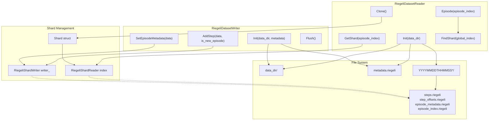
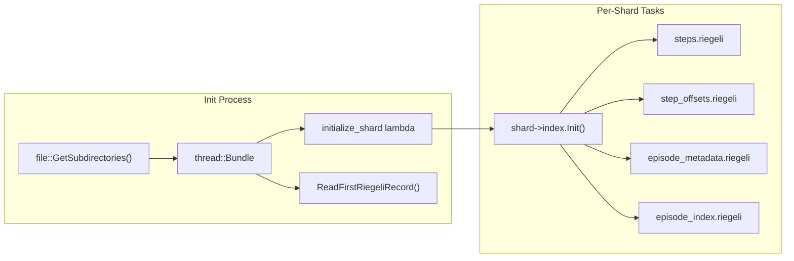
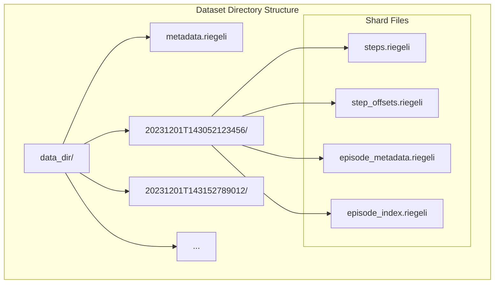
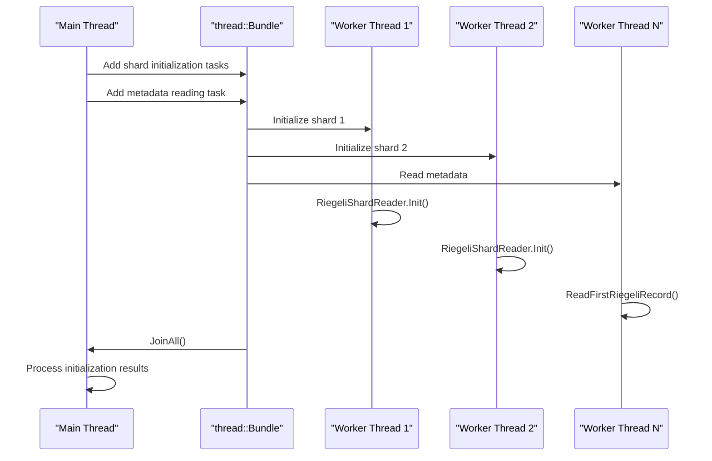
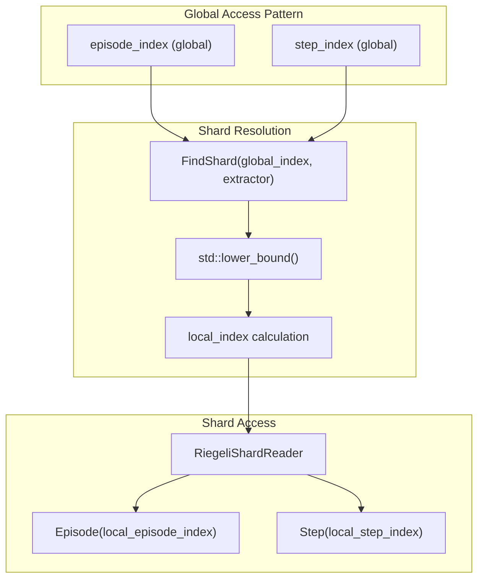

<!-- source: DeepWiki mcp.deepwiki.com · repo google-deepmind/envlogger · extra page Riegeli C++ Implementation · fetched 2026-10-26 -->

# Riegeli C++ Implementation

Relevant source files

The following files were used as context for generating this wiki page:

- [envlogger/backends/cc/BUILD.bazel](envlogger/backends/cc/BUILD.bazel)
- [envlogger/backends/cc/riegeli_dataset_reader.cc](envlogger/backends/cc/riegeli_dataset_reader.cc)
- [envlogger/backends/cc/riegeli_dataset_writer.cc](envlogger/backends/cc/riegeli_dataset_writer.cc)
- [envlogger/backends/cc/riegeli_dataset_writer.h](envlogger/backends/cc/riegeli_dataset_writer.h)
- [envlogger/backends/cc/riegeli_shard_io_test.cc](envlogger/backends/cc/riegeli_shard_io_test.cc)

## Purpose and Scope

This document covers the C++ implementation of the Riegeli dataset storage system, specifically the high-level dataset reader and writer classes that manage multiple shards and coordinate I/O operations. The implementation provides efficient, parallel access to trajectory data stored in Riegeli format.

For information about the underlying shard-level I/O operations, see [Riegeli Shard System](#3.2.2). For the Python-facing dataset APIs, see [Riegeli Dataset APIs](#3.2.3). For C++ data serialization, see [C++ XTensor Codec](#4.2).

## Architecture Overview

The Riegeli C++ implementation consists of two primary classes that manage collections of shards, each containing trajectory data organized by episodes and steps.

### Dataset Management Architecture

**Sources:** [envlogger/backends/cc/riegeli_dataset_reader.cc:94-167](), [envlogger/backends/cc/riegeli_dataset_writer.cc:86-110](), [envlogger/backends/cc/riegeli_dataset_writer.h:35-84]()

## Core Components

### RiegeliDatasetReader

The `RiegeliDatasetReader` class provides read access to multi-shard Riegeli datasets with support for parallel initialization and efficient episode/step lookups.

#### Key Data Structures

| Component | Purpose | Location |
|-----------|---------|----------|
| `Shard` struct | Manages individual shard metadata and reader | [riegeli_dataset_reader.cc:75-86]() |
| `shards_` vector | Collection of all dataset shards | [riegeli_dataset_reader.cc:105]() |
| `total_num_steps_` | Cumulative step count across shards | [riegeli_dataset_reader.cc:153]() |
| `total_num_episodes_` | Cumulative episode count across shards | [riegeli_dataset_reader.cc:154]() |

#### Parallel Initialization

The reader uses `thread::Bundle` to parallelize shard initialization:

**Sources:** [envlogger/backends/cc/riegeli_dataset_reader.cc:126-151](), [envlogger/backends/cc/riegeli_dataset_reader.cc:111-124]()

### RiegeliDatasetWriter

The `RiegeliDatasetWriter` class manages writing trajectory data across multiple shards with automatic shard creation based on episode limits.

#### Shard Management Strategy

The writer creates new shards when episode limits are reached:

| Parameter | Purpose | Default Value |
|-----------|---------|---------------|
| `max_episodes_per_shard_` | Maximum episodes per shard | 0 (unlimited) |
| `episode_counter_` | Current episode counter | 0 |
| `writer_options_` | Riegeli writer options | "transpose,brotli:6,chunk_size:1M" |

**Sources:** [envlogger/backends/cc/riegeli_dataset_writer.h:41-53](), [envlogger/backends/cc/riegeli_dataset_writer.cc:112-122]()

## File Organization and Constants

### Directory Structure

The implementation uses a specific directory structure defined in `riegeli_dataset_io_constants.h`:

### File Constants

The system uses predefined filename constants:

- `kStepsFilename`: Main trajectory data
- `kStepOffsetsFilename`: Step position indices
- `kEpisodeMetadataFilename`: Episode-level metadata
- `kEpisodeIndexFilename`: Episode boundary indices
- `kMetadataFilename`: Dataset-level metadata

**Sources:** [envlogger/backends/cc/riegeli_dataset_reader.cc:98](), [envlogger/backends/cc/riegeli_dataset_reader.cc:114-121](), [envlogger/backends/cc/riegeli_dataset_writer.cc:95-96]()

## Threading and Parallelization

### Parallel Shard Initialization

The reader implements parallel initialization using `thread::Bundle`:

**Sources:** [envlogger/backends/cc/riegeli_dataset_reader.cc:126-151]()

### Cumulative Index Building

After parallel initialization, the reader builds cumulative indices for efficient lookups:

- `global_step_index`: Global step offset for each shard
- `cumulative_steps`: Running total of steps up to each shard
- `cumulative_episodes`: Running total of episodes up to each shard

**Sources:** [envlogger/backends/cc/riegeli_dataset_reader.cc:152-161]()

## Integration with Lower-Level Components

### Shard Reader Integration

The dataset reader manages multiple `RiegeliShardReader` instances and provides global indexing:

**Sources:** [envlogger/backends/cc/riegeli_dataset_reader.cc:212-223](), [envlogger/backends/cc/riegeli_dataset_reader.cc:177-193]()

### Writer Integration

The dataset writer coordinates with `RiegeliShardWriter` for automatic shard management:

- Creates new shards based on episode limits
- Manages timestamp-based directory naming
- Handles metadata persistence
- Coordinates flushing and closing operations

**Sources:** [envlogger/backends/cc/riegeli_dataset_writer.cc:64-82](), [envlogger/backends/cc/riegeli_dataset_writer.cc:112-122]()

---

