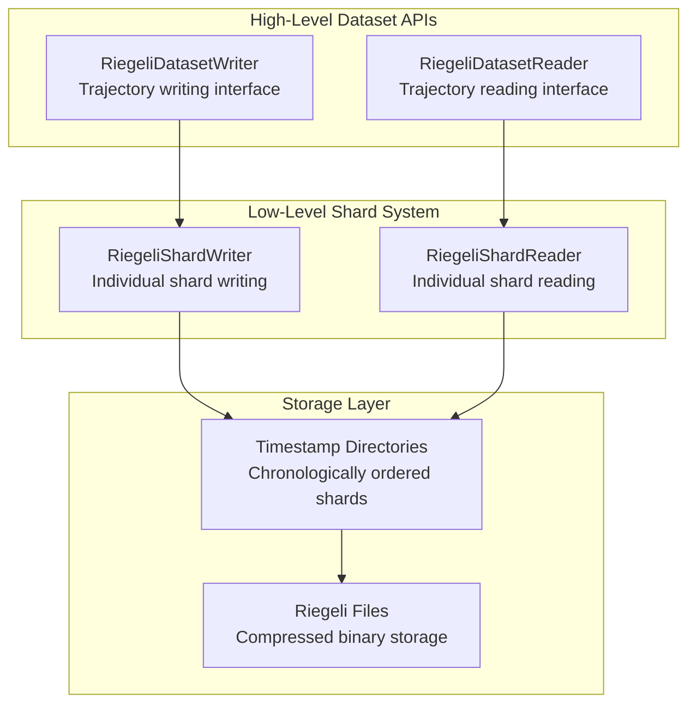
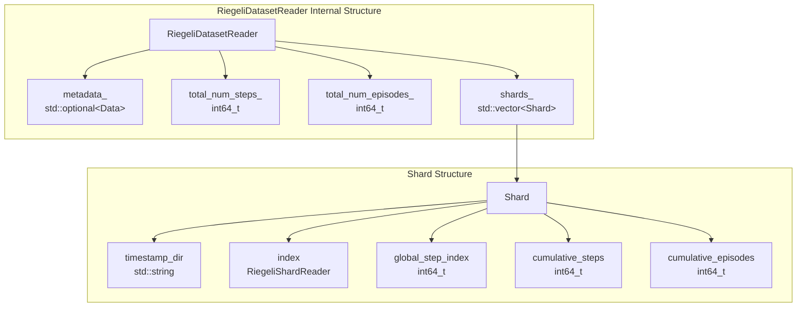
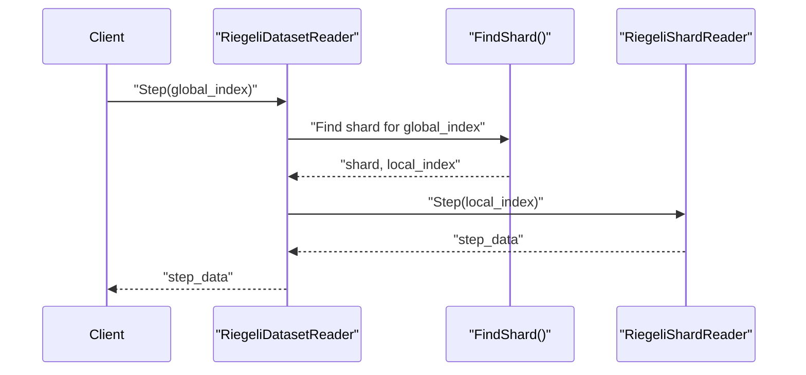
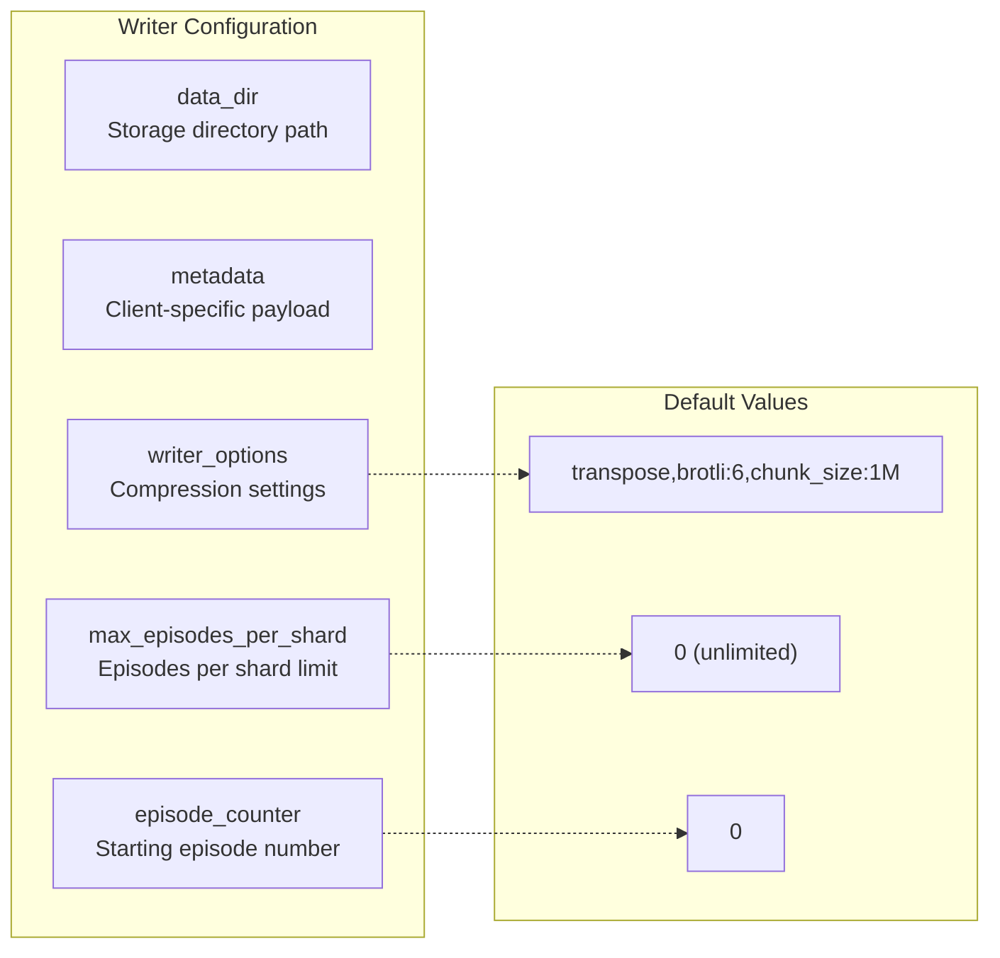
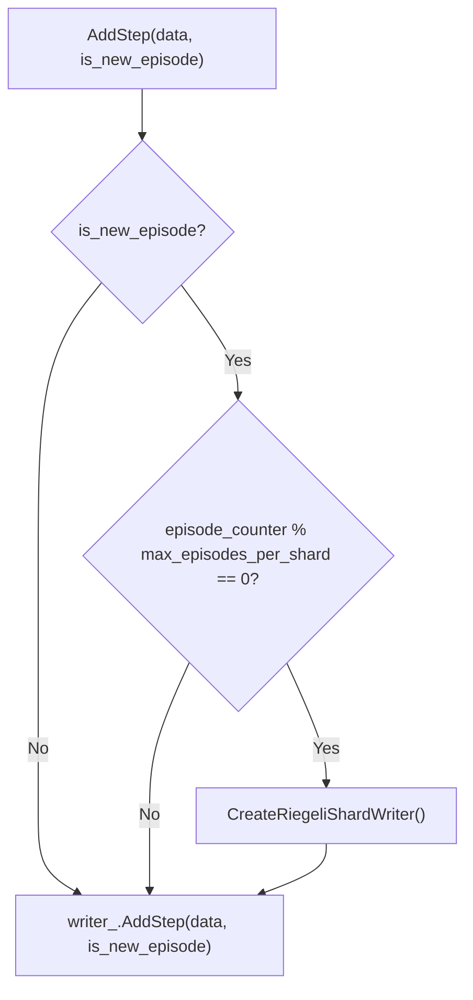
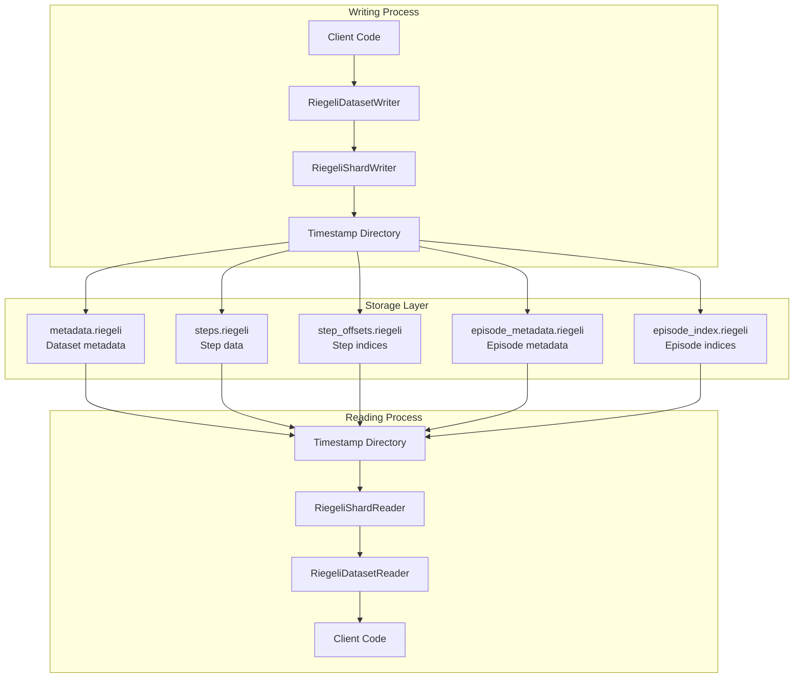

<!-- source: DeepWiki mcp.deepwiki.com · repo google-deepmind/envlogger · extra page Riegeli Dataset APIs · fetched 2026-10-26 -->

# Riegeli Dataset APIs

Relevant source files

The following files were used as context for generating this wiki page:

- [envlogger/backends/cc/riegeli_dataset_reader.h](envlogger/backends/cc/riegeli_dataset_reader.h)
- [envlogger/backends/cc/riegeli_dataset_writer.cc](envlogger/backends/cc/riegeli_dataset_writer.cc)
- [envlogger/backends/cc/riegeli_dataset_writer.h](envlogger/backends/cc/riegeli_dataset_writer.h)

This document covers the high-level dataset reader and writer APIs for the Riegeli backend storage system. These APIs provide convenient interfaces for reading and writing trajectory data stored in the Riegeli format, abstracting away the complexities of the underlying shard system.

For information about the low-level shard I/O implementation, see [Riegeli Shard System](#3.2.2). For details about the C++ implementation internals, see [Riegeli C++ Implementation](#3.2.1).

## API Overview

The Riegeli dataset APIs consist of two primary classes that work together to provide a complete data storage and retrieval system:

**Dataset-Level API Architecture**

Sources: [envlogger/backends/cc/riegeli_dataset_reader.h:15-149](), [envlogger/backends/cc/riegeli_dataset_writer.h:15-88]()

## RiegeliDatasetReader API

The `RiegeliDatasetReader` class provides read access to trajectory data stored across multiple shards. It represents a one-dimensional trajectory composed of steps that can be grouped into episodes.

### Core Reader Methods

| Method | Purpose | Return Type |
|--------|---------|-------------|
| `Init(data_dir)` | Initialize reader with data directory | `absl::Status` |
| `NumSteps()` | Get total number of steps across all shards | `int64_t` |
| `NumEpisodes()` | Get total number of episodes across all shards | `int64_t` |
| `Step<T>(step_index)` | Retrieve step data at global index | `std::optional<T>` |
| `Episode(episode_index)` | Get episode information and metadata | `std::optional<EpisodeInfo>` |
| `Clone()` | Create thread-safe copy of reader | `absl::StatusOr<RiegeliDatasetReader>` |

### Reader Architecture

**RiegeliDatasetReader Internal Architecture**

Sources: [envlogger/backends/cc/riegeli_dataset_reader.h:89-128]()

### Step Access Pattern

The reader uses a two-level indexing system to locate steps efficiently:

1. **Global Index Resolution**: Find the appropriate shard using the `FindShard` method
2. **Local Index Access**: Access the step within the shard using the shard's internal index

**Step Access Flow**

Sources: [envlogger/backends/cc/riegeli_dataset_reader.h:134-145]()

## RiegeliDatasetWriter API

The `RiegeliDatasetWriter` class manages the creation of trajectory data, automatically handling shard creation and episode boundaries.

### Core Writer Methods

| Method | Purpose | Parameters |
|--------|---------|------------|
| `Init()` | Initialize writer with configuration | `data_dir`, `metadata`, `max_episodes_per_shard`, `writer_options` |
| `AddStep()` | Add step data to trajectory | `data`, `is_new_episode` |
| `SetEpisodeMetadata()` | Set metadata for current episode | `data` |
| `Flush()` | Flush pending writes to disk | None |
| `Close()` | Finalize all writes and release resources | None |

### Writer Configuration

The writer accepts several configuration parameters during initialization:

**Writer Configuration Parameters**

Sources: [envlogger/backends/cc/riegeli_dataset_writer.h:49-53]()

### Shard Management

The writer automatically creates new shards based on the `max_episodes_per_shard` parameter:

**Shard Creation Logic**

Sources: [envlogger/backends/cc/riegeli_dataset_writer.cc:112-122]()

## Data Flow Architecture

The complete data flow from writing to reading involves several layers:

**Complete Data Flow Architecture**

Sources: [envlogger/backends/cc/riegeli_dataset_writer.cc:64-82](), [envlogger/backends/cc/riegeli_dataset_reader.h:37-48]()

## Usage Patterns

### Thread Safety

The `RiegeliDatasetReader` supports multi-threaded access through the `Clone()` method:

- Original reader can be used in one thread
- `Clone()` creates an independent reader instance for additional threads
- Each cloned reader maintains its own file handles and state

Sources: [envlogger/backends/cc/riegeli_dataset_reader.h:54-56]()

### Episode Boundary Management

Writers must explicitly mark episode boundaries when adding steps:

- `AddStep(data, true)` marks the beginning of a new episode
- `SetEpisodeMetadata()` can be called multiple times for the current episode
- Metadata is written when a new episode begins or when the writer is closed

Sources: [envlogger/backends/cc/riegeli_dataset_writer.h:55-65]()

### Resource Management

Both reader and writer classes provide explicit resource management:

- `Close()` methods release file handles and flush pending writes
- Destructors automatically clean up resources
- `Flush()` ensures data is written to disk without closing files

Sources: [envlogger/backends/cc/riegeli_dataset_reader.h:59](), [envlogger/backends/cc/riegeli_dataset_writer.h:67-70]()

---

