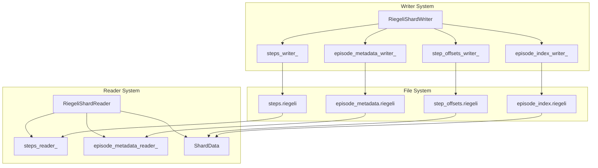
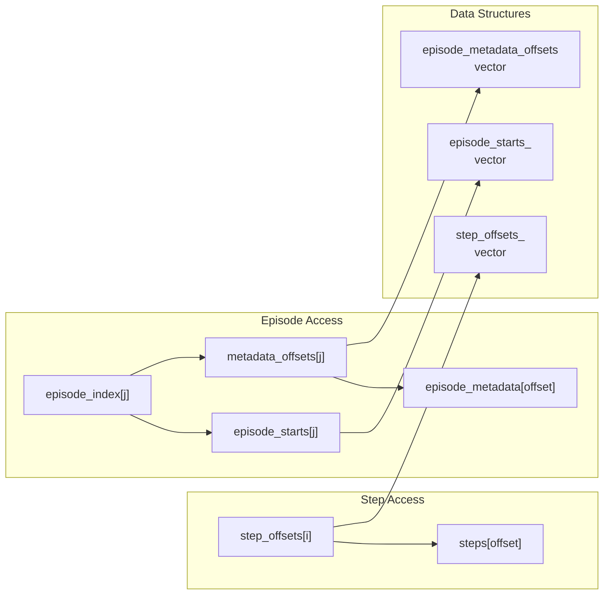
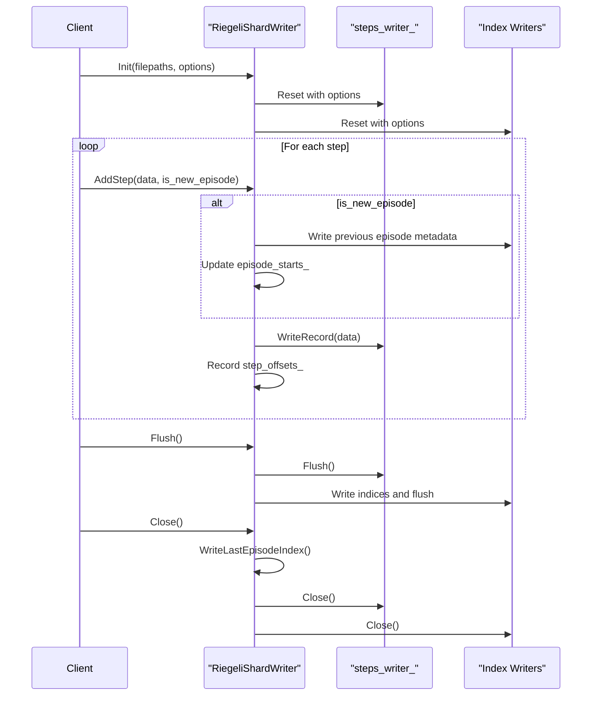
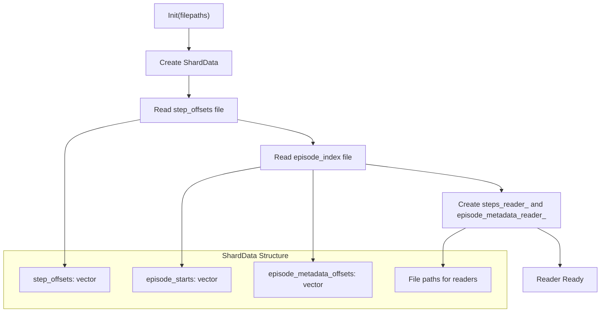
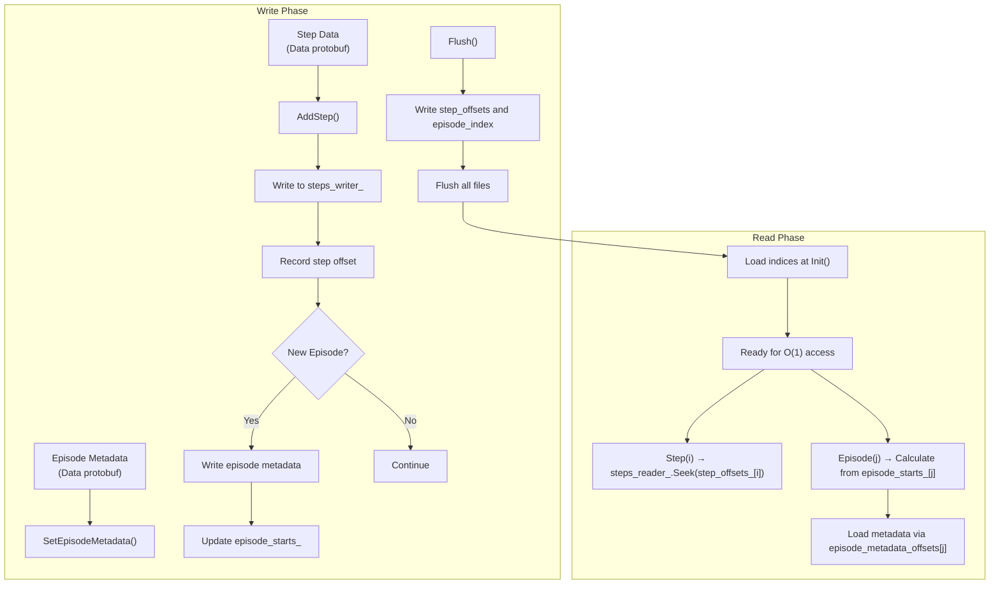

<!-- source: DeepWiki mcp.deepwiki.com · repo google-deepmind/envlogger · extra page Riegeli Shard System · fetched 2026-10-26 -->

# Riegeli Shard System

Relevant source files

The following files were used as context for generating this wiki page:

- [envlogger/backends/cc/riegeli_shard_reader.cc](envlogger/backends/cc/riegeli_shard_reader.cc)
- [envlogger/backends/cc/riegeli_shard_reader_test.cc](envlogger/backends/cc/riegeli_shard_reader_test.cc)
- [envlogger/backends/cc/riegeli_shard_writer.cc](envlogger/backends/cc/riegeli_shard_writer.cc)
- [envlogger/backends/cc/riegeli_shard_writer.h](envlogger/backends/cc/riegeli_shard_writer.h)
- [envlogger/backends/cc/riegeli_shard_writer_test.cc](envlogger/backends/cc/riegeli_shard_writer_test.cc)

## Purpose and Scope

The Riegeli Shard System provides a high-performance sharding architecture for storing and retrieving trajectory data using the Riegeli record format. This system implements external indexing to enable O(1) random access to individual steps and episodes within large trajectory datasets.

For the high-level Riegeli backend integration, see [Riegeli Backend](#3.2). For the C++ dataset APIs that use this sharding system, see [Riegeli Dataset APIs](#3.2.3).

## Architecture Overview

The Riegeli Shard System consists of two main components: `RiegeliShardWriter` for data ingestion and `RiegeliShardReader` for data retrieval. The system employs a multi-file architecture where each shard is split into four distinct files to optimize storage and enable efficient random access.

### Core Components

**Sources:** [envlogger/backends/cc/riegeli_shard_writer.h:35-116](), [envlogger/backends/cc/riegeli_shard_reader.cc:59-195]()

## File Structure

The sharding system divides trajectory data across four specialized files, each optimized for specific access patterns:

| File Type | Purpose | Content | Access Pattern |
|-----------|---------|---------|----------------|
| **steps** | Trajectory data | `Data` objects containing timesteps, actions, metadata | Sequential/Random via index |
| **step_offsets** | Step index | `Datum` objects with `xt::xarray<int64_t>` offsets | Random access |
| **episode_metadata** | Episode metadata | `Data` objects with episode-level information | Random via episode index |
| **episode_index** | Episode index | `Datum` objects with `(start_step, metadata_offset)` pairs | Random access |

### Index Structure

**Sources:** [envlogger/backends/cc/riegeli_shard_writer.h:44-67](), [envlogger/backends/cc/riegeli_shard_reader.cc:72-89]()

## Writer System

The `RiegeliShardWriter` manages the creation and writing of sharded trajectory data through a coordinated multi-file write process.

### Writer Lifecycle

**Sources:** [envlogger/backends/cc/riegeli_shard_writer.cc:72-95](), [envlogger/backends/cc/riegeli_shard_writer.cc:179-215]()

### Key Writer Methods

The writer provides several key methods for data ingestion:

- **`Init()`** - Initializes all four file writers with specified options
- **`AddStep()`** - Writes step data and manages episode boundaries
- **`SetEpisodeMetadata()`** - Sets metadata for the current episode
- **`Flush()`** - Writes accumulated indices to disk
- **`Close()`** - Finalizes all files and releases resources

**Sources:** [envlogger/backends/cc/riegeli_shard_writer.h:68-91](), [envlogger/backends/cc/riegeli_shard_writer.cc:99-177]()

## Reader System

The `RiegeliShardReader` provides efficient random access to trajectory data by loading index information at initialization and using it for O(1) lookups.

### Reader Initialization

**Sources:** [envlogger/backends/cc/riegeli_shard_reader.cc:61-126](), [envlogger/backends/cc/riegeli_shard_reader.cc:66-67]()

### Reader Operations

The reader supports both step-level and episode-level access:

| Method | Purpose | Time Complexity |
|--------|---------|-----------------|
| `NumSteps()` | Returns total step count | O(1) |
| `NumEpisodes()` | Returns total episode count | O(1) |
| `Step(index)` | Retrieves specific step | O(1) |
| `Episode(index, include_metadata)` | Retrieves episode info | O(1) |
| `Clone()` | Creates independent reader copy | O(1) |

**Sources:** [envlogger/backends/cc/riegeli_shard_reader.cc:140-184]()

## Data Flow Architecture

The system processes trajectory data through a coordinated write-then-read pipeline:

**Sources:** [envlogger/backends/cc/riegeli_shard_writer.cc:179-215](), [envlogger/backends/cc/riegeli_shard_reader.cc:148-184]()

The shard system's design enables efficient storage and retrieval of large trajectory datasets by separating data from indexing information, allowing for both sequential processing during writes and random access during reads.

---

