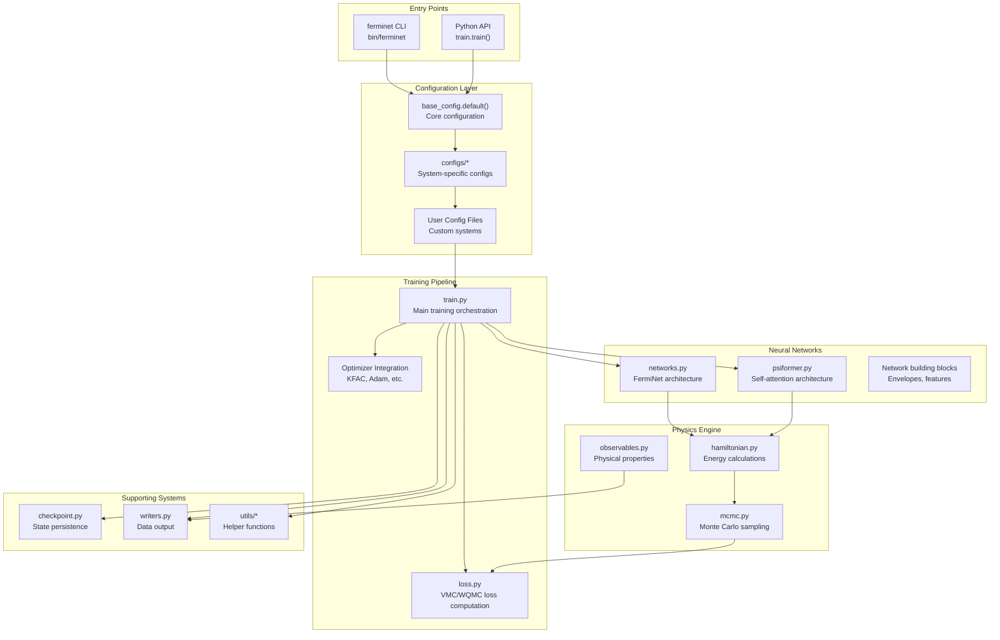

<!-- source: DeepWiki mcp.deepwiki.com · repo google-deepmind/ferminet · page 1 Overview · fetched 2026-10-26 -->

# Overview

Relevant source files

The following files were used as context for generating this wiki page:

- [README.md](README.md)
- [ferminet/configs/atom.py](ferminet/configs/atom.py)
- [ferminet/utils/writers.py](ferminet/utils/writers.py)
- [setup.py](setup.py)

This document provides a comprehensive introduction to the FermiNet codebase, covering its purpose, architecture, and core components. FermiNet is a research-level implementation of neural networks for solving quantum many-body problems in computational chemistry and condensed matter physics.

For specific configuration details, see [Configuration System](#2). For training workflows, see [Core Training Pipeline](#3). For neural network architectures, see [Neural Network Architectures](#4).

## Purpose and Scope

FermiNet (Fermionic Neural Networks) is a neural network framework designed to learn highly accurate ground state wavefunctions of atoms and molecules using variational Monte Carlo (VMC) methods. The codebase implements deep neural networks that can solve the many-electron Schrödinger equation ab-initio, providing a machine learning approach to quantum chemistry calculations.

The framework supports:
- **Ground and excited state calculations** for atoms and molecules
- **Variational Monte Carlo** optimization with custom loss functions
- **Periodic boundary conditions** for solid-state systems
- **Multiple neural architectures** including FermiNet and PsiFormer
- **Integration with quantum chemistry tools** like PySCF
- **Multi-GPU parallelization** via JAX

Sources: [README.md:1-15](), [setup.py:49-65]()

## Core Architecture Overview

The FermiNet codebase follows a modular architecture centered around a configuration-driven training pipeline. The system can be understood through several key architectural layers:

**System Architecture**

Sources: [README.md:47-97](), [ferminet/configs/atom.py:64-76](), [setup.py:57-59]()

## Data Flow and Training Workflow

The training process follows a clear data flow pattern from system definition through neural network optimization:

**Training Data Flow**

```mermaid
graph LR
    subgraph "System Definition"
        MolDef["System Definition<br/>atoms, electrons, geometry"]
        ConfigMerge["Configuration Merge<br/>base_config + user config"]
    end
    
    subgraph "Network Initialization"
        NetworkBuild["Network Construction<br/>make_fermi_net()"]
        ParamInit["Parameter Initialization<br/>init_fermi_net()"]
        WalkerInit["Walker Initialization<br/>MCMC starting positions"]
    end
    
    subgraph "Training Loop Core" 
        MCMCStep["MCMC Sampling<br/>mcmc.make_mcmc_step()"]
        NetworkEval["Network Evaluation<br/>Ψ(r₁,r₂,...,rₙ)"]
        EnergyCalc["Energy Calculation<br/>local_energy()"]
        LossComp["Loss Computation<br/>make_loss()"]
        GradUpdate["Gradient Update<br/>Optimizer step"]
    end
    
    subgraph "Output Generation"
        Checkpoint["Checkpoint Save<br/>parameters + state"]
        Metrics["Metrics Logging<br/>train_stats.csv"]
        Observables["Observable Calculation<br/>S², dipole, density"]
    end
    
    MolDef --> ConfigMerge
    ConfigMerge --> NetworkBuild
    NetworkBuild --> ParamInit
    ParamInit --> WalkerInit
    
    WalkerInit --> MCMCStep
    MCMCStep --> NetworkEval
    NetworkEval --> EnergyCalc
    EnergyCalc --> LossComp
    LossComp --> GradUpdate
    GradUpdate --> MCMCStep
    
    GradUpdate --> Checkpoint
    LossComp --> Metrics
    NetworkEval --> Observables
```

Sources: [README.md:98-152](), [ferminet/utils/writers.py:23-80]()

## Key Components and Entry Points

### Configuration System
The configuration system uses `ml_collections.ConfigDict` for hierarchical configuration management. The base configuration is defined in `base_config.default()` and can be extended through system-specific configs in the `configs/` directory.

| Component | Function | File Path |
|-----------|----------|-----------|
| Base Configuration | `default()` | `ferminet/base_config.py` |
| Atom Systems | `get_config()` | `ferminet/configs/atom.py` |
| CLI Interface | Main entry point | `bin/ferminet` |

### Neural Network Architectures
Two primary architectures are supported:

| Architecture | Key Function | Description |
|--------------|--------------|-------------|
| FermiNet | `fermi_net()` | Deep sets with antisymmetric determinant layers |
| PsiFormer | `psiformer()` | Self-attention based transformer architecture |

### Physics and Training
The core physics computations and training loop:

| Component | Key Function | Purpose |
|-----------|--------------|---------|
| Hamiltonian | `local_energy()` | Computes ⟨Ψ\|Ĥ\|Ψ⟩/⟨Ψ\|Ψ⟩ |
| MCMC Sampling | `make_mcmc_step()` | Metropolis-Hastings electron sampling |
| Loss Functions | `make_loss()` | VMC, WQMC, overlap penalty losses |
| Training Loop | `train()` | Main orchestration function |

Sources: [README.md:47-67](), [ferminet/configs/atom.py:23-61]()

## System Capabilities

### Supported Systems
- **Atoms**: Single atoms with configurable charge and spin
- **Molecules**: Multi-atom systems with arbitrary geometries  
- **Periodic Systems**: Solids with periodic boundary conditions
- **Excited States**: Multiple electronic states via NES-VMC or penalty methods

### Calculation Types
- **Ground State Optimization**: Standard VMC energy minimization
- **Excited State Calculations**: Multi-state optimization with `cfg.system.states=k`
- **Inference Mode**: Fixed-parameter observable calculations with `cfg.optim.optimizer='none'`
- **Pretraining**: Hartree-Fock initialization via `cfg.pretrain.iterations`

### Integration Points
- **PySCF Integration**: Direct molecule import via `cfg.system.pyscf_mol`
- **Multi-GPU Support**: Automatic parallelization via JAX `pmap`
- **Checkpointing**: Automatic state saving to `cfg.log.save_path`
- **Observable Tracking**: S², dipole moments, density matrices

Sources: [README.md:159-193](), [README.md:176-192]()

This architecture provides a flexible, research-oriented framework for quantum many-body calculations while maintaining clear separation between configuration, physics, and neural network components.

---

