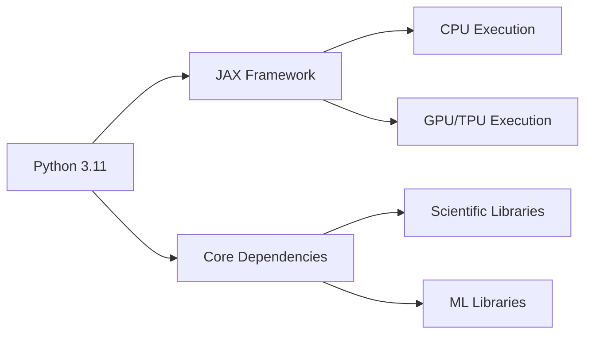
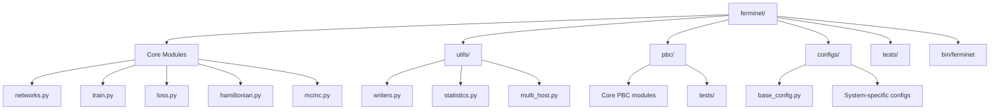
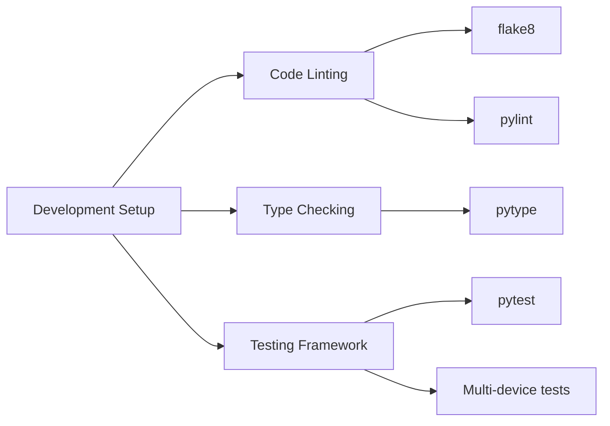

<!-- source: DeepWiki mcp.deepwiki.com · repo google-deepmind/ferminet · page 1.1 Installation and Setup · fetched 2026-10-26 -->

# Installation and Setup

<details>
<summary>Relevant source files</summary>

The following files were used as context for generating this wiki page:

- [.github/workflows/ci-build.yaml](.github/workflows/ci-build.yaml)
- [ferminet/pbc/__init__.py](ferminet/pbc/__init__.py)
- [ferminet/utils/writers.py](ferminet/utils/writers.py)
- [setup.py](setup.py)

</details>


This document provides a comprehensive guide for installing FermiNet and understanding its package structure. It covers dependency requirements, installation methods, and verification procedures to get FermiNet running on your system.

For information about configuring FermiNet for specific calculations, see [Configuration System](#2). For running your first calculation, see [Quick Start Guide](#1.2).

## Prerequisites and System Requirements

FermiNet requires Python 3.11 and is designed to work with JAX for hardware acceleration. The system supports both CPU and GPU/TPU execution.

### Python Version Requirements



The CI system validates compatibility with Python 3.11 as shown in the continuous integration configuration.

**Sources:** [.github/workflows/ci-build.yaml:19](), [.github/workflows/ci-build.yaml:25]()

## Core Dependencies

FermiNet has several categories of dependencies that enable its quantum chemistry and machine learning capabilities:

| Category | Dependencies | Purpose |
|----------|-------------|---------|
| **JAX Ecosystem** | `jax`, `jaxlib`, `chex`, `optax` | Neural network training and differentiation |
| **Scientific Computing** | `numpy`, `scipy`, `pyscf` | Numerical operations and quantum chemistry |
| **Machine Learning** | `kfac_jax`, `folx` | Optimization and automatic differentiation |
| **Data Management** | `h5py`, `pandas`, `pyblock` | Data storage and statistical analysis |
| **Configuration** | `ml-collections`, `absl-py`, `attrs` | Configuration management and command-line tools |

### Special Dependencies

Two dependencies are installed from Git repositories rather than PyPI:

- `folx`: Microsoft's forward-mode automatic differentiation library
- `kfac_jax`: DeepMind's K-FAC optimization library

**Sources:** [setup.py:22-40]()

## Installation Methods

### Standard Installation

The recommended installation method uses pip with the repository:

```bash
# Install from source
pip install git+https://github.com/google-deepmind/ferminet.git
```

### Development Installation

For development or if you want to modify the code:

```bash
# Clone the repository
git clone https://github.com/google-deepmind/ferminet.git
cd ferminet

# Install in editable mode
pip install -e .

# Install with testing dependencies
pip install -e '.[testing]'
```

The development installation includes additional tools for code quality and testing.

**Sources:** [.github/workflows/ci-build.yaml:28](), [.github/workflows/ci-build.yaml:57](), [setup.py:61]()

## Package Structure Overview

FermiNet follows a modular architecture with clear separation of concerns:



### Key Package Components

- **Core Training Pipeline**: `train.py`, `loss.py`, `networks.py`
- **Physics Implementation**: `hamiltonian.py`, `mcmc.py`, `observables.py`
- **Periodic Boundary Conditions**: `pbc/` subpackage
- **Configuration System**: `base_config.py` and `configs/`
- **Utilities**: `utils/` for logging, statistics, and multi-host support
- **Command Line Interface**: `bin/ferminet` script

**Sources:** [setup.py:58](), [ferminet/pbc/__init__.py:1-14](), [ferminet/utils/writers.py:1-80]()

## Installation Verification

### Basic Verification

After installation, verify that FermiNet is properly installed:

```bash
# Test import
python -c "import ferminet; print('FermiNet successfully imported')"

# Check command line tool
ferminet --help
```

### Running the Test Suite

The complete test suite validates all functionality:

```bash
# Run all tests
python -m pytest

# Run specific test modules
python -m pytest ferminet/tests/

# Run with verbose output
python -m pytest -v
```

### Multi-Device Testing

For multi-device setups (multiple GPUs/CPUs):

```bash
# Test with 2 CPU devices
FERMINET_CHEX_N_CPU_DEVICES=2 python -m pytest ferminet/tests/train_test.py
```

**Sources:** [.github/workflows/ci-build.yaml:63](), [.github/workflows/ci-build.yaml:67]()

## Development Environment Setup

### Code Quality Tools

FermiNet uses several tools to maintain code quality:



Install development dependencies:

```bash
pip install -e '.[testing]'
```

This includes: `flake8`, `pylint`, `pytest`, `pytype`

### Running Quality Checks

```bash
# Linting
flake8 .
pylint --fail-under 9.5 ferminet

# Type checking
pytype ferminet

# All checks (as run in CI)
python -m pytest && flake8 . && pylint --fail-under 9.5 ferminet && pytype ferminet
```

**Sources:** [setup.py:61](), [.github/workflows/ci-build.yaml:29-37]()

## Common Installation Issues

### JAX Installation Problems

JAX installation varies by platform and hardware:

- **CPU-only**: `pip install jax` installs CPU version
- **GPU**: Requires CUDA-compatible jaxlib version
- **TPU**: Requires TPU-compatible jaxlib version

Refer to JAX documentation for platform-specific installation instructions.

### Git Dependencies

The Git-based dependencies (`folx` and `kfac_jax`) require Git to be installed and accessible. If installation fails:

1. Ensure Git is installed and in PATH
2. Check network connectivity to GitHub
3. Consider using SSH keys if HTTPS access is restricted

### Import Errors

Common import issues:
- **Missing dependencies**: Reinstall with `pip install -e '.[testing]'`
- **Version conflicts**: Use a fresh virtual environment
- **Path issues**: Ensure FermiNet is properly installed, not just cloned

## Environment Configuration

### Virtual Environment (Recommended)

```bash
# Create virtual environment
python -m venv ferminet_env
source ferminet_env/bin/activate  # Linux/Mac
# ferminet_env\Scripts\activate    # Windows

# Install FermiNet
pip install -e '.[testing]'
```

### Environment Variables

FermiNet respects several environment variables:

- `FERMINET_CHEX_N_CPU_DEVICES`: Number of CPU devices for testing
- Standard JAX environment variables for device configuration

**Sources:** [.github/workflows/ci-build.yaml:67]()

---

