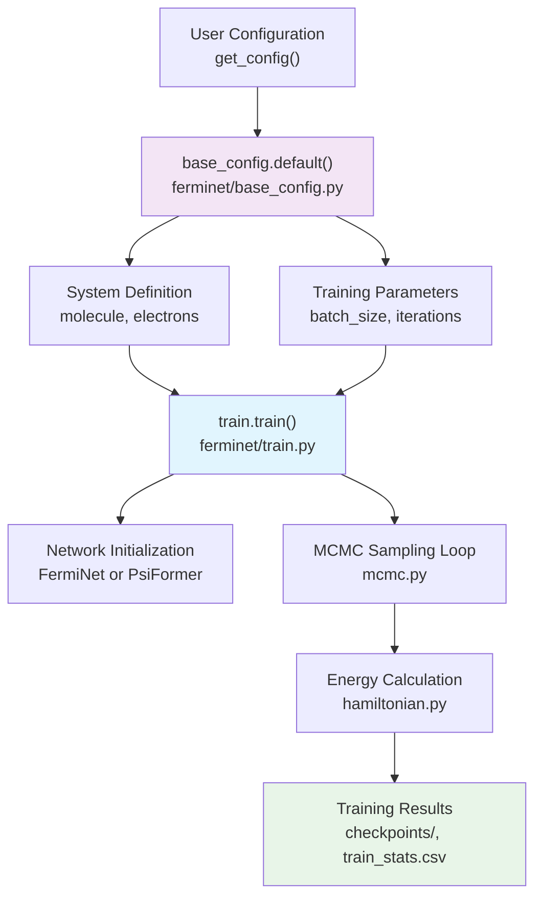
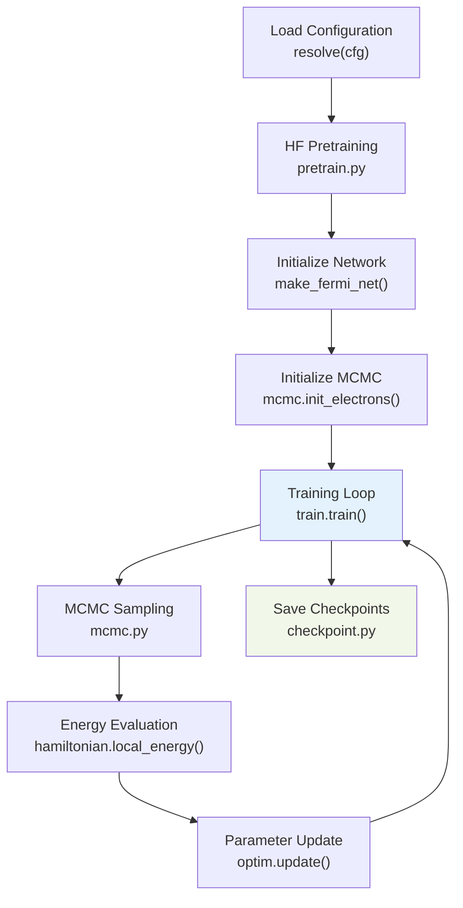

<!-- source: DeepWiki mcp.deepwiki.com · repo google-deepmind/ferminet · page 1.2 Quick Start Guide · fetched 2026-10-26 -->

# Quick Start Guide

<details>
<summary>Relevant source files</summary>

The following files were used as context for generating this wiki page:

- [README.md](README.md)
- [ferminet/base_config.py](ferminet/base_config.py)
- [ferminet/configs/atom.py](ferminet/configs/atom.py)

</details>


This guide provides a practical introduction to running FermiNet calculations. It covers basic usage patterns, simple molecular examples, and essential configuration concepts needed to get started with quantum Monte Carlo calculations. For detailed configuration options, see [Base Configuration](#2.1). For comprehensive training pipeline details, see [Core Training Pipeline](#3).

## Basic Workflow Overview

FermiNet follows a configuration-driven workflow where you define a molecular system, set training parameters, and run variational Monte Carlo optimization. The following diagram shows the essential components and their relationships:

### Quick Start Workflow



Sources: [ferminet/base_config.py:36-325](), [README.md:47-96](), [ferminet/configs/atom.py:64-76]()

## Simple Examples

### H2 Molecule Calculation

The simplest way to run a calculation is to create a configuration file or use the interactive approach. Here's how to set up an H2 molecule calculation:

**Method 1: Configuration File**

Create a file containing the `get_config()` function:

```python
from ferminet import base_config
from ferminet.utils import system

def get_config():
    cfg = base_config.default()
    cfg.system.electrons = (1, 1)  # (alpha, beta)
    cfg.system.molecule = [
        system.Atom('H', (0, 0, -1)), 
        system.Atom('H', (0, 0, 1))
    ]
    cfg.batch_size = 256
    cfg.pretrain.iterations = 100
    return cfg
```

Run with: `ferminet --config /path/to/h2_config.py`

**Method 2: Interactive Script**

```python
from ferminet import base_config, train
from ferminet.utils import system

cfg = base_config.default()
cfg.system.electrons = (1, 1)
cfg.system.molecule = [
    system.Atom('H', (0, 0, -1)), 
    system.Atom('H', (0, 0, 1))
]
cfg.batch_size = 256
cfg.pretrain.iterations = 100

train.train(cfg)
```

**Method 3: PySCF Integration**

```python
from pyscf import gto
from ferminet import base_config, train

mol = gto.Mole()
mol.build(atom='H 0 0 1; H 0 0 -1', basis='sto-3g', unit='bohr')

cfg = base_config.default()
cfg.system.pyscf_mol = mol
cfg.batch_size = 256
cfg.pretrain.iterations = 100

train.train(cfg)
```

Sources: [README.md:68-96](), [README.md:125-152]()

### Li Atom Calculation

For atomic systems, you can use the predefined atom configuration:

```bash
ferminet --config ferminet/configs/atom.py \
         --config.system.atom Li \
         --config.batch_size 256 \
         --config.pretrain.iterations 100
```

This uses the `adjust_nuclear_charge()` function in [ferminet/configs/atom.py:23-61]() to automatically set up the lithium atom with the correct electron configuration.

Sources: [README.md:55-67](), [ferminet/configs/atom.py:64-76]()

## Key Configuration Concepts

### Configuration Resolution Flow

```mermaid
graph LR
    DefaultConfig["base_config.default()"]
    UserConfig["User get_config()"]
    CommandLine["Command Line Flags"]
    ResolvedConfig["resolve(cfg)"]
    
    SystemSetup["system.set_molecule"]
    MoleculeConfig["Final molecule setup"]
    TrainingReady["Training Ready Config"]
    
    DefaultConfig --> UserConfig
    UserConfig --> CommandLine
    CommandLine --> ResolvedConfig
    
    ResolvedConfig --> SystemSetup
    SystemSetup --> MoleculeConfig
    MoleculeConfig --> TrainingReady
    
    style ResolvedConfig fill:#fff3e0
    style TrainingReady fill:#e8f5e8
```



### Essential Configuration Fields

| Field | Purpose | Example |
|-------|---------|---------|
| `cfg.system.molecule` | Atomic positions and charges | `[system.Atom('H', (0,0,0))]` |
| `cfg.system.electrons` | Electron count (α, β) | `(1, 1)` for H2 |
| `cfg.batch_size` | MCMC walker count | `256`, `4096` |
| `cfg.network.network_type` | Architecture choice | `'ferminet'`, `'psiformer'` |
| `cfg.optim.iterations` | Training steps | `1000000` |
| `cfg.pretrain.iterations` | HF pretraining steps | `1000` |

Sources: [ferminet/base_config.py:46-323]()

### System Definition Methods

The configuration system supports three ways to define molecular systems:

1. **Direct specification**: Set `cfg.system.molecule` and `cfg.system.electrons` directly
2. **PySCF integration**: Set `cfg.system.pyscf_mol` with a `pyscf.gto.Mole` object  
3. **Dynamic setup**: Use `cfg.system.set_molecule` callable for programmatic setup

The `resolve()` function in [ferminet/base_config.py:328-354]() handles the conversion between these methods.

Sources: [ferminet/base_config.py:145-194]()

## Training and Inference Workflow

### Training Phase



To run training:
```bash
ferminet --config your_config.py
```

### Inference Phase

For post-training analysis with fixed parameters, set the optimizer to `'none'`:

```bash
ferminet --config your_config.py --config.optim.optimizer 'none'
```

This runs energy evaluation without parameter updates, useful for:
- Accumulating low-variance energy estimates
- Computing observables like spin magnitude (`--config.observables.s2`)
- Calculating dipole moments (`--config.observables.dipole`)
- Generating density matrices (`--config.observables.density`)

Sources: [README.md:159-175]()

## Understanding Output

### Directory Structure

```
results/
├── train_stats.csv          # Energy and acceptance rates per iteration
├── checkpoints/             # Saved model parameters
│   ├── checkpoint_00001000  
│   └── checkpoint_00002000
└── observables/             # Observable calculations (if enabled)
    ├── s2_values.npy
    ├── dipole_values.npy
    └── density_matrix.npy
```

### Key Output Files

| File | Content | Usage |
|------|---------|-------|
| `train_stats.csv` | Training metrics per iteration | Monitor convergence |
| `checkpoints/` | Model parameters | Resume training, inference |
| `*_values.npy` | Observable timeseries | Physical analysis |

The checkpointing system in [ferminet/checkpoint.py]() automatically saves progress, allowing you to resume interrupted calculations by setting `cfg.log.restore_path`.

Sources: [README.md:194-204]()

### Multi-GPU Support

FermiNet automatically detects and uses multiple GPUs via JAX's `pmap` parallelization. No additional configuration is required - simply ensure JAX is installed with CUDA support for GPU acceleration.

Sources: [README.md:154-157]()

---

