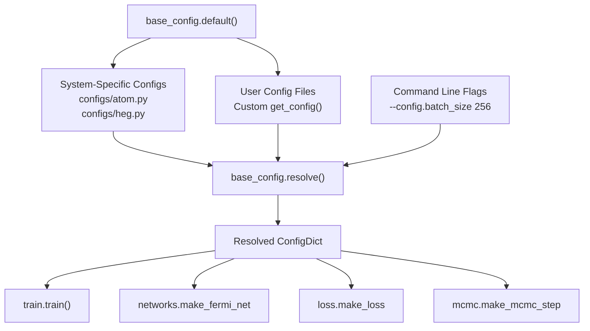
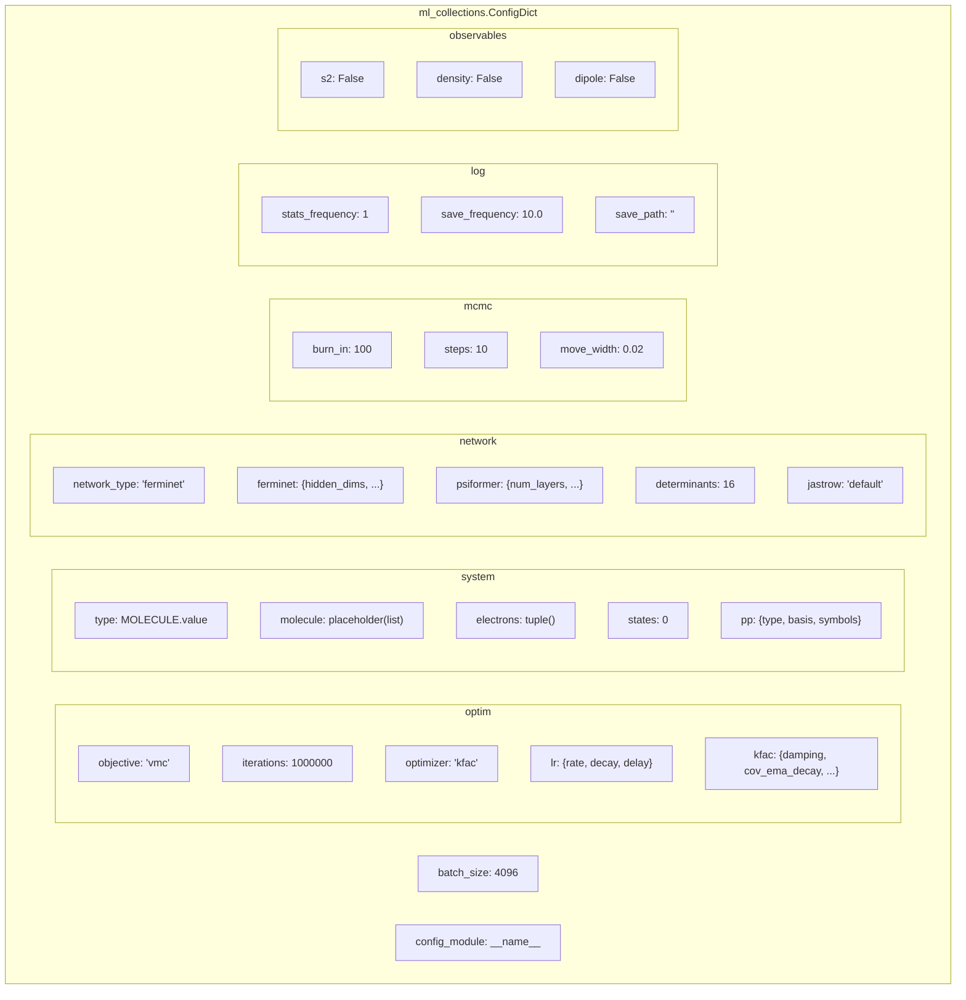
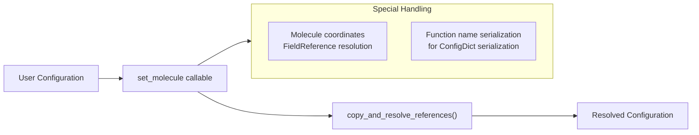
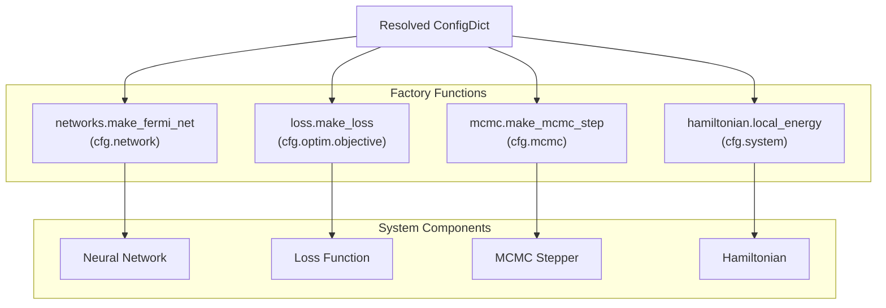

<!-- source: DeepWiki mcp.deepwiki.com · repo google-deepmind/ferminet · page 2 Configuration System · fetched 2026-10-26 -->

# Configuration System

<details>
<summary>Relevant source files</summary>

The following files were used as context for generating this wiki page:

- [README.md](README.md)
- [ferminet/base_config.py](ferminet/base_config.py)
- [ferminet/configs/atom.py](ferminet/configs/atom.py)

</details>


The Configuration System provides a centralized framework for managing all parameters, hyperparameters, and system definitions required for FermiNet calculations. It uses `ml_collections.ConfigDict` to create hierarchical, type-safe configuration objects that control every aspect of neural network training, physics calculations, and system behavior.

For information about the core training pipeline that consumes these configurations, see [Core Training Pipeline](#3). For details about specific system definitions and molecular setups, see [System Configurations](#2.2).

## Configuration Architecture

The configuration system follows a hierarchical structure where a base configuration provides defaults that can be overridden by system-specific configurations and command-line flags.



**Sources:** [ferminet/base_config.py:36-325](), [ferminet/configs/atom.py:64-76](), [README.md:49-66]()

## Base Configuration Structure

The base configuration is defined in `base_config.default()` and contains six major sections that control different aspects of the system:



**Sources:** [ferminet/base_config.py:46-323]()

## Configuration Resolution Process

Configuration resolution transforms user inputs into a complete, validated configuration through the `resolve()` function:

| Phase | Function | Purpose |
|-------|----------|---------|
| 1. Molecule Setup | `cfg.system.set_molecule()` | Execute callable to configure molecular system |
| 2. Reference Resolution | `cfg.copy_and_resolve_references()` | Resolve `ml_collections.FieldReference` values |
| 3. Validation | Implicit type checking | Ensure configuration consistency |

The resolution process handles special cases for nested references in molecular coordinates and system definitions:



**Sources:** [ferminet/base_config.py:328-355]()

## System Type Classification

The configuration system uses the `SystemType` enum to categorize different physical systems:

```python
class SystemType(enum.IntEnum):
  MOLECULE = enum.auto()
```

Currently, only molecular systems are supported, but the enum structure allows for future extensions to other system types like crystalline solids or homogeneous electron gases.

**Sources:** [ferminet/base_config.py:23-34]()

## Configuration Sections Reference

### Optimization Configuration (`cfg.optim`)

Controls training objectives, optimizers, and convergence parameters:

| Parameter | Default | Description |
|-----------|---------|-------------|
| `objective` | `'vmc'` | Loss function type: `'vmc'`, `'wqmc'`, or `'vmc_overlap'` |
| `optimizer` | `'kfac'` | Optimizer: `'adam'`, `'kfac'`, `'lamb'`, or `'none'` |
| `iterations` | `1000000` | Maximum training iterations |
| `lr.rate` | `0.05` | Base learning rate |
| `clip_local_energy` | `5.0` | Energy clipping threshold in standard deviations |

**Sources:** [ferminet/base_config.py:55-123]()

### System Configuration (`cfg.system`)

Defines the physical system being studied:

| Parameter | Default | Description |
|-----------|---------|-------------|
| `molecule` | `placeholder(list)` | List of `system.Atom` objects |
| `electrons` | `tuple()` | `(n_alpha, n_beta)` electron counts |
| `states` | `0` | Number of excited states to compute |
| `use_pp` | `False` | Enable pseudopotentials |

**Sources:** [ferminet/base_config.py:145-194]()

### Network Configuration (`cfg.network`)

Specifies neural network architecture and parameters:

| Parameter | Default | Description |
|-----------|---------|-------------|
| `network_type` | `'ferminet'` | Architecture: `'ferminet'` or `'psiformer'` |
| `determinants` | `16` | Number of Slater determinants |
| `ferminet.hidden_dims` | `((256, 32), ...)` | Layer dimensions for FermiNet |
| `psiformer.num_layers` | `4` | Number of transformer layers |

**Sources:** [ferminet/base_config.py:223-297]()

### MCMC Configuration (`cfg.mcmc`)

Controls Monte Carlo sampling parameters:

| Parameter | Default | Description |
|-----------|---------|-------------|
| `burn_in` | `100` | Burn-in steps after pretraining |
| `steps` | `10` | MCMC steps between network updates |
| `move_width` | `0.02` | Gaussian proposal width |
| `adapt_frequency` | `100` | Steps between move width adaptation |

**Sources:** [ferminet/base_config.py:195-222]()

## Configuration Usage Patterns

The configuration system integrates with the training pipeline through factory functions that consume specific configuration sections:



**Sources:** [README.md:72-96](), [ferminet/configs/atom.py:64-76]()

---

