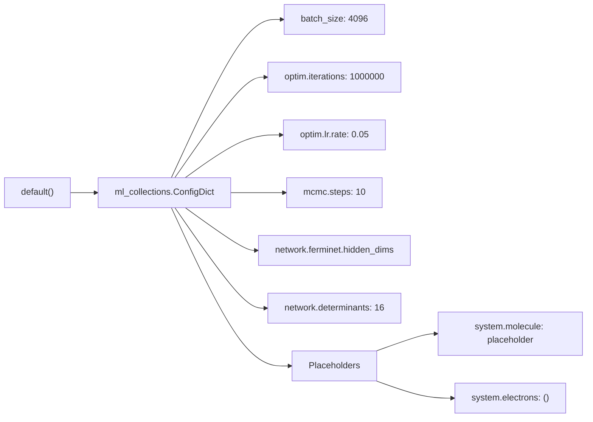
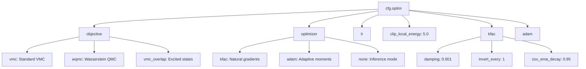
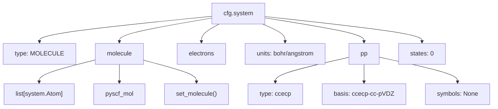
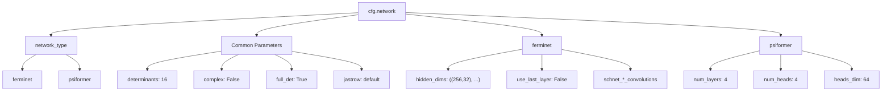
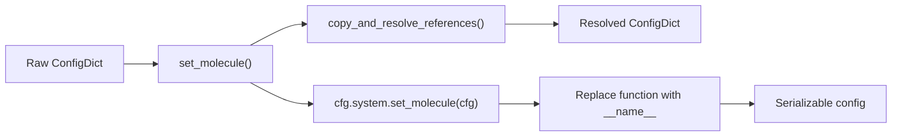
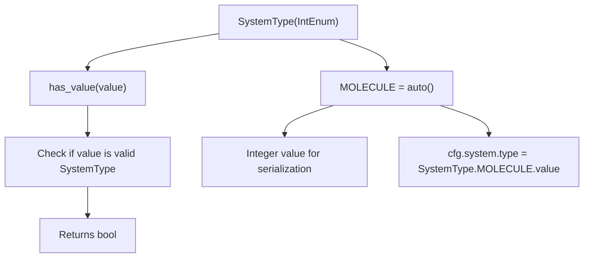

<!-- source: DeepWiki mcp.deepwiki.com · repo google-deepmind/ferminet · page 2.1 Base Configuration · fetched 2026-10-26 -->

# Base Configuration

<details>
<summary>Relevant source files</summary>

The following files were used as context for generating this wiki page:

- [ferminet/base_config.py](ferminet/base_config.py)

</details>


This document explains FermiNet's base configuration system, which provides the foundational structure and default values for all FermiNet calculations. The base configuration defines the complete parameter space for training, system definition, network architecture, and computational settings.

For information about specific system configurations (molecules, atoms, HEG), see [System Configurations](#2.2). For details about the training pipeline that uses these configurations, see [Training Loop Architecture](#3.1).

## Purpose and Scope

The base configuration system in [ferminet/base_config.py]() serves as the foundation for all FermiNet calculations. It provides:

- Default parameter values for all computational aspects
- Configuration structure and validation
- Field reference resolution for dynamic configuration
- Type safety through `ml_collections.ConfigDict`
- Extensibility for specialized systems

## Configuration Architecture

The base configuration is structured as a hierarchical `ConfigDict` with seven major sections, each controlling different aspects of the computation:

```mermaid
graph TD
    BaseConfig["default()"] --> OptimConfig["optim"]
    BaseConfig --> LogConfig["log"]
    BaseConfig --> SystemConfig["system"]
    BaseConfig --> MCMCConfig["mcmc"]
    BaseConfig --> NetworkConfig["network"]
    BaseConfig --> ObservablesConfig["observables"]
    BaseConfig --> DebugConfig["debug"]
    BaseConfig --> PretrainConfig["pretrain"]
    
    OptimConfig --> Objective["objective: vmc/wqmc/vmc_overlap"]
    OptimConfig --> Optimizer["optimizer: kfac/adam/lamb/none"]
    OptimConfig --> LearningRate["lr: rate/decay/delay"]
    OptimConfig --> KFACParams["kfac: damping/invert_every"]
    
    SystemConfig --> SystemType["type: MOLECULE"]
    SystemConfig --> MoleculeSpec["molecule: list[Atom]"]
    SystemConfig --> ElectronCount["electrons: (nup, ndown)"]
    SystemConfig --> Pseudopotentials["pp: type/basis/symbols"]
    
    NetworkConfig --> Architecture["network_type: ferminet/psiformer"]
    NetworkConfig --> FermiNetParams["ferminet: hidden_dims/determinants"]
    NetworkConfig --> PsiFormerParams["psiformer: num_layers/num_heads"]
    
    MCMCConfig --> Sampling["steps/move_width/burn_in"]
    MCMCConfig --> Initialization["init_width/init_means"]
    MCMCConfig --> Adaptation["adapt_frequency"]
```



Sources: [ferminet/base_config.py:36-325]()

## Default Configuration Factory

The `default()` function creates the base configuration with sensible default values for molecular VMC calculations:



Key characteristics of the default configuration:

| Component | Default Value | Purpose |
|-----------|---------------|---------|
| `batch_size` | 4096 | Number of electron configurations per batch |
| `optim.objective` | 'vmc' | Variational Monte Carlo optimization |
| `optim.optimizer` | 'kfac' | K-FAC natural gradient optimizer |
| `optim.lr.rate` | 0.05 | Base learning rate |
| `mcmc.steps` | 10 | MCMC steps between parameter updates |
| `network.network_type` | 'ferminet' | Default architecture |
| `network.determinants` | 16 | Number of Slater determinants |

Sources: [ferminet/base_config.py:46-323]()

## Configuration Sections

### Optimization Section

The `optim` section controls the training objective and optimization algorithm:



### System Section

The `system` section defines the quantum system being studied:



### Network Section

The `network` section configures the neural network architecture:



Sources: [ferminet/base_config.py:223-297]()

## Configuration Resolution Process

The `resolve()` function processes the configuration to handle dynamic elements and field references:



The resolution process handles:

1. **Dynamic molecule setting**: If `cfg.system.set_molecule` is callable, it's executed to configure the molecular system
2. **Field reference resolution**: `ml_collections.FieldReference` values are resolved to their actual values
3. **Function serialization**: Callable objects are replaced with their names for serialization
4. **Coordinate validation**: Atomic positions are validated as numeric values

### Resolution Steps

| Step | Function | Purpose |
|------|----------|---------|
| 1 | Check `set_molecule` | Execute dynamic molecule configuration |
| 2 | `copy_and_resolve_references()` | Resolve all field references |
| 3 | Function name replacement | Make config serializable |
| 4 | Coordinate validation | Ensure numeric atomic positions |

Sources: [ferminet/base_config.py:328-354]()

## System Type Enumeration

The `SystemType` enum provides type safety for system specification:



**Important Note**: The enum values should be accessed via `.value` for serialization compatibility, as stated in the warning comment.

Sources: [ferminet/base_config.py:23-34]()

## Configuration Usage Patterns

### Basic Usage

```python
# Create default configuration
cfg = base_config.default()

# Set required placeholders
cfg.system.molecule = [system.Atom('H', (0, 0, 0)), system.Atom('H', (0, 0, 1.4))]
cfg.system.electrons = (1, 1)

# Resolve field references
cfg = base_config.resolve(cfg)
```

### Dynamic Configuration

```python
# Use set_molecule for dynamic setup
def configure_water(cfg):
    cfg.system.molecule = [
        system.Atom('O', (0, 0, 0)),
        system.Atom('H', (0.757, 0.587, 0)),
        system.Atom('H', (-0.757, 0.587, 0))
    ]
    cfg.system.electrons = (5, 5)
    return cfg

cfg.system.set_molecule = configure_water
cfg = base_config.resolve(cfg)
```

### Configuration Extension

The base configuration serves as a foundation that can be extended by specific system configurations in the `configs/` directory, which import and modify the base configuration for specialized use cases.

Sources: [ferminet/base_config.py:346-354]()

---

