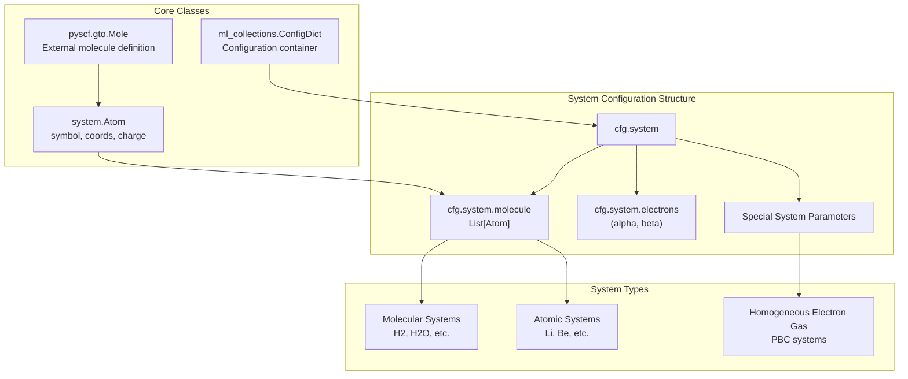
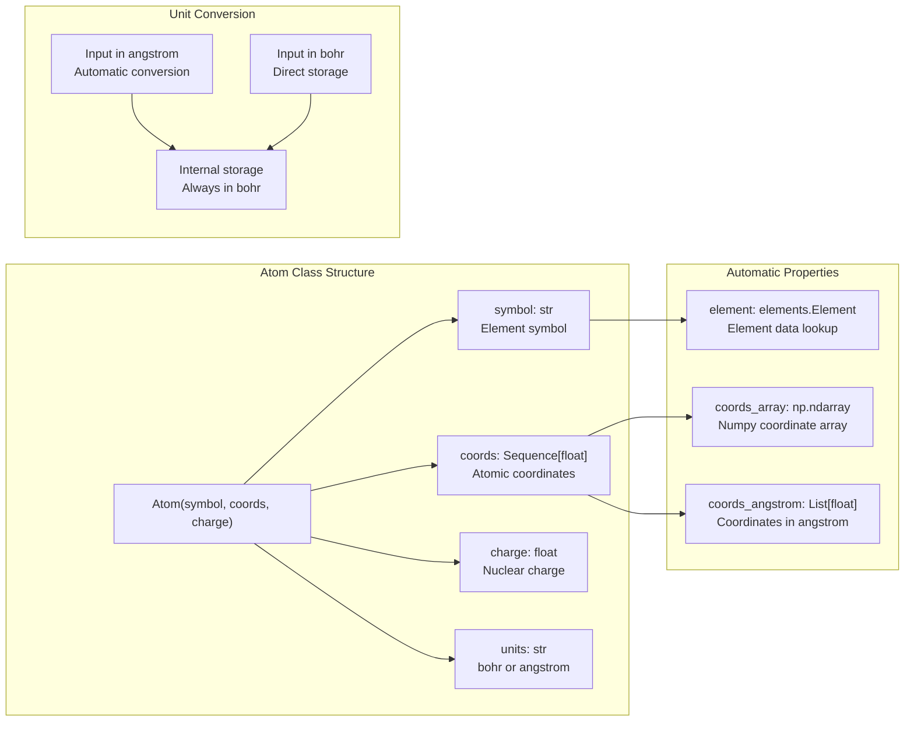
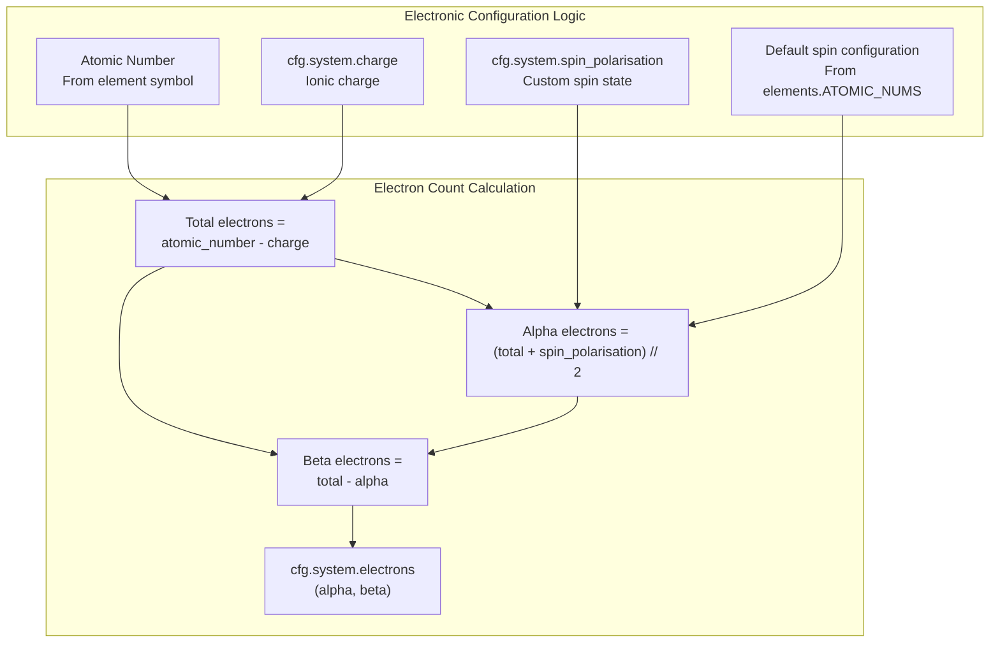
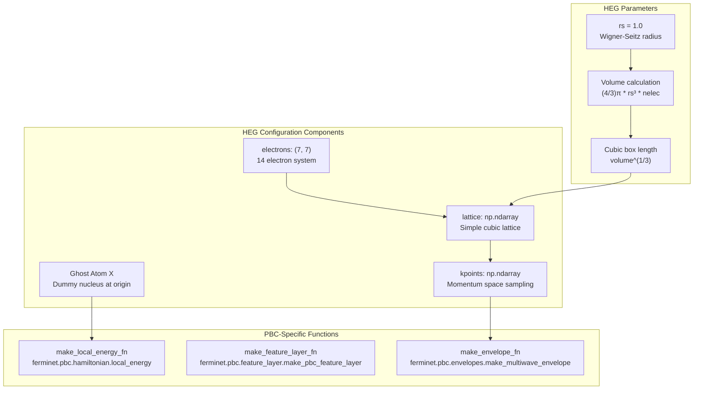
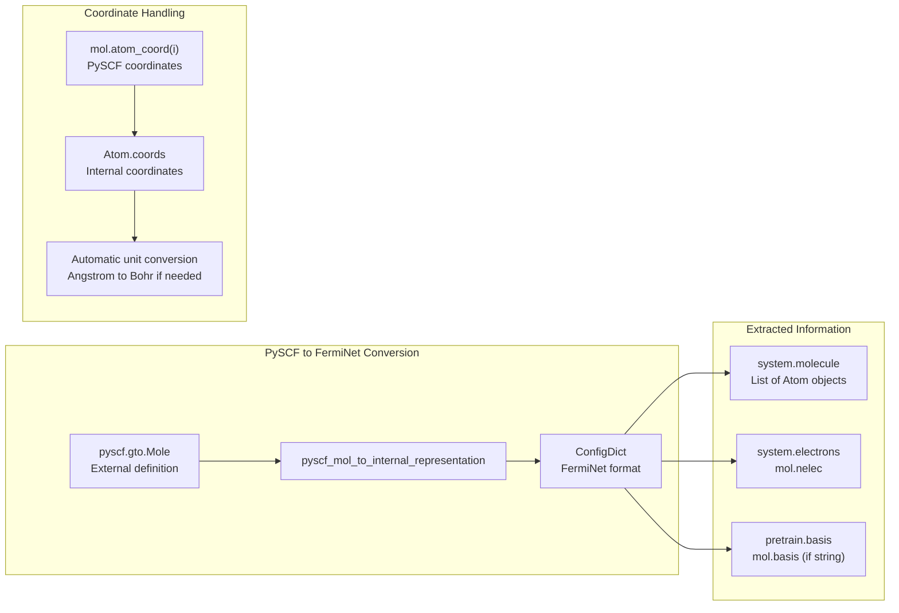

<!-- source: DeepWiki mcp.deepwiki.com · repo google-deepmind/ferminet · page 2.2 System Configurations · fetched 2026-10-26 -->

# System Configurations

<details>
<summary>Relevant source files</summary>

The following files were used as context for generating this wiki page:

- [README.md](README.md)
- [ferminet/configs/atom.py](ferminet/configs/atom.py)
- [ferminet/configs/heg.py](ferminet/configs/heg.py)
- [ferminet/pbc/tests/__init__.py](ferminet/pbc/tests/__init__.py)
- [ferminet/pbc/tests/features_test.py](ferminet/pbc/tests/features_test.py)
- [ferminet/utils/system.py](ferminet/utils/system.py)
- [ferminet/utils/tests/system_test.py](ferminet/utils/tests/system_test.py)

</details>


This document explains how to define quantum systems in FermiNet, including atoms, molecules, and specialized systems like the homogeneous electron gas (HEG). It covers the system-specific parts of the configuration that specify the physical problem to be solved. For information about the overall configuration structure and default values, see [Base Configuration](#2.1). For details about the training pipeline that uses these system definitions, see [Core Training Pipeline](#3).

## System Definition Components

FermiNet system configurations consist of three primary components: atomic positions and charges, electronic structure, and system-specific parameters. These are defined through the `cfg.system` configuration section and related utility classes.



**Sources:** [ferminet/utils/system.py:26-87](), [ferminet/configs/atom.py:23-61](), [ferminet/configs/heg.py:31-57]()

## The Atom Class

The fundamental building block for system definitions is the `Atom` class, which represents individual atomic species with their positions and nuclear charges.



**Sources:** [ferminet/utils/system.py:26-87](), [ferminet/utils/tests/system_test.py:27-38]()

### Key Atom Class Features

| Property | Description | Default Behavior |
|----------|-------------|------------------|
| `symbol` | IUPAC element symbol | Required parameter |
| `coords` | Atomic coordinates | `(0.0, 0.0, 0.0)` |
| `charge` | Nuclear charge | Atomic number of element |
| `atomic_number` | Atomic number | Atomic number of element |
| `units` | Coordinate units | `'bohr'` |

The `Atom` class automatically handles unit conversion and provides convenient properties for accessing coordinates in different formats. Nuclear charges default to the atomic number but can be overridden for fractional nuclear charge calculations.

**Sources:** [ferminet/utils/system.py:49-87]()

## Molecular Systems

Molecular systems are defined by specifying a list of `Atom` objects in `cfg.system.molecule` along with the electronic configuration in `cfg.system.electrons`.

### Basic Molecular Configuration

```python
# H2 molecule example from README
cfg.system.electrons = (1, 1)  # (alpha electrons, beta electrons)
cfg.system.molecule = [
    system.Atom('H', (0, 0, -1)), 
    system.Atom('H', (0, 0, 1))
]
```

### Electronic Structure Specification

The `cfg.system.electrons` tuple specifies the number of alpha (spin-up) and beta (spin-down) electrons. For atoms, this can be automatically determined based on the atomic number and charge state.



**Sources:** [ferminet/configs/atom.py:49-60](), [ferminet/utils/system.py:89-116]()

## Atomic Systems

Single-atom systems use the generic atom configuration template that automatically sets up the electronic structure based on the element and charge state.

### Atomic Configuration Parameters

| Parameter | Type | Description |
|-----------|------|-------------|
| `cfg.system.atom` | `str` | Element symbol |
| `cfg.system.charge` | `int` | Ionic charge |
| `cfg.system.delta_charge` | `float` | Fractional nuclear charge adjustment |
| `cfg.system.spin_polarisation` | `int` | Custom spin polarization |

The `adjust_nuclear_charge` function in [ferminet/configs/atom.py:23-61]() automatically sets up the molecule and electronic structure based on these parameters.

**Sources:** [ferminet/configs/atom.py:23-76]()

## Specialized Systems

### Homogeneous Electron Gas (HEG)

The HEG represents a system of interacting electrons in a uniform positive background, used for studying electron correlation in bulk materials.



**Sources:** [ferminet/configs/heg.py:24-57]()

### HEG System Setup

The HEG configuration demonstrates how specialized systems override default functions:

- **Hamiltonian**: Uses `ferminet.pbc.hamiltonian.local_energy` with `heg=True`
- **Features**: Uses `ferminet.pbc.feature_layer.make_pbc_feature_layer` without atom-electron features
- **Envelope**: Uses `ferminet.pbc.envelopes.make_multiwave_envelope` with k-point sampling
- **Pretraining**: Disabled (`cfg.pretrain.method = None`)

**Sources:** [ferminet/configs/heg.py:45-56]()

## PySCF Integration

FermiNet can directly import molecular definitions from PySCF `Mole` objects, providing seamless integration with existing quantum chemistry workflows.



**Sources:** [ferminet/utils/system.py:89-116](), [ferminet/utils/tests/system_test.py:53-92]()

### PySCF Conversion Process

The `pyscf_mol_to_internal_representation` function extracts:

1. **Atomic information**: Symbol and coordinates for each atom
2. **Electronic structure**: Total number of alpha and beta electrons
3. **Basis set**: Basis set specification (if provided as string)
4. **Unit handling**: Automatic conversion from PySCF units to internal bohr units

**Sources:** [ferminet/utils/system.py:89-116]()

## Configuration Patterns and Examples

### Complete System Configuration Examples

```python
# Molecular system (H2O)
cfg.system.electrons = (5, 5)  # 10 total electrons
cfg.system.molecule = [
    system.Atom('O', (0, 0, 0)),
    system.Atom('H', (0, 1.8, 0)),
    system.Atom('H', (0, 0, 1.8))
]

# Atomic system with custom charge
cfg.system.atom = 'Li'
cfg.system.charge = 1  # Li+ ion
# electrons automatically set to (1, 1) by adjust_nuclear_charge

# PySCF integration
mol = pyscf.gto.Mole()
mol.build(atom='H 0 0 1; H 0 0 -1', basis='sto-3g', unit='bohr')
cfg.system.pyscf_mol = mol
```

### System Type Selection Matrix

| System Type | Key Configuration | Special Functions | Use Cases |
|-------------|------------------|-------------------|-----------|
| Molecules | `cfg.system.molecule` | Standard functions | Chemistry, materials |
| Atoms | `cfg.system.atom` | `adjust_nuclear_charge` | Atomic physics, testing |
| HEG | Ghost atom + PBC | PBC functions | Condensed matter theory |
| PySCF Import | `cfg.system.pyscf_mol` | Automatic conversion | Existing workflows |

**Sources:** [README.md:70-152](), [ferminet/configs/atom.py:64-76](), [ferminet/configs/heg.py:31-57]()

---

