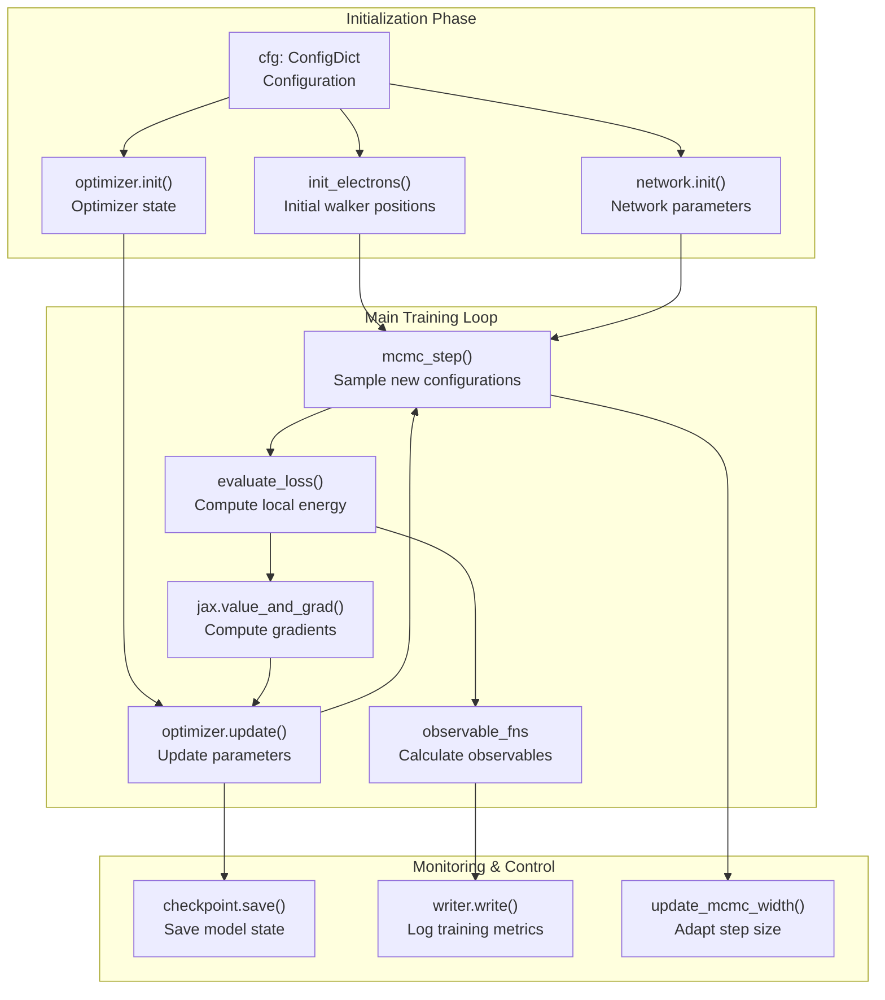
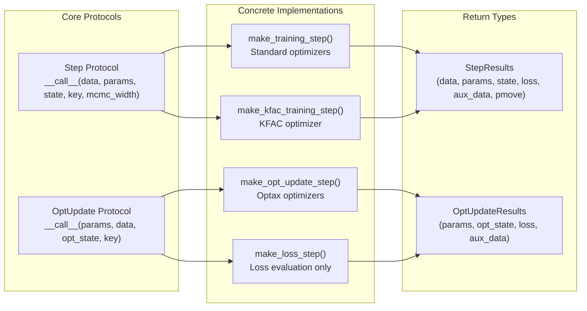
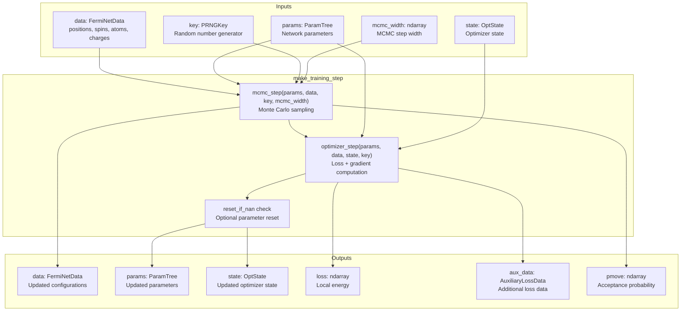
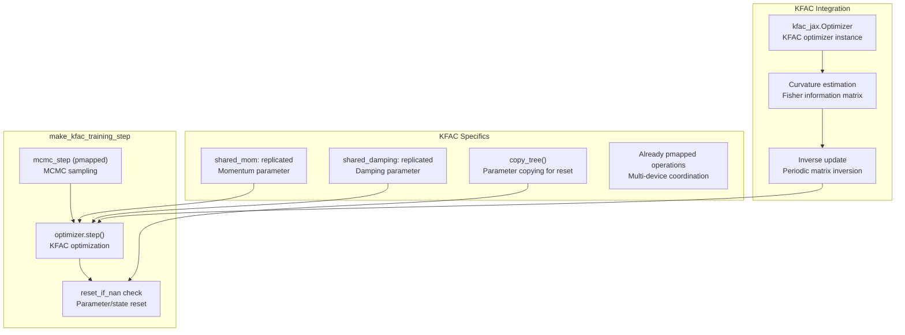
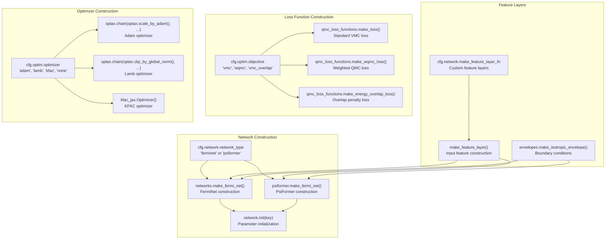
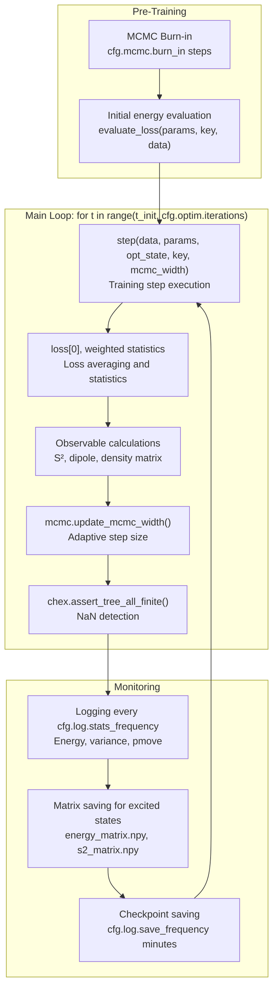
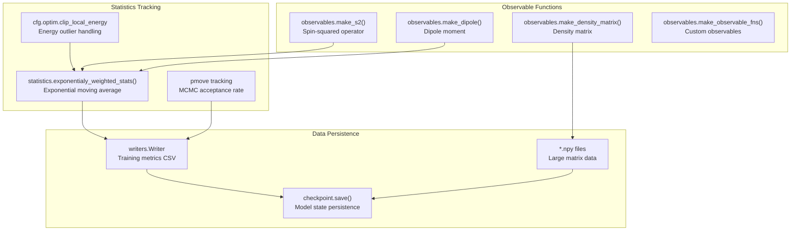
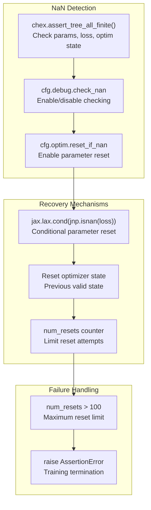

<!-- source: DeepWiki mcp.deepwiki.com · repo google-deepmind/ferminet · page 3 Core Training Pipeline · fetched 2026-10-26 -->

# Core Training Pipeline

Relevant source files

The following files were used as context for generating this wiki page:

- [ferminet/psiformer.py](ferminet/psiformer.py)
- [ferminet/tests/train_test.py](ferminet/tests/train_test.py)
- [ferminet/train.py](ferminet/train.py)

## Purpose and Scope

This document covers the core training pipeline in FermiNet, which orchestrates the main training loop that combines Monte Carlo sampling with neural network optimization for variational quantum Monte Carlo (VMC) calculations. The training pipeline coordinates between MCMC sampling, loss evaluation, and parameter optimization to train neural network wavefunctions.

For details about specific network architectures used in training, see [Neural Network Architectures](#4). For information about the physics calculations performed during training, see [Physics and Mathematics](#5). For configuration options that control the training pipeline, see [Configuration System](#2).

## Training Pipeline Overview

The training pipeline follows a standard pattern: initialize electron configurations, perform MCMC sampling to generate new configurations, evaluate the loss function (typically the local energy), compute gradients, and update network parameters. This process repeats for a specified number of iterations.

Sources: [ferminet/train.py:389-1070]()

## Main Training Function Architecture

The `train` function in [ferminet/train.py:389-1070]() serves as the main entry point and orchestrates the entire training pipeline. It handles device setup, configuration processing, network construction, and the main training loop.

### Key Training Components

| Component | Implementation | Purpose |
|-----------|---------------|---------|
| **Main Loop** | `train()` function | Coordinates all training components |
| **Step Function** | `Step` protocol | Defines interface for training steps |
| **Optimizer Update** | `OptUpdate` protocol | Defines optimization interface |
| **MCMC Sampling** | `mcmc_step` callable | Generates new electron configurations |
| **Loss Evaluation** | `evaluate_loss` callable | Computes local energy and gradients |

Sources: [ferminet/train.py:181-222](), [ferminet/train.py:157-179](), [ferminet/train.py:274-321](), [ferminet/train.py:323-387]()

## Training Step Implementations

The training pipeline supports different step implementations depending on the optimizer type and use case.

### Standard Training Step

The `make_training_step` function creates the training step for most optimizers (Adam, Lamb):

Sources: [ferminet/train.py:274-321]()

### KFAC Training Step

KFAC (Kronecker-Factored Approximate Curvature) requires special handling due to its more complex optimization procedure:

Sources: [ferminet/train.py:323-387]()

## Configuration and Initialization

The training pipeline requires extensive configuration and initialization before the main training loop begins.

### System Configuration Processing

```mermaid
graph TD
    subgraph "Input Processing"
        PySCFMol["cfg.system.pyscf_mol<br/>PySCF molecule object"]
        MoleculeConvert["pyscf_mol_to_internal_representation()<br/>Convert to internal format"]
        AtomArrays["atoms, charges arrays<br/>Atomic positions and charges"]
    end
    
    subgraph "Device Setup"
        DeviceCount["jax.local_device_count()<br/>Available devices"]
        BatchConfig["Batch size configuration<br/>Per-device batch sizing"]
        DataShape["data_shape: (num_devices, device_batch_size)<br/>Data parallelization"]
    end
    
    subgraph "Random State"
        SeedGeneration["Seed generation<br/>Deterministic or random"]
        KeySharding["kfac_jax.utils.make_different_rng_key_on_all_devices()<br/>Per-device PRNG keys"]
        MultiHostSync["multihost_utils.broadcast_one_to_all()<br/>Multi-host synchronization"]
    end
    
    PySCFMol --> MoleculeConvert
    MoleculeConvert --> AtomArrays
    
    DeviceCount --> BatchConfig
    BatchConfig --> DataShape
    
    SeedGeneration --> KeySharding
    KeySharding --> MultiHostSync
```

Sources: [ferminet/train.py:401-437](), [ferminet/train.py:686-687]()

### Network and Optimizer Construction

The training pipeline supports multiple network architectures and optimizers through a factory pattern:

Sources: [ferminet/train.py:500-530](), [ferminet/train.py:786-827](), [ferminet/train.py:834-876]()

## Main Training Loop

The core training loop executes for a specified number of iterations, performing MCMC sampling, loss evaluation, parameter updates, and monitoring.

### Training Loop Flow

Sources: [ferminet/train.py:907-926](), [ferminet/train.py:968-1070]()

### Observable and Statistics Management

The training pipeline computes various physical observables and maintains training statistics:

Sources: [ferminet/train.py:641-684](), [ferminet/train.py:982-984](), [ferminet/train.py:1016-1043](), [ferminet/train.py:1044-1055]()

## Error Handling and Recovery

The training pipeline includes robust error handling and recovery mechanisms:

### NaN Detection and Recovery

Sources: [ferminet/train.py:1000-1014](), [ferminet/train.py:311-317]()

The core training pipeline provides a robust and flexible framework for training neural network wavefunctions, supporting multiple architectures, optimizers, and loss functions while maintaining comprehensive monitoring and error recovery capabilities.

---

