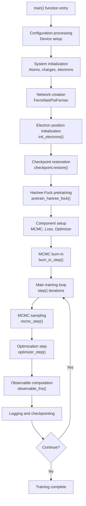
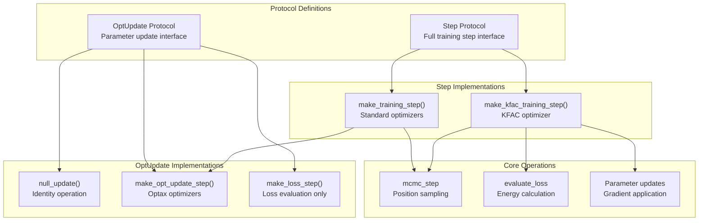
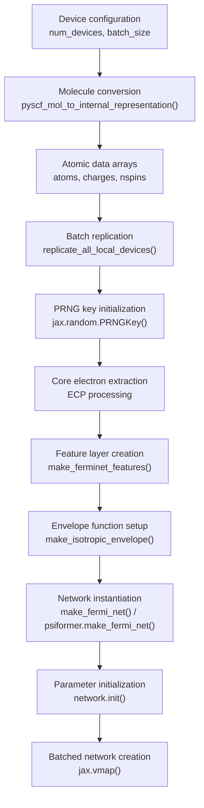
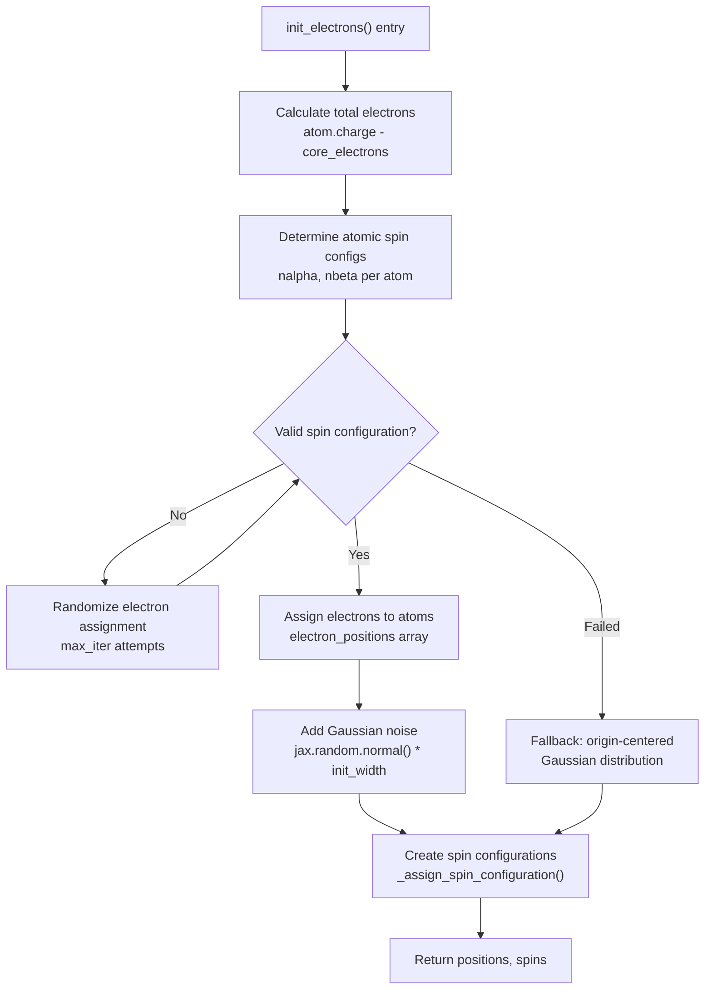
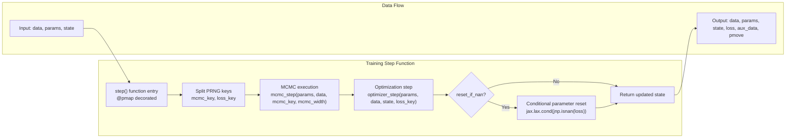
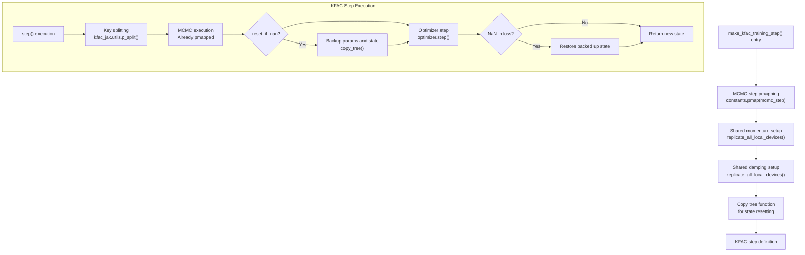
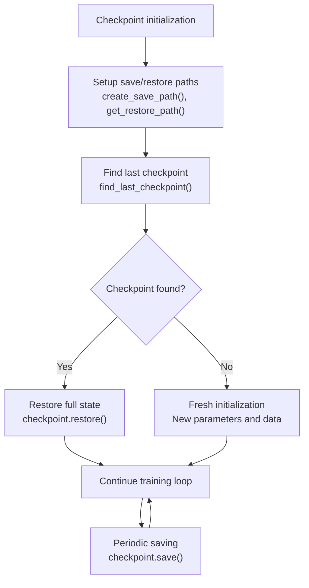
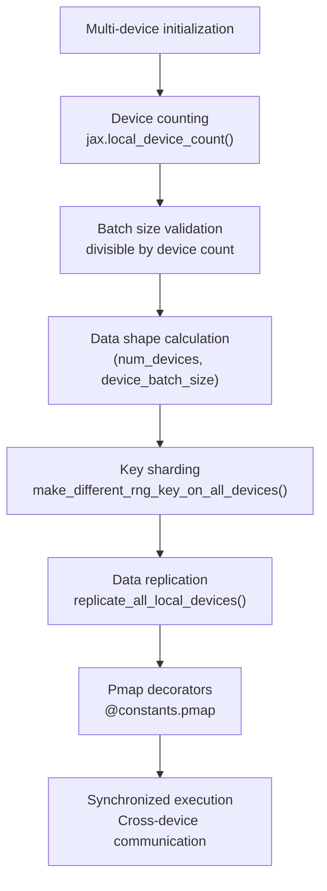

<!-- source: DeepWiki mcp.deepwiki.com · repo google-deepmind/ferminet · page 3.1 Training Loop Architecture · fetched 2026-10-26 -->

# Training Loop Architecture

Relevant source files

The following files were used as context for generating this wiki page:

- [ferminet/train.py](ferminet/train.py)

## Purpose and Scope

This document covers the architecture of FermiNet's main training loop, focusing on the `train` function implementation, component initialization, MCMC sampling integration, and optimization step coordination. This page details how the core training pipeline orchestrates all components to perform neural quantum Monte Carlo calculations.

For information about the specific loss functions and optimization algorithms, see [Loss Functions and Optimization](#3.2). For details about MCMC sampling algorithms, see [MCMC Sampling](#5.2). For network architecture details, see [Neural Network Architectures](#4).

## Training Loop Overview

The training loop architecture centers around the `train` function in `ferminet/train.py`, which coordinates initialization, pretraining, and the main training iterations. The system follows a clear separation between MCMC sampling and optimization steps.

### High-Level Training Flow

Sources: [ferminet/train.py:389-1070]()

### Training Step Protocol Architecture

The training system uses a protocol-based architecture with clear interfaces for different optimization strategies:

Sources: [ferminet/train.py:157-222](), [ferminet/train.py:224-320](), [ferminet/train.py:323-386]()

## Component Initialization

### System and Network Setup

The initialization process follows a structured sequence that sets up the computational environment, molecular system, and neural network components:

Sources: [ferminet/train.py:401-549]()

### Electron Position Initialization

The `init_electrons` function handles the critical task of generating physically reasonable initial electron configurations:

Sources: [ferminet/train.py:58-148](), [ferminet/train.py:50-56]()

## Training Step Architecture

### Standard Optimizer Training Steps

The `make_training_step` function creates training steps for non-KFAC optimizers with a clear separation between MCMC and optimization:

Sources: [ferminet/train.py:274-320]()

### KFAC Optimizer Training Steps

KFAC optimizers require special handling due to their curvature estimation requirements:

Sources: [ferminet/train.py:323-386]()

## State Management and Coordination

### Checkpointing Integration

The training loop integrates comprehensive checkpointing for long-running calculations:

| Component | Checkpoint Data | Restoration Logic |
|-----------|-----------------|-------------------|
| Training state | `t_init` (iteration number) | Resume from last iteration |
| MCMC data | `data` (positions, spins) | Restore walker configurations |
| Parameters | `params` (network weights) | Restore trained parameters |
| Optimizer state | `opt_state_ckpt` | Restore optimizer internal state |
| MCMC width | `mcmc_width_ckpt` | Restore adaptive step sizes |
| Density state | `density_state_ckpt` | Restore density matrix computation |

Sources: [ferminet/train.py:589-633](), [ferminet/train.py:1057-1059]()

### Multi-Device Coordination

The training system handles multi-device execution through systematic key management and data distribution:

Sources: [ferminet/train.py:402-414](), [ferminet/train.py:686-687](), [ferminet/train.py:293]()

---

