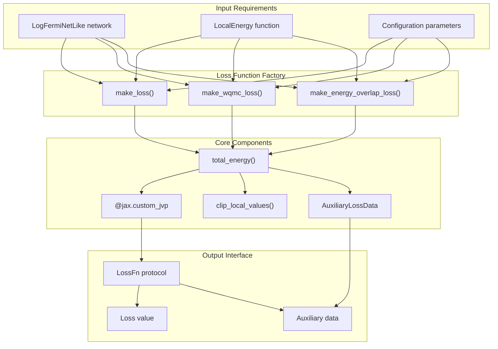
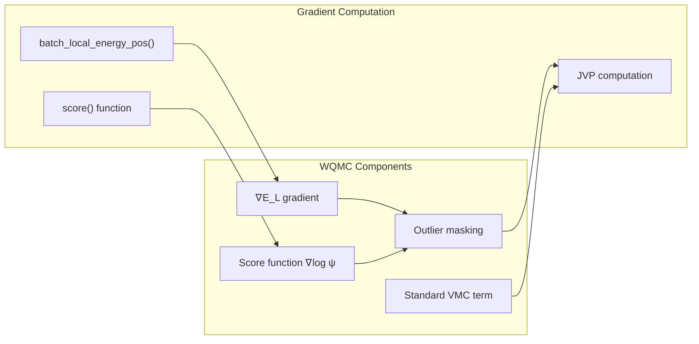
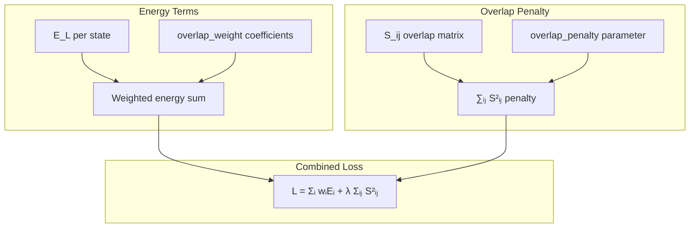
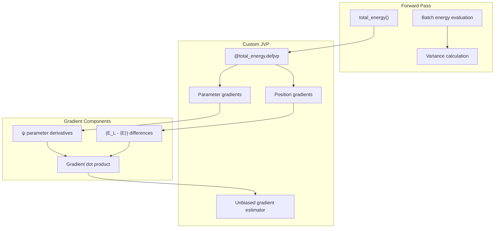
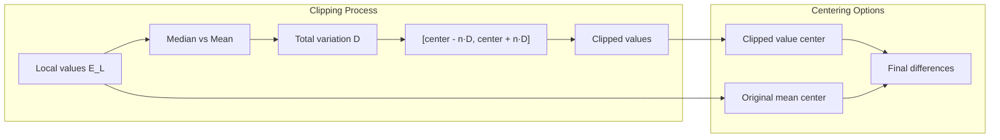
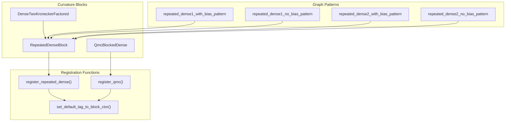
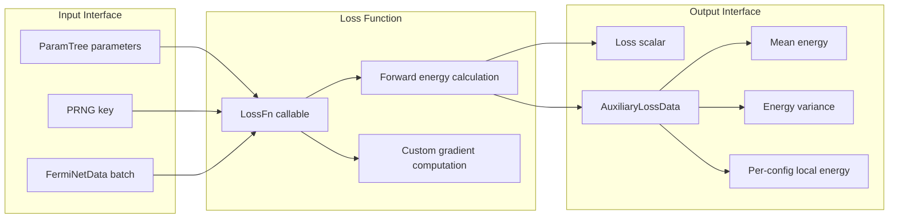

<!-- source: DeepWiki mcp.deepwiki.com · repo google-deepmind/ferminet · page 3.2 Loss Functions and Optimization · fetched 2026-10-26 -->

# Loss Functions and Optimization

Relevant source files

The following files were used as context for generating this wiki page:

- [ferminet/constants.py](ferminet/constants.py)
- [ferminet/curvature_tags_and_blocks.py](ferminet/curvature_tags_and_blocks.py)
- [ferminet/loss.py](ferminet/loss.py)

This document covers FermiNet's loss function implementations and optimization strategies. It details the three main loss functions (VMC, WQMC, and energy+overlap), custom gradient implementations, local energy clipping mechanisms, and KFAC optimization blocks. For information about the overall training pipeline that uses these loss functions, see [Training Loop Architecture](#3.1). For details about the Hamiltonian and energy calculations that feed into these loss functions, see [Hamiltonian and Energy Calculation](#5.1).

## Core Loss Functions

FermiNet implements three distinct loss functions, each designed for different training scenarios and physical requirements.

### Loss Function Architecture

Sources: [ferminet/loss.py:153-285](), [ferminet/loss.py:55-80](), [ferminet/loss.py:31-53]()

### VMC Loss Function

The standard Variational Monte Carlo (VMC) loss is implemented by `make_loss()` and represents the core energy minimization objective:

| Component | Purpose | Implementation |
|-----------|---------|----------------|
| `total_energy()` | Forward pass energy calculation | [ferminet/loss.py:201-234]() |
| `total_energy_jvp()` | Custom gradient computation | [ferminet/loss.py:236-283]() |
| `batch_local_energy` | Vectorized energy evaluation | [ferminet/loss.py:189-197]() |
| `clip_local_values()` | Outlier removal | [ferminet/loss.py:82-150]() |

The VMC loss minimizes the expectation value of the local energy:
- Forward pass: Computes mean local energy across MCMC configurations
- Custom gradient: Implements unbiased gradient estimator using `jax.custom_jvp`
- Variance tracking: Monitors energy variance for convergence assessment

Sources: [ferminet/loss.py:153-285]()

### WQMC Loss Function

The Weighted Quantum Monte Carlo (WQMC) loss function, implemented by `make_wqmc_loss()`, incorporates additional gradient information:

Key features:
- Combines VMC energy gradient with score function gradients
- Uses `jnp.tanh()` to stabilize gradient magnitudes
- Applies median-based outlier filtering with 5σ deviation threshold
- Configurable VMC weight parameter (`vmc_weight`) for hybrid training

Sources: [ferminet/loss.py:288-439](), [ferminet/loss.py:369-430]()

### Energy+Overlap Loss for Excited States

The `make_energy_overlap_loss()` function implements the penalty method for excited state calculations:

The overlap penalty ensures orthogonality between different excited states:
- Energy component: Weighted sum of individual state energies
- Overlap component: Penalty term proportional to squared overlaps
- Gradient computation: Custom JVP handles both energy and overlap gradients
- State matrix: Network returns full state×walker matrix for overlap calculation

Sources: [ferminet/loss.py:442-611](), [ferminet/loss.py:511-528]()

## Custom Gradient Implementation

All loss functions use `@jax.custom_jvp` to implement unbiased gradient estimators required for quantum Monte Carlo methods.

### Gradient Computation Flow

The custom JVP implementation ensures:
- **Unbiased gradients**: Proper handling of stochastic energy estimates
- **KFAC compatibility**: Maintains required calling convention `(params, rng, data)`
- **Position vs parameter gradients**: Separates Laplacian calculation from parameter updates
- **Complex number support**: Handles complex wavefunctions when `complex_output=True`

Sources: [ferminet/loss.py:236-283](), [ferminet/loss.py:389-437](), [ferminet/loss.py:540-609]()

## Local Energy Clipping

The `clip_local_values()` function removes outliers from local energy estimates to improve gradient stability:

| Parameter | Purpose | Default |
|-----------|---------|---------|
| `clip_scale` | Clipping threshold (multiples of MAD) | 0.0 (disabled) |
| `clip_from_median` | Use median instead of mean for centering | `True` |
| `center_at_clipped_value` | Center gradients at clipped values | `True` |
| `complex_output` | Handle complex-valued energies | `False` |

### Clipping Algorithm

The clipping mechanism:
- Computes total variation as mean absolute deviation from center
- Clips outliers beyond `clip_scale × total_variation`
- Optionally centers differences to ensure zero mean gradient contribution
- Supports complex-valued energies with separate real/imaginary clipping

Sources: [ferminet/loss.py:82-150](), [ferminet/loss.py:115-149]()

## KFAC Optimization

FermiNet integrates with KFAC (Kronecker-Factored Approximate Curvature) for second-order optimization through specialized curvature blocks.

### KFAC Architecture

Sources: [ferminet/curvature_tags_and_blocks.py:54-95](), [ferminet/curvature_tags_and_blocks.py:97-231]()

### Specialized Curvature Blocks

**RepeatedDenseBlock**: Handles dense layers applied repeatedly via `vmap`:
- Inherits from `DenseTwoKroneckerFactored`
- Reshapes batch dimensions for proper curvature estimation
- Computes `fixed_scale()` based on input dimensionality
- Updates curvature matrices with reshaped estimation data

**QmcBlockedDense**: Specialized for quantum Monte Carlo blocked operations:
- Implements custom `update_curvature_matrix_estimate()` 
- Handles tensor contractions: `einsum("bijk,bijl->jkl", x, x)`
- Supports only inverse power approximations (`power=-1`)
- Uses `pi_adjusted_kronecker_inverse` for matrix computations

Sources: [ferminet/curvature_tags_and_blocks.py:54-95](), [ferminet/curvature_tags_and_blocks.py:97-231]()

## Integration with Training Pipeline

The loss functions integrate with the broader training system through well-defined interfaces:

### Loss Function Protocol

The `LossFn` protocol ensures compatibility with:
- **KFAC optimizer**: Matches required signature with `value_func_has_rng=True` and `value_func_has_aux=True`
- **Multi-device training**: Uses `constants.pmean()` for proper averaging across devices
- **Training statistics**: Returns comprehensive auxiliary data for monitoring
- **Checkpointing**: Maintains consistent state representation

Sources: [ferminet/loss.py:55-80](), [ferminet/loss.py:31-53](), [ferminet/constants.py:22-34]()

---

