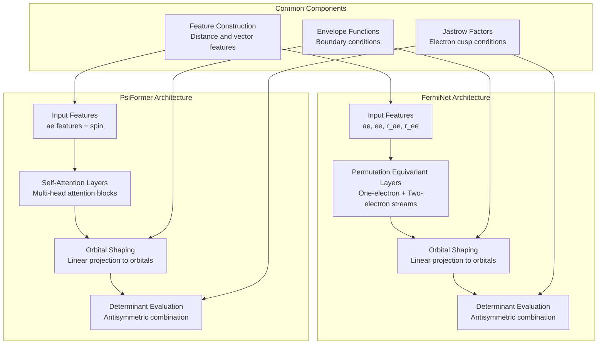
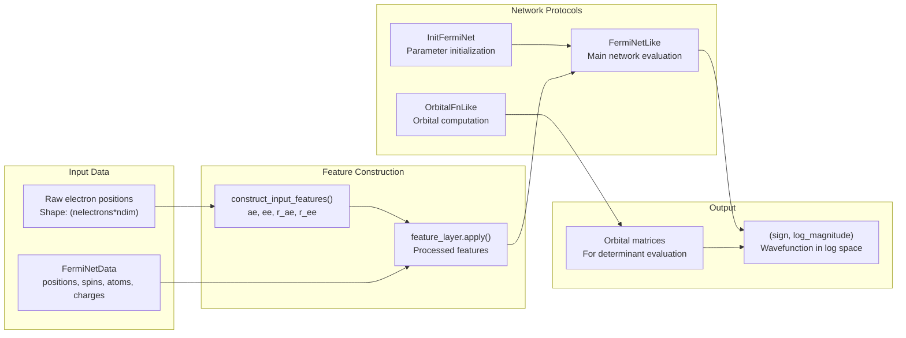
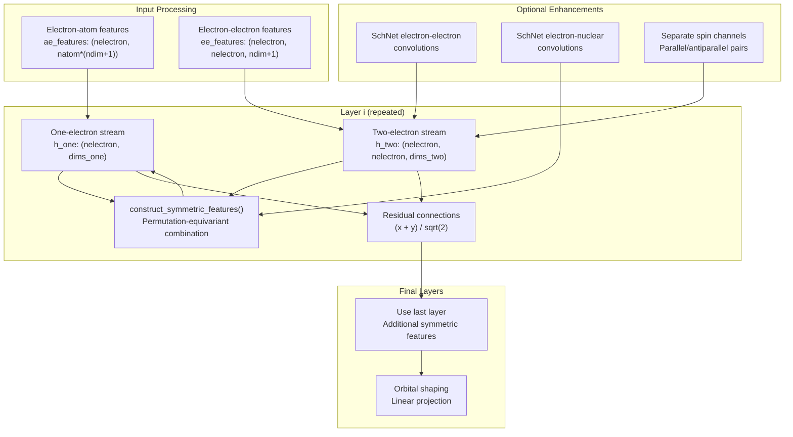
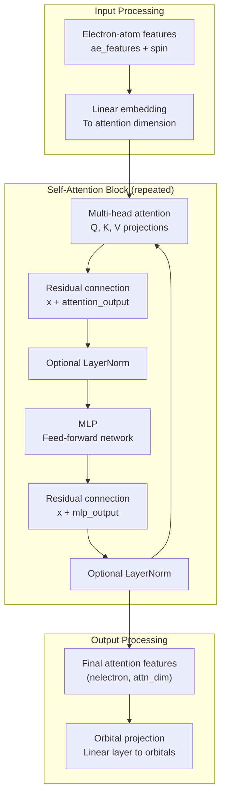
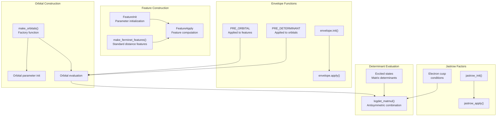
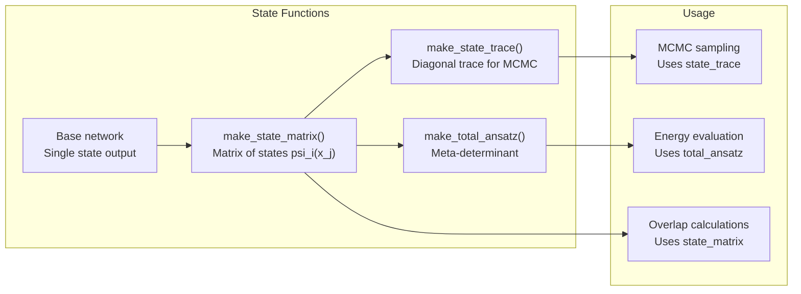
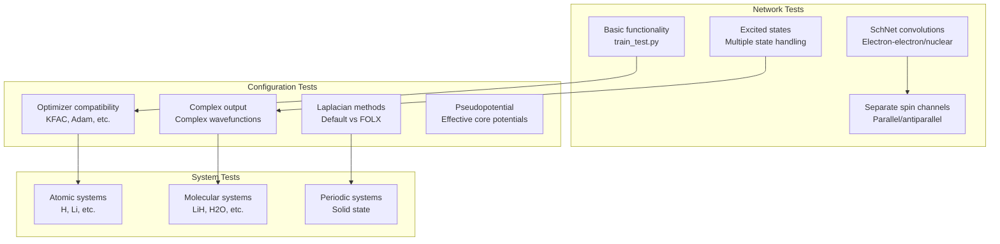

<!-- source: DeepWiki mcp.deepwiki.com · repo google-deepmind/ferminet · page 4 Neural Network Architectures · fetched 2026-10-26 -->

# Neural Network Architectures

<details>
<summary>Relevant source files</summary>

The following files were used as context for generating this wiki page:

- [ferminet/networks.py](ferminet/networks.py)
- [ferminet/psiformer.py](ferminet/psiformer.py)
- [ferminet/tests/train_test.py](ferminet/tests/train_test.py)

</details>


This document covers the neural network architectures implemented in FermiNet, specifically the FermiNet and PsiFormer architectures. These are the core wavefunction ansatzes that learn to approximate quantum many-body wavefunctions through antisymmetric neural networks.

For configuration of these networks, see [Configuration System](#2). For the training pipeline that uses these networks, see [Core Training Pipeline](#3). For the physics implementation details like Hamiltonian evaluation, see [Physics and Mathematics](#5).

## Architecture Overview

FermiNet provides two main neural network architectures for quantum wavefunction approximation:

**FermiNet Architecture Comparison**


Sources: [ferminet/networks.py:1-1525](), [ferminet/psiformer.py:1-462]()

## Network Interface and Data Flow

Both architectures implement common interfaces and follow the same high-level data flow pattern:

**Network Data Flow**


Sources: [ferminet/networks.py:40-70](), [ferminet/networks.py:75-151](), [ferminet/networks.py:449-478]()

## FermiNet Architecture

The FermiNet uses a dual-stream architecture with permutation-equivariant layers to maintain antisymmetry:

**FermiNet Layer Structure**


Sources: [ferminet/networks.py:675-1057](), [ferminet/networks.py:514-553]()

### FermiNet Configuration Options

The `FermiNetOptions` class controls the architecture:

| Option | Type | Description |
|--------|------|-------------|
| `hidden_dims` | `FermiLayers` | Tuple of (one-electron, two-electron) dimensions per layer |
| `separate_spin_channels` | `bool` | Use separate streams for parallel/antiparallel spins |
| `schnet_electron_electron_convolutions` | `Tuple[int, ...]` | SchNet convolution dimensions |
| `use_last_layer` | `bool` | Include final permutation-equivariant layer |
| `nuclear_embedding_dim` | `int` | Nuclear embedding dimension for SchNet |
| `electron_nuclear_aux_dims` | `Tuple[int, ...]` | Auxiliary electron-nuclear stream dimensions |

Sources: [ferminet/networks.py:298-334]()

### Key FermiNet Functions

- `make_fermi_net()`: Main factory function [ferminet/networks.py:1363-1524]()
- `make_fermi_net_layers()`: Creates permutation-equivariant layers [ferminet/networks.py:675-1057]()
- `construct_symmetric_features()`: Combines one- and two-electron features [ferminet/networks.py:514-553]()
- `make_schnet_convolution()`: SchNet-style convolutions [ferminet/networks.py:559-634]()

## PsiFormer Architecture

The PsiFormer uses self-attention mechanisms instead of the dual-stream FermiNet architecture:

**PsiFormer Architecture Flow**


Sources: [ferminet/psiformer.py:231-323](), [ferminet/psiformer.py:173-228]()

### PsiFormer Configuration Options

The `PsiformerOptions` class controls the attention-based architecture:

| Option | Type | Description |
|--------|------|-------------|
| `num_layers` | `int` | Number of self-attention layers |
| `num_heads` | `int` | Number of attention heads |
| `heads_dim` | `int` | Embedding dimension per head |
| `mlp_hidden_dims` | `Tuple[int, ...]` | MLP hidden dimensions |
| `use_layer_norm` | `bool` | Apply layer normalization |

Sources: [ferminet/psiformer.py:30-48]()

### Key PsiFormer Functions

- `make_fermi_net()`: PsiFormer factory function [ferminet/psiformer.py:326-461]()
- `make_psiformer_layers()`: Creates attention layers [ferminet/psiformer.py:231-323]()
- `make_self_attention_block()`: Self-attention implementation [ferminet/psiformer.py:173-228]()
- `make_multi_head_attention()`: Multi-head attention [ferminet/psiformer.py:71-142]()

## Shared Network Components

Both architectures share several key components that handle common aspects of wavefunction representation:

**Shared Component Architecture**


Sources: [ferminet/networks.py:1063-1244](), [ferminet/networks.py:196-258](), [ferminet/networks.py:481-508]()

### Feature Layers

Feature construction transforms raw positions into network inputs:

```python
# Standard FermiNet features
def make_ferminet_features(natoms, nspins, ndim=3, rescale_inputs=False)
# Returns: FeatureLayer with init and apply functions
# Output: (ae_features, ee_features) where
#   ae_features: (nelectron, natom*(ndim+1))  
#   ee_features: (nelectron, nelectron, ndim+1)
```

Sources: [ferminet/networks.py:481-508]()

### Envelope Functions

Envelopes ensure orbitals decay properly at infinity and can be applied at different points:

- `EnvelopeType.PRE_ORBITAL`: Applied to final layer features [ferminet/networks.py:1183-1187]()
- `EnvelopeType.PRE_DETERMINANT`: Applied to individual orbitals [ferminet/networks.py:1210-1220]()

### Determinant Construction

Both architectures support multiple determinants and excited states:

```python
# Multiple determinants for ground state
options.determinants = 16

# Multiple excited states  
options.states = 3

# Full determinant vs spin-factored
options.full_det = True  # (ndet, nalpha+nbeta, nalpha+nbeta)
options.full_det = False # Separate (ndet, nalpha, nalpha) and (ndet, nbeta, nbeta)
```

Sources: [ferminet/networks.py:1099-1112](), [ferminet/networks.py:1222-1232]()

## Excited State Support

Both architectures support excited state calculations through specialized wrappers:

**Excited State Functions**


Sources: [ferminet/networks.py:1250-1357]()

## Testing and Validation

The architecture implementations are extensively tested across various configurations:

**Test Coverage**


Sources: [ferminet/tests/train_test.py:51-310]()

Key test configurations include:
- Hidden dimensions: `((16, 4),) * 2` for testing
- Determinants: 2 for fast testing
- Batch size: 32 for memory efficiency
- Iterations: 3 for quick validation

Sources: [ferminet/tests/train_test.py:107-117](), [ferminet/tests/train_test.py:289-309]()

---

