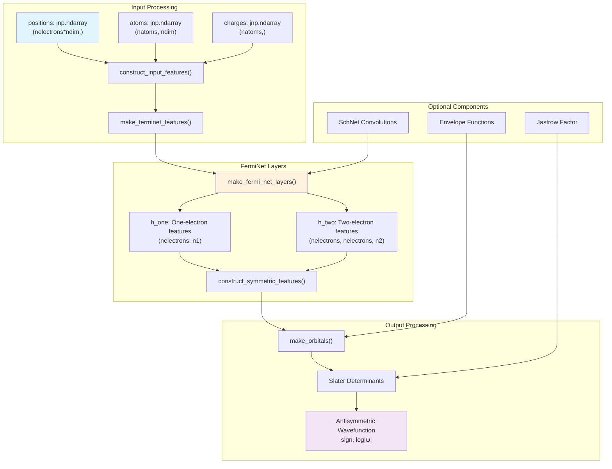
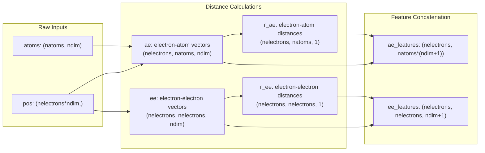
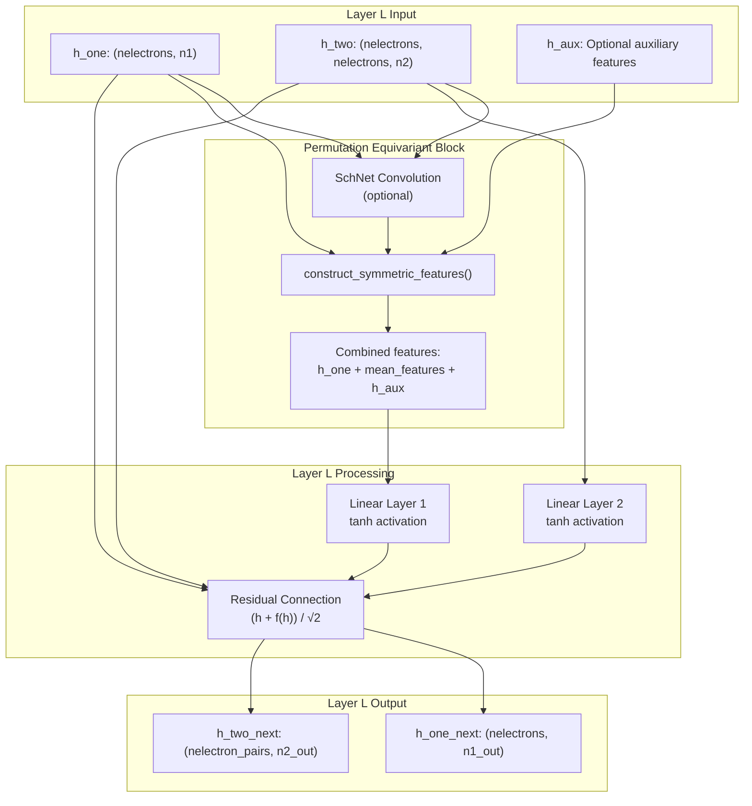
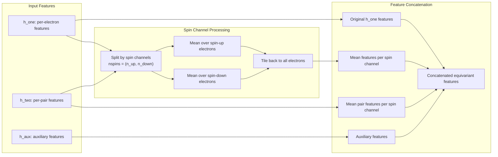
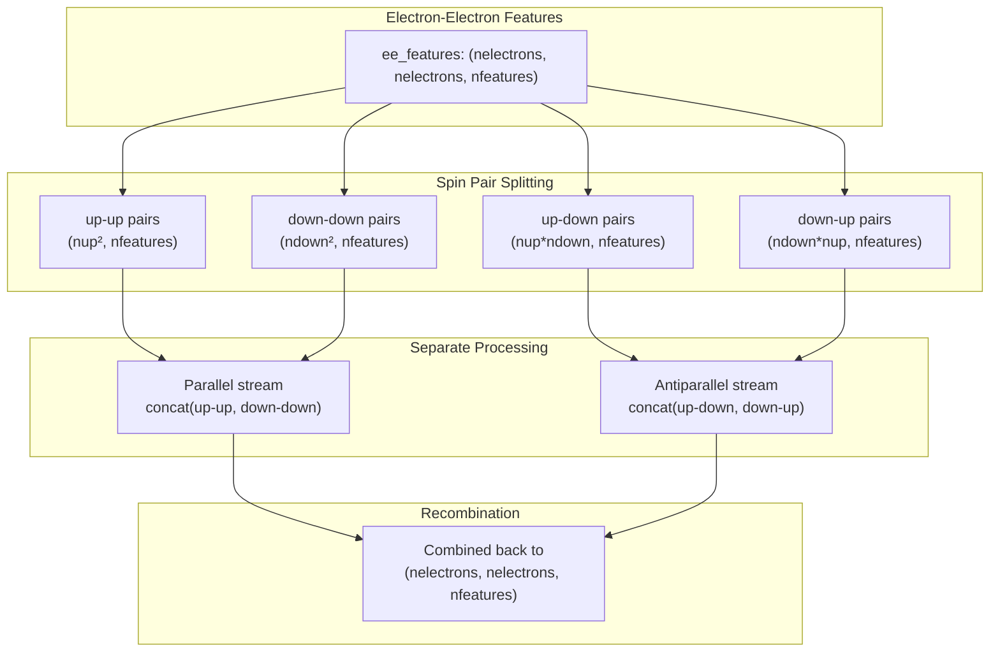
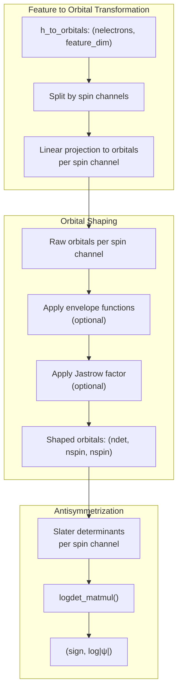
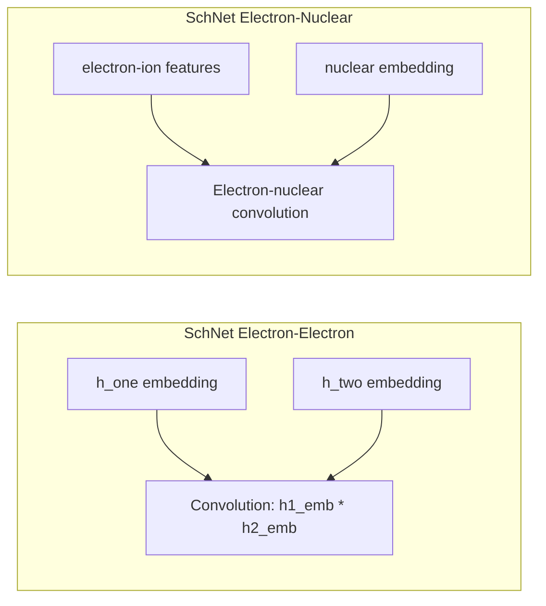
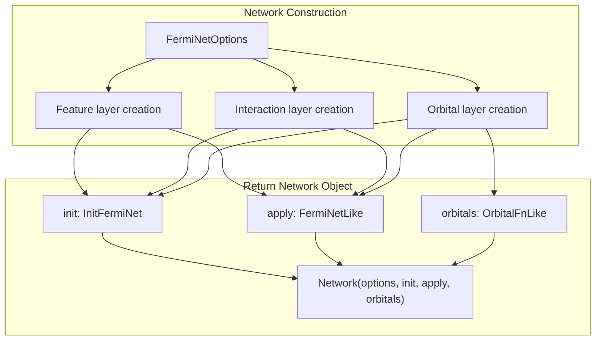

<!-- source: DeepWiki mcp.deepwiki.com · repo google-deepmind/ferminet · page 4.1 FermiNet Architecture · fetched 2026-10-26 -->

# FermiNet Architecture

Relevant source files

The following files were used as context for generating this wiki page:

- [ferminet/networks.py](ferminet/networks.py)
- [ferminet/tests/networks_test.py](ferminet/tests/networks_test.py)

This document provides a detailed explanation of the FermiNet neural network architecture, its core components, and implementation details. FermiNet is the primary deep learning architecture for variational quantum Monte Carlo calculations in this codebase, designed to learn antisymmetric many-electron wavefunctions while maintaining fermionic exchange symmetry.

For information about the alternative PsiFormer architecture, see [PsiFormer Architecture](#4.2). For details about network building blocks and components shared between architectures, see [Network Building Blocks](#4.3).

## Architecture Overview

FermiNet implements a deep neural network that respects the antisymmetry requirements of fermionic wavefunctions. The architecture consists of multiple interaction layers that process electron-electron and electron-nuclear features, followed by orbital-shaping layers that produce antisymmetric determinants.

**Sources:** [ferminet/networks.py:1363-1525](), [ferminet/networks.py:298-334]()

## Network Configuration

The `FermiNetOptions` class controls the architecture configuration and extends `BaseNetworkOptions` with FermiNet-specific parameters:

| Parameter | Type | Description |
|-----------|------|-------------|
| `hidden_dims` | `FermiLayers` | Tuple of (one-electron, two-electron) hidden units per layer |
| `separate_spin_channels` | `bool` | Use separate parameters for parallel/antiparallel spin pairs |
| `schnet_electron_electron_convolutions` | `Tuple[int, ...]` | SchNet convolution embedding dimensions |
| `nuclear_embedding_dim` | `int` | Nuclear embedding dimension for SchNet |
| `use_last_layer` | `bool` | Combine streams in final orbital-shaping layer |

**Sources:** [ferminet/networks.py:298-334](), [ferminet/networks.py:263-296]()

## Input Feature Construction

The network begins by transforming raw electron and atomic positions into structured input features suitable for neural network processing.

The `construct_input_features` function computes electron-atom and electron-electron vectors and distances, with special handling for the diagonal terms in electron-electron distances to avoid singularities:

- **Electron-atom features**: `ae_features = concat(r_ae, ae)` - distances and vectors
- **Electron-electron features**: `ee_features = concat(r_ee, ee)` - distances and vectors  
- **Diagonal masking**: `r_ee` diagonal terms are zeroed to prevent undefined gradients

**Sources:** [ferminet/networks.py:449-478](), [ferminet/networks.py:481-508]()

## Interaction Layers Architecture

The core of FermiNet consists of multiple interaction layers that process one-electron and two-electron features while maintaining permutation equivariance.

**Key Features:**

1. **Separate Streams**: One-electron and two-electron features are processed in parallel streams
2. **Permutation Equivariance**: The `construct_symmetric_features` function creates features that respect electron exchange symmetry
3. **Residual Connections**: Applied when input and output dimensions match: `(x + y) / sqrt(2.0)`
4. **Optional SchNet Convolutions**: Modern graph neural network-style convolutions for enhanced expressivity

**Sources:** [ferminet/networks.py:675-1057](), [ferminet/networks.py:514-553](), [ferminet/networks.py:559-635]()

## Permutation Equivariance Implementation

The `construct_symmetric_features` function ensures the network respects fermionic exchange symmetry by creating permutation-equivariant features:

The output feature dimension is: `(n_channels + 1) * n1 + n_channels * n2 + n_aux`, where `n_channels` is the number of occupied spin channels.

**Sources:** [ferminet/networks.py:514-553](), [ferminet/networks.py:779-782]()

## Spin Channel Handling

FermiNet supports separate processing of spin-parallel and spin-antiparallel electron pairs when `separate_spin_channels=True`:

**Sources:** [ferminet/networks.py:350-443](), [ferminet/networks.py:1009-1020]()

## Orbital Construction and Antisymmetrization

The final layers transform the processed features into molecular orbitals and construct antisymmetric wavefunctions through determinant evaluation:

**Key Components:**

1. **Orbital Projection**: Linear layers map features to orbital space with dimensions `(nspin * ndet * nstates)`
2. **Envelope Functions**: Multiplicative factors ensuring proper asymptotic behavior
3. **Jastrow Factors**: Additional correlation terms for electron cusp conditions  
4. **Determinant Evaluation**: Antisymmetrization through Slater determinant calculation

**Sources:** [ferminet/networks.py:1063-1244](), [ferminet/networks.py:1486-1521]()

## Advanced Features

### SchNet-Style Convolutions

Optional graph neural network-style convolutions can be enabled for enhanced feature learning:

### Complex Output Support

FermiNet supports complex-valued wavefunctions when `complex_output=True`:
- Orbital dimensions are doubled (real and imaginary parts)
- Final output uses complex determinant evaluation
- Phase information is preserved in the sign output

**Sources:** [ferminet/networks.py:559-673](), [ferminet/networks.py:1203-1207](), [ferminet/networks.py:1347-1355]()

## Network Factory Function

The main entry point `make_fermi_net` constructs the complete network by composing all components:

The function validates configuration compatibility, creates default components when not specified, and returns a `Network` object with initialization and application functions.

**Sources:** [ferminet/networks.py:1363-1525](), [ferminet/networks.py:339-345]()

---

