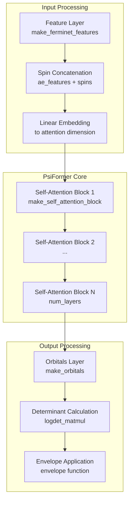
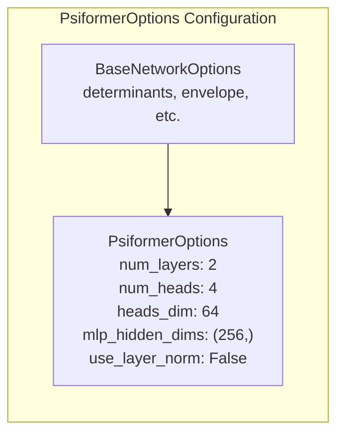
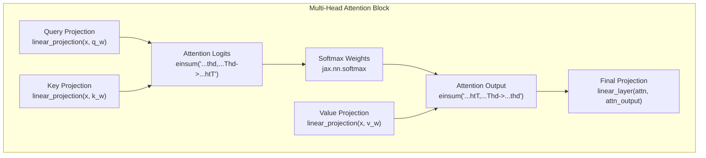
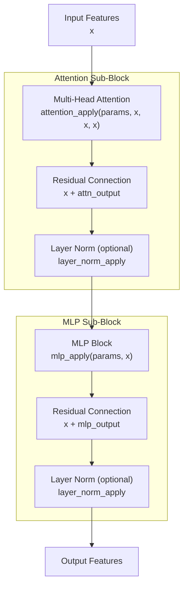
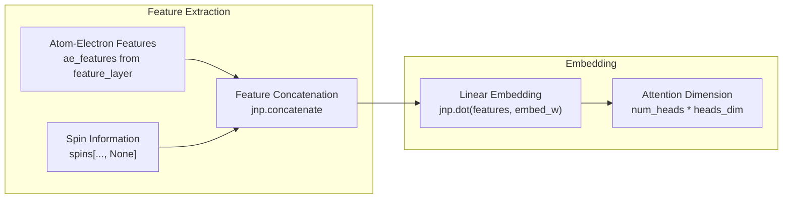
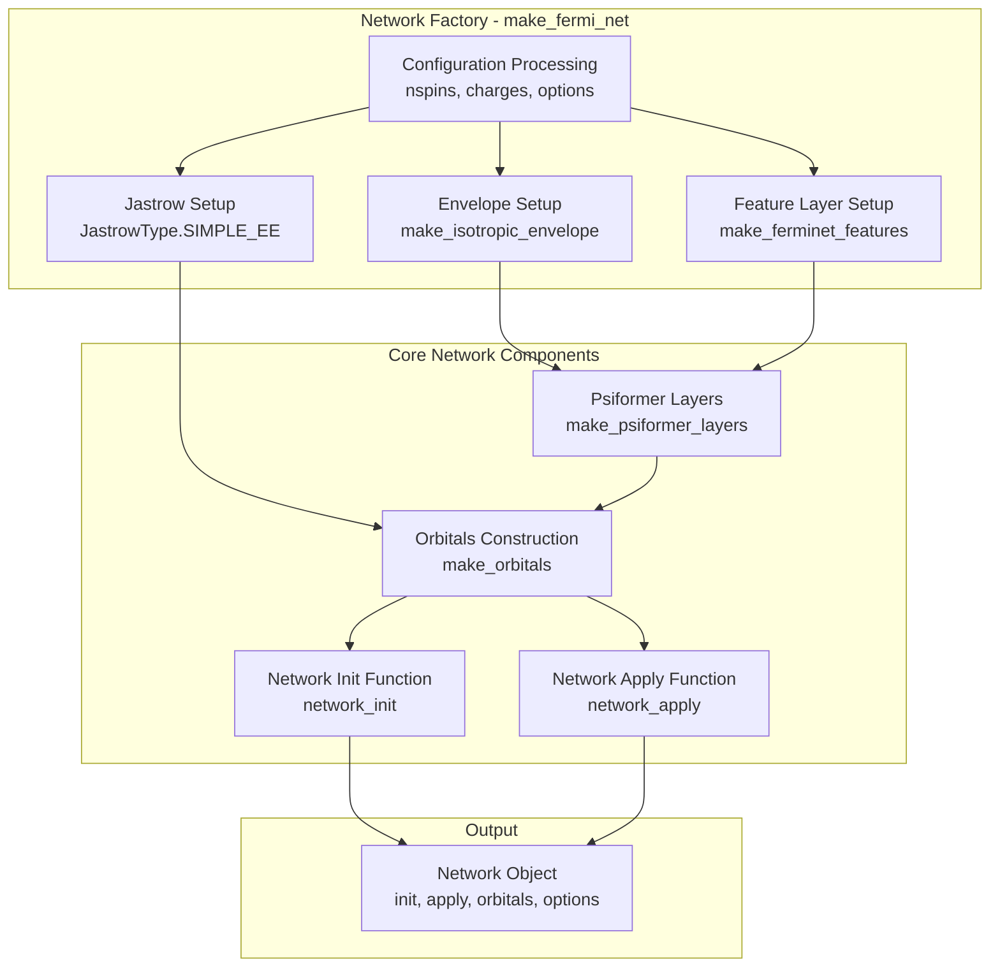
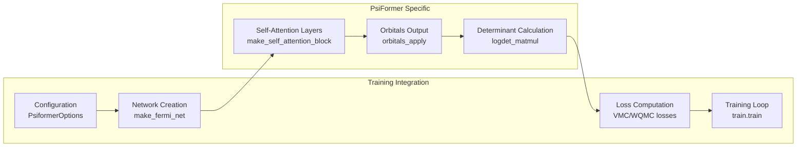

<!-- source: DeepWiki mcp.deepwiki.com · repo google-deepmind/ferminet · page 4.2 PsiFormer Architecture · fetched 2026-10-26 -->

# PsiFormer Architecture

Relevant source files

The following files were used as context for generating this wiki page:

- [ferminet/psiformer.py](ferminet/psiformer.py)
- [ferminet/tests/train_test.py](ferminet/tests/train_test.py)

This document covers the PsiFormer neural network architecture, an attention-based alternative to the standard FermiNet network for solving quantum many-body problems. PsiFormer replaces FermiNet's permutation-equivariant interaction layers with self-attention mechanisms while maintaining antisymmetry and other essential quantum mechanical properties.

For information about the standard FermiNet architecture, see [FermiNet Architecture](#4.1). For details on network building blocks shared between architectures, see [Network Building Blocks](#4.3).

## Architecture Overview

PsiFormer leverages self-attention to model electron-electron interactions, offering an alternative approach to the graph-based convolutions used in standard FermiNet. The architecture maintains the same overall structure for wavefunctions (envelope functions, Jastrow factors, determinants) but replaces the core interaction layers with transformer-style attention blocks.

Sources: [ferminet/psiformer.py:231-324](), [ferminet/psiformer.py:326-461]()

## Core Components

### PsiformerOptions Configuration

The `PsiformerOptions` class extends `BaseNetworkOptions` to define PsiFormer-specific parameters:

| Parameter | Type | Default | Description |
|-----------|------|---------|-------------|
| `num_layers` | int | 2 | Number of self-attention layers |
| `num_heads` | int | 4 | Number of multihead attention heads |
| `heads_dim` | int | 64 | Embedding dimension per attention head |
| `mlp_hidden_dims` | Tuple[int, ...] | (256,) | Hidden dimensions for MLP blocks |
| `use_layer_norm` | bool | False | Whether to include layer normalization |

Sources: [ferminet/psiformer.py:30-48]()

### Self-Attention Architecture

The self-attention mechanism consists of several key components working together:

Sources: [ferminet/psiformer.py:71-142]()

## Self-Attention Block Structure

Each self-attention block combines multi-head attention with an MLP, using residual connections and optional layer normalization:

Sources: [ferminet/psiformer.py:173-228]()

## Feature Processing and Embedding

PsiFormer processes input features differently from standard FermiNet, focusing on one-electron features with explicit spin information:

Sources: [ferminet/psiformer.py:279-321]()

## Network Construction Pipeline

The `make_fermi_net` function creates a complete PsiFormer network by combining all components:

Sources: [ferminet/psiformer.py:326-461]()

## Integration with Training Pipeline

PsiFormer integrates seamlessly with the existing FermiNet training infrastructure. The network can be selected through configuration and follows the same interfaces:

Sources: [ferminet/tests/train_test.py:98-126](), [ferminet/psiformer.py:441-454]()

## Key Differences from FermiNet

PsiFormer differs from standard FermiNet in several important ways:

| Aspect | FermiNet | PsiFormer |
|--------|----------|-----------|
| Interaction Modeling | Graph convolutions | Self-attention |
| Feature Usage | One and two-electron features | One-electron features + spin |
| Permutation Equivariance | Built into interaction layers | Through attention mechanism |
| Computational Complexity | O(N²) per layer | O(N²) attention |
| Required Options | `full_det=False` allowed | `full_det=True` required |

The attention mechanism in PsiFormer naturally handles permutation equivariance through the self-attention operation, which is inherently permutation-equivariant when applied to sets of features.

Sources: [ferminet/psiformer.py:400](), [ferminet/psiformer.py:312-314]()

---

