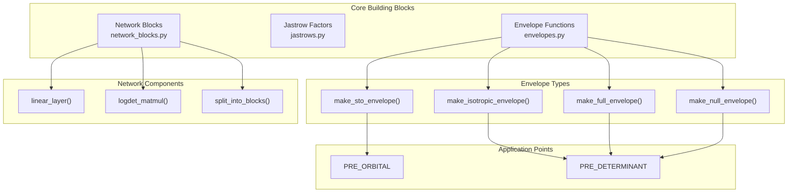
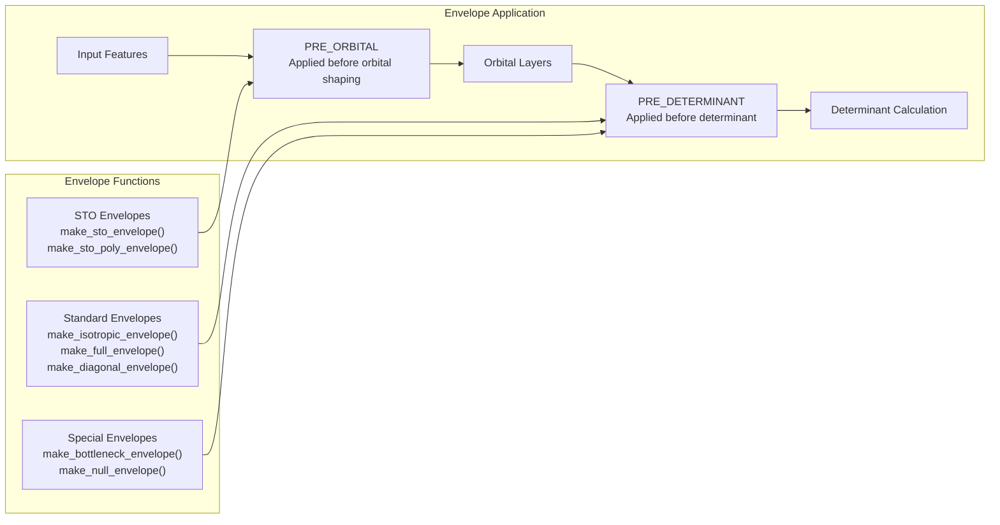
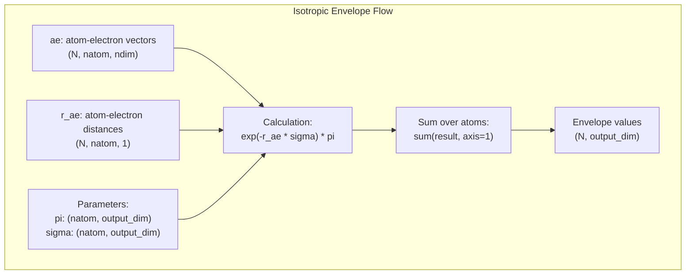
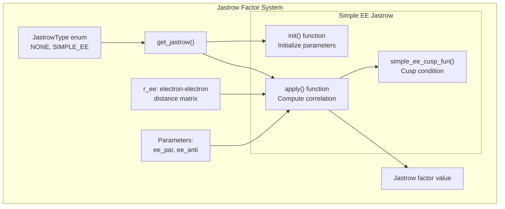
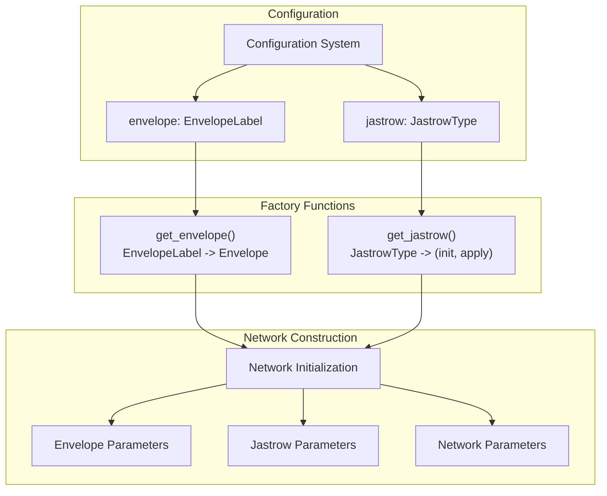

<!-- source: DeepWiki mcp.deepwiki.com · repo google-deepmind/ferminet · page 4.3 Network Building Blocks · fetched 2026-10-26 -->

# Network Building Blocks

<details>
<summary>Relevant source files</summary>

The following files were used as context for generating this wiki page:

- [ferminet/envelopes.py](ferminet/envelopes.py)
- [ferminet/jastrows.py](ferminet/jastrows.py)
- [ferminet/network_blocks.py](ferminet/network_blocks.py)
- [ferminet/tests/envelopes_test.py](ferminet/tests/envelopes_test.py)
- [ferminet/tests/network_blocks_test.py](ferminet/tests/network_blocks_test.py)

</details>


This page covers the fundamental components used to construct FermiNet and PsiFormer neural networks. These building blocks include envelope functions for boundary conditions, Jastrow factors for electron correlation, and basic neural network layers. For the complete network architectures that use these components, see [FermiNet Architecture](#4.1) and [PsiFormer Architecture](#4.2).

## Overview of Building Blocks

The neural network architectures in FermiNet are composed of several key building blocks that serve specific physical and mathematical purposes:



Sources: [ferminet/envelopes.py:1-319](), [ferminet/jastrows.py:1-101](), [ferminet/network_blocks.py:1-178]()

## Envelope Functions

Envelope functions are multiplicative factors applied to ensure proper boundary conditions for the wavefunction. They are implemented in the `Envelope` class which consists of three components: `apply_type`, `init`, and `apply` functions.

### Envelope Types and Application Points



Sources: [ferminet/envelopes.py:29-44](), [ferminet/envelopes.py:85-90]()

### Available Envelope Functions

| Envelope Label | Function | Purpose | Application Point |
|----------------|----------|---------|-------------------|
| `ISOTROPIC` | `make_isotropic_envelope()` | Spherically symmetric decay | `PRE_DETERMINANT` |
| `FULL` | `make_full_envelope()` | Fully anisotropic with covariance matrix | `PRE_DETERMINANT` |
| `DIAGONAL` | `make_diagonal_envelope()` | Diagonal anisotropic decay | `PRE_DETERMINANT` |
| `BOTTLENECK` | `make_bottleneck_envelope()` | Memory-efficient linear projection | `PRE_DETERMINANT` |
| `STO` | `make_sto_envelope()` | Slater-type orbital form | `PRE_ORBITAL` |
| `STO_POLY` | `make_sto_poly_envelope()` | STO with polynomial terms | `PRE_ORBITAL` |
| `NULL` | `make_null_envelope()` | Identity (no envelope) | `PRE_DETERMINANT` |

Sources: [ferminet/envelopes.py:35-44](), [ferminet/envelopes.py:295-318]()

### Envelope Implementation Details

The most commonly used envelope is the isotropic envelope, which applies exponential decay:



Sources: [ferminet/envelopes.py:103-124](), [ferminet/envelopes.py:118-122]()

The full envelope provides the most flexibility with a covariance matrix but is computationally expensive:

```python
# Full envelope applies covariance transformation
ae_sigma = _apply_covariance(ae, sigma)  # Transform coordinates
r_ae_sigma = jnp.linalg.norm(ae_sigma, axis=2)  # Distance in transformed space
return jnp.sum(jnp.exp(-r_ae_sigma) * pi, axis=1)
```

Sources: [ferminet/envelopes.py:192-217](), [ferminet/envelopes.py:92-101]()

## Jastrow Factors

Jastrow factors are multiplicative correlation functions that capture electron-electron interactions, particularly important for satisfying cusp conditions.

### Jastrow Factor Implementation



Sources: [ferminet/jastrows.py:25-30](), [ferminet/jastrows.py:93-100]()

The simple electron-electron Jastrow factor handles parallel and antiparallel spin interactions differently:

- **Parallel spins**: Cusp value of 0.25, applied to same-spin electron pairs
- **Antiparallel spins**: Cusp value of 0.5, applied to opposite-spin electron pairs

Sources: [ferminet/jastrows.py:32-61](), [ferminet/jastrows.py:66-88]()

## Network Blocks

The `network_blocks` module provides fundamental neural network components and utilities for determinant calculations.

### Core Network Components

```mermaid
graph TD
    subgraph "Linear Layer Operations"
        InitLinear["init_linear_layer()<br/>Initialize weights and bias"]
        Linear["linear_layer()<br/>x @ w + b"]
        VmapLinear["vmap_linear_layer()<br/>Vectorized application"]
    end
    
    subgraph "Determinant Operations"
        SLogDet["slogdet()<br/>Sign and log determinant"]
        LogDetMat["logdet_matmul()<br/>Combine determinants with weights"]
        LogSumExp["Log-sum-exp trick<br/>Numerical stability"]
    end
    
    subgraph "Array Utilities"
        Partition["array_partitions()<br/>Split indices"]
        SplitBlocks["split_into_blocks()<br/>Split into submatrices"]
    end
    
    InitLinear --> Linear
    Linear --> VmapLinear
    SLogDet --> LogDetMat
    LogDetMat --> LogSumExp
    Partition --> SplitBlocks
```



Sources: [ferminet/network_blocks.py:64-105](), [ferminet/network_blocks.py:109-178](), [ferminet/network_blocks.py:26-61]()

### Determinant Calculation

The `logdet_matmul()` function is crucial for computing determinants in the log domain to maintain numerical stability:

```python
def logdet_matmul(xs, w=None):
    # Handle 1x1 determinants separately for numerical stability  
    det1d = functools.reduce(lambda a, b: a * b,
                           [x.reshape(-1) for x in xs if x.shape[-1] == 1], 1)
    
    # Compute sign and log determinant for larger matrices
    phase_in, logdet = functools.reduce(
        lambda a, b: (a[0] * b[0], a[1] + b[1]),
        [slogdet(x) for x in xs if x.shape[-1] > 1], (1, 0))
    
    # Log-sum-exp trick for numerical stability
    maxlogdet = jnp.max(logdet)
    det = phase_in * det1d * jnp.exp(logdet - maxlogdet)
```

Sources: [ferminet/network_blocks.py:132-177]()

## Integration and Usage

These building blocks are integrated through factory functions and configuration systems:



Sources: [ferminet/envelopes.py:295-318](), [ferminet/jastrows.py:93-100]()

The building blocks are combined in the main network architectures where:

1. **Envelope functions** ensure proper asymptotic behavior and boundary conditions
2. **Jastrow factors** capture short-range electron correlation and cusp conditions  
3. **Network blocks** provide the basic computational primitives for neural network operations
4. **Determinant utilities** enable efficient computation of antisymmetric wavefunctions

Sources: [ferminet/envelopes.py:1-319](), [ferminet/jastrows.py:1-101](), [ferminet/network_blocks.py:1-178]()

---

