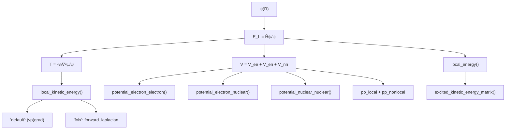
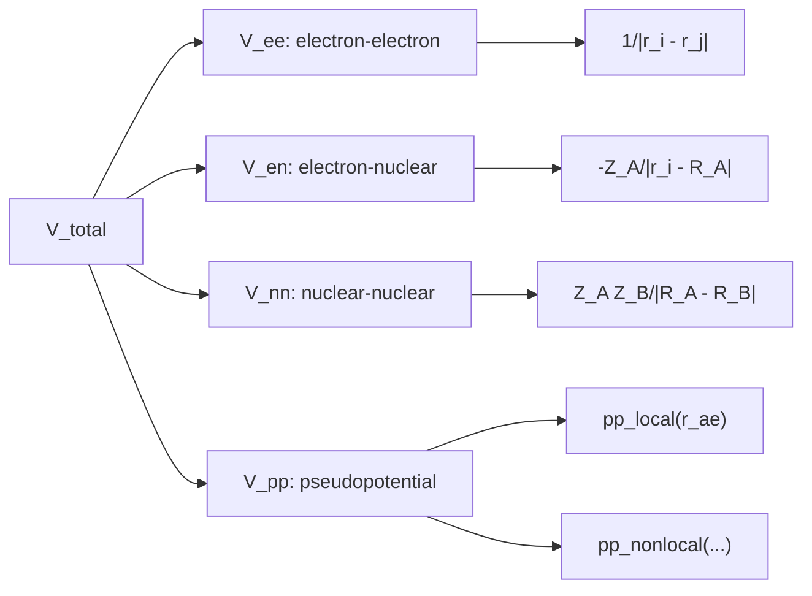
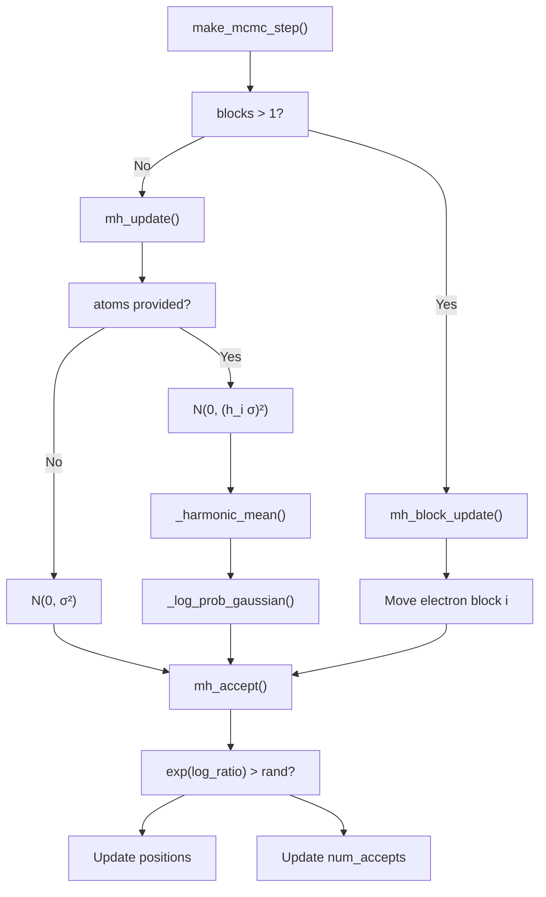
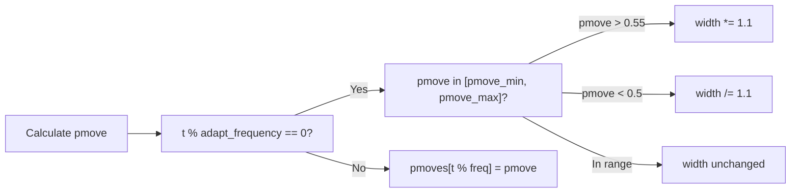
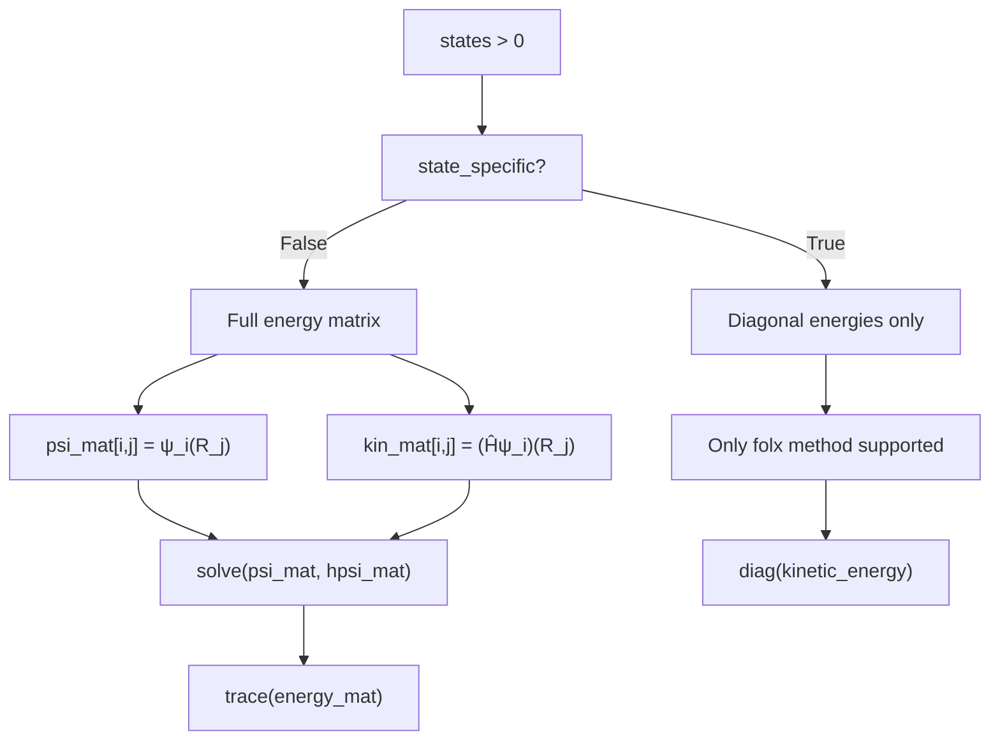
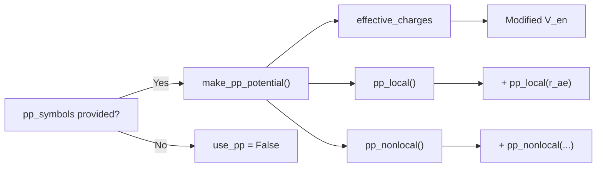

<!-- source: DeepWiki mcp.deepwiki.com · repo google-deepmind/ferminet · page 5 Physics and Mathematics · fetched 2026-10-26 -->

# Physics and Mathematics

<details>
<summary>Relevant source files</summary>

The following files were used as context for generating this wiki page:

- [ferminet/hamiltonian.py](ferminet/hamiltonian.py)
- [ferminet/mcmc.py](ferminet/mcmc.py)

</details>


## Purpose and Scope

This document covers the quantum mechanical foundations and mathematical methods underlying FermiNet's variational Monte Carlo approach. It focuses on Hamiltonian evaluation, Monte Carlo sampling algorithms, and the mathematical infrastructure for energy calculations. For network architecture details, see [Neural Network Architectures](#4). For observable calculations beyond energy, see [Observables and Density Matrix](#5.3).

## Quantum Mechanical Foundations

FermiNet solves the time-independent Schrödinger equation using variational Monte Carlo (VMC). The core challenge is evaluating the local energy:

```
E_L(R) = (Ĥψ(R)) / ψ(R)
```

where `Ĥ` is the Hamiltonian operator, `ψ(R)` is the neural network wavefunction, and `R` represents electron coordinates.

### Energy Calculation Architecture



Sources: [ferminet/hamiltonian.py:75-158](), [ferminet/hamiltonian.py:319-456]()

The `LocalEnergy` protocol defines the interface for energy evaluation functions, taking network parameters, random key, and MCMC data as inputs. The main implementation is created by the `local_energy` factory function.

### Kinetic Energy Calculation

The kinetic energy operator requires computing the Laplacian of the wavefunction. FermiNet implements two methods:

| Method | Description | Implementation |
|--------|-------------|----------------|
| `'default'` | Uses `jax.grad` and `jax.linearize` for Hessian diagonal | [ferminet/hamiltonian.py:105-140]() |
| `'folx'` | Microsoft's forward-mode automatic differentiation | [ferminet/hamiltonian.py:141-153]() |

The kinetic energy function handles both real and complex wavefunctions, with special handling for phase gradients in the complex case.

### Potential Energy Components



Sources: [ferminet/hamiltonian.py:266-317]()

Each potential component is implemented as a separate function, allowing modular composition. The pseudopotential terms are optional and activated when `pp_symbols` is provided to `local_energy`.

## Monte Carlo Sampling

FermiNet uses Metropolis-Hastings Monte Carlo to sample electron configurations according to the probability distribution `|ψ(R)|²`.

### MCMC Implementation Architecture



Sources: [ferminet/mcmc.py:220-284](), [ferminet/mcmc.py:78-148](), [ferminet/mcmc.py:150-218]()

### Move Proposal Strategies

The MCMC implementation supports two move proposal strategies:

1. **Symmetric moves**: Standard Gaussian proposals `N(0, σ²)` when `atoms=None`
2. **Asymmetric moves**: Proposals scaled by harmonic mean of electron-nucleus distances when `atoms` is provided

The asymmetric moves use the harmonic mean function `_harmonic_mean` to calculate distance-dependent step sizes, improving acceptance rates near nuclei.

### Adaptive Step Size Control



Sources: [ferminet/mcmc.py:287-322]()

The `update_mcmc_width` function automatically adjusts the step size to maintain acceptance rates between 50-55%, ensuring efficient sampling.

## Mathematical Methods

### Excited State Calculations

For excited states (`states > 0`), FermiNet computes energy matrices rather than scalar energies:



Sources: [ferminet/hamiltonian.py:161-263](), [ferminet/hamiltonian.py:387-438]()

The `excited_kinetic_energy_matrix` function vectorizes the kinetic energy calculation across multiple states, computing the matrix elements needed for the generalized eigenvalue problem.

### Pseudopotential Integration

When pseudopotentials are used (`pp_symbols` provided), the local energy calculation incorporates effective core potentials:



Sources: [ferminet/hamiltonian.py:360-376](), [ferminet/hamiltonian.py:447-449]()

The pseudopotential implementation modifies both the nuclear charges and adds local/nonlocal correction terms, enabling accurate treatment of heavy atoms without explicit core electrons.

---

