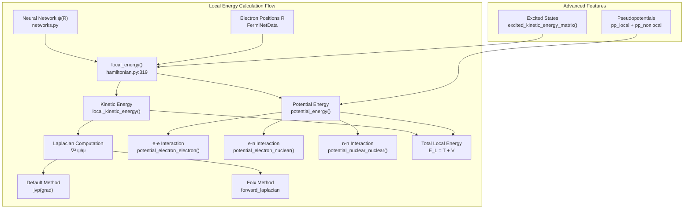
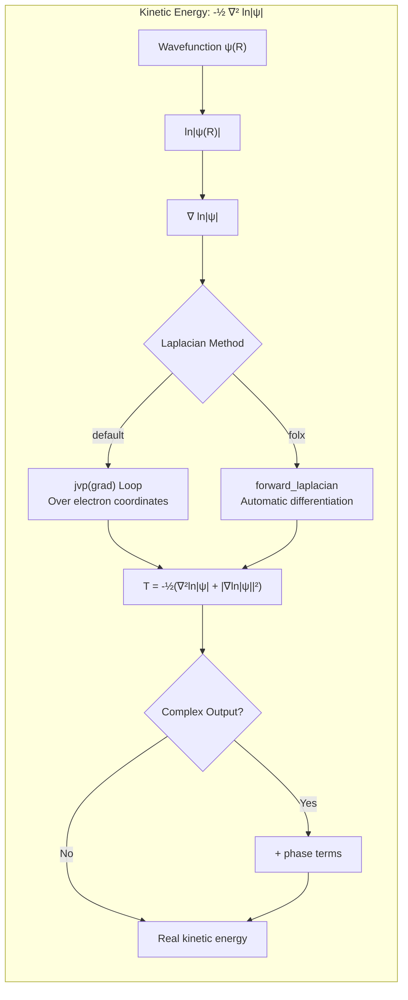
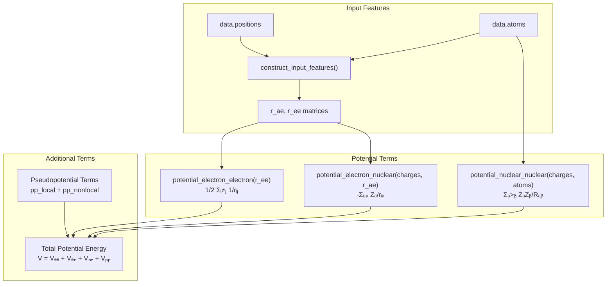
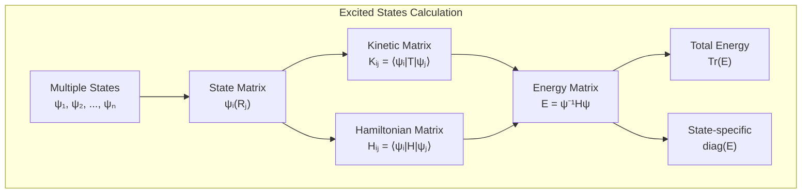

<!-- source: DeepWiki mcp.deepwiki.com · repo google-deepmind/ferminet · page 5.1 Hamiltonian and Energy Calculation · fetched 2026-10-26 -->

# Hamiltonian and Energy Calculation

<details>
<summary>Relevant source files</summary>

The following files were used as context for generating this wiki page:

- [ferminet/hamiltonian.py](ferminet/hamiltonian.py)
- [ferminet/tests/hamiltonian_test.py](ferminet/tests/hamiltonian_test.py)

</details>


This page covers the core physics calculations in FermiNet, specifically the computation of local energies using the Hamiltonian operator. The local energy evaluation is central to variational Monte Carlo (VMC) methods and represents the quantum mechanical energy of electron configurations.

For information about the MCMC sampling that generates electron configurations, see [MCMC Sampling](#5.2). For details about computing other physical observables beyond energy, see [Observables and Density Matrix](#5.3).

## Purpose and Mathematical Foundation

The local energy is defined as:

```
E_L(R) = (H ψ(R)) / ψ(R)
```

Where `H` is the Hamiltonian operator, `ψ(R)` is the wavefunction, and `R` represents electron positions. In VMC, the expectation value of energy is computed as an average of local energies over sampled configurations.

The Hamiltonian consists of kinetic energy (`T`) and potential energy (`V`) terms:
- **Kinetic Energy**: `-½ ∇² ψ / ψ` for each electron
- **Potential Energy**: Electron-electron, electron-nuclear, and nuclear-nuclear interactions

**System Architecture**



Sources: [ferminet/hamiltonian.py:319-456]()

## Core Protocols and Interfaces

The system is built around two main protocols that define the interface for local energy calculations:

| Protocol | Purpose | Key Method |
|----------|---------|------------|
| `LocalEnergy` | Function signature for evaluating local energy | `__call__(params, key, data) -> (energy, energy_matrix)` |
| `MakeLocalEnergy` | Factory for creating LocalEnergy functions | `__call__(f, charges, nspins, **kwargs) -> LocalEnergy` |

The `local_energy` function [ferminet/hamiltonian.py:319-456]() serves as the primary implementation of `MakeLocalEnergy`, constructing a complete local energy evaluator from a neural network wavefunction.

Sources: [ferminet/hamiltonian.py:34-72]()

## Kinetic Energy Calculation

The kinetic energy computation requires evaluating the Laplacian of the wavefunction. FermiNet implements two methods for this calculation:

**Laplacian Computation Methods**



Sources: [ferminet/hamiltonian.py:80-158]()

### Default Method Implementation

The default method uses `jax.linearize` to compute the Hessian diagonal efficiently:

```python
# Key computation pattern from local_kinetic_energy
primal, dgrad_f = jax.linearize(grad_f_closure, data.positions)
hessian_diagonal = lambda i: dgrad_f(eye[i])[i]
result = -0.5 * lax.fori_loop(0, n, lambda i, val: val + hessian_diagonal(i), 0.0)
result -= 0.5 * jnp.sum(primal ** 2)
```

### Folx Method Integration

The folx method uses Microsoft's forward-mode automatic differentiation for potentially more efficient Laplacian computation:

```python
f_wrapped = folx.forward_laplacian(f_closure, sparsity_threshold=6)
output = f_wrapped(data.positions)
result = -(output[1].laplacian + jnp.sum(output[1].jacobian.dense_array ** 2)) / 2
```

Sources: [ferminet/hamiltonian.py:105-157]()

## Potential Energy Components

The potential energy consists of three distinct interaction terms, each handled by specialized functions:

| Component | Function | Formula | Implementation |
|-----------|----------|---------|----------------|
| Electron-Electron | `potential_electron_electron` | `Σᵢ>ⱼ 1/rᵢⱼ` | Upper triangular sum |
| Electron-Nuclear | `potential_electron_nuclear` | `-Σᵢ,ₐ Zₐ/rᵢₐ` | Attraction terms |
| Nuclear-Nuclear | `potential_nuclear_nuclear` | `Σₐ>ᵦ ZₐZᵦ/Rₐᵦ` | Nuclear repulsion |

**Potential Energy Calculation Flow**



Sources: [ferminet/hamiltonian.py:266-317]()

### Distance Matrix Construction

The potential energy functions operate on distance matrices constructed by `networks.construct_input_features`:
- `r_ae[i,j]`: Distance between electron `i` and atom `j`
- `r_ee[i,j,0]`: Distance between electrons `i` and `j`

## Excited States Support

For excited state calculations, FermiNet implements specialized matrix-based energy computation:

**Excited States Energy Matrix**



The `excited_kinetic_energy_matrix` function [ferminet/hamiltonian.py:161-263]() computes kinetic energy matrices for all state combinations, while potential energies are computed per configuration and broadcasted appropriately.

Sources: [ferminet/hamiltonian.py:161-263](), [ferminet/hamiltonian.py:387-438]()

## Pseudopotential Integration

When pseudopotentials are specified via `pp_symbols`, the system incorporates effective core potentials:

```python
# Pseudopotential workflow
effective_charges, pp_local, pp_nonlocal = pp.make_pp_potential(
    charges=charges, symbols=pp_symbols, quad_degree=4, ecp=pp_type
)
total_potential = base_potential + pp_local(r_ae) + pp_nonlocal(key, f, params, data, ae, r_ae)
```

The pseudopotential terms replace part of the nuclear potential with effective interactions that account for core electrons implicitly.

Sources: [ferminet/hamiltonian.py:360-376]()

## Integration with Training Pipeline

The local energy function integrates with the broader training system through several key interfaces:

1. **Configuration Input**: Accepts `networks.FermiNetData` containing electron positions, spins, and atomic information
2. **Parameter Input**: Takes neural network parameters for wavefunction evaluation  
3. **Random Key**: Uses JAX PRNG keys for stochastic pseudopotential evaluation
4. **Output**: Returns `(total_energy, energy_matrix)` tuple where energy_matrix is used for excited states

The function is typically called within the training loop's loss computation, where local energies are averaged over MCMC samples to estimate the variational energy.

Sources: [ferminet/hamiltonian.py:377-455]()

---

