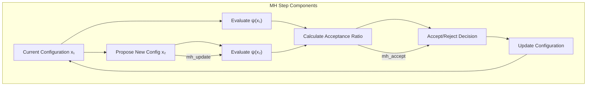
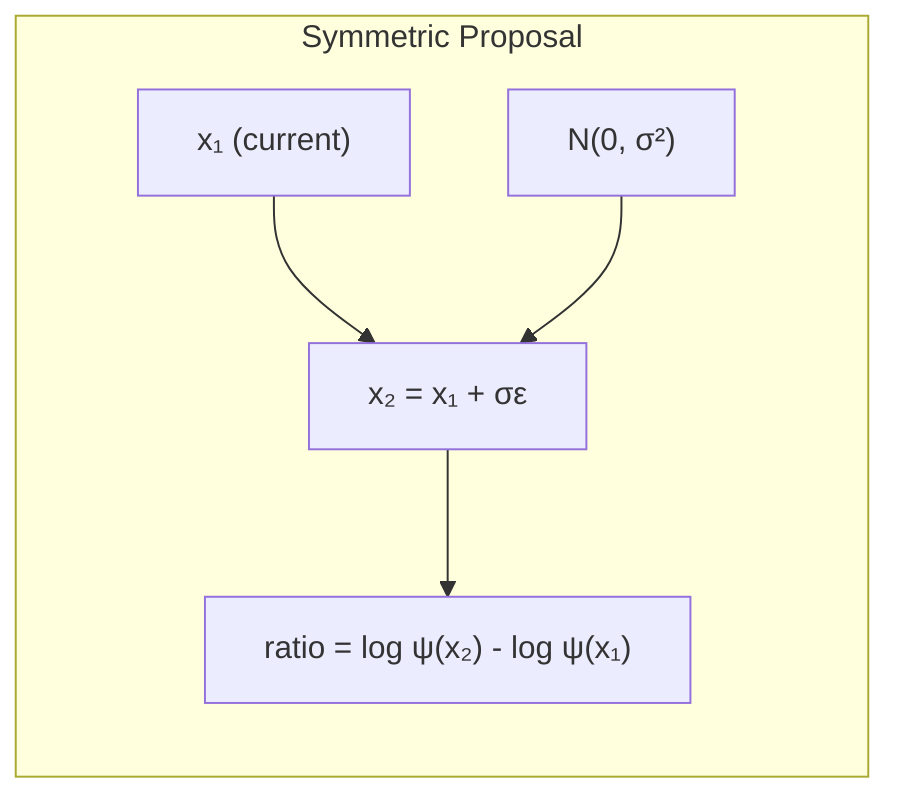
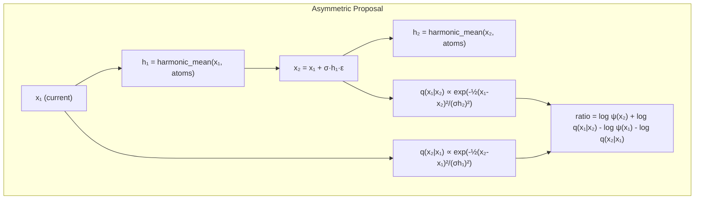
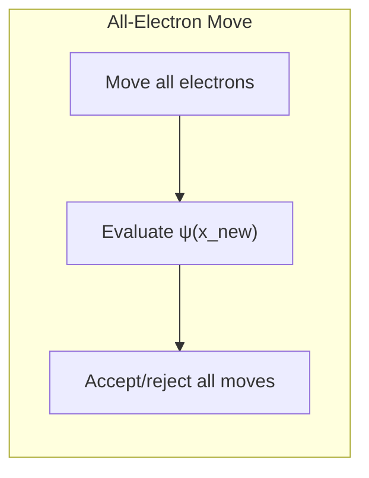
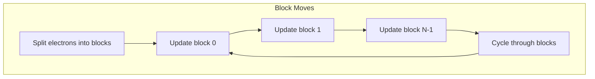
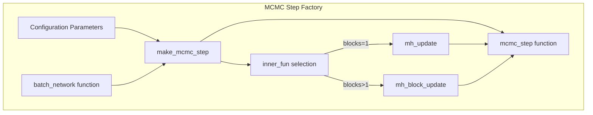
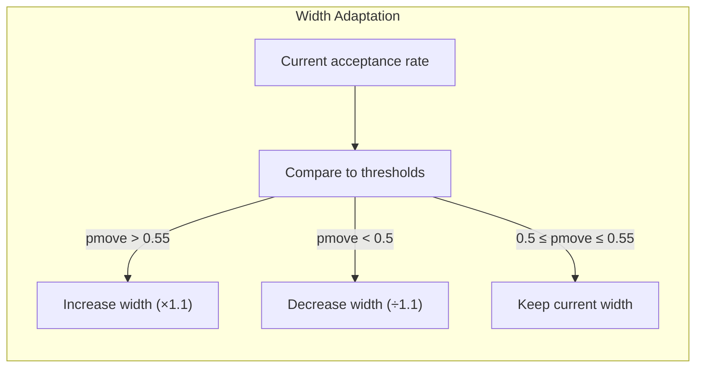
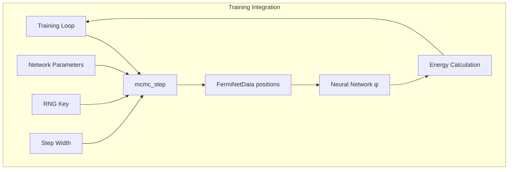

<!-- source: DeepWiki mcp.deepwiki.com · repo google-deepmind/ferminet · page 5.2 MCMC Sampling · fetched 2026-10-26 -->

# MCMC Sampling

Relevant source files

The following files were used as context for generating this wiki page:

- [ferminet/mcmc.py](ferminet/mcmc.py)

This document covers the Monte Carlo Markov Chain (MCMC) sampling implementation in FermiNet, which uses the Metropolis-Hastings algorithm to generate electron configurations for variational Monte Carlo calculations. The MCMC sampler is responsible for proposing new electron positions and accepting or rejecting them based on the wavefunction probability, enabling efficient exploration of the high-dimensional configuration space.

For information about energy calculations using these MCMC samples, see [Hamiltonian and Energy Calculation](#5.1). For details on how observables are computed from MCMC samples, see [Observables and Density Matrix](#5.3).

## Overview

The MCMC sampling system implements the Metropolis-Hastings algorithm to sample electron configurations from the probability distribution defined by the neural network wavefunction. The sampler supports both all-electron moves and block-based electron moves, with adaptive step size control to maintain optimal acceptance rates.

## Metropolis-Hastings Algorithm Implementation

The core of the MCMC sampling is implemented through the Metropolis-Hastings accept/reject mechanism. The algorithm proposes new electron configurations and accepts or rejects them based on the ratio of wavefunction probabilities.

**Sources:** [ferminet/mcmc.py:67-76](), [ferminet/mcmc.py:78-147]()

The `mh_accept` function implements the core accept/reject logic:

| Parameter | Description | Shape |
|-----------|-------------|-------|
| `x1`, `x2` | Current and proposed configurations | `(batch, nelec * ndim)` |
| `lp_1`, `lp_2` | Log probabilities of configurations | `(batch,)` |
| `ratio` | Log acceptance probability | `(batch,)` |
| `key` | JAX random number generator state | `PRNGKey` |

## Move Proposal Strategies

The implementation supports two types of move proposals: symmetric and asymmetric, determined by whether nuclear positions are provided.

### Symmetric Proposals

When `atoms=None`, the sampler uses symmetric Gaussian proposals with constant step size:

**Sources:** [ferminet/mcmc.py:121-126]()

### Asymmetric Proposals  

When nuclear positions are provided via the `atoms` parameter, the sampler uses distance-adapted proposals where the step size scales with the harmonic mean of electron-nuclear distances:

**Sources:** [ferminet/mcmc.py:30-46](), [ferminet/mcmc.py:127-141]()

The harmonic mean calculation `_harmonic_mean` ensures that electrons near nuclei take smaller steps, improving sampling efficiency in regions of high wavefunction curvature.

## Block vs All-Electron Moves

The system supports two update schemes controlled by the `blocks` parameter in the configuration.

### All-Electron Moves (`blocks=1`)

All electrons are moved simultaneously in each MCMC step:

**Sources:** [ferminet/mcmc.py:78-147]()

### Block Moves (`blocks>1`)

Electrons are divided into blocks and updated sequentially:

**Sources:** [ferminet/mcmc.py:150-217]()

The `mh_block_update` function handles the block-wise updates by reshaping the electron coordinates and updating only the specified block.

## MCMC Step Function Factory

The `make_mcmc_step` function creates the main MCMC step function used during training:

**Sources:** [ferminet/mcmc.py:220-284]()

The factory function configures the MCMC parameters and returns a `mcmc_step` function that:
1. Performs multiple MCMC steps in sequence using `lax.fori_loop`
2. Tracks acceptance rates
3. Returns updated configurations and acceptance statistics

## Acceptance Rate Adaptation

The system includes adaptive step size control through the `update_mcmc_width` function:

| Parameter | Purpose | Default Range |
|-----------|---------|---------------|
| `pmove_min` | Lower acceptance threshold | 0.5 |
| `pmove_max` | Upper acceptance threshold | 0.55 |
| `adapt_frequency` | Steps between width updates | Configurable |

**Sources:** [ferminet/mcmc.py:287-322]()

The adaptation maintains acceptance rates in the optimal range (50-55%) by adjusting the proposal step size. Higher acceptance rates indicate steps that are too small, while lower rates suggest steps that are too large.

## Integration with Training Pipeline

The MCMC sampler integrates with the training loop through the `FermiNetData` structure and network evaluation:

**Sources:** [ferminet/mcmc.py:247-282]()

The MCMC sampler receives:
- Network parameters for wavefunction evaluation
- Current electron positions in `FermiNetData.positions`
- RNG state for random number generation
- Step width for proposal generation

And returns:
- Updated electron configurations
- Acceptance probability statistics for width adaptation

---

