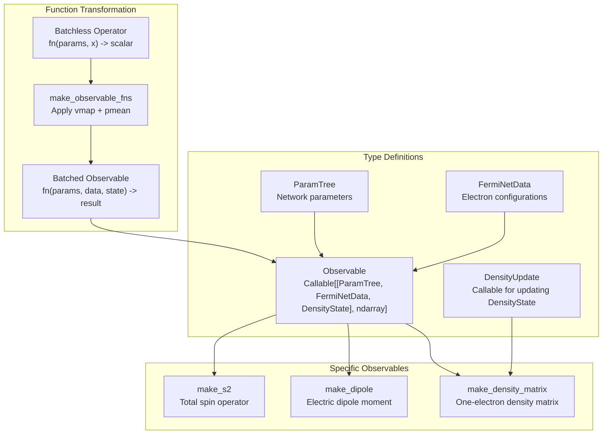
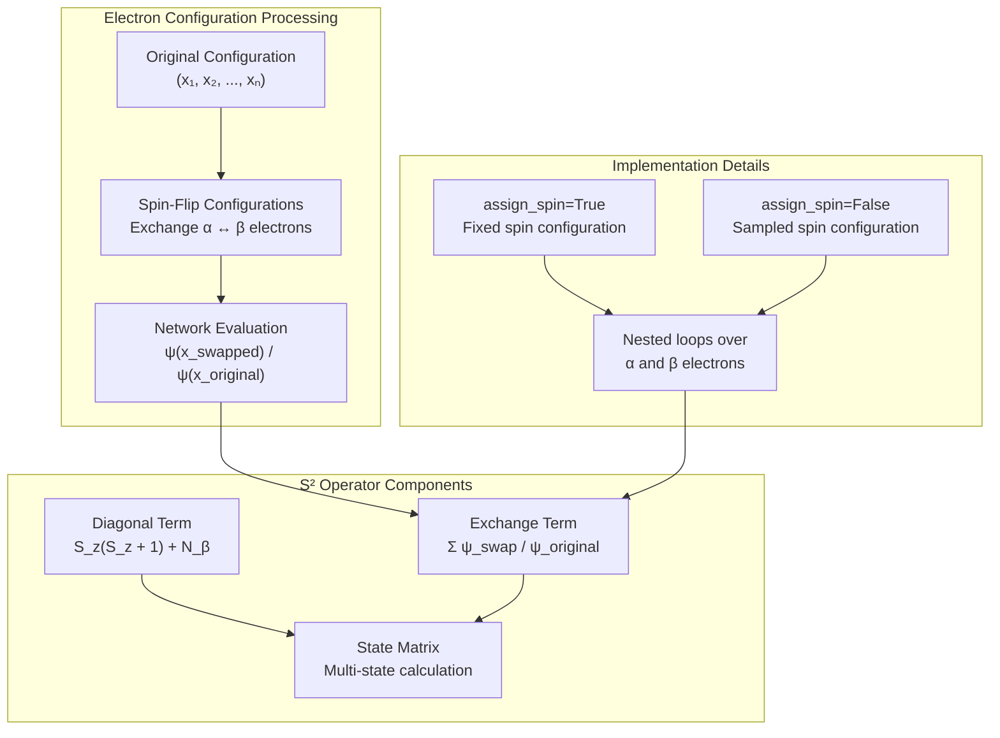
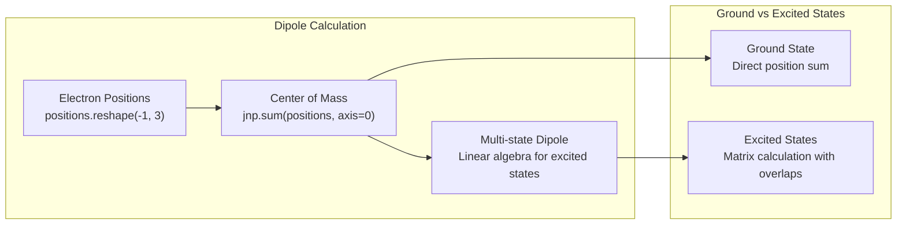
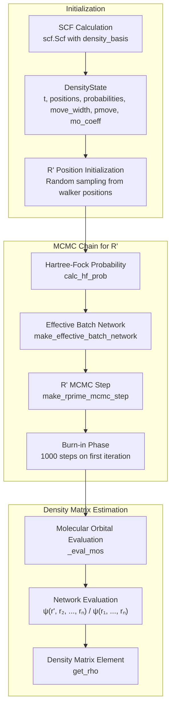
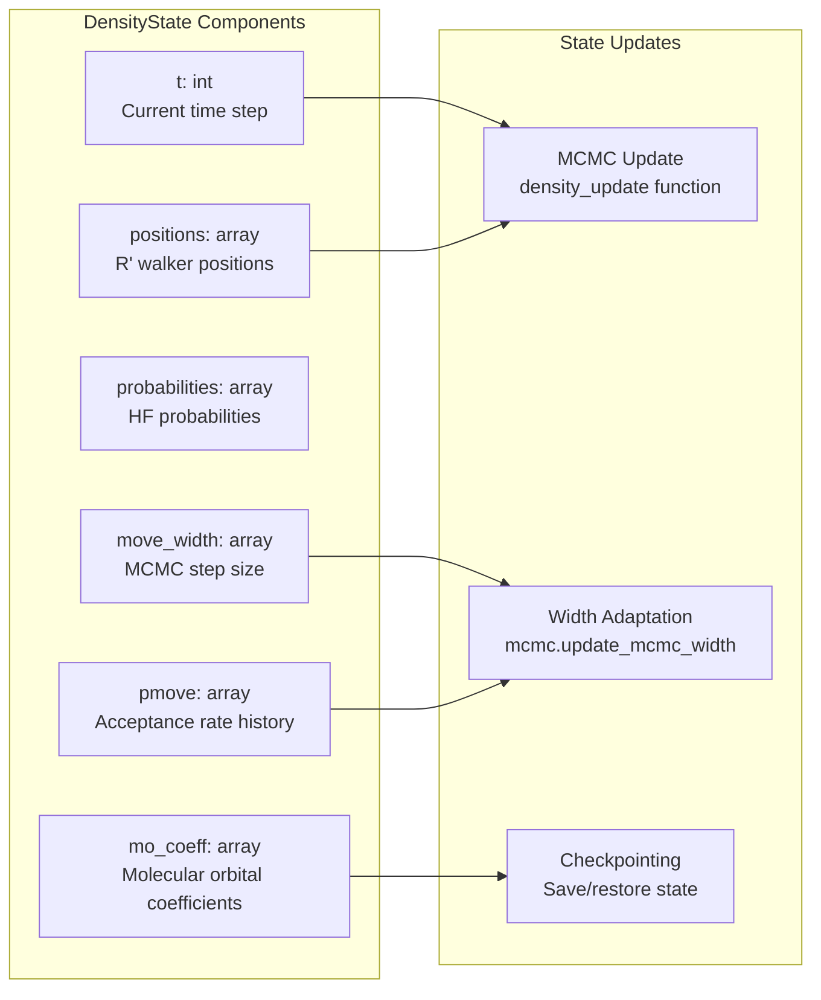
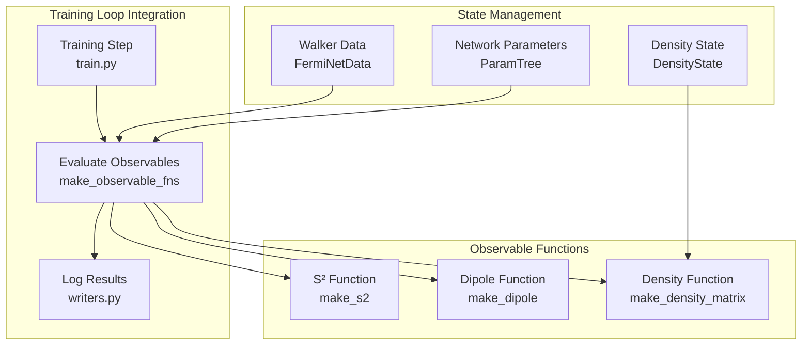

<!-- source: DeepWiki mcp.deepwiki.com · repo google-deepmind/ferminet · page 5.3 Observables and Density Matrix · fetched 2026-10-26 -->

# Observables and Density Matrix

<details>
<summary>Relevant source files</summary>

The following files were used as context for generating this wiki page:

- [ferminet/checkpoint.py](ferminet/checkpoint.py)
- [ferminet/density.py](ferminet/density.py)
- [ferminet/observables.py](ferminet/observables.py)

</details>


This page covers the computation of quantum mechanical observables and the one-electron reduced density matrix in FermiNet. The observables system provides Monte Carlo estimates of physical quantities like total spin (S²), dipole moment, and electron density from trained wavefunctions. For information about the core energy calculation (the primary observable used during training), see [Hamiltonian and Energy Calculation](#5.1). For details about the MCMC sampling used to generate electron configurations, see [MCMC Sampling](#5.2).

## Observable Computation Framework

The observables system in FermiNet transforms batchless quantum mechanical operators into functions that compute Monte Carlo estimates over electron configuration samples. The core architecture separates the mathematical definition of observables from their Monte Carlo evaluation.

### Observable Function Types



Sources: [ferminet/observables.py:55-65](), [ferminet/observables.py:67-96]()

The `make_observable_fns` function transforms single-configuration operators into batch-averaged observables that can be efficiently computed over multiple electron configurations using JAX's vectorization and parallelization primitives.

## Total Spin Observable (S²)

The S² observable measures the total spin angular momentum of the electronic wavefunction, providing a key diagnostic for spin contamination in quantum chemistry calculations.

### S² Calculation Method

| Component | Description | Implementation |
|-----------|-------------|----------------|
| Diagonal term | S_z(S_z + 1) + N_β | Direct calculation from spin configuration |
| Off-diagonal term | Sum over spin-flip configurations | MCMC evaluation with electron exchange |
| State matrix | Multi-state S² for excited states | Linear algebra with state overlap matrix |



Sources: [ferminet/observables.py:98-227](), [ferminet/observables.py:134-204]()

The S² calculation handles both spin-assigned wavefunctions (where electron spins are fixed) and spin-sampled wavefunctions. For excited states, it computes a matrix of S² values using the state overlap matrix.

## Dipole Moment Observable

The dipole moment observable computes the electric dipole moment of the electronic charge distribution, which is simply the center of mass of the electron cloud.



Sources: [ferminet/observables.py:230-272](), [ferminet/observables.py:262-270]()

For ground state calculations, the dipole moment is simply the sum of electron positions. For excited states, it requires solving a linear system involving the state overlap matrix.

## Density Matrix Calculation

The one-electron reduced density matrix calculation is the most complex observable, requiring a separate MCMC chain to sample auxiliary electron positions (r') and integration with Hartree-Fock molecular orbitals.

### Density Matrix Architecture



Sources: [ferminet/observables.py:275-407](), [ferminet/density.py:119-167](), [ferminet/density.py:170-301]()

### Density Matrix Mathematical Framework

The density matrix calculation implements the Monte Carlo estimate:

```
ρᵢⱼ = N ∫ dr' dr₁...drₙ φᵢ(r₁) φⱼ(r') ψ(r₁,...,rₙ) ψ(r',r₂,...,rₙ)
```

This is computed as an expectation value where r' is sampled from the Hartree-Fock one-electron density and (r₁,...,rₙ) are sampled from the neural network wavefunction.

### DensityState Management



Sources: [ferminet/observables.py:32-53](), [ferminet/observables.py:357-387](), [ferminet/checkpoint.py:98-127]()

The `DensityState` dataclass maintains the complete state of the auxiliary MCMC chain used for density matrix calculation, enabling proper checkpointing and restoration of long-running calculations.

## Integration with Training Pipeline

Observables are computed during training to monitor physical properties and can be used for excited state calculations with penalty methods.

### Observable Evaluation Flow



Sources: [ferminet/observables.py:67-96](), [ferminet/checkpoint.py:92-127]()

The observables system integrates seamlessly with the training pipeline through the standardized `Observable` interface, allowing physical quantities to be monitored throughout the optimization process and providing essential diagnostics for quantum chemistry calculations.

---

