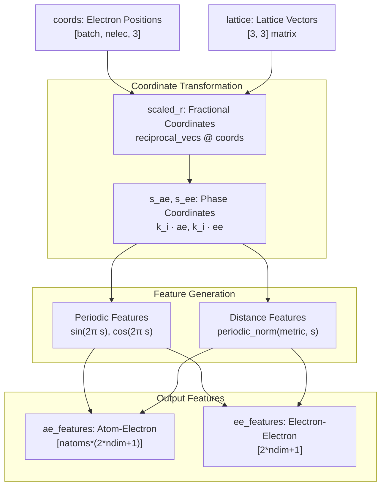
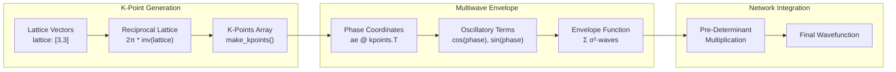
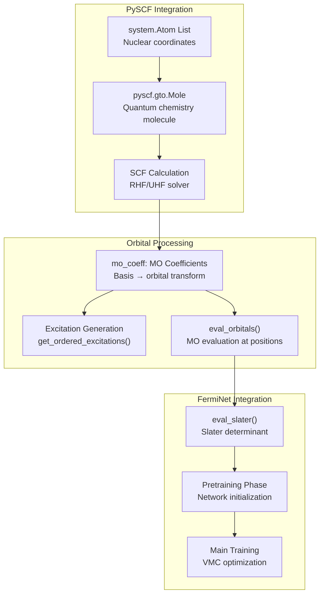
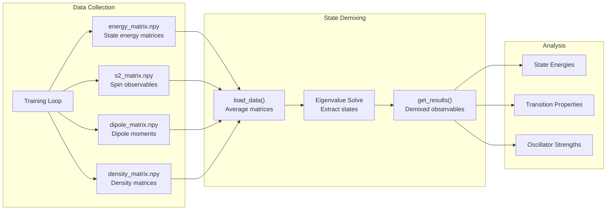
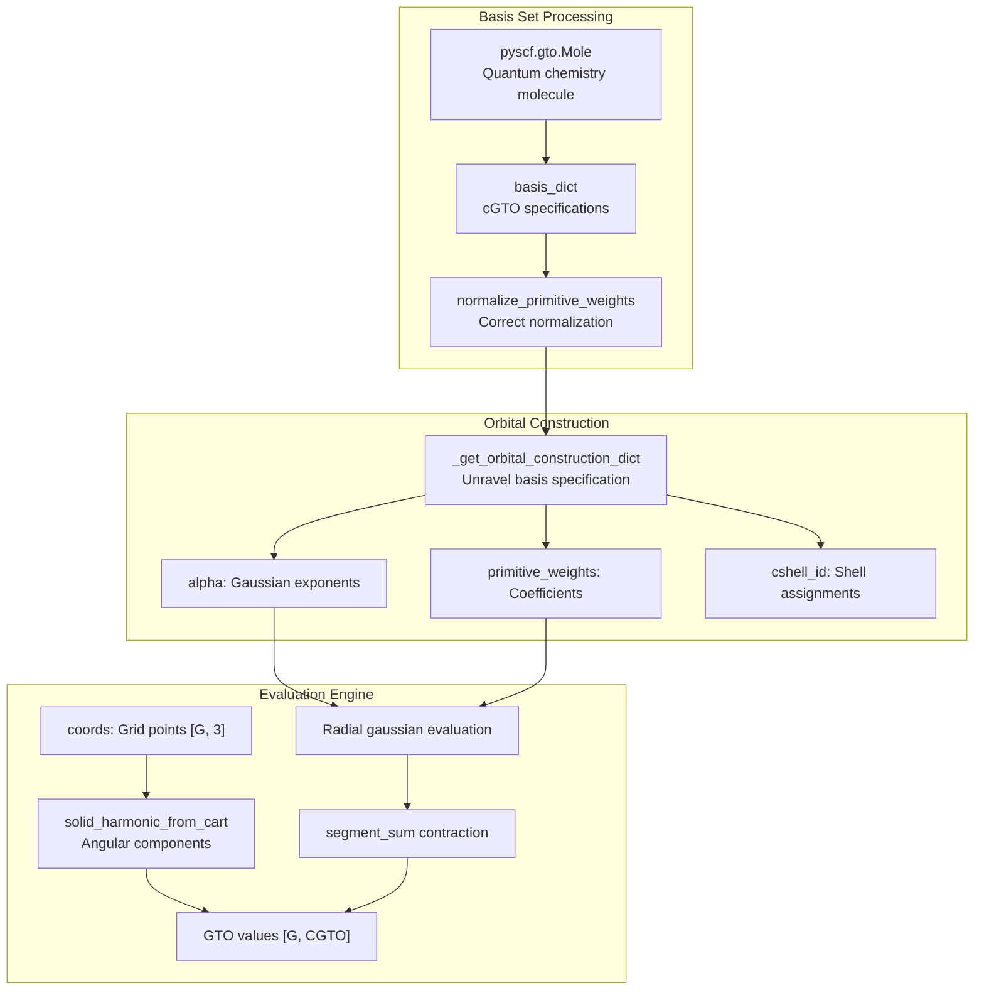
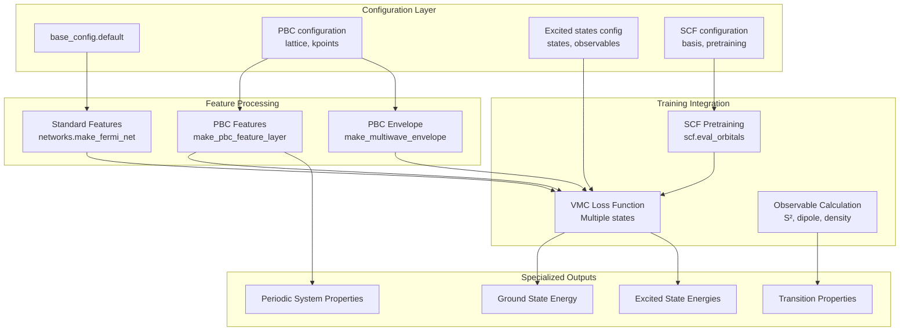

<!-- source: DeepWiki mcp.deepwiki.com · repo google-deepmind/ferminet · page 6 Advanced Features · fetched 2026-10-26 -->

# Advanced Features

Relevant source files

The following files were used as context for generating this wiki page:

- [ferminet/configs/li_excited.py](ferminet/configs/li_excited.py)
- [ferminet/notebooks/excited_states_analysis.ipynb](ferminet/notebooks/excited_states_analysis.ipynb)
- [ferminet/pbc/envelopes.py](ferminet/pbc/envelopes.py)
- [ferminet/pbc/feature_layer.py](ferminet/pbc/feature_layer.py)
- [ferminet/utils/gto.py](ferminet/utils/gto.py)
- [ferminet/utils/scf.py](ferminet/utils/scf.py)
- [ferminet/utils/tests/gto_test.py](ferminet/utils/tests/gto_test.py)

This document covers specialized capabilities and extensions to the core FermiNet functionality, including periodic boundary conditions for solid-state systems, excited states calculations, SCF pretraining integration, and Gaussian-type orbital evaluation. For information about the core neural network architectures, see [Neural Network Architectures](#4). For basic configuration and training, see [Configuration System](#2) and [Core Training Pipeline](#3).

## Periodic Boundary Conditions

FermiNet supports periodic boundary conditions (PBC) for modeling solid-state systems, quantum phase transitions, and extended materials. The PBC implementation includes specialized feature layers, envelope functions, and k-point sampling to handle the unique requirements of periodic systems.

### PBC Feature Layer Architecture

The PBC feature layer transforms standard Cartesian coordinates into periodic-aware features using the `make_pbc_feature_layer` function, which handles lattice vector transformations and periodic distance calculations.

**Sources**: [ferminet/pbc/feature_layer.py:46-110]()

### Envelope Functions and K-Point Sampling

The envelope system uses `make_multiwave_envelope` to create oscillatory envelope functions based on k-point sampling. The `make_kpoints` function generates reciprocal lattice vectors sorted by magnitude to ensure proper shell filling.

**Sources**: [ferminet/pbc/envelopes.py:31-76](), [ferminet/pbc/envelopes.py:79-122]()

## Excited States and SCF Integration

FermiNet supports calculation of excited electronic states through overlap penalty methods and integration with Hartree-Fock pretraining via PySCF. This enables access to multiple electronic states and improved initialization.

### SCF Integration Architecture

The `Scf` class provides a bridge between FermiNet and quantum chemistry methods, handling molecular orbital evaluation and excited state generation.

**Sources**: [ferminet/utils/scf.py:54-127](), [ferminet/utils/scf.py:362-433]()

### Excited States Configuration

| Configuration Parameter | Purpose | Example Value |
|-------------------------|---------|---------------|
| `cfg.system.states` | Number of states to calculate | `3` |
| `cfg.pretrain.iterations` | SCF pretraining iterations | `1000` |
| `cfg.observables.s2` | Calculate spin magnitude | `True` |
| `cfg.observables.dipole` | Calculate dipole moment | `True` |
| `cfg.observables.density` | Calculate density matrix | `True` |

The excited states system supports both ordered and random excitation generation through the `excitation_type` parameter in the `run` method.

**Sources**: [ferminet/configs/li_excited.py:64-81]()

### Excited States Analysis Workflow

The analysis workflow processes mixed state data from training to extract individual excited state properties through eigenvalue decomposition and statistical analysis.

**Sources**: [ferminet/notebooks/excited_states_analysis.ipynb:148-197]()

## Gaussian-Type Orbital Integration

FermiNet includes a pure JAX implementation for evaluating Gaussian-type orbitals (GTOs), enabling direct integration with quantum chemistry basis sets and molecular orbital calculations.

### GTO Evaluation System

The `Mol` class provides a JAX-native implementation of GTO evaluation that maintains compatibility with PySCF while enabling GPU acceleration and automatic differentiation.

**Sources**: [ferminet/utils/gto.py:219-263](), [ferminet/utils/gto.py:338-389]()

### Spherical Harmonics Implementation

The GTO system includes optimized spherical harmonic evaluation using cartesian-to-spherical transformations:

| Function | Purpose | Key Features |
|----------|---------|--------------|
| `solid_harmonic_from_cart` | Cartesian → spherical conversion | Numerically stable, vectorized |
| `cartesian_product` | Cartesian polynomial products | Efficient mesh generation |
| `full_cart2sph` | Complete transformation matrix | Handles symmetry averaging |
| `grad_solid_harmonic` | Gradient evaluation | Analytical derivatives |

**Sources**: [ferminet/utils/gto.py:137-162](), [ferminet/utils/gto.py:165-201]()

## System Integration

### Advanced Features in Training Pipeline

The advanced features integrate seamlessly with the core training pipeline through modular component design, allowing combinations like PBC excited states calculations or SCF-pretrained periodic systems.

**Sources**: [ferminet/pbc/feature_layer.py:46-110](), [ferminet/utils/scf.py:128-183](), [ferminet/configs/li_excited.py:64-81]()

### Testing and Validation

The advanced features include comprehensive testing frameworks to ensure correctness:

- **GTO Tests**: Comparison with PySCF reference implementations for orbital evaluation accuracy
- **PBC Tests**: Validation of periodic distance calculations and lattice transformations  
- **Excited States Tests**: Verification of state orthogonality and observable calculations
- **SCF Integration Tests**: Consistency checks between PySCF and JAX implementations

**Sources**: [ferminet/utils/tests/gto_test.py:36-50]()

---

