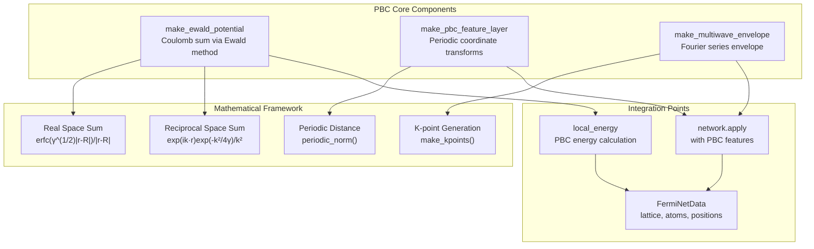
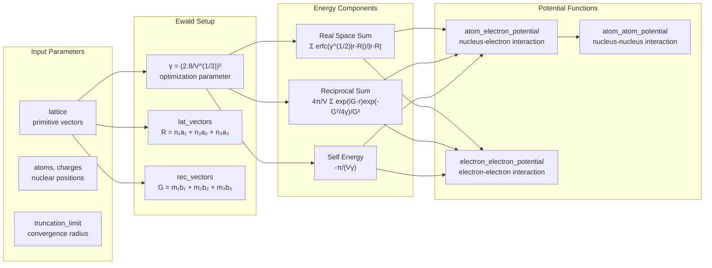
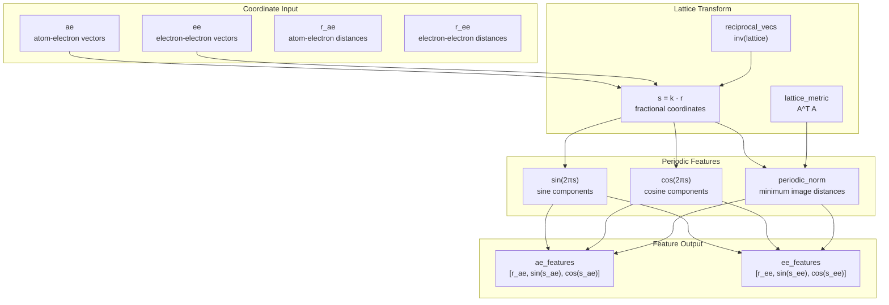
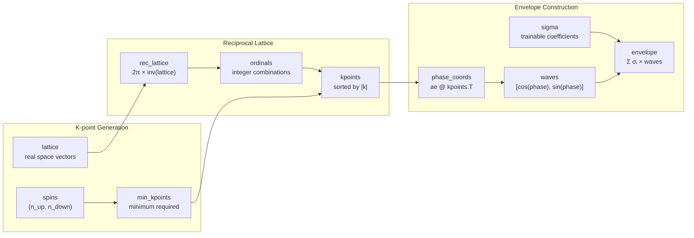
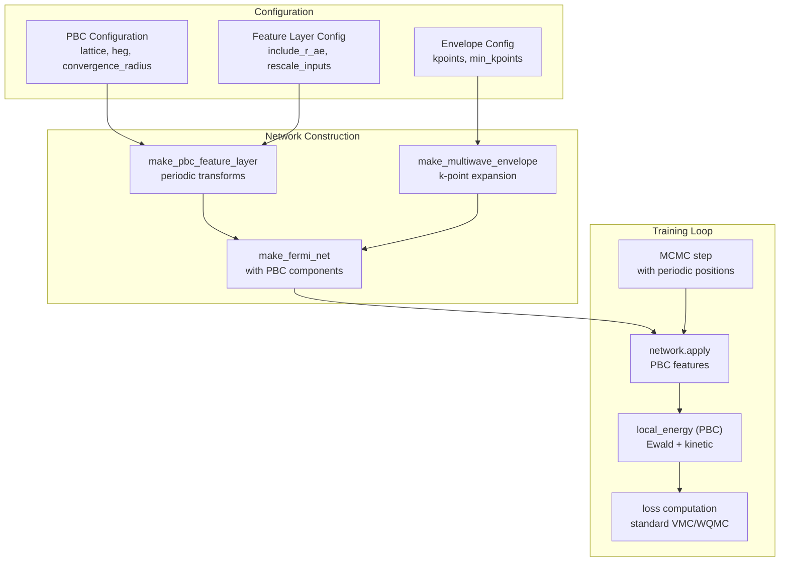

<!-- source: DeepWiki mcp.deepwiki.com · repo google-deepmind/ferminet · page 6.1 Periodic Boundary Conditions · fetched 2026-10-26 -->

# Periodic Boundary Conditions

<details>
<summary>Relevant source files</summary>

The following files were used as context for generating this wiki page:

- [ferminet/pbc/envelopes.py](ferminet/pbc/envelopes.py)
- [ferminet/pbc/feature_layer.py](ferminet/pbc/feature_layer.py)
- [ferminet/pbc/hamiltonian.py](ferminet/pbc/hamiltonian.py)
- [ferminet/pbc/tests/hamiltonian_test.py](ferminet/pbc/tests/hamiltonian_test.py)

</details>


This document covers FermiNet's implementation of periodic boundary conditions (PBC) for studying crystalline systems and the homogeneous electron gas. The PBC implementation enables accurate quantum Monte Carlo calculations in periodic systems through Ewald summation techniques, specialized feature transformations, and periodic envelope functions.

For information about the core neural network architectures that work with PBC, see [Neural Network Architectures](#4). For details about the standard (non-periodic) Hamiltonian evaluation, see [Hamiltonian and Energy Calculation](#5.1).

## System Overview

The PBC implementation consists of three main components that extend FermiNet's core functionality:



Sources: [ferminet/pbc/hamiltonian.py:32-150](), [ferminet/pbc/feature_layer.py:46-110](), [ferminet/pbc/envelopes.py:31-76]()

## Ewald Summation Implementation

The Ewald summation technique handles the infinite Coulomb sum in periodic systems by splitting it into rapidly converging real-space and reciprocal-space components:



The `make_ewald_potential` function implements this by:

1. **Computing lattice parameters**: reciprocal vectors, volume, and optimization parameter γ
2. **Generating lattice/reciprocal vectors**: within the truncation limit for convergence
3. **Defining component functions**: `real_space_ewald`, `recp_space_ewald`, and self-energy terms
4. **Computing Madelung constant**: for charge neutrality corrections

Sources: [ferminet/pbc/hamiltonian.py:32-96](), [ferminet/pbc/hamiltonian.py:136-150]()

## PBC Feature Layer

The periodic feature layer transforms electron and atomic coordinates into periodic-aware features that respect the lattice symmetry:



The `periodic_norm` function computes distances using the minimum image convention:
- Transforms vectors to fractional coordinates: `s = k · r`
- Applies periodic distance formula using sine and cosine terms
- Accounts for lattice metric tensor for non-orthogonal cells

Sources: [ferminet/pbc/feature_layer.py:29-44](), [ferminet/pbc/feature_layer.py:83-108]()

## Envelope Functions and K-points

PBC systems use oscillatory envelope functions based on Fourier series expansions, with k-points selected from the reciprocal lattice:

| Component | Purpose | Implementation |
|-----------|---------|----------------|
| `make_kpoints` | Generate reciprocal lattice vectors | Sorted by ascending length, fills shells |
| `make_multiwave_envelope` | Create Fourier series envelope | Sum of cos/sin terms at k-points |
| K-point initialization | Set initial coefficients | First term = 1, others = 0 |



The envelope function takes the form:
```
envelope = Σᵢ [σ₂ᵢ cos(kᵢ · r_ae) + σ₂ᵢ₊₁ sin(kᵢ · r_ae)]
```

Sources: [ferminet/pbc/envelopes.py:79-122](), [ferminet/pbc/envelopes.py:54-75]()

## Integration with Training Pipeline

The PBC components integrate with FermiNet's main training loop through specialized versions of core functions:



Key differences in PBC mode:
- **Feature layer**: Uses `make_pbc_feature_layer` instead of standard features
- **Envelope**: Uses `make_multiwave_envelope` with k-point expansion
- **Local energy**: Uses PBC-specific `local_energy` function with Ewald summation
- **Coordinates**: Electron positions are reduced to first unit cell during energy evaluation

Sources: [ferminet/pbc/hamiltonian.py:153-220](), [ferminet/pbc/tests/hamiltonian_test.py:43-93]()

## Configuration and Usage

| Parameter | Type | Purpose | Default |
|-----------|------|---------|---------|
| `lattice` | `jnp.ndarray (3,3)` | Primitive lattice vectors | `jnp.eye(3)` |
| `heg` | `bool` | Enable homogeneous electron gas features | `True` |
| `convergence_radius` | `int` | Ewald summation truncation limit | `5` |
| `include_r_ae` | `bool` | Include atom-electron distances | `True` |
| `rescale_inputs` | `bool` | Apply log scaling to distances | `False` |

The PBC implementation handles:
- **Homogeneous electron gas**: With neutralizing background when `heg=True`
- **Crystalline systems**: With explicit nuclear charges when `heg=False`
- **Convergence control**: Through `truncation_limit` and γ parameter optimization
- **Coordinate reduction**: Automatic mapping to first unit cell for Ewald convergence

Sources: [ferminet/pbc/hamiltonian.py:32-51](), [ferminet/pbc/feature_layer.py:46-66]()

---

