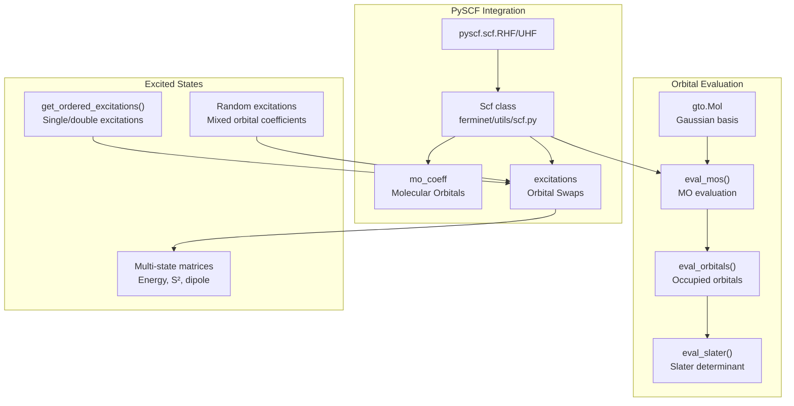
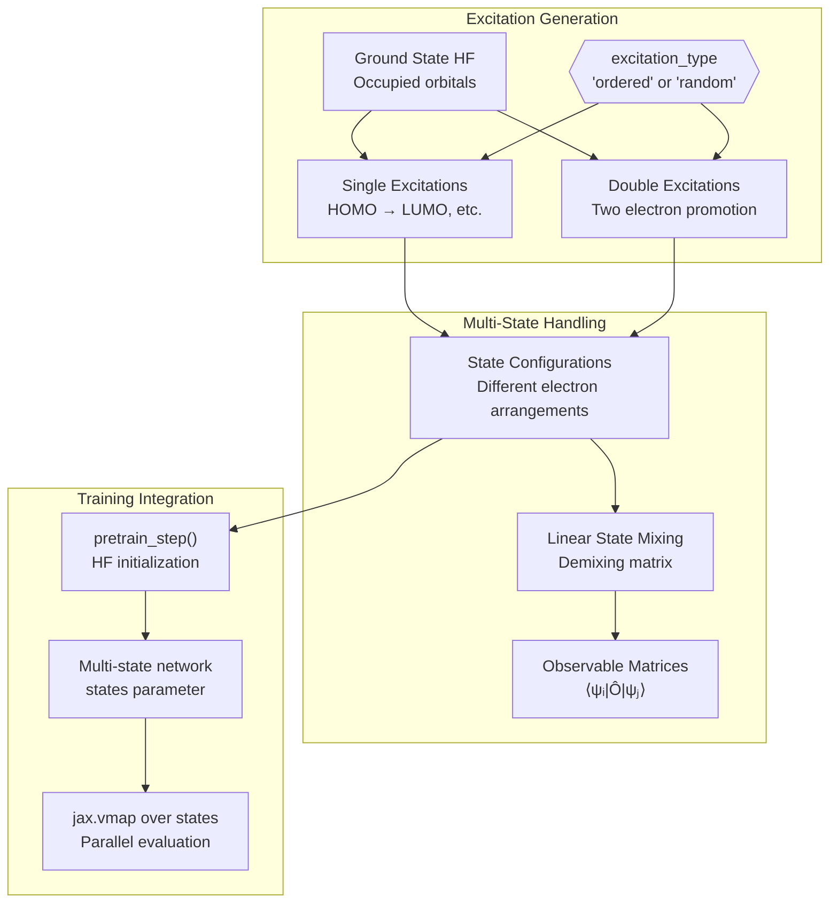
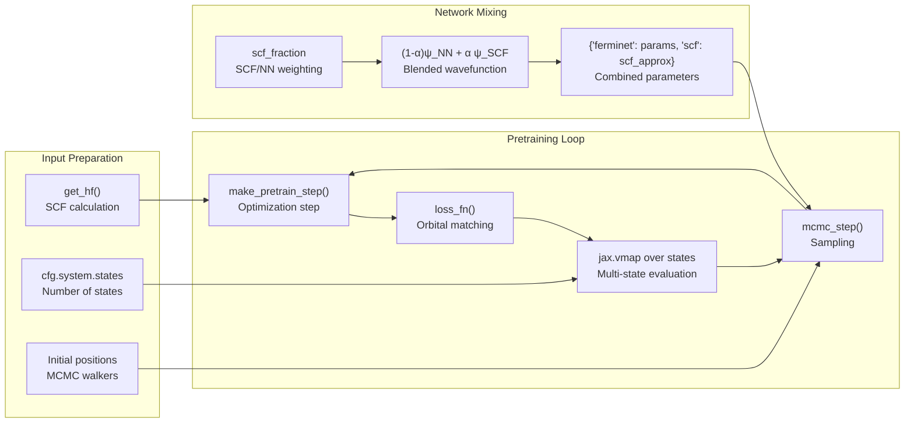
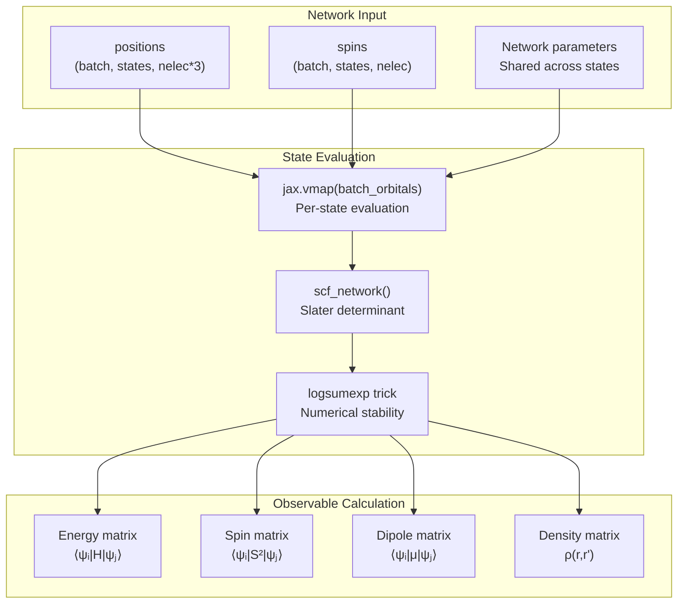
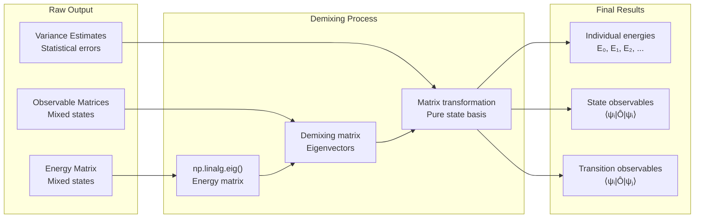

<!-- source: DeepWiki mcp.deepwiki.com · repo google-deepmind/ferminet · page 6.2 Excited States and SCF Integration · fetched 2026-10-26 -->

# Excited States and SCF Integration

<details>
<summary>Relevant source files</summary>

The following files were used as context for generating this wiki page:

- [ferminet/configs/li_excited.py](ferminet/configs/li_excited.py)
- [ferminet/notebooks/excited_states_analysis.ipynb](ferminet/notebooks/excited_states_analysis.ipynb)
- [ferminet/pretrain.py](ferminet/pretrain.py)
- [ferminet/utils/gto.py](ferminet/utils/gto.py)
- [ferminet/utils/scf.py](ferminet/utils/scf.py)
- [ferminet/utils/tests/gto_test.py](ferminet/utils/tests/gto_test.py)

</details>


This document covers FermiNet's capabilities for calculating electronic excited states and its integration with Self-Consistent Field (SCF) methods through PySCF. This includes Hartree-Fock pretraining, excited state generation, and the analysis of multi-state quantum systems.

For information about the core neural network architectures, see [Neural Network Architectures](#4). For basic training procedures, see [Core Training Pipeline](#3).

## SCF Integration Architecture

FermiNet integrates with PySCF through the `Scf` class, which provides a bridge between quantum chemistry calculations and neural network training. The integration supports both restricted and unrestricted Hartree-Fock calculations and can generate excited states through systematic orbital excitations.



**SCF Class Structure and Methods**

The `Scf` class provides several key methods for orbital evaluation and excited state generation:

| Method | Purpose | Key Parameters |
|--------|---------|---------------|
| `run()` | Execute SCF calculation | `excitations`, `excitation_type` |
| `eval_mos()` | Evaluate molecular orbitals | `positions` |
| `eval_orbitals()` | Get occupied orbital matrices | `pos`, `nspins` |
| `eval_slater()` | Calculate Slater determinant | `pos`, `nspins` |
| `get_ordered_excitations()` | Generate systematic excitations | `n`, `preserve_spin` |

Sources: [ferminet/utils/scf.py:54-434]()

## Excited States Calculation Framework

FermiNet implements excited states using the Natural Excited States Variational Monte Carlo (NES-VMC) approach. The system can handle multiple electronic states simultaneously by constructing appropriate linear combinations of Slater determinants.



**Excitation Types and Generation**

The system supports two approaches for generating excited states:

- **Ordered excitations**: Systematic single and double excitations ranked by energy difference
- **Random excitations**: Random linear combinations of orbitals for challenging systems

Sources: [ferminet/utils/scf.py:158-183](), [ferminet/utils/scf.py:362-433]()

## Pretraining Workflow

The pretraining system initializes neural networks to match Hartree-Fock orbitals, with special handling for excited states through simultaneous multi-state training.



**Key Pretraining Functions**

| Function | Purpose | Location |
|----------|---------|----------|
| `get_hf()` | Initialize SCF calculation | [ferminet/pretrain.py:34-75]() |
| `make_pretrain_step()` | Create pretraining optimization step | [ferminet/pretrain.py:113-258]() |
| `pretrain_hartree_fock()` | Execute pretraining loop | [ferminet/pretrain.py:261-347]() |
| `eval_orbitals()` | Evaluate SCF orbitals for target | [ferminet/pretrain.py:78-110]() |

Sources: [ferminet/pretrain.py:113-347]()

## Multi-State Network Architecture

For excited states calculations, the network architecture is extended to handle multiple electronic states simultaneously through vectorized evaluation and state mixing.



**Multi-State Loss Function**

The pretraining loss for excited states uses complex norm calculations to match SCF orbitals across all states:

```python
# Complex norm for orbital matching
cnorm = lambda x, y: (x - y) * jnp.conj(x - y)
result = jnp.array([
    jnp.mean(cnorm(t[:, None, ...], o)).real
    for t, o in zip(target, orbitals)
]).sum()
```

Sources: [ferminet/pretrain.py:151-245]()

## Configuration and Usage

Excited states calculations are configured through the system configuration, with specific parameters controlling the number of states and excitation generation.

**Configuration Parameters**

| Parameter | Purpose | Example |
|-----------|---------|---------|
| `cfg.system.states` | Number of excited states | `3` |
| `cfg.pretrain.iterations` | Pretraining steps | `1000` |
| `excitation_type` | Excitation generation method | `'ordered'` |
| `scf_fraction` | SCF/NN mixing ratio | `0.0` to `1.0` |

**Example Configuration for Lithium Excited States**

The lithium excited states configuration demonstrates typical usage:

```python
cfg.system.states = 3  # Ground + 2 excited states
cfg.pretrain.iterations = 1000
cfg.observables.s2 = True  # Calculate spin magnitude
cfg.observables.dipole = True  # Calculate dipole moments
```

Sources: [ferminet/configs/li_excited.py:64-81]()

**Analysis and Results Processing**

The excited states analysis involves demixing the computed state matrices to extract individual state properties:



Sources: [ferminet/notebooks/excited_states_analysis.ipynb:188-197]()

---

