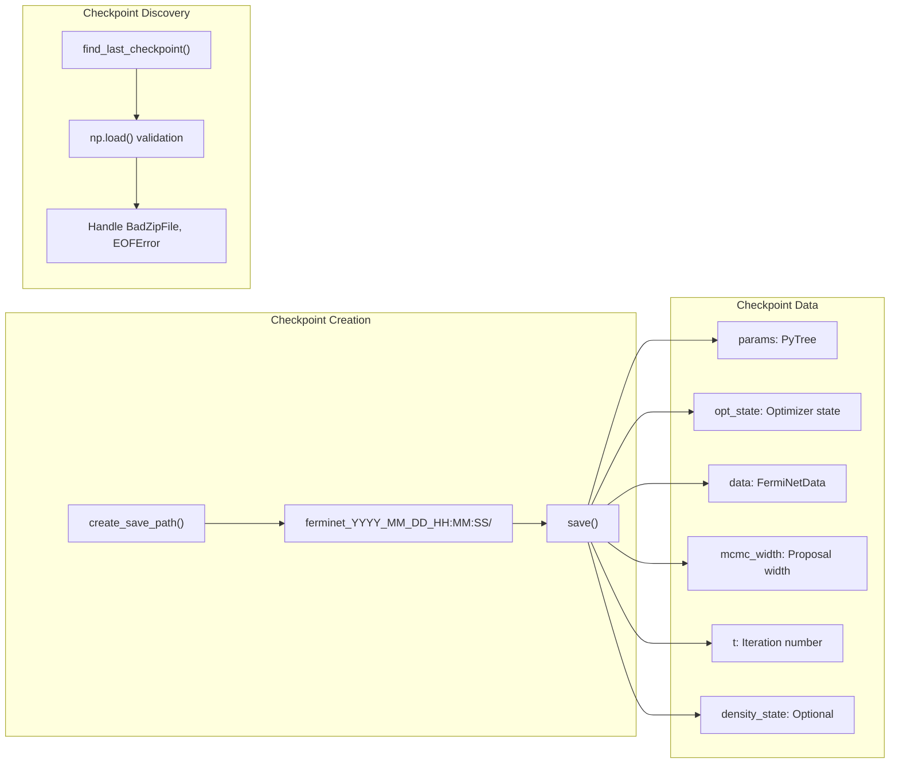
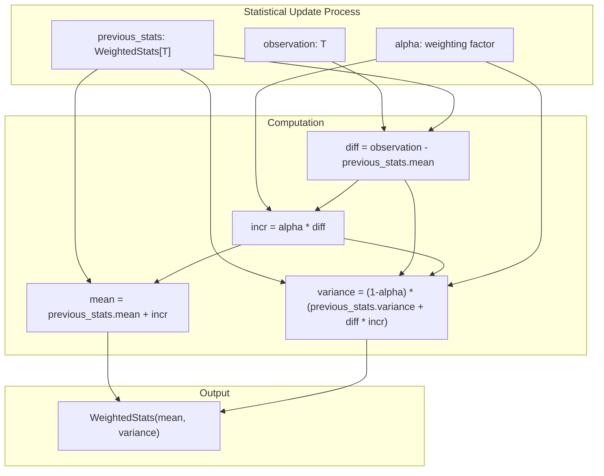
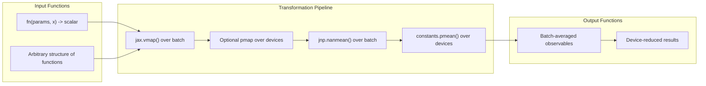
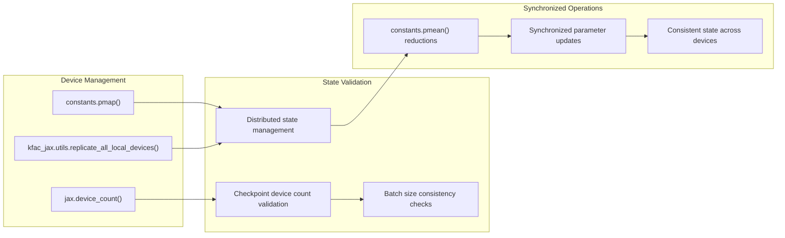

<!-- source: DeepWiki mcp.deepwiki.com · repo google-deepmind/ferminet · page 7 Utilities and Development · fetched 2026-10-26 -->

# Utilities and Development

<details>
<summary>Relevant source files</summary>

The following files were used as context for generating this wiki page:

- [ferminet/checkpoint.py](ferminet/checkpoint.py)
- [ferminet/density.py](ferminet/density.py)
- [ferminet/observables.py](ferminet/observables.py)
- [ferminet/utils/statistics.py](ferminet/utils/statistics.py)
- [ferminet/utils/tests/statistics_test.py](ferminet/utils/tests/statistics_test.py)

</details>


This document covers the supporting utilities and development infrastructure in FermiNet, including checkpointing systems, statistical monitoring tools, observable computation utilities, and development workflows. These components provide essential functionality for managing long-running calculations, monitoring training progress, and computing physical observables.

For information about the core training pipeline, see [Core Training Pipeline](#3). For details about physics calculations and Hamiltonian evaluation, see [Physics and Mathematics](#5).

## Checkpointing and State Management

FermiNet provides a comprehensive checkpointing system to save and restore training state across interruptions. The system handles network parameters, optimizer state, MCMC walker configurations, and auxiliary data like density matrix calculations.

### Checkpoint File Management

The checkpoint system uses a simple file-based approach with `.npz` files containing all necessary state information:



**Sources:** [ferminet/checkpoint.py:31-55](), [ferminet/checkpoint.py:58-73](), [ferminet/checkpoint.py:92-127]()

### State Restoration and Validation

The restoration process includes validation to ensure compatibility between saved state and current execution environment:

| Validation Check | Purpose | Error Condition |
|------------------|---------|-----------------|
| Device Count | Ensure MCMC data matches available devices | `data.positions.shape[0] != jax.device_count()` |
| Batch Size | Verify total batch size consistency | `data.positions.shape[0] * data.positions.shape[1] != batch_size` |
| File Integrity | Handle corrupted checkpoint files | `BadZipFile`, `EOFError`, `OSError` |

**Sources:** [ferminet/checkpoint.py:130-181]()

## Statistics and Monitoring

FermiNet includes utilities for tracking training statistics using exponentially weighted averages, which provide stable estimates of converging quantities during optimization.

### Exponentially Weighted Statistics

The `WeightedStats` system implements incremental computation of weighted mean and variance:



The implementation follows the incremental calculation method from Tony Finch, providing numerically stable updates for streaming data.

**Sources:** [ferminet/utils/statistics.py:25-58]()

## Observable Computation Utilities

FermiNet provides utilities for computing physical observables including the S² operator, dipole moments, and one-particle density matrices. These observables are computed using Monte Carlo estimation over electron configurations.

### Observable Function Factory

The `make_observable_fns()` system transforms single-configuration functions into batch-averaged observables:



**Sources:** [ferminet/observables.py:67-95]()

### Physical Observable Implementations

The system provides specialized implementations for quantum mechanical observables:

```mermaid
graph TD
    subgraph "Observable Types"
        S2Observable["make_s2()"]
        DipoleObservable["make_dipole()"]
        DensityMatrix["make_density_matrix()"]
    end
    
    subgraph "S² Operator Components"
        DiagonalS2["Diagonal S² contribution"]
        SpinFlipTerms["Spin-flip interaction terms"]
        AntiSymmetryHandling["Antisymmetry considerations"]
    end
    
    subgraph "Density Matrix Components"
        DensityState["DensityState dataclass"]
        DensityUpdate["density_update() function"]
        DensityEstimator["density_estimator() function"]
        SCFIntegration["SCF approximation integration"]
    end
    
    subgraph "Implementation Details"
        StateMatrix["State matrix for excited states"]
        HFProbability["Hartree-Fock probability weighting"]
        MCMCParallel["Parallel MCMC chains"]
    end
    
    S2Observable --> DiagonalS2
    S2Observable --> SpinFlipTerms
    S2Observable --> AntiSymmetryHandling
    S2Observable --> StateMatrix
    
    DensityMatrix --> DensityState
    DensityMatrix --> DensityUpdate
    DensityMatrix --> DensityEstimator
    DensityMatrix --> SCFIntegration
    DensityMatrix --> HFProbability
    DensityMatrix --> MCMCParallel
```



**Sources:** [ferminet/observables.py:98-227](), [ferminet/observables.py:230-272](), [ferminet/observables.py:275-407]()

### Density Matrix Calculation Infrastructure

The density matrix calculation requires specialized MCMC sampling and probability computation:

| Component | Purpose | Implementation |
|-----------|---------|----------------|
| `DensityState` | Track parallel MCMC chain state | Positions, probabilities, move width, acceptance rates |
| `make_effective_batch_network()` | HF probability network | Returns `½ log(p_HF)` for MCMC compatibility |
| `make_rprime_mcmc_step()` | Specialized MCMC step | Returns data, probability, and move acceptance |
| `get_rho()` | Density matrix estimation | Monte Carlo expectation over configurations |

The density matrix calculation uses the formula:

```
ρᵢⱼ = N ∫ dr' dr₁...drₙ φᵢ(r₁) φⱼ(r') ψ(r₁,r₂,...,rₙ) ψ(r',r₂,...,rₙ)
```

This is computed as a Monte Carlo expectation over HF-weighted r' samples and wavefunction-weighted electron configurations.

**Sources:** [ferminet/density.py:84-117](), [ferminet/density.py:119-167](), [ferminet/density.py:170-301]()

## Development Workflows

### Multi-device Synchronization

The utilities support multi-device execution through JAX's `pmap` functionality, ensuring synchronized state across devices:



**Sources:** [ferminet/checkpoint.py:169-173](), [ferminet/observables.py:86-91](), [ferminet/density.py:154]()

### Error Handling and Robustness

The utility systems include comprehensive error handling for production use:

- **Checkpoint corruption handling**: Automatic fallback to previous valid checkpoints when files are corrupted
- **Numerical stability**: Log-space computations with careful handling of underflow in density calculations  
- **Device consistency**: Validation of device counts and batch sizes during restoration
- **Graceful degradation**: NaN handling in statistical computations using `jnp.nanmean()`

**Sources:** [ferminet/checkpoint.py:46-54](), [ferminet/density.py:274-278](), [ferminet/observables.py:88]()

---

