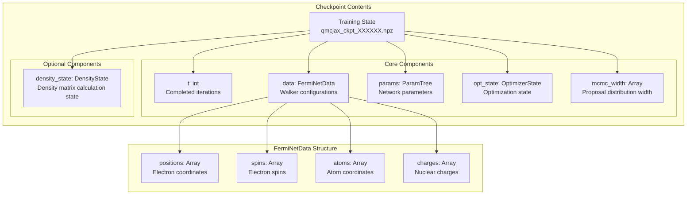
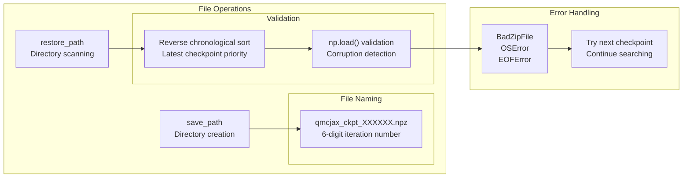
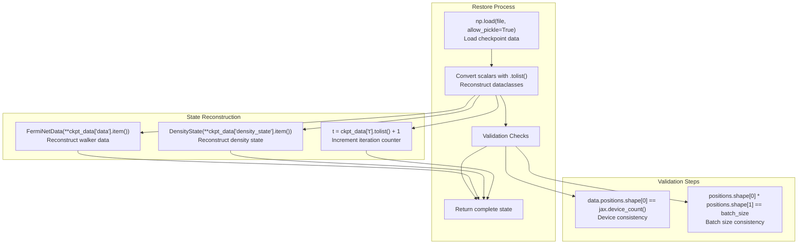
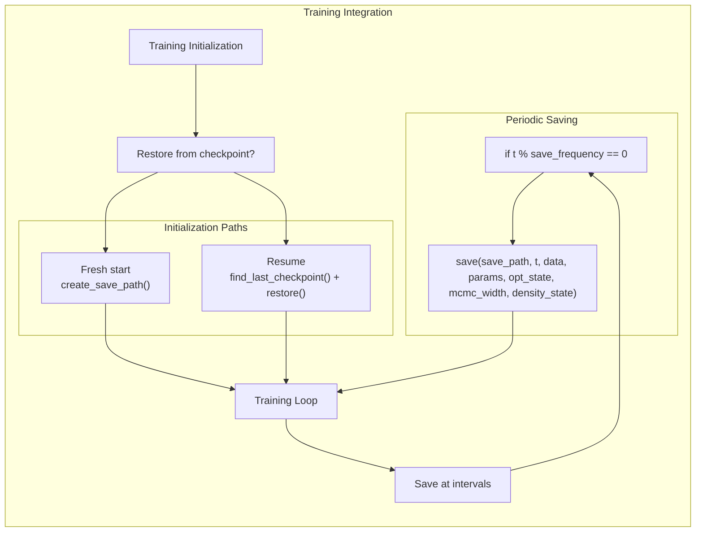

<!-- source: DeepWiki mcp.deepwiki.com · repo google-deepmind/ferminet · page 7.1 Checkpointing and State Management · fetched 2026-10-26 -->

# Checkpointing and State Management

Relevant source files

The following files were used as context for generating this wiki page:

- [ferminet/checkpoint.py](ferminet/checkpoint.py)
- [ferminet/density.py](ferminet/density.py)
- [ferminet/observables.py](ferminet/observables.py)

This document covers FermiNet's checkpointing system, which provides functionality for saving and restoring training states during long-running quantum Monte Carlo calculations. The system enables resuming interrupted calculations, monitoring training progress, and managing computational resources effectively across distributed environments.

For information about the training loop architecture that uses checkpointing, see [Training Loop Architecture](#3.1). For details about multi-host execution considerations, see [Multi-host and Distribution](#7.3).

## Overview

FermiNet's checkpointing system is implemented in `checkpoint.py` and provides a simple, robust mechanism for persisting training state using NumPy's `.npz` format. The system handles the complete state required to resume training, including network parameters, optimizer state, MCMC walker configurations, and optional density matrix calculations.

### Checkpoint Data Structure

The checkpoint system manages a comprehensive set of training state components:

Sources: [ferminet/checkpoint.py:92-127](), [ferminet/networks.py](), [ferminet/observables.py:31-53]()

### Checkpoint File Management

The system uses a structured naming convention and automatic discovery mechanism:

Sources: [ferminet/checkpoint.py:31-55](), [ferminet/checkpoint.py:58-89]()

## Core Checkpoint Operations

### Save Operation

The `save` function persists the complete training state to disk:

| Component | Type | Description |
|-----------|------|-------------|
| `t` | `int` | Number of completed training iterations |
| `data` | `FermiNetData` | MCMC walker configurations as dataclass dict |
| `params` | `ParamTree` | Network parameters (JAX pytree) |
| `opt_state` | `OptimizerState` | Optimization state as object array |
| `mcmc_width` | `Array` | MCMC proposal distribution width |
| `density_state` | `DensityState` | Optional density matrix calculation state |

The save operation converts dataclasses to dictionaries using `dataclasses.asdict()` and handles JAX optimizer states by converting them to NumPy object arrays for serialization.

Sources: [ferminet/checkpoint.py:92-127]()

### Restore Operation

The `restore` function reconstructs the training state from disk with validation:

Sources: [ferminet/checkpoint.py:130-181]()

## Density Matrix State Management

For calculations involving density matrix observables, the checkpointing system also manages `DensityState`:

| Field | Type | Description |
|-------|------|-------------|
| `t` | `int` | Time step (not distributed over devices) |
| `positions` | `Array` | Walker positions for density calculation |
| `probabilities` | `Array` | Walker probabilities |
| `move_width` | `Array` | MCMC move width for density sampling |
| `pmove` | `Array` | Acceptance probability history |
| `mo_coeff` | `Array` | SCF molecular orbital coefficients |

This state enables resuming density matrix calculations that require separate MCMC chains for the auxiliary coordinate sampling.

Sources: [ferminet/observables.py:31-53](), [ferminet/observables.py:275-340]()

## Integration with Training Pipeline

The checkpointing system integrates seamlessly with FermiNet's training loop:

Sources: [ferminet/checkpoint.py:58-89](), [ferminet/train.py]()

## Multi-Device Considerations

The checkpointing system includes specific validation for distributed training environments:

- **Device Count Validation**: Ensures the number of devices matches between saved and current execution contexts
- **Batch Size Consistency**: Validates that the total batch size (devices × local batch size) remains consistent
- **Data Sharding**: Maintains proper sharding of walker configurations across devices

The validation prevents common issues when resuming training on different hardware configurations or with modified batch sizes.

Sources: [ferminet/checkpoint.py:169-180]()

## Error Handling and Robustness

The system implements several robustness measures:

- **Corruption Detection**: Uses `np.load()` validation to detect corrupted checkpoint files
- **Automatic Fallback**: When the latest checkpoint is corrupted, automatically tries the next most recent valid checkpoint
- **Graceful Degradation**: Returns `None` when no valid checkpoints are found, allowing fresh starts

This design ensures training can continue even when individual checkpoint files are corrupted or incomplete.

Sources: [ferminet/checkpoint.py:44-55]()

---

