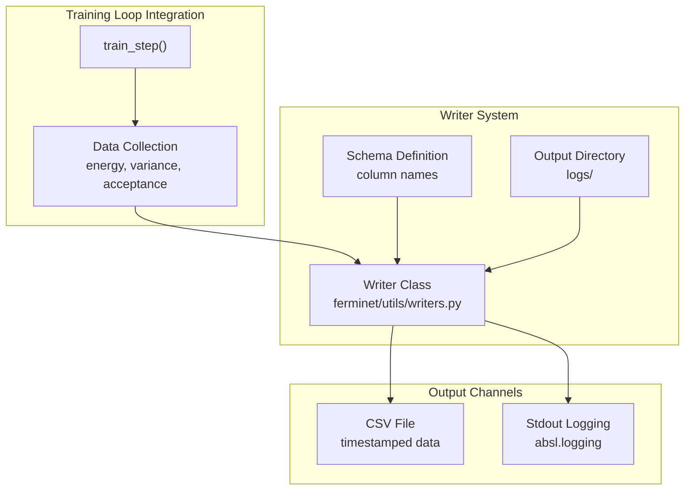
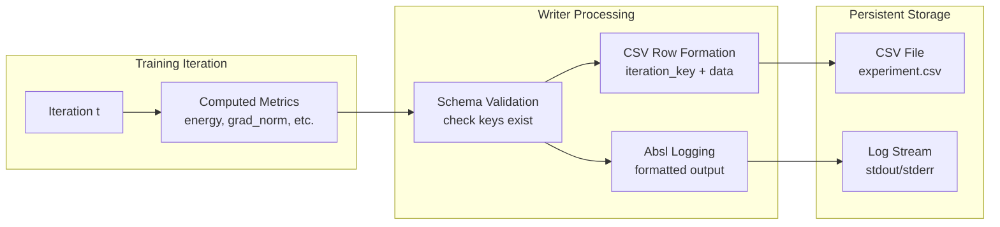
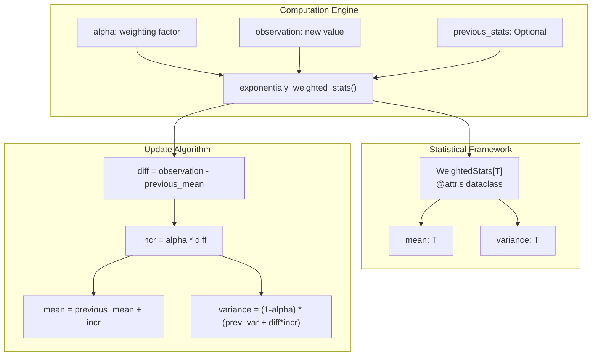
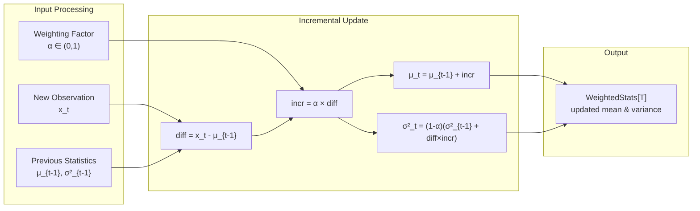
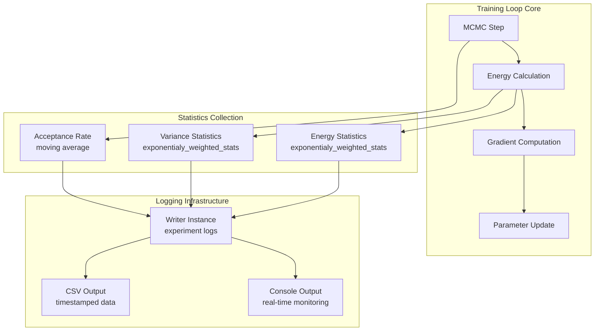

<!-- source: DeepWiki mcp.deepwiki.com · repo google-deepmind/ferminet · page 7.2 Logging and Statistics · fetched 2026-10-26 -->

# Logging and Statistics

<details>
<summary>Relevant source files</summary>

The following files were used as context for generating this wiki page:

- [ferminet/utils/statistics.py](ferminet/utils/statistics.py)
- [ferminet/utils/tests/statistics_test.py](ferminet/utils/tests/statistics_test.py)
- [ferminet/utils/writers.py](ferminet/utils/writers.py)
- [setup.py](setup.py)

</details>


This section covers FermiNet's logging and statistical utilities that enable monitoring training progress, collecting experimental data, and computing convergence statistics. The system provides structured CSV output, real-time logging to stdout, and exponentially weighted statistical tracking for long-running quantum Monte Carlo calculations.

For information about checkpointing and state persistence, see [Checkpointing and State Management](#7.1). For multi-host synchronization and distributed logging, see [Multi-host and Distribution](#7.3).

## Writer System for Data Collection

The primary logging infrastructure is built around the `Writer` class in [ferminet/utils/writers.py](), which provides structured data collection with dual output to CSV files and console logging.

### Writer Architecture



The `Writer` class operates as a context manager, automatically handling file creation, header writing, and cleanup:

| Component | Purpose | Configuration |
|-----------|---------|---------------|
| `name` | Base filename for CSV output | String identifier |
| `schema` | Column names for structured data | Sequence of strings |
| `directory` | Output directory path | Default: `'logs/'` |
| `iteration_key` | Iteration column name | Default: `'t'` |
| `log` | Enable stdout logging | Boolean flag |

**Key Methods:**
- `__init__()` - Configures output schema and directory [ferminet/utils/writers.py:26-47]()
- `__enter__()` - Creates CSV file and writes header [ferminet/utils/writers.py:49-55]()  
- `write()` - Outputs data row to CSV and optionally logs to stdout [ferminet/utils/writers.py:57-76]()
- `__exit__()` - Closes file handle [ferminet/utils/writers.py:78-79]()

Sources: [ferminet/utils/writers.py:23-80]()

### Data Flow and Usage Pattern



The typical usage pattern involves creating a writer with predefined schema, then calling `write()` with iteration number and keyword arguments matching the schema:

```python
with Writer(name='experiment', schema=['energy', 'variance']) as writer:
    writer.write(t=100, energy=-2.345, variance=0.012)
```

Sources: [ferminet/utils/writers.py:57-76]()

## Statistical Utilities

FermiNet includes specialized statistical utilities for tracking convergence during Monte Carlo simulations, implemented in [ferminet/utils/statistics.py]().

### Exponentially Weighted Statistics



The `WeightedStats` class is a generic dataclass supporting float, numpy arrays, and JAX arrays:

| Field | Type | Purpose |
|-------|------|---------|
| `mean` | `T` | Exponentially weighted mean |
| `variance` | `T` | Exponentially weighted variance |

**Key Function:**
- `exponentialy_weighted_stats()` - Computes incremental weighted statistics [ferminet/utils/statistics.py:31-58]()

The algorithm implements the incremental calculation method from Tony Finch's paper on weighted mean and variance, providing numerically stable updates for long-running simulations.

Sources: [ferminet/utils/statistics.py:25-58]()

### Statistical Algorithm Implementation



The exponential weighting formula follows:
- **Mean**: `μ_t = α μ_{t-1} + (1-α) x_t`
- **Variance**: Updated using incremental method for numerical stability

For the initial observation (when `previous_stats` is `None`), the function returns mean equal to the observation and variance of zero.

Sources: [ferminet/utils/statistics.py:31-58]()

## Integration with Training Pipeline

The logging and statistics systems integrate seamlessly with FermiNet's training loop to provide real-time monitoring and convergence tracking.

### Training Progress Monitoring



The integration pattern typically involves:

1. **Statistics Accumulation**: Using `exponentialy_weighted_stats()` to track convergence metrics
2. **Periodic Logging**: Writing accumulated statistics via `Writer.write()` at regular intervals
3. **Real-time Monitoring**: Console output for immediate feedback during training

Sources: [ferminet/utils/statistics.py:31-58](), [ferminet/utils/writers.py:57-76]()

## Testing and Validation

The statistical utilities include comprehensive testing to ensure correctness against established implementations.

### Test Framework

The test suite in [ferminet/utils/tests/statistics_test.py]() validates the exponentially weighted statistics against pandas' equivalent implementation:

| Test Component | Validation Method | Reference |
|----------------|-------------------|-----------|
| Mean calculation | Compare against `pandas.Series.ewm().mean()` | Pandas EWM |
| Variance calculation | Compare against `pandas.Series.ewm().var()` | Pandas EWM |
| Convergence behavior | Synthetic data with known properties | Generated sequences |

The tests use parameterized alpha values (0.1, 0.2, 0.5) and synthetic data that mimics converging simulation behavior, ensuring the implementation matches established statistical methods.

Sources: [ferminet/utils/tests/statistics_test.py:23-49]()

---

