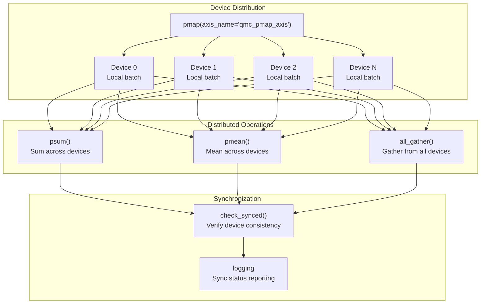
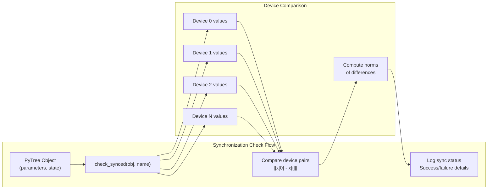
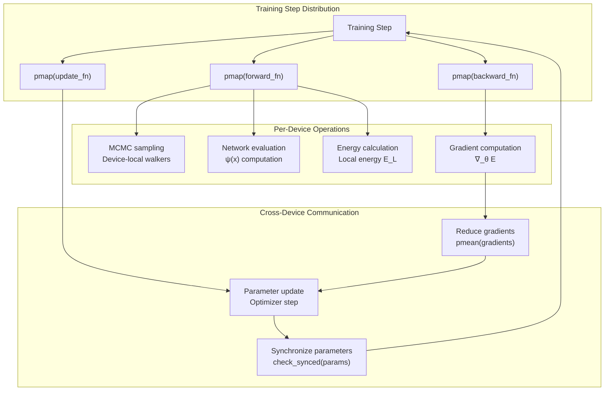
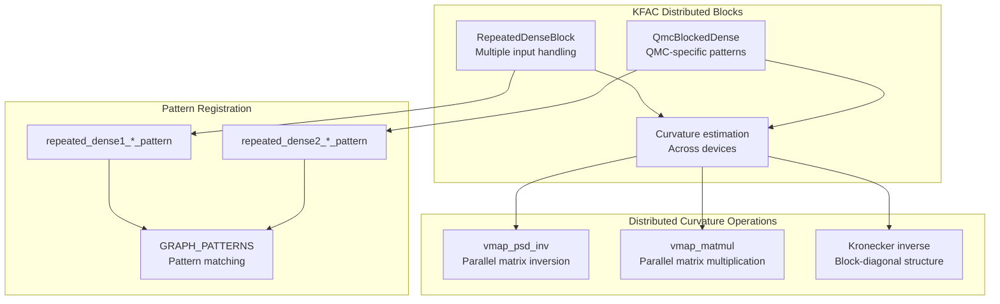

<!-- source: DeepWiki mcp.deepwiki.com · repo google-deepmind/ferminet · page 7.3 Multi-host and Distribution · fetched 2026-10-26 -->

# Multi-host and Distribution

<details>
<summary>Relevant source files</summary>

The following files were used as context for generating this wiki page:

- [ferminet/constants.py](ferminet/constants.py)
- [ferminet/curvature_tags_and_blocks.py](ferminet/curvature_tags_and_blocks.py)
- [ferminet/utils/multi_host.py](ferminet/utils/multi_host.py)

</details>


This document covers FermiNet's multi-device and distributed execution system, which enables efficient training and inference across multiple GPUs or TPUs. The system is built on JAX's `pmap` (parallel map) functionality and provides utilities for device synchronization and distributed reductions.

For information about the core training loop that uses these distributed primitives, see [Core Training Pipeline](#3). For KFAC optimization in distributed settings, see [Loss Functions and Optimization](#3.2).

## Purpose and Scope

FermiNet's distribution system handles:
- Parallel execution across multiple devices using JAX `pmap`
- Synchronization verification between devices
- Distributed reduction operations (sum, mean, gather)
- Integration with KFAC optimizer for distributed second-order optimization
- Device communication patterns for Monte Carlo sampling

## JAX pmap Architecture

FermiNet uses JAX's `pmap` to distribute computation across available devices. The system defines a consistent axis name and provides convenience functions for distributed operations.



**Diagram: FermiNet Distributed Execution Architecture**

The core constants and utilities are defined in `constants.py`. The `PMAP_AXIS_NAME` serves as the consistent identifier for all distributed operations:

| Constant/Function | Purpose | Implementation |
|------------------|---------|----------------|
| `PMAP_AXIS_NAME` | Axis identifier for pmap operations | `'qmc_pmap_axis'` |
| `pmap` | Convenience wrapper for `jax.pmap` | `functools.partial(jax.pmap, axis_name=PMAP_AXIS_NAME)` |
| `psum` | Distributed sum reduction | `kfac_jax.utils.psum_if_pmap` wrapper |
| `pmean` | Distributed mean reduction | `kfac_jax.utils.pmean_if_pmap` wrapper |
| `all_gather` | Gather values from all devices | `jax.lax.all_gather` wrapper |

Sources: [ferminet/constants.py:22-34]()

## Device Synchronization

The multi-host system includes utilities to verify that model parameters and training state remain synchronized across all devices. This is critical for ensuring consistent training behavior.



**Diagram: Device Synchronization Verification Process**

The `check_synced` function performs pair-wise comparisons between device 0 and all other devices:

```python
# From multi_host.py:32-44
for i in range(1, jax.local_device_count()):
    norms = jax.tree.map(lambda x: jnp.linalg.norm(x[0] - x[i]), obj)
    total_norms = sum(jax.tree.leaves(norms))
    if total_norms != 0.0:
        # Log desynchronization details
        return False
```

Sources: [ferminet/utils/multi_host.py:22-44]()

## Distributed Training Integration

The distribution system integrates seamlessly with FermiNet's training pipeline, handling both forward and backward passes across devices.



**Diagram: Distributed Training Step Flow**

Each device processes its local batch of Monte Carlo walkers independently during the forward pass, then gradients are averaged across devices before parameter updates.

Sources: [ferminet/constants.py:22-34](), [ferminet/utils/multi_host.py:22-44]()

## KFAC Distributed Optimization

The KFAC optimizer integration provides additional distributed computation patterns for second-order optimization methods. This includes custom blocks that handle distributed curvature estimation.



**Diagram: KFAC Distributed Optimization Architecture**

The KFAC system defines specialized blocks for handling the distributed nature of FermiNet's computations:

| Block Type | Purpose | Key Methods |
|------------|---------|-------------|
| `RepeatedDenseBlock` | Dense layers applied to multiple inputs via vmap | `update_curvature_matrix_estimate` |
| `QmcBlockedDense` | QMC-specific Kronecker-factored blocks | `multiply_matpower` |

Sources: [ferminet/curvature_tags_and_blocks.py:54-95](), [ferminet/curvature_tags_and_blocks.py:97-231]()

## Usage and Configuration

The distributed system is largely transparent to end users. JAX automatically detects available devices, and FermiNet's training functions use the distributed primitives when multiple devices are present.

**Key Configuration Points:**

1. **Device Detection**: JAX automatically discovers available GPUs/TPUs
2. **Batch Distribution**: Training batches are automatically sharded across devices
3. **Synchronization Monitoring**: Use `check_synced()` to verify training consistency
4. **Logging**: Device synchronization status is logged during training

**Typical Usage Pattern:**
```python
# Training automatically uses all available devices
train_fn = constants.pmap(train_step_fn)
# Synchronization verification
multi_host.check_synced(params, "parameters")
```

The system requires no explicit configuration for most use cases - it scales automatically based on available hardware.

Sources: [ferminet/constants.py:22-34](), [ferminet/utils/multi_host.py:22-44]()

---

