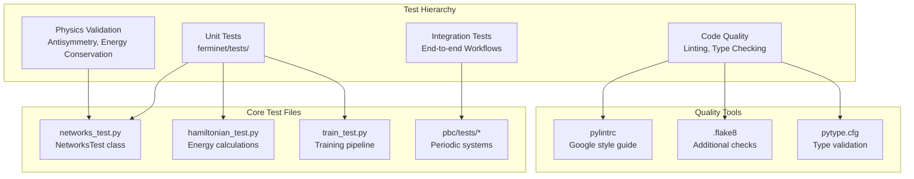
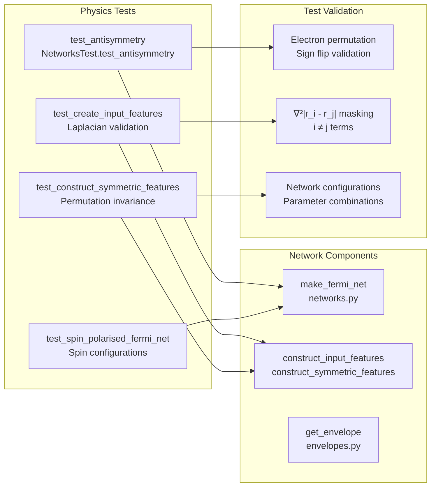
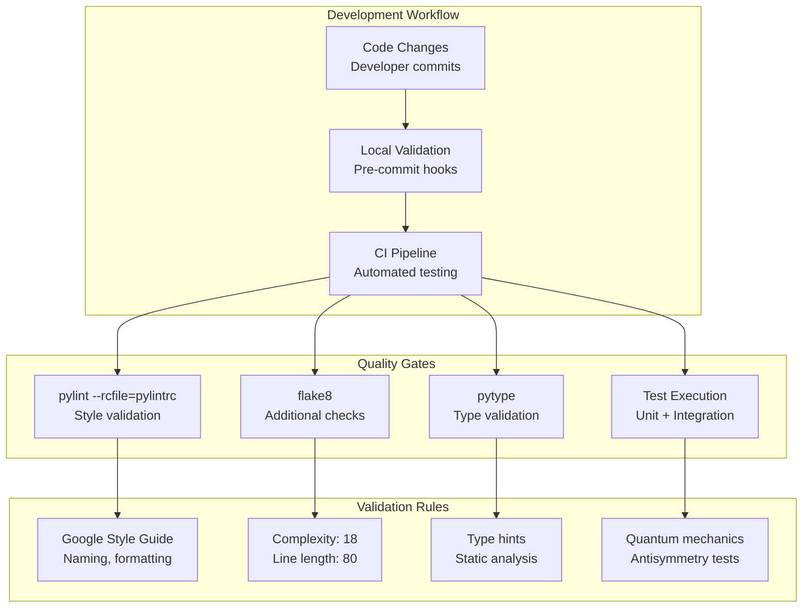
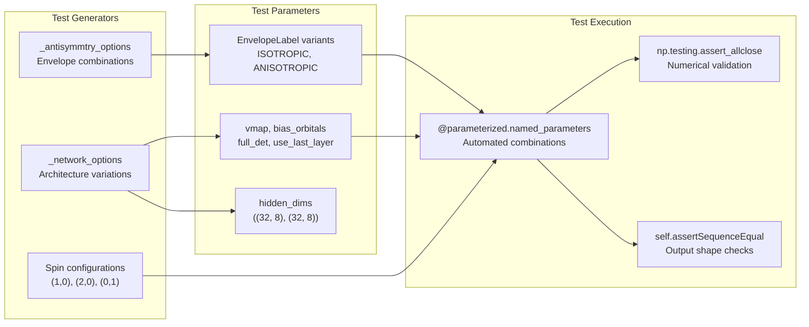

<!-- source: DeepWiki mcp.deepwiki.com · repo google-deepmind/ferminet · page 8 Testing and Code Quality · fetched 2026-10-26 -->

# Testing and Code Quality

Relevant source files

The following files were used as context for generating this wiki page:

- [.flake8](.flake8)
- [.gitignore](.gitignore)
- [ferminet/tests/networks_test.py](ferminet/tests/networks_test.py)
- [pylintrc](pylintrc)
- [pytype.cfg](pytype.cfg)

This page covers FermiNet's comprehensive testing framework and code quality standards. The testing system ensures both computational correctness and adherence to scientific principles, while the code quality tools maintain consistency with Google's Python style guide. 

For detailed information about specific test categories, see [Test Suite Overview](#8.1), [Physics Validation and Testing](#8.2), and [Code Quality and CI](#8.3).

## Overview

FermiNet employs a multi-layered approach to code quality and testing that encompasses unit tests, integration tests, physics validation, and automated code quality checks. The system is designed to catch both software bugs and violations of quantum mechanical principles.

## Testing Architecture

The testing framework is structured around several key principles: validating quantum mechanical properties, ensuring numerical accuracy, and verifying computational correctness across different system configurations.

### Test Categories and Structure

Sources: [ferminet/tests/networks_test.py:1-279](), [pylintrc:1-433](), [.flake8:1-17](), [pytype.cfg:1-4]()

### Physics Validation Framework

The testing system places special emphasis on validating quantum mechanical principles. The most critical tests ensure that the neural network wavefunctions satisfy fundamental requirements.

Sources: [ferminet/tests/networks_test.py:76-140](), [ferminet/tests/networks_test.py:141-172](), [ferminet/tests/networks_test.py:173-207]()

## Code Quality Standards

FermiNet adheres to Google's Python style guide with specific adaptations for scientific computing. The quality assurance system uses multiple tools to enforce consistency and catch potential issues.

### Linting Configuration

| Tool | Purpose | Configuration |
|------|---------|---------------|
| **pylint** | Primary style enforcement | [pylintrc:1-433]() |
| **flake8** | Additional code checks | [.flake8:1-17]() |
| **pytype** | Static type checking | [pytype.cfg:1-4]() |

The `pylintrc` configuration implements Google's style guide with scientific computing adaptations:

- **Indentation**: 2 spaces (Google internal style)
- **Line length**: 80 characters maximum
- **Naming conventions**: Snake case for functions, CamelCase for classes
- **Disabled checks**: Scientific computing specific exemptions

Sources: [pylintrc:263-290](), [pylintrc:194-226]()

### Quality Enforcement Pipeline

Sources: [pylintrc:8-31](), [.flake8:12-13](), [pytype.cfg:1-4]()

## Test Execution Framework

The test suite uses `absltest` and `parameterized` testing to systematically validate functionality across multiple configurations and parameter combinations.

### Parameterized Testing Strategy

The `networks_test.py` demonstrates sophisticated parameterized testing approaches:

Sources: [ferminet/tests/networks_test.py:37-72](), [ferminet/tests/networks_test.py:76-140](), [ferminet/tests/networks_test.py:208-255]()

## Scientific Correctness Validation

The most critical aspect of FermiNet's testing is ensuring that the neural networks satisfy quantum mechanical principles. The antisymmetry test exemplifies this approach.

### Antisymmetry Validation Process

The `test_antisymmetry` method systematically verifies that wavefunctions change sign under electron exchange:

1. **Setup**: Creates random electron configurations with different permutations
2. **Network evaluation**: Applies the same network to permuted configurations  
3. **Validation**: Ensures `ψ(r₁,r₂,...) = -ψ(r₂,r₁,...)` for electron swaps

The test validates both same-spin (fermion antisymmetry) and different-spin exchanges across multiple envelope types and network configurations.

Sources: [ferminet/tests/networks_test.py:76-140](), [ferminet/tests/networks_test.py:89-98](), [ferminet/tests/networks_test.py:131-139]()

---

