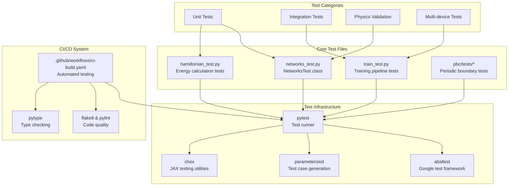
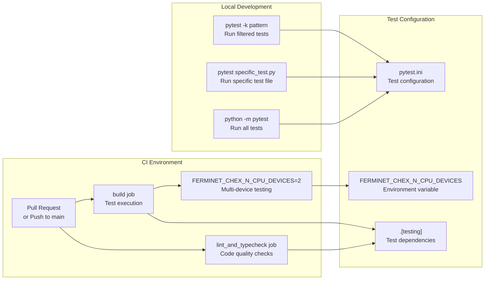
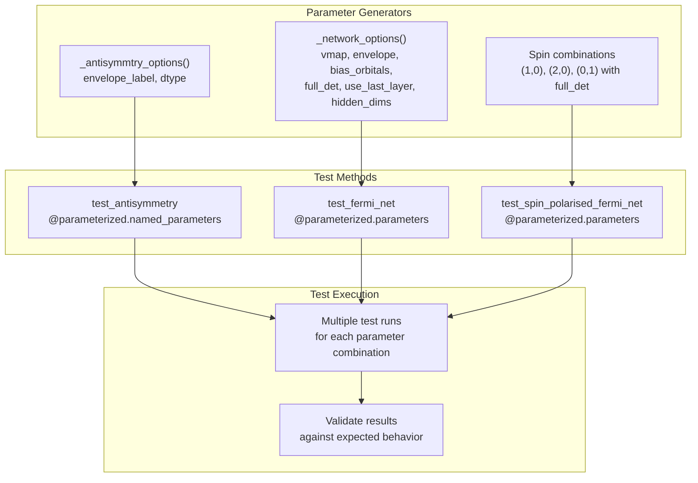

<!-- source: DeepWiki mcp.deepwiki.com · repo google-deepmind/ferminet · page 8.1 Test Suite Overview · fetched 2026-10-26 -->

# Test Suite Overview

<details>
<summary>Relevant source files</summary>

The following files were used as context for generating this wiki page:

- [.github/workflows/ci-build.yaml](.github/workflows/ci-build.yaml)
- [ferminet/pbc/__init__.py](ferminet/pbc/__init__.py)
- [ferminet/tests/networks_test.py](ferminet/tests/networks_test.py)

</details>


This page provides a comprehensive overview of FermiNet's test suite structure, types of tests, and how to run them during development. The test suite ensures code quality, validates physical correctness, and maintains system reliability across different configurations and environments.

For information about physics validation and testing methodologies, see [Physics Validation and Testing](#8.2). For details about code quality standards and continuous integration setup, see [Code Quality and CI](#8.3).

## Purpose and Scope

The FermiNet test suite serves multiple critical functions:

- **Unit Testing**: Validates individual components like network architectures, feature layers, and energy calculations
- **Integration Testing**: Ensures components work together correctly in end-to-end workflows
- **Physics Validation**: Verifies that calculations maintain physical correctness, antisymmetry, and conservation laws
- **Multi-device Testing**: Confirms proper operation across different hardware configurations
- **Continuous Integration**: Automated testing on code changes to maintain stability

## Test Suite Architecture

The following diagram shows the overall structure of the testing system and how different test categories relate to the main codebase components:

**Test Suite Component Structure**


Sources: [ferminet/tests/networks_test.py:1-279](), [.github/workflows/ci-build.yaml:1-68]()

## Test Execution Methods

**Test Execution Workflow**


Sources: [.github/workflows/ci-build.yaml:62-67]()

## Core Test Classes and Methods

The test suite is organized around several key test classes that validate different aspects of the system:

### NetworksTest Class

The `NetworksTest` class in [ferminet/tests/networks_test.py:74-275]() contains the primary tests for neural network functionality:

| Test Method | Purpose | Key Validation |
|-------------|---------|----------------|
| `test_antisymmetry` | Validates fermionic antisymmetry | Wavefunction sign changes under electron exchange |
| `test_create_input_features` | Tests input feature construction | Gradient masking for electron-electron distances |
| `test_construct_symmetric_features` | Tests symmetric feature layers | Permutation invariance under electron swaps |
| `test_fermi_net` | General network functionality | Network construction and evaluation |
| `test_spin_polarised_fermi_net` | Spin-polarized systems | Handling of systems with unequal spin counts |

### Parameterized Testing

The test suite extensively uses parameterized testing to validate functionality across different configurations:

**Test Parameter Generation**


Sources: [ferminet/tests/networks_test.py:37-72](), [ferminet/tests/networks_test.py:208-275]()

## Running Tests

### Local Development

To run the complete test suite locally:

```bash
# Install test dependencies
pip install -e '.[testing]'

# Run all tests
python -m pytest

# Run specific test file
python -m pytest ferminet/tests/networks_test.py

# Run tests with specific pattern
python -m pytest -k "antisymmetry"
```

### Multi-device Testing

For testing multi-device functionality:

```bash
# Set environment variable for multiple CPU devices
FERMINET_CHEX_N_CPU_DEVICES=2 python -m pytest ferminet/tests/train_test.py
```

### Continuous Integration

The CI system automatically runs tests on:
- Push to main branch
- Pull requests to main branch
- Manual workflow dispatch

The CI pipeline includes:
1. **Lint and Type Check Job**: Runs `flake8`, `pylint`, and `pytype`
2. **Build Job**: Runs the full test suite with `pytest`
3. **Multi-device Tests**: Validates distributed execution

Sources: [.github/workflows/ci-build.yaml:15-67]()

## Test Infrastructure Dependencies

The test suite relies on several key testing libraries:

| Library | Purpose | Usage in Tests |
|---------|---------|----------------|
| `absltest` | Google's testing framework | Base test class and utilities |
| `parameterized` | Parameterized test generation | Multiple test configurations |
| `chex` | JAX testing utilities | Finite value checking, tree validation |
| `pytest` | Test runner and discovery | Primary test execution engine |
| `jax.random` | Random number generation | Reproducible test data generation |
| `numpy.testing` | Numerical assertions | Precision-aware comparisons |

Key testing patterns used throughout the codebase:

- **Parameterized Testing**: Generate multiple test cases from parameter combinations
- **Random State Management**: Use fixed seeds for reproducible tests
- **Numerical Tolerance**: Careful handling of floating-point comparisons
- **Exception Testing**: Validate error conditions and edge cases
- **Tree Structure Validation**: Use `chex` for JAX pytree validation

Sources: [ferminet/tests/networks_test.py:19-27](), [ferminet/tests/networks_test.py:161-171]()

---

