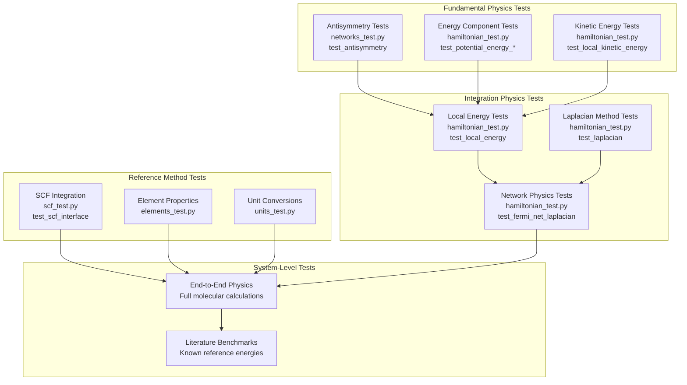
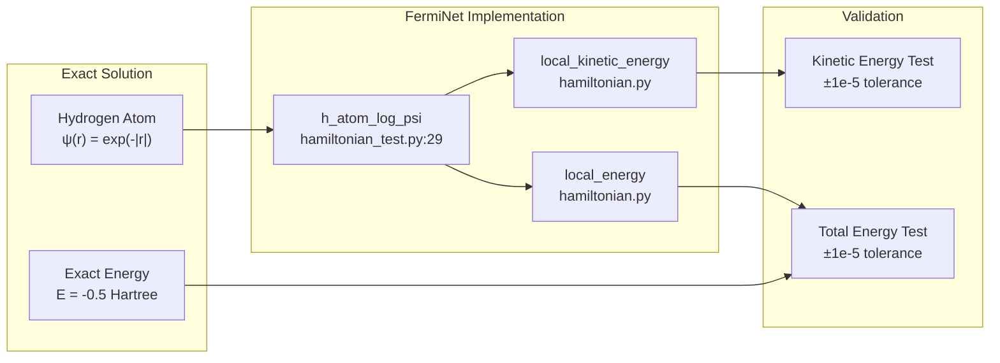
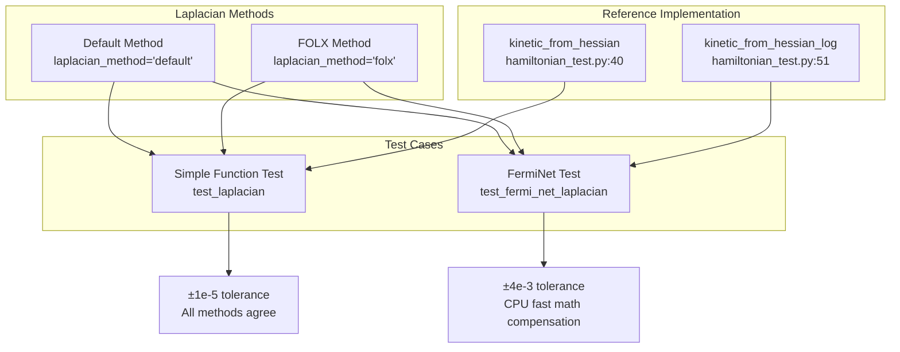
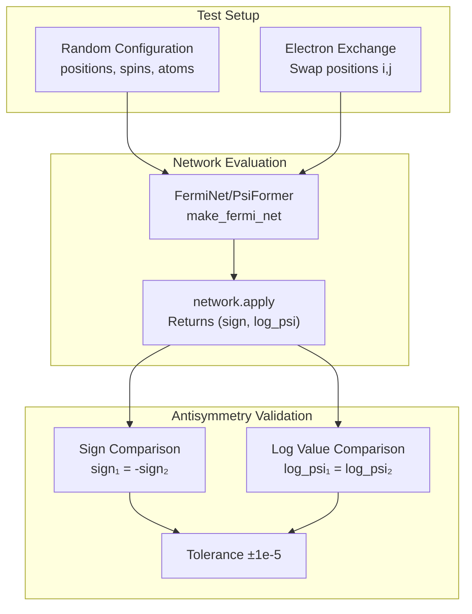
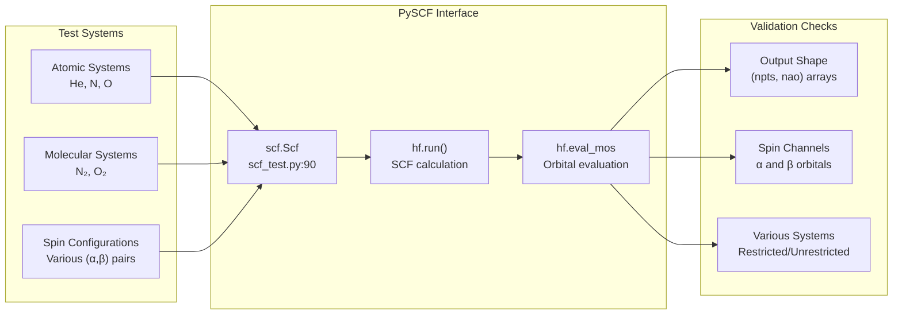
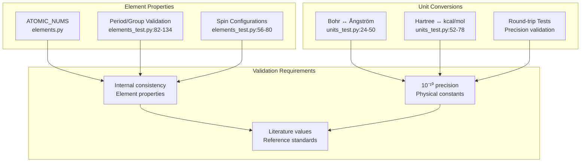
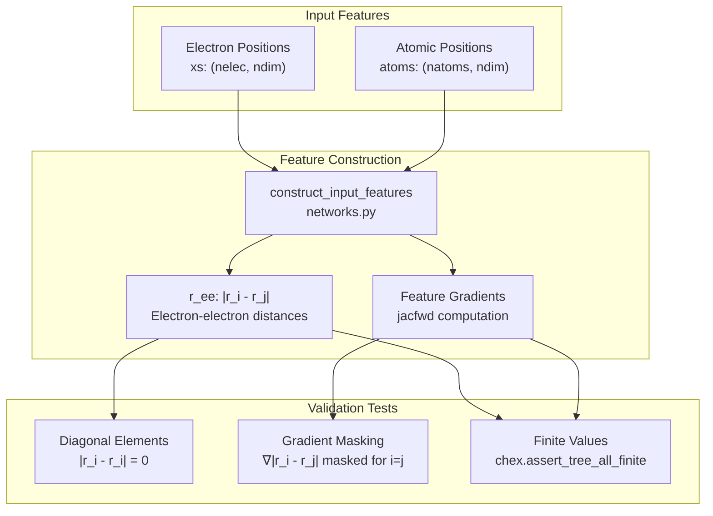
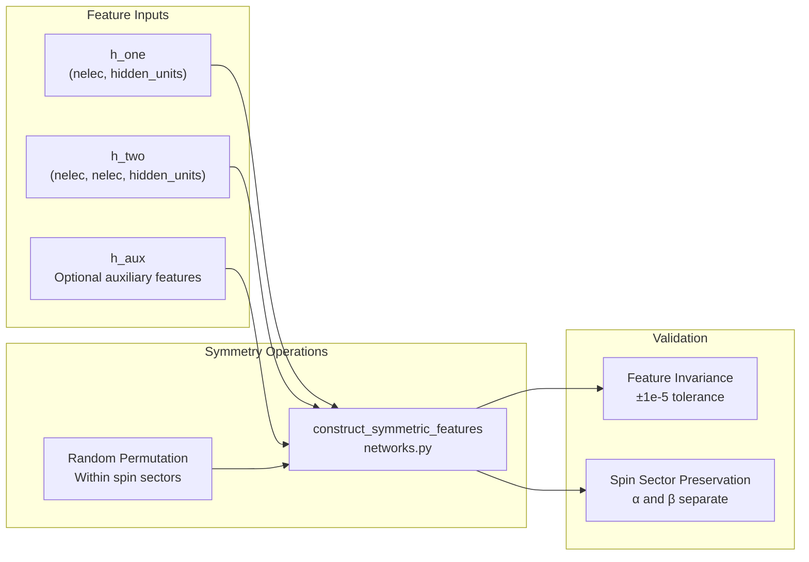

<!-- source: DeepWiki mcp.deepwiki.com · repo google-deepmind/ferminet · page 8.2 Physics Validation and Testing · fetched 2026-10-26 -->

# Physics Validation and Testing

Relevant source files

The following files were used as context for generating this wiki page:

- [ferminet/tests/hamiltonian_test.py](ferminet/tests/hamiltonian_test.py)
- [ferminet/tests/networks_test.py](ferminet/tests/networks_test.py)
- [ferminet/utils/tests/elements_test.py](ferminet/utils/tests/elements_test.py)
- [ferminet/utils/tests/scf_test.py](ferminet/utils/tests/scf_test.py)
- [ferminet/utils/tests/units_test.py](ferminet/utils/tests/units_test.py)

This document describes how FermiNet's test suite validates the physical correctness of quantum mechanical calculations. It covers the validation of energy calculations, wavefunction antisymmetry, and integration with reference quantum chemistry methods. For information about the overall test suite structure, see [Test Suite Overview](#8.1). For code quality and continuous integration practices, see [Code Quality and CI](#8.3).

## Purpose and Scope

Physics validation in FermiNet ensures that the neural network implementations correctly represent quantum mechanical principles and produce physically meaningful results. The tests validate fundamental properties including:

- **Energy calculation accuracy** using analytical solutions
- **Wavefunction antisymmetry** for fermionic systems  
- **Conservation laws** and symmetries
- **Integration** with established quantum chemistry methods
- **Numerical stability** of physics computations

## Physics Validation Architecture

The physics validation system is organized around testing core quantum mechanical principles at multiple levels of abstraction.

### Physics Test Hierarchy

Sources: [ferminet/tests/hamiltonian_test.py:62-155](), [ferminet/tests/networks_test.py:74-278](), [ferminet/utils/tests/scf_test.py:26-102]()

## Energy Calculation Validation

Energy calculation tests validate the accuracy of Hamiltonian evaluation using analytical solutions and known physics principles.

### Hamiltonian Component Testing

| Test Function | Physics Property | Validation Method |
|---------------|------------------|-------------------|
| `test_potential_energy_null` | Zero potential energy | Single electron, zero nuclear charge |
| `test_potential_energy_ee` | Electron-electron repulsion | Multi-electron Coulomb interactions |
| `test_potential_energy_he2_ion` | Mixed interactions | He₂⁺ ion with all energy terms |
| `test_local_kinetic_energy` | Kinetic energy operator | Hydrogen atom exact solution |
| `test_local_energy` | Total local energy | Complete H atom energy |

### Analytical Solution Validation

The tests use the exact hydrogen atom wavefunction as a benchmark for energy calculations:

Sources: [ferminet/tests/hamiltonian_test.py:29-37](), [ferminet/tests/hamiltonian_test.py:65-83](), [ferminet/tests/hamiltonian_test.py:122-154]()

### Laplacian Method Consistency

The tests verify that different Laplacian calculation methods produce identical results:

Sources: [ferminet/tests/hamiltonian_test.py:159-185](), [ferminet/tests/hamiltonian_test.py:187-250]()

## Wavefunction Antisymmetry Validation

Antisymmetry testing ensures that fermionic wavefunctions correctly change sign under particle exchange, a fundamental requirement of quantum mechanics.

### Antisymmetry Test Implementation

The antisymmetry tests verify the fundamental fermionic property: ψ(r₁, r₂, ..., rᵢ, ..., rⱼ, ...) = -ψ(r₁, r₂, ..., rⱼ, ..., rᵢ, ...)

Sources: [ferminet/tests/networks_test.py:76-139]()

### Test Coverage for Network Configurations

The antisymmetry tests cover all envelope types and validate different network configurations:

| Parameter | Test Values | Purpose |
|-----------|-------------|---------|
| `envelope_label` | All `EnvelopeLabel` types | Different boundary conditions |
| `full_det` | `True`, `False` | Full vs factorized determinants |
| `bias_orbitals` | `True`, `False` | Orbital bias configurations |
| `use_last_layer` | `True`, `False` | Network architecture variants |
| `nspins` | Various combinations | Different spin configurations |

Sources: [ferminet/tests/networks_test.py:37-71](), [ferminet/tests/networks_test.py:208-255]()

## Reference Method Integration Testing

Integration tests validate FermiNet's interface with established quantum chemistry methods, ensuring compatibility and correctness.

### SCF Integration Validation

Sources: [ferminet/utils/tests/scf_test.py:35-98]()

### Element and Unit Validation

Supporting physics tests ensure fundamental constants and conversions are correct:

Sources: [ferminet/utils/tests/elements_test.py:25-134](), [ferminet/utils/tests/units_test.py:24-82]()

## Input Feature Validation

The tests validate that input features are constructed correctly and have proper mathematical properties:

### Feature Construction Tests

Sources: [ferminet/tests/networks_test.py:141-171]()

## Symmetric Feature Validation

Tests ensure that symmetric features remain invariant under electron permutations:

Sources: [ferminet/tests/networks_test.py:173-206]()

---

