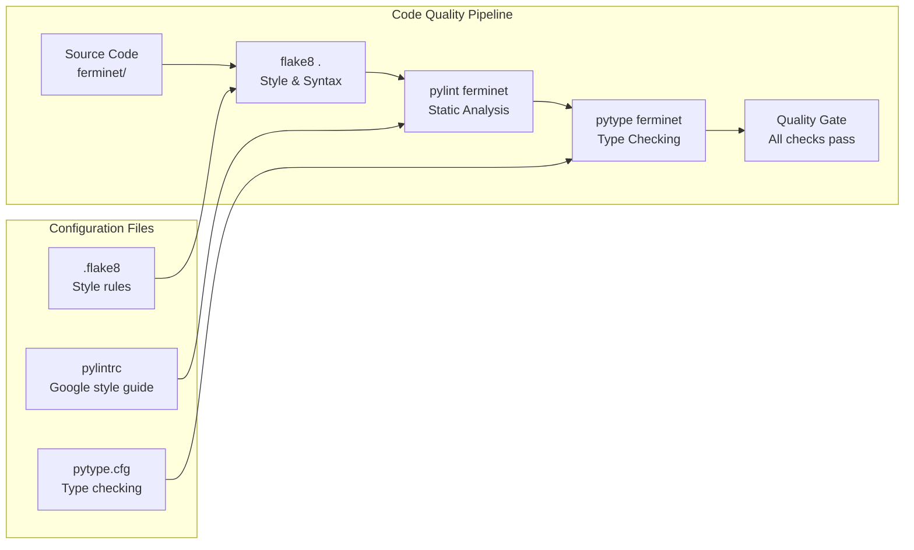

<!-- source: DeepWiki mcp.deepwiki.com · repo google-deepmind/ferminet · page 8.3 Code Quality and CI · fetched 2026-10-26 -->

# Code Quality and CI

<details>
<summary>Relevant source files</summary>

The following files were used as context for generating this wiki page:

- [.flake8](.flake8)
- [.github/workflows/ci-build.yaml](.github/workflows/ci-build.yaml)
- [.gitignore](.gitignore)
- [ferminet/pbc/__init__.py](ferminet/pbc/__init__.py)
- [pylintrc](pylintrc)
- [pytype.cfg](pytype.cfg)

</details>


This document covers the code quality standards, static analysis tools, and continuous integration (CI) pipeline used in the FermiNet codebase. It explains how automated quality checks ensure code consistency, type safety, and adherence to Google Python style guidelines.

For information about the test suite structure and test execution, see [Test Suite Overview](#8.1). For details about physics validation in tests, see [Physics Validation and Testing](#8.2).

## CI Pipeline Overview

The FermiNet project uses GitHub Actions for continuous integration, with automated quality checks running on every push and pull request to the main branch.

### CI Workflow Architecture

```mermaid
graph TD
    subgraph "Trigger Events"
        Push["Push to main"]
        PR["Pull Request"]
        Manual["workflow_dispatch"]
    end
    
    subgraph "lint_and_typecheck Job"
        Setup1["Setup Python 3.11"]
        InstallDeps1["pip install -e '.[testing]'"]
        Flake8["flake8 ."]
        Pylint["pylint --fail-under 9.5 ferminet"]
        Pytype["pytype ferminet"]
    end
    
    subgraph "build Job"
        Setup2["Setup Python 3.11"]
        InstallDeps2["pip install -e '.[testing]'"]
        RunTests["python -m pytest"]
        MultiDevice["FERMINET_CHEX_N_CPU_DEVICES=2<br/>pytest ferminet/tests/train_test.py"]
    end
    
    Push --> Setup1
    PR --> Setup1
    Manual --> Setup1
    
    Push --> Setup2
    PR --> Setup2
    Manual --> Setup2
    
    Setup1 --> InstallDeps1
    InstallDeps1 --> Flake8
    Flake8 --> Pylint
    Pylint --> Pytype
    
    Setup2 --> InstallDeps2
    InstallDeps2 --> RunTests
    RunTests --> MultiDevice
```



The CI pipeline runs two parallel jobs that must both pass for changes to be accepted. The `lint_and_typecheck` job focuses on code quality, while the `build` job executes the full test suite including multi-device scenarios.

**Sources:** [.github/workflows/ci-build.yaml:1-68]()

## Code Quality Tools

FermiNet employs three primary static analysis tools to maintain code quality and consistency across the codebase.

### Tool Configuration Matrix

| Tool | Primary Purpose | Configuration File | Failure Threshold |
|------|----------------|-------------------|-------------------|
| `flake8` | Style and syntax checking | `.flake8` | Any violation |
| `pylint` | Comprehensive static analysis | `pylintrc` | Score < 9.5 |
| `pytype` | Static type checking | `pytype.cfg` | Type errors |

### Pylint Configuration

Pylint is configured to follow the Google Python style guide with a strict quality threshold requiring a minimum score of 9.5 out of 10. The configuration includes extensive customizations:

#### Key Settings
- **Line length:** 80 characters maximum [pylintrc:264]()
- **Indentation:** 2 spaces (Google internal style) [pylintrc:286]()
- **Parallel execution:** 4 jobs for faster analysis [pylintrc:26]()
- **Score threshold:** 9.5 minimum [.github/workflows/ci-build.yaml:34]()

#### Disabled Checks
The configuration disables numerous checks that are either incompatible with scientific computing patterns or overly restrictive for the FermiNet codebase, including:
- `too-many-arguments`, `too-many-locals` - Common in scientific functions
- `no-member`, `import-error` - JAX and NumPy dynamic attributes
- `abstract-method`, `signature-differs` - Inheritance patterns

**Sources:** [pylintrc:54-151](), [pylintrc:264](), [pylintrc:286]()

### Flake8 Configuration

Flake8 provides fast syntax and style checking with customized rules for the FermiNet codebase:

```
max-line-length = 80
max-complexity = 18
ignore = C901, E111, E114, E121, W503, W504
select = B,C,F,W,T4,B9,E261
exclude = .git, __pycache__
```

The configuration ignores certain formatting rules (indentation, line breaks) while maintaining focus on more critical issues like unused imports and undefined variables.

**Sources:** [.flake8:1-17]()

### Pytype Configuration

Pytype performs static type analysis on the entire `ferminet` package with minimal configuration:

```
[pytype]
inputs = ferminet
disable = wrong-arg-types
```

The `wrong-arg-types` check is disabled due to dynamic typing patterns common in JAX and scientific computing libraries.

**Sources:** [pytype.cfg:1-4]()

## Quality Tools Integration

### CI Execution Flow



The tools run sequentially in the CI pipeline, with each tool having access to its respective configuration file. Failure at any stage prevents the pipeline from proceeding.

**Sources:** [.github/workflows/ci-build.yaml:29-37]()

## Development Workflow Integration

### Local Development
Developers can run the same quality checks locally before committing:

```bash
# Style checking
flake8 .

# Static analysis (requires score ≥ 9.5)
pylint --fail-under 9.5 ferminet

# Type checking
pytype ferminet
```

### Multi-Device Testing
The CI includes specialized multi-device testing for distributed training scenarios:

```bash
FERMINET_CHEX_N_CPU_DEVICES=2 python -m pytest ferminet/tests/train_test.py
```

This environment variable configures Chex to simulate multiple devices, enabling testing of the distributed training functionality on single-machine CI runners.

**Sources:** [.github/workflows/ci-build.yaml:64-67]()

### File Exclusions
The quality tools are configured to ignore certain files and directories:

- **Git artifacts:** `.git`, `__pycache__` [.flake8:14-16]()
- **Third-party code:** `third_party` [pylintrc:12]()
- **Generated files:** `*.pyc`, `*.egg-info` [.gitignore:1-5]()

These exclusions ensure quality checks focus on the core FermiNet codebase rather than external dependencies or build artifacts.

**Sources:** [.flake8:14-16](), [pylintrc:12](), [.gitignore:1-5]()