# Page: Overview

# Overview

<details>
<summary>Relevant source files</summary>

The following files were used as context for generating this wiki page:

- [README.md](README.md)
- [ferminet/configs/atom.py](ferminet/configs/atom.py)
- [ferminet/utils/writers.py](ferminet/utils/writers.py)
- [setup.py](setup.py)

</details>


This document provides a comprehensive introduction to the FermiNet codebase, covering its purpose, architecture, and core components. FermiNet is a research-level implementation of neural networks for solving quantum many-body problems in computational chemistry and condensed matter physics.

For specific configuration details, see [Configuration System](#2). For training workflows, see [Core Training Pipeline](#3). For neural network architectures, see [Neural Network Architectures](#4).

## Purpose and Scope

FermiNet (Fermionic Neural Networks) is a neural network framework designed to learn highly accurate ground state wavefunctions of atoms and molecules using variational Monte Carlo (VMC) methods. The codebase implements deep neural networks that can solve the many-electron Schrödinger equation ab-initio, providing a machine learning approach to quantum chemistry calculations.

The framework supports:
- **Ground and excited state calculations** for atoms and molecules
- **Variational Monte Carlo** optimization with custom loss functions
- **Periodic boundary conditions** for solid-state systems
- **Multiple neural architectures** including FermiNet and PsiFormer
- **Integration with quantum chemistry tools** like PySCF
- **Multi-GPU parallelization** via JAX

Sources: [README.md:1-15](), [setup.py:49-65]()

## Core Architecture Overview

The FermiNet codebase follows a modular architecture centered around a configuration-driven training pipeline. The system can be understood through several key architectural layers:

**System Architecture**
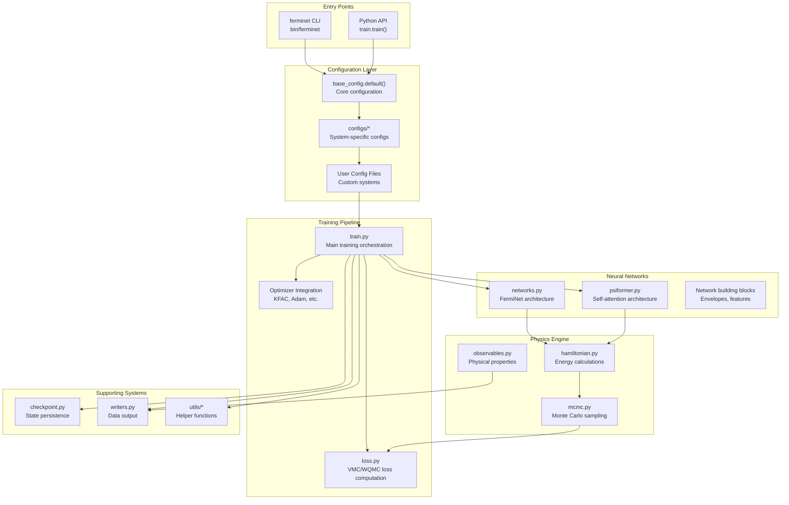

Sources: [README.md:47-97](), [ferminet/configs/atom.py:64-76](), [setup.py:57-59]()

## Data Flow and Training Workflow

The training process follows a clear data flow pattern from system definition through neural network optimization:

**Training Data Flow**
```mermaid
graph LR
    subgraph "System Definition"
        MolDef["System Definition<br/>atoms, electrons, geometry"]
        ConfigMerge["Configuration Merge<br/>base_config + user config"]
    end
    
    subgraph "Network Initialization"
        NetworkBuild["Network Construction<br/>make_fermi_net()"]
        ParamInit["Parameter Initialization<br/>init_fermi_net()"]
        WalkerInit["Walker Initialization<br/>MCMC starting positions"]
    end
    
    subgraph "Training Loop Core" 
        MCMCStep["MCMC Sampling<br/>mcmc.make_mcmc_step()"]
        NetworkEval["Network Evaluation<br/>Ψ(r₁,r₂,...,rₙ)"]
        EnergyCalc["Energy Calculation<br/>local_energy()"]
        LossComp["Loss Computation<br/>make_loss()"]
        GradUpdate["Gradient Update<br/>Optimizer step"]
    end
    
    subgraph "Output Generation"
        Checkpoint["Checkpoint Save<br/>parameters + state"]
        Metrics["Metrics Logging<br/>train_stats.csv"]
        Observables["Observable Calculation<br/>S², dipole, density"]
    end
    
    MolDef --> ConfigMerge
    ConfigMerge --> NetworkBuild
    NetworkBuild --> ParamInit
    ParamInit --> WalkerInit
    
    WalkerInit --> MCMCStep
    MCMCStep --> NetworkEval
    NetworkEval --> EnergyCalc
    EnergyCalc --> LossComp
    LossComp --> GradUpdate
    GradUpdate --> MCMCStep
    
    GradUpdate --> Checkpoint
    LossComp --> Metrics
    NetworkEval --> Observables
```

Sources: [README.md:98-152](), [ferminet/utils/writers.py:23-80]()

## Key Components and Entry Points

### Configuration System
The configuration system uses `ml_collections.ConfigDict` for hierarchical configuration management. The base configuration is defined in `base_config.default()` and can be extended through system-specific configs in the `configs/` directory.

| Component | Function | File Path |
|-----------|----------|-----------|
| Base Configuration | `default()` | `ferminet/base_config.py` |
| Atom Systems | `get_config()` | `ferminet/configs/atom.py` |
| CLI Interface | Main entry point | `bin/ferminet` |

### Neural Network Architectures
Two primary architectures are supported:

| Architecture | Key Function | Description |
|--------------|--------------|-------------|
| FermiNet | `fermi_net()` | Deep sets with antisymmetric determinant layers |
| PsiFormer | `psiformer()` | Self-attention based transformer architecture |

### Physics and Training
The core physics computations and training loop:

| Component | Key Function | Purpose |
|-----------|--------------|---------|
| Hamiltonian | `local_energy()` | Computes ⟨Ψ\|Ĥ\|Ψ⟩/⟨Ψ\|Ψ⟩ |
| MCMC Sampling | `make_mcmc_step()` | Metropolis-Hastings electron sampling |
| Loss Functions | `make_loss()` | VMC, WQMC, overlap penalty losses |
| Training Loop | `train()` | Main orchestration function |

Sources: [README.md:47-67](), [ferminet/configs/atom.py:23-61]()

## System Capabilities

### Supported Systems
- **Atoms**: Single atoms with configurable charge and spin
- **Molecules**: Multi-atom systems with arbitrary geometries  
- **Periodic Systems**: Solids with periodic boundary conditions
- **Excited States**: Multiple electronic states via NES-VMC or penalty methods

### Calculation Types
- **Ground State Optimization**: Standard VMC energy minimization
- **Excited State Calculations**: Multi-state optimization with `cfg.system.states=k`
- **Inference Mode**: Fixed-parameter observable calculations with `cfg.optim.optimizer='none'`
- **Pretraining**: Hartree-Fock initialization via `cfg.pretrain.iterations`

### Integration Points
- **PySCF Integration**: Direct molecule import via `cfg.system.pyscf_mol`
- **Multi-GPU Support**: Automatic parallelization via JAX `pmap`
- **Checkpointing**: Automatic state saving to `cfg.log.save_path`
- **Observable Tracking**: S², dipole moments, density matrices

Sources: [README.md:159-193](), [README.md:176-192]()

This architecture provides a flexible, research-oriented framework for quantum many-body calculations while maintaining clear separation between configuration, physics, and neural network components.

---

# Page: Installation and Setup

# Installation and Setup

<details>
<summary>Relevant source files</summary>

The following files were used as context for generating this wiki page:

- [.github/workflows/ci-build.yaml](.github/workflows/ci-build.yaml)
- [ferminet/pbc/__init__.py](ferminet/pbc/__init__.py)
- [ferminet/utils/writers.py](ferminet/utils/writers.py)
- [setup.py](setup.py)

</details>


This document provides a comprehensive guide for installing FermiNet and understanding its package structure. It covers dependency requirements, installation methods, and verification procedures to get FermiNet running on your system.

For information about configuring FermiNet for specific calculations, see [Configuration System](#2). For running your first calculation, see [Quick Start Guide](#1.2).

## Prerequisites and System Requirements

FermiNet requires Python 3.11 and is designed to work with JAX for hardware acceleration. The system supports both CPU and GPU/TPU execution.

### Python Version Requirements

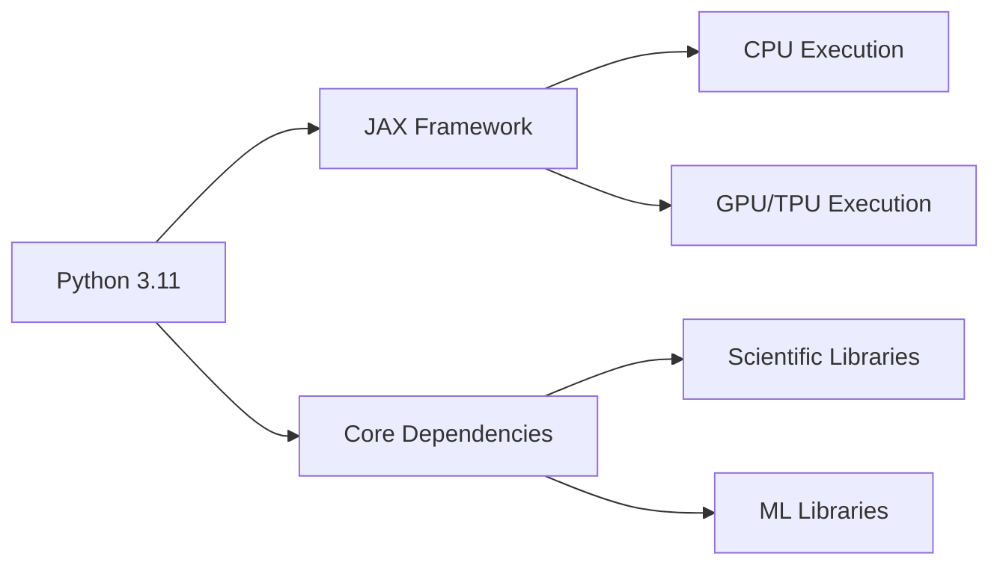

The CI system validates compatibility with Python 3.11 as shown in the continuous integration configuration.

**Sources:** [.github/workflows/ci-build.yaml:19](), [.github/workflows/ci-build.yaml:25]()

## Core Dependencies

FermiNet has several categories of dependencies that enable its quantum chemistry and machine learning capabilities:

| Category | Dependencies | Purpose |
|----------|-------------|---------|
| **JAX Ecosystem** | `jax`, `jaxlib`, `chex`, `optax` | Neural network training and differentiation |
| **Scientific Computing** | `numpy`, `scipy`, `pyscf` | Numerical operations and quantum chemistry |
| **Machine Learning** | `kfac_jax`, `folx` | Optimization and automatic differentiation |
| **Data Management** | `h5py`, `pandas`, `pyblock` | Data storage and statistical analysis |
| **Configuration** | `ml-collections`, `absl-py`, `attrs` | Configuration management and command-line tools |

### Special Dependencies

Two dependencies are installed from Git repositories rather than PyPI:

- `folx`: Microsoft's forward-mode automatic differentiation library
- `kfac_jax`: DeepMind's K-FAC optimization library

**Sources:** [setup.py:22-40]()

## Installation Methods

### Standard Installation

The recommended installation method uses pip with the repository:

```bash
# Install from source
pip install git+https://github.com/google-deepmind/ferminet.git
```

### Development Installation

For development or if you want to modify the code:

```bash
# Clone the repository
git clone https://github.com/google-deepmind/ferminet.git
cd ferminet

# Install in editable mode
pip install -e .

# Install with testing dependencies
pip install -e '.[testing]'
```

The development installation includes additional tools for code quality and testing.

**Sources:** [.github/workflows/ci-build.yaml:28](), [.github/workflows/ci-build.yaml:57](), [setup.py:61]()

## Package Structure Overview

FermiNet follows a modular architecture with clear separation of concerns:

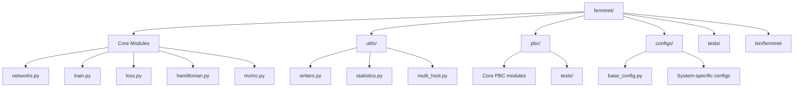

### Key Package Components

- **Core Training Pipeline**: `train.py`, `loss.py`, `networks.py`
- **Physics Implementation**: `hamiltonian.py`, `mcmc.py`, `observables.py`
- **Periodic Boundary Conditions**: `pbc/` subpackage
- **Configuration System**: `base_config.py` and `configs/`
- **Utilities**: `utils/` for logging, statistics, and multi-host support
- **Command Line Interface**: `bin/ferminet` script

**Sources:** [setup.py:58](), [ferminet/pbc/__init__.py:1-14](), [ferminet/utils/writers.py:1-80]()

## Installation Verification

### Basic Verification

After installation, verify that FermiNet is properly installed:

```bash
# Test import
python -c "import ferminet; print('FermiNet successfully imported')"

# Check command line tool
ferminet --help
```

### Running the Test Suite

The complete test suite validates all functionality:

```bash
# Run all tests
python -m pytest

# Run specific test modules
python -m pytest ferminet/tests/

# Run with verbose output
python -m pytest -v
```

### Multi-Device Testing

For multi-device setups (multiple GPUs/CPUs):

```bash
# Test with 2 CPU devices
FERMINET_CHEX_N_CPU_DEVICES=2 python -m pytest ferminet/tests/train_test.py
```

**Sources:** [.github/workflows/ci-build.yaml:63](), [.github/workflows/ci-build.yaml:67]()

## Development Environment Setup

### Code Quality Tools

FermiNet uses several tools to maintain code quality:

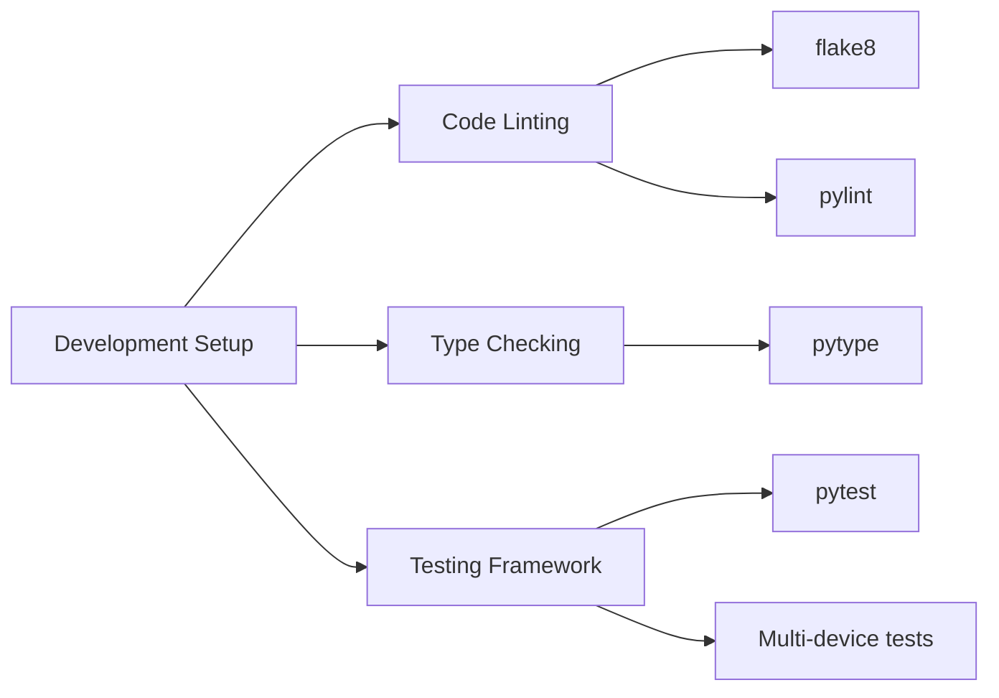

Install development dependencies:

```bash
pip install -e '.[testing]'
```

This includes: `flake8`, `pylint`, `pytest`, `pytype`

### Running Quality Checks

```bash
# Linting
flake8 .
pylint --fail-under 9.5 ferminet

# Type checking
pytype ferminet

# All checks (as run in CI)
python -m pytest && flake8 . && pylint --fail-under 9.5 ferminet && pytype ferminet
```

**Sources:** [setup.py:61](), [.github/workflows/ci-build.yaml:29-37]()

## Common Installation Issues

### JAX Installation Problems

JAX installation varies by platform and hardware:

- **CPU-only**: `pip install jax` installs CPU version
- **GPU**: Requires CUDA-compatible jaxlib version
- **TPU**: Requires TPU-compatible jaxlib version

Refer to JAX documentation for platform-specific installation instructions.

### Git Dependencies

The Git-based dependencies (`folx` and `kfac_jax`) require Git to be installed and accessible. If installation fails:

1. Ensure Git is installed and in PATH
2. Check network connectivity to GitHub
3. Consider using SSH keys if HTTPS access is restricted

### Import Errors

Common import issues:
- **Missing dependencies**: Reinstall with `pip install -e '.[testing]'`
- **Version conflicts**: Use a fresh virtual environment
- **Path issues**: Ensure FermiNet is properly installed, not just cloned

## Environment Configuration

### Virtual Environment (Recommended)

```bash
# Create virtual environment
python -m venv ferminet_env
source ferminet_env/bin/activate  # Linux/Mac
# ferminet_env\Scripts\activate    # Windows

# Install FermiNet
pip install -e '.[testing]'
```

### Environment Variables

FermiNet respects several environment variables:

- `FERMINET_CHEX_N_CPU_DEVICES`: Number of CPU devices for testing
- Standard JAX environment variables for device configuration

**Sources:** [.github/workflows/ci-build.yaml:67]()

---

# Page: Quick Start Guide

# Quick Start Guide

<details>
<summary>Relevant source files</summary>

The following files were used as context for generating this wiki page:

- [README.md](README.md)
- [ferminet/base_config.py](ferminet/base_config.py)
- [ferminet/configs/atom.py](ferminet/configs/atom.py)

</details>


This guide provides a practical introduction to running FermiNet calculations. It covers basic usage patterns, simple molecular examples, and essential configuration concepts needed to get started with quantum Monte Carlo calculations. For detailed configuration options, see [Base Configuration](#2.1). For comprehensive training pipeline details, see [Core Training Pipeline](#3).

## Basic Workflow Overview

FermiNet follows a configuration-driven workflow where you define a molecular system, set training parameters, and run variational Monte Carlo optimization. The following diagram shows the essential components and their relationships:

### Quick Start Workflow

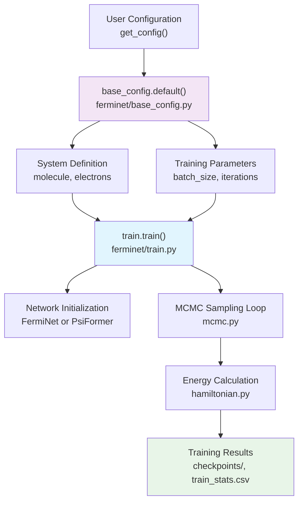

Sources: [ferminet/base_config.py:36-325](), [README.md:47-96](), [ferminet/configs/atom.py:64-76]()

## Simple Examples

### H2 Molecule Calculation

The simplest way to run a calculation is to create a configuration file or use the interactive approach. Here's how to set up an H2 molecule calculation:

**Method 1: Configuration File**

Create a file containing the `get_config()` function:

```python
from ferminet import base_config
from ferminet.utils import system

def get_config():
    cfg = base_config.default()
    cfg.system.electrons = (1, 1)  # (alpha, beta)
    cfg.system.molecule = [
        system.Atom('H', (0, 0, -1)), 
        system.Atom('H', (0, 0, 1))
    ]
    cfg.batch_size = 256
    cfg.pretrain.iterations = 100
    return cfg
```

Run with: `ferminet --config /path/to/h2_config.py`

**Method 2: Interactive Script**

```python
from ferminet import base_config, train
from ferminet.utils import system

cfg = base_config.default()
cfg.system.electrons = (1, 1)
cfg.system.molecule = [
    system.Atom('H', (0, 0, -1)), 
    system.Atom('H', (0, 0, 1))
]
cfg.batch_size = 256
cfg.pretrain.iterations = 100

train.train(cfg)
```

**Method 3: PySCF Integration**

```python
from pyscf import gto
from ferminet import base_config, train

mol = gto.Mole()
mol.build(atom='H 0 0 1; H 0 0 -1', basis='sto-3g', unit='bohr')

cfg = base_config.default()
cfg.system.pyscf_mol = mol
cfg.batch_size = 256
cfg.pretrain.iterations = 100

train.train(cfg)
```

Sources: [README.md:68-96](), [README.md:125-152]()

### Li Atom Calculation

For atomic systems, you can use the predefined atom configuration:

```bash
ferminet --config ferminet/configs/atom.py \
         --config.system.atom Li \
         --config.batch_size 256 \
         --config.pretrain.iterations 100
```

This uses the `adjust_nuclear_charge()` function in [ferminet/configs/atom.py:23-61]() to automatically set up the lithium atom with the correct electron configuration.

Sources: [README.md:55-67](), [ferminet/configs/atom.py:64-76]()

## Key Configuration Concepts

### Configuration Resolution Flow

```mermaid
graph LR
    DefaultConfig["base_config.default()"]
    UserConfig["User get_config()"]
    CommandLine["Command Line Flags"]
    ResolvedConfig["resolve(cfg)"]
    
    SystemSetup["system.set_molecule"]
    MoleculeConfig["Final molecule setup"]
    TrainingReady["Training Ready Config"]
    
    DefaultConfig --> UserConfig
    UserConfig --> CommandLine
    CommandLine --> ResolvedConfig
    
    ResolvedConfig --> SystemSetup
    SystemSetup --> MoleculeConfig
    MoleculeConfig --> TrainingReady
    
    style ResolvedConfig fill:#fff3e0
    style TrainingReady fill:#e8f5e8
```

### Essential Configuration Fields

| Field | Purpose | Example |
|-------|---------|---------|
| `cfg.system.molecule` | Atomic positions and charges | `[system.Atom('H', (0,0,0))]` |
| `cfg.system.electrons` | Electron count (α, β) | `(1, 1)` for H2 |
| `cfg.batch_size` | MCMC walker count | `256`, `4096` |
| `cfg.network.network_type` | Architecture choice | `'ferminet'`, `'psiformer'` |
| `cfg.optim.iterations` | Training steps | `1000000` |
| `cfg.pretrain.iterations` | HF pretraining steps | `1000` |

Sources: [ferminet/base_config.py:46-323]()

### System Definition Methods

The configuration system supports three ways to define molecular systems:

1. **Direct specification**: Set `cfg.system.molecule` and `cfg.system.electrons` directly
2. **PySCF integration**: Set `cfg.system.pyscf_mol` with a `pyscf.gto.Mole` object  
3. **Dynamic setup**: Use `cfg.system.set_molecule` callable for programmatic setup

The `resolve()` function in [ferminet/base_config.py:328-354]() handles the conversion between these methods.

Sources: [ferminet/base_config.py:145-194]()

## Training and Inference Workflow

### Training Phase

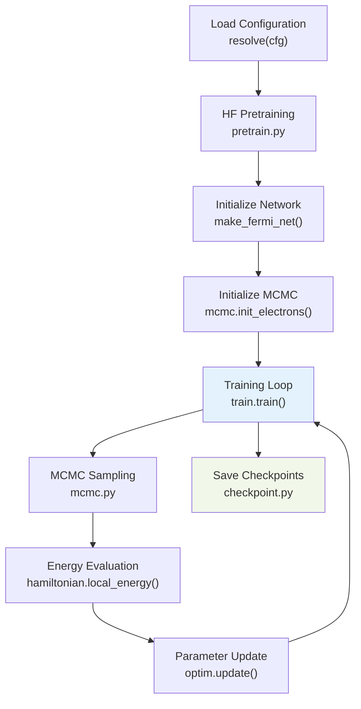

To run training:
```bash
ferminet --config your_config.py
```

### Inference Phase

For post-training analysis with fixed parameters, set the optimizer to `'none'`:

```bash
ferminet --config your_config.py --config.optim.optimizer 'none'
```

This runs energy evaluation without parameter updates, useful for:
- Accumulating low-variance energy estimates
- Computing observables like spin magnitude (`--config.observables.s2`)
- Calculating dipole moments (`--config.observables.dipole`)
- Generating density matrices (`--config.observables.density`)

Sources: [README.md:159-175]()

## Understanding Output

### Directory Structure

```
results/
├── train_stats.csv          # Energy and acceptance rates per iteration
├── checkpoints/             # Saved model parameters
│   ├── checkpoint_00001000  
│   └── checkpoint_00002000
└── observables/             # Observable calculations (if enabled)
    ├── s2_values.npy
    ├── dipole_values.npy
    └── density_matrix.npy
```

### Key Output Files

| File | Content | Usage |
|------|---------|-------|
| `train_stats.csv` | Training metrics per iteration | Monitor convergence |
| `checkpoints/` | Model parameters | Resume training, inference |
| `*_values.npy` | Observable timeseries | Physical analysis |

The checkpointing system in [ferminet/checkpoint.py]() automatically saves progress, allowing you to resume interrupted calculations by setting `cfg.log.restore_path`.

Sources: [README.md:194-204]()

### Multi-GPU Support

FermiNet automatically detects and uses multiple GPUs via JAX's `pmap` parallelization. No additional configuration is required - simply ensure JAX is installed with CUDA support for GPU acceleration.

Sources: [README.md:154-157]()

---

# Page: Configuration System

# Configuration System

<details>
<summary>Relevant source files</summary>

The following files were used as context for generating this wiki page:

- [README.md](README.md)
- [ferminet/base_config.py](ferminet/base_config.py)
- [ferminet/configs/atom.py](ferminet/configs/atom.py)

</details>


The Configuration System provides a centralized framework for managing all parameters, hyperparameters, and system definitions required for FermiNet calculations. It uses `ml_collections.ConfigDict` to create hierarchical, type-safe configuration objects that control every aspect of neural network training, physics calculations, and system behavior.

For information about the core training pipeline that consumes these configurations, see [Core Training Pipeline](#3). For details about specific system definitions and molecular setups, see [System Configurations](#2.2).

## Configuration Architecture

The configuration system follows a hierarchical structure where a base configuration provides defaults that can be overridden by system-specific configurations and command-line flags.

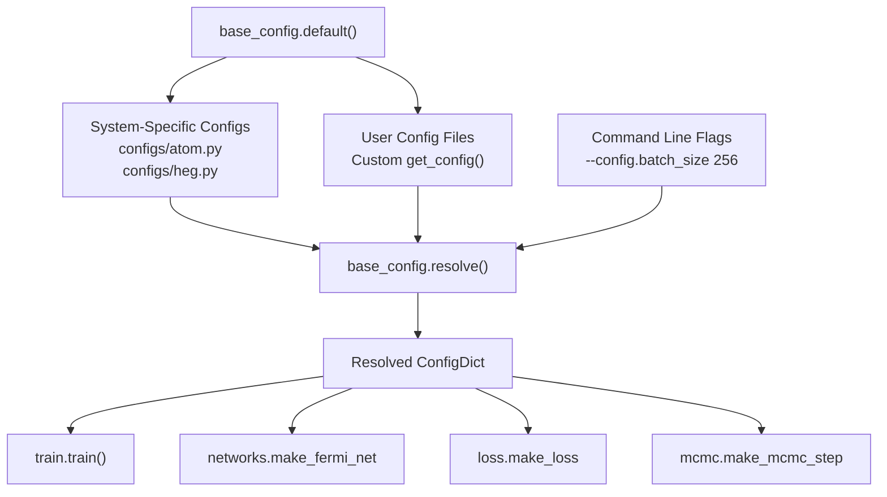

**Sources:** [ferminet/base_config.py:36-325](), [ferminet/configs/atom.py:64-76](), [README.md:49-66]()

## Base Configuration Structure

The base configuration is defined in `base_config.default()` and contains six major sections that control different aspects of the system:

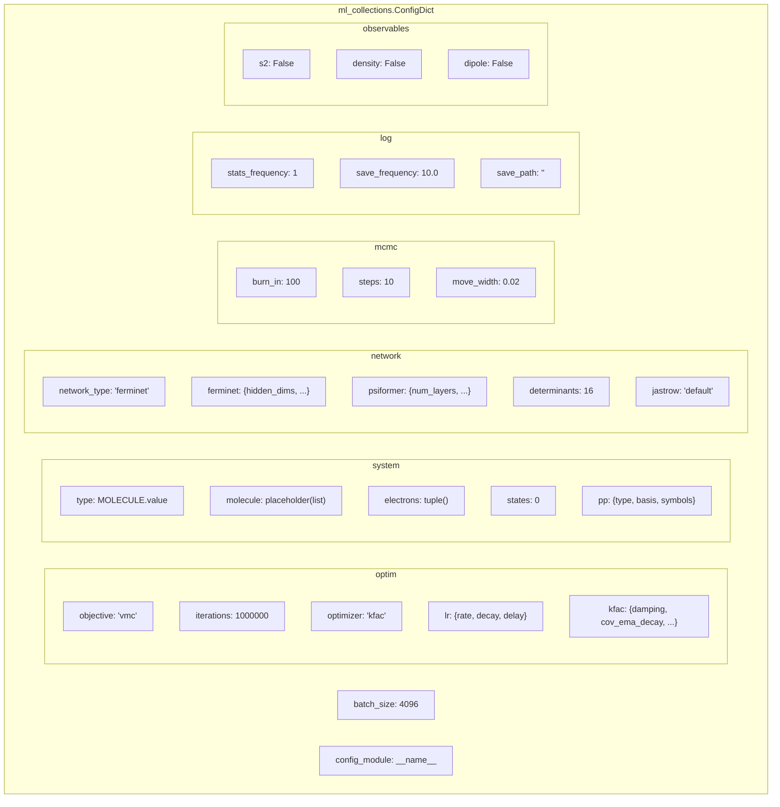

**Sources:** [ferminet/base_config.py:46-323]()

## Configuration Resolution Process

Configuration resolution transforms user inputs into a complete, validated configuration through the `resolve()` function:

| Phase | Function | Purpose |
|-------|----------|---------|
| 1. Molecule Setup | `cfg.system.set_molecule()` | Execute callable to configure molecular system |
| 2. Reference Resolution | `cfg.copy_and_resolve_references()` | Resolve `ml_collections.FieldReference` values |
| 3. Validation | Implicit type checking | Ensure configuration consistency |

The resolution process handles special cases for nested references in molecular coordinates and system definitions:

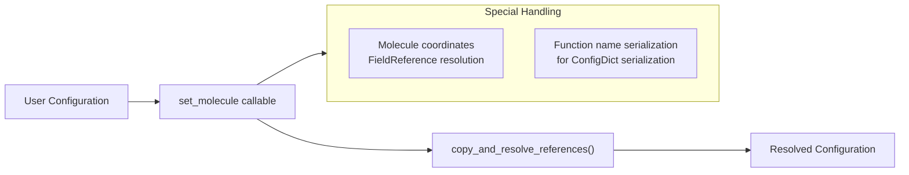

**Sources:** [ferminet/base_config.py:328-355]()

## System Type Classification

The configuration system uses the `SystemType` enum to categorize different physical systems:

```python
class SystemType(enum.IntEnum):
  MOLECULE = enum.auto()
```

Currently, only molecular systems are supported, but the enum structure allows for future extensions to other system types like crystalline solids or homogeneous electron gases.

**Sources:** [ferminet/base_config.py:23-34]()

## Configuration Sections Reference

### Optimization Configuration (`cfg.optim`)

Controls training objectives, optimizers, and convergence parameters:

| Parameter | Default | Description |
|-----------|---------|-------------|
| `objective` | `'vmc'` | Loss function type: `'vmc'`, `'wqmc'`, or `'vmc_overlap'` |
| `optimizer` | `'kfac'` | Optimizer: `'adam'`, `'kfac'`, `'lamb'`, or `'none'` |
| `iterations` | `1000000` | Maximum training iterations |
| `lr.rate` | `0.05` | Base learning rate |
| `clip_local_energy` | `5.0` | Energy clipping threshold in standard deviations |

**Sources:** [ferminet/base_config.py:55-123]()

### System Configuration (`cfg.system`)

Defines the physical system being studied:

| Parameter | Default | Description |
|-----------|---------|-------------|
| `molecule` | `placeholder(list)` | List of `system.Atom` objects |
| `electrons` | `tuple()` | `(n_alpha, n_beta)` electron counts |
| `states` | `0` | Number of excited states to compute |
| `use_pp` | `False` | Enable pseudopotentials |

**Sources:** [ferminet/base_config.py:145-194]()

### Network Configuration (`cfg.network`)

Specifies neural network architecture and parameters:

| Parameter | Default | Description |
|-----------|---------|-------------|
| `network_type` | `'ferminet'` | Architecture: `'ferminet'` or `'psiformer'` |
| `determinants` | `16` | Number of Slater determinants |
| `ferminet.hidden_dims` | `((256, 32), ...)` | Layer dimensions for FermiNet |
| `psiformer.num_layers` | `4` | Number of transformer layers |

**Sources:** [ferminet/base_config.py:223-297]()

### MCMC Configuration (`cfg.mcmc`)

Controls Monte Carlo sampling parameters:

| Parameter | Default | Description |
|-----------|---------|-------------|
| `burn_in` | `100` | Burn-in steps after pretraining |
| `steps` | `10` | MCMC steps between network updates |
| `move_width` | `0.02` | Gaussian proposal width |
| `adapt_frequency` | `100` | Steps between move width adaptation |

**Sources:** [ferminet/base_config.py:195-222]()

## Configuration Usage Patterns

The configuration system integrates with the training pipeline through factory functions that consume specific configuration sections:

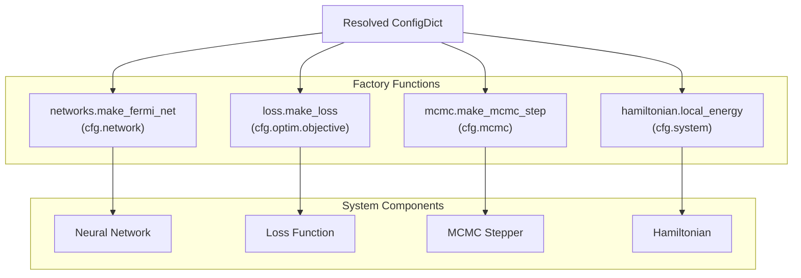

**Sources:** [README.md:72-96](), [ferminet/configs/atom.py:64-76]()

---

# Page: Base Configuration

# Base Configuration

<details>
<summary>Relevant source files</summary>

The following files were used as context for generating this wiki page:

- [ferminet/base_config.py](ferminet/base_config.py)

</details>


This document explains FermiNet's base configuration system, which provides the foundational structure and default values for all FermiNet calculations. The base configuration defines the complete parameter space for training, system definition, network architecture, and computational settings.

For information about specific system configurations (molecules, atoms, HEG), see [System Configurations](#2.2). For details about the training pipeline that uses these configurations, see [Training Loop Architecture](#3.1).

## Purpose and Scope

The base configuration system in [ferminet/base_config.py]() serves as the foundation for all FermiNet calculations. It provides:

- Default parameter values for all computational aspects
- Configuration structure and validation
- Field reference resolution for dynamic configuration
- Type safety through `ml_collections.ConfigDict`
- Extensibility for specialized systems

## Configuration Architecture

The base configuration is structured as a hierarchical `ConfigDict` with seven major sections, each controlling different aspects of the computation:

```mermaid
graph TD
    BaseConfig["default()"] --> OptimConfig["optim"]
    BaseConfig --> LogConfig["log"]
    BaseConfig --> SystemConfig["system"]
    BaseConfig --> MCMCConfig["mcmc"]
    BaseConfig --> NetworkConfig["network"]
    BaseConfig --> ObservablesConfig["observables"]
    BaseConfig --> DebugConfig["debug"]
    BaseConfig --> PretrainConfig["pretrain"]
    
    OptimConfig --> Objective["objective: vmc/wqmc/vmc_overlap"]
    OptimConfig --> Optimizer["optimizer: kfac/adam/lamb/none"]
    OptimConfig --> LearningRate["lr: rate/decay/delay"]
    OptimConfig --> KFACParams["kfac: damping/invert_every"]
    
    SystemConfig --> SystemType["type: MOLECULE"]
    SystemConfig --> MoleculeSpec["molecule: list[Atom]"]
    SystemConfig --> ElectronCount["electrons: (nup, ndown)"]
    SystemConfig --> Pseudopotentials["pp: type/basis/symbols"]
    
    NetworkConfig --> Architecture["network_type: ferminet/psiformer"]
    NetworkConfig --> FermiNetParams["ferminet: hidden_dims/determinants"]
    NetworkConfig --> PsiFormerParams["psiformer: num_layers/num_heads"]
    
    MCMCConfig --> Sampling["steps/move_width/burn_in"]
    MCMCConfig --> Initialization["init_width/init_means"]
    MCMCConfig --> Adaptation["adapt_frequency"]
```

Sources: [ferminet/base_config.py:36-325]()

## Default Configuration Factory

The `default()` function creates the base configuration with sensible default values for molecular VMC calculations:

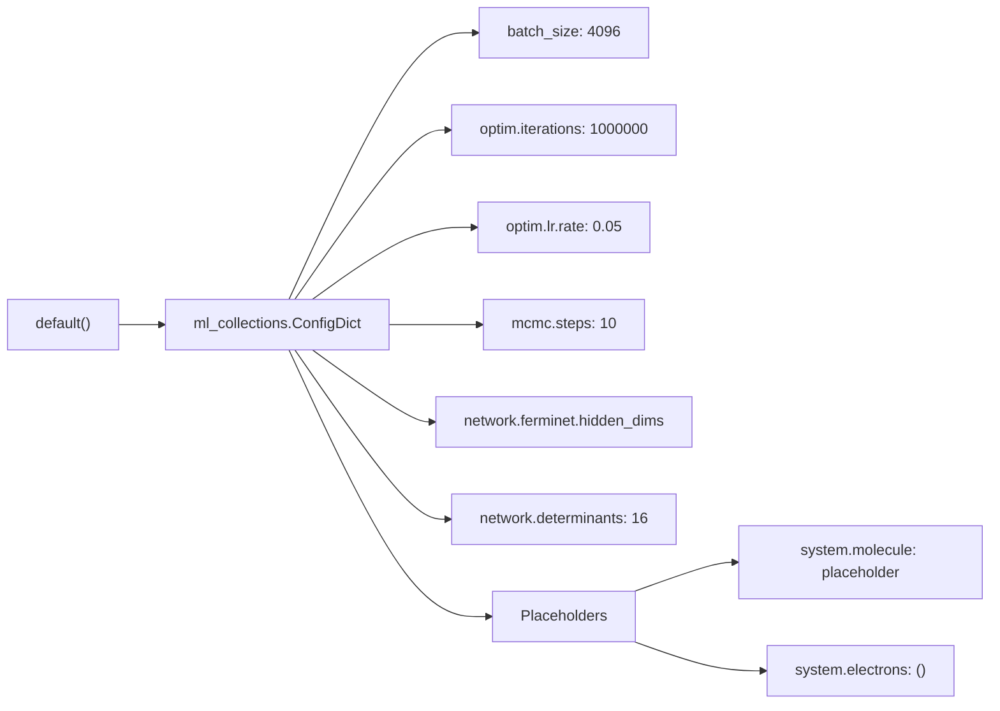

Key characteristics of the default configuration:

| Component | Default Value | Purpose |
|-----------|---------------|---------|
| `batch_size` | 4096 | Number of electron configurations per batch |
| `optim.objective` | 'vmc' | Variational Monte Carlo optimization |
| `optim.optimizer` | 'kfac' | K-FAC natural gradient optimizer |
| `optim.lr.rate` | 0.05 | Base learning rate |
| `mcmc.steps` | 10 | MCMC steps between parameter updates |
| `network.network_type` | 'ferminet' | Default architecture |
| `network.determinants` | 16 | Number of Slater determinants |

Sources: [ferminet/base_config.py:46-323]()

## Configuration Sections

### Optimization Section

The `optim` section controls the training objective and optimization algorithm:

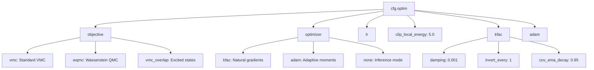

### System Section

The `system` section defines the quantum system being studied:

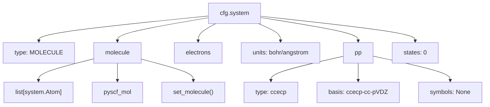

### Network Section

The `network` section configures the neural network architecture:

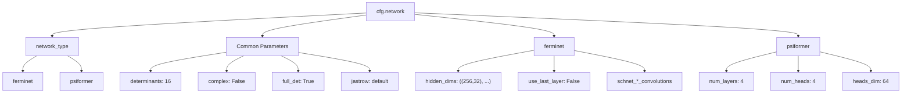

Sources: [ferminet/base_config.py:223-297]()

## Configuration Resolution Process

The `resolve()` function processes the configuration to handle dynamic elements and field references:

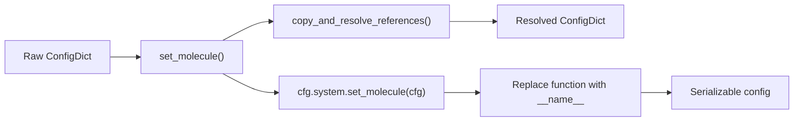

The resolution process handles:

1. **Dynamic molecule setting**: If `cfg.system.set_molecule` is callable, it's executed to configure the molecular system
2. **Field reference resolution**: `ml_collections.FieldReference` values are resolved to their actual values
3. **Function serialization**: Callable objects are replaced with their names for serialization
4. **Coordinate validation**: Atomic positions are validated as numeric values

### Resolution Steps

| Step | Function | Purpose |
|------|----------|---------|
| 1 | Check `set_molecule` | Execute dynamic molecule configuration |
| 2 | `copy_and_resolve_references()` | Resolve all field references |
| 3 | Function name replacement | Make config serializable |
| 4 | Coordinate validation | Ensure numeric atomic positions |

Sources: [ferminet/base_config.py:328-354]()

## System Type Enumeration

The `SystemType` enum provides type safety for system specification:

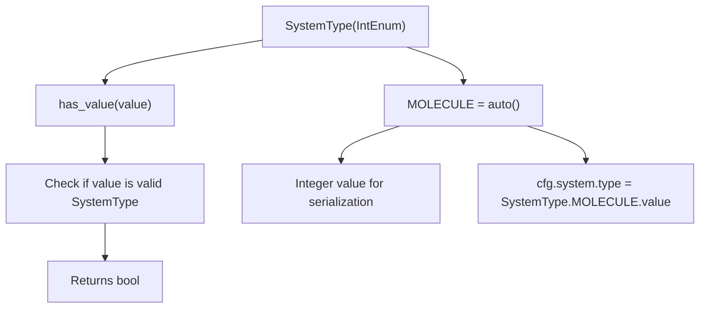

**Important Note**: The enum values should be accessed via `.value` for serialization compatibility, as stated in the warning comment.

Sources: [ferminet/base_config.py:23-34]()

## Configuration Usage Patterns

### Basic Usage

```python
# Create default configuration
cfg = base_config.default()

# Set required placeholders
cfg.system.molecule = [system.Atom('H', (0, 0, 0)), system.Atom('H', (0, 0, 1.4))]
cfg.system.electrons = (1, 1)

# Resolve field references
cfg = base_config.resolve(cfg)
```

### Dynamic Configuration

```python
# Use set_molecule for dynamic setup
def configure_water(cfg):
    cfg.system.molecule = [
        system.Atom('O', (0, 0, 0)),
        system.Atom('H', (0.757, 0.587, 0)),
        system.Atom('H', (-0.757, 0.587, 0))
    ]
    cfg.system.electrons = (5, 5)
    return cfg

cfg.system.set_molecule = configure_water
cfg = base_config.resolve(cfg)
```

### Configuration Extension

The base configuration serves as a foundation that can be extended by specific system configurations in the `configs/` directory, which import and modify the base configuration for specialized use cases.

Sources: [ferminet/base_config.py:346-354]()

---

# Page: System Configurations

# System Configurations

<details>
<summary>Relevant source files</summary>

The following files were used as context for generating this wiki page:

- [README.md](README.md)
- [ferminet/configs/atom.py](ferminet/configs/atom.py)
- [ferminet/configs/heg.py](ferminet/configs/heg.py)
- [ferminet/pbc/tests/__init__.py](ferminet/pbc/tests/__init__.py)
- [ferminet/pbc/tests/features_test.py](ferminet/pbc/tests/features_test.py)
- [ferminet/utils/system.py](ferminet/utils/system.py)
- [ferminet/utils/tests/system_test.py](ferminet/utils/tests/system_test.py)

</details>


This document explains how to define quantum systems in FermiNet, including atoms, molecules, and specialized systems like the homogeneous electron gas (HEG). It covers the system-specific parts of the configuration that specify the physical problem to be solved. For information about the overall configuration structure and default values, see [Base Configuration](#2.1). For details about the training pipeline that uses these system definitions, see [Core Training Pipeline](#3).

## System Definition Components

FermiNet system configurations consist of three primary components: atomic positions and charges, electronic structure, and system-specific parameters. These are defined through the `cfg.system` configuration section and related utility classes.

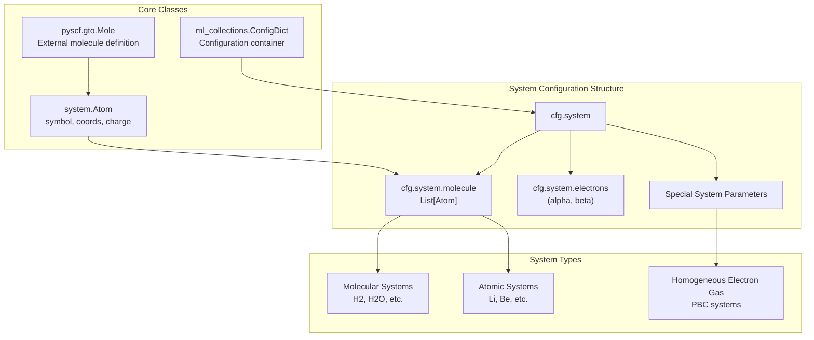

**Sources:** [ferminet/utils/system.py:26-87](), [ferminet/configs/atom.py:23-61](), [ferminet/configs/heg.py:31-57]()

## The Atom Class

The fundamental building block for system definitions is the `Atom` class, which represents individual atomic species with their positions and nuclear charges.

```mermaid
graph LR
    subgraph "Atom Class Structure"
        AtomInit["Atom(symbol, coords, charge)"]
        Symbol["symbol: str<br/>Element symbol"]
        Coords["coords: Sequence[float]<br/>Atomic coordinates"]
        Charge["charge: float<br/>Nuclear charge"]
        Units["units: str<br/>bohr or angstrom"]
    end
    
    subgraph "Automatic Properties"
        Element["element: elements.Element<br/>Element data lookup"]
        CoordsArray["coords_array: np.ndarray<br/>Numpy coordinate array"]
        CoordsAngstrom["coords_angstrom: List[float]<br/>Coordinates in angstrom"]
    end
    
    subgraph "Unit Conversion"
        BohrInput["Input in bohr<br/>Direct storage"]
        AngstromInput["Input in angstrom<br/>Automatic conversion"]
        InternalBohr["Internal storage<br/>Always in bohr"]
    end
    
    AtomInit --> Symbol
    AtomInit --> Coords
    AtomInit --> Charge
    AtomInit --> Units
    
    Symbol --> Element
    Coords --> CoordsArray
    Coords --> CoordsAngstrom
    
    AngstromInput --> InternalBohr
    BohrInput --> InternalBohr
```

**Sources:** [ferminet/utils/system.py:26-87](), [ferminet/utils/tests/system_test.py:27-38]()

### Key Atom Class Features

| Property | Description | Default Behavior |
|----------|-------------|------------------|
| `symbol` | IUPAC element symbol | Required parameter |
| `coords` | Atomic coordinates | `(0.0, 0.0, 0.0)` |
| `charge` | Nuclear charge | Atomic number of element |
| `atomic_number` | Atomic number | Atomic number of element |
| `units` | Coordinate units | `'bohr'` |

The `Atom` class automatically handles unit conversion and provides convenient properties for accessing coordinates in different formats. Nuclear charges default to the atomic number but can be overridden for fractional nuclear charge calculations.

**Sources:** [ferminet/utils/system.py:49-87]()

## Molecular Systems

Molecular systems are defined by specifying a list of `Atom` objects in `cfg.system.molecule` along with the electronic configuration in `cfg.system.electrons`.

### Basic Molecular Configuration

```python
# H2 molecule example from README
cfg.system.electrons = (1, 1)  # (alpha electrons, beta electrons)
cfg.system.molecule = [
    system.Atom('H', (0, 0, -1)), 
    system.Atom('H', (0, 0, 1))
]
```

### Electronic Structure Specification

The `cfg.system.electrons` tuple specifies the number of alpha (spin-up) and beta (spin-down) electrons. For atoms, this can be automatically determined based on the atomic number and charge state.

```mermaid
graph TD
    subgraph "Electronic Configuration Logic"
        AtomicNum["Atomic Number<br/>From element symbol"]
        IonCharge["cfg.system.charge<br/>Ionic charge"]
        SpinPolar["cfg.system.spin_polarisation<br/>Custom spin state"]
        DefaultSpin["Default spin configuration<br/>From elements.ATOMIC_NUMS"]
    end
    
    subgraph "Electron Count Calculation"
        TotalElec["Total electrons = <br/>atomic_number - charge"]
        AlphaCalc["Alpha electrons = <br/>(total + spin_polarisation) // 2"]
        BetaCalc["Beta electrons = <br/>total - alpha"]
        FinalConfig["cfg.system.electrons<br/>(alpha, beta)"]
    end
    
    AtomicNum --> TotalElec
    IonCharge --> TotalElec
    TotalElec --> AlphaCalc
    SpinPolar --> AlphaCalc
    DefaultSpin --> AlphaCalc
    AlphaCalc --> BetaCalc
    TotalElec --> BetaCalc
    BetaCalc --> FinalConfig
```

**Sources:** [ferminet/configs/atom.py:49-60](), [ferminet/utils/system.py:89-116]()

## Atomic Systems

Single-atom systems use the generic atom configuration template that automatically sets up the electronic structure based on the element and charge state.

### Atomic Configuration Parameters

| Parameter | Type | Description |
|-----------|------|-------------|
| `cfg.system.atom` | `str` | Element symbol |
| `cfg.system.charge` | `int` | Ionic charge |
| `cfg.system.delta_charge` | `float` | Fractional nuclear charge adjustment |
| `cfg.system.spin_polarisation` | `int` | Custom spin polarization |

The `adjust_nuclear_charge` function in [ferminet/configs/atom.py:23-61]() automatically sets up the molecule and electronic structure based on these parameters.

**Sources:** [ferminet/configs/atom.py:23-76]()

## Specialized Systems

### Homogeneous Electron Gas (HEG)

The HEG represents a system of interacting electrons in a uniform positive background, used for studying electron correlation in bulk materials.

```mermaid
graph TD
    subgraph "HEG Configuration Components"
        GhostAtom["Ghost Atom X<br/>Dummy nucleus at origin"]
        ElecConfig["electrons: (7, 7)<br/>14 electron system"]
        Lattice["lattice: np.ndarray<br/>Simple cubic lattice"]
        Kpoints["kpoints: np.ndarray<br/>Momentum space sampling"]
    end
    
    subgraph "PBC-Specific Functions"
        PBCHam["make_local_energy_fn<br/>ferminet.pbc.hamiltonian.local_energy"]
        PBCFeature["make_feature_layer_fn<br/>ferminet.pbc.feature_layer.make_pbc_feature_layer"]
        PBCEnvelope["make_envelope_fn<br/>ferminet.pbc.envelopes.make_multiwave_envelope"]
    end
    
    subgraph "HEG Parameters"
        WignerSeitz["rs = 1.0<br/>Wigner-Seitz radius"]
        Volume["Volume calculation<br/>(4/3)π * rs³ * nelec"]
        CubicLength["Cubic box length<br/>volume^(1/3)"]
    end
    
    GhostAtom --> PBCHam
    ElecConfig --> Lattice
    Lattice --> Kpoints
    Kpoints --> PBCEnvelope
    
    WignerSeitz --> Volume
    Volume --> CubicLength
    CubicLength --> Lattice
```

**Sources:** [ferminet/configs/heg.py:24-57]()

### HEG System Setup

The HEG configuration demonstrates how specialized systems override default functions:

- **Hamiltonian**: Uses `ferminet.pbc.hamiltonian.local_energy` with `heg=True`
- **Features**: Uses `ferminet.pbc.feature_layer.make_pbc_feature_layer` without atom-electron features
- **Envelope**: Uses `ferminet.pbc.envelopes.make_multiwave_envelope` with k-point sampling
- **Pretraining**: Disabled (`cfg.pretrain.method = None`)

**Sources:** [ferminet/configs/heg.py:45-56]()

## PySCF Integration

FermiNet can directly import molecular definitions from PySCF `Mole` objects, providing seamless integration with existing quantum chemistry workflows.

```mermaid
graph LR
    subgraph "PySCF to FermiNet Conversion"
        PySCFMol["pyscf.gto.Mole<br/>External definition"]
        ConvFunc["pyscf_mol_to_internal_representation"]
        InternalRep["ConfigDict<br/>FermiNet format"]
    end
    
    subgraph "Extracted Information"
        Atoms["system.molecule<br/>List of Atom objects"]
        Electrons["system.electrons<br/>mol.nelec"]
        Basis["pretrain.basis<br/>mol.basis (if string)"]
    end
    
    subgraph "Coordinate Handling"
        PySCFCoords["mol.atom_coord(i)<br/>PySCF coordinates"]
        AtomCoords["Atom.coords<br/>Internal coordinates"]
        UnitConv["Automatic unit conversion<br/>Angstrom to Bohr if needed"]
    end
    
    PySCFMol --> ConvFunc
    ConvFunc --> InternalRep
    InternalRep --> Atoms
    InternalRep --> Electrons
    InternalRep --> Basis
    
    PySCFCoords --> AtomCoords
    AtomCoords --> UnitConv
```

**Sources:** [ferminet/utils/system.py:89-116](), [ferminet/utils/tests/system_test.py:53-92]()

### PySCF Conversion Process

The `pyscf_mol_to_internal_representation` function extracts:

1. **Atomic information**: Symbol and coordinates for each atom
2. **Electronic structure**: Total number of alpha and beta electrons
3. **Basis set**: Basis set specification (if provided as string)
4. **Unit handling**: Automatic conversion from PySCF units to internal bohr units

**Sources:** [ferminet/utils/system.py:89-116]()

## Configuration Patterns and Examples

### Complete System Configuration Examples

```python
# Molecular system (H2O)
cfg.system.electrons = (5, 5)  # 10 total electrons
cfg.system.molecule = [
    system.Atom('O', (0, 0, 0)),
    system.Atom('H', (0, 1.8, 0)),
    system.Atom('H', (0, 0, 1.8))
]

# Atomic system with custom charge
cfg.system.atom = 'Li'
cfg.system.charge = 1  # Li+ ion
# electrons automatically set to (1, 1) by adjust_nuclear_charge

# PySCF integration
mol = pyscf.gto.Mole()
mol.build(atom='H 0 0 1; H 0 0 -1', basis='sto-3g', unit='bohr')
cfg.system.pyscf_mol = mol
```

### System Type Selection Matrix

| System Type | Key Configuration | Special Functions | Use Cases |
|-------------|------------------|-------------------|-----------|
| Molecules | `cfg.system.molecule` | Standard functions | Chemistry, materials |
| Atoms | `cfg.system.atom` | `adjust_nuclear_charge` | Atomic physics, testing |
| HEG | Ghost atom + PBC | PBC functions | Condensed matter theory |
| PySCF Import | `cfg.system.pyscf_mol` | Automatic conversion | Existing workflows |

**Sources:** [README.md:70-152](), [ferminet/configs/atom.py:64-76](), [ferminet/configs/heg.py:31-57]()

---

# Page: Core Training Pipeline

# Core Training Pipeline

<details>
<summary>Relevant source files</summary>

The following files were used as context for generating this wiki page:

- [ferminet/psiformer.py](ferminet/psiformer.py)
- [ferminet/tests/train_test.py](ferminet/tests/train_test.py)
- [ferminet/train.py](ferminet/train.py)

</details>


## Purpose and Scope

This document covers the core training pipeline in FermiNet, which orchestrates the main training loop that combines Monte Carlo sampling with neural network optimization for variational quantum Monte Carlo (VMC) calculations. The training pipeline coordinates between MCMC sampling, loss evaluation, and parameter optimization to train neural network wavefunctions.

For details about specific network architectures used in training, see [Neural Network Architectures](#4). For information about the physics calculations performed during training, see [Physics and Mathematics](#5). For configuration options that control the training pipeline, see [Configuration System](#2).

## Training Pipeline Overview

The training pipeline follows a standard pattern: initialize electron configurations, perform MCMC sampling to generate new configurations, evaluate the loss function (typically the local energy), compute gradients, and update network parameters. This process repeats for a specified number of iterations.

```mermaid
graph TD
    subgraph "Initialization Phase"
        Config["cfg: ConfigDict<br/>Configuration"]
        InitElectrons["init_electrons()<br/>Initial walker positions"]
        InitNetwork["network.init()<br/>Network parameters"]
        InitOptimizer["optimizer.init()<br/>Optimizer state"]
    end
    
    subgraph "Main Training Loop"
        MCMCStep["mcmc_step()<br/>Sample new configurations"]
        LossEval["evaluate_loss()<br/>Compute local energy"]
        GradCompute["jax.value_and_grad()<br/>Compute gradients"]
        ParamUpdate["optimizer.update()<br/>Update parameters"]
        ObservableCalc["observable_fns<br/>Calculate observables"]
    end
    
    subgraph "Monitoring & Control"
        Checkpoint["checkpoint.save()<br/>Save model state"]
        Logging["writer.write()<br/>Log training metrics"]
        MCMCAdapt["update_mcmc_width()<br/>Adapt step size"]
    end
    
    Config --> InitElectrons
    Config --> InitNetwork
    Config --> InitOptimizer
    
    InitElectrons --> MCMCStep
    InitNetwork --> MCMCStep
    InitOptimizer --> ParamUpdate
    
    MCMCStep --> LossEval
    LossEval --> GradCompute
    GradCompute --> ParamUpdate
    ParamUpdate --> MCMCStep
    
    LossEval --> ObservableCalc
    ParamUpdate --> Checkpoint
    ObservableCalc --> Logging
    MCMCStep --> MCMCAdapt
```

Sources: [ferminet/train.py:389-1070]()

## Main Training Function Architecture

The `train` function in [ferminet/train.py:389-1070]() serves as the main entry point and orchestrates the entire training pipeline. It handles device setup, configuration processing, network construction, and the main training loop.

### Key Training Components

| Component | Implementation | Purpose |
|-----------|---------------|---------|
| **Main Loop** | `train()` function | Coordinates all training components |
| **Step Function** | `Step` protocol | Defines interface for training steps |
| **Optimizer Update** | `OptUpdate` protocol | Defines optimization interface |
| **MCMC Sampling** | `mcmc_step` callable | Generates new electron configurations |
| **Loss Evaluation** | `evaluate_loss` callable | Computes local energy and gradients |

```mermaid
graph LR
    subgraph "Core Protocols"
        StepProtocol["Step Protocol<br/>__call__(data, params, state, key, mcmc_width)"]
        OptUpdateProtocol["OptUpdate Protocol<br/>__call__(params, data, opt_state, key)"]
    end
    
    subgraph "Concrete Implementations"
        TrainingStep["make_training_step()<br/>Standard optimizers"]
        KFACStep["make_kfac_training_step()<br/>KFAC optimizer"]
        OptStep["make_opt_update_step()<br/>Optax optimizers"]
        LossStep["make_loss_step()<br/>Loss evaluation only"]
    end
    
    subgraph "Return Types"
        StepResults["StepResults<br/>(data, params, state, loss, aux_data, pmove)"]
        OptResults["OptUpdateResults<br/>(params, opt_state, loss, aux_data)"]
    end
    
    StepProtocol --> TrainingStep
    StepProtocol --> KFACStep
    OptUpdateProtocol --> OptStep
    OptUpdateProtocol --> LossStep
    
    TrainingStep --> StepResults
    KFACStep --> StepResults
    OptStep --> OptResults
    LossStep --> OptResults
```

Sources: [ferminet/train.py:181-222](), [ferminet/train.py:157-179](), [ferminet/train.py:274-321](), [ferminet/train.py:323-387]()

## Training Step Implementations

The training pipeline supports different step implementations depending on the optimizer type and use case.

### Standard Training Step

The `make_training_step` function creates the training step for most optimizers (Adam, Lamb):

```mermaid
graph TD
    subgraph "make_training_step"
        MCMCLoop["mcmc_step(params, data, key, mcmc_width)<br/>Monte Carlo sampling"]
        OptUpdate["optimizer_step(params, data, state, key)<br/>Loss + gradient computation"]
        NaNCheck["reset_if_nan check<br/>Optional parameter reset"]
    end
    
    subgraph "Inputs"
        InputData["data: FermiNetData<br/>positions, spins, atoms, charges"]
        InputParams["params: ParamTree<br/>Network parameters"]
        InputState["state: OptState<br/>Optimizer state"]
        InputKey["key: PRNGKey<br/>Random number generator"]
        InputWidth["mcmc_width: ndarray<br/>MCMC step width"]
    end
    
    subgraph "Outputs"
        OutputData["data: FermiNetData<br/>Updated configurations"]
        OutputParams["params: ParamTree<br/>Updated parameters"]
        OutputState["state: OptState<br/>Updated optimizer state"]
        OutputLoss["loss: ndarray<br/>Local energy"]
        OutputAux["aux_data: AuxiliaryLossData<br/>Additional loss data"]
        OutputPmove["pmove: ndarray<br/>Acceptance probability"]
    end
    
    InputData --> MCMCLoop
    InputParams --> MCMCLoop
    InputKey --> MCMCLoop
    InputWidth --> MCMCLoop
    
    MCMCLoop --> OptUpdate
    InputParams --> OptUpdate
    InputState --> OptUpdate
    
    OptUpdate --> NaNCheck
    NaNCheck --> OutputParams
    NaNCheck --> OutputState
    MCMCLoop --> OutputData
    OptUpdate --> OutputLoss
    OptUpdate --> OutputAux
    MCMCLoop --> OutputPmove
```

Sources: [ferminet/train.py:274-321]()

### KFAC Training Step

KFAC (Kronecker-Factored Approximate Curvature) requires special handling due to its more complex optimization procedure:

```mermaid
graph TD
    subgraph "make_kfac_training_step"
        KFACMCMCStep["mcmc_step (pmapped)<br/>MCMC sampling"]
        KFACOptStep["optimizer.step()<br/>KFAC optimization"]
        KFACNaNCheck["reset_if_nan check<br/>Parameter/state reset"]
    end
    
    subgraph "KFAC Specifics"
        SharedMom["shared_mom: replicated<br/>Momentum parameter"]
        SharedDamping["shared_damping: replicated<br/>Damping parameter"]
        CopyTree["copy_tree()<br/>Parameter copying for reset"]
        PmappedOps["Already pmapped operations<br/>Multi-device coordination"]
    end
    
    subgraph "KFAC Integration"
        KFACOptimizer["kfac_jax.Optimizer<br/>KFAC optimizer instance"]
        CurvatureEstimation["Curvature estimation<br/>Fisher information matrix"]
        InversePeriodic["Inverse update<br/>Periodic matrix inversion"]
    end
    
    KFACMCMCStep --> KFACOptStep
    SharedMom --> KFACOptStep
    SharedDamping --> KFACOptStep
    
    KFACOptStep --> KFACNaNCheck
    CopyTree --> KFACNaNCheck
    
    KFACOptimizer --> CurvatureEstimation
    CurvatureEstimation --> InversePeriodic
    InversePeriodic --> KFACOptStep
```

Sources: [ferminet/train.py:323-387]()

## Configuration and Initialization

The training pipeline requires extensive configuration and initialization before the main training loop begins.

### System Configuration Processing

```mermaid
graph TD
    subgraph "Input Processing"
        PySCFMol["cfg.system.pyscf_mol<br/>PySCF molecule object"]
        MoleculeConvert["pyscf_mol_to_internal_representation()<br/>Convert to internal format"]
        AtomArrays["atoms, charges arrays<br/>Atomic positions and charges"]
    end
    
    subgraph "Device Setup"
        DeviceCount["jax.local_device_count()<br/>Available devices"]
        BatchConfig["Batch size configuration<br/>Per-device batch sizing"]
        DataShape["data_shape: (num_devices, device_batch_size)<br/>Data parallelization"]
    end
    
    subgraph "Random State"
        SeedGeneration["Seed generation<br/>Deterministic or random"]
        KeySharding["kfac_jax.utils.make_different_rng_key_on_all_devices()<br/>Per-device PRNG keys"]
        MultiHostSync["multihost_utils.broadcast_one_to_all()<br/>Multi-host synchronization"]
    end
    
    PySCFMol --> MoleculeConvert
    MoleculeConvert --> AtomArrays
    
    DeviceCount --> BatchConfig
    BatchConfig --> DataShape
    
    SeedGeneration --> KeySharding
    KeySharding --> MultiHostSync
```

Sources: [ferminet/train.py:401-437](), [ferminet/train.py:686-687]()

### Network and Optimizer Construction

The training pipeline supports multiple network architectures and optimizers through a factory pattern:

```mermaid
graph TD
    subgraph "Network Construction"
        NetworkType["cfg.network.network_type<br/>'ferminet' or 'psiformer'"]
        FermiNetFactory["networks.make_fermi_net()<br/>FermiNet construction"]
        PsiFormerFactory["psiformer.make_fermi_net()<br/>PsiFormer construction"]
        NetworkInit["network.init(key)<br/>Parameter initialization"]
    end
    
    subgraph "Feature Layers"
        FeatureLayer["make_feature_layer()<br/>Input feature construction"]
        Envelope["envelopes.make_isotropic_envelope()<br/>Boundary conditions"]
        CustomFeatures["cfg.network.make_feature_layer_fn<br/>Custom feature layers"]
    end
    
    subgraph "Loss Function Construction"
        LossType["cfg.optim.objective<br/>'vmc', 'wqmc', 'vmc_overlap'"]
        VMCLoss["qmc_loss_functions.make_loss()<br/>Standard VMC loss"]
        WQMCLoss["qmc_loss_functions.make_wqmc_loss()<br/>Weighted QMC loss"]
        OverlapLoss["qmc_loss_functions.make_energy_overlap_loss()<br/>Overlap penalty loss"]
    end
    
    subgraph "Optimizer Construction"
        OptimizerType["cfg.optim.optimizer<br/>'adam', 'lamb', 'kfac', 'none'"]
        AdamOpt["optax.chain(optax.scale_by_adam(), ...)<br/>Adam optimizer"]
        LambOpt["optax.chain(optax.clip_by_global_norm(), ...)<br/>Lamb optimizer"]
        KFACOpt["kfac_jax.Optimizer()<br/>KFAC optimizer"]
    end
    
    NetworkType --> FermiNetFactory
    NetworkType --> PsiFormerFactory
    FermiNetFactory --> NetworkInit
    PsiFormerFactory --> NetworkInit
    
    FeatureLayer --> FermiNetFactory
    FeatureLayer --> PsiFormerFactory
    Envelope --> FermiNetFactory
    Envelope --> PsiFormerFactory
    CustomFeatures --> FeatureLayer
    
    LossType --> VMCLoss
    LossType --> WQMCLoss
    LossType --> OverlapLoss
    
    OptimizerType --> AdamOpt
    OptimizerType --> LambOpt
    OptimizerType --> KFACOpt
```

Sources: [ferminet/train.py:500-530](), [ferminet/train.py:786-827](), [ferminet/train.py:834-876]()

## Main Training Loop

The core training loop executes for a specified number of iterations, performing MCMC sampling, loss evaluation, parameter updates, and monitoring.

### Training Loop Flow

```mermaid
graph TD
    subgraph "Pre-Training"
        BurnIn["MCMC Burn-in<br/>cfg.mcmc.burn_in steps"]
        InitialEnergy["Initial energy evaluation<br/>evaluate_loss(params, key, data)"]
    end
    
    subgraph "Main Loop: for t in range(t_init, cfg.optim.iterations)"
        StepExecution["step(data, params, opt_state, key, mcmc_width)<br/>Training step execution"]
        LossProcessing["loss[0], weighted statistics<br/>Loss averaging and statistics"]
        ObservableUpdate["Observable calculations<br/>S², dipole, density matrix"]
        MCMCAdaptation["mcmc.update_mcmc_width()<br/>Adaptive step size"]
        NaNChecking["chex.assert_tree_all_finite()<br/>NaN detection"]
    end
    
    subgraph "Monitoring"
        StatsLogging["Logging every cfg.log.stats_frequency<br/>Energy, variance, pmove"]
        MatrixSaving["Matrix saving for excited states<br/>energy_matrix.npy, s2_matrix.npy"]
        Checkpointing["Checkpoint saving<br/>cfg.log.save_frequency minutes"]
    end
    
    BurnIn --> InitialEnergy
    InitialEnergy --> StepExecution
    
    StepExecution --> LossProcessing
    LossProcessing --> ObservableUpdate
    ObservableUpdate --> MCMCAdaptation
    MCMCAdaptation --> NaNChecking
    NaNChecking --> StatsLogging
    StatsLogging --> MatrixSaving
    MatrixSaving --> Checkpointing
    Checkpointing --> StepExecution
```

Sources: [ferminet/train.py:907-926](), [ferminet/train.py:968-1070]()

### Observable and Statistics Management

The training pipeline computes various physical observables and maintains training statistics:

```mermaid
graph TD
    subgraph "Observable Functions"
        S2Observable["observables.make_s2()<br/>Spin-squared operator"]
        DipoleObservable["observables.make_dipole()<br/>Dipole moment"]
        DensityObservable["observables.make_density_matrix()<br/>Density matrix"]
        CustomObservables["observables.make_observable_fns()<br/>Custom observables"]
    end
    
    subgraph "Statistics Tracking"
        WeightedStats["statistics.exponentialy_weighted_stats()<br/>Exponential moving average"]
        MCMCStats["pmove tracking<br/>MCMC acceptance rate"]
        EnergyClipping["cfg.optim.clip_local_energy<br/>Energy outlier handling"]
    end
    
    subgraph "Data Persistence"
        CSVWriter["writers.Writer<br/>Training metrics CSV"]
        NPYFiles["*.npy files<br/>Large matrix data"]
        Checkpoints["checkpoint.save()<br/>Model state persistence"]
    end
    
    S2Observable --> WeightedStats
    DipoleObservable --> WeightedStats
    DensityObservable --> NPYFiles
    
    WeightedStats --> CSVWriter
    MCMCStats --> CSVWriter
    EnergyClipping --> WeightedStats
    
    CSVWriter --> Checkpoints
    NPYFiles --> Checkpoints
```

Sources: [ferminet/train.py:641-684](), [ferminet/train.py:982-984](), [ferminet/train.py:1016-1043](), [ferminet/train.py:1044-1055]()

## Error Handling and Recovery

The training pipeline includes robust error handling and recovery mechanisms:

### NaN Detection and Recovery

```mermaid
graph TD
    subgraph "NaN Detection"
        TreeCheck["chex.assert_tree_all_finite()<br/>Check params, loss, optim state"]
        ConfigFlag["cfg.debug.check_nan<br/>Enable/disable checking"]
        ResetFlag["cfg.optim.reset_if_nan<br/>Enable parameter reset"]
    end
    
    subgraph "Recovery Mechanisms"
        ParamReset["jax.lax.cond(jnp.isnan(loss))<br/>Conditional parameter reset"]
        StateReset["Reset optimizer state<br/>Previous valid state"]
        CounterTracking["num_resets counter<br/>Limit reset attempts"]
    end
    
    subgraph "Failure Handling"
        MaxResets["num_resets > 100<br/>Maximum reset limit"]
        ExceptionRaise["raise AssertionError<br/>Training termination"]
    end
    
    TreeCheck --> ConfigFlag
    ConfigFlag --> ResetFlag
    ResetFlag --> ParamReset
    ParamReset --> StateReset
    StateReset --> CounterTracking
    CounterTracking --> MaxResets
    MaxResets --> ExceptionRaise
```

Sources: [ferminet/train.py:1000-1014](), [ferminet/train.py:311-317]()

The core training pipeline provides a robust and flexible framework for training neural network wavefunctions, supporting multiple architectures, optimizers, and loss functions while maintaining comprehensive monitoring and error recovery capabilities.

---

# Page: Training Loop Architecture

# Training Loop Architecture

<details>
<summary>Relevant source files</summary>

The following files were used as context for generating this wiki page:

- [ferminet/train.py](ferminet/train.py)

</details>


## Purpose and Scope

This document covers the architecture of FermiNet's main training loop, focusing on the `train` function implementation, component initialization, MCMC sampling integration, and optimization step coordination. This page details how the core training pipeline orchestrates all components to perform neural quantum Monte Carlo calculations.

For information about the specific loss functions and optimization algorithms, see [Loss Functions and Optimization](#3.2). For details about MCMC sampling algorithms, see [MCMC Sampling](#5.2). For network architecture details, see [Neural Network Architectures](#4).

## Training Loop Overview

The training loop architecture centers around the `train` function in `ferminet/train.py`, which coordinates initialization, pretraining, and the main training iterations. The system follows a clear separation between MCMC sampling and optimization steps.

### High-Level Training Flow

```mermaid
flowchart TD
    Start["train() function entry"] --> Config["Configuration processing<br/>Device setup"]
    Config --> SystemInit["System initialization<br/>Atoms, charges, electrons"]
    SystemInit --> NetworkInit["Network creation<br/>FermiNet/PsiFormer"]
    NetworkInit --> DataInit["Electron position initialization<br/>init_electrons()"]
    DataInit --> CheckpointRestore["Checkpoint restoration<br/>checkpoint.restore()"]
    CheckpointRestore --> Pretrain["Hartree-Fock pretraining<br/>pretrain_hartree_fock()"]
    Pretrain --> ComponentSetup["Component setup<br/>MCMC, Loss, Optimizer"]
    ComponentSetup --> BurnIn["MCMC burn-in<br/>burn_in_step()"]
    BurnIn --> MainLoop["Main training loop<br/>step() iterations"]
    MainLoop --> StepMCMC["MCMC sampling<br/>mcmc_step()"]
    StepMCMC --> StepOpt["Optimization step<br/>optimizer_step()"]
    StepOpt --> Observables["Observable computation<br/>observable_fns()"]
    Observables --> Logging["Logging and checkpointing"]
    Logging --> Continue{Continue?}
    Continue -->|Yes| MainLoop
    Continue -->|No| End["Training complete"]
```

Sources: [ferminet/train.py:389-1070]()

### Training Step Protocol Architecture

The training system uses a protocol-based architecture with clear interfaces for different optimization strategies:

```mermaid
flowchart TD
    subgraph "Protocol Definitions"
        OptUpdate["OptUpdate Protocol<br/>Parameter update interface"]
        Step["Step Protocol<br/>Full training step interface"]
    end
    
    subgraph "OptUpdate Implementations"
        NullUpdate["null_update()<br/>Identity operation"]
        OptUpdateStep["make_opt_update_step()<br/>Optax optimizers"]
        LossStep["make_loss_step()<br/>Loss evaluation only"]
    end
    
    subgraph "Step Implementations"
        TrainingStep["make_training_step()<br/>Standard optimizers"]
        KfacStep["make_kfac_training_step()<br/>KFAC optimizer"]
    end
    
    subgraph "Core Operations"
        MCMCStep["mcmc_step<br/>Position sampling"]
        LossEval["evaluate_loss<br/>Energy calculation"]
        ParamUpdate["Parameter updates<br/>Gradient application"]
    end
    
    OptUpdate --> OptUpdateStep
    OptUpdate --> LossStep
    OptUpdate --> NullUpdate
    
    Step --> TrainingStep
    Step --> KfacStep
    
    TrainingStep --> MCMCStep
    TrainingStep --> OptUpdateStep
    KfacStep --> MCMCStep
    KfacStep --> LossEval
    KfacStep --> ParamUpdate
```

Sources: [ferminet/train.py:157-222](), [ferminet/train.py:224-320](), [ferminet/train.py:323-386]()

## Component Initialization

### System and Network Setup

The initialization process follows a structured sequence that sets up the computational environment, molecular system, and neural network components:

```mermaid
flowchart TD
    DeviceSetup["Device configuration<br/>num_devices, batch_size"] --> MoleculeConv["Molecule conversion<br/>pyscf_mol_to_internal_representation()"]
    MoleculeConv --> AtomArrays["Atomic data arrays<br/>atoms, charges, nspins"]
    AtomArrays --> BatchReplication["Batch replication<br/>replicate_all_local_devices()"]
    BatchReplication --> KeyInit["PRNG key initialization<br/>jax.random.PRNGKey()"]
    KeyInit --> CoreElectrons["Core electron extraction<br/>ECP processing"]
    CoreElectrons --> FeatureLayer["Feature layer creation<br/>make_ferminet_features()"]
    FeatureLayer --> Envelope["Envelope function setup<br/>make_isotropic_envelope()"]
    Envelope --> NetworkCreation["Network instantiation<br/>make_fermi_net() / psiformer.make_fermi_net()"]
    NetworkCreation --> ParamInit["Parameter initialization<br/>network.init()"]
    ParamInit --> BatchNetwork["Batched network creation<br/>jax.vmap()"]
```

Sources: [ferminet/train.py:401-549]()

### Electron Position Initialization

The `init_electrons` function handles the critical task of generating physically reasonable initial electron configurations:

```mermaid
flowchart TD
    InitStart["init_electrons() entry"] --> ElectronCount["Calculate total electrons<br/>atom.charge - core_electrons"]
    ElectronCount --> SpinConfig["Determine atomic spin configs<br/>nalpha, nbeta per atom"]
    SpinConfig --> ValidConfig{"Valid spin configuration?"}
    ValidConfig -->|No| Iterate["Randomize electron assignment<br/>max_iter attempts"]
    Iterate --> ValidConfig
    ValidConfig -->|Yes| AtomAssignment["Assign electrons to atoms<br/>electron_positions array"]
    AtomAssignment --> GaussianNoise["Add Gaussian noise<br/>jax.random.normal() * init_width"]
    GaussianNoise --> SpinAssignment["Create spin configurations<br/>_assign_spin_configuration()"]
    SpinAssignment --> Return["Return positions, spins"]
    ValidConfig -->|Failed| Fallback["Fallback: origin-centered<br/>Gaussian distribution"]
    Fallback --> SpinAssignment
```

Sources: [ferminet/train.py:58-148](), [ferminet/train.py:50-56]()

## Training Step Architecture

### Standard Optimizer Training Steps

The `make_training_step` function creates training steps for non-KFAC optimizers with a clear separation between MCMC and optimization:

```mermaid
flowchart LR
    subgraph "Training Step Function"
        StepEntry["step() function entry<br/>@pmap decorated"] --> KeySplit["Split PRNG keys<br/>mcmc_key, loss_key"]
        KeySplit --> MCMCExec["MCMC execution<br/>mcmc_step(params, data, mcmc_key, mcmc_width)"]
        MCMCExec --> OptStep["Optimization step<br/>optimizer_step(params, data, state, loss_key)"]
        OptStep --> NaNCheck{"reset_if_nan?"}
        NaNCheck -->|Yes| ConditionalReset["Conditional parameter reset<br/>jax.lax.cond(jnp.isnan(loss))"]
        NaNCheck -->|No| Return["Return updated state"]
        ConditionalReset --> Return
    end
    
    subgraph "Data Flow"
        DataIn["Input: data, params, state"] --> StepEntry
        Return --> DataOut["Output: data, params, state, loss, aux_data, pmove"]
    end
```

Sources: [ferminet/train.py:274-320]()

### KFAC Optimizer Training Steps

KFAC optimizers require special handling due to their curvature estimation requirements:

```mermaid
flowchart TD
    KfacEntry["make_kfac_training_step() entry"] --> MCMCPmap["MCMC step pmapping<br/>constants.pmap(mcmc_step)"]
    MCMCPmap --> SharedMom["Shared momentum setup<br/>replicate_all_local_devices()"]
    SharedMom --> SharedDamping["Shared damping setup<br/>replicate_all_local_devices()"]
    SharedDamping --> CopyTree["Copy tree function<br/>for state resetting"]
    CopyTree --> KfacStepDef["KFAC step definition"]
    
    subgraph "KFAC Step Execution"
        StepStart["step() execution"] --> KeySplit2["Key splitting<br/>kfac_jax.utils.p_split()"]
        KeySplit2 --> MCMCExec2["MCMC execution<br/>Already pmapped"]
        MCMCExec2 --> StateBackup{"reset_if_nan?"}
        StateBackup -->|Yes| BackupState["Backup params and state<br/>copy_tree()"]
        StateBackup --> OptimizerStep["Optimizer step<br/>optimizer.step()"]
        BackupState --> OptimizerStep
        OptimizerStep --> NaNCheck2{"NaN in loss?"}
        NaNCheck2 -->|Yes| RestoreState["Restore backed up state"]
        NaNCheck2 -->|No| ReturnNew["Return new state"]
        RestoreState --> ReturnNew
    end
```

Sources: [ferminet/train.py:323-386]()

## State Management and Coordination

### Checkpointing Integration

The training loop integrates comprehensive checkpointing for long-running calculations:

| Component | Checkpoint Data | Restoration Logic |
|-----------|-----------------|-------------------|
| Training state | `t_init` (iteration number) | Resume from last iteration |
| MCMC data | `data` (positions, spins) | Restore walker configurations |
| Parameters | `params` (network weights) | Restore trained parameters |
| Optimizer state | `opt_state_ckpt` | Restore optimizer internal state |
| MCMC width | `mcmc_width_ckpt` | Restore adaptive step sizes |
| Density state | `density_state_ckpt` | Restore density matrix computation |

```mermaid
flowchart TD
    CheckpointInit["Checkpoint initialization"] --> PathSetup["Setup save/restore paths<br/>create_save_path(), get_restore_path()"]
    PathSetup --> FindCheckpoint["Find last checkpoint<br/>find_last_checkpoint()"]
    FindCheckpoint --> RestoreCheck{"Checkpoint found?"}
    RestoreCheck -->|Yes| RestoreState["Restore full state<br/>checkpoint.restore()"]
    RestoreCheck -->|No| FreshInit["Fresh initialization<br/>New parameters and data"]
    RestoreState --> ContinueTraining["Continue training loop"]
    FreshInit --> ContinueTraining
    ContinueTraining --> PeriodicSave["Periodic saving<br/>checkpoint.save()"]
    PeriodicSave --> ContinueTraining
```

Sources: [ferminet/train.py:589-633](), [ferminet/train.py:1057-1059]()

### Multi-Device Coordination

The training system handles multi-device execution through systematic key management and data distribution:

```mermaid
flowchart TD
    MultiDeviceInit["Multi-device initialization"] --> DeviceCount["Device counting<br/>jax.local_device_count()"]
    DeviceCount --> BatchSizing["Batch size validation<br/>divisible by device count"]
    BatchSizing --> DataShaping["Data shape calculation<br/>(num_devices, device_batch_size)"]
    DataShaping --> KeySharding["Key sharding<br/>make_different_rng_key_on_all_devices()"]
    KeySharding --> DataReplication["Data replication<br/>replicate_all_local_devices()"]
    DataReplication --> PmapDecorators["Pmap decorators<br/>@constants.pmap"]
    PmapDecorators --> SynchronizedExecution["Synchronized execution<br/>Cross-device communication"]
```

Sources: [ferminet/train.py:402-414](), [ferminet/train.py:686-687](), [ferminet/train.py:293]()

---

# Page: Loss Functions and Optimization

# Loss Functions and Optimization

<details>
<summary>Relevant source files</summary>

The following files were used as context for generating this wiki page:

- [ferminet/constants.py](ferminet/constants.py)
- [ferminet/curvature_tags_and_blocks.py](ferminet/curvature_tags_and_blocks.py)
- [ferminet/loss.py](ferminet/loss.py)

</details>


This document covers FermiNet's loss function implementations and optimization strategies. It details the three main loss functions (VMC, WQMC, and energy+overlap), custom gradient implementations, local energy clipping mechanisms, and KFAC optimization blocks. For information about the overall training pipeline that uses these loss functions, see [Training Loop Architecture](#3.1). For details about the Hamiltonian and energy calculations that feed into these loss functions, see [Hamiltonian and Energy Calculation](#5.1).

## Core Loss Functions

FermiNet implements three distinct loss functions, each designed for different training scenarios and physical requirements.

### Loss Function Architecture

```mermaid
graph TD
    subgraph "Loss Function Factory"
        make_loss["make_loss()"]
        make_wqmc_loss["make_wqmc_loss()"]
        make_energy_overlap_loss["make_energy_overlap_loss()"]
    end
    
    subgraph "Core Components"
        clip_local_values["clip_local_values()"]
        total_energy["total_energy()"]
        custom_jvp["@jax.custom_jvp"]
        AuxiliaryLossData["AuxiliaryLossData"]
    end
    
    subgraph "Input Requirements"
        network["LogFermiNetLike network"]
        local_energy["LocalEnergy function"]
        config["Configuration parameters"]
    end
    
    subgraph "Output Interface"
        LossFn["LossFn protocol"]
        loss_value["Loss value"]
        aux_data["Auxiliary data"]
    end
    
    network --> make_loss
    network --> make_wqmc_loss
    network --> make_energy_overlap_loss
    
    local_energy --> make_loss
    local_energy --> make_wqmc_loss
    local_energy --> make_energy_overlap_loss
    
    config --> make_loss
    config --> make_wqmc_loss
    config --> make_energy_overlap_loss
    
    make_loss --> total_energy
    make_wqmc_loss --> total_energy
    make_energy_overlap_loss --> total_energy
    
    total_energy --> custom_jvp
    total_energy --> clip_local_values
    total_energy --> AuxiliaryLossData
    
    custom_jvp --> LossFn
    AuxiliaryLossData --> aux_data
    LossFn --> loss_value
    LossFn --> aux_data
```

Sources: [ferminet/loss.py:153-285](), [ferminet/loss.py:55-80](), [ferminet/loss.py:31-53]()

### VMC Loss Function

The standard Variational Monte Carlo (VMC) loss is implemented by `make_loss()` and represents the core energy minimization objective:

| Component | Purpose | Implementation |
|-----------|---------|----------------|
| `total_energy()` | Forward pass energy calculation | [ferminet/loss.py:201-234]() |
| `total_energy_jvp()` | Custom gradient computation | [ferminet/loss.py:236-283]() |
| `batch_local_energy` | Vectorized energy evaluation | [ferminet/loss.py:189-197]() |
| `clip_local_values()` | Outlier removal | [ferminet/loss.py:82-150]() |

The VMC loss minimizes the expectation value of the local energy:
- Forward pass: Computes mean local energy across MCMC configurations
- Custom gradient: Implements unbiased gradient estimator using `jax.custom_jvp`
- Variance tracking: Monitors energy variance for convergence assessment

Sources: [ferminet/loss.py:153-285]()

### WQMC Loss Function

The Weighted Quantum Monte Carlo (WQMC) loss function, implemented by `make_wqmc_loss()`, incorporates additional gradient information:

```mermaid
graph LR
    subgraph "WQMC Components"
        standard_vmc["Standard VMC term"]
        score_function["Score function ∇log ψ"]
        grad_local_energy["∇E_L gradient"]
        weight_mask["Outlier masking"]
    end
    
    subgraph "Gradient Computation"
        batch_local_energy_pos["batch_local_energy_pos()"]
        score["score() function"]
        jvp_computation["JVP computation"]
    end
    
    batch_local_energy_pos --> grad_local_energy
    score --> score_function
    grad_local_energy --> weight_mask
    score_function --> weight_mask
    weight_mask --> jvp_computation
    
    standard_vmc --> jvp_computation
```

Key features:
- Combines VMC energy gradient with score function gradients
- Uses `jnp.tanh()` to stabilize gradient magnitudes
- Applies median-based outlier filtering with 5σ deviation threshold
- Configurable VMC weight parameter (`vmc_weight`) for hybrid training

Sources: [ferminet/loss.py:288-439](), [ferminet/loss.py:369-430]()

### Energy+Overlap Loss for Excited States

The `make_energy_overlap_loss()` function implements the penalty method for excited state calculations:

```mermaid
graph TD
    subgraph "Energy Terms"
        weighted_energy["Weighted energy sum"]
        overlap_weight["overlap_weight coefficients"]
        local_energy_terms["E_L per state"]
    end
    
    subgraph "Overlap Penalty"
        overlap_matrix["S_ij overlap matrix"]
        penalty_strength["overlap_penalty parameter"]
        total_overlap["∑ᵢⱼ S²ᵢⱼ penalty"]
    end
    
    subgraph "Combined Loss"
        final_loss["L = Σᵢ wᵢEᵢ + λ Σᵢⱼ S²ᵢⱼ"]
    end
    
    local_energy_terms --> weighted_energy
    overlap_weight --> weighted_energy
    
    overlap_matrix --> total_overlap
    penalty_strength --> total_overlap
    
    weighted_energy --> final_loss
    total_overlap --> final_loss
```

The overlap penalty ensures orthogonality between different excited states:
- Energy component: Weighted sum of individual state energies
- Overlap component: Penalty term proportional to squared overlaps
- Gradient computation: Custom JVP handles both energy and overlap gradients
- State matrix: Network returns full state×walker matrix for overlap calculation

Sources: [ferminet/loss.py:442-611](), [ferminet/loss.py:511-528]()

## Custom Gradient Implementation

All loss functions use `@jax.custom_jvp` to implement unbiased gradient estimators required for quantum Monte Carlo methods.

### Gradient Computation Flow

```mermaid
graph TD
    subgraph "Forward Pass"
        forward_energy["total_energy()"]
        batch_evaluation["Batch energy evaluation"]
        variance_calc["Variance calculation"]
    end
    
    subgraph "Custom JVP"
        jvp_decorator["@total_energy.defjvp"]
        parameter_gradients["Parameter gradients"]
        position_gradients["Position gradients"] 
        unbiased_estimator["Unbiased gradient estimator"]
    end
    
    subgraph "Gradient Components"
        psi_tangent["ψ parameter derivatives"]
        energy_diff["(E_L - ⟨E⟩) differences"]
        dot_product["Gradient dot product"]
    end
    
    forward_energy --> jvp_decorator
    batch_evaluation --> variance_calc
    
    jvp_decorator --> parameter_gradients
    jvp_decorator --> position_gradients
    
    parameter_gradients --> psi_tangent
    position_gradients --> energy_diff
    
    psi_tangent --> dot_product
    energy_diff --> dot_product
    dot_product --> unbiased_estimator
```

The custom JVP implementation ensures:
- **Unbiased gradients**: Proper handling of stochastic energy estimates
- **KFAC compatibility**: Maintains required calling convention `(params, rng, data)`
- **Position vs parameter gradients**: Separates Laplacian calculation from parameter updates
- **Complex number support**: Handles complex wavefunctions when `complex_output=True`

Sources: [ferminet/loss.py:236-283](), [ferminet/loss.py:389-437](), [ferminet/loss.py:540-609]()

## Local Energy Clipping

The `clip_local_values()` function removes outliers from local energy estimates to improve gradient stability:

| Parameter | Purpose | Default |
|-----------|---------|---------|
| `clip_scale` | Clipping threshold (multiples of MAD) | 0.0 (disabled) |
| `clip_from_median` | Use median instead of mean for centering | `True` |
| `center_at_clipped_value` | Center gradients at clipped values | `True` |
| `complex_output` | Handle complex-valued energies | `False` |

### Clipping Algorithm

```mermaid
graph LR
    subgraph "Clipping Process"
        local_values["Local values E_L"]
        center_choice["Median vs Mean"]
        deviation_calc["Total variation D"]
        clipping_bounds["[center - n·D, center + n·D]"]
        clipped_values["Clipped values"]
    end
    
    local_values --> center_choice
    center_choice --> deviation_calc
    deviation_calc --> clipping_bounds
    clipping_bounds --> clipped_values
    
    subgraph "Centering Options"
        clipped_center["Clipped value center"]
        original_center["Original mean center"]
        final_diff["Final differences"]
    end
    
    clipped_values --> clipped_center
    local_values --> original_center
    clipped_center --> final_diff
    original_center --> final_diff
```

The clipping mechanism:
- Computes total variation as mean absolute deviation from center
- Clips outliers beyond `clip_scale × total_variation`
- Optionally centers differences to ensure zero mean gradient contribution
- Supports complex-valued energies with separate real/imaginary clipping

Sources: [ferminet/loss.py:82-150](), [ferminet/loss.py:115-149]()

## KFAC Optimization

FermiNet integrates with KFAC (Kronecker-Factored Approximate Curvature) for second-order optimization through specialized curvature blocks.

### KFAC Architecture

```mermaid
graph TD
    subgraph "Curvature Blocks"
        RepeatedDenseBlock["RepeatedDenseBlock"]
        QmcBlockedDense["QmcBlockedDense"]
        DenseTwoKroneckerFactored["DenseTwoKroneckerFactored"]
    end
    
    subgraph "Graph Patterns"
        repeated_dense1_with_bias["repeated_dense1_with_bias_pattern"]
        repeated_dense1_no_bias["repeated_dense1_no_bias_pattern"]
        repeated_dense2_with_bias["repeated_dense2_with_bias_pattern"]
        repeated_dense2_no_bias["repeated_dense2_no_bias_pattern"]
    end
    
    subgraph "Registration Functions"
        register_repeated_dense["register_repeated_dense()"]
        register_qmc["register_qmc()"]
        set_default_tag_to_block_ctor["set_default_tag_to_block_ctor()"]
    end
    
    DenseTwoKroneckerFactored --> RepeatedDenseBlock
    RepeatedDenseBlock --> register_repeated_dense
    QmcBlockedDense --> register_qmc
    
    repeated_dense1_with_bias --> RepeatedDenseBlock
    repeated_dense1_no_bias --> RepeatedDenseBlock
    repeated_dense2_with_bias --> RepeatedDenseBlock
    repeated_dense2_no_bias --> RepeatedDenseBlock
    
    register_repeated_dense --> set_default_tag_to_block_ctor
    register_qmc --> set_default_tag_to_block_ctor
```

Sources: [ferminet/curvature_tags_and_blocks.py:54-95](), [ferminet/curvature_tags_and_blocks.py:97-231]()

### Specialized Curvature Blocks

**RepeatedDenseBlock**: Handles dense layers applied repeatedly via `vmap`:
- Inherits from `DenseTwoKroneckerFactored`
- Reshapes batch dimensions for proper curvature estimation
- Computes `fixed_scale()` based on input dimensionality
- Updates curvature matrices with reshaped estimation data

**QmcBlockedDense**: Specialized for quantum Monte Carlo blocked operations:
- Implements custom `update_curvature_matrix_estimate()` 
- Handles tensor contractions: `einsum("bijk,bijl->jkl", x, x)`
- Supports only inverse power approximations (`power=-1`)
- Uses `pi_adjusted_kronecker_inverse` for matrix computations

Sources: [ferminet/curvature_tags_and_blocks.py:54-95](), [ferminet/curvature_tags_and_blocks.py:97-231]()

## Integration with Training Pipeline

The loss functions integrate with the broader training system through well-defined interfaces:

### Loss Function Protocol

```mermaid
graph LR
    subgraph "Input Interface"
        params["ParamTree parameters"]
        prng_key["PRNG key"]
        ferminet_data["FermiNetData batch"]
    end
    
    subgraph "Loss Function"
        loss_fn["LossFn callable"]
        forward_pass["Forward energy calculation"]
        custom_gradients["Custom gradient computation"]
    end
    
    subgraph "Output Interface"
        loss_value["Loss scalar"]
        auxiliary_data["AuxiliaryLossData"]
        energy["Mean energy"]
        variance["Energy variance"]
        local_energy["Per-config local energy"]
    end
    
    params --> loss_fn
    prng_key --> loss_fn
    ferminet_data --> loss_fn
    
    loss_fn --> forward_pass
    loss_fn --> custom_gradients
    
    forward_pass --> loss_value
    forward_pass --> auxiliary_data
    
    auxiliary_data --> energy
    auxiliary_data --> variance
    auxiliary_data --> local_energy
```

The `LossFn` protocol ensures compatibility with:
- **KFAC optimizer**: Matches required signature with `value_func_has_rng=True` and `value_func_has_aux=True`
- **Multi-device training**: Uses `constants.pmean()` for proper averaging across devices
- **Training statistics**: Returns comprehensive auxiliary data for monitoring
- **Checkpointing**: Maintains consistent state representation

Sources: [ferminet/loss.py:55-80](), [ferminet/loss.py:31-53](), [ferminet/constants.py:22-34]()

---

# Page: Neural Network Architectures

# Neural Network Architectures

<details>
<summary>Relevant source files</summary>

The following files were used as context for generating this wiki page:

- [ferminet/networks.py](ferminet/networks.py)
- [ferminet/psiformer.py](ferminet/psiformer.py)
- [ferminet/tests/train_test.py](ferminet/tests/train_test.py)

</details>


This document covers the neural network architectures implemented in FermiNet, specifically the FermiNet and PsiFormer architectures. These are the core wavefunction ansatzes that learn to approximate quantum many-body wavefunctions through antisymmetric neural networks.

For configuration of these networks, see [Configuration System](#2). For the training pipeline that uses these networks, see [Core Training Pipeline](#3). For the physics implementation details like Hamiltonian evaluation, see [Physics and Mathematics](#5).

## Architecture Overview

FermiNet provides two main neural network architectures for quantum wavefunction approximation:

**FermiNet Architecture Comparison**
```mermaid
graph TD
    subgraph "FermiNet Architecture"
        FN_Input["Input Features<br/>ae, ee, r_ae, r_ee"]
        FN_Layers["Permutation Equivariant Layers<br/>One-electron + Two-electron streams"]
        FN_Orbitals["Orbital Shaping<br/>Linear projection to orbitals"]
        FN_Det["Determinant Evaluation<br/>Antisymmetric combination"]
    end
    
    subgraph "PsiFormer Architecture"
        PF_Input["Input Features<br/>ae features + spin"]
        PF_Attn["Self-Attention Layers<br/>Multi-head attention blocks"]
        PF_Orbitals["Orbital Shaping<br/>Linear projection to orbitals"]
        PF_Det["Determinant Evaluation<br/>Antisymmetric combination"]
    end
    
    subgraph "Common Components"
        Envelope["Envelope Functions<br/>Boundary conditions"]
        Jastrow["Jastrow Factors<br/>Electron cusp conditions"]
        Features["Feature Construction<br/>Distance and vector features"]
    end
    
    FN_Input --> FN_Layers
    FN_Layers --> FN_Orbitals
    FN_Orbitals --> FN_Det
    
    PF_Input --> PF_Attn
    PF_Attn --> PF_Orbitals
    PF_Orbitals --> PF_Det
    
    Features --> FN_Input
    Features --> PF_Input
    Envelope --> FN_Orbitals
    Envelope --> PF_Orbitals
    Jastrow --> FN_Det
    Jastrow --> PF_Det
```

Sources: [ferminet/networks.py:1-1525](), [ferminet/psiformer.py:1-462]()

## Network Interface and Data Flow

Both architectures implement common interfaces and follow the same high-level data flow pattern:

**Network Data Flow**
```mermaid
graph LR
    subgraph "Input Data"
        FermiNetData["FermiNetData<br/>positions, spins, atoms, charges"]
        RawInput["Raw electron positions<br/>Shape: (nelectrons*ndim)"]
    end
    
    subgraph "Feature Construction"
        ConstructFeatures["construct_input_features()<br/>ae, ee, r_ae, r_ee"]
        FeatureLayer["feature_layer.apply()<br/>Processed features"]
    end
    
    subgraph "Network Protocols"
        InitFermiNet["InitFermiNet<br/>Parameter initialization"]
        FermiNetLike["FermiNetLike<br/>Main network evaluation"]
        OrbitalFnLike["OrbitalFnLike<br/>Orbital computation"]
    end
    
    subgraph "Output"
        SignLog["(sign, log_magnitude)<br/>Wavefunction in log space"]
        Orbitals["Orbital matrices<br/>For determinant evaluation"]
    end
    
    RawInput --> ConstructFeatures
    ConstructFeatures --> FeatureLayer
    FermiNetData --> FeatureLayer
    
    InitFermiNet --> FermiNetLike
    FeatureLayer --> FermiNetLike
    FermiNetLike --> SignLog
    
    OrbitalFnLike --> Orbitals
    Orbitals --> SignLog
```

Sources: [ferminet/networks.py:40-70](), [ferminet/networks.py:75-151](), [ferminet/networks.py:449-478]()

## FermiNet Architecture

The FermiNet uses a dual-stream architecture with permutation-equivariant layers to maintain antisymmetry:

**FermiNet Layer Structure**
```mermaid
graph TD
    subgraph "Input Processing"
        AE["Electron-atom features<br/>ae_features: (nelectron, natom*(ndim+1))"]
        EE["Electron-electron features<br/>ee_features: (nelectron, nelectron, ndim+1)"]
    end
    
    subgraph "Layer i (repeated)"
        OneElectron["One-electron stream<br/>h_one: (nelectron, dims_one)"]
        TwoElectron["Two-electron stream<br/>h_two: (nelectron, nelectron, dims_two)"]
        Symmetric["construct_symmetric_features()<br/>Permutation-equivariant combination"]
        Residual["Residual connections<br/>(x + y) / sqrt(2)"]
    end
    
    subgraph "Optional Enhancements"
        SchNetEE["SchNet electron-electron<br/>convolutions"]
        SchNetEN["SchNet electron-nuclear<br/>convolutions"]
        SeparateSpins["Separate spin channels<br/>Parallel/antiparallel pairs"]
    end
    
    subgraph "Final Layers"
        LastLayer["Use last layer<br/>Additional symmetric features"]
        OrbitalShape["Orbital shaping<br/>Linear projection"]
    end
    
    AE --> OneElectron
    EE --> TwoElectron
    OneElectron --> Symmetric
    TwoElectron --> Symmetric
    Symmetric --> OneElectron
    OneElectron --> Residual
    TwoElectron --> Residual
    
    SchNetEE --> TwoElectron
    SchNetEN --> Symmetric
    SeparateSpins --> TwoElectron
    
    Residual --> LastLayer
    LastLayer --> OrbitalShape
```

Sources: [ferminet/networks.py:675-1057](), [ferminet/networks.py:514-553]()

### FermiNet Configuration Options

The `FermiNetOptions` class controls the architecture:

| Option | Type | Description |
|--------|------|-------------|
| `hidden_dims` | `FermiLayers` | Tuple of (one-electron, two-electron) dimensions per layer |
| `separate_spin_channels` | `bool` | Use separate streams for parallel/antiparallel spins |
| `schnet_electron_electron_convolutions` | `Tuple[int, ...]` | SchNet convolution dimensions |
| `use_last_layer` | `bool` | Include final permutation-equivariant layer |
| `nuclear_embedding_dim` | `int` | Nuclear embedding dimension for SchNet |
| `electron_nuclear_aux_dims` | `Tuple[int, ...]` | Auxiliary electron-nuclear stream dimensions |

Sources: [ferminet/networks.py:298-334]()

### Key FermiNet Functions

- `make_fermi_net()`: Main factory function [ferminet/networks.py:1363-1524]()
- `make_fermi_net_layers()`: Creates permutation-equivariant layers [ferminet/networks.py:675-1057]()
- `construct_symmetric_features()`: Combines one- and two-electron features [ferminet/networks.py:514-553]()
- `make_schnet_convolution()`: SchNet-style convolutions [ferminet/networks.py:559-634]()

## PsiFormer Architecture

The PsiFormer uses self-attention mechanisms instead of the dual-stream FermiNet architecture:

**PsiFormer Architecture Flow**
```mermaid
graph TD
    subgraph "Input Processing"
        AEFeatures["Electron-atom features<br/>ae_features + spin"]
        Embed["Linear embedding<br/>To attention dimension"]
    end
    
    subgraph "Self-Attention Block (repeated)"
        MultiHead["Multi-head attention<br/>Q, K, V projections"]
        AttnRes["Residual connection<br/>x + attention_output"]
        LayerNorm1["Optional LayerNorm"]
        MLP["MLP<br/>Feed-forward network"]
        MLPRes["Residual connection<br/>x + mlp_output"]
        LayerNorm2["Optional LayerNorm"]
    end
    
    subgraph "Output Processing"
        FinalFeatures["Final attention features<br/>(nelectron, attn_dim)"]
        OrbitalProj["Orbital projection<br/>Linear layer to orbitals"]
    end
    
    AEFeatures --> Embed
    Embed --> MultiHead
    MultiHead --> AttnRes
    AttnRes --> LayerNorm1
    LayerNorm1 --> MLP
    MLP --> MLPRes
    MLPRes --> LayerNorm2
    LayerNorm2 --> MultiHead
    
    LayerNorm2 --> FinalFeatures
    FinalFeatures --> OrbitalProj
```

Sources: [ferminet/psiformer.py:231-323](), [ferminet/psiformer.py:173-228]()

### PsiFormer Configuration Options

The `PsiformerOptions` class controls the attention-based architecture:

| Option | Type | Description |
|--------|------|-------------|
| `num_layers` | `int` | Number of self-attention layers |
| `num_heads` | `int` | Number of attention heads |
| `heads_dim` | `int` | Embedding dimension per head |
| `mlp_hidden_dims` | `Tuple[int, ...]` | MLP hidden dimensions |
| `use_layer_norm` | `bool` | Apply layer normalization |

Sources: [ferminet/psiformer.py:30-48]()

### Key PsiFormer Functions

- `make_fermi_net()`: PsiFormer factory function [ferminet/psiformer.py:326-461]()
- `make_psiformer_layers()`: Creates attention layers [ferminet/psiformer.py:231-323]()
- `make_self_attention_block()`: Self-attention implementation [ferminet/psiformer.py:173-228]()
- `make_multi_head_attention()`: Multi-head attention [ferminet/psiformer.py:71-142]()

## Shared Network Components

Both architectures share several key components that handle common aspects of wavefunction representation:

**Shared Component Architecture**
```mermaid
graph TD
    subgraph "Feature Construction"
        FeatureInit["FeatureInit<br/>Parameter initialization"]
        FeatureApply["FeatureApply<br/>Feature computation"]
        MakeFerminetFeatures["make_ferminet_features()<br/>Standard distance features"]
    end
    
    subgraph "Orbital Construction"
        MakeOrbitals["make_orbitals()<br/>Factory function"]
        OrbitalInit["Orbital parameter init"]
        OrbitalApply["Orbital evaluation"]
    end
    
    subgraph "Envelope Functions"
        EnvelopeInit["envelope.init()"]
        EnvelopeApply["envelope.apply()"]
        PreOrbital["PRE_ORBITAL<br/>Applied to features"]
        PreDeterminant["PRE_DETERMINANT<br/>Applied to orbitals"]
    end
    
    subgraph "Jastrow Factors"
        JastrowInit["jastrow_init()"]
        JastrowApply["jastrow_apply()"]
        ElectronCusp["Electron cusp<br/>conditions"]
    end
    
    subgraph "Determinant Evaluation"
        LogdetMatmul["logdet_matmul()<br/>Antisymmetric combination"]
        StateMatrix["Excited states<br/>Matrix determinants"]
    end
    
    FeatureInit --> FeatureApply
    MakeFerminetFeatures --> FeatureApply
    
    MakeOrbitals --> OrbitalInit
    MakeOrbitals --> OrbitalApply
    
    EnvelopeInit --> EnvelopeApply
    PreOrbital --> OrbitalApply
    PreDeterminant --> OrbitalApply
    
    JastrowInit --> JastrowApply
    ElectronCusp --> LogdetMatmul
    
    OrbitalApply --> LogdetMatmul
    StateMatrix --> LogdetMatmul
```

Sources: [ferminet/networks.py:1063-1244](), [ferminet/networks.py:196-258](), [ferminet/networks.py:481-508]()

### Feature Layers

Feature construction transforms raw positions into network inputs:

```python
# Standard FermiNet features
def make_ferminet_features(natoms, nspins, ndim=3, rescale_inputs=False)
# Returns: FeatureLayer with init and apply functions
# Output: (ae_features, ee_features) where
#   ae_features: (nelectron, natom*(ndim+1))  
#   ee_features: (nelectron, nelectron, ndim+1)
```

Sources: [ferminet/networks.py:481-508]()

### Envelope Functions

Envelopes ensure orbitals decay properly at infinity and can be applied at different points:

- `EnvelopeType.PRE_ORBITAL`: Applied to final layer features [ferminet/networks.py:1183-1187]()
- `EnvelopeType.PRE_DETERMINANT`: Applied to individual orbitals [ferminet/networks.py:1210-1220]()

### Determinant Construction

Both architectures support multiple determinants and excited states:

```python
# Multiple determinants for ground state
options.determinants = 16

# Multiple excited states  
options.states = 3

# Full determinant vs spin-factored
options.full_det = True  # (ndet, nalpha+nbeta, nalpha+nbeta)
options.full_det = False # Separate (ndet, nalpha, nalpha) and (ndet, nbeta, nbeta)
```

Sources: [ferminet/networks.py:1099-1112](), [ferminet/networks.py:1222-1232]()

## Excited State Support

Both architectures support excited state calculations through specialized wrappers:

**Excited State Functions**
```mermaid
graph LR
    subgraph "State Functions"
        BaseNetwork["Base network<br/>Single state output"]
        StateMatrix["make_state_matrix()<br/>Matrix of states psi_i(x_j)"]
        StateTrace["make_state_trace()<br/>Diagonal trace for MCMC"]
        TotalAnsatz["make_total_ansatz()<br/>Meta-determinant"]
    end
    
    subgraph "Usage"
        MCMC["MCMC sampling<br/>Uses state_trace"]
        Energy["Energy evaluation<br/>Uses total_ansatz"]
        Overlap["Overlap calculations<br/>Uses state_matrix"]
    end
    
    BaseNetwork --> StateMatrix
    StateMatrix --> StateTrace
    StateMatrix --> TotalAnsatz
    
    StateTrace --> MCMC
    TotalAnsatz --> Energy
    StateMatrix --> Overlap
```

Sources: [ferminet/networks.py:1250-1357]()

## Testing and Validation

The architecture implementations are extensively tested across various configurations:

**Test Coverage**
```mermaid
graph TD
    subgraph "Network Tests"
        BasicTests["Basic functionality<br/>train_test.py"]
        SchNetTests["SchNet convolutions<br/>Electron-electron/nuclear"]
        SpinTests["Separate spin channels<br/>Parallel/antiparallel"]
        StateTests["Excited states<br/>Multiple state handling"]
    end
    
    subgraph "Configuration Tests"
        OptimizerTests["Optimizer compatibility<br/>KFAC, Adam, etc."]
        ComplexTests["Complex output<br/>Complex wavefunctions"]
        LaplacianTests["Laplacian methods<br/>Default vs FOLX"]
        PseudoTests["Pseudopotential<br/>Effective core potentials"]
    end
    
    subgraph "System Tests"
        AtomTests["Atomic systems<br/>H, Li, etc."]
        MoleculeTests["Molecular systems<br/>LiH, H2O, etc."]
        PBCTests["Periodic systems<br/>Solid state"]
    end
    
    BasicTests --> OptimizerTests
    SchNetTests --> SpinTests
    StateTests --> ComplexTests
    
    OptimizerTests --> AtomTests
    ComplexTests --> MoleculeTests
    LaplacianTests --> PBCTests
```

Sources: [ferminet/tests/train_test.py:51-310]()

Key test configurations include:
- Hidden dimensions: `((16, 4),) * 2` for testing
- Determinants: 2 for fast testing
- Batch size: 32 for memory efficiency
- Iterations: 3 for quick validation

Sources: [ferminet/tests/train_test.py:107-117](), [ferminet/tests/train_test.py:289-309]()

---

# Page: FermiNet Architecture

# FermiNet Architecture

<details>
<summary>Relevant source files</summary>

The following files were used as context for generating this wiki page:

- [ferminet/networks.py](ferminet/networks.py)
- [ferminet/tests/networks_test.py](ferminet/tests/networks_test.py)

</details>


This document provides a detailed explanation of the FermiNet neural network architecture, its core components, and implementation details. FermiNet is the primary deep learning architecture for variational quantum Monte Carlo calculations in this codebase, designed to learn antisymmetric many-electron wavefunctions while maintaining fermionic exchange symmetry.

For information about the alternative PsiFormer architecture, see [PsiFormer Architecture](#4.2). For details about network building blocks and components shared between architectures, see [Network Building Blocks](#4.3).

## Architecture Overview

FermiNet implements a deep neural network that respects the antisymmetry requirements of fermionic wavefunctions. The architecture consists of multiple interaction layers that process electron-electron and electron-nuclear features, followed by orbital-shaping layers that produce antisymmetric determinants.

```mermaid
graph TD
    subgraph "Input Processing"
        InputPos["positions: jnp.ndarray<br/>(nelectrons*ndim,)"]
        InputAtoms["atoms: jnp.ndarray<br/>(natoms, ndim)"]
        InputCharges["charges: jnp.ndarray<br/>(natoms,)"]
        ConstructFeatures["construct_input_features()"]
        FeatureLayer["make_ferminet_features()"]
    end
    
    subgraph "FermiNet Layers"
        InteractionLayers["make_fermi_net_layers()"]
        OneElectronStream["h_one: One-electron features<br/>(nelectrons, n1)"]
        TwoElectronStream["h_two: Two-electron features<br/>(nelectrons, nelectrons, n2)"]
        SymmetricFeatures["construct_symmetric_features()"]
    end
    
    subgraph "Output Processing"
        OrbitalLayers["make_orbitals()"]
        Determinants["Slater Determinants"]
        Antisymmetric["Antisymmetric Wavefunction<br/>sign, log|ψ|"]
    end
    
    subgraph "Optional Components"
        Envelope["Envelope Functions"]
        Jastrow["Jastrow Factor"]
        SchNet["SchNet Convolutions"]
    end
    
    InputPos --> ConstructFeatures
    InputAtoms --> ConstructFeatures
    InputCharges --> ConstructFeatures
    ConstructFeatures --> FeatureLayer
    FeatureLayer --> InteractionLayers
    
    InteractionLayers --> OneElectronStream
    InteractionLayers --> TwoElectronStream
    OneElectronStream --> SymmetricFeatures
    TwoElectronStream --> SymmetricFeatures
    SymmetricFeatures --> OrbitalLayers
    
    OrbitalLayers --> Determinants
    Determinants --> Antisymmetric
    
    Envelope --> OrbitalLayers
    Jastrow --> Determinants
    SchNet --> InteractionLayers
    
    style InputPos fill:#e1f5fe
    style Antisymmetric fill:#f3e5f5
    style InteractionLayers fill:#fff3e0
```

**Sources:** [ferminet/networks.py:1363-1525](), [ferminet/networks.py:298-334]()

## Network Configuration

The `FermiNetOptions` class controls the architecture configuration and extends `BaseNetworkOptions` with FermiNet-specific parameters:

| Parameter | Type | Description |
|-----------|------|-------------|
| `hidden_dims` | `FermiLayers` | Tuple of (one-electron, two-electron) hidden units per layer |
| `separate_spin_channels` | `bool` | Use separate parameters for parallel/antiparallel spin pairs |
| `schnet_electron_electron_convolutions` | `Tuple[int, ...]` | SchNet convolution embedding dimensions |
| `nuclear_embedding_dim` | `int` | Nuclear embedding dimension for SchNet |
| `use_last_layer` | `bool` | Combine streams in final orbital-shaping layer |

**Sources:** [ferminet/networks.py:298-334](), [ferminet/networks.py:263-296]()

## Input Feature Construction

The network begins by transforming raw electron and atomic positions into structured input features suitable for neural network processing.

```mermaid
graph LR
    subgraph "Raw Inputs"
        Pos["pos: (nelectrons*ndim,)"]
        Atoms["atoms: (natoms, ndim)"]
    end
    
    subgraph "Distance Calculations"
        AE["ae: electron-atom vectors<br/>(nelectrons, natoms, ndim)"]
        EE["ee: electron-electron vectors<br/>(nelectrons, nelectrons, ndim)"]
        RAE["r_ae: electron-atom distances<br/>(nelectrons, natoms, 1)"]
        REE["r_ee: electron-electron distances<br/>(nelectrons, nelectrons, 1)"]
    end
    
    subgraph "Feature Concatenation"
        AEFeatures["ae_features: (nelectrons, natoms*(ndim+1))"]
        EEFeatures["ee_features: (nelectrons, nelectrons, ndim+1)"]
    end
    
    Pos --> AE
    Pos --> EE
    Atoms --> AE
    AE --> RAE
    EE --> REE
    
    AE --> AEFeatures
    RAE --> AEFeatures
    EE --> EEFeatures
    REE --> EEFeatures
```

The `construct_input_features` function computes electron-atom and electron-electron vectors and distances, with special handling for the diagonal terms in electron-electron distances to avoid singularities:

- **Electron-atom features**: `ae_features = concat(r_ae, ae)` - distances and vectors
- **Electron-electron features**: `ee_features = concat(r_ee, ee)` - distances and vectors  
- **Diagonal masking**: `r_ee` diagonal terms are zeroed to prevent undefined gradients

**Sources:** [ferminet/networks.py:449-478](), [ferminet/networks.py:481-508]()

## Interaction Layers Architecture

The core of FermiNet consists of multiple interaction layers that process one-electron and two-electron features while maintaining permutation equivariance.

```mermaid
graph TD
    subgraph "Layer L Input"
        H1In["h_one: (nelectrons, n1)"]
        H2In["h_two: (nelectrons, nelectrons, n2)"]
        HAuxIn["h_aux: Optional auxiliary features"]
    end
    
    subgraph "Permutation Equivariant Block"
        SchNetConv["SchNet Convolution<br/>(optional)"]
        SymFeatures["construct_symmetric_features()"]
        Combined["Combined features:<br/>h_one + mean_features + h_aux"]
    end
    
    subgraph "Layer L Processing"
        Linear1["Linear Layer 1<br/>tanh activation"]
        Linear2["Linear Layer 2<br/>tanh activation"]
        Residual["Residual Connection<br/>(h + f(h)) / √2"]
    end
    
    subgraph "Layer L Output"
        H1Out["h_one_next: (nelectrons, n1_out)"]
        H2Out["h_two_next: (nelectron_pairs, n2_out)"]
    end
    
    H1In --> SchNetConv
    H2In --> SchNetConv
    SchNetConv --> SymFeatures
    H1In --> SymFeatures
    HAuxIn --> SymFeatures
    
    SymFeatures --> Combined
    Combined --> Linear1
    H2In --> Linear2
    
    Linear1 --> Residual
    Linear2 --> Residual
    H1In --> Residual
    H2In --> Residual
    
    Residual --> H1Out
    Residual --> H2Out
```

**Key Features:**

1. **Separate Streams**: One-electron and two-electron features are processed in parallel streams
2. **Permutation Equivariance**: The `construct_symmetric_features` function creates features that respect electron exchange symmetry
3. **Residual Connections**: Applied when input and output dimensions match: `(x + y) / sqrt(2.0)`
4. **Optional SchNet Convolutions**: Modern graph neural network-style convolutions for enhanced expressivity

**Sources:** [ferminet/networks.py:675-1057](), [ferminet/networks.py:514-553](), [ferminet/networks.py:559-635]()

## Permutation Equivariance Implementation

The `construct_symmetric_features` function ensures the network respects fermionic exchange symmetry by creating permutation-equivariant features:

```mermaid
graph LR
    subgraph "Input Features"
        H1["h_one: per-electron features"]
        H2["h_two: per-pair features"]
        HAux["h_aux: auxiliary features"]
    end
    
    subgraph "Spin Channel Processing"
        SplitSpin["Split by spin channels<br/>nspins = (n_up, n_down)"]
        MeanUp["Mean over spin-up electrons"]
        MeanDown["Mean over spin-down electrons"]
        TileBack["Tile back to all electrons"]
    end
    
    subgraph "Feature Concatenation"
        Original["Original h_one features"]
        SpinMeans["Mean features per spin channel"]
        PairMeans["Mean pair features per spin channel"]
        AuxFeats["Auxiliary features"]
        Combined["Concatenated equivariant features"]
    end
    
    H1 --> SplitSpin
    H2 --> SplitSpin
    SplitSpin --> MeanUp
    SplitSpin --> MeanDown
    MeanUp --> TileBack
    MeanDown --> TileBack
    
    H1 --> Original
    TileBack --> SpinMeans
    H2 --> PairMeans
    HAux --> AuxFeats
    
    Original --> Combined
    SpinMeans --> Combined
    PairMeans --> Combined
    AuxFeats --> Combined
```

The output feature dimension is: `(n_channels + 1) * n1 + n_channels * n2 + n_aux`, where `n_channels` is the number of occupied spin channels.

**Sources:** [ferminet/networks.py:514-553](), [ferminet/networks.py:779-782]()

## Spin Channel Handling

FermiNet supports separate processing of spin-parallel and spin-antiparallel electron pairs when `separate_spin_channels=True`:

```mermaid
graph TD
    subgraph "Electron-Electron Features"
        AllPairs["ee_features: (nelectrons, nelectrons, nfeatures)"]
    end
    
    subgraph "Spin Pair Splitting"
        UpUp["up-up pairs<br/>(nup²,  nfeatures)"]
        DownDown["down-down pairs<br/>(ndown², nfeatures)"]
        UpDown["up-down pairs<br/>(nup*ndown, nfeatures)"]
        DownUp["down-up pairs<br/>(ndown*nup, nfeatures)"]
    end
    
    subgraph "Separate Processing"
        ParallelStream["Parallel stream<br/>concat(up-up, down-down)"]
        AntiparallelStream["Antiparallel stream<br/>concat(up-down, down-up)"]
    end
    
    subgraph "Recombination"
        CombinedPairs["Combined back to<br/>(nelectrons, nelectrons, nfeatures)"]
    end
    
    AllPairs --> UpUp
    AllPairs --> DownDown
    AllPairs --> UpDown
    AllPairs --> DownUp
    
    UpUp --> ParallelStream
    DownDown --> ParallelStream
    UpDown --> AntiparallelStream
    DownUp --> AntiparallelStream
    
    ParallelStream --> CombinedPairs
    AntiparallelStream --> CombinedPairs
```

**Sources:** [ferminet/networks.py:350-443](), [ferminet/networks.py:1009-1020]()

## Orbital Construction and Antisymmetrization

The final layers transform the processed features into molecular orbitals and construct antisymmetric wavefunctions through determinant evaluation:

```mermaid
graph TD
    subgraph "Feature to Orbital Transformation"
        FinalFeatures["h_to_orbitals: (nelectrons, feature_dim)"]
        SplitSpins["Split by spin channels"]
        LinearOrbitals["Linear projection to orbitals<br/>per spin channel"]
    end
    
    subgraph "Orbital Shaping"
        Orbitals["Raw orbitals per spin channel"]
        EnvelopeApp["Apply envelope functions<br/>(optional)"]
        JastrowApp["Apply Jastrow factor<br/>(optional)"]
        ShapedOrbitals["Shaped orbitals: (ndet, nspin, nspin)"]
    end
    
    subgraph "Antisymmetrization"
        Determinants["Slater determinants<br/>per spin channel"]
        LogDet["logdet_matmul()"]
        SignLog["(sign, log|ψ|)"]
    end
    
    FinalFeatures --> SplitSpins
    SplitSpins --> LinearOrbitals
    LinearOrbitals --> Orbitals
    
    Orbitals --> EnvelopeApp
    EnvelopeApp --> JastrowApp
    JastrowApp --> ShapedOrbitals
    
    ShapedOrbitals --> Determinants
    Determinants --> LogDet
    LogDet --> SignLog
```

**Key Components:**

1. **Orbital Projection**: Linear layers map features to orbital space with dimensions `(nspin * ndet * nstates)`
2. **Envelope Functions**: Multiplicative factors ensuring proper asymptotic behavior
3. **Jastrow Factors**: Additional correlation terms for electron cusp conditions  
4. **Determinant Evaluation**: Antisymmetrization through Slater determinant calculation

**Sources:** [ferminet/networks.py:1063-1244](), [ferminet/networks.py:1486-1521]()

## Advanced Features

### SchNet-Style Convolutions

Optional graph neural network-style convolutions can be enabled for enhanced feature learning:

```mermaid
graph LR
    subgraph "SchNet Electron-Electron"
        H1["h_one embedding"]
        H2["h_two embedding"]
        Conv["Convolution: h1_emb * h2_emb"]
    end
    
    subgraph "SchNet Electron-Nuclear"
        HElecIon["electron-ion features"]
        NucEmb["nuclear embedding"]
        ElecNucConv["Electron-nuclear convolution"]
    end
    
    H1 --> Conv
    H2 --> Conv
    HElecIon --> ElecNucConv
    NucEmb --> ElecNucConv
```

### Complex Output Support

FermiNet supports complex-valued wavefunctions when `complex_output=True`:
- Orbital dimensions are doubled (real and imaginary parts)
- Final output uses complex determinant evaluation
- Phase information is preserved in the sign output

**Sources:** [ferminet/networks.py:559-673](), [ferminet/networks.py:1203-1207](), [ferminet/networks.py:1347-1355]()

## Network Factory Function

The main entry point `make_fermi_net` constructs the complete network by composing all components:

```mermaid
graph TD
    subgraph "Network Construction"
        Options["FermiNetOptions"]
        FeatureLayer["Feature layer creation"]
        EquivariantLayers["Interaction layer creation"]
        OrbitalLayers["Orbital layer creation"]
    end
    
    subgraph "Return Network Object"
        InitFn["init: InitFermiNet"]
        ApplyFn["apply: FermiNetLike"]
        OrbitalsFn["orbitals: OrbitalFnLike"]
        NetworkObj["Network(options, init, apply, orbitals)"]
    end
    
    Options --> FeatureLayer
    Options --> EquivariantLayers
    Options --> OrbitalLayers
    
    FeatureLayer --> InitFn
    EquivariantLayers --> InitFn
    OrbitalLayers --> InitFn
    
    FeatureLayer --> ApplyFn
    EquivariantLayers --> ApplyFn
    OrbitalLayers --> ApplyFn
    
    OrbitalLayers --> OrbitalsFn
    
    InitFn --> NetworkObj
    ApplyFn --> NetworkObj
    OrbitalsFn --> NetworkObj
```

The function validates configuration compatibility, creates default components when not specified, and returns a `Network` object with initialization and application functions.

**Sources:** [ferminet/networks.py:1363-1525](), [ferminet/networks.py:339-345]()

---

# Page: PsiFormer Architecture

# PsiFormer Architecture

<details>
<summary>Relevant source files</summary>

The following files were used as context for generating this wiki page:

- [ferminet/psiformer.py](ferminet/psiformer.py)
- [ferminet/tests/train_test.py](ferminet/tests/train_test.py)

</details>


This document covers the PsiFormer neural network architecture, an attention-based alternative to the standard FermiNet network for solving quantum many-body problems. PsiFormer replaces FermiNet's permutation-equivariant interaction layers with self-attention mechanisms while maintaining antisymmetry and other essential quantum mechanical properties.

For information about the standard FermiNet architecture, see [FermiNet Architecture](#4.1). For details on network building blocks shared between architectures, see [Network Building Blocks](#4.3).

## Architecture Overview

PsiFormer leverages self-attention to model electron-electron interactions, offering an alternative approach to the graph-based convolutions used in standard FermiNet. The architecture maintains the same overall structure for wavefunctions (envelope functions, Jastrow factors, determinants) but replaces the core interaction layers with transformer-style attention blocks.

```mermaid
graph TD
    subgraph "Input Processing"
        Features["Feature Layer<br/>make_ferminet_features"]
        SpinConcat["Spin Concatenation<br/>ae_features + spins"]
        Embedding["Linear Embedding<br/>to attention dimension"]
    end
    
    subgraph "PsiFormer Core"
        AttentionBlock1["Self-Attention Block 1<br/>make_self_attention_block"]
        AttentionBlock2["Self-Attention Block 2<br/>..."]
        AttentionBlockN["Self-Attention Block N<br/>num_layers"]
    end
    
    subgraph "Output Processing"
        OrbitalsLayer["Orbitals Layer<br/>make_orbitals"]
        Determinants["Determinant Calculation<br/>logdet_matmul"]
        Envelope["Envelope Application<br/>envelope function"]
    end
    
    Features --> SpinConcat
    SpinConcat --> Embedding
    Embedding --> AttentionBlock1
    AttentionBlock1 --> AttentionBlock2
    AttentionBlock2 --> AttentionBlockN
    AttentionBlockN --> OrbitalsLayer
    OrbitalsLayer --> Determinants
    Determinants --> Envelope
```

Sources: [ferminet/psiformer.py:231-324](), [ferminet/psiformer.py:326-461]()

## Core Components

### PsiformerOptions Configuration

The `PsiformerOptions` class extends `BaseNetworkOptions` to define PsiFormer-specific parameters:

| Parameter | Type | Default | Description |
|-----------|------|---------|-------------|
| `num_layers` | int | 2 | Number of self-attention layers |
| `num_heads` | int | 4 | Number of multihead attention heads |
| `heads_dim` | int | 64 | Embedding dimension per attention head |
| `mlp_hidden_dims` | Tuple[int, ...] | (256,) | Hidden dimensions for MLP blocks |
| `use_layer_norm` | bool | False | Whether to include layer normalization |

```mermaid
graph LR
    subgraph "PsiformerOptions Configuration"
        BaseOptions["BaseNetworkOptions<br/>determinants, envelope, etc."]
        PsiOptions["PsiformerOptions<br/>num_layers: 2<br/>num_heads: 4<br/>heads_dim: 64<br/>mlp_hidden_dims: (256,)<br/>use_layer_norm: False"]
    end
    
    BaseOptions --> PsiOptions
```

Sources: [ferminet/psiformer.py:30-48]()

### Self-Attention Architecture

The self-attention mechanism consists of several key components working together:

```mermaid
graph TD
    subgraph "Multi-Head Attention Block"
        QueryProj["Query Projection<br/>linear_projection(x, q_w)"]
        KeyProj["Key Projection<br/>linear_projection(x, k_w)"]
        ValueProj["Value Projection<br/>linear_projection(x, v_w)"]
        
        AttentionLogits["Attention Logits<br/>einsum('...thd,...Thd->...htT')"]
        Softmax["Softmax Weights<br/>jax.nn.softmax"]
        AttentionOutput["Attention Output<br/>einsum('...htT,...Thd->...thd')"]
        FinalProj["Final Projection<br/>linear_layer(attn, attn_output)"]
    end
    
    QueryProj --> AttentionLogits
    KeyProj --> AttentionLogits
    AttentionLogits --> Softmax
    Softmax --> AttentionOutput
    ValueProj --> AttentionOutput
    AttentionOutput --> FinalProj
```

Sources: [ferminet/psiformer.py:71-142]()

## Self-Attention Block Structure

Each self-attention block combines multi-head attention with an MLP, using residual connections and optional layer normalization:

```mermaid
graph TD
    Input["Input Features<br/>x"]
    
    subgraph "Attention Sub-Block"
        MultiHeadAttn["Multi-Head Attention<br/>attention_apply(params, x, x, x)"]
        Residual1["Residual Connection<br/>x + attn_output"]
        LayerNorm1["Layer Norm (optional)<br/>layer_norm_apply"]
    end
    
    subgraph "MLP Sub-Block"
        MLPBlock["MLP Block<br/>mlp_apply(params, x)"]
        Residual2["Residual Connection<br/>x + mlp_output"]
        LayerNorm2["Layer Norm (optional)<br/>layer_norm_apply"]
    end
    
    Output["Output Features"]
    
    Input --> MultiHeadAttn
    MultiHeadAttn --> Residual1
    Residual1 --> LayerNorm1
    LayerNorm1 --> MLPBlock
    MLPBlock --> Residual2
    Residual2 --> LayerNorm2
    LayerNorm2 --> Output
```

Sources: [ferminet/psiformer.py:173-228]()

## Feature Processing and Embedding

PsiFormer processes input features differently from standard FermiNet, focusing on one-electron features with explicit spin information:

```mermaid
graph LR
    subgraph "Feature Extraction"
        AEFeatures["Atom-Electron Features<br/>ae_features from feature_layer"]
        SpinFeatures["Spin Information<br/>spins[..., None]"]
        FeatureConcat["Feature Concatenation<br/>jnp.concatenate"]
    end
    
    subgraph "Embedding"
        LinearEmbed["Linear Embedding<br/>jnp.dot(features, embed_w)"]
        AttentionDim["Attention Dimension<br/>num_heads * heads_dim"]
    end
    
    AEFeatures --> FeatureConcat
    SpinFeatures --> FeatureConcat
    FeatureConcat --> LinearEmbed
    LinearEmbed --> AttentionDim
```

Sources: [ferminet/psiformer.py:279-321]()

## Network Construction Pipeline

The `make_fermi_net` function creates a complete PsiFormer network by combining all components:

```mermaid
graph TD
    subgraph "Network Factory - make_fermi_net"
        ConfigParsing["Configuration Processing<br/>nspins, charges, options"]
        EnvelopeSetup["Envelope Setup<br/>make_isotropic_envelope"]
        FeatureSetup["Feature Layer Setup<br/>make_ferminet_features"]
        JastrowSetup["Jastrow Setup<br/>JastrowType.SIMPLE_EE"]
    end
    
    subgraph "Core Network Components"
        PsiformerLayers["Psiformer Layers<br/>make_psiformer_layers"]
        OrbitalsConstruct["Orbitals Construction<br/>make_orbitals"]
        NetworkInit["Network Init Function<br/>network_init"]
        NetworkApply["Network Apply Function<br/>network_apply"]
    end
    
    subgraph "Output"
        NetworkObject["Network Object<br/>init, apply, orbitals, options"]
    end
    
    ConfigParsing --> EnvelopeSetup
    ConfigParsing --> FeatureSetup
    ConfigParsing --> JastrowSetup
    EnvelopeSetup --> PsiformerLayers
    FeatureSetup --> PsiformerLayers
    JastrowSetup --> OrbitalsConstruct
    PsiformerLayers --> OrbitalsConstruct
    OrbitalsConstruct --> NetworkInit
    OrbitalsConstruct --> NetworkApply
    NetworkInit --> NetworkObject
    NetworkApply --> NetworkObject
```

Sources: [ferminet/psiformer.py:326-461]()

## Integration with Training Pipeline

PsiFormer integrates seamlessly with the existing FermiNet training infrastructure. The network can be selected through configuration and follows the same interfaces:

```mermaid
graph LR
    subgraph "Training Integration"
        Config["Configuration<br/>PsiformerOptions"]
        TrainLoop["Training Loop<br/>train.train"]
        NetworkFactory["Network Creation<br/>make_fermi_net"]
        LossComputation["Loss Computation<br/>VMC/WQMC losses"]
    end
    
    subgraph "PsiFormer Specific"
        SelfAttention["Self-Attention Layers<br/>make_self_attention_block"]
        OrbitalsOutput["Orbitals Output<br/>orbitals_apply"]
        Determinants["Determinant Calculation<br/>logdet_matmul"]
    end
    
    Config --> NetworkFactory
    NetworkFactory --> SelfAttention
    SelfAttention --> OrbitalsOutput
    OrbitalsOutput --> Determinants
    Determinants --> LossComputation
    LossComputation --> TrainLoop
```

Sources: [ferminet/tests/train_test.py:98-126](), [ferminet/psiformer.py:441-454]()

## Key Differences from FermiNet

PsiFormer differs from standard FermiNet in several important ways:

| Aspect | FermiNet | PsiFormer |
|--------|----------|-----------|
| Interaction Modeling | Graph convolutions | Self-attention |
| Feature Usage | One and two-electron features | One-electron features + spin |
| Permutation Equivariance | Built into interaction layers | Through attention mechanism |
| Computational Complexity | O(N²) per layer | O(N²) attention |
| Required Options | `full_det=False` allowed | `full_det=True` required |

The attention mechanism in PsiFormer naturally handles permutation equivariance through the self-attention operation, which is inherently permutation-equivariant when applied to sets of features.

Sources: [ferminet/psiformer.py:400](), [ferminet/psiformer.py:312-314]()

---

# Page: Network Building Blocks

# Network Building Blocks

<details>
<summary>Relevant source files</summary>

The following files were used as context for generating this wiki page:

- [ferminet/envelopes.py](ferminet/envelopes.py)
- [ferminet/jastrows.py](ferminet/jastrows.py)
- [ferminet/network_blocks.py](ferminet/network_blocks.py)
- [ferminet/tests/envelopes_test.py](ferminet/tests/envelopes_test.py)
- [ferminet/tests/network_blocks_test.py](ferminet/tests/network_blocks_test.py)

</details>


This page covers the fundamental components used to construct FermiNet and PsiFormer neural networks. These building blocks include envelope functions for boundary conditions, Jastrow factors for electron correlation, and basic neural network layers. For the complete network architectures that use these components, see [FermiNet Architecture](#4.1) and [PsiFormer Architecture](#4.2).

## Overview of Building Blocks

The neural network architectures in FermiNet are composed of several key building blocks that serve specific physical and mathematical purposes:

```mermaid
graph TD
    subgraph "Core Building Blocks"
        Envelopes["Envelope Functions<br/>envelopes.py"]
        Jastrows["Jastrow Factors<br/>jastrows.py"] 
        NetworkBlocks["Network Blocks<br/>network_blocks.py"]
    end
    
    subgraph "Envelope Types"
        Iso["make_isotropic_envelope()"]
        Full["make_full_envelope()"]
        STO["make_sto_envelope()"]
        Null["make_null_envelope()"]
    end
    
    subgraph "Network Components"
        Linear["linear_layer()"]
        Determinant["logdet_matmul()"]
        Split["split_into_blocks()"]
    end
    
    subgraph "Application Points"
        PreOrb["PRE_ORBITAL"]
        PreDet["PRE_DETERMINANT"]
    end
    
    Envelopes --> Iso
    Envelopes --> Full
    Envelopes --> STO
    Envelopes --> Null
    
    NetworkBlocks --> Linear
    NetworkBlocks --> Determinant
    NetworkBlocks --> Split
    
    Iso --> PreDet
    Full --> PreDet
    STO --> PreOrb
    Null --> PreDet
```

Sources: [ferminet/envelopes.py:1-319](), [ferminet/jastrows.py:1-101](), [ferminet/network_blocks.py:1-178]()

## Envelope Functions

Envelope functions are multiplicative factors applied to ensure proper boundary conditions for the wavefunction. They are implemented in the `Envelope` class which consists of three components: `apply_type`, `init`, and `apply` functions.

### Envelope Types and Application Points

```mermaid
graph LR
    subgraph "Envelope Application"
        Input["Input Features"]
        PreOrb["PRE_ORBITAL<br/>Applied before orbital shaping"]
        Orbital["Orbital Layers"]
        PreDet["PRE_DETERMINANT<br/>Applied before determinant"]
        Det["Determinant Calculation"]
    end
    
    subgraph "Envelope Functions"
        STO["STO Envelopes<br/>make_sto_envelope()<br/>make_sto_poly_envelope()"]
        Standard["Standard Envelopes<br/>make_isotropic_envelope()<br/>make_full_envelope()<br/>make_diagonal_envelope()"]
        Special["Special Envelopes<br/>make_bottleneck_envelope()<br/>make_null_envelope()"]
    end
    
    Input --> PreOrb
    PreOrb --> Orbital
    Orbital --> PreDet
    PreDet --> Det
    
    STO --> PreOrb
    Standard --> PreDet
    Special --> PreDet
```

Sources: [ferminet/envelopes.py:29-44](), [ferminet/envelopes.py:85-90]()

### Available Envelope Functions

| Envelope Label | Function | Purpose | Application Point |
|----------------|----------|---------|-------------------|
| `ISOTROPIC` | `make_isotropic_envelope()` | Spherically symmetric decay | `PRE_DETERMINANT` |
| `FULL` | `make_full_envelope()` | Fully anisotropic with covariance matrix | `PRE_DETERMINANT` |
| `DIAGONAL` | `make_diagonal_envelope()` | Diagonal anisotropic decay | `PRE_DETERMINANT` |
| `BOTTLENECK` | `make_bottleneck_envelope()` | Memory-efficient linear projection | `PRE_DETERMINANT` |
| `STO` | `make_sto_envelope()` | Slater-type orbital form | `PRE_ORBITAL` |
| `STO_POLY` | `make_sto_poly_envelope()` | STO with polynomial terms | `PRE_ORBITAL` |
| `NULL` | `make_null_envelope()` | Identity (no envelope) | `PRE_DETERMINANT` |

Sources: [ferminet/envelopes.py:35-44](), [ferminet/envelopes.py:295-318]()

### Envelope Implementation Details

The most commonly used envelope is the isotropic envelope, which applies exponential decay:

```mermaid
graph TD
    subgraph "Isotropic Envelope Flow"
        AE["ae: atom-electron vectors<br/>(N, natom, ndim)"]
        RAE["r_ae: atom-electron distances<br/>(N, natom, 1)"]
        Params["Parameters:<br/>pi: (natom, output_dim)<br/>sigma: (natom, output_dim)"]
        
        Calc["Calculation:<br/>exp(-r_ae * sigma) * pi"]
        Sum["Sum over atoms:<br/>sum(result, axis=1)"]
        Output["Envelope values<br/>(N, output_dim)"]
    end
    
    AE --> Calc
    RAE --> Calc
    Params --> Calc
    Calc --> Sum
    Sum --> Output
```

Sources: [ferminet/envelopes.py:103-124](), [ferminet/envelopes.py:118-122]()

The full envelope provides the most flexibility with a covariance matrix but is computationally expensive:

```python
# Full envelope applies covariance transformation
ae_sigma = _apply_covariance(ae, sigma)  # Transform coordinates
r_ae_sigma = jnp.linalg.norm(ae_sigma, axis=2)  # Distance in transformed space
return jnp.sum(jnp.exp(-r_ae_sigma) * pi, axis=1)
```

Sources: [ferminet/envelopes.py:192-217](), [ferminet/envelopes.py:92-101]()

## Jastrow Factors

Jastrow factors are multiplicative correlation functions that capture electron-electron interactions, particularly important for satisfying cusp conditions.

### Jastrow Factor Implementation

```mermaid
graph TD
    subgraph "Jastrow Factor System"
        JType["JastrowType enum<br/>NONE, SIMPLE_EE"]
        Factory["get_jastrow()"]
        
        subgraph "Simple EE Jastrow"
            Init["init() function<br/>Initialize parameters"]
            Apply["apply() function<br/>Compute correlation"]
            Cusp["simple_ee_cusp_fun()<br/>Cusp condition"]
        end
        
        REE["r_ee: electron-electron<br/>distance matrix"]
        Params["Parameters:<br/>ee_par, ee_anti"]
        Result["Jastrow factor value"]
    end
    
    JType --> Factory
    Factory --> Init
    Factory --> Apply
    Apply --> Cusp
    REE --> Apply
    Params --> Apply
    Apply --> Result
```

Sources: [ferminet/jastrows.py:25-30](), [ferminet/jastrows.py:93-100]()

The simple electron-electron Jastrow factor handles parallel and antiparallel spin interactions differently:

- **Parallel spins**: Cusp value of 0.25, applied to same-spin electron pairs
- **Antiparallel spins**: Cusp value of 0.5, applied to opposite-spin electron pairs

Sources: [ferminet/jastrows.py:32-61](), [ferminet/jastrows.py:66-88]()

## Network Blocks

The `network_blocks` module provides fundamental neural network components and utilities for determinant calculations.

### Core Network Components

```mermaid
graph TD
    subgraph "Linear Layer Operations"
        InitLinear["init_linear_layer()<br/>Initialize weights and bias"]
        Linear["linear_layer()<br/>x @ w + b"]
        VmapLinear["vmap_linear_layer()<br/>Vectorized application"]
    end
    
    subgraph "Determinant Operations"
        SLogDet["slogdet()<br/>Sign and log determinant"]
        LogDetMat["logdet_matmul()<br/>Combine determinants with weights"]
        LogSumExp["Log-sum-exp trick<br/>Numerical stability"]
    end
    
    subgraph "Array Utilities"
        Partition["array_partitions()<br/>Split indices"]
        SplitBlocks["split_into_blocks()<br/>Split into submatrices"]
    end
    
    InitLinear --> Linear
    Linear --> VmapLinear
    SLogDet --> LogDetMat
    LogDetMat --> LogSumExp
    Partition --> SplitBlocks
```

Sources: [ferminet/network_blocks.py:64-105](), [ferminet/network_blocks.py:109-178](), [ferminet/network_blocks.py:26-61]()

### Determinant Calculation

The `logdet_matmul()` function is crucial for computing determinants in the log domain to maintain numerical stability:

```python
def logdet_matmul(xs, w=None):
    # Handle 1x1 determinants separately for numerical stability  
    det1d = functools.reduce(lambda a, b: a * b,
                           [x.reshape(-1) for x in xs if x.shape[-1] == 1], 1)
    
    # Compute sign and log determinant for larger matrices
    phase_in, logdet = functools.reduce(
        lambda a, b: (a[0] * b[0], a[1] + b[1]),
        [slogdet(x) for x in xs if x.shape[-1] > 1], (1, 0))
    
    # Log-sum-exp trick for numerical stability
    maxlogdet = jnp.max(logdet)
    det = phase_in * det1d * jnp.exp(logdet - maxlogdet)
```

Sources: [ferminet/network_blocks.py:132-177]()

## Integration and Usage

These building blocks are integrated through factory functions and configuration systems:

```mermaid
graph TD
    subgraph "Factory Functions"
        GetEnv["get_envelope()<br/>EnvelopeLabel -> Envelope"]
        GetJast["get_jastrow()<br/>JastrowType -> (init, apply)"]
    end
    
    subgraph "Configuration"
        Config["Configuration System"]
        EnvLabel["envelope: EnvelopeLabel"]
        JastType["jastrow: JastrowType"]
    end
    
    subgraph "Network Construction"
        NetworkInit["Network Initialization"]
        EnvParams["Envelope Parameters"]
        JastParams["Jastrow Parameters"]
        NetParams["Network Parameters"]
    end
    
    Config --> EnvLabel
    Config --> JastType
    EnvLabel --> GetEnv
    JastType --> GetJast
    
    GetEnv --> NetworkInit
    GetJast --> NetworkInit
    NetworkInit --> EnvParams
    NetworkInit --> JastParams
    NetworkInit --> NetParams
```

Sources: [ferminet/envelopes.py:295-318](), [ferminet/jastrows.py:93-100]()

The building blocks are combined in the main network architectures where:

1. **Envelope functions** ensure proper asymptotic behavior and boundary conditions
2. **Jastrow factors** capture short-range electron correlation and cusp conditions  
3. **Network blocks** provide the basic computational primitives for neural network operations
4. **Determinant utilities** enable efficient computation of antisymmetric wavefunctions

Sources: [ferminet/envelopes.py:1-319](), [ferminet/jastrows.py:1-101](), [ferminet/network_blocks.py:1-178]()

---

# Page: Physics and Mathematics

# Physics and Mathematics

<details>
<summary>Relevant source files</summary>

The following files were used as context for generating this wiki page:

- [ferminet/hamiltonian.py](ferminet/hamiltonian.py)
- [ferminet/mcmc.py](ferminet/mcmc.py)

</details>


## Purpose and Scope

This document covers the quantum mechanical foundations and mathematical methods underlying FermiNet's variational Monte Carlo approach. It focuses on Hamiltonian evaluation, Monte Carlo sampling algorithms, and the mathematical infrastructure for energy calculations. For network architecture details, see [Neural Network Architectures](#4). For observable calculations beyond energy, see [Observables and Density Matrix](#5.3).

## Quantum Mechanical Foundations

FermiNet solves the time-independent Schrödinger equation using variational Monte Carlo (VMC). The core challenge is evaluating the local energy:

```
E_L(R) = (Ĥψ(R)) / ψ(R)
```

where `Ĥ` is the Hamiltonian operator, `ψ(R)` is the neural network wavefunction, and `R` represents electron coordinates.

### Energy Calculation Architecture

```mermaid
graph TD
    WaveFunction["ψ(R)"] --> LocalEnergy["E_L = Ĥψ/ψ"]
    LocalEnergy --> KineticEnergy["T = -½∇²ψ/ψ"]
    LocalEnergy --> PotentialEnergy["V = V_ee + V_en + V_nn"]
    
    KineticEnergy --> LaplacianCalc["local_kinetic_energy()"]
    LaplacianCalc --> DefaultMethod["'default': jvp(grad)"]
    LaplacianCalc --> FolxMethod["'folx': forward_laplacian"]
    
    PotentialEnergy --> ElectronElectron["potential_electron_electron()"]
    PotentialEnergy --> ElectronNuclear["potential_electron_nuclear()"]
    PotentialEnergy --> NuclearNuclear["potential_nuclear_nuclear()"]
    PotentialEnergy --> Pseudopotentials["pp_local + pp_nonlocal"]
    
    LocalEnergy --> TotalEnergy["local_energy()"]
    TotalEnergy --> ExcitedStates["excited_kinetic_energy_matrix()"]
```

Sources: [ferminet/hamiltonian.py:75-158](), [ferminet/hamiltonian.py:319-456]()

The `LocalEnergy` protocol defines the interface for energy evaluation functions, taking network parameters, random key, and MCMC data as inputs. The main implementation is created by the `local_energy` factory function.

### Kinetic Energy Calculation

The kinetic energy operator requires computing the Laplacian of the wavefunction. FermiNet implements two methods:

| Method | Description | Implementation |
|--------|-------------|----------------|
| `'default'` | Uses `jax.grad` and `jax.linearize` for Hessian diagonal | [ferminet/hamiltonian.py:105-140]() |
| `'folx'` | Microsoft's forward-mode automatic differentiation | [ferminet/hamiltonian.py:141-153]() |

The kinetic energy function handles both real and complex wavefunctions, with special handling for phase gradients in the complex case.

### Potential Energy Components

```mermaid
graph LR
    PotentialEnergy["V_total"] --> VEE["V_ee: electron-electron"]
    PotentialEnergy --> VEN["V_en: electron-nuclear"] 
    PotentialEnergy --> VNN["V_nn: nuclear-nuclear"]
    PotentialEnergy --> VPP["V_pp: pseudopotential"]
    
    VEE --> CoulombEE["1/|r_i - r_j|"]
    VEN --> CoulombEN["-Z_A/|r_i - R_A|"]
    VNN --> CoulombNN["Z_A Z_B/|R_A - R_B|"]
    VPP --> PPLocal["pp_local(r_ae)"]
    VPP --> PPNonlocal["pp_nonlocal(...)"]
```

Sources: [ferminet/hamiltonian.py:266-317]()

Each potential component is implemented as a separate function, allowing modular composition. The pseudopotential terms are optional and activated when `pp_symbols` is provided to `local_energy`.

## Monte Carlo Sampling

FermiNet uses Metropolis-Hastings Monte Carlo to sample electron configurations according to the probability distribution `|ψ(R)|²`.

### MCMC Implementation Architecture

```mermaid
graph TD
    MCMCStep["make_mcmc_step()"] --> ChooseUpdate["blocks > 1?"]
    ChooseUpdate -->|Yes| BlockUpdate["mh_block_update()"]
    ChooseUpdate -->|No| AllElectron["mh_update()"]
    
    AllElectron --> ProposalType["atoms provided?"]
    ProposalType -->|No| SymmetricMove["N(0, σ²)"]
    ProposalType -->|Yes| AsymmetricMove["N(0, (h_i σ)²)"]
    
    AsymmetricMove --> HarmonicMean["_harmonic_mean()"]
    HarmonicMean --> ForwardProb["_log_prob_gaussian()"]
    
    BlockUpdate --> BlockProposal["Move electron block i"]
    SymmetricMove --> MHAccept["mh_accept()"]
    ForwardProb --> MHAccept
    BlockProposal --> MHAccept
    
    MHAccept --> AcceptReject["exp(log_ratio) > rand?"]
    AcceptReject --> UpdateConfig["Update positions"]
    AcceptReject --> UpdateAccepts["Update num_accepts"]
```

Sources: [ferminet/mcmc.py:220-284](), [ferminet/mcmc.py:78-148](), [ferminet/mcmc.py:150-218]()

### Move Proposal Strategies

The MCMC implementation supports two move proposal strategies:

1. **Symmetric moves**: Standard Gaussian proposals `N(0, σ²)` when `atoms=None`
2. **Asymmetric moves**: Proposals scaled by harmonic mean of electron-nucleus distances when `atoms` is provided

The asymmetric moves use the harmonic mean function `_harmonic_mean` to calculate distance-dependent step sizes, improving acceptance rates near nuclei.

### Adaptive Step Size Control

```mermaid
graph LR
    PMoveCalc["Calculate pmove"] --> CheckFreq["t % adapt_frequency == 0?"]
    CheckFreq -->|Yes| CheckRange["pmove in [pmove_min, pmove_max]?"]
    CheckRange -->|pmove > 0.55| IncreaseWidth["width *= 1.1"]
    CheckRange -->|pmove < 0.5| DecreaseWidth["width /= 1.1"]
    CheckRange -->|In range| NoChange["width unchanged"]
    CheckFreq -->|No| StoreMove["pmoves[t % freq] = pmove"]
```

Sources: [ferminet/mcmc.py:287-322]()

The `update_mcmc_width` function automatically adjusts the step size to maintain acceptance rates between 50-55%, ensuring efficient sampling.

## Mathematical Methods

### Excited State Calculations

For excited states (`states > 0`), FermiNet computes energy matrices rather than scalar energies:

```mermaid
graph TD
    ExcitedStates["states > 0"] --> StateSpecific["state_specific?"]
    StateSpecific -->|True| DiagonalOnly["Diagonal energies only"]
    StateSpecific -->|False| FullMatrix["Full energy matrix"]
    
    FullMatrix --> PsiMatrix["psi_mat[i,j] = ψ_i(R_j)"]
    FullMatrix --> KineticMatrix["kin_mat[i,j] = (Ĥψ_i)(R_j)"]
    PsiMatrix --> SolveMatrix["solve(psi_mat, hpsi_mat)"]
    KineticMatrix --> SolveMatrix
    SolveMatrix --> TraceEnergy["trace(energy_mat)"]
    
    DiagonalOnly --> FolxOnly["Only folx method supported"]
    FolxOnly --> DiagonalKinetic["diag(kinetic_energy)"]
```

Sources: [ferminet/hamiltonian.py:161-263](), [ferminet/hamiltonian.py:387-438]()

The `excited_kinetic_energy_matrix` function vectorizes the kinetic energy calculation across multiple states, computing the matrix elements needed for the generalized eigenvalue problem.

### Pseudopotential Integration

When pseudopotentials are used (`pp_symbols` provided), the local energy calculation incorporates effective core potentials:

```mermaid
graph LR
    PPCheck["pp_symbols provided?"] -->|Yes| MakePP["make_pp_potential()"]
    PPCheck -->|No| SkipPP["use_pp = False"]
    
    MakePP --> EffectiveCharges["effective_charges"]
    MakePP --> LocalPP["pp_local()"]
    MakePP --> NonlocalPP["pp_nonlocal()"]
    
    EffectiveCharges --> ModifiedCoulomb["Modified V_en"]
    LocalPP --> AdditionalLocal["+ pp_local(r_ae)"]
    NonlocalPP --> NonlocalTerm["+ pp_nonlocal(...)"]
```

Sources: [ferminet/hamiltonian.py:360-376](), [ferminet/hamiltonian.py:447-449]()

The pseudopotential implementation modifies both the nuclear charges and adds local/nonlocal correction terms, enabling accurate treatment of heavy atoms without explicit core electrons.

---

# Page: Hamiltonian and Energy Calculation

# Hamiltonian and Energy Calculation

<details>
<summary>Relevant source files</summary>

The following files were used as context for generating this wiki page:

- [ferminet/hamiltonian.py](ferminet/hamiltonian.py)
- [ferminet/tests/hamiltonian_test.py](ferminet/tests/hamiltonian_test.py)

</details>


This page covers the core physics calculations in FermiNet, specifically the computation of local energies using the Hamiltonian operator. The local energy evaluation is central to variational Monte Carlo (VMC) methods and represents the quantum mechanical energy of electron configurations.

For information about the MCMC sampling that generates electron configurations, see [MCMC Sampling](#5.2). For details about computing other physical observables beyond energy, see [Observables and Density Matrix](#5.3).

## Purpose and Mathematical Foundation

The local energy is defined as:

```
E_L(R) = (H ψ(R)) / ψ(R)
```

Where `H` is the Hamiltonian operator, `ψ(R)` is the wavefunction, and `R` represents electron positions. In VMC, the expectation value of energy is computed as an average of local energies over sampled configurations.

The Hamiltonian consists of kinetic energy (`T`) and potential energy (`V`) terms:
- **Kinetic Energy**: `-½ ∇² ψ / ψ` for each electron
- **Potential Energy**: Electron-electron, electron-nuclear, and nuclear-nuclear interactions

**System Architecture**

```mermaid
graph TD
    subgraph "Local Energy Calculation Flow"
        Wavefunction["Neural Network ψ(R)<br/>networks.py"] --> LocalEnergy["local_energy()<br/>hamiltonian.py:319"]
        Positions["Electron Positions R<br/>FermiNetData"] --> LocalEnergy
        
        LocalEnergy --> KineticCalc["Kinetic Energy<br/>local_kinetic_energy()"]
        LocalEnergy --> PotentialCalc["Potential Energy<br/>potential_energy()"]
        
        KineticCalc --> Laplacian["Laplacian Computation<br/>∇² ψ/ψ"]
        Laplacian --> LaplacianDefault["Default Method<br/>jvp(grad)"]
        Laplacian --> LaplacianFolx["Folx Method<br/>forward_laplacian"]
        
        PotentialCalc --> ElecElec["e-e Interaction<br/>potential_electron_electron()"]
        PotentialCalc --> ElecNuc["e-n Interaction<br/>potential_electron_nuclear()"]
        PotentialCalc --> NucNuc["n-n Interaction<br/>potential_nuclear_nuclear()"]
        
        KineticCalc --> TotalEnergy["Total Local Energy<br/>E_L = T + V"]
        PotentialCalc --> TotalEnergy
    end
    
    subgraph "Advanced Features"
        Pseudopotentials["Pseudopotentials<br/>pp_local + pp_nonlocal"]
        ExcitedStates["Excited States<br/>excited_kinetic_energy_matrix()"]
    end
    
    Pseudopotentials --> PotentialCalc
    ExcitedStates --> LocalEnergy
```

Sources: [ferminet/hamiltonian.py:319-456]()

## Core Protocols and Interfaces

The system is built around two main protocols that define the interface for local energy calculations:

| Protocol | Purpose | Key Method |
|----------|---------|------------|
| `LocalEnergy` | Function signature for evaluating local energy | `__call__(params, key, data) -> (energy, energy_matrix)` |
| `MakeLocalEnergy` | Factory for creating LocalEnergy functions | `__call__(f, charges, nspins, **kwargs) -> LocalEnergy` |

The `local_energy` function [ferminet/hamiltonian.py:319-456]() serves as the primary implementation of `MakeLocalEnergy`, constructing a complete local energy evaluator from a neural network wavefunction.

Sources: [ferminet/hamiltonian.py:34-72]()

## Kinetic Energy Calculation

The kinetic energy computation requires evaluating the Laplacian of the wavefunction. FermiNet implements two methods for this calculation:

**Laplacian Computation Methods**

```mermaid
graph LR
    subgraph "Kinetic Energy: -½ ∇² ln|ψ|"
        Input["Wavefunction ψ(R)"] --> LogPsi["ln|ψ(R)|"]
        LogPsi --> GradCalc["∇ ln|ψ|"]
        GradCalc --> LaplacianMethod{"Laplacian Method"}
        
        LaplacianMethod -->|"default"| DefaultPath["jvp(grad) Loop<br/>Over electron coordinates"]
        LaplacianMethod -->|"folx"| FolxPath["forward_laplacian<br/>Automatic differentiation"]
        
        DefaultPath --> KineticFormula["T = -½(∇²ln|ψ| + |∇ln|ψ||²)"]
        FolxPath --> KineticFormula
        
        KineticFormula --> ComplexCheck{"Complex Output?"}
        ComplexCheck -->|"Yes"| ComplexTerms["+ phase terms"]
        ComplexCheck -->|"No"| RealResult["Real kinetic energy"]
        ComplexTerms --> RealResult
    end
```

Sources: [ferminet/hamiltonian.py:80-158]()

### Default Method Implementation

The default method uses `jax.linearize` to compute the Hessian diagonal efficiently:

```python
# Key computation pattern from local_kinetic_energy
primal, dgrad_f = jax.linearize(grad_f_closure, data.positions)
hessian_diagonal = lambda i: dgrad_f(eye[i])[i]
result = -0.5 * lax.fori_loop(0, n, lambda i, val: val + hessian_diagonal(i), 0.0)
result -= 0.5 * jnp.sum(primal ** 2)
```

### Folx Method Integration

The folx method uses Microsoft's forward-mode automatic differentiation for potentially more efficient Laplacian computation:

```python
f_wrapped = folx.forward_laplacian(f_closure, sparsity_threshold=6)
output = f_wrapped(data.positions)
result = -(output[1].laplacian + jnp.sum(output[1].jacobian.dense_array ** 2)) / 2
```

Sources: [ferminet/hamiltonian.py:105-157]()

## Potential Energy Components

The potential energy consists of three distinct interaction terms, each handled by specialized functions:

| Component | Function | Formula | Implementation |
|-----------|----------|---------|----------------|
| Electron-Electron | `potential_electron_electron` | `Σᵢ>ⱼ 1/rᵢⱼ` | Upper triangular sum |
| Electron-Nuclear | `potential_electron_nuclear` | `-Σᵢ,ₐ Zₐ/rᵢₐ` | Attraction terms |
| Nuclear-Nuclear | `potential_nuclear_nuclear` | `Σₐ>ᵦ ZₐZᵦ/Rₐᵦ` | Nuclear repulsion |

**Potential Energy Calculation Flow**

```mermaid
graph TD
    subgraph "Input Features"
        Positions["data.positions"] --> Features["construct_input_features()"]
        Atoms["data.atoms"] --> Features
        Features --> DistanceMatrices["r_ae, r_ee matrices"]
    end
    
    subgraph "Potential Terms"
        DistanceMatrices --> ElecElecTerm["potential_electron_electron(r_ee)<br/>1/2 Σᵢ≠ⱼ 1/rᵢⱼ"]
        DistanceMatrices --> ElecNucTerm["potential_electron_nuclear(charges, r_ae)<br/>-Σᵢ,ₐ Zₐ/rᵢₐ"]
        Atoms --> NucNucTerm["potential_nuclear_nuclear(charges, atoms)<br/>Σₐ>ᵦ ZₐZᵦ/Rₐᵦ"]
    end
    
    subgraph "Additional Terms"
        Pseudopotentials["Pseudopotential Terms<br/>pp_local + pp_nonlocal"] --> TotalPotential
    end
    
    ElecElecTerm --> TotalPotential["Total Potential Energy<br/>V = Vₑₑ + Vₑₙ + Vₙₙ + Vₚₚ"]
    ElecNucTerm --> TotalPotential
    NucNucTerm --> TotalPotential
```

Sources: [ferminet/hamiltonian.py:266-317]()

### Distance Matrix Construction

The potential energy functions operate on distance matrices constructed by `networks.construct_input_features`:
- `r_ae[i,j]`: Distance between electron `i` and atom `j`
- `r_ee[i,j,0]`: Distance between electrons `i` and `j`

## Excited States Support

For excited state calculations, FermiNet implements specialized matrix-based energy computation:

**Excited States Energy Matrix**

```mermaid
graph TD
    subgraph "Excited States Calculation"
        MultipleStates["Multiple States<br/>ψ₁, ψ₂, ..., ψₙ"] --> StateMatrix["State Matrix<br/>ψᵢ(Rⱼ)"]
        StateMatrix --> KineticMatrix["Kinetic Matrix<br/>Kᵢⱼ = ⟨ψᵢ|T|ψⱼ⟩"]
        StateMatrix --> HamiltonianMatrix["Hamiltonian Matrix<br/>Hᵢⱼ = ⟨ψᵢ|H|ψⱼ⟩"]
        
        KineticMatrix --> EnergyMatrix["Energy Matrix<br/>E = ψ⁻¹Hψ"]
        HamiltonianMatrix --> EnergyMatrix
        
        EnergyMatrix --> TraceEnergy["Total Energy<br/>Tr(E)"]
        EnergyMatrix --> StateSpecific["State-specific<br/>diag(E)"]
    end
```

The `excited_kinetic_energy_matrix` function [ferminet/hamiltonian.py:161-263]() computes kinetic energy matrices for all state combinations, while potential energies are computed per configuration and broadcasted appropriately.

Sources: [ferminet/hamiltonian.py:161-263](), [ferminet/hamiltonian.py:387-438]()

## Pseudopotential Integration

When pseudopotentials are specified via `pp_symbols`, the system incorporates effective core potentials:

```python
# Pseudopotential workflow
effective_charges, pp_local, pp_nonlocal = pp.make_pp_potential(
    charges=charges, symbols=pp_symbols, quad_degree=4, ecp=pp_type
)
total_potential = base_potential + pp_local(r_ae) + pp_nonlocal(key, f, params, data, ae, r_ae)
```

The pseudopotential terms replace part of the nuclear potential with effective interactions that account for core electrons implicitly.

Sources: [ferminet/hamiltonian.py:360-376]()

## Integration with Training Pipeline

The local energy function integrates with the broader training system through several key interfaces:

1. **Configuration Input**: Accepts `networks.FermiNetData` containing electron positions, spins, and atomic information
2. **Parameter Input**: Takes neural network parameters for wavefunction evaluation  
3. **Random Key**: Uses JAX PRNG keys for stochastic pseudopotential evaluation
4. **Output**: Returns `(total_energy, energy_matrix)` tuple where energy_matrix is used for excited states

The function is typically called within the training loop's loss computation, where local energies are averaged over MCMC samples to estimate the variational energy.

Sources: [ferminet/hamiltonian.py:377-455]()

---

# Page: MCMC Sampling

# MCMC Sampling

<details>
<summary>Relevant source files</summary>

The following files were used as context for generating this wiki page:

- [ferminet/mcmc.py](ferminet/mcmc.py)

</details>


This document covers the Monte Carlo Markov Chain (MCMC) sampling implementation in FermiNet, which uses the Metropolis-Hastings algorithm to generate electron configurations for variational Monte Carlo calculations. The MCMC sampler is responsible for proposing new electron positions and accepting or rejecting them based on the wavefunction probability, enabling efficient exploration of the high-dimensional configuration space.

For information about energy calculations using these MCMC samples, see [Hamiltonian and Energy Calculation](#5.1). For details on how observables are computed from MCMC samples, see [Observables and Density Matrix](#5.3).

## Overview

The MCMC sampling system implements the Metropolis-Hastings algorithm to sample electron configurations from the probability distribution defined by the neural network wavefunction. The sampler supports both all-electron moves and block-based electron moves, with adaptive step size control to maintain optimal acceptance rates.

## Metropolis-Hastings Algorithm Implementation

The core of the MCMC sampling is implemented through the Metropolis-Hastings accept/reject mechanism. The algorithm proposes new electron configurations and accepts or rejects them based on the ratio of wavefunction probabilities.

```mermaid
graph TD
    subgraph "MH Step Components"
        Current["Current Configuration x₁"]
        Proposal["Propose New Config x₂"]
        EvalCurrent["Evaluate ψ(x₁)"]
        EvalProposal["Evaluate ψ(x₂)"]
        Ratio["Calculate Acceptance Ratio"]
        Decision["Accept/Reject Decision"]
        Update["Update Configuration"]
    end
    
    Current --> Proposal
    Current --> EvalCurrent
    Proposal --> EvalProposal
    EvalCurrent --> Ratio
    EvalProposal --> Ratio
    Ratio --> Decision
    Decision --> Update
    Update --> Current
    
    Proposal --> |"mh_update"| EvalProposal
    Ratio --> |"mh_accept"| Decision
```

**Sources:** [ferminet/mcmc.py:67-76](), [ferminet/mcmc.py:78-147]()

The `mh_accept` function implements the core accept/reject logic:

| Parameter | Description | Shape |
|-----------|-------------|-------|
| `x1`, `x2` | Current and proposed configurations | `(batch, nelec * ndim)` |
| `lp_1`, `lp_2` | Log probabilities of configurations | `(batch,)` |
| `ratio` | Log acceptance probability | `(batch,)` |
| `key` | JAX random number generator state | `PRNGKey` |

## Move Proposal Strategies

The implementation supports two types of move proposals: symmetric and asymmetric, determined by whether nuclear positions are provided.

### Symmetric Proposals

When `atoms=None`, the sampler uses symmetric Gaussian proposals with constant step size:

```mermaid
graph LR
    subgraph "Symmetric Proposal"
        X1["x₁ (current)"]
        Normal["N(0, σ²)"]
        X2["x₂ = x₁ + σε"]
        SimpleRatio["ratio = log ψ(x₂) - log ψ(x₁)"]
    end
    
    X1 --> X2
    Normal --> X2
    X2 --> SimpleRatio
```

**Sources:** [ferminet/mcmc.py:121-126]()

### Asymmetric Proposals  

When nuclear positions are provided via the `atoms` parameter, the sampler uses distance-adapted proposals where the step size scales with the harmonic mean of electron-nuclear distances:

```mermaid
graph TD
    subgraph "Asymmetric Proposal"
        X1["x₁ (current)"]
        HMean1["h₁ = harmonic_mean(x₁, atoms)"]
        Proposal["x₂ = x₁ + σ·h₁·ε"]
        HMean2["h₂ = harmonic_mean(x₂, atoms)"]
        Forward["q(x₂|x₁) ∝ exp(-½(x₂-x₁)²/(σh₁)²)"]
        Reverse["q(x₁|x₂) ∝ exp(-½(x₁-x₂)²/(σh₂)²)"]
        AsymRatio["ratio = log ψ(x₂) + log q(x₁|x₂) - log ψ(x₁) - log q(x₂|x₁)"]
    end
    
    X1 --> HMean1
    HMean1 --> Proposal
    Proposal --> HMean2
    X1 --> Forward
    Proposal --> Reverse
    Forward --> AsymRatio
    Reverse --> AsymRatio
```

**Sources:** [ferminet/mcmc.py:30-46](), [ferminet/mcmc.py:127-141]()

The harmonic mean calculation `_harmonic_mean` ensures that electrons near nuclei take smaller steps, improving sampling efficiency in regions of high wavefunction curvature.

## Block vs All-Electron Moves

The system supports two update schemes controlled by the `blocks` parameter in the configuration.

### All-Electron Moves (`blocks=1`)

All electrons are moved simultaneously in each MCMC step:

```mermaid
graph LR
    subgraph "All-Electron Move"
        AllElec["Move all electrons"]
        Evaluate["Evaluate ψ(x_new)"]
        AcceptReject["Accept/reject all moves"]
    end
    
    AllElec --> Evaluate --> AcceptReject
```

**Sources:** [ferminet/mcmc.py:78-147]()

### Block Moves (`blocks>1`)

Electrons are divided into blocks and updated sequentially:

```mermaid
graph TD
    subgraph "Block Moves"
        Split["Split electrons into blocks"]
        Block0["Update block 0"]
        Block1["Update block 1"]
        BlockN["Update block N-1"]
        Cycle["Cycle through blocks"]
    end
    
    Split --> Block0
    Block0 --> Block1
    Block1 --> BlockN
    BlockN --> Cycle
    Cycle --> Block0
```

**Sources:** [ferminet/mcmc.py:150-217]()

The `mh_block_update` function handles the block-wise updates by reshaping the electron coordinates and updating only the specified block.

## MCMC Step Function Factory

The `make_mcmc_step` function creates the main MCMC step function used during training:

```mermaid
graph TD
    subgraph "MCMC Step Factory"
        Config["Configuration Parameters"]
        BatchNetwork["batch_network function"]
        Factory["make_mcmc_step"]
        MCMCStep["mcmc_step function"]
        
        Inner["inner_fun selection"]
        AllElec["mh_update"]
        Block["mh_block_update"]
    end
    
    Config --> Factory
    BatchNetwork --> Factory
    Factory --> MCMCStep
    Factory --> Inner
    Inner --> |"blocks=1"| AllElec
    Inner --> |"blocks>1"| Block
    AllElec --> MCMCStep
    Block --> MCMCStep
```

**Sources:** [ferminet/mcmc.py:220-284]()

The factory function configures the MCMC parameters and returns a `mcmc_step` function that:
1. Performs multiple MCMC steps in sequence using `lax.fori_loop`
2. Tracks acceptance rates
3. Returns updated configurations and acceptance statistics

## Acceptance Rate Adaptation

The system includes adaptive step size control through the `update_mcmc_width` function:

| Parameter | Purpose | Default Range |
|-----------|---------|---------------|
| `pmove_min` | Lower acceptance threshold | 0.5 |
| `pmove_max` | Upper acceptance threshold | 0.55 |
| `adapt_frequency` | Steps between width updates | Configurable |

```mermaid
graph LR
    subgraph "Width Adaptation"
        AcceptRate["Current acceptance rate"]
        Compare["Compare to thresholds"]
        Increase["Increase width (×1.1)"]
        Decrease["Decrease width (÷1.1)"]
        Keep["Keep current width"]
    end
    
    AcceptRate --> Compare
    Compare --> |"pmove > 0.55"| Increase
    Compare --> |"pmove < 0.5"| Decrease  
    Compare --> |"0.5 ≤ pmove ≤ 0.55"| Keep
```

**Sources:** [ferminet/mcmc.py:287-322]()

The adaptation maintains acceptance rates in the optimal range (50-55%) by adjusting the proposal step size. Higher acceptance rates indicate steps that are too small, while lower rates suggest steps that are too large.

## Integration with Training Pipeline

The MCMC sampler integrates with the training loop through the `FermiNetData` structure and network evaluation:

```mermaid
graph TD
    subgraph "Training Integration"
        TrainLoop["Training Loop"]
        MCMCStep["mcmc_step"]
        FermiNetData["FermiNetData positions"]
        Network["Neural Network ψ"]
        Energy["Energy Calculation"]
        
        Params["Network Parameters"]
        Key["RNG Key"]
        Width["Step Width"]
    end
    
    TrainLoop --> MCMCStep
    MCMCStep --> FermiNetData
    FermiNetData --> Network
    Network --> Energy
    Energy --> TrainLoop
    
    Params --> MCMCStep
    Key --> MCMCStep
    Width --> MCMCStep
```

**Sources:** [ferminet/mcmc.py:247-282]()

The MCMC sampler receives:
- Network parameters for wavefunction evaluation
- Current electron positions in `FermiNetData.positions`
- RNG state for random number generation
- Step width for proposal generation

And returns:
- Updated electron configurations
- Acceptance probability statistics for width adaptation

---

# Page: Observables and Density Matrix

# Observables and Density Matrix

<details>
<summary>Relevant source files</summary>

The following files were used as context for generating this wiki page:

- [ferminet/checkpoint.py](ferminet/checkpoint.py)
- [ferminet/density.py](ferminet/density.py)
- [ferminet/observables.py](ferminet/observables.py)

</details>


This page covers the computation of quantum mechanical observables and the one-electron reduced density matrix in FermiNet. The observables system provides Monte Carlo estimates of physical quantities like total spin (S²), dipole moment, and electron density from trained wavefunctions. For information about the core energy calculation (the primary observable used during training), see [Hamiltonian and Energy Calculation](#5.1). For details about the MCMC sampling used to generate electron configurations, see [MCMC Sampling](#5.2).

## Observable Computation Framework

The observables system in FermiNet transforms batchless quantum mechanical operators into functions that compute Monte Carlo estimates over electron configuration samples. The core architecture separates the mathematical definition of observables from their Monte Carlo evaluation.

### Observable Function Types

```mermaid
graph TD
    subgraph "Type Definitions"
        Observable["Observable<br/>Callable[[ParamTree, FermiNetData, DensityState], ndarray]"]
        DensityUpdate["DensityUpdate<br/>Callable for updating DensityState"]
        ParamTree["ParamTree<br/>Network parameters"]
        FermiNetData["FermiNetData<br/>Electron configurations"]
    end
    
    subgraph "Function Transformation"
        BatchlessOp["Batchless Operator<br/>fn(params, x) -> scalar"]
        Transform["make_observable_fns<br/>Apply vmap + pmean"]
        BatchedOp["Batched Observable<br/>fn(params, data, state) -> result"]
    end
    
    subgraph "Specific Observables"
        S2["make_s2<br/>Total spin operator"]
        Dipole["make_dipole<br/>Electric dipole moment"]
        Density["make_density_matrix<br/>One-electron density matrix"]
    end
    
    BatchlessOp --> Transform
    Transform --> BatchedOp
    BatchedOp --> Observable
    
    Observable --> S2
    Observable --> Dipole
    Observable --> Density
    
    ParamTree --> Observable
    FermiNetData --> Observable
    DensityUpdate --> Density
```

Sources: [ferminet/observables.py:55-65](), [ferminet/observables.py:67-96]()

The `make_observable_fns` function transforms single-configuration operators into batch-averaged observables that can be efficiently computed over multiple electron configurations using JAX's vectorization and parallelization primitives.

## Total Spin Observable (S²)

The S² observable measures the total spin angular momentum of the electronic wavefunction, providing a key diagnostic for spin contamination in quantum chemistry calculations.

### S² Calculation Method

| Component | Description | Implementation |
|-----------|-------------|----------------|
| Diagonal term | S_z(S_z + 1) + N_β | Direct calculation from spin configuration |
| Off-diagonal term | Sum over spin-flip configurations | MCMC evaluation with electron exchange |
| State matrix | Multi-state S² for excited states | Linear algebra with state overlap matrix |

```mermaid
graph TD
    subgraph "S² Operator Components"
        SzTerm["Diagonal Term<br/>S_z(S_z + 1) + N_β"]
        ExchangeTerm["Exchange Term<br/>Σ ψ_swap / ψ_original"]
        StateMatrix["State Matrix<br/>Multi-state calculation"]
    end
    
    subgraph "Electron Configuration Processing"
        OriginalConfig["Original Configuration<br/>(x₁, x₂, ..., xₙ)"]
        SpinFlip["Spin-Flip Configurations<br/>Exchange α ↔ β electrons"]
        NetworkEval["Network Evaluation<br/>ψ(x_swapped) / ψ(x_original)"]
    end
    
    subgraph "Implementation Details"
        AssignSpin["assign_spin=True<br/>Fixed spin configuration"]
        SampleSpin["assign_spin=False<br/>Sampled spin configuration"]
        LoopStructure["Nested loops over<br/>α and β electrons"]
    end
    
    OriginalConfig --> SpinFlip
    SpinFlip --> NetworkEval
    NetworkEval --> ExchangeTerm
    
    SzTerm --> StateMatrix
    ExchangeTerm --> StateMatrix
    
    AssignSpin --> LoopStructure
    SampleSpin --> LoopStructure
    LoopStructure --> ExchangeTerm
```

Sources: [ferminet/observables.py:98-227](), [ferminet/observables.py:134-204]()

The S² calculation handles both spin-assigned wavefunctions (where electron spins are fixed) and spin-sampled wavefunctions. For excited states, it computes a matrix of S² values using the state overlap matrix.

## Dipole Moment Observable

The dipole moment observable computes the electric dipole moment of the electronic charge distribution, which is simply the center of mass of the electron cloud.

```mermaid
graph LR
    subgraph "Dipole Calculation"
        ElectronPos["Electron Positions<br/>positions.reshape(-1, 3)"]
        CenterMass["Center of Mass<br/>jnp.sum(positions, axis=0)"]
        StateMatrix["Multi-state Dipole<br/>Linear algebra for excited states"]
    end
    
    subgraph "Ground vs Excited States"
        GroundState["Ground State<br/>Direct position sum"]
        ExcitedState["Excited States<br/>Matrix calculation with overlaps"]
    end
    
    ElectronPos --> CenterMass
    CenterMass --> GroundState
    CenterMass --> StateMatrix
    StateMatrix --> ExcitedState
```

Sources: [ferminet/observables.py:230-272](), [ferminet/observables.py:262-270]()

For ground state calculations, the dipole moment is simply the sum of electron positions. For excited states, it requires solving a linear system involving the state overlap matrix.

## Density Matrix Calculation

The one-electron reduced density matrix calculation is the most complex observable, requiring a separate MCMC chain to sample auxiliary electron positions (r') and integration with Hartree-Fock molecular orbitals.

### Density Matrix Architecture

```mermaid
graph TD
    subgraph "Initialization"
        SCFCalc["SCF Calculation<br/>scf.Scf with density_basis"]
        InitState["DensityState<br/>t, positions, probabilities, move_width, pmove, mo_coeff"]
        RPrimeInit["R' Position Initialization<br/>Random sampling from walker positions"]
    end
    
    subgraph "MCMC Chain for R'"
        HFProb["Hartree-Fock Probability<br/>calc_hf_prob"]
        EffectiveNetwork["Effective Batch Network<br/>make_effective_batch_network"]
        MCMCStep["R' MCMC Step<br/>make_rprime_mcmc_step"]
        BurnIn["Burn-in Phase<br/>1000 steps on first iteration"]
    end
    
    subgraph "Density Matrix Estimation"
        MOEval["Molecular Orbital Evaluation<br/>_eval_mos"]
        NetworkEval["Network Evaluation<br/>ψ(r', r₂, ..., rₙ) / ψ(r₁, ..., rₙ)"]
        DensityCalc["Density Matrix Element<br/>get_rho"]
    end
    
    SCFCalc --> InitState
    InitState --> RPrimeInit
    RPrimeInit --> HFProb
    HFProb --> EffectiveNetwork
    EffectiveNetwork --> MCMCStep
    MCMCStep --> BurnIn
    
    BurnIn --> MOEval
    MOEval --> NetworkEval
    NetworkEval --> DensityCalc
```

Sources: [ferminet/observables.py:275-407](), [ferminet/density.py:119-167](), [ferminet/density.py:170-301]()

### Density Matrix Mathematical Framework

The density matrix calculation implements the Monte Carlo estimate:

```
ρᵢⱼ = N ∫ dr' dr₁...drₙ φᵢ(r₁) φⱼ(r') ψ(r₁,...,rₙ) ψ(r',r₂,...,rₙ)
```

This is computed as an expectation value where r' is sampled from the Hartree-Fock one-electron density and (r₁,...,rₙ) are sampled from the neural network wavefunction.

### DensityState Management

```mermaid
graph LR
    subgraph "DensityState Components"
        TimeStep["t: int<br/>Current time step"]
        Positions["positions: array<br/>R' walker positions"]
        Probabilities["probabilities: array<br/>HF probabilities"]
        MoveWidth["move_width: array<br/>MCMC step size"]
        PMoveHist["pmove: array<br/>Acceptance rate history"]
        MOCoeff["mo_coeff: array<br/>Molecular orbital coefficients"]
    end
    
    subgraph "State Updates"
        MCMCUpdate["MCMC Update<br/>density_update function"]
        WidthAdapt["Width Adaptation<br/>mcmc.update_mcmc_width"]
        Checkpoint["Checkpointing<br/>Save/restore state"]
    end
    
    TimeStep --> MCMCUpdate
    Positions --> MCMCUpdate
    MoveWidth --> WidthAdapt
    PMoveHist --> WidthAdapt
    MOCoeff --> Checkpoint
```

Sources: [ferminet/observables.py:32-53](), [ferminet/observables.py:357-387](), [ferminet/checkpoint.py:98-127]()

The `DensityState` dataclass maintains the complete state of the auxiliary MCMC chain used for density matrix calculation, enabling proper checkpointing and restoration of long-running calculations.

## Integration with Training Pipeline

Observables are computed during training to monitor physical properties and can be used for excited state calculations with penalty methods.

### Observable Evaluation Flow

```mermaid
graph TD
    subgraph "Training Loop Integration"
        TrainStep["Training Step<br/>train.py"]
        EvalObservables["Evaluate Observables<br/>make_observable_fns"]
        LogResults["Log Results<br/>writers.py"]
    end
    
    subgraph "Observable Functions"
        S2Func["S² Function<br/>make_s2"]
        DipolFunc["Dipole Function<br/>make_dipole"]
        DensityFunc["Density Function<br/>make_density_matrix"]
    end
    
    subgraph "State Management"
        WalkerData["Walker Data<br/>FermiNetData"]
        DensityState["Density State<br/>DensityState"]
        NetworkParams["Network Parameters<br/>ParamTree"]
    end
    
    TrainStep --> EvalObservables
    EvalObservables --> S2Func
    EvalObservables --> DipolFunc
    EvalObservables --> DensityFunc
    
    WalkerData --> EvalObservables
    DensityState --> DensityFunc
    NetworkParams --> EvalObservables
    
    EvalObservables --> LogResults
```

Sources: [ferminet/observables.py:67-96](), [ferminet/checkpoint.py:92-127]()

The observables system integrates seamlessly with the training pipeline through the standardized `Observable` interface, allowing physical quantities to be monitored throughout the optimization process and providing essential diagnostics for quantum chemistry calculations.

---

# Page: Advanced Features

# Advanced Features

<details>
<summary>Relevant source files</summary>

The following files were used as context for generating this wiki page:

- [ferminet/configs/li_excited.py](ferminet/configs/li_excited.py)
- [ferminet/notebooks/excited_states_analysis.ipynb](ferminet/notebooks/excited_states_analysis.ipynb)
- [ferminet/pbc/envelopes.py](ferminet/pbc/envelopes.py)
- [ferminet/pbc/feature_layer.py](ferminet/pbc/feature_layer.py)
- [ferminet/utils/gto.py](ferminet/utils/gto.py)
- [ferminet/utils/scf.py](ferminet/utils/scf.py)
- [ferminet/utils/tests/gto_test.py](ferminet/utils/tests/gto_test.py)

</details>


This document covers specialized capabilities and extensions to the core FermiNet functionality, including periodic boundary conditions for solid-state systems, excited states calculations, SCF pretraining integration, and Gaussian-type orbital evaluation. For information about the core neural network architectures, see [Neural Network Architectures](#4). For basic configuration and training, see [Configuration System](#2) and [Core Training Pipeline](#3).

## Periodic Boundary Conditions

FermiNet supports periodic boundary conditions (PBC) for modeling solid-state systems, quantum phase transitions, and extended materials. The PBC implementation includes specialized feature layers, envelope functions, and k-point sampling to handle the unique requirements of periodic systems.

### PBC Feature Layer Architecture

```mermaid
graph TD
    Coords["coords: Electron Positions<br/>[batch, nelec, 3]"]
    Lattice["lattice: Lattice Vectors<br/>[3, 3] matrix"]
    
    subgraph "Coordinate Transformation"
        FractCoords["scaled_r: Fractional Coordinates<br/>reciprocal_vecs @ coords"]
        PhaseCoords["s_ae, s_ee: Phase Coordinates<br/>k_i · ae, k_i · ee"]
    end
    
    subgraph "Feature Generation"
        PeriodicFeats["Periodic Features<br/>sin(2π s), cos(2π s)"]
        DistFeats["Distance Features<br/>periodic_norm(metric, s)"]
    end
    
    subgraph "Output Features"
        AEFeats["ae_features: Atom-Electron<br/>[natoms*(2*ndim+1)]"]
        EEFeats["ee_features: Electron-Electron<br/>[2*ndim+1]"]
    end
    
    Coords --> FractCoords
    Lattice --> FractCoords
    FractCoords --> PhaseCoords
    PhaseCoords --> PeriodicFeats
    PhaseCoords --> DistFeats
    PeriodicFeats --> AEFeats
    PeriodicFeats --> EEFeats
    DistFeats --> AEFeats
    DistFeats --> EEFeats
```

The PBC feature layer transforms standard Cartesian coordinates into periodic-aware features using the `make_pbc_feature_layer` function, which handles lattice vector transformations and periodic distance calculations.

**Sources**: [ferminet/pbc/feature_layer.py:46-110]()

### Envelope Functions and K-Point Sampling

```mermaid
graph LR
    subgraph "K-Point Generation"
        LatticeVecs["Lattice Vectors<br/>lattice: [3,3]"]
        RecLattice["Reciprocal Lattice<br/>2π * inv(lattice)"]
        KPoints["K-Points Array<br/>make_kpoints()"]
    end
    
    subgraph "Multiwave Envelope"
        KPoints --> Phases["Phase Coordinates<br/>ae @ kpoints.T"]
        Phases --> Waves["Oscillatory Terms<br/>cos(phase), sin(phase)"]
        Waves --> Envelope["Envelope Function<br/>Σ σ²·waves"]
    end
    
    subgraph "Network Integration"
        Envelope --> PreDet["Pre-Determinant<br/>Multiplication"]
        PreDet --> WaveFunction["Final Wavefunction"]
    end
    
    LatticeVecs --> RecLattice
    RecLattice --> KPoints
```

The envelope system uses `make_multiwave_envelope` to create oscillatory envelope functions based on k-point sampling. The `make_kpoints` function generates reciprocal lattice vectors sorted by magnitude to ensure proper shell filling.

**Sources**: [ferminet/pbc/envelopes.py:31-76](), [ferminet/pbc/envelopes.py:79-122]()

## Excited States and SCF Integration

FermiNet supports calculation of excited electronic states through overlap penalty methods and integration with Hartree-Fock pretraining via PySCF. This enables access to multiple electronic states and improved initialization.

### SCF Integration Architecture

```mermaid
graph TD
    subgraph "PySCF Integration"
        Molecule["system.Atom List<br/>Nuclear coordinates"]
        PySCFMol["pyscf.gto.Mole<br/>Quantum chemistry molecule"]
        SCFCalc["SCF Calculation<br/>RHF/UHF solver"]
    end
    
    subgraph "Orbital Processing"
        MOCoeffs["mo_coeff: MO Coefficients<br/>Basis → orbital transform"]
        ExciteGen["Excitation Generation<br/>get_ordered_excitations()"]
        OrbitalEval["eval_orbitals()<br/>MO evaluation at positions"]
    end
    
    subgraph "FermiNet Integration"
        SlaterDet["eval_slater()<br/>Slater determinant"]
        Pretraining["Pretraining Phase<br/>Network initialization"]
        Training["Main Training<br/>VMC optimization"]
    end
    
    Molecule --> PySCFMol
    PySCFMol --> SCFCalc
    SCFCalc --> MOCoeffs
    MOCoeffs --> ExciteGen
    MOCoeffs --> OrbitalEval
    OrbitalEval --> SlaterDet
    SlaterDet --> Pretraining
    Pretraining --> Training
```

The `Scf` class provides a bridge between FermiNet and quantum chemistry methods, handling molecular orbital evaluation and excited state generation.

**Sources**: [ferminet/utils/scf.py:54-127](), [ferminet/utils/scf.py:362-433]()

### Excited States Configuration

| Configuration Parameter | Purpose | Example Value |
|-------------------------|---------|---------------|
| `cfg.system.states` | Number of states to calculate | `3` |
| `cfg.pretrain.iterations` | SCF pretraining iterations | `1000` |
| `cfg.observables.s2` | Calculate spin magnitude | `True` |
| `cfg.observables.dipole` | Calculate dipole moment | `True` |
| `cfg.observables.density` | Calculate density matrix | `True` |

The excited states system supports both ordered and random excitation generation through the `excitation_type` parameter in the `run` method.

**Sources**: [ferminet/configs/li_excited.py:64-81]()

### Excited States Analysis Workflow

```mermaid
graph LR
    subgraph "Data Collection"
        Training["Training Loop"]
        EnergyMat["energy_matrix.npy<br/>State energy matrices"]
        S2Mat["s2_matrix.npy<br/>Spin observables"]
        DipoleMat["dipole_matrix.npy<br/>Dipole moments"]
        DensityMat["density_matrix.npy<br/>Density matrices"]
    end
    
    subgraph "State Demixing"
        LoadData["load_data()<br/>Average matrices"]
        Eigsolve["Eigenvalue Solve<br/>Extract states"]
        Demix["get_results()<br/>Demixed observables"]
    end
    
    subgraph "Analysis"
        Energies["State Energies"]
        Transitions["Transition Properties"]
        OscStrength["Oscillator Strengths"]
    end
    
    Training --> EnergyMat
    Training --> S2Mat
    Training --> DipoleMat
    Training --> DensityMat
    
    EnergyMat --> LoadData
    S2Mat --> LoadData
    DipoleMat --> LoadData
    DensityMat --> LoadData
    
    LoadData --> Eigsolve
    Eigsolve --> Demix
    Demix --> Energies
    Demix --> Transitions
    Demix --> OscStrength
```

The analysis workflow processes mixed state data from training to extract individual excited state properties through eigenvalue decomposition and statistical analysis.

**Sources**: [ferminet/notebooks/excited_states_analysis.ipynb:148-197]()

## Gaussian-Type Orbital Integration

FermiNet includes a pure JAX implementation for evaluating Gaussian-type orbitals (GTOs), enabling direct integration with quantum chemistry basis sets and molecular orbital calculations.

### GTO Evaluation System

```mermaid
graph TD
    subgraph "Basis Set Processing"
        PySCFMol["pyscf.gto.Mole<br/>Quantum chemistry molecule"]
        BasisDict["basis_dict<br/>cGTO specifications"]
        NormWeights["normalize_primitive_weights<br/>Correct normalization"]
    end
    
    subgraph "Orbital Construction"
        ConstructSpec["_get_orbital_construction_dict<br/>Unravel basis specification"]
        Alpha["alpha: Gaussian exponents"]
        Weights["primitive_weights: Coefficients"]
        Shells["cshell_id: Shell assignments"]
    end
    
    subgraph "Evaluation Engine"
        Coords["coords: Grid points [G, 3]"]
        SolidHarm["solid_harmonic_from_cart<br/>Angular components"]
        RadialPart["Radial gaussian evaluation"]
        Contract["segment_sum contraction"]
        GTOValues["GTO values [G, CGTO]"]
    end
    
    PySCFMol --> BasisDict
    BasisDict --> NormWeights
    NormWeights --> ConstructSpec
    ConstructSpec --> Alpha
    ConstructSpec --> Weights
    ConstructSpec --> Shells
    
    Coords --> SolidHarm
    Alpha --> RadialPart
    Weights --> RadialPart
    SolidHarm --> GTOValues
    RadialPart --> Contract
    Contract --> GTOValues
```

The `Mol` class provides a JAX-native implementation of GTO evaluation that maintains compatibility with PySCF while enabling GPU acceleration and automatic differentiation.

**Sources**: [ferminet/utils/gto.py:219-263](), [ferminet/utils/gto.py:338-389]()

### Spherical Harmonics Implementation

The GTO system includes optimized spherical harmonic evaluation using cartesian-to-spherical transformations:

| Function | Purpose | Key Features |
|----------|---------|--------------|
| `solid_harmonic_from_cart` | Cartesian → spherical conversion | Numerically stable, vectorized |
| `cartesian_product` | Cartesian polynomial products | Efficient mesh generation |
| `full_cart2sph` | Complete transformation matrix | Handles symmetry averaging |
| `grad_solid_harmonic` | Gradient evaluation | Analytical derivatives |

**Sources**: [ferminet/utils/gto.py:137-162](), [ferminet/utils/gto.py:165-201]()

## System Integration

### Advanced Features in Training Pipeline

```mermaid
graph TD
    subgraph "Configuration Layer"
        BaseConfig["base_config.default"]
        PBCConfig["PBC configuration<br/>lattice, kpoints"]
        ExcitedConfig["Excited states config<br/>states, observables"]
        SCFConfig["SCF configuration<br/>basis, pretraining"]
    end
    
    subgraph "Feature Processing"
        StandardFeats["Standard Features<br/>networks.make_fermi_net"]
        PBCFeats["PBC Features<br/>make_pbc_feature_layer"]
        PBCEnvelope["PBC Envelope<br/>make_multiwave_envelope"]
    end
    
    subgraph "Training Integration"
        Pretraining["SCF Pretraining<br/>scf.eval_orbitals"]
        VMCLoss["VMC Loss Function<br/>Multiple states"]
        Observables["Observable Calculation<br/>S², dipole, density"]
    end
    
    subgraph "Specialized Outputs"
        GroundState["Ground State Energy"]
        ExcitedStates["Excited State Energies"]
        TransitionProps["Transition Properties"]
        PeriodicProps["Periodic System Properties"]
    end
    
    BaseConfig --> StandardFeats
    PBCConfig --> PBCFeats
    PBCConfig --> PBCEnvelope
    ExcitedConfig --> VMCLoss
    SCFConfig --> Pretraining
    
    StandardFeats --> VMCLoss
    PBCFeats --> VMCLoss
    PBCEnvelope --> VMCLoss
    Pretraining --> VMCLoss
    
    VMCLoss --> GroundState
    VMCLoss --> ExcitedStates
    Observables --> TransitionProps
    PBCFeats --> PeriodicProps
```

The advanced features integrate seamlessly with the core training pipeline through modular component design, allowing combinations like PBC excited states calculations or SCF-pretrained periodic systems.

**Sources**: [ferminet/pbc/feature_layer.py:46-110](), [ferminet/utils/scf.py:128-183](), [ferminet/configs/li_excited.py:64-81]()

### Testing and Validation

The advanced features include comprehensive testing frameworks to ensure correctness:

- **GTO Tests**: Comparison with PySCF reference implementations for orbital evaluation accuracy
- **PBC Tests**: Validation of periodic distance calculations and lattice transformations  
- **Excited States Tests**: Verification of state orthogonality and observable calculations
- **SCF Integration Tests**: Consistency checks between PySCF and JAX implementations

**Sources**: [ferminet/utils/tests/gto_test.py:36-50]()

---

# Page: Periodic Boundary Conditions

# Periodic Boundary Conditions

<details>
<summary>Relevant source files</summary>

The following files were used as context for generating this wiki page:

- [ferminet/pbc/envelopes.py](ferminet/pbc/envelopes.py)
- [ferminet/pbc/feature_layer.py](ferminet/pbc/feature_layer.py)
- [ferminet/pbc/hamiltonian.py](ferminet/pbc/hamiltonian.py)
- [ferminet/pbc/tests/hamiltonian_test.py](ferminet/pbc/tests/hamiltonian_test.py)

</details>


This document covers FermiNet's implementation of periodic boundary conditions (PBC) for studying crystalline systems and the homogeneous electron gas. The PBC implementation enables accurate quantum Monte Carlo calculations in periodic systems through Ewald summation techniques, specialized feature transformations, and periodic envelope functions.

For information about the core neural network architectures that work with PBC, see [Neural Network Architectures](#4). For details about the standard (non-periodic) Hamiltonian evaluation, see [Hamiltonian and Energy Calculation](#5.1).

## System Overview

The PBC implementation consists of three main components that extend FermiNet's core functionality:

```mermaid
graph TD
    subgraph "PBC Core Components"
        EwaldPotential["make_ewald_potential<br/>Coulomb sum via Ewald method"]
        PBCFeatures["make_pbc_feature_layer<br/>Periodic coordinate transforms"]
        MultiwaveEnv["make_multiwave_envelope<br/>Fourier series envelope"]
    end
    
    subgraph "Mathematical Framework"
        RealSpace["Real Space Sum<br/>erfc(γ^(1/2)|r-R|)/|r-R|"]
        RecipSpace["Reciprocal Space Sum<br/>exp(ik·r)exp(-k²/4γ)/k²"]
        PeriodicNorm["Periodic Distance<br/>periodic_norm()"]
        KPoints["K-point Generation<br/>make_kpoints()"]
    end
    
    subgraph "Integration Points"
        LocalEnergy["local_energy<br/>PBC energy calculation"]
        FermiNetData["FermiNetData<br/>lattice, atoms, positions"]
        NetworkApply["network.apply<br/>with PBC features"]
    end
    
    EwaldPotential --> RealSpace
    EwaldPotential --> RecipSpace
    PBCFeatures --> PeriodicNorm
    MultiwaveEnv --> KPoints
    
    EwaldPotential --> LocalEnergy
    PBCFeatures --> NetworkApply
    MultiwaveEnv --> NetworkApply
    
    LocalEnergy --> FermiNetData
    NetworkApply --> FermiNetData
```

Sources: [ferminet/pbc/hamiltonian.py:32-150](), [ferminet/pbc/feature_layer.py:46-110](), [ferminet/pbc/envelopes.py:31-76]()

## Ewald Summation Implementation

The Ewald summation technique handles the infinite Coulomb sum in periodic systems by splitting it into rapidly converging real-space and reciprocal-space components:

```mermaid
graph LR
    subgraph "Input Parameters"
        Lattice["lattice<br/>primitive vectors"]
        Atoms["atoms, charges<br/>nuclear positions"]
        TruncLimit["truncation_limit<br/>convergence radius"]
    end
    
    subgraph "Ewald Setup"
        Gamma["γ = (2.8/V^(1/3))²<br/>optimization parameter"]
        LatticeVectors["lat_vectors<br/>R = n₁a₁ + n₂a₂ + n₃a₃"]
        RecipVectors["rec_vectors<br/>G = m₁b₁ + m₂b₂ + m₃b₃"]
    end
    
    subgraph "Energy Components"
        RealSum["Real Space Sum<br/>Σ erfc(γ^(1/2)|r-R|)/|r-R|"]
        RecipSum["Reciprocal Sum<br/>4π/V Σ exp(iG·r)exp(-G²/4γ)/G²"]
        SelfEnergy["Self Energy<br/>-π/(Vγ)"]
    end
    
    subgraph "Potential Functions"
        AEPotential["atom_electron_potential<br/>nucleus-electron interaction"]
        EEPotential["electron_electron_potential<br/>electron-electron interaction"]
        AAPotential["atom_atom_potential<br/>nucleus-nucleus interaction"]
    end
    
    Lattice --> Gamma
    Lattice --> LatticeVectors
    Lattice --> RecipVectors
    
    Gamma --> RealSum
    Gamma --> RecipSum
    Gamma --> SelfEnergy
    
    RealSum --> AEPotential
    RecipSum --> AEPotential
    SelfEnergy --> AEPotential
    
    RealSum --> EEPotential
    RecipSum --> EEPotential
    SelfEnergy --> EEPotential
    
    AEPotential --> AAPotential
```

The `make_ewald_potential` function implements this by:

1. **Computing lattice parameters**: reciprocal vectors, volume, and optimization parameter γ
2. **Generating lattice/reciprocal vectors**: within the truncation limit for convergence
3. **Defining component functions**: `real_space_ewald`, `recp_space_ewald`, and self-energy terms
4. **Computing Madelung constant**: for charge neutrality corrections

Sources: [ferminet/pbc/hamiltonian.py:32-96](), [ferminet/pbc/hamiltonian.py:136-150]()

## PBC Feature Layer

The periodic feature layer transforms electron and atomic coordinates into periodic-aware features that respect the lattice symmetry:

```mermaid
graph TD
    subgraph "Coordinate Input"
        AE["ae<br/>atom-electron vectors"]
        EE["ee<br/>electron-electron vectors"]
        RAE["r_ae<br/>atom-electron distances"]
        REE["r_ee<br/>electron-electron distances"]
    end
    
    subgraph "Lattice Transform"
        ReciprocalVecs["reciprocal_vecs<br/>inv(lattice)"]
        PhaseCoords["s = k · r<br/>fractional coordinates"]
        LatticeMetric["lattice_metric<br/>A^T A"]
    end
    
    subgraph "Periodic Features"
        SinFeatures["sin(2πs)<br/>sine components"]
        CosFeatures["cos(2πs)<br/>cosine components"]
        PeriodicDist["periodic_norm<br/>minimum image distances"]
    end
    
    subgraph "Feature Output"
        AEFeatures["ae_features<br/>[r_ae, sin(s_ae), cos(s_ae)]"]
        EEFeatures["ee_features<br/>[r_ee, sin(s_ee), cos(s_ee)]"]
    end
    
    AE --> PhaseCoords
    EE --> PhaseCoords
    ReciprocalVecs --> PhaseCoords
    
    PhaseCoords --> SinFeatures
    PhaseCoords --> CosFeatures
    PhaseCoords --> PeriodicDist
    LatticeMetric --> PeriodicDist
    
    SinFeatures --> AEFeatures
    CosFeatures --> AEFeatures
    PeriodicDist --> AEFeatures
    
    SinFeatures --> EEFeatures
    CosFeatures --> EEFeatures
    PeriodicDist --> EEFeatures
```

The `periodic_norm` function computes distances using the minimum image convention:
- Transforms vectors to fractional coordinates: `s = k · r`
- Applies periodic distance formula using sine and cosine terms
- Accounts for lattice metric tensor for non-orthogonal cells

Sources: [ferminet/pbc/feature_layer.py:29-44](), [ferminet/pbc/feature_layer.py:83-108]()

## Envelope Functions and K-points

PBC systems use oscillatory envelope functions based on Fourier series expansions, with k-points selected from the reciprocal lattice:

| Component | Purpose | Implementation |
|-----------|---------|----------------|
| `make_kpoints` | Generate reciprocal lattice vectors | Sorted by ascending length, fills shells |
| `make_multiwave_envelope` | Create Fourier series envelope | Sum of cos/sin terms at k-points |
| K-point initialization | Set initial coefficients | First term = 1, others = 0 |

```mermaid
graph LR
    subgraph "K-point Generation"
        Lattice2["lattice<br/>real space vectors"]
        Spins["spins<br/>(n_up, n_down)"]
        MinKpoints["min_kpoints<br/>minimum required"]
    end
    
    subgraph "Reciprocal Lattice"
        RecLattice["rec_lattice<br/>2π × inv(lattice)"]
        Ordinals["ordinals<br/>integer combinations"]
        KpointsList["kpoints<br/>sorted by |k|"]
    end
    
    subgraph "Envelope Construction"
        PhaseCoords2["phase_coords<br/>ae @ kpoints.T"]
        Waves["waves<br/>[cos(phase), sin(phase)]"]
        EnvParams["sigma<br/>trainable coefficients"]
        EnvOutput["envelope<br/>Σ σᵢ × waves"]
    end
    
    Lattice2 --> RecLattice
    Spins --> MinKpoints
    RecLattice --> Ordinals
    Ordinals --> KpointsList
    MinKpoints --> KpointsList
    
    KpointsList --> PhaseCoords2
    PhaseCoords2 --> Waves
    EnvParams --> EnvOutput
    Waves --> EnvOutput
```

The envelope function takes the form:
```
envelope = Σᵢ [σ₂ᵢ cos(kᵢ · r_ae) + σ₂ᵢ₊₁ sin(kᵢ · r_ae)]
```

Sources: [ferminet/pbc/envelopes.py:79-122](), [ferminet/pbc/envelopes.py:54-75]()

## Integration with Training Pipeline

The PBC components integrate with FermiNet's main training loop through specialized versions of core functions:

```mermaid
graph TD
    subgraph "Configuration"
        PBCConfig["PBC Configuration<br/>lattice, heg, convergence_radius"]
        FeatureConfig["Feature Layer Config<br/>include_r_ae, rescale_inputs"]
        EnvelopeConfig["Envelope Config<br/>kpoints, min_kpoints"]
    end
    
    subgraph "Network Construction"
        NetworkMake["make_fermi_net<br/>with PBC components"]
        FeatureLayerPBC["make_pbc_feature_layer<br/>periodic transforms"]
        MultiwaveEnvelope["make_multiwave_envelope<br/>k-point expansion"]
    end
    
    subgraph "Training Loop"
        MCMCStep["MCMC step<br/>with periodic positions"]
        NetworkEval["network.apply<br/>PBC features"]
        LocalEnergyPBC["local_energy (PBC)<br/>Ewald + kinetic"]
        LossCompute["loss computation<br/>standard VMC/WQMC"]
    end
    
    PBCConfig --> FeatureLayerPBC
    FeatureConfig --> FeatureLayerPBC
    EnvelopeConfig --> MultiwaveEnvelope
    
    FeatureLayerPBC --> NetworkMake
    MultiwaveEnvelope --> NetworkMake
    
    NetworkMake --> NetworkEval
    NetworkEval --> LocalEnergyPBC
    LocalEnergyPBC --> LossCompute
    MCMCStep --> NetworkEval
```

Key differences in PBC mode:
- **Feature layer**: Uses `make_pbc_feature_layer` instead of standard features
- **Envelope**: Uses `make_multiwave_envelope` with k-point expansion
- **Local energy**: Uses PBC-specific `local_energy` function with Ewald summation
- **Coordinates**: Electron positions are reduced to first unit cell during energy evaluation

Sources: [ferminet/pbc/hamiltonian.py:153-220](), [ferminet/pbc/tests/hamiltonian_test.py:43-93]()

## Configuration and Usage

| Parameter | Type | Purpose | Default |
|-----------|------|---------|---------|
| `lattice` | `jnp.ndarray (3,3)` | Primitive lattice vectors | `jnp.eye(3)` |
| `heg` | `bool` | Enable homogeneous electron gas features | `True` |
| `convergence_radius` | `int` | Ewald summation truncation limit | `5` |
| `include_r_ae` | `bool` | Include atom-electron distances | `True` |
| `rescale_inputs` | `bool` | Apply log scaling to distances | `False` |

The PBC implementation handles:
- **Homogeneous electron gas**: With neutralizing background when `heg=True`
- **Crystalline systems**: With explicit nuclear charges when `heg=False`
- **Convergence control**: Through `truncation_limit` and γ parameter optimization
- **Coordinate reduction**: Automatic mapping to first unit cell for Ewald convergence

Sources: [ferminet/pbc/hamiltonian.py:32-51](), [ferminet/pbc/feature_layer.py:46-66]()

---

# Page: Excited States and SCF Integration

# Excited States and SCF Integration

<details>
<summary>Relevant source files</summary>

The following files were used as context for generating this wiki page:

- [ferminet/configs/li_excited.py](ferminet/configs/li_excited.py)
- [ferminet/notebooks/excited_states_analysis.ipynb](ferminet/notebooks/excited_states_analysis.ipynb)
- [ferminet/pretrain.py](ferminet/pretrain.py)
- [ferminet/utils/gto.py](ferminet/utils/gto.py)
- [ferminet/utils/scf.py](ferminet/utils/scf.py)
- [ferminet/utils/tests/gto_test.py](ferminet/utils/tests/gto_test.py)

</details>


This document covers FermiNet's capabilities for calculating electronic excited states and its integration with Self-Consistent Field (SCF) methods through PySCF. This includes Hartree-Fock pretraining, excited state generation, and the analysis of multi-state quantum systems.

For information about the core neural network architectures, see [Neural Network Architectures](#4). For basic training procedures, see [Core Training Pipeline](#3).

## SCF Integration Architecture

FermiNet integrates with PySCF through the `Scf` class, which provides a bridge between quantum chemistry calculations and neural network training. The integration supports both restricted and unrestricted Hartree-Fock calculations and can generate excited states through systematic orbital excitations.

```mermaid
graph TD
    subgraph "PySCF Integration"
        PySCF["pyscf.scf.RHF/UHF"]
        ScfClass["Scf class<br/>ferminet/utils/scf.py"]
        MOCoeff["mo_coeff<br/>Molecular Orbitals"]
        Excitations["excitations<br/>Orbital Swaps"]
    end
    
    subgraph "Orbital Evaluation"
        EvalMOS["eval_mos()<br/>MO evaluation"]
        EvalOrbitals["eval_orbitals()<br/>Occupied orbitals"]
        EvalSlater["eval_slater()<br/>Slater determinant"]
        GTO["gto.Mol<br/>Gaussian basis"]
    end
    
    subgraph "Excited States"
        OrderedExc["get_ordered_excitations()<br/>Single/double excitations"]
        RandomExc["Random excitations<br/>Mixed orbital coefficients"]
        StateMatrix["Multi-state matrices<br/>Energy, S², dipole"]
    end
    
    PySCF --> ScfClass
    ScfClass --> MOCoeff
    ScfClass --> Excitations
    ScfClass --> EvalMOS
    EvalMOS --> EvalOrbitals
    EvalOrbitals --> EvalSlater
    GTO --> EvalMOS
    
    OrderedExc --> Excitations
    RandomExc --> Excitations
    Excitations --> StateMatrix
```

**SCF Class Structure and Methods**

The `Scf` class provides several key methods for orbital evaluation and excited state generation:

| Method | Purpose | Key Parameters |
|--------|---------|---------------|
| `run()` | Execute SCF calculation | `excitations`, `excitation_type` |
| `eval_mos()` | Evaluate molecular orbitals | `positions` |
| `eval_orbitals()` | Get occupied orbital matrices | `pos`, `nspins` |
| `eval_slater()` | Calculate Slater determinant | `pos`, `nspins` |
| `get_ordered_excitations()` | Generate systematic excitations | `n`, `preserve_spin` |

Sources: [ferminet/utils/scf.py:54-434]()

## Excited States Calculation Framework

FermiNet implements excited states using the Natural Excited States Variational Monte Carlo (NES-VMC) approach. The system can handle multiple electronic states simultaneously by constructing appropriate linear combinations of Slater determinants.

```mermaid
graph TD
    subgraph "Excitation Generation"
        GroundState["Ground State HF<br/>Occupied orbitals"]
        SingleExc["Single Excitations<br/>HOMO → LUMO, etc."]
        DoubleExc["Double Excitations<br/>Two electron promotion"]
        ExcType{{"excitation_type<br/>'ordered' or 'random'"}}
    end
    
    subgraph "Multi-State Handling"
        StateConfigs["State Configurations<br/>Different electron arrangements"]
        StateMixing["Linear State Mixing<br/>Demixing matrix"]
        ObservableMatrix["Observable Matrices<br/>⟨ψᵢ|Ô|ψⱼ⟩"]
    end
    
    subgraph "Training Integration"
        PretrainStep["pretrain_step()<br/>HF initialization"]
        MultiStateNet["Multi-state network<br/>states parameter"]
        VmapEval["jax.vmap over states<br/>Parallel evaluation"]
    end
    
    GroundState --> SingleExc
    GroundState --> DoubleExc
    ExcType --> SingleExc
    ExcType --> DoubleExc
    
    SingleExc --> StateConfigs
    DoubleExc --> StateConfigs
    StateConfigs --> StateMixing
    StateMixing --> ObservableMatrix
    
    StateConfigs --> PretrainStep
    PretrainStep --> MultiStateNet
    MultiStateNet --> VmapEval
```

**Excitation Types and Generation**

The system supports two approaches for generating excited states:

- **Ordered excitations**: Systematic single and double excitations ranked by energy difference
- **Random excitations**: Random linear combinations of orbitals for challenging systems

Sources: [ferminet/utils/scf.py:158-183](), [ferminet/utils/scf.py:362-433]()

## Pretraining Workflow

The pretraining system initializes neural networks to match Hartree-Fock orbitals, with special handling for excited states through simultaneous multi-state training.

```mermaid
graph LR
    subgraph "Input Preparation"
        HFCalc["get_hf()<br/>SCF calculation"]
        ConfigStates["cfg.system.states<br/>Number of states"]
        InitPos["Initial positions<br/>MCMC walkers"]
    end
    
    subgraph "Pretraining Loop"
        PretrainStep["make_pretrain_step()<br/>Optimization step"]
        LossFn["loss_fn()<br/>Orbital matching"]
        MCMCStep["mcmc_step()<br/>Sampling"]
        StateVmap["jax.vmap over states<br/>Multi-state evaluation"]
    end
    
    subgraph "Network Mixing"
        SCFFraction["scf_fraction<br/>SCF/NN weighting"]
        NetworkBlend["(1-α)ψ_NN + α ψ_SCF<br/>Blended wavefunction"]
        FullParams["{'ferminet': params, 'scf': scf_approx}<br/>Combined parameters"]
    end
    
    HFCalc --> PretrainStep
    ConfigStates --> StateVmap
    InitPos --> MCMCStep
    
    PretrainStep --> LossFn
    LossFn --> StateVmap
    StateVmap --> MCMCStep
    MCMCStep --> PretrainStep
    
    SCFFraction --> NetworkBlend
    NetworkBlend --> FullParams
    FullParams --> MCMCStep
```

**Key Pretraining Functions**

| Function | Purpose | Location |
|----------|---------|----------|
| `get_hf()` | Initialize SCF calculation | [ferminet/pretrain.py:34-75]() |
| `make_pretrain_step()` | Create pretraining optimization step | [ferminet/pretrain.py:113-258]() |
| `pretrain_hartree_fock()` | Execute pretraining loop | [ferminet/pretrain.py:261-347]() |
| `eval_orbitals()` | Evaluate SCF orbitals for target | [ferminet/pretrain.py:78-110]() |

Sources: [ferminet/pretrain.py:113-347]()

## Multi-State Network Architecture

For excited states calculations, the network architecture is extended to handle multiple electronic states simultaneously through vectorized evaluation and state mixing.

```mermaid
graph TD
    subgraph "Network Input"
        PosStates["positions<br/>(batch, states, nelec*3)"]
        SpinStates["spins<br/>(batch, states, nelec)"]
        NetworkParams["Network parameters<br/>Shared across states"]
    end
    
    subgraph "State Evaluation"
        VmapOrbitals["jax.vmap(batch_orbitals)<br/>Per-state evaluation"]
        SlaterFn["scf_network()<br/>Slater determinant"]
        LogSumExp["logsumexp trick<br/>Numerical stability"]
    end
    
    subgraph "Observable Calculation"
        EnergyMatrix["Energy matrix<br/>⟨ψᵢ|H|ψⱼ⟩"]
        S2Matrix["Spin matrix<br/>⟨ψᵢ|S²|ψⱼ⟩"]
        DipoleMatrix["Dipole matrix<br/>⟨ψᵢ|μ|ψⱼ⟩"]
        DensityMatrix["Density matrix<br/>ρ(r,r')"]
    end
    
    PosStates --> VmapOrbitals
    SpinStates --> VmapOrbitals
    NetworkParams --> VmapOrbitals
    
    VmapOrbitals --> SlaterFn
    SlaterFn --> LogSumExp
    LogSumExp --> EnergyMatrix
    LogSumExp --> S2Matrix
    LogSumExp --> DipoleMatrix
    LogSumExp --> DensityMatrix
```

**Multi-State Loss Function**

The pretraining loss for excited states uses complex norm calculations to match SCF orbitals across all states:

```python
# Complex norm for orbital matching
cnorm = lambda x, y: (x - y) * jnp.conj(x - y)
result = jnp.array([
    jnp.mean(cnorm(t[:, None, ...], o)).real
    for t, o in zip(target, orbitals)
]).sum()
```

Sources: [ferminet/pretrain.py:151-245]()

## Configuration and Usage

Excited states calculations are configured through the system configuration, with specific parameters controlling the number of states and excitation generation.

**Configuration Parameters**

| Parameter | Purpose | Example |
|-----------|---------|---------|
| `cfg.system.states` | Number of excited states | `3` |
| `cfg.pretrain.iterations` | Pretraining steps | `1000` |
| `excitation_type` | Excitation generation method | `'ordered'` |
| `scf_fraction` | SCF/NN mixing ratio | `0.0` to `1.0` |

**Example Configuration for Lithium Excited States**

The lithium excited states configuration demonstrates typical usage:

```python
cfg.system.states = 3  # Ground + 2 excited states
cfg.pretrain.iterations = 1000
cfg.observables.s2 = True  # Calculate spin magnitude
cfg.observables.dipole = True  # Calculate dipole moments
```

Sources: [ferminet/configs/li_excited.py:64-81]()

**Analysis and Results Processing**

The excited states analysis involves demixing the computed state matrices to extract individual state properties:

```mermaid
graph LR
    subgraph "Raw Output"
        EnergyMat["Energy Matrix<br/>Mixed states"]
        ObsMat["Observable Matrices<br/>Mixed states"]
        Variance["Variance Estimates<br/>Statistical errors"]
    end
    
    subgraph "Demixing Process"
        Eigendecomp["np.linalg.eig()<br/>Energy matrix"]
        DemixMatrix["Demixing matrix<br/>Eigenvectors"]
        Transform["Matrix transformation<br/>Pure state basis"]
    end
    
    subgraph "Final Results"
        StateEnergies["Individual energies<br/>E₀, E₁, E₂, ..."]
        StateObs["State observables<br/>⟨ψᵢ|Ô|ψᵢ⟩"]
        TransitionObs["Transition observables<br/>⟨ψᵢ|Ô|ψⱼ⟩"]
    end
    
    EnergyMat --> Eigendecomp
    ObsMat --> DemixMatrix
    Variance --> Transform
    
    Eigendecomp --> DemixMatrix
    DemixMatrix --> Transform
    Transform --> StateEnergies
    Transform --> StateObs
    Transform --> TransitionObs
```

Sources: [ferminet/notebooks/excited_states_analysis.ipynb:188-197]()

---

# Page: Utilities and Development

# Utilities and Development

<details>
<summary>Relevant source files</summary>

The following files were used as context for generating this wiki page:

- [ferminet/checkpoint.py](ferminet/checkpoint.py)
- [ferminet/density.py](ferminet/density.py)
- [ferminet/observables.py](ferminet/observables.py)
- [ferminet/utils/statistics.py](ferminet/utils/statistics.py)
- [ferminet/utils/tests/statistics_test.py](ferminet/utils/tests/statistics_test.py)

</details>


This document covers the supporting utilities and development infrastructure in FermiNet, including checkpointing systems, statistical monitoring tools, observable computation utilities, and development workflows. These components provide essential functionality for managing long-running calculations, monitoring training progress, and computing physical observables.

For information about the core training pipeline, see [Core Training Pipeline](#3). For details about physics calculations and Hamiltonian evaluation, see [Physics and Mathematics](#5).

## Checkpointing and State Management

FermiNet provides a comprehensive checkpointing system to save and restore training state across interruptions. The system handles network parameters, optimizer state, MCMC walker configurations, and auxiliary data like density matrix calculations.

### Checkpoint File Management

The checkpoint system uses a simple file-based approach with `.npz` files containing all necessary state information:

```mermaid
graph LR
    subgraph "Checkpoint Creation"
        CreatePath["create_save_path()"]
        SaveCheckpoint["save()"]
        TimestampDir["ferminet_YYYY_MM_DD_HH:MM:SS/"]
    end
    
    subgraph "Checkpoint Discovery"
        FindLast["find_last_checkpoint()"]
        ValidateFile["np.load() validation"]
        CorruptionHandling["Handle BadZipFile, EOFError"]
    end
    
    subgraph "Checkpoint Data"
        NetworkParams["params: PyTree"]
        OptState["opt_state: Optimizer state"]
        MCMCData["data: FermiNetData"]
        MCMCWidth["mcmc_width: Proposal width"]
        Iteration["t: Iteration number"]
        DensityState["density_state: Optional"]
    end
    
    CreatePath --> TimestampDir
    TimestampDir --> SaveCheckpoint
    SaveCheckpoint --> NetworkParams
    SaveCheckpoint --> OptState
    SaveCheckpoint --> MCMCData
    SaveCheckpoint --> MCMCWidth
    SaveCheckpoint --> Iteration
    SaveCheckpoint --> DensityState
    
    FindLast --> ValidateFile
    ValidateFile --> CorruptionHandling
```

**Sources:** [ferminet/checkpoint.py:31-55](), [ferminet/checkpoint.py:58-73](), [ferminet/checkpoint.py:92-127]()

### State Restoration and Validation

The restoration process includes validation to ensure compatibility between saved state and current execution environment:

| Validation Check | Purpose | Error Condition |
|------------------|---------|-----------------|
| Device Count | Ensure MCMC data matches available devices | `data.positions.shape[0] != jax.device_count()` |
| Batch Size | Verify total batch size consistency | `data.positions.shape[0] * data.positions.shape[1] != batch_size` |
| File Integrity | Handle corrupted checkpoint files | `BadZipFile`, `EOFError`, `OSError` |

**Sources:** [ferminet/checkpoint.py:130-181]()

## Statistics and Monitoring

FermiNet includes utilities for tracking training statistics using exponentially weighted averages, which provide stable estimates of converging quantities during optimization.

### Exponentially Weighted Statistics

The `WeightedStats` system implements incremental computation of weighted mean and variance:

```mermaid
graph TD
    subgraph "Statistical Update Process"
        Observation["observation: T"]
        PreviousStats["previous_stats: WeightedStats[T]"]
        Alpha["alpha: weighting factor"]
    end
    
    subgraph "Computation"
        Diff["diff = observation - previous_stats.mean"]
        Incr["incr = alpha * diff"]
        NewMean["mean = previous_stats.mean + incr"]
        NewVar["variance = (1-alpha) * (previous_stats.variance + diff * incr)"]
    end
    
    subgraph "Output"
        WeightedStatsOut["WeightedStats(mean, variance)"]
    end
    
    Observation --> Diff
    PreviousStats --> Diff
    Alpha --> Incr
    Diff --> Incr
    PreviousStats --> NewMean
    Incr --> NewMean
    PreviousStats --> NewVar
    Diff --> NewVar
    Incr --> NewVar
    Alpha --> NewVar
    
    NewMean --> WeightedStatsOut
    NewVar --> WeightedStatsOut
```

The implementation follows the incremental calculation method from Tony Finch, providing numerically stable updates for streaming data.

**Sources:** [ferminet/utils/statistics.py:25-58]()

## Observable Computation Utilities

FermiNet provides utilities for computing physical observables including the S² operator, dipole moments, and one-particle density matrices. These observables are computed using Monte Carlo estimation over electron configurations.

### Observable Function Factory

The `make_observable_fns()` system transforms single-configuration functions into batch-averaged observables:

```mermaid
graph LR
    subgraph "Input Functions"
        SingleConfigFn["fn(params, x) -> scalar"]
        ArbitraryStructure["Arbitrary structure of functions"]
    end
    
    subgraph "Transformation Pipeline"
        VmapTransform["jax.vmap() over batch"]
        PmapTransform["Optional pmap over devices"]
        MeanReduction["jnp.nanmean() over batch"]
        PMeanReduction["constants.pmean() over devices"]
    end
    
    subgraph "Output Functions"
        BatchAveraged["Batch-averaged observables"]
        DeviceReduced["Device-reduced results"]
    end
    
    SingleConfigFn --> VmapTransform
    ArbitraryStructure --> VmapTransform
    VmapTransform --> PmapTransform
    PmapTransform --> MeanReduction
    MeanReduction --> PMeanReduction
    PMeanReduction --> BatchAveraged
    BatchAveraged --> DeviceReduced
```

**Sources:** [ferminet/observables.py:67-95]()

### Physical Observable Implementations

The system provides specialized implementations for quantum mechanical observables:

```mermaid
graph TD
    subgraph "Observable Types"
        S2Observable["make_s2()"]
        DipoleObservable["make_dipole()"]
        DensityMatrix["make_density_matrix()"]
    end
    
    subgraph "S² Operator Components"
        DiagonalS2["Diagonal S² contribution"]
        SpinFlipTerms["Spin-flip interaction terms"]
        AntiSymmetryHandling["Antisymmetry considerations"]
    end
    
    subgraph "Density Matrix Components"
        DensityState["DensityState dataclass"]
        DensityUpdate["density_update() function"]
        DensityEstimator["density_estimator() function"]
        SCFIntegration["SCF approximation integration"]
    end
    
    subgraph "Implementation Details"
        StateMatrix["State matrix for excited states"]
        HFProbability["Hartree-Fock probability weighting"]
        MCMCParallel["Parallel MCMC chains"]
    end
    
    S2Observable --> DiagonalS2
    S2Observable --> SpinFlipTerms
    S2Observable --> AntiSymmetryHandling
    S2Observable --> StateMatrix
    
    DensityMatrix --> DensityState
    DensityMatrix --> DensityUpdate
    DensityMatrix --> DensityEstimator
    DensityMatrix --> SCFIntegration
    DensityMatrix --> HFProbability
    DensityMatrix --> MCMCParallel
```

**Sources:** [ferminet/observables.py:98-227](), [ferminet/observables.py:230-272](), [ferminet/observables.py:275-407]()

### Density Matrix Calculation Infrastructure

The density matrix calculation requires specialized MCMC sampling and probability computation:

| Component | Purpose | Implementation |
|-----------|---------|----------------|
| `DensityState` | Track parallel MCMC chain state | Positions, probabilities, move width, acceptance rates |
| `make_effective_batch_network()` | HF probability network | Returns `½ log(p_HF)` for MCMC compatibility |
| `make_rprime_mcmc_step()` | Specialized MCMC step | Returns data, probability, and move acceptance |
| `get_rho()` | Density matrix estimation | Monte Carlo expectation over configurations |

The density matrix calculation uses the formula:

```
ρᵢⱼ = N ∫ dr' dr₁...drₙ φᵢ(r₁) φⱼ(r') ψ(r₁,r₂,...,rₙ) ψ(r',r₂,...,rₙ)
```

This is computed as a Monte Carlo expectation over HF-weighted r' samples and wavefunction-weighted electron configurations.

**Sources:** [ferminet/density.py:84-117](), [ferminet/density.py:119-167](), [ferminet/density.py:170-301]()

## Development Workflows

### Multi-device Synchronization

The utilities support multi-device execution through JAX's `pmap` functionality, ensuring synchronized state across devices:

```mermaid
graph LR
    subgraph "Device Management"
        DeviceCount["jax.device_count()"]
        PMAPOperations["constants.pmap()"]
        Replication["kfac_jax.utils.replicate_all_local_devices()"]
    end
    
    subgraph "State Validation"
        CheckpointValidation["Checkpoint device count validation"]
        BatchSizeConsistency["Batch size consistency checks"]
        StateDistribution["Distributed state management"]
    end
    
    subgraph "Synchronized Operations"
        PMeanReduction["constants.pmean() reductions"]
        CollectiveUpdates["Synchronized parameter updates"]
        ConsistentState["Consistent state across devices"]
    end
    
    DeviceCount --> CheckpointValidation
    PMAPOperations --> StateDistribution
    Replication --> StateDistribution
    CheckpointValidation --> BatchSizeConsistency
    StateDistribution --> PMeanReduction
    PMeanReduction --> CollectiveUpdates
    CollectiveUpdates --> ConsistentState
```

**Sources:** [ferminet/checkpoint.py:169-173](), [ferminet/observables.py:86-91](), [ferminet/density.py:154]()

### Error Handling and Robustness

The utility systems include comprehensive error handling for production use:

- **Checkpoint corruption handling**: Automatic fallback to previous valid checkpoints when files are corrupted
- **Numerical stability**: Log-space computations with careful handling of underflow in density calculations  
- **Device consistency**: Validation of device counts and batch sizes during restoration
- **Graceful degradation**: NaN handling in statistical computations using `jnp.nanmean()`

**Sources:** [ferminet/checkpoint.py:46-54](), [ferminet/density.py:274-278](), [ferminet/observables.py:88]()

---

# Page: Checkpointing and State Management

# Checkpointing and State Management

<details>
<summary>Relevant source files</summary>

The following files were used as context for generating this wiki page:

- [ferminet/checkpoint.py](ferminet/checkpoint.py)
- [ferminet/density.py](ferminet/density.py)
- [ferminet/observables.py](ferminet/observables.py)

</details>


This document covers FermiNet's checkpointing system, which provides functionality for saving and restoring training states during long-running quantum Monte Carlo calculations. The system enables resuming interrupted calculations, monitoring training progress, and managing computational resources effectively across distributed environments.

For information about the training loop architecture that uses checkpointing, see [Training Loop Architecture](#3.1). For details about multi-host execution considerations, see [Multi-host and Distribution](#7.3).

## Overview

FermiNet's checkpointing system is implemented in `checkpoint.py` and provides a simple, robust mechanism for persisting training state using NumPy's `.npz` format. The system handles the complete state required to resume training, including network parameters, optimizer state, MCMC walker configurations, and optional density matrix calculations.

### Checkpoint Data Structure

The checkpoint system manages a comprehensive set of training state components:

```mermaid
graph TD
    subgraph "Checkpoint Contents"
        TrainingState["Training State<br/>qmcjax_ckpt_XXXXXX.npz"]
        
        subgraph "Core Components"
            Iteration["t: int<br/>Completed iterations"]
            Data["data: FermiNetData<br/>Walker configurations"]
            Params["params: ParamTree<br/>Network parameters"]
            OptState["opt_state: OptimizerState<br/>Optimization state"]
            MCMCWidth["mcmc_width: Array<br/>Proposal distribution width"]
        end
        
        subgraph "Optional Components"
            DensityState["density_state: DensityState<br/>Density matrix calculation state"]
        end
    end
    
    TrainingState --> Iteration
    TrainingState --> Data
    TrainingState --> Params
    TrainingState --> OptState
    TrainingState --> MCMCWidth
    TrainingState --> DensityState
    
    subgraph "FermiNetData Structure"
        Positions["positions: Array<br/>Electron coordinates"]
        Spins["spins: Array<br/>Electron spins"]
        Atoms["atoms: Array<br/>Atom coordinates"]
        Charges["charges: Array<br/>Nuclear charges"]
    end
    
    Data --> Positions
    Data --> Spins
    Data --> Atoms
    Data --> Charges
```

Sources: [ferminet/checkpoint.py:92-127](), [ferminet/networks.py](), [ferminet/observables.py:31-53]()

### Checkpoint File Management

The system uses a structured naming convention and automatic discovery mechanism:

```mermaid
graph LR
    subgraph "File Operations"
        SavePath["save_path<br/>Directory creation"]
        RestorePath["restore_path<br/>Directory scanning"]
        
        subgraph "File Naming"
            Pattern["qmcjax_ckpt_XXXXXX.npz<br/>6-digit iteration number"]
        end
        
        subgraph "Validation"
            LoadTest["np.load() validation<br/>Corruption detection"]
            SortReverse["Reverse chronological sort<br/>Latest checkpoint priority"]
        end
    end
    
    SavePath --> Pattern
    RestorePath --> SortReverse
    SortReverse --> LoadTest
    
    subgraph "Error Handling"
        Corrupt["BadZipFile<br/>OSError<br/>EOFError"]
        FallBack["Try next checkpoint<br/>Continue searching"]
    end
    
    LoadTest --> Corrupt
    Corrupt --> FallBack
```

Sources: [ferminet/checkpoint.py:31-55](), [ferminet/checkpoint.py:58-89]()

## Core Checkpoint Operations

### Save Operation

The `save` function persists the complete training state to disk:

| Component | Type | Description |
|-----------|------|-------------|
| `t` | `int` | Number of completed training iterations |
| `data` | `FermiNetData` | MCMC walker configurations as dataclass dict |
| `params` | `ParamTree` | Network parameters (JAX pytree) |
| `opt_state` | `OptimizerState` | Optimization state as object array |
| `mcmc_width` | `Array` | MCMC proposal distribution width |
| `density_state` | `DensityState` | Optional density matrix calculation state |

The save operation converts dataclasses to dictionaries using `dataclasses.asdict()` and handles JAX optimizer states by converting them to NumPy object arrays for serialization.

Sources: [ferminet/checkpoint.py:92-127]()

### Restore Operation

The `restore` function reconstructs the training state from disk with validation:

```mermaid
graph TD
    subgraph "Restore Process"
        Load["np.load(file, allow_pickle=True)<br/>Load checkpoint data"]
        Convert["Convert scalars with .tolist()<br/>Reconstruct dataclasses"]
        Validate["Validation Checks"]
        Return["Return complete state"]
    end
    
    subgraph "Validation Steps"
        DeviceCheck["data.positions.shape[0] == jax.device_count()<br/>Device consistency"]
        BatchCheck["positions.shape[0] * positions.shape[1] == batch_size<br/>Batch size consistency"]
    end
    
    subgraph "State Reconstruction"
        DataRecon["FermiNetData(**ckpt_data['data'].item())<br/>Reconstruct walker data"]
        DensityRecon["DensityState(**ckpt_data['density_state'].item())<br/>Reconstruct density state"]
        IterIncrement["t = ckpt_data['t'].tolist() + 1<br/>Increment iteration counter"]
    end
    
    Load --> Convert
    Convert --> Validate
    Validate --> DeviceCheck
    Validate --> BatchCheck
    Convert --> DataRecon
    Convert --> DensityRecon
    Convert --> IterIncrement
    Validate --> Return
    DataRecon --> Return
    DensityRecon --> Return
    IterIncrement --> Return
```

Sources: [ferminet/checkpoint.py:130-181]()

## Density Matrix State Management

For calculations involving density matrix observables, the checkpointing system also manages `DensityState`:

| Field | Type | Description |
|-------|------|-------------|
| `t` | `int` | Time step (not distributed over devices) |
| `positions` | `Array` | Walker positions for density calculation |
| `probabilities` | `Array` | Walker probabilities |
| `move_width` | `Array` | MCMC move width for density sampling |
| `pmove` | `Array` | Acceptance probability history |
| `mo_coeff` | `Array` | SCF molecular orbital coefficients |

This state enables resuming density matrix calculations that require separate MCMC chains for the auxiliary coordinate sampling.

Sources: [ferminet/observables.py:31-53](), [ferminet/observables.py:275-340]()

## Integration with Training Pipeline

The checkpointing system integrates seamlessly with FermiNet's training loop:

```mermaid
graph LR
    subgraph "Training Integration"
        Init["Training Initialization"]
        RestoreCheck["Restore from checkpoint?"]
        TrainLoop["Training Loop"]
        SaveInterval["Save at intervals"]
        
        subgraph "Initialization Paths"
            FreshStart["Fresh start<br/>create_save_path()"]
            Resume["Resume<br/>find_last_checkpoint() + restore()"]
        end
        
        subgraph "Periodic Saving"
            SaveCondition["if t % save_frequency == 0"]
            SaveCall["save(save_path, t, data, params, opt_state, mcmc_width, density_state)"]
        end
    end
    
    Init --> RestoreCheck
    RestoreCheck --> FreshStart
    RestoreCheck --> Resume
    FreshStart --> TrainLoop
    Resume --> TrainLoop
    TrainLoop --> SaveInterval
    SaveInterval --> SaveCondition
    SaveCondition --> SaveCall
    SaveCall --> TrainLoop
```

Sources: [ferminet/checkpoint.py:58-89](), [ferminet/train.py]()

## Multi-Device Considerations

The checkpointing system includes specific validation for distributed training environments:

- **Device Count Validation**: Ensures the number of devices matches between saved and current execution contexts
- **Batch Size Consistency**: Validates that the total batch size (devices × local batch size) remains consistent
- **Data Sharding**: Maintains proper sharding of walker configurations across devices

The validation prevents common issues when resuming training on different hardware configurations or with modified batch sizes.

Sources: [ferminet/checkpoint.py:169-180]()

## Error Handling and Robustness

The system implements several robustness measures:

- **Corruption Detection**: Uses `np.load()` validation to detect corrupted checkpoint files
- **Automatic Fallback**: When the latest checkpoint is corrupted, automatically tries the next most recent valid checkpoint
- **Graceful Degradation**: Returns `None` when no valid checkpoints are found, allowing fresh starts

This design ensures training can continue even when individual checkpoint files are corrupted or incomplete.

Sources: [ferminet/checkpoint.py:44-55]()

---

# Page: Logging and Statistics

# Logging and Statistics

<details>
<summary>Relevant source files</summary>

The following files were used as context for generating this wiki page:

- [ferminet/utils/statistics.py](ferminet/utils/statistics.py)
- [ferminet/utils/tests/statistics_test.py](ferminet/utils/tests/statistics_test.py)
- [ferminet/utils/writers.py](ferminet/utils/writers.py)
- [setup.py](setup.py)

</details>


This section covers FermiNet's logging and statistical utilities that enable monitoring training progress, collecting experimental data, and computing convergence statistics. The system provides structured CSV output, real-time logging to stdout, and exponentially weighted statistical tracking for long-running quantum Monte Carlo calculations.

For information about checkpointing and state persistence, see [Checkpointing and State Management](#7.1). For multi-host synchronization and distributed logging, see [Multi-host and Distribution](#7.3).

## Writer System for Data Collection

The primary logging infrastructure is built around the `Writer` class in [ferminet/utils/writers.py](), which provides structured data collection with dual output to CSV files and console logging.

### Writer Architecture

```mermaid
graph TB
    subgraph "Training Loop Integration"
        TrainStep["train_step()"]
        DataCollection["Data Collection<br/>energy, variance, acceptance"]
    end
    
    subgraph "Writer System"
        WriterClass["Writer Class<br/>ferminet/utils/writers.py"]
        Schema["Schema Definition<br/>column names"]
        Directory["Output Directory<br/>logs/"]
    end
    
    subgraph "Output Channels"
        CSVFile["CSV File<br/>timestamped data"]
        StdoutLog["Stdout Logging<br/>absl.logging"]
    end
    
    TrainStep --> DataCollection
    DataCollection --> WriterClass
    Schema --> WriterClass
    Directory --> WriterClass
    WriterClass --> CSVFile
    WriterClass --> StdoutLog
```

The `Writer` class operates as a context manager, automatically handling file creation, header writing, and cleanup:

| Component | Purpose | Configuration |
|-----------|---------|---------------|
| `name` | Base filename for CSV output | String identifier |
| `schema` | Column names for structured data | Sequence of strings |
| `directory` | Output directory path | Default: `'logs/'` |
| `iteration_key` | Iteration column name | Default: `'t'` |
| `log` | Enable stdout logging | Boolean flag |

**Key Methods:**
- `__init__()` - Configures output schema and directory [ferminet/utils/writers.py:26-47]()
- `__enter__()` - Creates CSV file and writes header [ferminet/utils/writers.py:49-55]()  
- `write()` - Outputs data row to CSV and optionally logs to stdout [ferminet/utils/writers.py:57-76]()
- `__exit__()` - Closes file handle [ferminet/utils/writers.py:78-79]()

Sources: [ferminet/utils/writers.py:23-80]()

### Data Flow and Usage Pattern

```mermaid
graph LR
    subgraph "Training Iteration"
        Iteration["Iteration t"]
        Metrics["Computed Metrics<br/>energy, grad_norm, etc."]
    end
    
    subgraph "Writer Processing"
        Validation["Schema Validation<br/>check keys exist"]
        CSVRow["CSV Row Formation<br/>iteration_key + data"]
        AbslLog["Absl Logging<br/>formatted output"]
    end
    
    subgraph "Persistent Storage"
        CSVOutput["CSV File<br/>experiment.csv"]
        LogStream["Log Stream<br/>stdout/stderr"]
    end
    
    Iteration --> Metrics
    Metrics --> Validation
    Validation --> CSVRow
    Validation --> AbslLog
    CSVRow --> CSVOutput
    AbslLog --> LogStream
```

The typical usage pattern involves creating a writer with predefined schema, then calling `write()` with iteration number and keyword arguments matching the schema:

```python
with Writer(name='experiment', schema=['energy', 'variance']) as writer:
    writer.write(t=100, energy=-2.345, variance=0.012)
```

Sources: [ferminet/utils/writers.py:57-76]()

## Statistical Utilities

FermiNet includes specialized statistical utilities for tracking convergence during Monte Carlo simulations, implemented in [ferminet/utils/statistics.py]().

### Exponentially Weighted Statistics

```mermaid
graph TB
    subgraph "Statistical Framework"
        WeightedStats["WeightedStats[T]<br/>@attr.s dataclass"]
        MeanField["mean: T"]
        VarianceField["variance: T"]
    end
    
    subgraph "Computation Engine"
        ExponentialFunc["exponentialy_weighted_stats()"]
        AlphaParam["alpha: weighting factor"]
        ObservationParam["observation: new value"]
        PreviousStats["previous_stats: Optional"]
    end
    
    subgraph "Update Algorithm"
        DiffCalc["diff = observation - previous_mean"]
        IncrCalc["incr = alpha * diff"]
        MeanUpdate["mean = previous_mean + incr"]
        VarianceUpdate["variance = (1-alpha) * (prev_var + diff*incr)"]
    end
    
    WeightedStats --> MeanField
    WeightedStats --> VarianceField
    ExponentialFunc --> WeightedStats
    AlphaParam --> ExponentialFunc
    ObservationParam --> ExponentialFunc
    PreviousStats --> ExponentialFunc
    
    ExponentialFunc --> DiffCalc
    DiffCalc --> IncrCalc
    IncrCalc --> MeanUpdate
    IncrCalc --> VarianceUpdate
```

The `WeightedStats` class is a generic dataclass supporting float, numpy arrays, and JAX arrays:

| Field | Type | Purpose |
|-------|------|---------|
| `mean` | `T` | Exponentially weighted mean |
| `variance` | `T` | Exponentially weighted variance |

**Key Function:**
- `exponentialy_weighted_stats()` - Computes incremental weighted statistics [ferminet/utils/statistics.py:31-58]()

The algorithm implements the incremental calculation method from Tony Finch's paper on weighted mean and variance, providing numerically stable updates for long-running simulations.

Sources: [ferminet/utils/statistics.py:25-58]()

### Statistical Algorithm Implementation

```mermaid
graph LR
    subgraph "Input Processing"
        NewObs["New Observation<br/>x_t"]
        Alpha["Weighting Factor<br/>α ∈ (0,1)"]
        PrevStats["Previous Statistics<br/>μ_{t-1}, σ²_{t-1}"]
    end
    
    subgraph "Incremental Update"
        Difference["diff = x_t - μ_{t-1}"]
        Increment["incr = α × diff"]
        MeanCalc["μ_t = μ_{t-1} + incr"]
        VarCalc["σ²_t = (1-α)(σ²_{t-1} + diff×incr)"]
    end
    
    subgraph "Output"
        UpdatedStats["WeightedStats[T]<br/>updated mean & variance"]
    end
    
    NewObs --> Difference
    PrevStats --> Difference
    Alpha --> Increment
    Difference --> Increment
    Increment --> MeanCalc
    Increment --> VarCalc
    MeanCalc --> UpdatedStats
    VarCalc --> UpdatedStats
```

The exponential weighting formula follows:
- **Mean**: `μ_t = α μ_{t-1} + (1-α) x_t`
- **Variance**: Updated using incremental method for numerical stability

For the initial observation (when `previous_stats` is `None`), the function returns mean equal to the observation and variance of zero.

Sources: [ferminet/utils/statistics.py:31-58]()

## Integration with Training Pipeline

The logging and statistics systems integrate seamlessly with FermiNet's training loop to provide real-time monitoring and convergence tracking.

### Training Progress Monitoring

```mermaid
graph TD
    subgraph "Training Loop Core"
        MCMCStep["MCMC Step"]
        EnergyCalc["Energy Calculation"]
        GradientComp["Gradient Computation"]
        ParamUpdate["Parameter Update"]
    end
    
    subgraph "Statistics Collection"
        EnergyStats["Energy Statistics<br/>exponentialy_weighted_stats"]
        VarianceStats["Variance Statistics<br/>exponentialy_weighted_stats"]
        AcceptanceStats["Acceptance Rate<br/>moving average"]
    end
    
    subgraph "Logging Infrastructure"
        WriterInstance["Writer Instance<br/>experiment logs"]
        CSVOutput["CSV Output<br/>timestamped data"]
        ConsoleOutput["Console Output<br/>real-time monitoring"]
    end
    
    MCMCStep --> EnergyCalc
    EnergyCalc --> GradientComp
    GradientComp --> ParamUpdate
    
    EnergyCalc --> EnergyStats
    EnergyCalc --> VarianceStats
    MCMCStep --> AcceptanceStats
    
    EnergyStats --> WriterInstance
    VarianceStats --> WriterInstance
    AcceptanceStats --> WriterInstance
    
    WriterInstance --> CSVOutput
    WriterInstance --> ConsoleOutput
```

The integration pattern typically involves:

1. **Statistics Accumulation**: Using `exponentialy_weighted_stats()` to track convergence metrics
2. **Periodic Logging**: Writing accumulated statistics via `Writer.write()` at regular intervals
3. **Real-time Monitoring**: Console output for immediate feedback during training

Sources: [ferminet/utils/statistics.py:31-58](), [ferminet/utils/writers.py:57-76]()

## Testing and Validation

The statistical utilities include comprehensive testing to ensure correctness against established implementations.

### Test Framework

The test suite in [ferminet/utils/tests/statistics_test.py]() validates the exponentially weighted statistics against pandas' equivalent implementation:

| Test Component | Validation Method | Reference |
|----------------|-------------------|-----------|
| Mean calculation | Compare against `pandas.Series.ewm().mean()` | Pandas EWM |
| Variance calculation | Compare against `pandas.Series.ewm().var()` | Pandas EWM |
| Convergence behavior | Synthetic data with known properties | Generated sequences |

The tests use parameterized alpha values (0.1, 0.2, 0.5) and synthetic data that mimics converging simulation behavior, ensuring the implementation matches established statistical methods.

Sources: [ferminet/utils/tests/statistics_test.py:23-49]()

---

# Page: Multi-host and Distribution

# Multi-host and Distribution

<details>
<summary>Relevant source files</summary>

The following files were used as context for generating this wiki page:

- [ferminet/constants.py](ferminet/constants.py)
- [ferminet/curvature_tags_and_blocks.py](ferminet/curvature_tags_and_blocks.py)
- [ferminet/utils/multi_host.py](ferminet/utils/multi_host.py)

</details>


This document covers FermiNet's multi-device and distributed execution system, which enables efficient training and inference across multiple GPUs or TPUs. The system is built on JAX's `pmap` (parallel map) functionality and provides utilities for device synchronization and distributed reductions.

For information about the core training loop that uses these distributed primitives, see [Core Training Pipeline](#3). For KFAC optimization in distributed settings, see [Loss Functions and Optimization](#3.2).

## Purpose and Scope

FermiNet's distribution system handles:
- Parallel execution across multiple devices using JAX `pmap`
- Synchronization verification between devices
- Distributed reduction operations (sum, mean, gather)
- Integration with KFAC optimizer for distributed second-order optimization
- Device communication patterns for Monte Carlo sampling

## JAX pmap Architecture

FermiNet uses JAX's `pmap` to distribute computation across available devices. The system defines a consistent axis name and provides convenience functions for distributed operations.

```mermaid
graph TD
    subgraph "Device Distribution"
        PM["pmap(axis_name='qmc_pmap_axis')"]
        D0["Device 0<br/>Local batch"]
        D1["Device 1<br/>Local batch"] 
        D2["Device 2<br/>Local batch"]
        DN["Device N<br/>Local batch"]
    end
    
    subgraph "Distributed Operations"
        PS["psum()<br/>Sum across devices"]
        PME["pmean()<br/>Mean across devices"]
        AG["all_gather()<br/>Gather from all devices"]
    end
    
    subgraph "Synchronization"
        CS["check_synced()<br/>Verify device consistency"]
        LOG["logging<br/>Sync status reporting"]
    end
    
    PM --> D0
    PM --> D1
    PM --> D2
    PM --> DN
    
    D0 --> PS
    D1 --> PS
    D2 --> PS
    DN --> PS
    
    D0 --> PME
    D1 --> PME
    D2 --> PME
    DN --> PME
    
    D0 --> AG
    D1 --> AG
    D2 --> AG
    DN --> AG
    
    PS --> CS
    PME --> CS
    AG --> CS
    
    CS --> LOG
```

**Diagram: FermiNet Distributed Execution Architecture**

The core constants and utilities are defined in `constants.py`. The `PMAP_AXIS_NAME` serves as the consistent identifier for all distributed operations:

| Constant/Function | Purpose | Implementation |
|------------------|---------|----------------|
| `PMAP_AXIS_NAME` | Axis identifier for pmap operations | `'qmc_pmap_axis'` |
| `pmap` | Convenience wrapper for `jax.pmap` | `functools.partial(jax.pmap, axis_name=PMAP_AXIS_NAME)` |
| `psum` | Distributed sum reduction | `kfac_jax.utils.psum_if_pmap` wrapper |
| `pmean` | Distributed mean reduction | `kfac_jax.utils.pmean_if_pmap` wrapper |
| `all_gather` | Gather values from all devices | `jax.lax.all_gather` wrapper |

Sources: [ferminet/constants.py:22-34]()

## Device Synchronization

The multi-host system includes utilities to verify that model parameters and training state remain synchronized across all devices. This is critical for ensuring consistent training behavior.

```mermaid
graph LR
    subgraph "Synchronization Check Flow"
        OBJ["PyTree Object<br/>(parameters, state)"]
        CHK["check_synced(obj, name)"]
        CMP["Compare device pairs<br/>||x[0] - x[i]||"]
        LOG["Log sync status<br/>Success/failure details"]
    end
    
    subgraph "Device Comparison"
        D0_["Device 0 values"]
        D1_["Device 1 values"]
        D2_["Device 2 values"]
        DN_["Device N values"]
        NORM["Compute norms<br/>of differences"]
    end
    
    OBJ --> CHK
    CHK --> D0_
    CHK --> D1_
    CHK --> D2_
    CHK --> DN_
    
    D0_ --> CMP
    D1_ --> CMP
    D2_ --> CMP
    DN_ --> CMP
    
    CMP --> NORM
    NORM --> LOG
```

**Diagram: Device Synchronization Verification Process**

The `check_synced` function performs pair-wise comparisons between device 0 and all other devices:

```python
# From multi_host.py:32-44
for i in range(1, jax.local_device_count()):
    norms = jax.tree.map(lambda x: jnp.linalg.norm(x[0] - x[i]), obj)
    total_norms = sum(jax.tree.leaves(norms))
    if total_norms != 0.0:
        # Log desynchronization details
        return False
```

Sources: [ferminet/utils/multi_host.py:22-44]()

## Distributed Training Integration

The distribution system integrates seamlessly with FermiNet's training pipeline, handling both forward and backward passes across devices.

```mermaid
graph TD
    subgraph "Training Step Distribution"
        TS["Training Step"]
        PM_FWD["pmap(forward_fn)"]
        PM_BWD["pmap(backward_fn)"]
        PM_UPD["pmap(update_fn)"]
    end
    
    subgraph "Per-Device Operations"
        MCMC["MCMC sampling<br/>Device-local walkers"]
        NET["Network evaluation<br/>ψ(x) computation"]
        ENERGY["Energy calculation<br/>Local energy E_L"]
        GRAD["Gradient computation<br/>∇_θ E"]
    end
    
    subgraph "Cross-Device Communication"
        REDUCE["Reduce gradients<br/>pmean(gradients)"]
        SYNC["Synchronize parameters<br/>check_synced(params)"]
        UPDATE["Parameter update<br/>Optimizer step"]
    end
    
    TS --> PM_FWD
    TS --> PM_BWD  
    TS --> PM_UPD
    
    PM_FWD --> MCMC
    PM_FWD --> NET
    PM_FWD --> ENERGY
    
    PM_BWD --> GRAD
    GRAD --> REDUCE
    
    PM_UPD --> UPDATE
    UPDATE --> SYNC
    
    REDUCE --> UPDATE
    SYNC --> TS
```

**Diagram: Distributed Training Step Flow**

Each device processes its local batch of Monte Carlo walkers independently during the forward pass, then gradients are averaged across devices before parameter updates.

Sources: [ferminet/constants.py:22-34](), [ferminet/utils/multi_host.py:22-44]()

## KFAC Distributed Optimization

The KFAC optimizer integration provides additional distributed computation patterns for second-order optimization methods. This includes custom blocks that handle distributed curvature estimation.

```mermaid
graph TD
    subgraph "KFAC Distributed Blocks"
        RDB["RepeatedDenseBlock<br/>Multiple input handling"]
        QDB["QmcBlockedDense<br/>QMC-specific patterns"]
        CCE["Curvature estimation<br/>Across devices"]
    end
    
    subgraph "Distributed Curvature Operations"
        VMI["vmap_psd_inv<br/>Parallel matrix inversion"]
        VMM["vmap_matmul<br/>Parallel matrix multiplication"]
        KRI["Kronecker inverse<br/>Block-diagonal structure"]
    end
    
    subgraph "Pattern Registration"
        RD1["repeated_dense1_*_pattern"]
        RD2["repeated_dense2_*_pattern"]
        GP["GRAPH_PATTERNS<br/>Pattern matching"]
    end
    
    RDB --> CCE
    QDB --> CCE
    CCE --> VMI
    CCE --> VMM
    CCE --> KRI
    
    RDB --> RD1
    QDB --> RD2
    RD1 --> GP
    RD2 --> GP
```

**Diagram: KFAC Distributed Optimization Architecture**

The KFAC system defines specialized blocks for handling the distributed nature of FermiNet's computations:

| Block Type | Purpose | Key Methods |
|------------|---------|-------------|
| `RepeatedDenseBlock` | Dense layers applied to multiple inputs via vmap | `update_curvature_matrix_estimate` |
| `QmcBlockedDense` | QMC-specific Kronecker-factored blocks | `multiply_matpower` |

Sources: [ferminet/curvature_tags_and_blocks.py:54-95](), [ferminet/curvature_tags_and_blocks.py:97-231]()

## Usage and Configuration

The distributed system is largely transparent to end users. JAX automatically detects available devices, and FermiNet's training functions use the distributed primitives when multiple devices are present.

**Key Configuration Points:**

1. **Device Detection**: JAX automatically discovers available GPUs/TPUs
2. **Batch Distribution**: Training batches are automatically sharded across devices
3. **Synchronization Monitoring**: Use `check_synced()` to verify training consistency
4. **Logging**: Device synchronization status is logged during training

**Typical Usage Pattern:**
```python
# Training automatically uses all available devices
train_fn = constants.pmap(train_step_fn)
# Synchronization verification
multi_host.check_synced(params, "parameters")
```

The system requires no explicit configuration for most use cases - it scales automatically based on available hardware.

Sources: [ferminet/constants.py:22-34](), [ferminet/utils/multi_host.py:22-44]()

---

# Page: Testing and Code Quality

# Testing and Code Quality

<details>
<summary>Relevant source files</summary>

The following files were used as context for generating this wiki page:

- [.flake8](.flake8)
- [.gitignore](.gitignore)
- [ferminet/tests/networks_test.py](ferminet/tests/networks_test.py)
- [pylintrc](pylintrc)
- [pytype.cfg](pytype.cfg)

</details>


This page covers FermiNet's comprehensive testing framework and code quality standards. The testing system ensures both computational correctness and adherence to scientific principles, while the code quality tools maintain consistency with Google's Python style guide. 

For detailed information about specific test categories, see [Test Suite Overview](#8.1), [Physics Validation and Testing](#8.2), and [Code Quality and CI](#8.3).

## Overview

FermiNet employs a multi-layered approach to code quality and testing that encompasses unit tests, integration tests, physics validation, and automated code quality checks. The system is designed to catch both software bugs and violations of quantum mechanical principles.

## Testing Architecture

The testing framework is structured around several key principles: validating quantum mechanical properties, ensuring numerical accuracy, and verifying computational correctness across different system configurations.

### Test Categories and Structure

```mermaid
graph TB
    subgraph "Test Hierarchy"
        UnitTests["Unit Tests<br/>ferminet/tests/"]
        PhysicsTests["Physics Validation<br/>Antisymmetry, Energy Conservation"]
        IntegrationTests["Integration Tests<br/>End-to-end Workflows"]
        QualityChecks["Code Quality<br/>Linting, Type Checking"]
    end
    
    subgraph "Core Test Files"
        NetworksTest["networks_test.py<br/>NetworksTest class"]
        HamiltonianTest["hamiltonian_test.py<br/>Energy calculations"]
        TrainTest["train_test.py<br/>Training pipeline"]
        PBCTests["pbc/tests/*<br/>Periodic systems"]
    end
    
    subgraph "Quality Tools"
        Pylint["pylintrc<br/>Google style guide"]
        Flake8[".flake8<br/>Additional checks"]
        Pytype["pytype.cfg<br/>Type validation"]
    end
    
    UnitTests --> NetworksTest
    UnitTests --> HamiltonianTest
    UnitTests --> TrainTest
    PhysicsTests --> NetworksTest
    IntegrationTests --> PBCTests
    QualityChecks --> Pylint
    QualityChecks --> Flake8
    QualityChecks --> Pytype
```

Sources: [ferminet/tests/networks_test.py:1-279](), [pylintrc:1-433](), [.flake8:1-17](), [pytype.cfg:1-4]()

### Physics Validation Framework

The testing system places special emphasis on validating quantum mechanical principles. The most critical tests ensure that the neural network wavefunctions satisfy fundamental requirements.

```mermaid
graph LR
    subgraph "Physics Tests"
        AntisymmetryTest["test_antisymmetry<br/>NetworksTest.test_antisymmetry"]
        GradientTest["test_create_input_features<br/>Laplacian validation"]
        SymmetryTest["test_construct_symmetric_features<br/>Permutation invariance"]
        SpinTest["test_spin_polarised_fermi_net<br/>Spin configurations"]
    end
    
    subgraph "Network Components"
        FermiNet["make_fermi_net<br/>networks.py"]
        Features["construct_input_features<br/>construct_symmetric_features"]
        Envelopes["get_envelope<br/>envelopes.py"]
    end
    
    subgraph "Test Validation"
        ElectronSwap["Electron permutation<br/>Sign flip validation"]
        GradientCheck["∇²|r_i - r_j| masking<br/>i ≠ j terms"]
        ConfigCheck["Network configurations<br/>Parameter combinations"]
    end
    
    AntisymmetryTest --> FermiNet
    GradientTest --> Features
    SymmetryTest --> Features
    SpinTest --> FermiNet
    
    AntisymmetryTest --> ElectronSwap
    GradientTest --> GradientCheck
    SymmetryTest --> ConfigCheck
```

Sources: [ferminet/tests/networks_test.py:76-140](), [ferminet/tests/networks_test.py:141-172](), [ferminet/tests/networks_test.py:173-207]()

## Code Quality Standards

FermiNet adheres to Google's Python style guide with specific adaptations for scientific computing. The quality assurance system uses multiple tools to enforce consistency and catch potential issues.

### Linting Configuration

| Tool | Purpose | Configuration |
|------|---------|---------------|
| **pylint** | Primary style enforcement | [pylintrc:1-433]() |
| **flake8** | Additional code checks | [.flake8:1-17]() |
| **pytype** | Static type checking | [pytype.cfg:1-4]() |

The `pylintrc` configuration implements Google's style guide with scientific computing adaptations:

- **Indentation**: 2 spaces (Google internal style)
- **Line length**: 80 characters maximum
- **Naming conventions**: Snake case for functions, CamelCase for classes
- **Disabled checks**: Scientific computing specific exemptions

Sources: [pylintrc:263-290](), [pylintrc:194-226]()

### Quality Enforcement Pipeline

```mermaid
graph TD
    subgraph "Development Workflow"
        CodeChange["Code Changes<br/>Developer commits"]
        LocalChecks["Local Validation<br/>Pre-commit hooks"]
        CITrigger["CI Pipeline<br/>Automated testing"]
    end
    
    subgraph "Quality Gates"
        LintCheck["pylint --rcfile=pylintrc<br/>Style validation"]
        FlakeCheck["flake8<br/>Additional checks"]
        TypeCheck["pytype<br/>Type validation"]
        TestSuite["Test Execution<br/>Unit + Integration"]
    end
    
    subgraph "Validation Rules"
        StyleRules["Google Style Guide<br/>Naming, formatting"]
        ComplexityLimits["Complexity: 18<br/>Line length: 80"]
        TypeAnnotations["Type hints<br/>Static analysis"]
        PhysicsCorrectness["Quantum mechanics<br/>Antisymmetry tests"]
    end
    
    CodeChange --> LocalChecks
    LocalChecks --> CITrigger
    CITrigger --> LintCheck
    CITrigger --> FlakeCheck
    CITrigger --> TypeCheck
    CITrigger --> TestSuite
    
    LintCheck --> StyleRules
    FlakeCheck --> ComplexityLimits
    TypeCheck --> TypeAnnotations
    TestSuite --> PhysicsCorrectness
```

Sources: [pylintrc:8-31](), [.flake8:12-13](), [pytype.cfg:1-4]()

## Test Execution Framework

The test suite uses `absltest` and `parameterized` testing to systematically validate functionality across multiple configurations and parameter combinations.

### Parameterized Testing Strategy

The `networks_test.py` demonstrates sophisticated parameterized testing approaches:

```mermaid
graph LR
    subgraph "Test Generators"
        AntisymmetryOptions["_antisymmtry_options<br/>Envelope combinations"]
        NetworkOptions["_network_options<br/>Architecture variations"]
        SpinOptions["Spin configurations<br/>(1,0), (2,0), (0,1)"]
    end
    
    subgraph "Test Parameters"
        EnvelopeTypes["EnvelopeLabel variants<br/>ISOTROPIC, ANISOTROPIC"]
        NetworkConfigs["vmap, bias_orbitals<br/>full_det, use_last_layer"]
        HiddenDims["hidden_dims<br/>((32, 8), (32, 8))"]
    end
    
    subgraph "Test Execution"
        ParameterizedRun["@parameterized.named_parameters<br/>Automated combinations"]
        AssertionChecks["np.testing.assert_allclose<br/>Numerical validation"]
        ShapeValidation["self.assertSequenceEqual<br/>Output shape checks"]
    end
    
    AntisymmetryOptions --> EnvelopeTypes
    NetworkOptions --> NetworkConfigs
    NetworkOptions --> HiddenDims
    
    EnvelopeTypes --> ParameterizedRun
    NetworkConfigs --> ParameterizedRun
    SpinOptions --> ParameterizedRun
    
    ParameterizedRun --> AssertionChecks
    ParameterizedRun --> ShapeValidation
```

Sources: [ferminet/tests/networks_test.py:37-72](), [ferminet/tests/networks_test.py:76-140](), [ferminet/tests/networks_test.py:208-255]()

## Scientific Correctness Validation

The most critical aspect of FermiNet's testing is ensuring that the neural networks satisfy quantum mechanical principles. The antisymmetry test exemplifies this approach.

### Antisymmetry Validation Process

The `test_antisymmetry` method systematically verifies that wavefunctions change sign under electron exchange:

1. **Setup**: Creates random electron configurations with different permutations
2. **Network evaluation**: Applies the same network to permuted configurations  
3. **Validation**: Ensures `ψ(r₁,r₂,...) = -ψ(r₂,r₁,...)` for electron swaps

The test validates both same-spin (fermion antisymmetry) and different-spin exchanges across multiple envelope types and network configurations.

Sources: [ferminet/tests/networks_test.py:76-140](), [ferminet/tests/networks_test.py:89-98](), [ferminet/tests/networks_test.py:131-139]()

---

# Page: Test Suite Overview

# Test Suite Overview

<details>
<summary>Relevant source files</summary>

The following files were used as context for generating this wiki page:

- [.github/workflows/ci-build.yaml](.github/workflows/ci-build.yaml)
- [ferminet/pbc/__init__.py](ferminet/pbc/__init__.py)
- [ferminet/tests/networks_test.py](ferminet/tests/networks_test.py)

</details>


This page provides a comprehensive overview of FermiNet's test suite structure, types of tests, and how to run them during development. The test suite ensures code quality, validates physical correctness, and maintains system reliability across different configurations and environments.

For information about physics validation and testing methodologies, see [Physics Validation and Testing](#8.2). For details about code quality standards and continuous integration setup, see [Code Quality and CI](#8.3).

## Purpose and Scope

The FermiNet test suite serves multiple critical functions:

- **Unit Testing**: Validates individual components like network architectures, feature layers, and energy calculations
- **Integration Testing**: Ensures components work together correctly in end-to-end workflows
- **Physics Validation**: Verifies that calculations maintain physical correctness, antisymmetry, and conservation laws
- **Multi-device Testing**: Confirms proper operation across different hardware configurations
- **Continuous Integration**: Automated testing on code changes to maintain stability

## Test Suite Architecture

The following diagram shows the overall structure of the testing system and how different test categories relate to the main codebase components:

**Test Suite Component Structure**
```mermaid
graph TB
    subgraph "Test Categories"
        UnitTests["Unit Tests"]
        IntegrationTests["Integration Tests"]
        PhysicsTests["Physics Validation"]
        MultiDeviceTests["Multi-device Tests"]
    end
    
    subgraph "Core Test Files"
        NetworksTest["networks_test.py<br/>NetworksTest class"]
        TrainTest["train_test.py<br/>Training pipeline tests"]
        HamiltonianTest["hamiltonian_test.py<br/>Energy calculation tests"]
        PBCTests["pbc/tests/*<br/>Periodic boundary tests"]
    end
    
    subgraph "Test Infrastructure"
        Pytest["pytest<br/>Test runner"]
        Parameterized["parameterized<br/>Test case generation"]
        Chex["chex<br/>JAX testing utilities"]
        AbslTest["absltest<br/>Google test framework"]
    end
    
    subgraph "CI/CD System"
        GithubActions[".github/workflows/ci-build.yaml<br/>Automated testing"]
        LintCheck["flake8 & pylint<br/>Code quality"]
        TypeCheck["pytype<br/>Type checking"]
    end
    
    UnitTests --> NetworksTest
    UnitTests --> HamiltonianTest
    IntegrationTests --> TrainTest
    PhysicsTests --> NetworksTest
    MultiDeviceTests --> TrainTest
    
    NetworksTest --> Pytest
    TrainTest --> Pytest
    HamiltonianTest --> Pytest
    PBCTests --> Pytest
    
    Pytest --> AbslTest
    Pytest --> Parameterized
    Pytest --> Chex
    
    GithubActions --> Pytest
    GithubActions --> LintCheck
    GithubActions --> TypeCheck
```

Sources: [ferminet/tests/networks_test.py:1-279](), [.github/workflows/ci-build.yaml:1-68]()

## Test Execution Methods

**Test Execution Workflow**
```mermaid
graph LR
    subgraph "Local Development"
        LocalPytest["python -m pytest<br/>Run all tests"]
        SingleTest["pytest specific_test.py<br/>Run specific test file"]
        FilteredTest["pytest -k pattern<br/>Run filtered tests"]
    end
    
    subgraph "CI Environment"
        PRTrigger["Pull Request<br/>or Push to main"]
        LintJob["lint_and_typecheck job<br/>Code quality checks"]
        BuildJob["build job<br/>Test execution"]
        MultiDeviceJob["FERMINET_CHEX_N_CPU_DEVICES=2<br/>Multi-device testing"]
    end
    
    subgraph "Test Configuration"
        PytestConfig["pytest.ini<br/>Test configuration"]
        ChexConfig["FERMINET_CHEX_N_CPU_DEVICES<br/>Environment variable"]
        TestDeps[".[testing]<br/>Test dependencies"]
    end
    
    LocalPytest --> PytestConfig
    SingleTest --> PytestConfig
    FilteredTest --> PytestConfig
    
    PRTrigger --> LintJob
    PRTrigger --> BuildJob
    BuildJob --> MultiDeviceJob
    
    LintJob --> TestDeps
    BuildJob --> TestDeps
    MultiDeviceJob --> ChexConfig
```

Sources: [.github/workflows/ci-build.yaml:62-67]()

## Core Test Classes and Methods

The test suite is organized around several key test classes that validate different aspects of the system:

### NetworksTest Class

The `NetworksTest` class in [ferminet/tests/networks_test.py:74-275]() contains the primary tests for neural network functionality:

| Test Method | Purpose | Key Validation |
|-------------|---------|----------------|
| `test_antisymmetry` | Validates fermionic antisymmetry | Wavefunction sign changes under electron exchange |
| `test_create_input_features` | Tests input feature construction | Gradient masking for electron-electron distances |
| `test_construct_symmetric_features` | Tests symmetric feature layers | Permutation invariance under electron swaps |
| `test_fermi_net` | General network functionality | Network construction and evaluation |
| `test_spin_polarised_fermi_net` | Spin-polarized systems | Handling of systems with unequal spin counts |

### Parameterized Testing

The test suite extensively uses parameterized testing to validate functionality across different configurations:

**Test Parameter Generation**
```mermaid
graph TD
    subgraph "Parameter Generators"
        AntiSymOptions["_antisymmtry_options()<br/>envelope_label, dtype"]
        NetworkOptions["_network_options()<br/>vmap, envelope, bias_orbitals,<br/>full_det, use_last_layer, hidden_dims"]
        SpinOptions["Spin combinations<br/>(1,0), (2,0), (0,1) with full_det"]
    end
    
    subgraph "Test Methods"
        TestAntiSym["test_antisymmetry<br/>@parameterized.named_parameters"]
        TestFermiNet["test_fermi_net<br/>@parameterized.parameters"]
        TestSpinPol["test_spin_polarised_fermi_net<br/>@parameterized.parameters"]
    end
    
    subgraph "Test Execution"
        MultipleRuns["Multiple test runs<br/>for each parameter combination"]
        ValidateResults["Validate results<br/>against expected behavior"]
    end
    
    AntiSymOptions --> TestAntiSym
    NetworkOptions --> TestFermiNet
    SpinOptions --> TestSpinPol
    
    TestAntiSym --> MultipleRuns
    TestFermiNet --> MultipleRuns
    TestSpinPol --> MultipleRuns
    
    MultipleRuns --> ValidateResults
```

Sources: [ferminet/tests/networks_test.py:37-72](), [ferminet/tests/networks_test.py:208-275]()

## Running Tests

### Local Development

To run the complete test suite locally:

```bash
# Install test dependencies
pip install -e '.[testing]'

# Run all tests
python -m pytest

# Run specific test file
python -m pytest ferminet/tests/networks_test.py

# Run tests with specific pattern
python -m pytest -k "antisymmetry"
```

### Multi-device Testing

For testing multi-device functionality:

```bash
# Set environment variable for multiple CPU devices
FERMINET_CHEX_N_CPU_DEVICES=2 python -m pytest ferminet/tests/train_test.py
```

### Continuous Integration

The CI system automatically runs tests on:
- Push to main branch
- Pull requests to main branch
- Manual workflow dispatch

The CI pipeline includes:
1. **Lint and Type Check Job**: Runs `flake8`, `pylint`, and `pytype`
2. **Build Job**: Runs the full test suite with `pytest`
3. **Multi-device Tests**: Validates distributed execution

Sources: [.github/workflows/ci-build.yaml:15-67]()

## Test Infrastructure Dependencies

The test suite relies on several key testing libraries:

| Library | Purpose | Usage in Tests |
|---------|---------|----------------|
| `absltest` | Google's testing framework | Base test class and utilities |
| `parameterized` | Parameterized test generation | Multiple test configurations |
| `chex` | JAX testing utilities | Finite value checking, tree validation |
| `pytest` | Test runner and discovery | Primary test execution engine |
| `jax.random` | Random number generation | Reproducible test data generation |
| `numpy.testing` | Numerical assertions | Precision-aware comparisons |

Key testing patterns used throughout the codebase:

- **Parameterized Testing**: Generate multiple test cases from parameter combinations
- **Random State Management**: Use fixed seeds for reproducible tests
- **Numerical Tolerance**: Careful handling of floating-point comparisons
- **Exception Testing**: Validate error conditions and edge cases
- **Tree Structure Validation**: Use `chex` for JAX pytree validation

Sources: [ferminet/tests/networks_test.py:19-27](), [ferminet/tests/networks_test.py:161-171]()

---

# Page: Physics Validation and Testing

# Physics Validation and Testing

<details>
<summary>Relevant source files</summary>

The following files were used as context for generating this wiki page:

- [ferminet/tests/hamiltonian_test.py](ferminet/tests/hamiltonian_test.py)
- [ferminet/tests/networks_test.py](ferminet/tests/networks_test.py)
- [ferminet/utils/tests/elements_test.py](ferminet/utils/tests/elements_test.py)
- [ferminet/utils/tests/scf_test.py](ferminet/utils/tests/scf_test.py)
- [ferminet/utils/tests/units_test.py](ferminet/utils/tests/units_test.py)

</details>


This document describes how FermiNet's test suite validates the physical correctness of quantum mechanical calculations. It covers the validation of energy calculations, wavefunction antisymmetry, and integration with reference quantum chemistry methods. For information about the overall test suite structure, see [Test Suite Overview](#8.1). For code quality and continuous integration practices, see [Code Quality and CI](#8.3).

## Purpose and Scope

Physics validation in FermiNet ensures that the neural network implementations correctly represent quantum mechanical principles and produce physically meaningful results. The tests validate fundamental properties including:

- **Energy calculation accuracy** using analytical solutions
- **Wavefunction antisymmetry** for fermionic systems  
- **Conservation laws** and symmetries
- **Integration** with established quantum chemistry methods
- **Numerical stability** of physics computations

## Physics Validation Architecture

The physics validation system is organized around testing core quantum mechanical principles at multiple levels of abstraction.

### Physics Test Hierarchy

```mermaid
graph TB
    subgraph "Fundamental Physics Tests"
        AntiSym["Antisymmetry Tests<br/>networks_test.py<br/>test_antisymmetry"]
        EnergyComp["Energy Component Tests<br/>hamiltonian_test.py<br/>test_potential_energy_*"]
        KineticTest["Kinetic Energy Tests<br/>hamiltonian_test.py<br/>test_local_kinetic_energy"]
    end
    
    subgraph "Integration Physics Tests"
        LocalEnergy["Local Energy Tests<br/>hamiltonian_test.py<br/>test_local_energy"]
        LaplacianTest["Laplacian Method Tests<br/>hamiltonian_test.py<br/>test_laplacian"]
        NetworkPhysics["Network Physics Tests<br/>hamiltonian_test.py<br/>test_fermi_net_laplacian"]
    end
    
    subgraph "Reference Method Tests"
        SCFInterface["SCF Integration<br/>scf_test.py<br/>test_scf_interface"]
        ElementProps["Element Properties<br/>elements_test.py"]
        UnitConversion["Unit Conversions<br/>units_test.py"]
    end
    
    subgraph "System-Level Tests"
        FullSystem["End-to-End Physics<br/>Full molecular calculations"]
        Benchmarks["Literature Benchmarks<br/>Known reference energies"]
    end
    
    AntiSym --> LocalEnergy
    EnergyComp --> LocalEnergy
    KineticTest --> LocalEnergy
    
    LocalEnergy --> NetworkPhysics
    LaplacianTest --> NetworkPhysics
    
    SCFInterface --> FullSystem
    NetworkPhysics --> FullSystem
    ElementProps --> FullSystem
    UnitConversion --> FullSystem
    
    FullSystem --> Benchmarks
```

Sources: [ferminet/tests/hamiltonian_test.py:62-155](), [ferminet/tests/networks_test.py:74-278](), [ferminet/utils/tests/scf_test.py:26-102]()

## Energy Calculation Validation

Energy calculation tests validate the accuracy of Hamiltonian evaluation using analytical solutions and known physics principles.

### Hamiltonian Component Testing

| Test Function | Physics Property | Validation Method |
|---------------|------------------|-------------------|
| `test_potential_energy_null` | Zero potential energy | Single electron, zero nuclear charge |
| `test_potential_energy_ee` | Electron-electron repulsion | Multi-electron Coulomb interactions |
| `test_potential_energy_he2_ion` | Mixed interactions | He₂⁺ ion with all energy terms |
| `test_local_kinetic_energy` | Kinetic energy operator | Hydrogen atom exact solution |
| `test_local_energy` | Total local energy | Complete H atom energy |

### Analytical Solution Validation

The tests use the exact hydrogen atom wavefunction as a benchmark for energy calculations:

```mermaid
graph LR
    subgraph "Exact Solution"
        HAtom["Hydrogen Atom<br/>ψ(r) = exp(-|r|)"]
        ExactEnergy["Exact Energy<br/>E = -0.5 Hartree"]
    end
    
    subgraph "FermiNet Implementation"
        LogPsi["h_atom_log_psi<br/>hamiltonian_test.py:29"]
        LocalKinetic["local_kinetic_energy<br/>hamiltonian.py"]
        LocalEnergyFn["local_energy<br/>hamiltonian.py"]
    end
    
    subgraph "Validation"
        KineticTest["Kinetic Energy Test<br/>±1e-5 tolerance"]
        EnergyTest["Total Energy Test<br/>±1e-5 tolerance"]
    end
    
    HAtom --> LogPsi
    ExactEnergy --> EnergyTest
    
    LogPsi --> LocalKinetic
    LogPsi --> LocalEnergyFn
    
    LocalKinetic --> KineticTest
    LocalEnergyFn --> EnergyTest
```

Sources: [ferminet/tests/hamiltonian_test.py:29-37](), [ferminet/tests/hamiltonian_test.py:65-83](), [ferminet/tests/hamiltonian_test.py:122-154]()

### Laplacian Method Consistency

The tests verify that different Laplacian calculation methods produce identical results:

```mermaid
graph TB
    subgraph "Laplacian Methods"
        DefaultLap["Default Method<br/>laplacian_method='default'"]
        FolxLap["FOLX Method<br/>laplacian_method='folx'"]
    end
    
    subgraph "Reference Implementation"
        HessianKinetic["kinetic_from_hessian<br/>hamiltonian_test.py:40"]
        HessianLog["kinetic_from_hessian_log<br/>hamiltonian_test.py:51"]
    end
    
    subgraph "Test Cases"
        SimpleTest["Simple Function Test<br/>test_laplacian"]
        NetworkTest["FermiNet Test<br/>test_fermi_net_laplacian"]
    end
    
    DefaultLap --> SimpleTest
    FolxLap --> SimpleTest
    DefaultLap --> NetworkTest
    FolxLap --> NetworkTest
    
    HessianKinetic --> SimpleTest
    HessianLog --> NetworkTest
    
    SimpleTest --> ValidationResult["±1e-5 tolerance<br/>All methods agree"]
    NetworkTest --> NetworkResult["±4e-3 tolerance<br/>CPU fast math compensation"]
```

Sources: [ferminet/tests/hamiltonian_test.py:159-185](), [ferminet/tests/hamiltonian_test.py:187-250]()

## Wavefunction Antisymmetry Validation

Antisymmetry testing ensures that fermionic wavefunctions correctly change sign under particle exchange, a fundamental requirement of quantum mechanics.

### Antisymmetry Test Implementation

The antisymmetry tests verify the fundamental fermionic property: ψ(r₁, r₂, ..., rᵢ, ..., rⱼ, ...) = -ψ(r₁, r₂, ..., rⱼ, ..., rᵢ, ...)

```mermaid
graph TB
    subgraph "Test Setup"
        InitConfig["Random Configuration<br/>positions, spins, atoms"]
        SwapElectrons["Electron Exchange<br/>Swap positions i,j"]
    end
    
    subgraph "Network Evaluation"
        Network["FermiNet/PsiFormer<br/>make_fermi_net"]
        WavefunctionEval["network.apply<br/>Returns (sign, log_psi)"]
    end
    
    subgraph "Antisymmetry Validation"
        SignTest["Sign Comparison<br/>sign₁ = -sign₂"]
        LogPsiTest["Log Value Comparison<br/>log_psi₁ = log_psi₂"]
        ToleranceCheck["Tolerance ±1e-5"]
    end
    
    InitConfig --> Network
    SwapElectrons --> Network
    
    Network --> WavefunctionEval
    WavefunctionEval --> SignTest
    WavefunctionEval --> LogPsiTest
    
    SignTest --> ToleranceCheck
    LogPsiTest --> ToleranceCheck
```

Sources: [ferminet/tests/networks_test.py:76-139]()

### Test Coverage for Network Configurations

The antisymmetry tests cover all envelope types and validate different network configurations:

| Parameter | Test Values | Purpose |
|-----------|-------------|---------|
| `envelope_label` | All `EnvelopeLabel` types | Different boundary conditions |
| `full_det` | `True`, `False` | Full vs factorized determinants |
| `bias_orbitals` | `True`, `False` | Orbital bias configurations |
| `use_last_layer` | `True`, `False` | Network architecture variants |
| `nspins` | Various combinations | Different spin configurations |

Sources: [ferminet/tests/networks_test.py:37-71](), [ferminet/tests/networks_test.py:208-255]()

## Reference Method Integration Testing

Integration tests validate FermiNet's interface with established quantum chemistry methods, ensuring compatibility and correctness.

### SCF Integration Validation

```mermaid
graph LR
    subgraph "Test Systems"
        Atoms["Atomic Systems<br/>He, N, O"]
        Molecules["Molecular Systems<br/>N₂, O₂"]
        SpinStates["Spin Configurations<br/>Various (α,β) pairs"]
    end
    
    subgraph "PySCF Interface"
        SCFClass["scf.Scf<br/>scf_test.py:90"]
        HFRun["hf.run()<br/>SCF calculation"]
        MOEval["hf.eval_mos<br/>Orbital evaluation"]
    end
    
    subgraph "Validation Checks"
        ShapeCheck["Output Shape<br/>(npts, nao) arrays"]
        SpinCheck["Spin Channels<br/>α and β orbitals"]
        SystemCheck["Various Systems<br/>Restricted/Unrestricted"]
    end
    
    Atoms --> SCFClass
    Molecules --> SCFClass
    SpinStates --> SCFClass
    
    SCFClass --> HFRun
    HFRun --> MOEval
    
    MOEval --> ShapeCheck
    MOEval --> SpinCheck
    MOEval --> SystemCheck
```

Sources: [ferminet/utils/tests/scf_test.py:35-98]()

### Element and Unit Validation

Supporting physics tests ensure fundamental constants and conversions are correct:

```mermaid
graph TB
    subgraph "Element Properties"
        AtomicData["ATOMIC_NUMS<br/>elements.py"]
        PeriodicTable["Period/Group Validation<br/>elements_test.py:82-134"]
        SpinConfig["Spin Configurations<br/>elements_test.py:56-80"]
    end
    
    subgraph "Unit Conversions"
        BohrAngstrom["Bohr ↔ Ångström<br/>units_test.py:24-50"]
        HartreeKcal["Hartree ↔ kcal/mol<br/>units_test.py:52-78"]
        Idempotency["Round-trip Tests<br/>Precision validation"]
    end
    
    subgraph "Validation Requirements"
        Accuracy["10⁻¹⁰ precision<br/>Physical constants"]
        Consistency["Internal consistency<br/>Element properties"]
        Standards["Literature values<br/>Reference standards"]
    end
    
    AtomicData --> Consistency
    PeriodicTable --> Consistency
    SpinConfig --> Consistency
    
    BohrAngstrom --> Accuracy
    HartreeKcal --> Accuracy
    Idempotency --> Accuracy
    
    Consistency --> Standards
    Accuracy --> Standards
```

Sources: [ferminet/utils/tests/elements_test.py:25-134](), [ferminet/utils/tests/units_test.py:24-82]()

## Input Feature Validation

The tests validate that input features are constructed correctly and have proper mathematical properties:

### Feature Construction Tests

```mermaid
graph TB
    subgraph "Input Features"
        ElectronPos["Electron Positions<br/>xs: (nelec, ndim)"]
        AtomPos["Atomic Positions<br/>atoms: (natoms, ndim)"]
    end
    
    subgraph "Feature Construction"
        FeatureFunc["construct_input_features<br/>networks.py"]
        DistanceMatrix["r_ee: |r_i - r_j|<br/>Electron-electron distances"]
        Gradients["Feature Gradients<br/>jacfwd computation"]
    end
    
    subgraph "Validation Tests"
        DiagonalZero["Diagonal Elements<br/>|r_i - r_i| = 0"]
        GradientMask["Gradient Masking<br/>∇|r_i - r_j| masked for i=j"]
        FiniteCheck["Finite Values<br/>chex.assert_tree_all_finite"]
    end
    
    ElectronPos --> FeatureFunc
    AtomPos --> FeatureFunc
    
    FeatureFunc --> DistanceMatrix
    FeatureFunc --> Gradients
    
    DistanceMatrix --> DiagonalZero
    Gradients --> GradientMask
    DistanceMatrix --> FiniteCheck
    Gradients --> FiniteCheck
```

Sources: [ferminet/tests/networks_test.py:141-171]()

## Symmetric Feature Validation

Tests ensure that symmetric features remain invariant under electron permutations:

```mermaid
graph LR
    subgraph "Feature Inputs"
        OneElectron["h_one<br/>(nelec, hidden_units)"]
        TwoElectron["h_two<br/>(nelec, nelec, hidden_units)"]
        AuxFeatures["h_aux<br/>Optional auxiliary features"]
    end
    
    subgraph "Symmetry Operations"
        ElectronSwap["Random Permutation<br/>Within spin sectors"]
        FeatureConstruct["construct_symmetric_features<br/>networks.py"]
    end
    
    subgraph "Validation"
        Invariance["Feature Invariance<br/>±1e-5 tolerance"]
        SpinSeparation["Spin Sector Preservation<br/>α and β separate"]
    end
    
    OneElectron --> FeatureConstruct
    TwoElectron --> FeatureConstruct
    AuxFeatures --> FeatureConstruct
    
    ElectronSwap --> FeatureConstruct
    FeatureConstruct --> Invariance
    FeatureConstruct --> SpinSeparation
```

Sources: [ferminet/tests/networks_test.py:173-206]()

---

# Page: Code Quality and CI

# Code Quality and CI

<details>
<summary>Relevant source files</summary>

The following files were used as context for generating this wiki page:

- [.flake8](.flake8)
- [.github/workflows/ci-build.yaml](.github/workflows/ci-build.yaml)
- [.gitignore](.gitignore)
- [ferminet/pbc/__init__.py](ferminet/pbc/__init__.py)
- [pylintrc](pylintrc)
- [pytype.cfg](pytype.cfg)

</details>


This document covers the code quality standards, static analysis tools, and continuous integration (CI) pipeline used in the FermiNet codebase. It explains how automated quality checks ensure code consistency, type safety, and adherence to Google Python style guidelines.

For information about the test suite structure and test execution, see [Test Suite Overview](#8.1). For details about physics validation in tests, see [Physics Validation and Testing](#8.2).

## CI Pipeline Overview

The FermiNet project uses GitHub Actions for continuous integration, with automated quality checks running on every push and pull request to the main branch.

### CI Workflow Architecture

```mermaid
graph TD
    subgraph "Trigger Events"
        Push["Push to main"]
        PR["Pull Request"]
        Manual["workflow_dispatch"]
    end
    
    subgraph "lint_and_typecheck Job"
        Setup1["Setup Python 3.11"]
        InstallDeps1["pip install -e '.[testing]'"]
        Flake8["flake8 ."]
        Pylint["pylint --fail-under 9.5 ferminet"]
        Pytype["pytype ferminet"]
    end
    
    subgraph "build Job"
        Setup2["Setup Python 3.11"]
        InstallDeps2["pip install -e '.[testing]'"]
        RunTests["python -m pytest"]
        MultiDevice["FERMINET_CHEX_N_CPU_DEVICES=2<br/>pytest ferminet/tests/train_test.py"]
    end
    
    Push --> Setup1
    PR --> Setup1
    Manual --> Setup1
    
    Push --> Setup2
    PR --> Setup2
    Manual --> Setup2
    
    Setup1 --> InstallDeps1
    InstallDeps1 --> Flake8
    Flake8 --> Pylint
    Pylint --> Pytype
    
    Setup2 --> InstallDeps2
    InstallDeps2 --> RunTests
    RunTests --> MultiDevice
```

The CI pipeline runs two parallel jobs that must both pass for changes to be accepted. The `lint_and_typecheck` job focuses on code quality, while the `build` job executes the full test suite including multi-device scenarios.

**Sources:** [.github/workflows/ci-build.yaml:1-68]()

## Code Quality Tools

FermiNet employs three primary static analysis tools to maintain code quality and consistency across the codebase.

### Tool Configuration Matrix

| Tool | Primary Purpose | Configuration File | Failure Threshold |
|------|----------------|-------------------|-------------------|
| `flake8` | Style and syntax checking | `.flake8` | Any violation |
| `pylint` | Comprehensive static analysis | `pylintrc` | Score < 9.5 |
| `pytype` | Static type checking | `pytype.cfg` | Type errors |

### Pylint Configuration

Pylint is configured to follow the Google Python style guide with a strict quality threshold requiring a minimum score of 9.5 out of 10. The configuration includes extensive customizations:

#### Key Settings
- **Line length:** 80 characters maximum [pylintrc:264]()
- **Indentation:** 2 spaces (Google internal style) [pylintrc:286]()
- **Parallel execution:** 4 jobs for faster analysis [pylintrc:26]()
- **Score threshold:** 9.5 minimum [.github/workflows/ci-build.yaml:34]()

#### Disabled Checks
The configuration disables numerous checks that are either incompatible with scientific computing patterns or overly restrictive for the FermiNet codebase, including:
- `too-many-arguments`, `too-many-locals` - Common in scientific functions
- `no-member`, `import-error` - JAX and NumPy dynamic attributes
- `abstract-method`, `signature-differs` - Inheritance patterns

**Sources:** [pylintrc:54-151](), [pylintrc:264](), [pylintrc:286]()

### Flake8 Configuration

Flake8 provides fast syntax and style checking with customized rules for the FermiNet codebase:

```
max-line-length = 80
max-complexity = 18
ignore = C901, E111, E114, E121, W503, W504
select = B,C,F,W,T4,B9,E261
exclude = .git, __pycache__
```

The configuration ignores certain formatting rules (indentation, line breaks) while maintaining focus on more critical issues like unused imports and undefined variables.

**Sources:** [.flake8:1-17]()

### Pytype Configuration

Pytype performs static type analysis on the entire `ferminet` package with minimal configuration:

```
[pytype]
inputs = ferminet
disable = wrong-arg-types
```

The `wrong-arg-types` check is disabled due to dynamic typing patterns common in JAX and scientific computing libraries.

**Sources:** [pytype.cfg:1-4]()

## Quality Tools Integration

### CI Execution Flow

```mermaid
graph LR
    subgraph "Code Quality Pipeline"
        Code["Source Code<br/>ferminet/"]
        Flake8Check["flake8 .<br/>Style & Syntax"]
        PylintCheck["pylint ferminet<br/>Static Analysis"]
        PytypeCheck["pytype ferminet<br/>Type Checking"]
        QualityGate["Quality Gate<br/>All checks pass"]
    end
    
    subgraph "Configuration Files"
        FlakeConfig[".flake8<br/>Style rules"]
        PylintConfig["pylintrc<br/>Google style guide"]
        PytypeConfig["pytype.cfg<br/>Type checking"]
    end
    
    Code --> Flake8Check
    Flake8Check --> PylintCheck
    PylintCheck --> PytypeCheck
    PytypeCheck --> QualityGate
    
    FlakeConfig --> Flake8Check
    PylintConfig --> PylintCheck
    PytypeConfig --> PytypeCheck
```

The tools run sequentially in the CI pipeline, with each tool having access to its respective configuration file. Failure at any stage prevents the pipeline from proceeding.

**Sources:** [.github/workflows/ci-build.yaml:29-37]()

## Development Workflow Integration

### Local Development
Developers can run the same quality checks locally before committing:

```bash
# Style checking
flake8 .

# Static analysis (requires score ≥ 9.5)
pylint --fail-under 9.5 ferminet

# Type checking
pytype ferminet
```

### Multi-Device Testing
The CI includes specialized multi-device testing for distributed training scenarios:

```bash
FERMINET_CHEX_N_CPU_DEVICES=2 python -m pytest ferminet/tests/train_test.py
```

This environment variable configures Chex to simulate multiple devices, enabling testing of the distributed training functionality on single-machine CI runners.

**Sources:** [.github/workflows/ci-build.yaml:64-67]()

### File Exclusions
The quality tools are configured to ignore certain files and directories:

- **Git artifacts:** `.git`, `__pycache__` [.flake8:14-16]()
- **Third-party code:** `third_party` [pylintrc:12]()
- **Generated files:** `*.pyc`, `*.egg-info` [.gitignore:1-5]()

These exclusions ensure quality checks focus on the core FermiNet codebase rather than external dependencies or build artifacts.

**Sources:** [.flake8:14-16](), [pylintrc:12](), [.gitignore:1-5]()