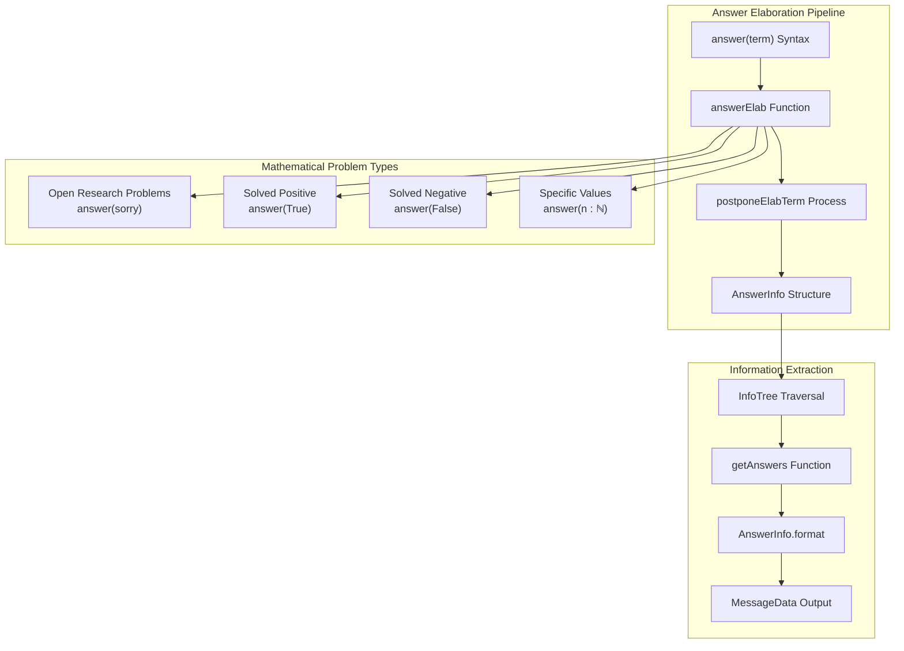
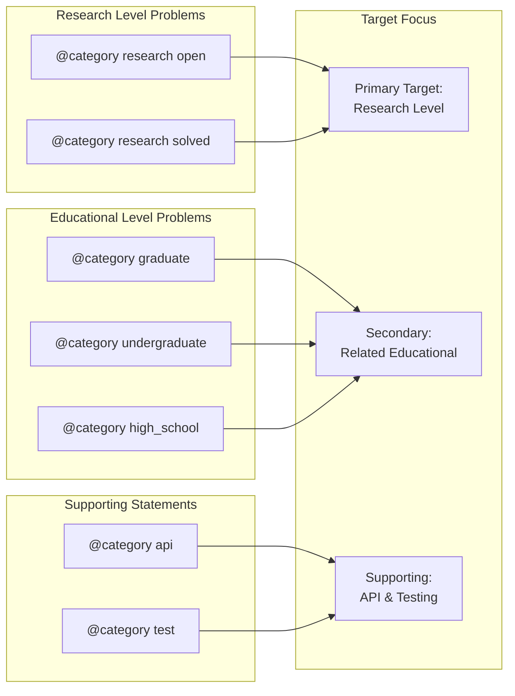
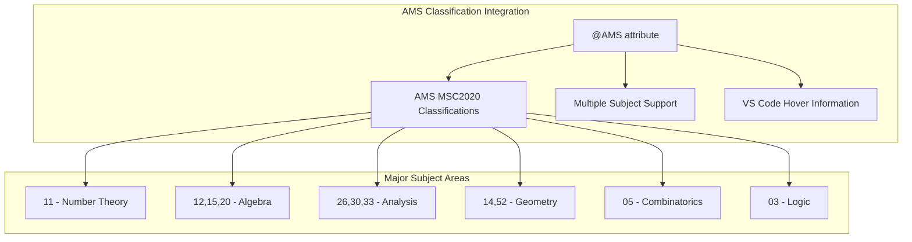
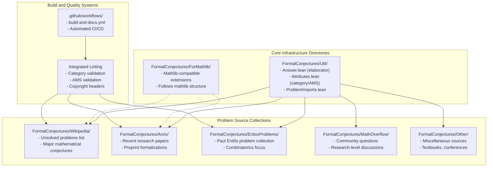
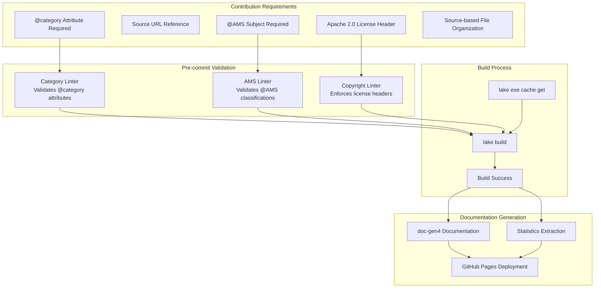

<!-- source: DeepWiki mcp.deepwiki.com · repo google-deepmind/formal-conjectures · page 1 Overview · fetched 2026-10-26 -->

# Overview

<details>
<summary>Relevant source files</summary>

The following files were used as context for generating this wiki page:

- [.devcontainer/devcontainer.json](.devcontainer/devcontainer.json)
- [.gitpod.yml](.gitpod.yml)
- [CONTRIBUTING.md](CONTRIBUTING.md)
- [FormalConjectures/Util/Answer.lean](FormalConjectures/Util/Answer.lean)
- [FormalConjectures/Wikipedia/HadwigerNelson.lean](FormalConjectures/Wikipedia/HadwigerNelson.lean)
- [README.md](README.md)

</details>


This document provides a comprehensive introduction to the FormalConjectures repository, a collection of formalized mathematical conjectures and open problems in Lean 4 using mathlib. The system centers around an innovative `answer()` elaborator that enables formalization of problems requiring user-provided answers, supported by a robust categorization and quality control framework.

For detailed information about specific problem collections, see [Mathematical Problem Collections](#3). For implementation details of core systems, see [System Architecture](#2).

## Purpose and Goals

The FormalConjectures repository addresses a gap in formal mathematics by providing a curated collection of formalized conjecture statements without proofs. The project serves three primary objectives:

1. **Automated Theorem Proving Benchmarks** - Creating standardized targets for ATP systems and automated formalization tools
2. **Mathematical Clarity** - Clarifying precise meanings of conjectures through formal specification  
3. **Mathlib Ecosystem Growth** - Identifying and developing needed definitions for the broader Lean community

The repository targets research-level mathematical problems while maintaining flexibility for educational variants when directly related to research questions.

Sources: [README.md:16-26]()

## Core Innovation: The answer() Elaborator System

The defining feature of this repository is the `answer()` elaborator, which enables formalization of problems that inherently require user-provided answers. This system distinguishes between providing proofs (replacing `sorry`) and providing meaningful mathematical answers.

### answer() Elaborator Architecture



Sources: [FormalConjectures/Util/Answer.lean:37-43](), [FormalConjectures/Util/Answer.lean:47-51](), [FormalConjectures/Util/Answer.lean:59-71]()

### Example Usage Patterns

The `answer()` elaborator supports multiple problem formulation patterns:

| Problem Type | Formalization Pattern | Example Usage |
|-------------|----------------------|---------------|
| Existence Question | `P ↔ answer(sorry)` | Does property P hold? |
| Value Question | `f(x) = answer(sorry)` | What is the value of f(x)? |
| Set Question | `S = answer(sorry)` | What elements satisfy condition? |
| Solved Positive | `P ↔ answer(True)` | Problem proven true |
| Solved Negative | `P ↔ answer(False)` | Problem proven false |

Sources: [README.md:235-241](), [FormalConjectures/Wikipedia/HadwigerNelson.lean:47-49]()

## Problem Categorization Framework

The repository implements a dual-attribute system for mathematical problem classification using persistent environment extensions.

### Category Classification System



Sources: [README.md:134-147](), [README.md:155-164]()

### AMS Subject Classification

The system integrates with the AMS Mathematical Subject Classification (MSC2020) to provide standardized subject tagging:



Sources: [README.md:168-188]()

## Repository Architecture and Organization

The repository follows a source-based organizational structure with specialized utility and extension directories.

### Directory Structure Mapping



Sources: [README.md:116-126](), [README.md:119-122]()

## Quality Control and Development Workflow

The repository maintains code quality through integrated linting systems and standardized development practices.

### Linting and Validation Pipeline



Sources: [README.md:99-100](), [README.md:251-268](), [README.md:95-98]()

### Development Environment Setup

The repository supports multiple development environments through standardized configurations:

| Environment | Configuration File | Key Features |
|------------|-------------------|--------------|
| Gitpod | `.gitpod.yml` | Cloud-based Lean 4 development |
| Dev Container | `.devcontainer/devcontainer.json` | Local containerized environment |
| Local Setup | Manual installation | Direct elan/lake installation |

All environments automatically execute `lake exe cache get` and `lake build` during initialization.

Sources: [.gitpod.yml:10-14](), [.devcontainer/devcontainer.json:6]()

## Mathematical Problem Examples

The following example demonstrates the complete formalization pattern using the Hadwiger-Nelson problem:

```lean
/--
The Hadwiger–Nelson problem asks: How many colors are required to color the plane
such that no two points at distance 1 from each other have the same color?
-/
@[category research open, AMS 52]
theorem HadwigerNelsonProblem :
    UnitDistancePlaneGraph.chromaticNumber = answer(sorry) := by
  sorry
```

This exemplifies the integration of:
- Custom mathematical definitions (`UnitDistancePlaneGraph`)  
- Category classification (`research open`)
- AMS subject classification (`52` for Convex and discrete geometry)
- Answer elaborator usage (`answer(sorry)`)
- Source documentation (Wikipedia URL reference)

Sources: [FormalConjectures/Wikipedia/HadwigerNelson.lean:46-49](), [FormalConjectures/Wikipedia/HadwigerNelson.lean:22]()

## Contributing and Community Integration

The repository integrates with the broader Lean community through multiple channels:

- **Zulip Integration**: Dedicated channel on leanprover Zulip for discussions
- **Mathlib Compatibility**: `ForMathlib` directory for upstream contributions  
- **GitHub Workflows**: Automated issue tracking for new conjecture proposals
- **Contributor License Agreement**: Google CLA requirement for contributions

The project encourages diverse contribution types including new problem formalizations, issue reports for desired problems, improvements to existing formalizations, and enhanced mathematical referencing.

Sources: [README.md:12](), [README.md:43-84](), [CONTRIBUTING.md:9-19]()

---

