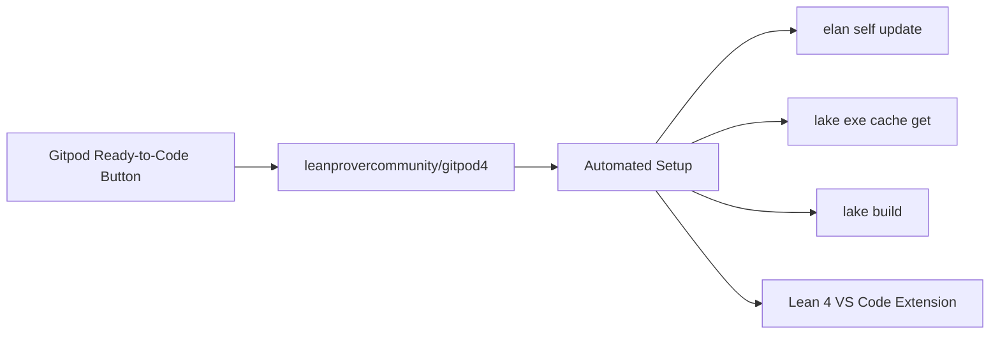
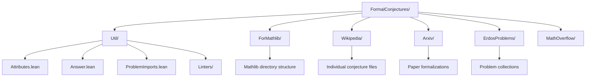
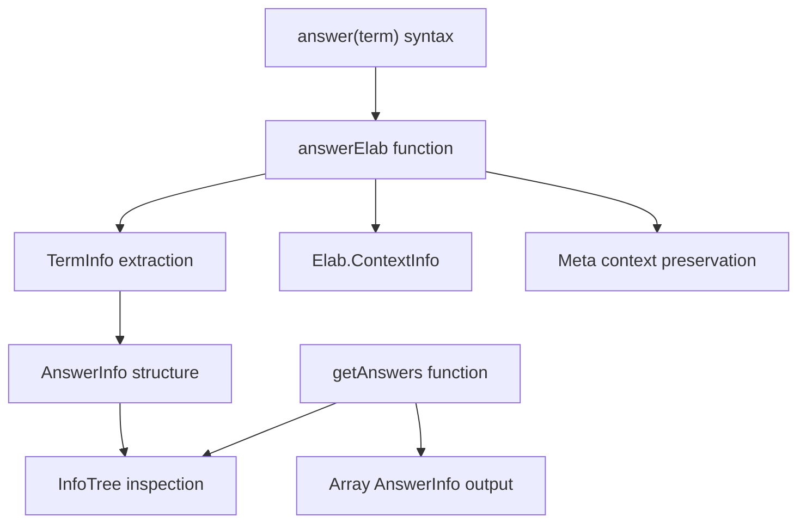
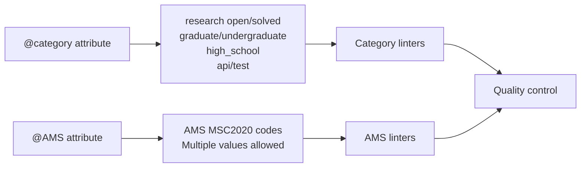
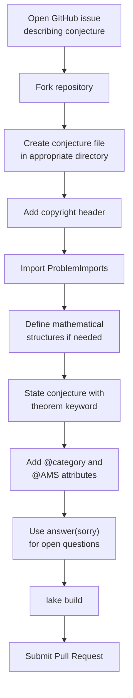

<!-- source: DeepWiki mcp.deepwiki.com · repo google-deepmind/formal-conjectures · page 1.1 Getting Started · fetched 2026-10-26 -->

# Getting Started

<details>
<summary>Relevant source files</summary>

The following files were used as context for generating this wiki page:

- [.devcontainer/devcontainer.json](.devcontainer/devcontainer.json)
- [.gitpod.yml](.gitpod.yml)
- [CONTRIBUTING.md](CONTRIBUTING.md)
- [FormalConjectures/Util/Answer.lean](FormalConjectures/Util/Answer.lean)
- [FormalConjectures/Wikipedia/HadwigerNelson.lean](FormalConjectures/Wikipedia/HadwigerNelson.lean)
- [README.md](README.md)

</details>


This document provides installation instructions, build process setup, development environment configuration, and basic usage patterns for the FormalConjectures framework. It covers the essential steps to begin contributing mathematical conjecture formalizations in Lean 4.

For detailed information about the system architecture and core infrastructure components, see [System Architecture](#2). For specific conjecture collections and problem domains, see [Mathematical Problem Collections](#3).

## Prerequisites

The FormalConjectures project requires Lean 4 with mathlib support and uses the `lake` build system for dependency management.

### Required Tools

| Tool | Purpose | Installation Method |
|------|---------|-------------------|
| `elan` | Lean version manager | [Lean installation guide](https://leanprover-community.github.io/get_started.html) |
| `lake` | Lean build system | Installed with elan |
| `lean` | Lean 4 compiler | Managed by elan |
| VS Code | Recommended IDE | Optional with Lean 4 extension |

The project tracks monthly tagged releases of mathlib rather than the master branch to provide stability for conjecture formalization work.

Sources: [README.md:104-106]()

## Installation and Build Process

### Basic Installation

```bash
# Get precompiled mathlib cache
lake exe cache get

# Build the project
lake build
```

The cache download significantly reduces initial build time by avoiding recompilation of mathlib dependencies.

### Development Environment Options

#### Gitpod Cloud Development

Access a pre-configured development environment with one click:



Sources: [README.md:4](), [.gitpod.yml:1-14]()

#### Local Development Container

For local development with container isolation:

```json
{
  "name": "Mathlib4 dev container",
  "image": "leanprovercommunity/gitpod4",
  "onCreateCommand": "lake exe cache get!"
}
```

The container automatically installs the Lean 4 VS Code extension and configures the environment.

Sources: [.devcontainer/devcontainer.json:1-17]()

## Project Structure Overview

The repository organizes conjecture formalizations by source type, with specialized directories for utilities and mathlib contributions.

### Directory Structure



### Special Directories

- **`Util/`**: Core framework components including the `category` attribute system, `answer()` elaborator, and quality control linters
- **`ForMathlib/`**: Mathematical definitions and theorems suitable for upstreaming to mathlib, following mathlib's directory structure

Sources: [README.md:114-125]()

## Core Framework Components

The framework provides three essential systems for conjecture formalization: answer elaboration, problem categorization, and mathematical subject classification.

### Answer Elaborator System



The `answerElab` function at [FormalConjectures/Util/Answer.lean:39-43]() processes `answer(term)` syntax by postponing elaboration and preserving context information for later extraction.

### Categorization and Classification Systems



Sources: [README.md:129-188](), [FormalConjectures/Util/Answer.lean:37-44]()

## Basic Usage Workflow

### Adding a New Conjecture

The standard workflow for contributing conjecture formalizations follows these steps:



### Example Conjecture Structure

A typical conjecture file follows this pattern, demonstrated in [FormalConjectures/Wikipedia/HadwigerNelson.lean]():

```lean
-- Copyright header (lines 1-15)
import FormalConjectures.Util.ProblemImports

namespace HadwigerNelson

-- Mathematical definitions (lines 29-41)
def UnitDistancePlaneGraph : SimpleGraph (EuclideanSpace ℝ (Fin 2)) := ...

-- Main conjecture with attributes (lines 46-49)
@[category research open, AMS 52]
theorem HadwigerNelsonProblem :
    UnitDistancePlaneGraph.chromaticNumber = answer(sorry) := by
  sorry
```

### Required Elements

| Element | Purpose | Example |
|---------|---------|---------|
| Copyright header | Legal compliance | Lines 1-15 in all files |
| `ProblemImports` | Framework utilities | `import FormalConjectures.Util.ProblemImports` |
| `@category` attribute | Research status | `@[category research open]` |
| `@AMS` attribute | Subject classification | `@[AMS 52]` for geometry |
| `answer()` elaborator | Open question placeholder | `answer(sorry)` for unknown answers |

### Build Verification

```bash
# Verify code builds correctly
lake build

# Run linters (automatically executed in CI)
# - Category linter validates @category attributes  
# - AMS linter validates @AMS subject codes
# - Copyright linter ensures proper headers
```

Sources: [README.md:85-101](), [README.md:220-268](), [FormalConjectures/Wikipedia/HadwigerNelson.lean:1-71]()

---

