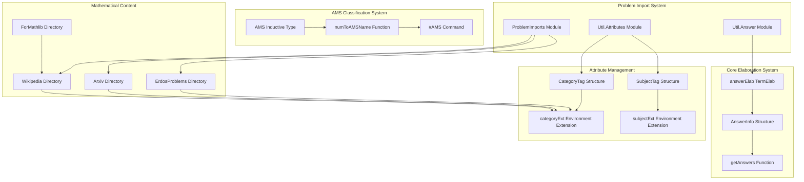
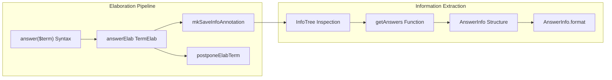
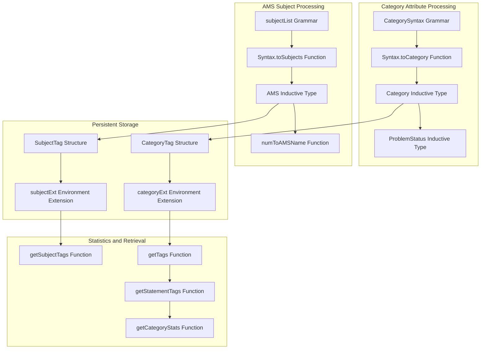
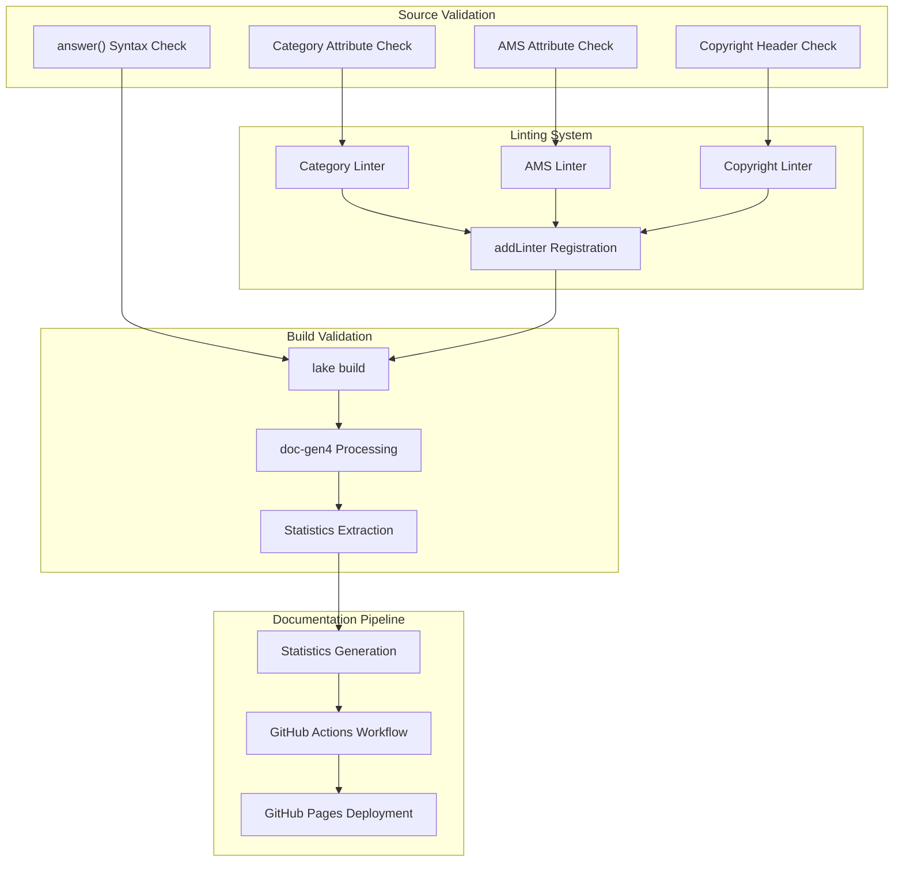
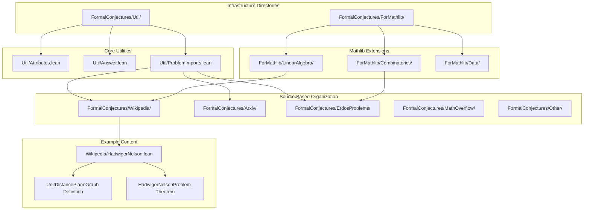

<!-- source: DeepWiki mcp.deepwiki.com · repo google-deepmind/formal-conjectures · page 2 System Architecture · fetched 2026-10-26 -->

# System Architecture

Relevant source files

The following files were used as context for generating this wiki page:

- [.devcontainer/devcontainer.json](.devcontainer/devcontainer.json)
- [.gitpod.yml](.gitpod.yml)
- [CONTRIBUTING.md](CONTRIBUTING.md)
- [FormalConjectures/Util/Answer.lean](FormalConjectures/Util/Answer.lean)
- [FormalConjectures/Util/Attributes.lean](FormalConjectures/Util/Attributes.lean)
- [FormalConjectures/Util/Attributes/AMS.lean](FormalConjectures/Util/Attributes/AMS.lean)
- [FormalConjectures/Util/Attributes/AttributesTest.lean](FormalConjectures/Util/Attributes/AttributesTest.lean)
- [FormalConjectures/Wikipedia/HadwigerNelson.lean](FormalConjectures/Wikipedia/HadwigerNelson.lean)
- [README.md](README.md)

This document provides a technical overview of the FormalConjectures system architecture, focusing on the core infrastructure components, categorization mechanisms, and quality control systems that enable formalized mathematical conjecture collection and validation. For information about specific mathematical problem collections, see [Mathematical Problem Collections](#3). For installation and setup procedures, see [Getting Started](#1.1).

## Core Infrastructure Components

The FormalConjectures system is built around several key infrastructure components that work together to enable mathematical conjecture formalization in Lean 4.

### Architecture Overview

Sources: [README.md:119-126](), [FormalConjectures/Util/Attributes.lean:19-301](), [FormalConjectures/Util/Answer.lean:17-72]()

### The answer() Elaboration System

The `answer()` elaborator provides syntax for marking placeholder answers in mathematical problem statements where the solution requires a specific value or term.

The elaborator processes terms of the form `answer(sorry)`, `answer(True)`, or `answer(False)` and preserves them for later extraction and analysis. The `AnswerInfo` structure stores both the elaborated term and its context for statistical and documentation purposes.

Sources: [FormalConjectures/Util/Answer.lean:37-72](), [README.md:189-219]()

## Problem Categorization System

The categorization system uses Lean 4 attributes to classify mathematical problems by research status and subject area, with persistent storage in environment extensions.

### Category Classification Architecture

The system supports the following category classifications:
- `research open`: Unsolved mathematical problems
- `research solved`: Problems with accepted informal solutions  
- `graduate`, `undergraduate`, `high_school`: Educational level problems
- `test`: Sanity check statements
- `API`: Basic theory construction statements

Sources: [FormalConjectures/Util/Attributes.lean:94-301](), [README.md:129-188]()

### AMS Subject Classification

The AMS (American Mathematical Society) subject classification system maps numerical codes to mathematical subject areas using an inductive type with 54 constructors.

| AMS Code | Subject Area | Constructor |
|----------|--------------|-------------|
| 11 | Number theory | `AMS.«11»` |
| 52 | Convex and discrete geometry | `AMS.«52»` |
| 15 | Linear and multilinear algebra | `AMS.«15»` |
| 5 | Combinatorics | `AMS.«5»` |
| 33 | Special functions | `AMS.«33»` |

The `#AMS` command provides interactive access to all available subject classifications within Lean files.

Sources: [FormalConjectures/Util/Attributes/AMS.lean:39-196](), [FormalConjectures/Util/Attributes/AttributesTest.lean:104-105]()

## Quality Control Pipeline

The quality control system enforces consistent metadata, formatting, and build validation across all conjecture formalizations.

### Validation Workflow

Each conjecture file must include:
1. Apache 2.0 copyright header as specified in [README.md:250-267]()
2. At least one `@[AMS n]` subject classification attribute
3. One `@[category type]` classification attribute
4. Proper `answer(sorry/True/False)` syntax for questions requiring specific answers

Sources: [README.md:220-267](), [.github/workflows/build-and-docs.yml (inferred)]()

## Mathematical Content Organization

The repository organizes mathematical content using a source-based directory structure that separates conjectures by their origin and provides extensions for mathlib integration.

### Directory Structure Mapping

The `ForMathlib` directory contains mathematical definitions and theorems intended for eventual upstreaming to mathlib, following mathlib's directory structure conventions. This allows the repository to include necessary definitions without waiting for mathlib releases.

Sources: [README.md:114-126](), [README.md:272-280](), [FormalConjectures/Wikipedia/HadwigerNelson.lean:27-70]()

### Build and Development Environment

The system supports multiple development environments through standardized configuration:

- **Gitpod**: Cloud-based development with automatic cache retrieval and build
- **DevContainer**: Local containerized development environment  
- **Local Setup**: Traditional `lake exe cache get` and `lake build` workflow

All environments use the `leanprovercommunity/gitpod4` base image and include automatic Lean 4 extension installation and mathlib cache management.

Sources: [.gitpod.yml:1-14](), [.devcontainer/devcontainer.json:1-17](), [README.md:104-113]()

---

