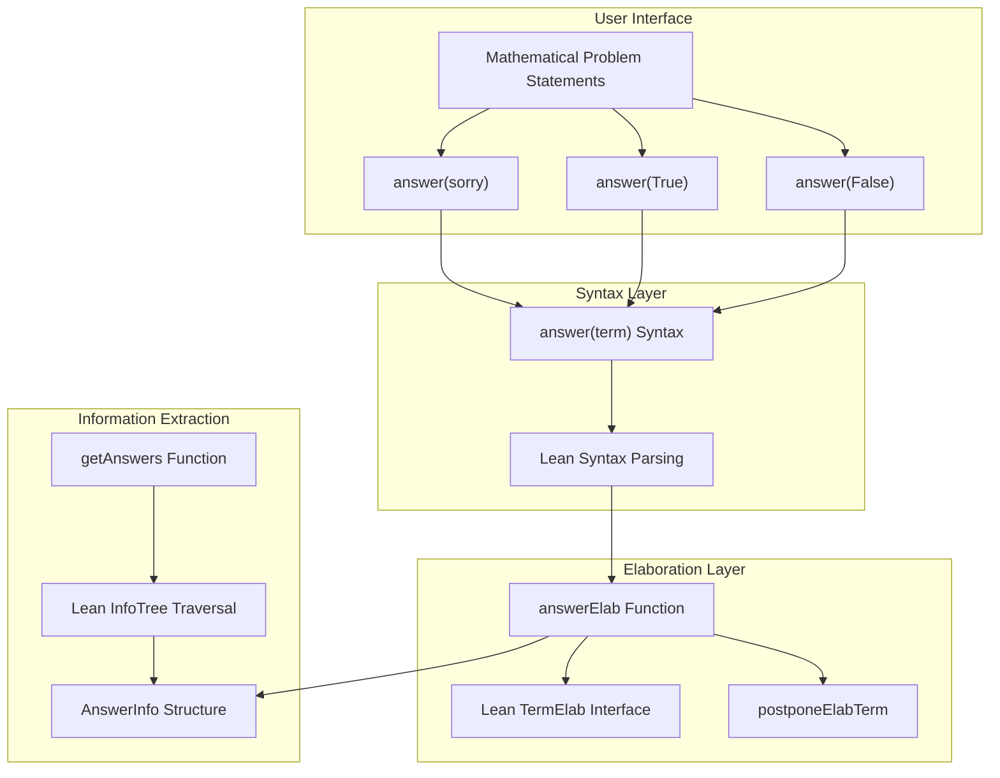
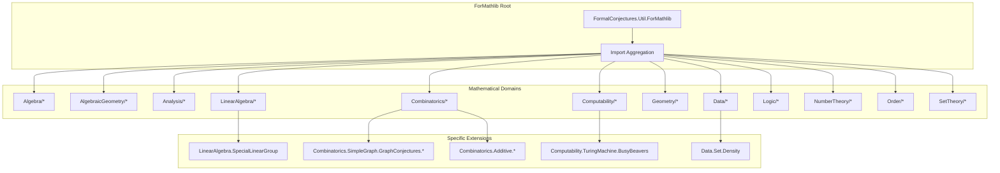
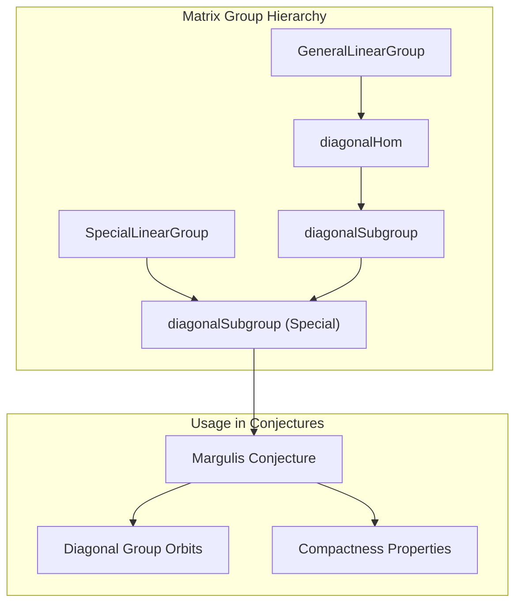
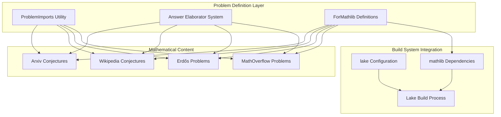

<!-- source: DeepWiki mcp.deepwiki.com · repo google-deepmind/formal-conjectures · page 2.1 Core Infrastructure · fetched 2026-10-26 -->

# Core Infrastructure

<details>
<summary>Relevant source files</summary>

The following files were used as context for generating this wiki page:

- [.devcontainer/devcontainer.json](.devcontainer/devcontainer.json)
- [.gitpod.yml](.gitpod.yml)
- [CONTRIBUTING.md](CONTRIBUTING.md)
- [FormalConjectures/Arxiv/2504.17644/Margulis.lean](FormalConjectures/Arxiv/2504.17644/Margulis.lean)
- [FormalConjectures/ForMathlib/LinearAlgebra/GeneralLinearGroup.lean](FormalConjectures/ForMathlib/LinearAlgebra/GeneralLinearGroup.lean)
- [FormalConjectures/ForMathlib/LinearAlgebra/SpecialLinearGroup.lean](FormalConjectures/ForMathlib/LinearAlgebra/SpecialLinearGroup.lean)
- [FormalConjectures/Util/Answer.lean](FormalConjectures/Util/Answer.lean)
- [FormalConjectures/Util/ForMathlib.lean](FormalConjectures/Util/ForMathlib.lean)
- [FormalConjectures/Wikipedia/HadwigerNelson.lean](FormalConjectures/Wikipedia/HadwigerNelson.lean)
- [README.md](README.md)

</details>


This document covers the fundamental architectural components that enable conjecture formalization in the FormalConjectures repository. This includes the `answer()` elaborator system for handling open problems, the ForMathlib extension framework for mathematical definitions, and the core utilities that support the entire formalization pipeline.

For information about problem categorization and metadata systems, see [Problem Categorization System](#2.2). For quality control mechanisms, see [Quality Control and Validation](#2.3).

## Answer Elaborator System

The `answer()` elaborator is the cornerstone mechanism that enables formalization of open mathematical problems where the solution is unknown. It provides syntax for marking placeholder answers in problem statements.

### Answer Elaborator Architecture



Sources: [FormalConjectures/Util/Answer.lean:17-72](), [README.md:189-218]()

### Core Answer Components

The answer system consists of several key components working together:

| Component | Location | Purpose |
|-----------|----------|---------|
| `answerElab` | [FormalConjectures/Util/Answer.lean:39-43]() | Main elaborator function handling `answer(term)` syntax |
| `AnswerInfo` | [FormalConjectures/Util/Answer.lean:48-50]() | Structure storing context and term information for answers |
| `getAnswers` | [FormalConjectures/Util/Answer.lean:60-71]() | Recursive function extracting answers from InfoTree |
| `AnswerInfo.format` | [FormalConjectures/Util/Answer.lean:53-57]() | Pretty-printing for answer information |

The `answerElab` function transforms `answer(term)` syntax into a postponed elaboration using `by exact $a`, enabling type-correct placeholder insertion in mathematical statements.

Sources: [FormalConjectures/Util/Answer.lean:38-72]()

### Answer Usage Patterns

The answer elaborator supports three primary usage patterns for different problem states:

```lean
-- Open problem (unknown answer)
theorem openProblem : Property ↔ answer(sorry) := by sorry

-- Solved positive (known to be true)  
theorem solvedTrue : Property ↔ answer(True) := by sorry

-- Solved negative (known to be false)
theorem solvedFalse : Property ↔ answer(False) := by sorry
```

Sources: [README.md:235-249](), [FormalConjectures/Wikipedia/HadwigerNelson.lean:47-49]()

## ForMathlib Extensions Framework

ForMathlib provides a structured approach to developing mathematical definitions and theorems that are intended for eventual upstream contribution to mathlib. This enables rapid conjecture formalization without waiting for mathlib release cycles.

### ForMathlib Organization Structure



Sources: [FormalConjectures/Util/ForMathlib.lean:17-59]()

### Matrix Group Extensions Example

The matrix group extensions demonstrate the ForMathlib pattern for developing specialized mathematical structures:



Sources: [FormalConjectures/ForMathlib/LinearAlgebra/GeneralLinearGroup.lean:25-34](), [FormalConjectures/ForMathlib/LinearAlgebra/SpecialLinearGroup.lean:25-27](), [FormalConjectures/Arxiv/2504.17644/Margulis.lean:47-52]()

## Core Infrastructure Integration

The core infrastructure components work together to enable the complete formalization workflow:

### Infrastructure Component Relationships



Sources: [README.md:104-126](), [FormalConjectures/Arxiv/2504.17644/Margulis.lean:17]()

### Development Workflow Integration

The core infrastructure enables a structured development workflow:

| Stage | Infrastructure Component | Function |
|-------|-------------------------|----------|
| Problem Import | `ProblemImports` utility | Provides standardized imports for conjecture files |
| Mathematical Definitions | ForMathlib extensions | Supplies domain-specific definitions and theorems |
| Problem Statement | `answer()` elaborator | Handles unknown values in open problems |
| Type Checking | Lean 4 + mathlib | Validates mathematical correctness |
| Build Integration | Lake build system | Compiles entire project including ForMathlib |

The infrastructure supports both rapid prototyping of new mathematical concepts in ForMathlib and systematic formalization of conjectures using the `answer()` mechanism.

Sources: [README.md:189-218](), [README.md:276-279]()

## Build System and Dependencies

The core infrastructure relies on a carefully configured build environment:

### Dependency Structure

- **Lean 4**: Core theorem prover and type system
- **mathlib**: Standard mathematical library providing foundational definitions
- **Lake**: Build system managing dependencies and compilation  
- **ForMathlib**: Project-specific extensions bridging gaps in mathlib coverage

The system tracks mathlib monthly tagged releases rather than master branch for stability, with ForMathlib extensions providing immediate access to needed definitions without waiting for mathlib release cycles.

Sources: [README.md:272-279](), [.gitpod.yml:10-13](), [.devcontainer/devcontainer.json:6]()

---

