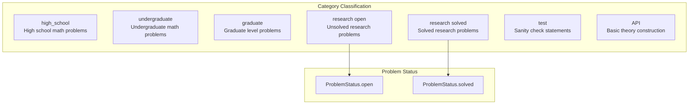
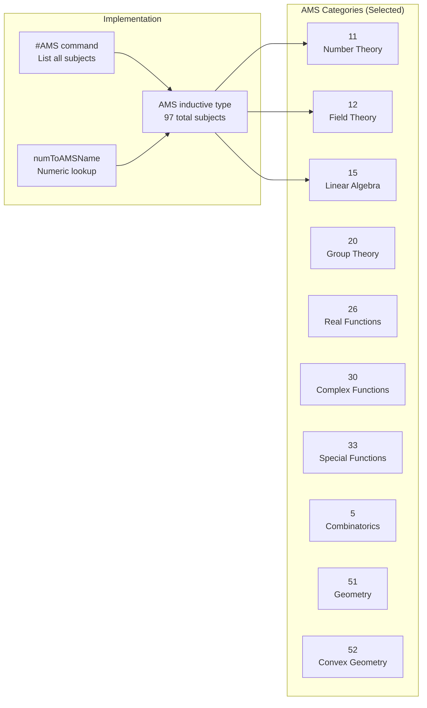
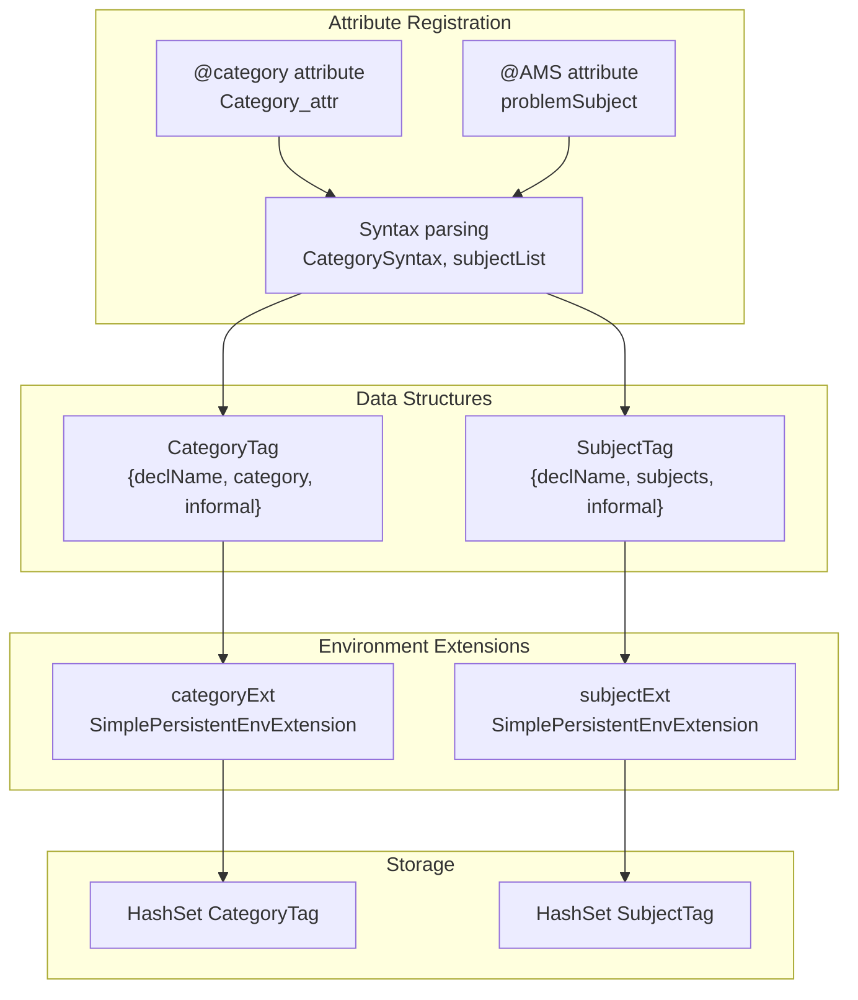
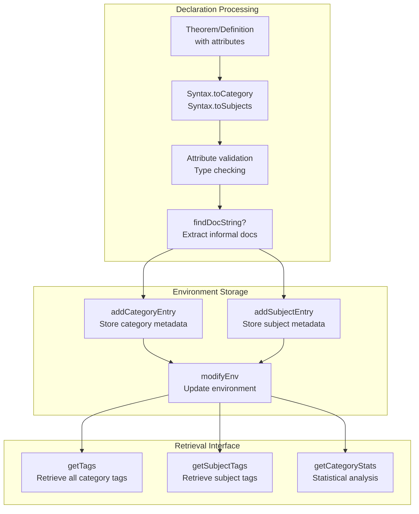

<!-- source: DeepWiki mcp.deepwiki.com · repo google-deepmind/formal-conjectures · page 2.2 Problem Categorization System · fetched 2026-10-26 -->

# Problem Categorization System

<details>
<summary>Relevant source files</summary>

The following files were used as context for generating this wiki page:

- [FormalConjectures/Util/Attributes.lean](FormalConjectures/Util/Attributes.lean)
- [FormalConjectures/Util/Attributes/AMS.lean](FormalConjectures/Util/Attributes/AMS.lean)
- [FormalConjectures/Util/Attributes/AttributesTest.lean](FormalConjectures/Util/Attributes/AttributesTest.lean)

</details>


This document describes the dual attribute system used to classify mathematical problems in the FormalConjectures repository. The system provides two orthogonal classification mechanisms: a `@category` attribute for problem difficulty and research status, and an `@AMS` attribute for mathematical subject classification according to the American Mathematical Society's subject classification system.

For information about the quality control mechanisms that enforce these attributes, see [Quality Control and Validation](#2.3). For details on how these attributes are used in documentation generation, see [Build and Documentation Pipeline](#2.4).

## Category Attribute System

The category attribute system classifies mathematical statements by their difficulty level and research status using the `@category` annotation. This system distinguishes between educational problems at different levels, research problems (both open and solved), and auxiliary statements like tests and API definitions.

### Category Types and Values

The system defines six distinct categories through the `Category` inductive type:



Sources: [FormalConjectures/Util/Attributes.lean:112-125](), [FormalConjectures/Util/Attributes.lean:94-100]()

### Usage Examples and Syntax

The category attribute uses a structured syntax that supports both simple categories and research-level problems with status indicators:

| Attribute Syntax | Description | Use Case |
|------------------|-------------|----------|
| `@[category high_school]` | High school level problem | IMO problems, basic algebra |
| `@[category undergraduate]` | Undergraduate level problem | Standard university coursework |
| `@[category graduate]` | Graduate level problem | Advanced mathematical concepts |
| `@[category research open]` | Open research problem | Unresolved conjectures |
| `@[category research solved]` | Solved research problem | Proven theorems with accepted solutions |
| `@[category test]` | Test statement | Definition sanity checks |
| `@[category API]` | API construction | Basic theory around definitions |

Sources: [FormalConjectures/Util/Attributes.lean:47-65](), [FormalConjectures/Util/Attributes.lean:207-214]()

## AMS Subject Classification System

The AMS attribute system classifies mathematical problems according to the American Mathematical Society's Mathematics Subject Classification using numeric codes. This provides standardized subject categorization used throughout mathematical literature.

### AMS Classification Structure



Sources: [FormalConjectures/Util/Attributes/AMS.lean:39-166](), [FormalConjectures/Util/Attributes/AMS.lean:187-195]()

### Subject Code Validation and Lookup

The system provides several mechanisms for working with AMS codes:

- **Numeric Lookup**: `numToAMSName` converts integers to valid AMS names [FormalConjectures/Util/Attributes/AMS.lean:168-171]()
- **Description Extraction**: `AMS.getDesc` retrieves docstring descriptions [FormalConjectures/Util/Attributes/AMS.lean:173-176]()  
- **Interactive Command**: `#AMS` displays all available subjects [FormalConjectures/Util/Attributes/AMS.lean:187-195]()
- **Multiple Subjects**: Single problems can have multiple AMS classifications

Sources: [FormalConjectures/Util/Attributes/AMS.lean:168-184]()

## Implementation Architecture

The categorization system uses Lean's persistent environment extensions to store metadata about mathematical problems throughout compilation and across module boundaries.

### Persistent Storage Architecture



Sources: [FormalConjectures/Util/Attributes.lean:131-146](), [FormalConjectures/Util/Attributes.lean:153-173]()

### Attribute Processing Pipeline

The system processes attributes during Lean's elaboration phase using a multi-stage pipeline:



Sources: [FormalConjectures/Util/Attributes.lean:215-227](), [FormalConjectures/Util/Attributes.lean:254-264](), [FormalConjectures/Util/Attributes.lean:286-299]()

## Statistics and Analysis Functions

The system provides helper functions for analyzing the distribution of categorized problems across the codebase. These functions enable generation of statistics for documentation and repository analytics.

### Statistical Analysis Interface

| Function | Purpose | Return Type |
|----------|---------|-------------|
| `getTags` | Retrieve all category tags | `Array CategoryTag` |
| `getStatementTags` | Group tags by category | `HashMap Category (Array CategoryTag)` |
| `getCategoryStats` | Count problems per category | `Category → Nat` |
| `getSubjectTags` | Retrieve all subject tags | `Array SubjectTag` |

The `splitByFun` helper function enables grouping of tagged problems by arbitrary classification functions, supporting flexible statistical analysis of the problem collection.

Sources: [FormalConjectures/Util/Attributes.lean:272-299]()

### Example Usage in Practice

The attribute test file demonstrates typical usage patterns combining both classification systems:

```lean
@[category research solved, AMS 11]
theorem FLT : FermatLastTheorem := by sorry

@[category research open, AMS 11 33]  
theorem an_open_problem : Transcendental ℝ (π + rexp 1) := by sorry
```

This shows how a single mathematical statement can be classified with both difficulty/status information and multiple subject areas simultaneously.

Sources: [FormalConjectures/Util/Attributes/AttributesTest.lean:29-36]()

---

