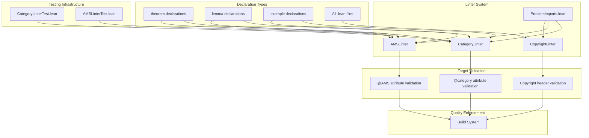
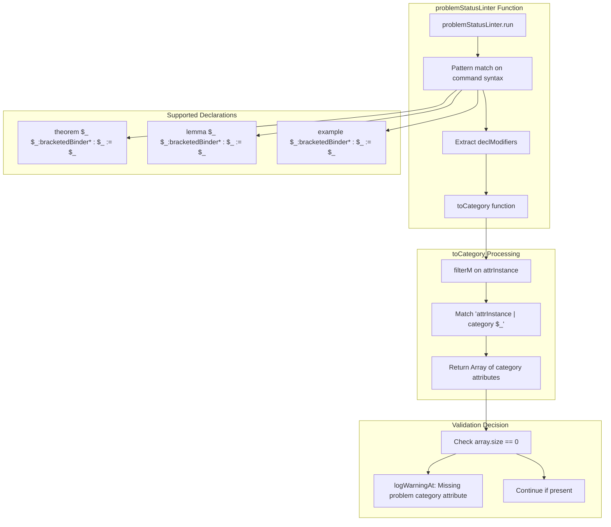
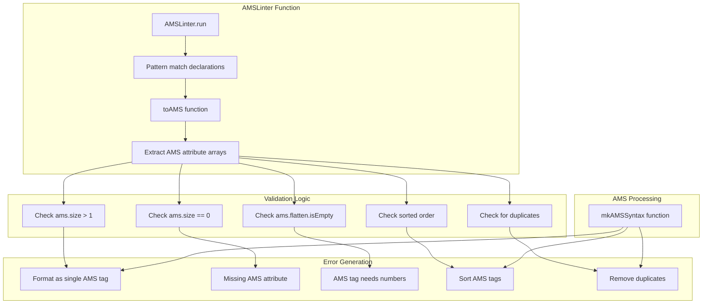
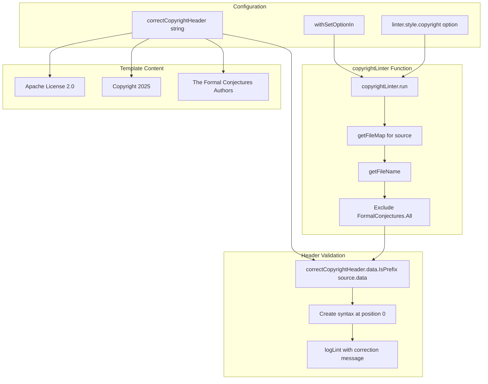
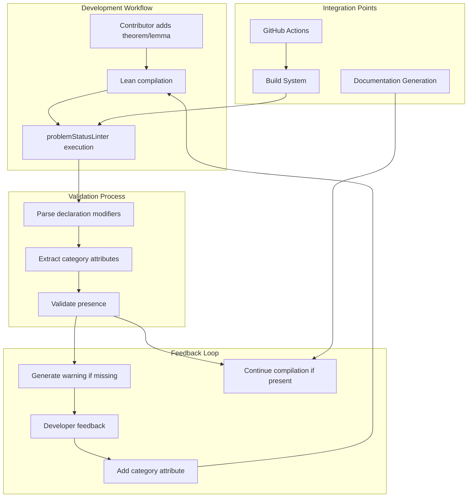

<!-- source: DeepWiki mcp.deepwiki.com · repo google-deepmind/formal-conjectures · page 2.3 Quality Control and Validation · fetched 2026-10-26 -->

# Quality Control and Validation

<details>
<summary>Relevant source files</summary>

The following files were used as context for generating this wiki page:

- [FormalConjectures/Util/Linters/AMSLinter.lean](FormalConjectures/Util/Linters/AMSLinter.lean)
- [FormalConjectures/Util/Linters/AMSLinterTest.lean](FormalConjectures/Util/Linters/AMSLinterTest.lean)
- [FormalConjectures/Util/Linters/CategoryLinter.lean](FormalConjectures/Util/Linters/CategoryLinter.lean)
- [FormalConjectures/Util/Linters/CategoryLinterTest.lean](FormalConjectures/Util/Linters/CategoryLinterTest.lean)
- [FormalConjectures/Util/Linters/CopyrightLinter.lean](FormalConjectures/Util/Linters/CopyrightLinter.lean)
- [FormalConjectures/Util/ProblemImports.lean](FormalConjectures/Util/ProblemImports.lean)

</details>


## Purpose and Scope

The Quality Control and Validation system enforces consistent metadata and formatting standards across all mathematical formalizations in the FormalConjectures repository. This automated validation system operates during compilation to ensure that:

1. **Mathematical statements** are properly categorized with `@category` attributes
2. **Subject classifications** are correctly tagged with `@AMS` attributes  
3. **Copyright headers** follow the project's standardized format

The system consists of three complementary linters that validate different aspects of code quality, ensuring repository-wide consistency and enabling systematic organization of mathematical conjectures.

For information about the attribute systems themselves, see [Problem Categorization System](#2.2). For build automation details, see [Build and Documentation Pipeline](#2.4).

## Linter System Overview

The quality control system consists of three specialized linters that validate different aspects of mathematical formalizations during compilation:

### Overall Linter Architecture



Sources: [FormalConjectures/Util/ProblemImports.lean:22-24](), [FormalConjectures/Util/Linters/CategoryLinter.lean:45](), [FormalConjectures/Util/Linters/AMSLinter.lean:47](), [FormalConjectures/Util/Linters/CopyrightLinter.lean:46]()

### Linter Comparison Matrix

| Linter | Target Scope | Validation Focus | Error Types |
|--------|--------------|------------------|-------------|
| `problemStatusLinter` | theorem/lemma/example | `@category` attributes | Missing category |
| `AMSLinter` | theorem/lemma/example | `@AMS` attributes | Missing AMS, formatting, ordering |
| `copyrightLinter` | All .lean files | File header | Incorrect copyright header |

## Category Attribute Linter

The `problemStatusLinter` validates that mathematical declarations have appropriate `@category` attributes to distinguish between research problems, solved problems, and background material.

### Category Linter Implementation



Sources: [FormalConjectures/Util/Linters/CategoryLinter.lean:45-57](), [FormalConjectures/Util/Linters/CategoryLinter.lean:32-41]()

### Validation Rules

| Declaration Type | Pattern | Category Required |
|------------------|---------|------------------|
| `theorem` | `theorem $_ $_:bracketedBinder* : $_ := $_` | Yes |
| `lemma` | `lemma $_ $_:bracketedBinder* : $_ := $_` | Yes |  
| `example` | `example $_:bracketedBinder* : $_ := $_` | Yes |
| `def` | Not matched | No |

The linter supports multiple attribute combinations and is order-independent:
- `@[category research open]`
- `@[simp, category research open]` 
- `@[category research open, simp]`

Sources: [FormalConjectures/Util/Linters/CategoryLinter.lean:48-50](), [FormalConjectures/Util/Linters/CategoryLinterTest.lean:64-72]()

## AMS Subject Classification Linter

The `AMSLinter` validates that mathematical declarations include proper `@AMS` subject classification codes and enforces consistent formatting of these tags.

### AMS Linter Architecture



Sources: [FormalConjectures/Util/Linters/AMSLinter.lean:47-76](), [FormalConjectures/Util/Linters/AMSLinter.lean:32-40](), [FormalConjectures/Util/Linters/AMSLinter.lean:42-43]()

### AMS Validation Rules

| Validation Type | Condition | Error Message |
|----------------|-----------|---------------|
| Missing AMS | `ams.size == 0` | "Missing AMS attribute." |
| Multiple Tags | `ams.size > 1` | "The AMS tag should be formatted as AMS 1 3 rather than AMS 1, AMS 3" |  
| Empty Numbers | `ams.flatten.isEmpty` | "The AMS tag should have at least one subject number." |
| Wrong Order | `ams_sorted != ams.flatten` | "The AMS tags should be ordered as AMS 1 3" |
| Duplicates | `ams_sorted.dedupSorted != ams_sorted` | "AMS tags contain duplicates. This should be AMS 1 3" |

The linter transforms multiple AMS tags like `@[AMS 1, AMS 3]` into the canonical form `@[AMS 1 3]` and ensures numeric codes are sorted in ascending order.

Sources: [FormalConjectures/Util/Linters/AMSLinter.lean:57-75](), [FormalConjectures/Util/Linters/AMSLinterTest.lean:52-87]()

## Copyright Header Linter

The `copyrightLinter` validates that all `.lean` files have the standardized Apache 2.0 copyright header required by the project.

### Copyright Validation Process



Sources: [FormalConjectures/Util/Linters/CopyrightLinter.lean:46-55](), [FormalConjectures/Util/Linters/CopyrightLinter.lean:23-38](), [FormalConjectures/Util/Linters/CopyrightLinter.lean:40-43]()

### Copyright Header Template

The linter validates against the exact template defined in `correctCopyrightHeader`:

```
/-
Copyright 2025 The Formal Conjectures Authors.

Licensed under the Apache License, Version 2.0 (the "License");
...
-/
```

The validation uses `IsPrefix` to check that files begin with this exact header format, excluding only the `FormalConjectures.All` file from validation.

Sources: [FormalConjectures/Util/Linters/CopyrightLinter.lean:23-38](), [FormalConjectures/Util/Linters/CopyrightLinter.lean:52]()

## Integration and Testing

### System Integration

All three linters integrate through the `ProblemImports.lean` file, which serves as the standard import set for mathematical problem files:

```lean
import FormalConjectures.Util.Linters.AMSLinter
import FormalConjectures.Util.Linters.CategoryLinter  
import FormalConjectures.Util.Linters.CopyrightLinter
```

This ensures that all linters are active during compilation of problem files, providing immediate validation feedback to contributors.

Sources: [FormalConjectures/Util/ProblemImports.lean:22-24]()

### Comprehensive Test Coverage

Each linter includes dedicated test files that validate expected behavior using `#guard_msgs`:

#### Category Linter Tests

| Test Case | Expected Behavior | File Reference |
|-----------|------------------|----------------|
| `def foo : Nat := 1` | No warning | [FormalConjectures/Util/Linters/CategoryLinterTest.lean:20-21]() |
| `theorem test_theorem : 1 + 1 = 2` | "Missing problem category attribute" | [FormalConjectures/Util/Linters/CategoryLinterTest.lean:24-27]() |
| `@[category research open] theorem test_2` | No warning | [FormalConjectures/Util/Linters/CategoryLinterTest.lean:58-60]() |
| `@[simp, category research open] theorem test_1` | No warning | [FormalConjectures/Util/Linters/CategoryLinterTest.lean:64-66]() |

#### AMS Linter Tests

| Test Case | Expected Behavior | File Reference |
|-----------|------------------|----------------|
| `def foo : Nat := 1` | No warning | [FormalConjectures/Util/Linters/AMSLinterTest.lean:20-21]() |
| `theorem test_theorem : 1 + 1 = 2` | "Missing AMS attribute." | [FormalConjectures/Util/Linters/AMSLinterTest.lean:24-27]() |
| `@[AMS 1, AMS 3] theorem test` | "The AMS tag should be formatted as AMS 1 3 rather than AMS 1, AMS 3" | [FormalConjectures/Util/Linters/AMSLinterTest.lean:53-57]() |
| `@[AMS 3 1] theorem test_out_of_order` | "The AMS tags should be ordered as AMS 1 3" | [FormalConjectures/Util/Linters/AMSLinterTest.lean:78-81]() |
| `@[AMS 3 3] theorem test_dup` | "AMS tags contain duplicates. This should be AMS 3" | [FormalConjectures/Util/Linters/AMSLinterTest.lean:84-87]() |

Sources: [FormalConjectures/Util/Linters/CategoryLinterTest.lean:20-72](), [FormalConjectures/Util/Linters/AMSLinterTest.lean:20-87]()

## Quality Assurance Workflow

### Automated Enforcement Pipeline



Sources: [FormalConjectures/Util/Linters/CategoryLinter.lean:56-57](), [FormalConjectures/Util/ProblemImports.lean:17-23]()

### Continuous Quality Monitoring

The linter is automatically initialized during module loading through the `initialize` block, ensuring it runs on every compilation. This provides continuous quality monitoring throughout the development process, catching categorization issues immediately rather than during code review.

The system integrates with the broader build pipeline to ensure that quality standards are maintained across all mathematical formalizations in the repository, supporting the project's goal of systematic conjecture organization.

Sources: [FormalConjectures/Util/Linters/CategoryLinter.lean:56-57]()

---

