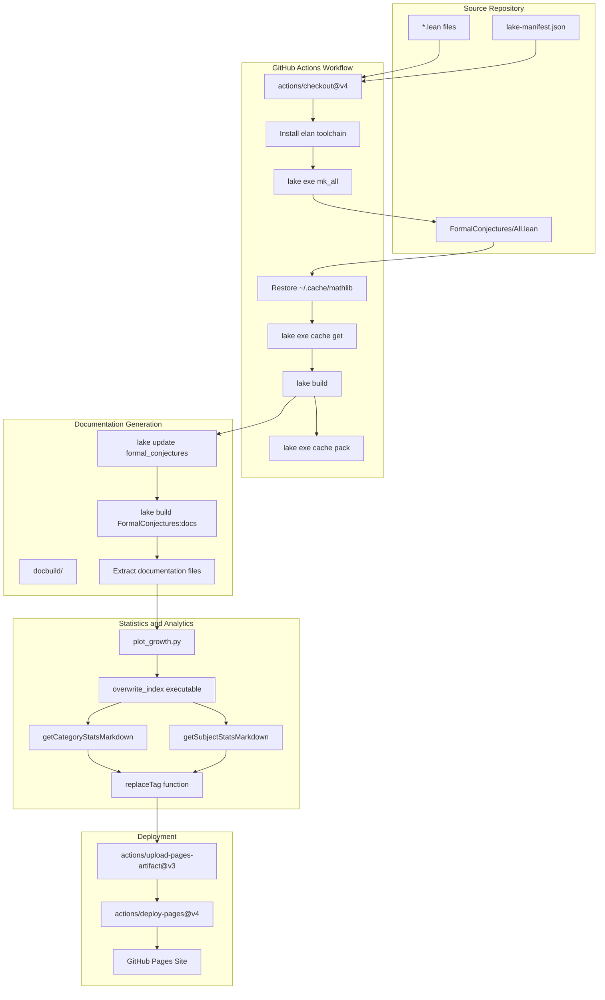
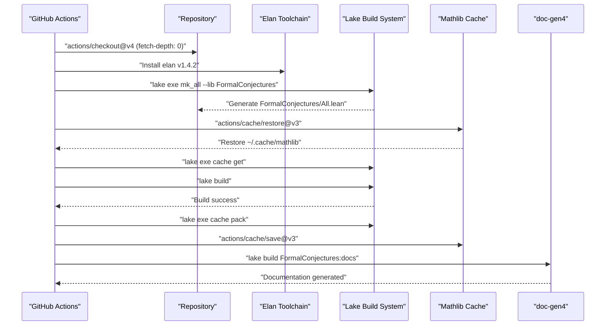
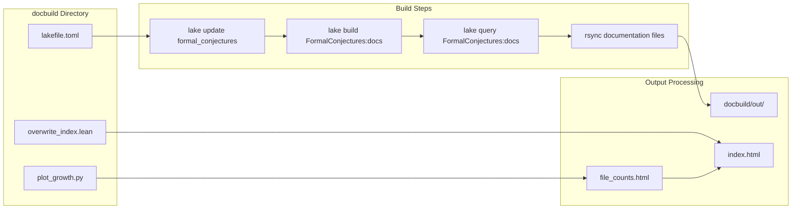
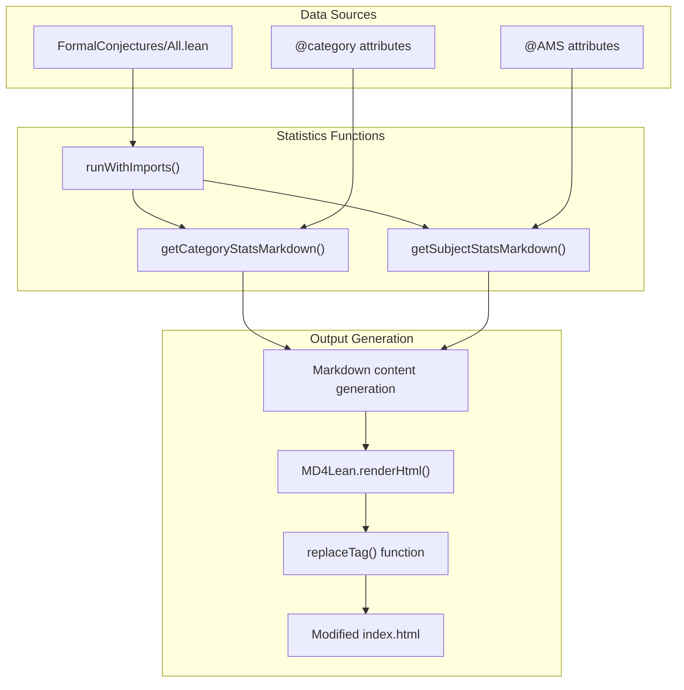
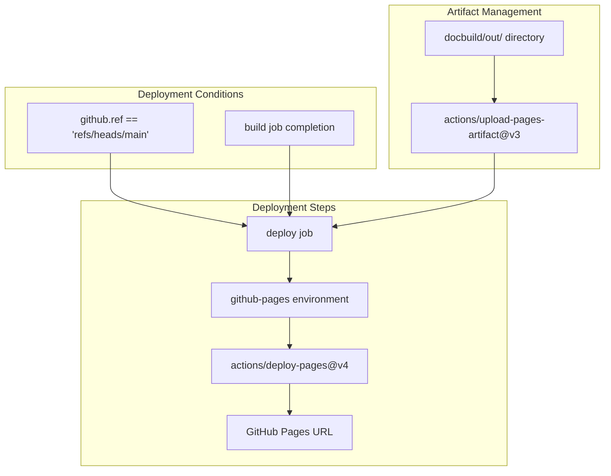

<!-- source: DeepWiki mcp.deepwiki.com · repo google-deepmind/formal-conjectures · page 2.4 Build and Documentation Pipeline · fetched 2026-10-26 -->

# Build and Documentation Pipeline

<details>
<summary>Relevant source files</summary>

The following files were used as context for generating this wiki page:

- [.github/workflows/build-and-docs.yml](.github/workflows/build-and-docs.yml)
- [.github/workflows/check_copyright_header.yml](.github/workflows/check_copyright_header.yml)
- [docbuild/lakefile.toml](docbuild/lakefile.toml)
- [docbuild/scripts/overwrite_index.lean](docbuild/scripts/overwrite_index.lean)
- [docbuild/scripts/plot_growth.py](docbuild/scripts/plot_growth.py)
- [scripts/check_copyright_header.js](scripts/check_copyright_header.js)

</details>


This document covers the automated build and documentation system for the FormalConjectures repository, including CI/CD workflows, documentation generation with doc-gen4, statistics extraction, and GitHub Pages deployment. The pipeline ensures that mathematical conjectures are properly built, validated, and presented with comprehensive documentation and analytics.

For information about code quality enforcement and linting systems, see [Quality Control and Validation](#2.3). For details about the core infrastructure components being built, see [Core Infrastructure](#2.1).

## Pipeline Overview

The build and documentation pipeline consists of several integrated components that work together to validate, build, and deploy the formal conjectures with rich documentation and analytics.

**Build and Documentation Pipeline Architecture**



Sources: [.github/workflows/build-and-docs.yml:1-153](), [docbuild/scripts/overwrite_index.lean:1-151](), [docbuild/scripts/plot_growth.py:1-110]()

## Build Workflow

The primary build workflow is defined in the `build-and-docs.yml` file and handles the complete build, test, and deployment cycle.

### Build Job Components

| Component | Purpose | Key Actions |
|-----------|---------|-------------|
| Project Checkout | Source code retrieval | `actions/checkout@v4` with full history |
| Elan Installation | Lean toolchain setup | Download and install elan v1.4.2 |
| All.lean Generation | Module aggregation | `lake exe mk_all --lib FormalConjectures` |
| Cache Management | Build optimization | Restore/save `~/.cache/mathlib` |
| Project Build | Core compilation | `lake build` |
| Documentation | Doc generation | `lake build FormalConjectures:docs` |

**Build Workflow Process**



Sources: [.github/workflows/build-and-docs.yml:34-83]()

### Cache Optimization

The workflow implements sophisticated caching to minimize build times:

- **Mathlib Cache**: Uses `actions/cache` with keys based on `lake-manifest.json` and Lean file hashes [.github/workflows/build-and-docs.yml:55-82]()
- **Documentation Cache**: Separate cache for doc-gen4 outputs keyed on manifest and source files [.github/workflows/build-and-docs.yml:90-98]()
- **Lake Cache Commands**: `lake exe cache unpack` and `lake exe cache get` for olean retrieval [.github/workflows/build-and-docs.yml:64-67]()

## Documentation Generation

The documentation system uses a two-stage approach with a dedicated `docbuild` directory containing its own Lake configuration.

### Doc-gen4 Integration

The documentation build process uses a forked version of doc-gen4 with backported fixes:

```toml
[[require]]
name = "doc-gen4"
git = "https://github.com/eric-wieser/doc-gen4"
rev = "3502f05c27ca650492c945307874755a8c2b42e3"
```

**Documentation Build Process**



Sources: [docbuild/lakefile.toml:1-22](), [.github/workflows/build-and-docs.yml:84-114]()

### Documentation Extraction and Processing

The workflow extracts generated documentation using `lake query FormalConjectures:docs` and processes the file list to copy only relevant documentation files [.github/workflows/build-and-docs.yml:104-114](). The `rsync` command with `--files-from` ensures only generated documentation is included in the final output.

## Statistics and Analytics

The system generates comprehensive statistics about the formal conjectures collection and tracks repository growth over time.

### Statistics Generation

The `overwrite_index` executable processes the generated documentation to inject statistical information:

**Statistics Processing Pipeline**



Sources: [docbuild/scripts/overwrite_index.lean:28-61](), [docbuild/scripts/overwrite_index.lean:116-150]()

### Category and Subject Statistics

The system generates two main types of statistics:

**Category Statistics**: Shows distribution across research status and educational levels [docbuild/scripts/overwrite_index.lean:28-39]()
- Research (open/solved)
- Graduate level
- Undergraduate level  
- High School level
- API and test categories

**Subject Statistics**: AMS Mathematics Subject Classification breakdown [docbuild/scripts/overwrite_index.lean:43-61]()
- Counts problems by AMS subject codes
- Generates sortable table with subject descriptions
- Links to GitHub search for each subject area

### Growth Analytics

The Python script `plot_growth.py` generates interactive visualizations of repository growth:

| Configuration | Value | Purpose |
|---------------|-------|---------|
| `start_date` | '2025-05-28' | Repository announcement date |
| `line_color` | '#4285F4' | Google blue for consistency |
| `aspect_ratio` | 2 | Wide format for time series |
| `out_path` | 'docbuild/out/file_counts.html' | Output location |

The script uses `git log` to traverse commit history and `git ls-tree` to count Lean files in each commit [docbuild/scripts/plot_growth.py:26-67](), generating a Plotly interactive chart that shows the growth of formal conjectures over time.

Sources: [docbuild/scripts/plot_growth.py:9-24](), [docbuild/scripts/plot_growth.py:69-92]()

## Deployment Process

The deployment system uses GitHub Actions to publish documentation to GitHub Pages with proper permission management and conditional deployment.

### GitHub Pages Configuration

The workflow is configured with specific permissions for GitHub Pages deployment:

```yaml
permissions:
  contents: read
  pages: write
  id-token: write
```

**Deployment Workflow**



Sources: [.github/workflows/build-and-docs.yml:23-27](), [.github/workflows/build-and-docs.yml:142-152]()

### Conditional Deployment

Deployment only occurs when:
1. The workflow runs on the `main` branch [.github/workflows/build-and-docs.yml:143]()
2. The build job completes successfully [.github/workflows/build-and-docs.yml:148]()
3. All quality checks pass (handled by the build dependencies)

The deployment creates a GitHub Pages environment and provides the deployment URL as an output for reference [.github/workflows/build-and-docs.yml:144-146]().

## Quality Integration

The build pipeline integrates with the quality control systems documented in [Quality Control and Validation](#2.3):

- **Copyright Header Validation**: Separate workflow ensures all Lean files have proper Apache 2.0 headers [.github/workflows/check_copyright_header.yml:15-33]()
- **Linting Integration**: The `lake build` step incorporates all registered linters from the quality control system
- **Statistics Validation**: The `overwrite_index` executable validates that all problems have proper category and AMS classifications

This integration ensures that only properly formatted and classified conjectures appear in the final documentation deployment.

Sources: [.github/workflows/check_copyright_header.yml:1-33](), [scripts/check_copyright_header.js:1-141]()

---

