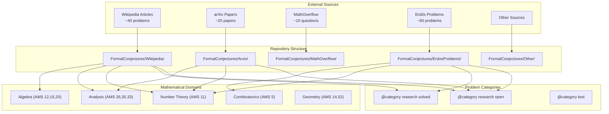
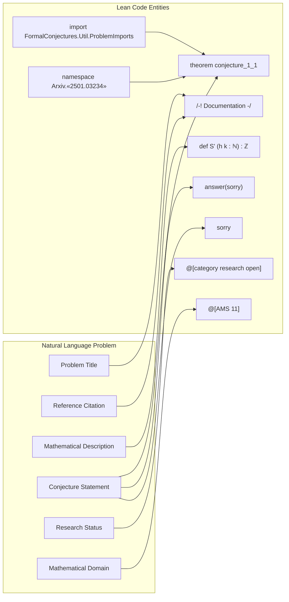
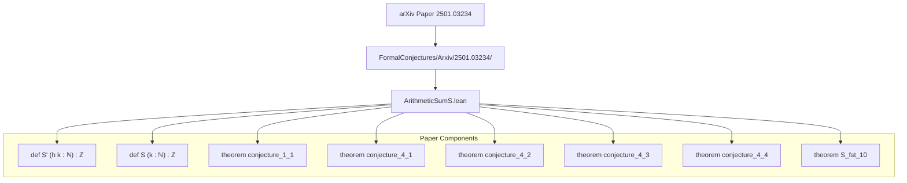

<!-- source: DeepWiki mcp.deepwiki.com · repo google-deepmind/formal-conjectures · page 3 Mathematical Problem Collections · fetched 2026-10-26 -->

# Mathematical Problem Collections

Relevant source files

The following files were used as context for generating this wiki page:

- [AUTHORS](AUTHORS)
- [FormalConjectures/Arxiv/2501.03234/ArithmeticSumS.lean](FormalConjectures/Arxiv/2501.03234/ArithmeticSumS.lean)
- [FormalConjectures/ErdosProblems/33.lean](FormalConjectures/ErdosProblems/33.lean)
- [FormalConjectures/Wikipedia/InvariantSubspaceProblem.lean](FormalConjectures/Wikipedia/InvariantSubspaceProblem.lean)
- [FormalConjectures/Wikipedia/Kakeya.lean](FormalConjectures/Wikipedia/Kakeya.lean)

This document provides an overview of the diverse mathematical problem collections in the FormalConjectures repository, covering the sources, organization, and formalization approach for mathematical conjectures from Wikipedia, academic literature, and historical problem collections. The material covers the high-level structure and categorization of problems, but not the detailed implementation of individual collections.

For information about the core infrastructure that enables problem formalization, see [Core Infrastructure](#2.1). For details about the categorization and attribute systems, see [Problem Categorization System](#2.2). For comprehensive coverage of individual collections, see [Wikipedia Conjectures](#3.1), [Academic Research Problems](#3.2), and [Erdős Problems](#3.3).

## Problem Collection Sources

The repository organizes mathematical conjectures from multiple authoritative sources into a structured collection. Each source contributes problems with distinct characteristics and research contexts.

### Collection Source Overview

Sources: [FormalConjectures/Wikipedia/InvariantSubspaceProblem.lean:1-88](), [FormalConjectures/ErdosProblems/33.lean:1-77](), [FormalConjectures/Arxiv/2501.03234/ArithmeticSumS.lean:1-131]()

## Problem Formalization Structure

Mathematical problems follow a consistent formalization pattern that maps natural language descriptions to formal Lean code with metadata annotations.

### Natural Language to Code Entity Mapping

Sources: [FormalConjectures/Arxiv/2501.03234/ArithmeticSumS.lean:16-17](), [FormalConjectures/Arxiv/2501.03234/ArithmeticSumS.lean:36-43](), [FormalConjectures/Arxiv/2501.03234/ArithmeticSumS.lean:60-62](), [FormalConjectures/Wikipedia/InvariantSubspaceProblem.lean:42-46]()

## Collection Organization

### Wikipedia Collection

Wikipedia-sourced problems cover major unsolved problems across mathematical domains, ranging from classical conjectures to modern research questions. Problems are categorized by research status and include both open conjectures and solved theorems for educational purposes.

| Problem Type | Example File | Category | AMS Code |
|--------------|--------------|----------|----------|
| Functional Analysis | `InvariantSubspaceProblem.lean` | `research open` | 47 |
| Geometry | `Kakeya.lean` | `research open` | 42 |
| Number Theory | Various files | Mixed | 11 |

Sources: [FormalConjectures/Wikipedia/InvariantSubspaceProblem.lean:42-46](), [FormalConjectures/Wikipedia/Kakeya.lean:55-58]()

### Academic Research Problems

Contemporary research problems from arXiv preprints and MathOverflow discussions represent active areas of mathematical investigation. These problems often include multiple related conjectures and computational verification examples.

#### ArXiv Paper Structure

Sources: [FormalConjectures/Arxiv/2501.03234/ArithmeticSumS.lean:26-44](), [FormalConjectures/Arxiv/2501.03234/ArithmeticSumS.lean:60-91]()

### Erdős Problems Collection

Problems posed by Paul Erdős represent a significant portion of the repository, covering combinatorics, number theory, and extremal problems. These problems often include density conditions and asymptotic estimates.

#### Problem Structure Example
The file `ErdosProblems/33.lean` demonstrates typical Erdős problem formalization:

- **Definitions**: `AdditiveBasisCondition` defines the mathematical condition
- **Main Conjecture**: `erdos_33` states the optimization problem with `answer(sorry)`
- **Variants**: Multiple related theorems with known partial results
- **Computational Bounds**: Specific numerical bounds like `1 ∈ lowerBounds` and `2 * (φ ^ ((5 : ℝ) / 2))`

Sources: [FormalConjectures/ErdosProblems/33.lean:41-53](), [FormalConjectures/ErdosProblems/33.lean:59-74]()

## Metadata and Categorization

### Attribute System Usage

All problems use a consistent attribute system for metadata:

| Attribute | Purpose | Example Values |
|-----------|---------|----------------|
| `@category` | Research status | `research open`, `research solved`, `test` |
| `@AMS` | Mathematical subject classification | `11` (Number Theory), `47` (Functional Analysis) |

### Answer Elaborator Integration

Problems integrate with the `answer()` elaborator system to indicate solution status:

- `answer(sorry)` - Unknown solution
- `answer(True)` - Confirmed true conjecture  
- `answer(False)` - Confirmed false conjecture

The `answer()` system enables automated tracking of problem resolution status across the collection.

Sources: [FormalConjectures/ErdosProblems/33.lean:52](), [FormalConjectures/Wikipedia/InvariantSubspaceProblem.lean:42](), [FormalConjectures/Arxiv/2501.03234/ArithmeticSumS.lean:60]()

---

